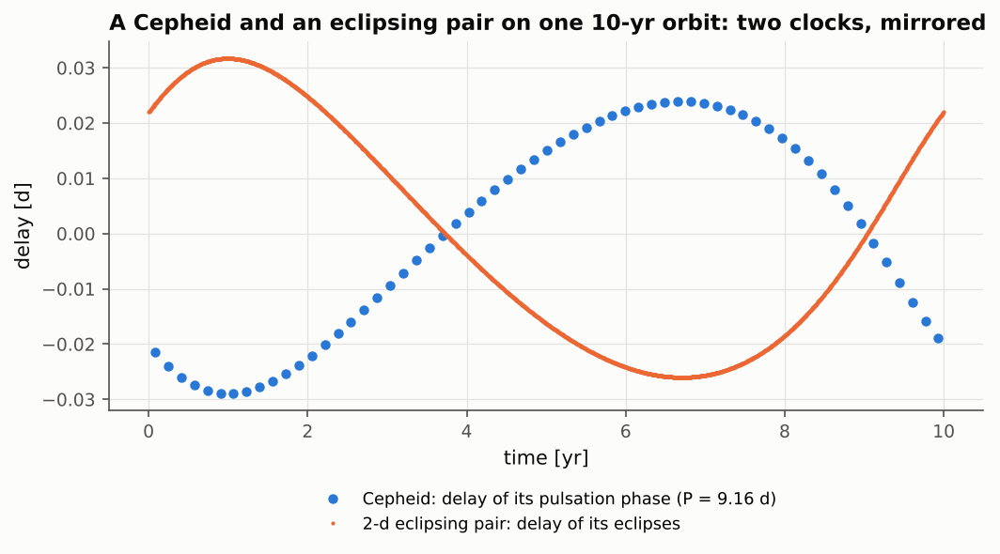

# Příklady životních cyklů {#life-cycles}

Příklady této kapitoly nejsou skutečné soustavy. Sledují vícenásobnou hvězdu během celé fáze jejího
života a ověřují vazbu dynamiky a vývoje hvězd – tu část SWINGERsimu, která je celá jeho vlastním
kódem: vývojový backend, moduly přenosu hmoty a společné obálky, model kontaktní dvojhvězdy
a světelné křivky s pulzacemi. Každý příklad je konfigurací v distribuci SWINGERsimu; čísla níže
jsou čísla z jejího běhu s konečnou verzí kódu. Existuje-li pro stejnou fyziku publikovaný
výsledek, je uveden; pokud neexistuje, testem je, že běh dodržuje zákony zachování
a publikované chování každé složky.

**Tabulka 41.** Příklady životních cyklů. Sloupec 2 uvádí soustavu, sloupec 3 backend a model
hvězd, sloupec 4 jak běh končí, sloupec 5 referenci pro fyziku.

| Příklad | Soustava | Běh | Konec | Reference |
|---|---|---|---|---|
| obr jako třetí hvězda | pár 1,3 + 1,1 M☉, třetí hvězda 2,0 M☉ na dráze 7,6 au, od 1,2 Gyr | vývojový, MIST, vítr | přetečení Rocheova laloku obra v čase 141,83 Myr | Jeans (1924); Cummings et al. (2018) |
| přenos hmoty z třetí hvězdy | tytéž hvězdy, vnější dráha 3,62 au | vývojový, MIST, přenos z třetí hvězdy | konec vývojové dráhy dárce v čase 141,87 Myr | de Vries et al. (2014); Hamers et al. (2022) |
| trojhvězda typu Algol | 2,9 + 0,9 M☉ s periodou 2,7 d (kruhová, stav na počátku přetečení), třetí hvězda 1,6 M☉ s periodou 680 d, od 390 Myr | vývojový, MIST, přenos hmoty, slapy | po 10 Myr stále probíhá přenos | Hurley et al. (2002) |
| kontaktní dvojhvězda | 1,0 + 0,5 M☉, $a$ = 0,010 au | vývojový, MIST, model kontaktu | splynutí přes L2 v čase 2,23 Gyr | Gazeas & Stępień (2008); Rasio (1995) |
| společná obálka v trojhvězdě | obr 1,8 M☉ + 0,5 M☉ ve vnější dráze s periodou 10 let | N-částicový, společná obálka | dvojhvězda po společné obálce | Hadjidemetriou (1963) |
| pulzující trojhvězdy | hvězda δ Sct v zákrytovém páru s třetí hvězdou, dlouhoperiodickou proměnnou; cefeida jako třetí hvězda | světelné křivky a minima | – | Irwin (1952) |

Tabulka 41 je mapou kapitoly: každý řádek je jeden příklad, popsaný v oddílu stejného jména.

## Obr jako třetí hvězda na tepelně pulzující AGB {#giant-tertiary}

**Otázka.** Třetí hvězda o hmotnosti 2,0 M☉ kolem páru 1,3 + 1,1 M☉ na dráze 7,6 au ($e$ = 0,3)
stoupá po větvi obrů a asymptotické větvi obrů, ztrácí hmotu větrem a rozšiřuje vnější dráhu.
Dosáhne svého Rocheova laloku – tedy začne lít hmotu na vnitřní dvojhvězdu?

**Výsledek.** Obr dosáhne **tepelně pulzující AGB** (TP-AGB), na níž se heliová slupka zapaluje
v záblescích každých 10⁴–10⁵ let a poloměr při každém pulzu vyskočí 2–4krát, jen na několik set let.
Běh končí přetečením Rocheova laloku obra ve vnějším periastru v čase 141,83 Myr (stáří
1341,8 Myr), na vrcholu tepelného pulzu, s $R$ = 452 R☉. V tom okamžiku má obr ještě 1,06 M☉
a vnější dráha se rozšířila ze 7,60 na 9,64 au. Rozšíření se řídí adiabatickým zákonem
$a\propto 1/M$ podle Jeanse (1924) s přesností 4·10⁻¹⁵ – přesně, protože vývojový backend jej
uplatňuje jako invariant. Bez přetečení by hvězda zanechala bílého trpaslíka, jehož hmotnost je
ověřena proti vztahu mezi počáteční a konečnou hmotností ([kapitola 3](#massive-giants)). Panel (a)
obrázku 19 ukazuje posledních 6 Myr: poloměr obra (modře, logaritmická osa) stoupá ve skocích ke
svému Rocheovu laloku ve vnějším periastru (čárkovaně oranžově, asi 420–450 R☉), jehož se dotkne
v místě hvězdičky. Rozlišení pulzů vyžaduje péči, protože jsou krátké: SWINGERsim klade hranice
svých vývojových úseků do uzlů vývojové dráhy MIST a zjemňuje je, dokud se mezi dvěma hranicemi
žádný poloměr nezmění o více než 1 % ([kapitola 10](#problems-found)).

## Přenos hmoty z třetí hvězdy {#tertiary-transfer}

**Definice.** Když třetí hvězda vyplní svůj Rocheův lalok kolem vnitřní dvojhvězdy, SWINGERsim
přenáší hmotu ve vnějším periastru rychlostí podle BSE, rozhodne, zda proud vytvoří cirkumbinární
disk, nechá vnitřní dvojhvězdu akreovat s podíly podle Hamerse et al. (2022) a odezvu vnitřní dráhy
určí předpisem pro energii nebo moment hybnosti. Je-li přenos dynamicky nestabilní (dárce mnohem
těžší než dvojhvězda), končí běh **trojnásobnou společnou obálkou**. Proud je předpis, nikoli
hydrodynamický výpočet.

**Výsledek.** Se stejnými hvězdami na těsnější vnější dráze (3,62 au) začne obr přenášet hmotu
v čase 140,58 Myr a pokračuje v epizodách na tepelných pulzech, dokud jeho vývojová dráha MIST
neskončí v čase 141,87 Myr. Dárce klesne z 2,0 na 0,70 M☉, vnitřní pár získá jen 0,002 M☉ (většina
hmoty soustavu opustí) a vnější dráha se rozšíří z 3,62 na 5,15 au (panel b obrázku 19). Přenos je
stabilní, protože dárce je lehčí než vnitřní pár (2,4 M☉). Opačným případem je HD 181068
([kapitola 7](#catalogue-growing)): její obr o hmotnosti 3,0 M☉ je těžší než vnitřní pár 1,8 M☉
a SWINGERsim ukončí běh trojnásobnou společnou obálkou při prvním dotyku, jak se pro nestabilní
přenos očekává.

![**Obrázek 19.** Příklady životních cyklů z konečných běhů. (a) Obr jako třetí hvězda: poloměr obra 2,0 M☉ (modře) a jeho Rocheův lalok ve vnějším periastru (čárkovaně oranžově) během posledních 6 Myr před přetečením (červená hvězdička, 141,83 Myr); logaritmická osa poloměru v R☉, čas od začátku běhu v Myr. (b) Přenos hmoty z třetí hvězdy: hmotnost dárce (modře, levá osa), hmotnost vnitřního páru minus 1,4 M☉ (zeleně, levá osa, posunuto, aby sdílela osu) a vnější velká poloosa (čárkovaně šedě, pravá osa, au) během přenosu. (c) Trojhvězda typu Algol: hmotnosti dárce m1 (modře) a příjemce m2 (oranžově) (levá osa, M☉) a vzdálenost složek páru (čárkovaně šedě, pravá osa, au) během 10 Myr; tečkovaná svislá čára: poměr hmotností se obrací. (d) Dvojhvězda vyvíjející se do kontaktu: hmotnosti hvězd 1,0 M☉ (modře) a 0,5 M☉ (oranžově) (levá osa) a jejich vzdálenost (čárkovaně šedě, pravá osa, R☉) od 1,2 do 2,23 Gyr; tečkovaná červená čára: splynutí přes L2.](../../figures/part1/life_cycles.png)

## Trojhvězda typu Algol s přenosem hmoty {#algol-triple}

**Otázka.** Příklad Algolu z BSE (Hurley et al. 2002, oddíl 3.1) začíná jako 2,9 + 0,9 M☉ na dráze
s $P$ = 8 d a $e$ = 0,7; když primární složka vyplní svůj Rocheův lalok, slapy dráhu zakulatily na
$P$ = 2,7 d. Běh začíná z tohoto stavu, zde s třetí hvězdou 1,6 M☉ s periodou 680 d. Hmotnější
hvězda vyplní svůj lalok po hlavní posloupnosti, přenáší hmotu na průvodce, poměr hmotností se
obrátí a dráha se rozšíří – historie samotného Algolu.

**Výsledek.** Panel (c) obrázku 19 sleduje běh s vývojovými drahami MIST a se slapy. Dárce vyplní
svůj lalok v čase 3,71 Myr. Během rychlé fáze na tepelné časové škále se vzdálenost složek nejprve
zmenšuje (na 0,034 au, dokud je dárce stále těžší hvězdou) a pak roste; poměr hmotností se obrátí
v čase 4,91 Myr. Po 10 Myr má dárce 0,454 M☉ a příjemce 3,172 M☉ a vzdálenost složek vzrostla
z 0,059 na 0,170 au; dárce stále přenáší hmotu na své jaderné časové škále. Slapy udržují dráhu
kruhovou ($e$ < 4·10⁻⁴); úloha slapů je zde rozebrána v [kapitole 10](#problems-found).
Kvantitativním testem této fyziky je test BSE v [kapitole 3](#mass-transfer): s vývojovými drahami
SSE, které BSE používá, obnaží SWINGERsim dárce na 0,404 M☉ (BSE 0,42 M☉, BSE v COSMIC 0,401 M☉)
a publikovanou fázi obra reprodukuje na 1,2 %. S drahami MIST je pomalá fáze pomalejší než se SSE,
protože vývojová dráha MIST je označena počáteční hmotností a dárce, který ztratil 2 M☉, si
ponechává velké jádro své počáteční hmotnosti. Které vývojové dráhy použít, je volbou konfigurace;
rozdíl je vlastností modelů hvězd, nikoli dynamiky.

## Dvojhvězda vyvíjející se do kontaktu {#contact-evolution}

**Výsledek.** Dvojhvězda 1,0 + 0,5 M☉ s $a$ = 0,010 au (panel d obrázku 19) začne přenášet hmotu
z primární složky v čase 1,31 Gyr. Pár se dostane do kontaktu asi v čase 2,14 Gyr (zlom
v hmotnostech); poté lehčí hvězda živí primární složku, zatímco se dráha zmenšuje ztrátou momentu
hybnosti (Gazeas & Stępień 2008). V čase 2,23 Gyr, s hmotnostmi 0,844 a 0,656 M☉ ($q$ = 0,78)
a vzdáleností složek 0,0074 au, pár splyne přes vnější Lagrangeův bod L2. To, že kontaktní
dvojhvězdy ztrácejí moment hybnosti a během miliard let splynou, je publikované očekávání; ke
splynutí zde dochází přes L2, a ne na Darwinově mezi ($q\approx0{,}09$; Rasio 1995), protože poměr
hmotností má daleko k extrémnímu. Kvantitativním testem ztráty momentu hybnosti je `contact-jdot`
([kapitola 3](#contact)) a světelná křivka kontaktního páru souhlasí s PHOEBE
([kapitola 4](#meshes)).

## Společná obálka uvnitř trojhvězdy {#ce-triple}

**Výsledek.** Obr o hmotnosti 1,8 M☉ (93 R☉) s průvodcem 0,5 M☉ vyplní svůj Rocheův lalok uvnitř
kruhové vnější dráhy s periodou 10 let a projde společnou obálkou (N-částicový backend). Obálka
o hmotnosti 1,37 M☉ soustavu opustí a jádro 0,43 M☉ s průvodcem se spirálovitě přiblíží z 0,88 na
0,0093 au. Náhlá ztráta hmoty rozšíří vnější dráhu a učiní ji excentrickou: 3,53krát místo 3,48krát
podle impulzního přiblížení, s $e$ = 0,717 místo 0,713 (Hadjidemetriou 1963); to jsou testy
`ce-impulsive-outer-a` a `-e`.

## Pulzující trojhvězdy {#life-pulsators}

**Otázka.** Světelné křivky a minima trojhvězd s pulzujícími hvězdami: hvězda δ Sct (pulzace asi
1 h) v zákrytovém páru s třetí hvězdou, dlouhoperiodickou proměnnou (LPV) – rudým obrem,
a zákrytový pár s cefeidou jako třetí hvězdou. Zkreslují pulzace změřená minima?

**Vstup.** Světelná křivka dlouhá 60 d v pásmu TESS a minima během 3 let pro trojhvězdu s δ Sct;
světelná křivka dlouhá 120 d v pásmu V a minima během 10,5 roku pro trojhvězdu s cefeidou. Minima
se měří ze světelných křivek tak, jak by je měřil pozorovatel.

**Tabulka 42.** Minima pulzujících trojhvězd. Sloupce: počet minim, rozptyl O−C kolem modelu,
střední posun, celkový rozsah O−C.

| Soustava | Minima | Rozptyl O−C | Střední posun | Rozsah O−C |
|---|---|---|---|---|
| trojhvězda δ Sct + LPV | 730 | 136 s | +8,6 s | 17 s (žádný vnější signál během 3 let) |
| trojhvězda s cefeidou | 3835 | 137 s | 0,0 s | 5891 s (světelný čas vnější dráhy) |

![**Obrázek 20.** Pulzující trojhvězdy. *Vlevo nahoře:* 60 dní světelné křivky trojhvězdy s δ Sct (relativní tok); pomalý pokles na polovinu způsobuje obr, dlouhoperiodická proměnná, zákryty a rychlé pulzace δ Sct jsou v tomto měřítku příliš malé, aby byly vidět. *Vpravo nahoře:* 120 dní trojhvězdy s cefeidou; velké vlny jsou pulzace cefeidy s periodou 9 d, zákryty průvodcova páru jsou malé zářezy. *Dole:* O−C každého syntetického minima (modře primární, oranžově sekundární) v sekundách; vpravo je černá čára křivkou světelného času vnější dráhy s periodou 10 let.](../../figures/part1/example_pulsators.png)

**Výsledek (tabulka 42).** Na obrázku 20 (vlevo dole) se minima trojhvězdy s δ Sct rozptylují asi
o ±2 min kolem nuly – pulzace pod zákryty ruší každé měření – za 3 roky však nevykazují žádný trend:
dlouhoperiodická proměnná mění celkové světlo o 50 % za 60 dní, a přesto zůstávají minima
nezkreslená (střední posun +8,6 ± 5 s). Rozptyl 136–137 s je typický pro pozorované zákrytové
dvojhvězdy s δ Sct (desítky až stovky sekund). Vpravo sledují minima trojhvězdy s cefeidou křivku
světelného času vnější dráhy (černá čára, Irwin 1952) v celém jejím rozsahu 5891 s se stejným
rozptylem. Obrázek 21 ukazuje dvoje hodiny trojhvězdy s cefeidou: protože cefeida a pár jsou na
opačných stranách společného těžiště, je jedno zpožděné, když druhé předbíhá, a amplitudy jsou
v obráceném poměru jejich hmotností. Objevilo se jedno omezení: tabulky okrajového ztemnění končí
na 3500 K a obr s teplotou 2867 K používá nejbližší uzel; SWINGERsim na to upozorní
([kapitola 10](#problems-found)).
