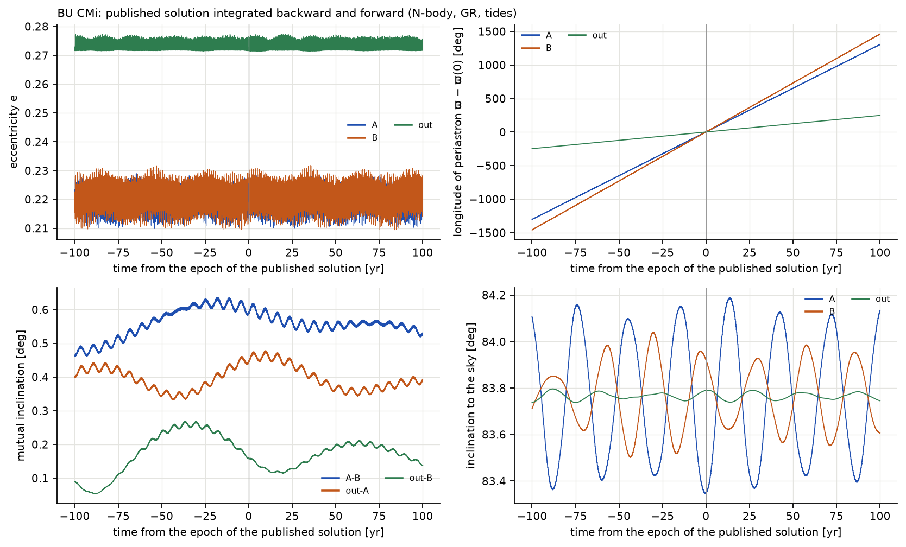
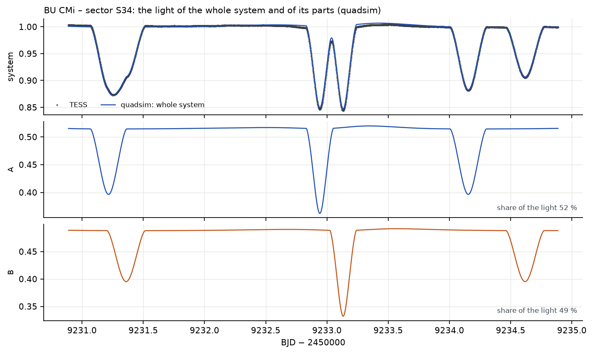
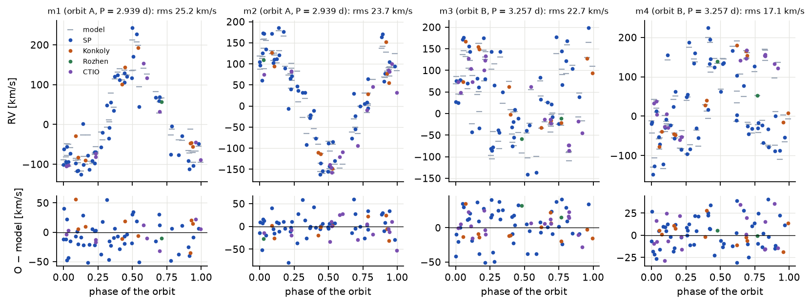
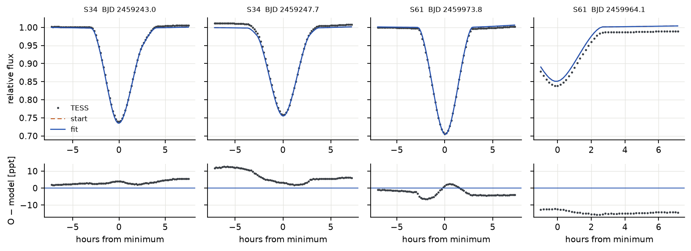
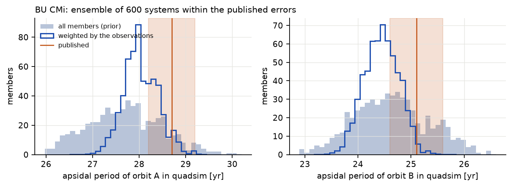

# BU CMi (2+2)

## Soustava podle Pribully et al. (2023)

BU CMi tvoří dvě zákrytové dvojhvězdy hvězd typu A, A (2,94 d) a B (3,26 d), každá s excentrickou dráhou
(e ≈ 0,22), které kolem sebe obíhají za pouhých 121,8 dne. Všechny tři dráhy leží v rámci jednoho stupně;
čtyři hvězdy mají 2,3–2,5 hmotnosti Slunce a stáří asi 260 Myr. Krátká vnější perioda činí z BU CMi
učebnicový příklad rychlého dynamického apsidálního pohybu: oba páry otočí své dráhy jednou za 25–29 let
a okamžiky zákrytů se houpou o hodiny. Autoři vše určili ze světelných křivek TESS, radiálních rychlostí
všech čtyř hvězd, 183 okamžiků minim od roku 2005 a spektrálního rozdělení energie (Pribulla et al. 2023,
tab. 7).

## Stabilita

**Tabulka 2.** Stabilita publikované BU CMi. Poměr nad 1 znamená stabilní.

| podtrojice | a_in / a_out | e_in | e_out | i_mut | MA01 | V22 |
|---|---|---|---|---|---|---|
| A uvnitř dráhy A–B (+B) | 0,066 | 0,219 | 0,273 | 0,4° | 2,53 | 2,89 |
| B uvnitř dráhy A–B (+A) | 0,071 | 0,226 | 0,273 | 0,2° | 2,36 | 2,69 |

Klasifikátor strojového učení Vynatheyi et al. (2023) pro čtyřhvězdy 2+2 dává *stabilní* a N-částicový
test duchem přes 100 vnějších oběhů (33 let) končí relativní divergencí 1,2 × 10⁻³, hluboko pod prahem
nestability. BU CMi je kompaktní (vnější pericentrum je jen asi 2,4krát dál než kritická vzdálenost), ale
jednoznačně stabilní.

## Století dopředu a dozadu a apsidální pohyb

**Jak číst obrázek.** Vodorovná osa je čas v letech od epochy publikovaných elementů (BJD 2458491,5, leden
2019); vlevo od nuly je minulost, spočítaná integrací dozadu. Každý panel ukazuje jednu vlastnost tří drah
(pár A, pár B a vnější dráha „out“). Vpravo nahoře: přímá stoupající čára je dráha, jejíž periastrum se
stáčí stálou rychlostí; její sklon je 360° děleno apsidální periodou. Vpravo dole: pár zakrývá jen tehdy,
zůstává-li jeho sklon blízko 90°.

Soustava zůstává neporušená v obou směrech, relativní chyba energie zůstává pod 2,3 × 10⁻¹¹, excentricity
kmitají v rozmezí 0,210–0,229 (A), 0,209–0,232 (B) a 0,271–0,277 (vnější) a oba páry zakrývají po celá dvě
století. Vzájemné sklony zůstávají malé: A–B 0,52–0,62° (publikováno 0,61°), vnější–A 0,34–0,48° (0,45°),
vnější–B 0,11–0,21° (0,26°).

**Tabulka 3.** Apsidální periody BU CMi. Publikované hodnoty byly změřeny z numerické integrace autorů;
SWINGERsim je měří ze své vlastní, se slapovými a rotačními výdutěmi hvězd i bez nich.

| | publikováno (z integrace autorů) | SWINGERsim: hmotné body + relativita | SWINGERsim: + slapy a rotace | ansámbl se slapy, vážený (16–84 %) |
|---|---|---|---|---|
| pár A | 28,7 ± 0,1 roku | 28,98 roku (+1,0 %) | 27,61 roku (−3,8 %) | 27,7 (26,8–28,5) roku |
| pár B | 25,1 ± 0,1 roku | 25,30 roku (+0,8 %) | 24,65 roku (−1,8 %) | 24,6 (23,9–25,4) roku |
| vnější dráha | 145,3 roku | 145,08 roku (−0,15 %) | 145,07 roku | – |

Rychlou precesi způsobuje druhý pár: s hmotnými body SWINGERsim reprodukuje publikované apsidální periody na
1 % a vnější dráhu na 0,15 %. Výdutě hvězd přidávají stáčení 0,56°/rok u A (asi 16″ za oběh) a 0,33°/rok
u B, což periody zkracuje o 4 % a 2 %. To je klasický apsidální pohyb, který předpovídá stavba hvězd.

Pribulla et al. (2023, tab. 7) odhadují tentýž klasický člen analyticky: Δω_tide = 18,73″ a 12,67″ za oběh.
Se středními periodami zákrytů párů (2,93959 a 3,26222 d, tj. 124,3 a 112,0 oběhu za rok) to dává
**0,65°/rok pro A a 0,39°/rok pro B**, o 15–20 % více než 0,56 a 0,33°/rok ze SWINGERsimu. Článek uvádí
také apsidální periody z analytického vzorce (31,75 a 28,96 roku) a ze samostatného fitu spekter
a světelných křivek TESS ze sektorů 7 a 34 nafitované apsidální periody 24,91 ± 0,04 a 25,79 ± 0,08 roku
(jeho tab. 5). Hodnoty v prvním sloupci tabulky 3 jsou jiné: byly změřeny z numerické integrace výsledného
fotodynamického řešení.

Co nám srovnání říká o této integraci? Lightcurvefactory umí integrovat dráhy se slapovými a rotačními
efekty (Borkovits et al. 2019, příloha A) a analytické slapové stáčení v článku je dokonce větší než
ve SWINGERsimu. Kdyby publikovaná integrace obsahovala klasický člen této velikosti, měl by SWINGERsim
souhlasit s publikovanými apsidálními periodami jen tehdy, když zahrne svůj vlastní slapový a rotační člen.
Děje se opak: publikované periody souhlasí s během SWINGERsimu pro hmotné body na 1 % a od běhu s výdutěmi
se liší o 2–4 %. Buď je slapový člen v publikované integraci menší než oba odhady (například kvůli jiným
apsidálním konstantám k₂ nebo poloměrům), nebo byl vypnut. Článek neříká, která možnost platí, a
z publikovaných čísel to rozhodnout nemůžeme. To je důležité pro fit níže.

## Světelné křivky TESS

**Jak číst obrázek.** Každá dvojice řádků je jeden sektor TESS. Ve velkém panelu je každý pokles zákrytem
páru A nebo B (hlubší úzké poklesy kolem 0,75–0,8 toku jsou místa, kde se zákryt A a B překrývají). Kdyby byl
model dokonalý, byl by panel reziduí pod ním plochým pásem šumu. Ve výřezu je časová osa v hodinách, aby
šlo srovnat tvar jednoho zákrytu: oranžová čárkovaná křivka ukazuje, kam padnou zákryty *publikovaných*
elementů: v sektoru 7, epoše elementů, téměř správně; v sektoru 61 (o čtyři roky později) o mnoho hodin
vedle. Modrá křivka (fit) leží na datech.

**Tabulka 4.** Rezidua světelných křivek TESS soustavy BU CMi (rms pozorování − model, ppt). Hloubky
zákrytů jsou 150–250 ppt.

| sektor (kadence) | body | publikovaná | ukotvená | nafitovaná na minima | škála a |
|---|---|---|---|---|---|
| 7 (30 min) | 1 086 | 9,8 | 7,0 | 7,1 | 0,98 |
| 34 (2 min) | 16 823 | 25,5 | 3,1 | 2,7 | 0,98 |
| 61 (2 min) | 15 774 | 27,9 | 2,8 | 2,0 | 0,98 |

Publikované elementy reprodukují sektor 7 (epochu elementů), ale sektory 34 a 61 míjejí o 25–28 ppt, protože
jejich zákryty padnou do nesprávných časů. Jakmile jsou periody a fáze ukotveny, souhlasí světelné křivky
všech tří sektorů ve dvouminutových datech na 2–3 ppt, asi na jedno procento hloubky zákrytu. Škálovací
faktor a se fituje volně pro každý sektor; jeho hodnota 0,98 znamená, že hloubky plynoucí z publikovaných
poloměrů a teplot jsou správně na 2 %. Zbývající rezidua jsou pomalé vlny o velikosti několika ppt, zčásti
instrumentální. Sektor 7 má 30minutové vzorkování, které zákryty rozmazává; jeho větší rms odráží hrubá
data, ne model.

**Jak číst obrázek.** Horní panel opakuje čtyři dny světelné křivky TESS s modelem. Dva panely pod ním
ukazují, co SWINGERsim ví a dalekohled vidět nemůže: světlo každého páru zvlášť. Každý pokles v horním panelu
lze přiřadit jednomu z párů pod ním, a kde oba páry klesají současně, ukazuje soustava dvojitý zákryt.

## Okamžiky minim

**Jak číst obrázek.** Každý bod je jeden naměřený zákryt; jeho výška udává, o kolik minut dříve nebo později
nastal, než předpovídá přísně periodická efemerida. Dvě zrcadlové vlny každého páru, primární a sekundární
minima posouvající se opačnými směry během asi 28 let, jsou apsidální pohyb; malé rychlé zvlnění křivek je
121,8denní vnější dráha (doba šíření světla a poruchy od druhého páru). Spodní panely mají logaritmickou
škálu: oranžové body publikovaných elementů leží ve stovkách až tisících minut, ukotvené a nafitované
u většiny minim v rozmezí ±10 minut.

S publikovanými elementy se zákryty za 18 let posunou až o 32 hodin (A) a 35 hodin (B): oskulační periody
článku odpovídají v SWINGERsimu středním periodám zákrytů kratším o 3,3 × 10⁻⁴ (A) a 4,0 × 10⁻⁴ (B). Ukotvení
dvou čísel na pár sníží rms na 11–13 minut a tvar O − C (amplituda a fáze apsidálního pohybu a 121,8denní
zvlnění) je reprodukován bez jakékoli další úpravy.

**Tabulka 5.** Minima BU CMi podle zdroje: uváděné chyby a dodatečná chyba, kterou fit přiřadí každému
zdroji (Pribulla et al. 2023, tab. 3–4). Šest níže uvedených zdrojů dává 182 ze 183 minim; zbývající je
jediné minimum z ledna 2005 od Oglozy et al. (2008), nejstarší bod souboru dat; jeden bod nemůže změřit
rozptyl, a fit mu proto žádnou dodatečnou chybu nepřidává. Volkov et al. (2021) u svých minim chyby
neuvádějí; 9 s je chyba 0,0001 d, kterou jim přiřadili Pribulla et al. (2023).

| zdroj | roky | minim | medián uváděné σ | dodatečná chyba z fitu |
|---|---|---|---|---|
| HAT | 2008–2009 | 10 | 55 s | 11,5 min |
| KELT | 2011–2013 | 13 | 118 s | 18,2 min |
| Volkov et al. (2021) | 2012–2021 | 8 | 9 s | 11,1 min |
| MASCARA | 2015–2016 | 39 | 41 s | 10,3 min |
| TESS | 2019–2023 | 87 | 6 s | 3,4 min |
| pozemní dopozorování | 2021–2023 | 25 | 11 s | 2,8 min |

Minima přehlídek (HAT, KELT, MASCARA) mají kolem jakéhokoli modelu rozptyl 10–18 min, desetkrát až
dvacetkrát víc než jejich uváděné chyby; TESS a novější pozemní dopozorování potřebují jen asi 3 min.
S těmito dodatečnými chybami stará minima stále určují dlouhodobý apsidální pohyb, ale už řešení
nestrhávají.

## Fit

**Tabulka 6.** BU CMi: co přináší který druh dat. *rms*: použitých minim, páry A / B; e_out a ω_out: vnější
dráha (publikováno 0,2728 ± 0,0037 a 141,0 ± 3,6°).

| fit | data | χ²_red | rms A / B [min] | e_out | ω_out [°] |
|---|---|---|---|---|---|
| jen minima, uváděné chyby | 179 minim | 1432 | 6,6 / 13,0 | 0,261 ± 0,003 | 131 ± 2 |
| + dodatečná chyba pro každý zdroj | 176 | 0,98 | 6,9 / 8,8 | 0,261 ± 0,003 | 130 ± 2 |
| + apriorní rozdělení | 177 | 0,99 | 8,3 / 9,4 | 0,262 ± 0,002 | 135 ± 2 |
| automaticky z publikovaných elementů | 176 | 0,99 | 8,4 / 8,9 | 0,261 ± 0,002 | 136 ± 2 |
| + radiální rychlosti | 176 + 305 RV | 1,00 | 7,8 / 9,3 | 0,263 ± 0,002 | 136 ± 2 |
| + světelné křivky, červený šum, MCMC (výsledný) | 177 + 305 RV + 4147 LC | – | 7,6 / 9,1 | 0,263 ± 0,002 | 132 ± 1 |
| **hmotné body** + radiální rychlosti | 176 + 305 RV | 1,00 | 8,7 / 10,3 | **0,271 ± 0,002** | **136 ± 2** |

**Tabulka 7.** BU CMi: publikované elementy (Pribulla et al. 2023, tab. 7) a výsledný fit SWINGERsimu (minima,
radiální rychlosti, sektory TESS 34 a 61; medián aposteriorního rozdělení a polovina rozsahu 16–84 %).

| veličina | publikováno | SWINGERsim | rozdíl |
|---|---|---|---|
| e_A | 0,2191 ± 0,0008 | 0,2152 ± 0,0005 | −4,9σ (apriorní rozdělení) |
| ω_A [°] | 101,41 ± 0,13 | 101,75 ± 0,13 | +1,9σ |
| e_B | 0,2257 ± 0,0009 | 0,2234 ± 0,0006 | −2,6σ (apriorní rozdělení) |
| ω_B [°] | 257,52 ± 0,15 | 257,21 ± 0,12 | −1,6σ |
| P_out [d] | 121,793 ± 0,031 | 121,717 ± 0,015 | −2,5σ |
| e_out | 0,2728 ± 0,0037 | 0,2631 ± 0,0017 | −2,6σ |
| ω_out [°] | 141,0 ± 3,6 | 132,2 ± 1,4 | −2,4σ |
| hmotnosti [M☉] | 2,536, 2,384, 2,521, 2,320 | 2,51 ± 0,09, 2,33 ± 0,11, 2,55 ± 0,12, 2,20 ± 0,09 | −1 %, −2 %, +1 %, −5 % |
| sklony A, B [°] | 83,35, 83,92 | 83,34 ± 0,10, 83,82 ± 0,09 | −0,01°, −0,10° |
| poloměry [R☉] | 2,249, 2,072, 2,235, 2,003 | 2,32 ± 0,06, 1,98 ± 0,07, 2,30 ± 0,07, 1,91 ± 0,08 | součty v rámci 0,5 % |
| rms světelné křivky TESS | – | 3,1 ppt (S34), 5,8 ppt (S61) | škála a = 0,985, 0,995 |

Hmotnosti a sklony souhlasí s článkem v rámci chyb. Poloměry ukazují známou degeneraci částečných zákrytů:
součet poloměrů každého páru je dán délkou zákrytů a souhlasí s článkem na 0,5 %, ale jejich poměr určují
světelné křivky jen slabě. V článku plynou jednotlivé poloměry ze společného modelu světelných křivek,
spektrálního rozdělení energie a izochron PARSEC (Pribulla et al. 2023, tab. 7, kde jsou teploty,
svítivosti a gravitační zrychlení označeny jako interpolované z PARSEC); náš fit určuje poloměry jen ze
světelných křivek, bez spektrálního rozdělení energie a bez izochron.

**Vnější dráha a klasický apsidální pohyb.** Ve všech fitech, které zahrnují slapové a rotační výdutě
hvězd, je vnější excentricita asi 0,263, o 2,6σ pod publikovanou hodnotou, a e_A je stažena pod své apriorní
rozdělení. Když se tentýž fit provede s hmotnými body, je e_out = 0,271 ± 0,002 a všechna apriorní rozdělení
jsou splněna v rámci 1,4σ. Vysvětlení plyne z tabulky 3: naměřené apsidální vlny v diagramu O − C určují
celkovou rychlost stáčení. Je-li zahrnut klasický člen, musí být dynamická část menší, a fit ji zmenší
snížením vnější excentricity. Oba popisy prokládají minima stejně dobře. Prokázáno je toto: integrace
SWINGERsimu pro hmotné body reprodukuje publikované apsidální periody na 1 % a přidání slapového
a rotačního členu SWINGERsimu posune nafitovanou e_out o 2,6σ. Otevřené zůstává, proč publikované řešení
tento posun nepotřebuje. SWINGERsim (0,56 a 0,33°/rok) i vlastní analytický odhad článku (0,65
a 0,39°/rok) předpovídají klasické stáčení této velikosti; pokud publikovaná integrace obsahovala menší
slapový člen nebo žádný, pohltila rozdíl její vnější excentricita a skutečná hodnota by byla blíže 0,263
než 0,273. Článek neuvádí, jaký slapový model jeho integrace použila. Rozdíl by se ukázal v minimech
příštího desetiletí, protože oba modely předpovídají mírně odlišné apsidální vlny.

**Volné apsidální konstanty.** Tentýž fit s volnou apsidální konstantou jedné hvězdy každého páru
(hvězd m1 a m3; jejich partneři si ponechávají modelové hodnoty; modely: 0,0042 pro obě) se ustálí na
$k_2$ = 0,0003 pro pár A (dolní mez) a 0,0045 ± 0,0021 pro pár B. Vnější excentricita se posune jen
z 0,2631 na 0,2663 ± 0,0021, o třetinu cesty k publikované hodnotě. Protože hodnota na mezi nemá
smysluplnou lineární chybu, plyne omezení z profilu χ²: sedm fitů s $k_2$ hvězdy m1 pevně na
0,0003–0,009 a vším ostatním volným, všechny s chybami volného fitu drženými pevně, aby bylo možné
jejich χ² srovnat (**tabulka 3a**).

**Tabulka 3a.** BU CMi: profil χ² v apsidální konstantě hvězdy m1 (pár A).

| $k_2$ (m1) | 0,0003 | 0,0010 | 0,0020 | 0,0030 | 0,0042 | 0,0060 | 0,0090 |
|---|---|---|---|---|---|---|---|
| Δχ² | 0 | 0,70 | 2,98 | 6,73 | 13,54 | 27,95 | 53,00 |
| $k_2$ (m3), fitováno | 0,0044 | 0,0034 | 0,0020 | 0,0006 | 0,0003* | 0,0003* | 0,0003* |
| $e_\mathrm{out}$ | 0,2659 | 0,2658 | 0,2656 | 0,2655 | 0,2647 | 0,2637 | 0,2624 |

\* na dolní mezi.

Data připouštějí $k_2 \le 0{,}0012$ pro pár A při Δχ² = 1 a $\le 0{,}0023$ při Δχ² = 4. Modelová hodnota
0,0042 stojí Δχ² = +13,5, i když je konstanta páru B stlačena na svou dolní mez. Až do
$k_{2,A}$ = 0,003 se oba páry navzájem zastupují ($k_{2,A} + k_{2,B} \approx 0{,}0045$), takže minima
měří hlavně jejich součet, asi polovinu toho, co dávají modely. Hodnoty Δχ² jsou konzervativní, protože
zmrazené chyby zahrnují faktor červeného šumu světelných křivek (χ²_red = 0,29). Slapové a rotační
stáčení, které data chtějí, je tedy slabší než u synchronně rotujících hvězd s modelovými konstantami.
Každá z možností – nižší $k_2$, podsynchronní rotace (která snižuje rotační část) nebo fyzika, jež
v modelu chybí – by to vysvětlila. Fit je od sebe nerozliší a uvolnění konstant nevysvětluje vnější
excentricitu z článku.

**Jak číst obrázek.** Každý sloupec je jedna hvězda; modelové čárky se rozptylují kolem sinusovky, protože
páry se pohybují po 121,8denní vnější dráze. Rezidua 17–25 km/s (rms) jsou sedmkrát až desetkrát větší
než uváděné chyby 2–3 km/s a neukazují zřetelnou závislost na fázi ani přístroji.

**Radiální rychlosti mají kolem jakéhokoli modelu rozptyl 17–25 km/s**, i kolem volného keplerovského fitu
každého páru s lineárním stáčením ω (rms 24 a 20 km/s), a záměna složek jej nezmenší. Rychlosti byly změřeny
z rozšiřovacích funkcí čtyř podobných hvězd typu A, jejichž čáry se ve většině fází překrývají; Pribulla et
al. (2023) překrývání a obtížnou identifikaci složek zmiňují a rms neuvádějí. Rozptyl je tedy vlastností
rychlostí, ne drah; fit přiřadí každému přístroji dodatečnou chybu 16–19 km/s a hmotnosti vycházejí v rámci
1–5 % od publikovaných.

**Jak číst obrázek.** Každý sloupec je jedno okno ±0,3 d kolem zákrytu, časová osa v hodinách od modelového
minima. Fit a počáteční model jsou téměř totožné: ukotvená konfigurace už světelné křivce odpovídala
(tab. 4).

## Ansámbl

600 soustav bylo vylosováno v rámci publikovaných chyb hmotností, excentricit, sklonů, uzlů a vnější dráhy
a zintegrováno 40 let dopředu i dozadu. **Všech 600 zůstává v obou směrech neporušených a stabilních podle
MA01 a V22**; oba páry zakrývají ve všech. Při vážení publikovanými apsidálními periodami (gaussovsky,
σ = 0,5 roku) a zákryty obou párů je n_eff = 238.

**Jak číst obrázek.** Každý histogram počítá, kolik soustav ansámblu má danou apsidální periodu. Plný
histogram ukazuje, co připouštějí publikované nejistoty; obrysový dává větší váhu soustavám blízkým
publikovaným apsidálním periodám. Vážená rozdělení mají vrchol o 1 rok pod publikovanými hodnotami: v rámci
publikovaných nejistot hmotností a drah je apsidální pohyb SWINGERsimu se slapy systematicky o 2–4 %
rychlejší, klasický člen z tabulky 3.

## Závěr

- **Potvrzuje** publikované řešení: stabilní, dynamický apsidální pohyb reprodukovaný s hmotnými body na
  1 %, světelné křivky na 2–3 ppt, 18leté O − C obou párů s apsidálními vlnami a 121,8denním zvlněním,
  hmotnosti na 1–5 % a sklony na 0,1°.
- **Přidává:** realistické chyby pro každý zdroj minim (přehlídky 10–18 min, TESS a dopozorování 3 min).
- **Liší se, příčina zčásti otevřená:** s klasickým stáčením apsid, které předpovídají modely hvězd,
  vyžadují okamžiky zákrytů vnější excentricitu 0,263 místo 0,273 (2,6σ); s hmotnými body souhlasí
  s článkem. Vlastní analytické slapové stáčení v článku má stejnou velikost, takže rozdíl ukazuje na
  slapový člen v publikované integraci, který článek nepopisuje.
  S volnými apsidálními konstantami chtějí minima slabší slapové a rotační stáčení, než dávají modely
  ($k_2 \le 0{,}0023$ pro pár A při Δχ² = 4 proti 0,0042), a e_out přesto zůstává na 0,266.
  Promítnuté rotační rychlosti by rotační část oddělily.
- **Data k prověření:** radiální rychlosti mají kolem jakéhokoli modelu rozptyl 17–25 km/s, daleko nad
  uváděnými chybami.
