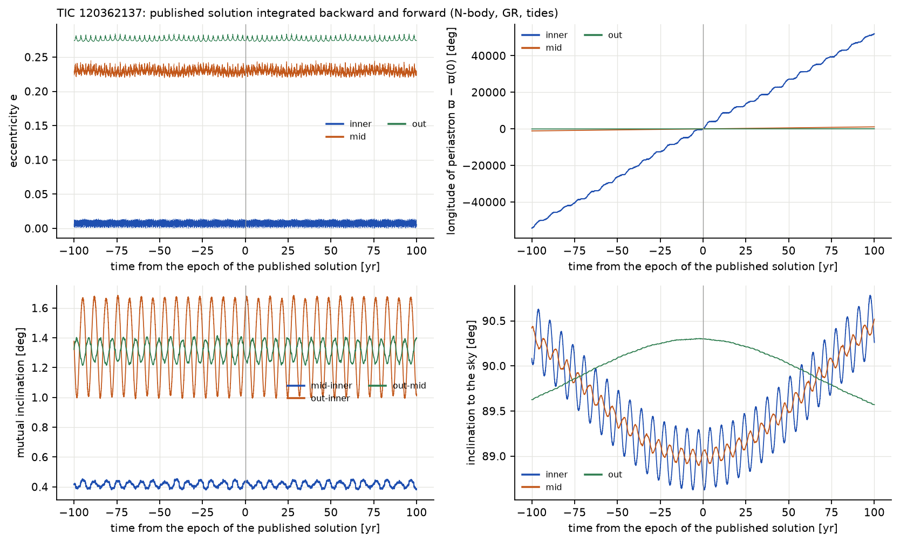
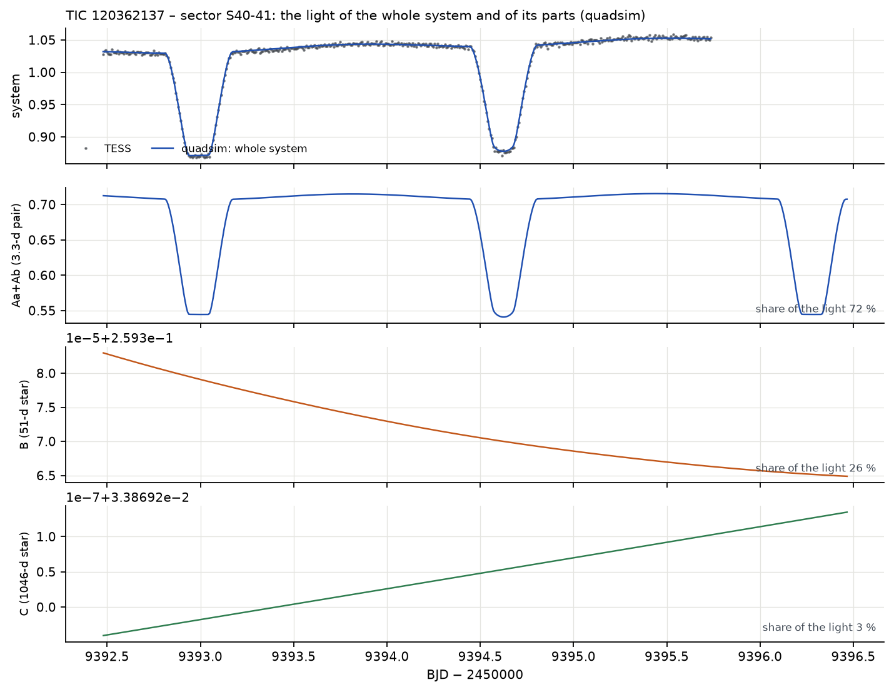
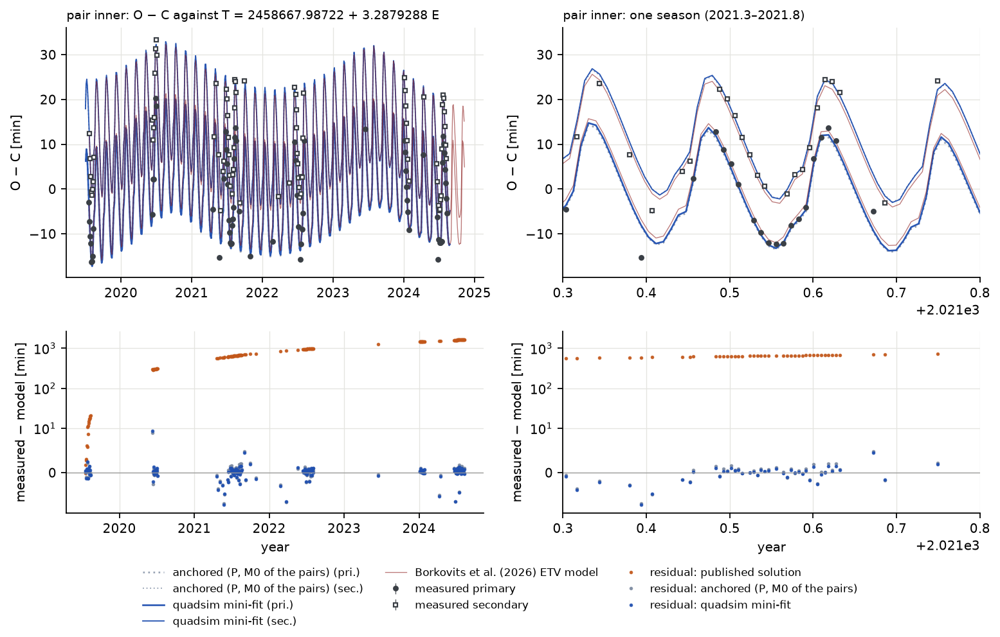
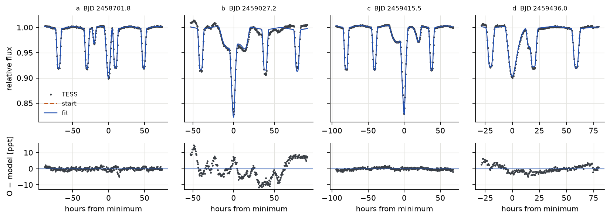
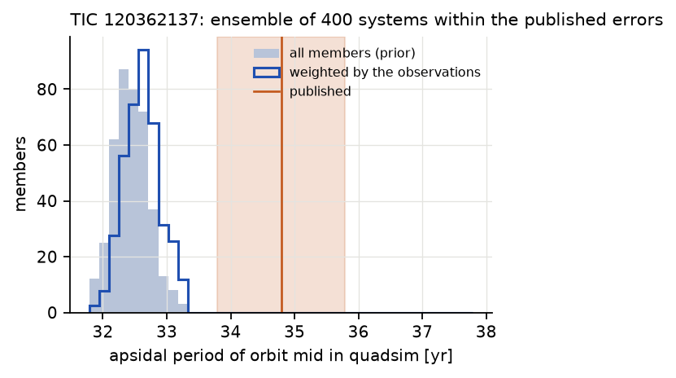

# TIC 120362137 (3+1)

## Soustava podle Borkovitse et al. (2026)

TIC 120362137 je nejkompaktnější známá čtyřhvězda typu 3+1: zákrytový pár hvězd F (Aa–Ab, 3,28 d, téměř
kruhová dráha), třetí hvězda F (B) obíhající kolem páru za 51,3 dne a hvězda G (C) obíhající kolem trojice za
1046 dní. 51denní dráha je tak těsná, že B způsobuje silné dynamické změny okamžiků zákrytů a občasné
*zákryty třetím tělesem*, když B přechází před vnitřním párem nebo za ním. Pravidelně zakrývá jen Aa–Ab; vše
o B a C se zjišťuje z časování těchto zákrytů, zákrytů třetím tělesem, radiálních rychlostí a spektrálního
rozdělení energie. Jasný soused ve vzdálenosti 27″ přispívá v cloně TESS asi polovinou světla: tabulka 2
článku uvádí světlo navíc ℓx(TESS) = 0,510 ± 0,007.

## Stabilita

**Tabulka 8.** Stabilita publikované TIC 120362137.

| podtrojice | a_in / a_out | e_in | e_out | i_mut | MA01 | V22 |
|---|---|---|---|---|---|---|
| dráha A–B uvnitř AB–C (+C) | 0,126 | 0,224 | 0,274 | 1,3° | 1,63 | 1,85 |
| Aa–Ab uvnitř A–B (+B) | 0,141 | 0,007 | 0,224 | 0,4° | 1,48 | 1,86 |

Oba poměry jsou výrazně nad 1, ale nižší než u BU CMi: TIC 120362137 je vůči své mezi stability
kompaktnější, ačkoli Borkovits et al. (2026) shledávají podmínky stability „splněné velmi robustně“ a naše
poměry s tím souhlasí. Klasifikátor Vynatheyi et al. (2023) dává *stabilní* a test duchem přes 100 vnějších
oběhů (286 let) končí divergencí 9,9 × 10⁻³, větší než u BU CMi, jak se u tak kompaktní soustavy čeká, ale
stále stabilní.

## Století dopředu a dozadu a apsidální pohyb

**Jak číst obrázek.** Jako u BU CMi. Excentricita vnitřního páru (vlevo nahoře, modře) kmitá mezi téměř
nulou a 0,014 během týdnů: je *vynucena* třetí hvězdou při každém průchodu. Vpravo dole: sklony vnitřní
a střední dráhy k obloze kmitají až o ±0,8° na časových škálách let až století (uzlová precese drah kolem
roviny celé soustavy); proto se hloubky zákrytů pomalu mění.

Soustava zůstává 200 let neporušená (chyba energie 7 × 10⁻¹³). Vzájemný sklon vnitřní a střední dráhy
zůstává 0,38–0,45° (publikováno 0,47 ± 0,25°), sklon vnější dráhy vůči ostatním 1,0–1,7° (publikováno 5,7°,
s nejistotou +5,0/−3,9°).

SWINGERsim měří apsidální periodu 51denní dráhy jako **32,4 roku** (300letý běh: 32,39 roku; ansámbl:
32,2–32,7 roku) a periodu vnější dráhy jako 836–840 let. Článek uvádí 34,79 ± 0,07 roku a 896 let, ale to
jsou podle jeho tabulky 1 „nominální, teoretické periody apsidálního pohybu“ z analytického vzorce, ne
naměřené hodnoty. 7% rozdíl je proto mezi N-částicovou integrací SWINGERsimu a analytickou aproximací, ne mezi
SWINGERsimem a pozorováním.

## Světelné křivky TESS

**Jak číst obrázek.** Pravidelné poklesy jsou zákryty 3,3denního páru. Nepravidelné, širší nebo zdvojené
události (např. sektor 26 kolem BJD 2459026,6, sektor 53 kolem 2459772,7) jsou zákryty třetím tělesem:
hvězda B během své 51denní dráhy přechází přes vnitřní pár a částečně zakrývá jednu nebo obě jeho hvězdy,
nebo je jimi zakryta. Tyto události jsou na dráhy mimořádně citlivé; jsou nejtěžší zkouškou dynamiky.

**Tabulka 9.** Rezidua světelných křivek TESS soustavy TIC 120362137 (rms, ppt). Hloubky zákrytů
vnitřního páru ≈ 150 ppt.

| sektor | body | publikovaná | ukotvená | nafitovaná jen na minima |
|---|---|---|---|---|
| 14 | 778 | 21,7 | 21,5 | 22,2 |
| 26 | 915 | 32,5 | 8,3 | 11,4 |
| 40–41 | 6 763 | 27,0 | 3,4 | 4,1 |
| 53–54 | 6 391 | 36,1 | 4,2 | 6,1 |
| 74 | 9 923 | 42,9 | 14,1 | 15,8 |

Ukotvený model reprodukuje pravidelné zákryty na 3–4 ppt v sektorech 40–41 a 53–54 a zákryty třetím tělesem
kvalitativně: objevují se ve správných sektorech se správnými hloubkami a délkami, s časováním posunutým
o několik hodin. Fit jen na minima události s třetím tělesem zhorší (sektor 53–54: 4,2 → 6,1 ppt), protože
posune vnější dráhu (níže). Sektory 14 a 74 mají ve fotometrii SPOC silné instrumentální trendy, které
kvadratická základní úroveň neodstraní; jejich rms není vlastností modelu.

**Jak číst obrázek.** Mění se jen 3,3denní pár; B a C přispívají stálým světlem (drobné posuny v jejich
panelech, na úrovni 10⁻⁵, jsou doba šíření světla a dopplerovské zjasnění). Během zákrytu třetím tělesem by
poklesl i panel B.

## Okamžiky minim

**Jak číst obrázek.** O − C vnitřního páru dominuje 51denní dráha B (dynamické ETV s amplitudou asi ±15 min,
každých 51 dní), modulovaná 1046denní dráhou C (doba šíření světla a poruchy). Primární a sekundární minima
sledují mírně odlišné křivky, protože se mění vynucená excentricita páru.

**Tabulka 10.** Okamžiky minim TIC 120362137 (147 minim, 2019–2024).

| konfigurace | rms | medián absolutního O − C |
|---|---|---|
| publikovaná | 1039 min | 836 min |
| ukotvená | 1,74 min | 0,59 min |
| výsledný fit | 1,24 min (143 minim) | – |
| pro srovnání: model Borkovitse et al. (2026) na týchž minimech | 1,82 min | – |

Publikovaná oskulační perioda páru odpovídá v SWINGERsimu střední periodě zákrytů kratší o 6,2 × 10⁻⁴; za pět
let se zákryty posunou o 27 hodin. Po ukotvení reprodukuje N-částicový model SWINGERsimu celé složité ETV,
51denní i 1046denní člen společně, s rms 1,7 min, **zhruba stejně dobře jako fotodynamický model samotného
článku (1,82 min na týchž minimech, z modelového ETV, které autoři publikovali)**; výsledný fit dosahuje
1,24 min. Srovnání není zcela rovnocenné: ukotvený model ladí dvě čísla páru (periodu a fázi) přesně na tato
minima, kdežto publikovaný model byl fitován na všechna svá data společně (světelné křivky, rychlosti, minima
a spektrální rozdělení energie), takže se od něj na samotných minimech čeká o něco větší rms.

## Fit

**Tabulka 11.** TIC 120362137: co přináší který druh dat. Publikovaná vnější dráha: P_out = 1045,5 ± 7,9 d,
e_out = 0,274 ± 0,013, ω_out = 289,0 ± 4,8°.

| fit | data | χ²_red | rms [min] | P_out [d] | e_out | ω_out [°] |
|---|---|---|---|---|---|---|
| jen minima, uváděné chyby | 147 minim | 148 | 1,68 | 1074 ± 30 | 0,42 ± 0,13 | 239 ± 15 |
| + dodatečná chyba pro každý zdroj | 145 | 1,00 | 1,45 | 1077 ± 23 | 0,42 ± 0,09 | 238 ± 27 |
| + apriorní rozdělení | 143 | 1,00 | 1,15 | 1044 ± 6 | 0,278 ± 0,013 | 289,3 ± 3,3 |
| automaticky z publikovaných elementů | 143 | 1,00 | 1,15 | 1044 ± 6 | 0,278 ± 0,013 | 289,4 ± 3,3 |
| + radiální rychlosti | 141 + 380 RV | 1,00 | 1,02 | 1052,7 ± 3,3 | 0,277 ± 0,007 | 275,7 ± 2,0 |
| + zákryty třetím tělesem, červený šum, MCMC (výsledný) | 143 + 379 RV + 2676 LC | – | 1,24 | 1034,2 ± 2,2 | 0,271 ± 0,004 | 284,4 ± 1,6 |

Jen s minimy se vnější dráha zatoulá daleko od publikované (e_out 0,42, ω_out 239°): s jediným zákrytovým
párem je vnější dráha vidět jen přes malou modulaci vnitřního ETV, pokrytou méně než dvěma vnějšími periodami,
a mnoho kombinací periody, excentricity, ω a fáze vyhovuje stejně dobře. **S apriorními rozděleními se celá
vnější dráha vrátí k publikovaným hodnotám v rámci 0,3σ, při lepší kvalitě časování** (rms 1,15 min).
Odchylka byla degenerací slabě omezené dráhy, ne rozporem. Radiální rychlosti a zákryty třetím tělesem pak
vnější dráhu určí i bez velké pomoci apriorních rozdělení (všechny parametry v rámci 1,4σ od nich).

**Tabulka 12.** TIC 120362137: publikované hodnoty (Borkovits et al. 2026, tab. 1–2) a výsledný fit SWINGERsimu
(minima, radiální rychlosti a devět oken světelné křivky se zákryty třetím tělesem z doplňkových dat článku;
medián aposteriorního rozdělení a polovina rozsahu 16–84 %).

| veličina | publikováno | SWINGERsim |
|---|---|---|
| P_mid [d], e_mid, ω_mid [°] | 51,3111 ± 0,0043, 0,22367 ± 0,00072, 190,05 ± 0,32 | 51,3036 ± 0,0009, 0,2229 ± 0,0002, 190,30 ± 0,08 |
| P_out [d], e_out, ω_out [°] | 1045,5 ± 7,9, 0,274 ± 0,013, 289,0 ± 4,8 | 1034,2 ± 2,2, 0,271 ± 0,004, 284,4 ± 1,6 |
| hmotnosti Aa, Ab, B, C [M☉] | 1,748, 1,361, 1,483, 1,008 | 1,7635 ± 0,0012, 1,3716 ± 0,0023, 1,527 ± 0,008, 0,996 ± 0,014 |
| sklony vnitřní, střední [°] | 88,7, 89,05 | 88,80 ± 0,02, 88,89 ± 0,02 |
| poloměry Aa, Ab, B [R☉] | 2,996, 1,507, 1,768 | 3,001 ± 0,005, 1,568 ± 0,004, 1,921 ± 0,016 |
| radiální rychlosti: rms | – | 3,8–4,3 km/s (Aa, Ab, C), 8,0 km/s (B) |
| zákryty třetím tělesem: rms | – | 0,7–2,4 ppt v osmi oknech, 5,9 ppt v jednom |
| škála hloubek a v oknech | ℓx = 0,510 ± 0,007 | a = 0,46–0,51 |

Hmotnosti vnitřního páru souhlasí s článkem na 1 %, třetí hvězda vychází o 3 % těžší a čtvrtá o 1 % lehčí.
Poloměr třetí hvězdy roste o 9 % a poloměr sekundární složky páru o 4 %; oba jsou omezeny hlavně zákryty
třetím tělesem a poloměr třetí hvězdy je nejméně jistý. Škála hloubek v oknech, a = 0,46–0,51, je světlo
navíc od sousední hvězdy, které uvádí článek (ℓx = 0,510): doplňkové světelné křivky nebyly o něj opraveny,
na rozdíl od celosektorových světelných křivek SPOC z tabulky 9 (a = 0,97–0,98). Rocheovy plochy místo koulí
mění rezidua o méně než 0,1 ppt a poloměry o ≤ 2 %: pár je dostatečně oddělený pro koule. Chyby hmotností
0,07–1,4 % pocházejí z MCMC se zohledněným korelovaným šumem světelných křivek; bez něj byly lineární chyby
fitu na 2676 fotometrických bodů několikrát menší a nerealistické.

**Jak číst obrázek.** Každé okno obsahuje několik zákrytů 3,28denního páru a jeden zákryt, kterého se
účastní třetí hvězda (hluboký nebo široký pokles navíc). Fit reprodukuje zákryty třetím tělesem ve většině
oken asi na 1 ppt; okno b (BJD 2459027) si ponechává strukturované reziduum ±10 ppt.

**Předpovědi.** Výsledný fit předpovídá další události s třetím tělesem zhruba každých 25 dní až do roku 2027
(např. BJD 2460559, 2460587, 2460610, 2460638, … 2461480). Jejich ověření vyžaduje nové sektory TESS nebo
pozemní fotometrii.

## Ansámbl

400 soustav v rámci publikovaných chyb (hmotnosti, střední a vnější dráha, uzly) bylo zintegrováno 100 let
dopředu i dozadu. **Všech 400 zůstává neporušených a stabilních** a vnitřní pár ve všech zakrývá. Apsidální
perioda 51denní dráhy je ve všech 32,4 roku (16–84 %: 32,2–32,7 roku).

**Jak číst obrázek.** Jako u BU CMi. Úzké rozdělení ukazuje, že N-částicová apsidální perioda téměř nezávisí
na nejistotách hmotností a drah; publikovaná hodnota je analytický odhad článku.

## Závěr

- **Potvrzuje** publikované řešení: stabilní (poměry stability 1,5–1,9), složité ETV reprodukované na 1,7 min
  po ukotvení periody a fáze na minima (zhruba stejně dobře jako společně fitovaný publikovaný model),
  světelné křivky TESS na 3–4 ppt se zákryty třetím tělesem na správných místech a ve společném fitu
  hmotnosti na 1–3 %, sklony na 0,15° a zákryty třetím tělesem na 1–2 ppt.
- **Přidává:** N-částicovou apsidální periodu 51denní dráhy, 32,4 roku (publikovaných 34,79 roku je
  teoretická hodnota), a předpovědi dalších událostí s třetím tělesem.
- **Ukazuje mez fitu jen na časování:** s jedním zákrytovým párem vnější dráhu samotná minima neurčí; jsou
  potřeba apriorní rozdělení, rychlosti nebo zákryty třetím tělesem.
