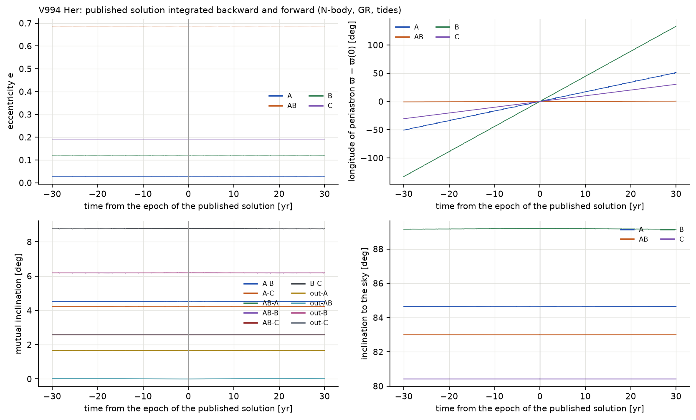
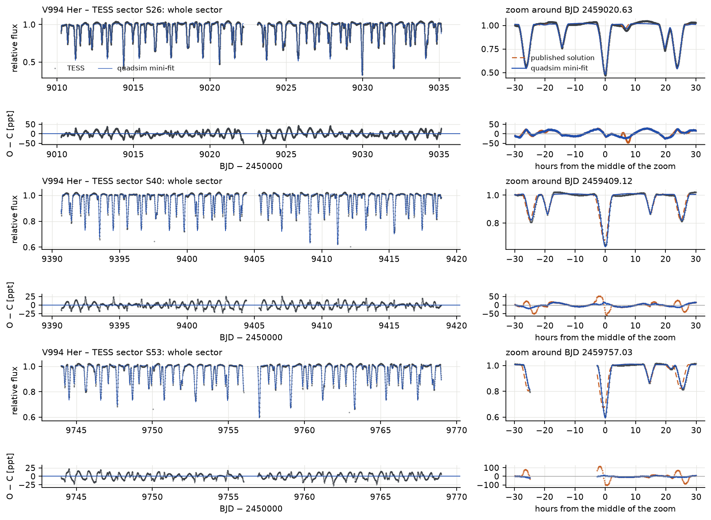
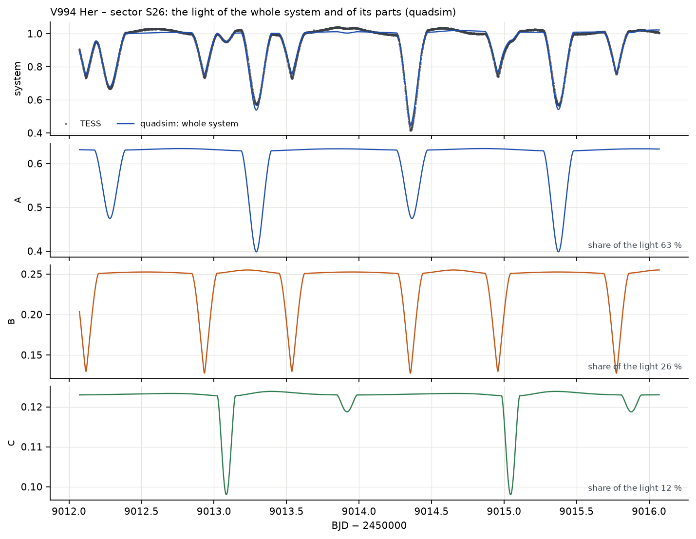
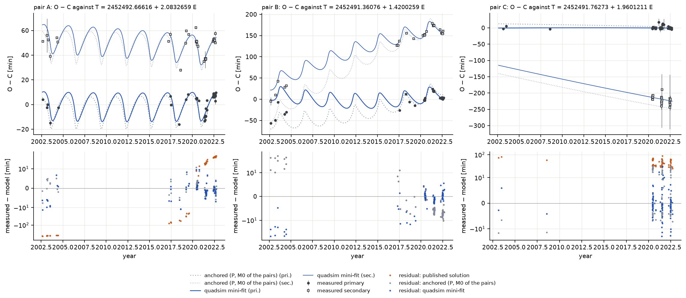
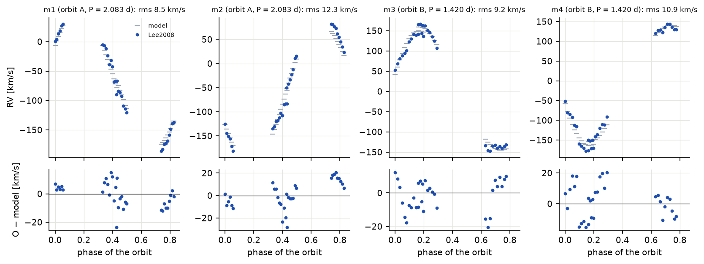
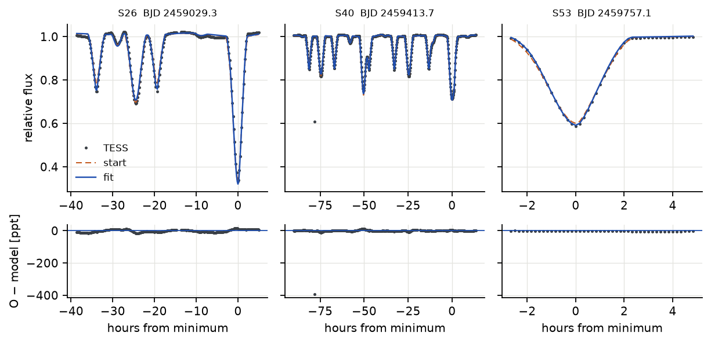
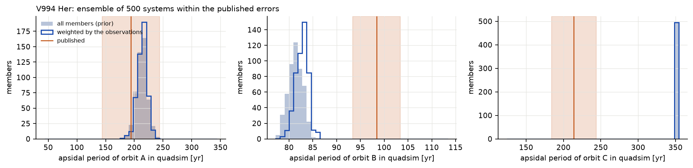

# V994 Her ((2+2)+2)

## Soustava podle Zascheho et al. (2023)

V994 Her obsahuje šest hvězd ve třech zákrytových dvojhvězdách: A (2,08 d) a B (1,42 d) obíhají kolem sebe za
1062 dní po velmi excentrické dráze (e = 0,69) a třetí dvojhvězda C (1,96 d) je vizuální průvodce ve
vzdálenosti 1,1″, v promítnuté vzdálenosti asi 300 au. Hvězdy jsou mladé (asi 80 Myr) hvězdy typu B a A
o 1,1–2,9 hmotnosti Slunce; všechny tři páry mají mírně excentrické dráhy a měřitelný apsidální pohyb.
Řešení Zascheho et al. (2023, tab. 3) kombinuje světelné křivky TESS, radiální rychlosti A a B (Lee et al.
2008), ETV všech tří párů a spektrální rozdělení energie. Minima pokrývají dvacet let a mnoho z nich pochází
od pozorovatelů: S. Dallaporta a U. Munari (SD & UM, 2002–2004), R. Uhlař (RU, 2017–2022, 64 minim ze
soukromé hvězdárny), robotický dalekohled FRAM, M. Mašek (MM) a další (Zasche et al. 2023, tab. A1–A4).

Články neuvádějí ani uzly drah, ani dráhu C kolem A+B; předpokládali jsme Ω = 0 pro všechny dráhy a dráhu C
s P = 3000 let, e = 0,3. Dráha C je tak široká, že časování během 20 let neovlivní jinak než téměř
konstantním členem doby šíření světla.

## Stabilita

**Tabulka 13.** Stabilita V994 Her (s předpokládanou dráhou C).

| podtrojice | a_in / a_out | e_in | e_out | i_mut | MA01 | V22 |
|---|---|---|---|---|---|---|
| A uvnitř A–B (+B) | 0,013 | 0,028 | 0,687 | 1,7° | 4,43 | 6,26 |
| B uvnitř A–B (+A) | 0,009 | 0,119 | 0,687 | 6,2° | 5,65 | 7,53 |
| A–B uvnitř dráhy C (+C) | 0,009 | 0,687 | 0,300 | 0,0° | 21,0 | 19,9 |

Všechny podsoustavy jsou stabilní s velkou rezervou a klasifikátor Vynatheyi et al. (2023) dává *stabilní*
pro každou podčtyřhvězdu. Test duchem přes jeden oběh C (3000 let, asi 1000 oběhů A–B) shledává soustavu
stabilní (divergence 2,3 × 10⁻⁵).

## Třicet let dopředu a dozadu a apsidální pohyb

**Jak číst obrázek.** Jako u BU CMi. Během 60 let se téměř nic nemění: dráhy jsou vůči párům mnohem širší než
u BU CMi, poruchy jsou malé a pomalý apsidální pohyb párů (periody století a více) se v pravém horním panelu
projevuje jako přímky.

Soustava zůstává neporušená (chyba energie 5,6 × 10⁻¹¹), excentricity zůstávají v rozmezí 0,0274–0,0279 (A),
0,118–0,120 (B) a 0,6869–0,6874 (A–B) a všechny tři páry po celou dobu zakrývají. Na rozdíl od BU CMi je
precese převážně *klasická*: způsobují ji slapové a rotační výdutě samotných hvězd, ne druhý pár.

**Tabulka 14.** Apsidální periody V994 Her. Publikováno: 360° / ω̇ z tabulky 3 Zascheho et al. (2023).

| pár | publikováno | běh SWINGERsimu | ansámbl SWINGERsimu, vážený (16–84 %) | pár sám (slapy + rotace + OTR) |
|---|---|---|---|---|
| A | 194 (158–271) let | 212 let | 213 (204–222) let | 244 let |
| B | 98 (94–103) let | 81 let | 81 (80–83) let | 84 let |
| C | 214 (188–250) let | 355 let | 355 let | 355 let |

U A SWINGERsim souhlasí v rámci (velké) publikované nejistoty. U B je precese SWINGERsimu o 17 % rychlejší,
u C o 40 % pomalejší (perioda o 66 % delší). Oba modely zde dělají různé věci. Zasche et al. (2023)
fitovali konstantní rychlost stáčení ω̇ každého ze tří párů jako volný parametr svého analytického
keplerovského modelu; SWINGERsim tyto rychlosti počítá z hvězd: z apsidálních konstant k₂ (Claret 2023, ve
stáří podle MIST), poloměrů a rotace. Rozdíly proto srovnávají změřenou rychlost s rychlostí, kterou
předpovídá stavba hvězd. Pro C dává předpověď SWINGERsimu 0,78°/rok slapově, 0,10°/rok rotačně a 0,14°/rok
relativisticky; pseudosynchronní místo synchronní rotace přidá jen 0,05°/rok. Dosažení publikovaných
1,68 ± 0,24°/rok by vyžadovalo k₂ obou hvězd 1,76krát větší, daleko za nejistotou modelů hvězd (asi 10 %).
B by potřeboval k₂ vynásobené 0,81, A (s poruchou od B, +0,22°/rok) 1,12.

U B provedli Zasche et al. (2023, odd. 4.1) totéž srovnání sami. Po odečtení relativistické a dynamické
části odvozují z nafitované rychlosti log k₂ = −2,44 ± 0,05 proti −2,36 ± 0,02 z modelů Clareta (2004), tj.
změřenou k₂ asi 0,83krát menší než teoretickou. Jako vysvětlení diskutují o něco rychlejší apsidální pohyb,
podsynchronní rotaci nebo vyšší metalicitu a shledávají, že modely bohaté na kovy (Z = 0,04,
log k₂ = −2,40) souhlasí lépe. Náš faktor 0,81 pro B tedy reprodukuje vlastní zjištění autorů s jinou sadou
hvězdných modelů; je to potvrzení, ne nový rozpor. Pro A a C autoři srovnání neprovádějí. C v SWINGERsimu
rušen není (jeho vnější dráha je předpokládána široká); publikovaná rychlost C je 2,8σ od předpovědi ze
stavby hvězd a bližší, neznámý průvodce C by byl jedním z vysvětlení.

**Skrytý průvodce C.** Abychom zjistili, jaký průvodce by to dokázal, bylo 30 let integrováno 3000
konfigurací C s třetí hvězdou (0,1–2 M☉, perioda 8–3000 d log-rovnoměrně, excentricita 0–0,6,
izotropní orientace, stabilní podle MA01): 2592 zůstane neporušených, 403 se srazí v cyklech ZLK
(vzájemné sklony 72–135°, periody ≤ 152 d) a 5 je vymrštěno. Bez průvodce (periody nad 2000 d)
vykonává C precesi za 354 let, jako výše. Publikovaných 214 ± 31 let dosáhne 172 členů. Váženo touto
hodnotou má průvodce 0,17–0,44–1,36 M☉ na dráze s periodou 92–171–332 d (16–50–84 %), což posouvá
zákryty C o 0,7–8,5 min efektem světelného času a o 0,4–1,5 min dynamicky. 56 primárních minim C
(2003–2022, většinou TESS, rms 3,8 min kolem kubické efemeridy) omezuje jakýkoli periodický signál
s periodou 80–400 d pod 2,4 min (2σ, medián přes periodu). To vylučuje 55 % těchto průvodců. Zbývající
mají 0,13–0,20–0,31 M☉ na drahách s periodou 80–126–182 d. Nejvyšší vrchol v minimech (80,9 d,
2,0 ± 0,5 min) není detekcí, protože aliasy v rozmezí 49–84 d jsou téměř stejně vysoké. Průvodce C
s malou hmotností na dráze s periodou několika měsíců tedy zůstává možný. Husté měření okamžiků
zákrytů C alespoň během dvou takových period by jej nalezlo nebo vyloučilo.

## Světelné křivky TESS

**Jak číst obrázek.** Ve stejné světelné křivce zakrývají tři dvojhvězdy, takže poklesy přicházejí ve třech
proplétajících se rytmech (2,08, 1,42 a 1,96 dne) a s různými hloubkami; nejhlubší poklesy (na 0,5 toku
v sektoru 26) jsou zákryty nejjasnější hvězdy A. Výřezy ukazují, že publikované elementy už zákryty umisťují
dobře (V994 Her je méně kompaktní a její oskulační a střední periody se liší méně) a že je fit posune na data.

**Tabulka 15.** Rezidua světelných křivek TESS soustavy V994 Her (rms, ppt). Hloubky zákrytů 50–550 ppt.

| sektor (kadence) | body | publikovaná | ukotvená | nafitovaná na minima | škála hloubek a |
|---|---|---|---|---|---|
| 26 (SPOC, 2 min) | 16 931 | 15,6 | 14,9 | 14,5 | 2,03 |
| 40 (QLP, 10 min) | 3 917 | 17,1 | 8,8 | 8,0 | 1,20 |
| 53 (QLP, 10 min) | 3 454 | 18,2 | 9,4 | 8,2 | 1,18 |

Dvě věci vynikají.

**Oscilace.** Rezidua 8–15 ppt jsou větší než u ostatních soustav a ukazují pravidelnou oscilaci s periodou
0,663 d, přítomnou v sektorech QLP 40 a 53 i v sektoru SPOC 26, s amplitudou 7,5–9 ppt v QLP a 15 ppt v SPOC
(stejný faktor jako u hloubek zákrytů, viz níže). Zasche et al. (2023, odd. 3) ji našli před námi:
oscilaci o velikosti asi 2 procent s periodou P_A − P_B (2,0833 − 1,4200 d = 0,663 d), kterou před fitováním
odstranili; není součástí ani jednoho modelu. Když se ze světelné křivky odstraní (součet sinusovek na její
periodě a harmonických, nafitovaný mimo zákryty), klesnou rezidua v sektorech 40 a 53 na 3,4–3,6 ppt.

**Hloubky v sektoru 26.** Hloubky je třeba škálovat faktorem 1,2 v sektorech QLP a 2,0 v sektoru SPOC 26.
Škála nad 1 znamená, že pozorované zákryty jsou hlubší, než SWINGERsim předpovídá pro celkové světlo šesti
hvězd, tj. fotometrie obsahuje méně světla, než soustava vyzařuje. V sektoru 26 jsou zákryty SPOC 1,75krát
hlubší než v QLP (primární zákryt A: 0,44 proti 0,25). Pravděpodobnou příčinou je korekce zpracování SPOC na
přeplněné pole (CROWDSAP), která světlo průvodce C ve vzdálenosti 1,1″ a sousedních hvězd počítá jako příměs
a odečte je; neprokázali jsme to. Zasche et al. (2023, odd. 3) také potřebovali pro sektor 26 zvláštní
světlo navíc (0,058 proti 0,181 pro sektory 40 a 53), ale jejich případ není stejný jako náš: pro sektory
40 a 53 použili vlastní fotometrii snímků celého pole (balík FITSH), ne QLP, a jejich zákryty v sektoru 26
byly jen „o několik procent“ hlubší než v ostatních dvou sektorech. Velký faktor, který nacházíme, proto
závisí na použitých zpracováních (SPOC proti QLP) a o hvězdách nic neříká.

**Jak číst obrázek.** Tři spodní panely rozdělují, co TESS zaznamenává společně. C je nejslabší pár a jeho
zákryty jsou v celkovém světle mělké, proto jsou jeho minima nejméně přesná.

## Okamžiky minim

**Jak číst obrázek.** U A a B jsou vlny s periodou 2,9 roku dobou šíření světla napříč excentrickou drahou
A–B: když je A na odvrácené straně, přicházejí jeho zákryty později a zákryty B dříve, takže vlny A a B jsou
zrcadlové s amplitudami v poměru hmotností. Pomalejší opačné posuny primárních a sekundárních minim jsou
apsidální pohyb. U C leží primární a sekundární minima 200 minut od sebe kvůli jeho excentrické dráze
(e cos ω ≠ 0); pomalé rozbíhání je jeho apsidální pohyb.

**Tabulka 16.** Minima V994 Her podle zdroje a dodatečná chyba, kterou fit přiřadí každému zdroji.

| zdroj | roky | minim | medián uváděné σ | dodatečná chyba z fitu |
|---|---|---|---|---|
| SD & UM (Dallaporta, Munari) | 2002–2004 | 23 | 128 s | 10 min |
| RU (R. Uhlař) | 2017–2022 | 64 | 60 s | 4,9 min |
| TESS | 2020–2022 | 246 | 10 s | 1,1 min |
| FRAM | 2021–2022 | 7 | 45 s | 2,2 min |
| další pozorovatelé (MR13, GP, MM) | 2008–2021 | 3 | 26–86 s | 5,5 min |

Novější pozemní minima pozorovatelů (RU, FRAM, MM) souhlasí s modelem téměř tak dobře jako TESS; minima z let
2002–2004 leží v průměru o 17 minut dříve než model a potřebují dodatečnou chybu 10 min. Jsou jedinými
minimy prvního desetiletí a ukotvují dlouhodobé trendy. Publikované elementy dávají chyby v hodinách jen
u A; po ukotvení model reprodukuje A na 3,3 min a vlny LTTE párů A a B společně, což potvrzuje hmotnosti
a dráhu A–B.

## Fit

**Tabulka 17.** V994 Her: co přináší který druh dat. Publikovaná dráha A–B: P_AB = 1062,3 ± 2,6 d,
e_AB = 0,687 ± 0,044, ω_AB = 59,6 ± 3,8°.

| fit | data | χ²_red | rms A / B / C [min] | e_AB | ω_AB [°] |
|---|---|---|---|---|---|
| jen minima, uváděné chyby | 338 minim | 86 | 3,8 / 10,4 / 6,3 | 0,579 ± 0,016 | 30 ± 5 |
| + dodatečná chyba pro každý zdroj | 337 | 1,00 | 4,0 / 3,5 / 5,3 | 0,511 ± 0,013 | 21 ± 8 |
| + apriorní rozdělení | 337 | 1,00 | 5,0 / 3,4 / 5,4 | 0,570 ± 0,018 | 51 ± 3 |
| automaticky z publikovaných elementů | 337 | 1,00 | 5,1 / 3,8 / 5,4 | 0,569 ± 0,018 | 51 ± 3 |
| + radiální rychlosti | 337 + 128 RV | 1,00 | 7,4 / 5,2 / 5,3 | 0,590 ± 0,018 | 56 ± 3 |
| + světelné křivky s odstraněnou oscilací, červený šum (výsledný) | 333 + 128 RV + 9214 LC | – | 5,3 / 3,4 / 5,4 | 0,587 ± 0,018 | 52 ± 3 |
| radiální rychlosti, bez minim SD & UM, bez apriorních rozdělení | 314 + 128 RV | 1,00 | 3,0 / 2,2 / 5,3 | 0,533 ± 0,026 | 40 ± 8 |

Dodatečná chyba pro každého pozorovatele je nejúčinnějším samostatným krokem: rms páru B klesne z 10,4 na
3,5 min, protože nejstarší minima už nedominují. Excentricity a argumenty periastra tří párů souhlasí
s publikovanými v rámci 2σ ve všech variantách, což je dobré nezávislé potvrzení. Dráhu A–B však minima vidí
jen přes vlny doby šíření světla a fit preferuje e_AB = 0,51–0,59 místo 0,69 ± 0,04. S apriorními
rozděleními zůstává o 2,3σ níž a vynechání raných minim SD & UM ji nevrátí (0,53). Publikovaná hodnota se
opírá také o radiální rychlosti dráhy A–B a o světelné křivky v modelu, který zahrnuje víc než časování;
rozdíl zůstává otevřený.

**Radiální rychlosti a hmotnosti páru A.** Rychlosti Lee et al. (2008), 32 na hvězdu ze čtyřčárových spekter
pořízených v březnu až květnu 2006, stahují ve společném fitu hmotnosti páru A na 2,38 ± 0,07
a 1,87 ± 0,06 M☉ (publikováno 2,93 a 2,22 M☉) a pár B nechávají beze změny (1,92 a 1,97 proti 1,91
a 1,89 M☉). Jednoduchý keplerovský fit týchž rychlostí, s lineárním trendem systémové rychlosti každého páru
během Leeových 60 dní, dává K_A = 126–128 a 157–159 km/s, tj. 2,82 a 2,29 M☉ při i = 84,7°, ve shodě se
Zaschem et al. (2,93 a 2,22 M☉). Během Leeových 60 dní se systémová rychlost A − B mění o −11,8 km/s za
30 dní; publikovaná dráha A–B dává −12,2, společný fit −9,1. Nízké hmotnosti společného fitu jsou tedy
artefaktem: s méně excentrickou drahou A–B fit pohltí část oběžného pohybu párů do jejich amplitud
rychlostí. Lee et al. (2008) neuvádějí ani chyby jednotlivých rychlostí, ani rms svých dráhových fitů;
zmiňují jen systematické posuny u páru B, které připisují překrývání čar čtyř hvězd nebo nerozlišenému
průvodci. Chyby 5 km/s na rychlost, použité zde, byly proto přiřazeny v tomto testu a o tom, nakolik se
rychlostem věří, rozhoduje dodatečná chyba zdroje určená fitem.

**Jak číst obrázek.** Jako u BU CMi. Model sleduje křivky rychlostí všech čtyř hvězd; rezidua 9–11 km/s jsou
asi dvojnásobkem chyb 5 km/s, které jsme přiřadili rychlostem Lee et al. (2008), protože sami žádné chyby
neuvádějí.

**Jak číst obrázek.** Okna kolem zákrytů tří párů se překrývají, takže každý panel ukazuje jeden až čtyři dny.
S oscilací s periodou 0,663 d odstraněnou z dat jsou rezidua několik ppt (s ní byla ±20 ppt).

S odstraněnou oscilací dává fit světelných křivek sektorů 26, 40 a 53 3,4–3,6 ppt v sektorech QLP (9,7 ppt
v sektoru 26), sklony 85,4 ± 0,8° (A), 89,0 ± 0,8° (B) a 80,6 ± 0,3° (C, publikováno 84,66°, 89,19°,
80,42°) a poloměry v rámci 5 % od publikovaných kromě sekundární složky A (1,49 proti 1,72 R☉, degenerace
poměru poloměrů u částečných zákrytů).

## Ansámbl

500 soustav bylo vylosováno s publikovanými hmotnostmi a drahou A–B v rámci jejich chyb, náhodnými uzly A a B
v rozmezí ±30°, náhodným uzlem C a náhodnou dráhou C kolem A+B (perioda 500–20 000 let, excentricita 0–0,7,
sklon 40–140°), přičemž ponechány byly jen soustavy stabilní podle MA01. Po integraci 30 let dopředu i dozadu
**zůstává všech 500 neporušených** a všechny tři páry dál zakrývají. Při vážení publikovanými apsidálními
periodami a zákryty je n_eff = 243.

**Jak číst obrázek.** Jako u BU CMi. U A ansámbl publikovanou hodnotu pokrývá. U B leží celý ansámbl na
78–86 letech, hluboko pod publikovanými 98 lety: žádná soustava v rámci publikovaných hmotností a drah
publikované precese nedosáhne. U C mají všichni členové stejných 355 let: jeho precese je čistě klasická
a náhodná dráha C kolem A+B ji nikdy nezmění. Oba rozdíly jsou proto mezi změřenými (fitovanými) rychlostmi
a stavbou hvězd, ne vlastnostmi drah.

## Závěr

- **Potvrzuje**, že SWINGERsim zvládá šestihvězdnou třístupňovou hierarchii se třemi zákrytovými páry: stabilní,
  vlny doby šíření světla A a B reprodukované z publikovaných hmotností, excentricity a orientace tří párů
  v rámci 2σ od publikovaných, časování všech tří párů na 3–5 min (TESS na 1 min) a světelné křivky na
  3,5 ppt po odstranění oscilace.
- **Potvrzuje** oscilaci s periodou P_A − P_B = 0,663 d, kterou Zasche et al. (2023) odstranili, a vlastní
  zjištění autorů, že apsidální pohyb B odpovídá apsidální konstantě asi 0,8krát menší než teoretická
  (jejich 0,83, naše 0,81).
- **Přidává:** realistické chyby pro každého pozorovatele (TESS 1,1, FRAM 2,2, R. Uhlař 4,9, SD & UM 10 min).
- **Liší se, s vysvětlením:** klasický apsidální pohyb C, který SWINGERsim předpovídá ze stavby hvězd,
  kdežto článek jej fitoval volně (C by potřeboval k₂ 1,8krát větší, než dávají modely hvězd,
  nebo průvodce o 0,13–0,31 M☉ na dráze s periodou 80–182 d, kterého současná minima C stále připouštějí); nízké
  hmotnosti páru A ve společném fitu, artefakt méně excentrické dráhy A–B (Leeovy rychlosti samy o sobě
  s publikovanými hmotnostmi souhlasí).
- **Otevřené:** excentricita A–B, kterou minima kladou na 0,51–0,59 místo 0,69 ± 0,04; škála hloubek 2,0
  v sektoru SPOC 26 proti 1,2 v QLP, pravděpodobně korekce SPOC na přeplněné pole, ale neprokázaná, a ne
  přímo srovnatelná s článkem, který pro sektory 40 a 53 použil jinou fotometrii.
