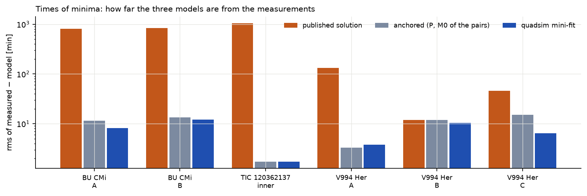

# Srovnání tří soustav

**Jak číst obrázek.** Každá skupina tří sloupců je jeden zákrytový pár. Oranžově: publikované elementy
převzaté doslovně; šedě: po ukotvení periody a fáze každého páru; modře: po fitu SWINGERsimu na minima.
Logaritmická osa pokrývá tři řády: od dnů posunu po několik minut.

**Tabulka 18.** Shrnutí testu. *ano*: shoda; *částečně*: shoda s výhradou; *ne*: rozdíl, vysvětlený v textu.

| otázka | BU CMi | TIC 120362137 | V994 Her |
|---|---|---|---|
| stabilní (MA01, V22, ML, test duchem) | ano | ano (poměry 1,5–1,9) | ano |
| neporušení všichni členové ansámblu, dopředu i dozadu | ano – 600/600 | ano – 400/400 | ano – 500/500 |
| dynamický apsidální pohyb vs publikovaný | ano – 1 % (hmotné body) | – (publikovaná hodnota teoretická) | – (převážně klasický) |
| klasický apsidální pohyb | přidává 2–4 %; slapový člen publikované integrace není uveden | – | A ano, B −17 % (jako vlastní k₂ článku pro B), C +66 % (v článku fitováno volně) |
| světelné křivky TESS (nejlepší sektory, ukotveno) | ano – 2–3 ppt | ano – 3–4 ppt | ano – 3,5 ppt po odstranění oscilace |
| zákryty třetím tělesem | – | ano – 1–2 ppt (fit) | – |
| okamžiky minim, ukotveno | ano – 11–13 min (minima přehlídek) | ano – 1,7 min | ano – 3,3 / 11,9 / 15,2 min |
| okamžiky minim, výsledný fit | 7,6 / 9,1 min; TESS a dopozorování ~3 min | 1,2 min | 5,3 / 3,4 / 5,4 min; TESS ~1 min |
| hmotnosti (společný fit) vs publikované | ano – 1–5 % | ano – 1–3 % | částečně – B ano, A −19 % (artefakt, viz text) |
| sklony vs publikované | ano – 0,1° | ano – 0,15° | ano – v rámci 1° |
| vnější dráha vs publikovaná | částečně – e_out −2,6σ se slapy, bez nich souhlasí | ano – v rámci 1,4σ | částečně – e_AB −2,3σ |
| radiální rychlosti | ne – rms 17–25 km/s (uváděno 2–3) | ano – 3,8–4,3 km/s (B: 8,0) | částečně – 9–11 km/s (bez publikovaných chyb; předpokládáno 5 km/s) |
