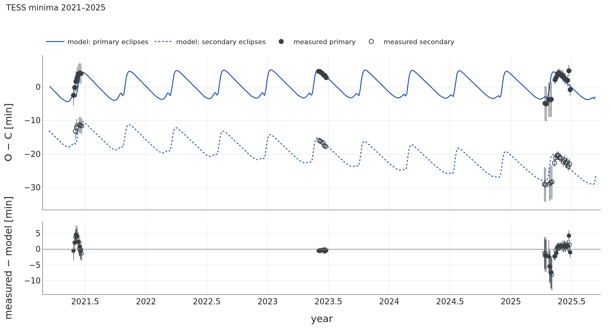
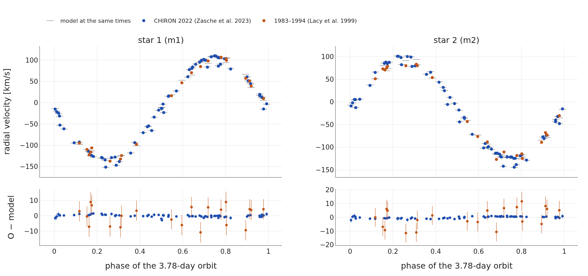
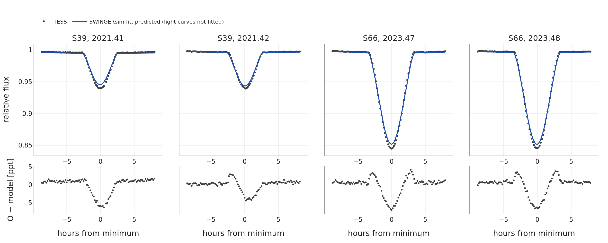

# V907 Sco

## Co uvádějí práce

V907 Sco je pár hvězd pozdního typu B na 3,78denní dráze se třetí hvězdou slunečního typu. Její zákryty
byly viděny na harvardských deskách od roku 1899 přibližně do roku 1918, znovu od roku 1963 přibližně do
roku 1986 a mezi tím ne (Lacy et al. 1999). Lacy et al. (1999) to vysvětlili třetí hvězdou na 99,3denní
dráze a uzlovou periodou asi 68 let a předpověděli návrat zákrytů na rok 2030 ± 5. TESS zaznamenal mělké
zákryty už v roce 2019 (sektor 13) a hlubší v roce 2021 (Borkovits 2022; Zasche et al. 2023). Zasche et
al. (2023) změřili v roce 2022 spektrografem CHIRON radiální rychlosti všech tří hvězd a našli vnější
dráhu **142,01 ± 0,05 d, e₂ = 0,47 ± 0,02, m₃ = 1,06 (+0,11/−0,10) M☉** (hmotnost s 90% mezemi
spolehlivosti). Nejprve prokládali 14 sklonů páru z let 1900–2022 sekulárním modelem (středovaným přes
oběh), nejlepší fit však shledali „formálně … statisticky nepřijatelným“, protože excentrická vnější dráha
přidává dlouhoperiodické poruchy, které sekulární model nemá. Proto použili plně numerický model tří
hmotných bodů (jejich odd. 3.2), omezený sekulárním řešením, a odvodili vzájemný sklon
**26,2 (+2,6/−2,2)°**, uzlovou periodu **63,5 (+3,3/−2,6) roku** (obojí opět s 90% mezemi spolehlivosti)
a konec současné zákrytové fáze kolem roku **2049**. Starší rychlosti Lacyho et al. nepoužili.

**Otázka pro SWINGERsim:** dokáže N-částicový fit všech těchto dat, včetně starých rychlostí, reprodukovat
zapínající se a vypínající se zákryty a potvrdí třetí hvězdu a její dráhu?

## Soustava: publikovaná a nafitovaná

**Jak číst obrázek 1.** Obě soustavy jsou téměř totožné. Třetí hvězda (m3) se pohybuje po velké
excentrické dráze; pár obíhá kolem společného těžiště po menší elipse. V prostředním panelu se oba disky
na obloze v okamžiku nejmenší promítnuté vzdálenosti právě dotýkají: v roce 2021 pár zakrývá jen částečně
(sklon 76,6°, mez zákrytů 72,8°). V pravém panelu obíhá osa dráhy páru kolem celkového momentu hybnosti
(×) jednou asi za 66 let. Do žlutého prstence vstupuje v roce 2019, zůstává v něm do poloviny 50. let
a pak jej asi na 30 let opouští.

## Sklon dráhy za 180 let

![**Obrázek 2.** Sklon dráhy 3,78denního páru, 1890–2070. Nahoře: tak, jak jej měří světelná křivka (0–90°); dole: tentýž model rozložený do 0–180°. Body: 14 naměřených sklonů (Zasche et al. 2023, tab. 2; v dolním panelu nakreslené na té straně od 90°, kde je model). Modrá čára a pás: fit SWINGERsimu a rozsah 95 % ze 100 vzorků aposteriorního rozdělení. Oranžově čárkovaně: publikovaná soustava zintegrovaná SWINGERsimem. Šedě: pod mezí zákrytů. Zelené pásy: kdy byly zákryty pozorovány (Lacy et al. 1999; TESS).](../../figures/squadra_test3/v907_inclination.png)

**Jak číst obrázek 2.** Oba panely ukazují sklon dráhy páru spočítaný N-částicovým modelem. Kdekoli je
křivka nad šedou oblastí, pár může zakrývat; kde se do šedé ponoří, zákryty ustanou. **Horní panel:** to
je to, co měří světelná křivka a čím jsou publikované sklony. V letech 1897–1911, 1964–1977 a 2031–2045 má
křivka výše popsaný tvar „M“: dráha projde polohou z boku (90°), otočí se zpět a projde jí znovu.
**Dolní panel:** rozložená je tatáž křivka jedinou vlnou mezi asi 57° a 93°. To je precese dráhy: osa
páru se pohybuje po kuželu kolem celkového momentu hybnosti, takže sklon se kývá o dvojnásobek
vrcholového úhlu kužele kolem sklonu celkového momentu hybnosti (asi 75°). Její perioda, uzlová perioda,
určuje, jak často zákryty přicházejí a odcházejí. Nafitovaná dráha prochází v každém cyklu polohou 90°;
publikovaná zůstává těsně pod ní. 14 naměřených hodnot obě nerozliší, protože světelná křivka dává pro i
a 180° − i stejný výsledek.

Modelová křivka prochází naměřenými body i všemi pozorovanými změnami: zákryty na harvardských deskách do
roku 1918, zákryty v letech 1963–1986, jejich konec pozorovaný Lacym et al. a rostoucí sklon, který od
roku 2019 vidí TESS a FRAM. Pás je úzký tam, kde jsou data, a rozšiřuje se do minulosti i do budoucnosti;
fit a publikovaný model se rozcházejí po roce 2040. Publikované chyby sklonů z TESS a FRAM (0,02–0,10°
a 0,25° pro mělké zákryty v sektoru TESS 13) jsou většinou menší než rozdíly mezi modely světelných křivek
(viz hloubky zákrytů níže), proto fit používá chybu nejméně 0,1°. S ní dává 14 sklonů χ² = 13,7 pro fit
a 6,0 pro publikovanou soustavu.

**Tabulka 2.** V907 Sco: kdy se zákryty přepínají. „Geometrický“ přechod je okamžik, kdy sklon modelu
překročí mez zákrytů; modelová hloubka zákrytu ve V (včetně třetího světla třetí hvězdy, 1,7 %) ukazuje,
kdy se zákryty staly příliš mělkými na to, aby byly zjištěny.

| změna | pozorováno | publikovaná soustava v SWINGERsimu | fit SWINGERsimu, geometricky (medián, rozsah 95 %) | fit SWINGERsimu: modelová hloubka ve V |
|---|---|---|---|---|
| zákryty ustávají | ~1918 (Lacy et al. 1999; poslední sklon z DASCH 1918) | 1923,5 | **1923,5** (1921,7–1925,5) | 0,16 mag v roce 1918, 0,06 mag v roce 1920 |
| zákryty se vracejí | pozorovány od ~1963 (Lacy et al. 1999; ohlásili Strohmeier et al. 1964) | 1956,5 | **1954,0** (1952,0–1955,5) | 0,08 mag v roce 1955, 0,28 mag v roce 1958 |
| zákryty ustávají | ~1986 (Lacy et al. 1999) | 1986,5 | **1989,0** (1988,0–1990,0) | 0,11 mag v roce 1986, 0,02 mag v roce 1988 |
| zákryty se vracejí | 2019, hloubka 0,6 % (TESS S13) | 2019,5 | **2019,5** | 0,002 mag v polovině roku 2019 (samotný zákryt; se změnami jasnosti mimo zákryt 0,008 mag) |
| zákryty končí | ~2049 (Zasche et al. 2023) | 2050,0 | **2054,5** (2052,5–2056,8) | 0,19 mag v roce 2052, 0,03 mag v roce 2055 |

Fotografická a fotoelektrická fotometrie té doby zachytila zákryty hlubší než asi 0,05 mag. Geometrický
přechod nastává 1–3 roky poté, co se modelové zákryty stanou mělčími než tato mez, takže model a pozorování
souhlasí u všech čtyř pozorovaných změn. Mezi lety 1925 a 1960 nebyly zaznamenány žádné zákryty, ve shodě
s modelem; model je zapíná v polovině 50. let, několik let před prvním ohlášeným pozorováním (1963;
Strohmeier et al. 1964 je ohlásili jako nové). Když SWINGERsim zintegruje publikované parametry, přechody
i konec zákrytů (2050,0; 0,014 mag v roce 2049) souhlasí s publikovaným numerickým modelem hmotných bodů
(kolem roku 2049). To je nezávislá kontrola N-částicové integrace SWINGERsimu.

## Okamžiky zákrytů

**Jak číst obrázek 3.** Horní panel je diagram O − C: ukazuje, o kolik minut zákryty přicházejí dříve nebo
později ve srovnání s přísně periodickými hodinami. Čáry jsou modelové okamžiky zákrytů (konjunkce
v N-částicovém modelu plus doba šíření světla), spočítané pro každý pozorovaný zákryt a protažené mezi
nimi. Pilovitý průběh se opakuje s 142denní vnější periodou. Primární a sekundární zákryty se od sebe
vzdalují (za čtyři roky ze 13 na 28 min), protože třetí hvězda pomalu mění excentricitu a orientaci mírně
excentrické dráhy páru (e ≈ 0,011): sekundární zákryt se posouvá vůči primárnímu. Naměřená minima leží na
modelu; rezidua (dole) mají rms 2,6 min a primární a sekundární minima souhlasí v rámci 0,45 min (0,7σ).
Větší rozptyl v roce 2025 pochází z méně kvalitní fotometrie QLP ze sektorů 91–93.

**Jak číst obrázek 4.** Modelové O − C má dvě části.

- **Doba šíření světla** (oranžově): pár se pohybuje po své dráze kolem společného těžiště se třetí
  hvězdou, takže jeho světlo k nám potřebuje více nebo méně času. U V907 Sco je tento příspěvek malý:
  ±1,1 min.
- **Dynamická část** (zeleně, 10,8 min mezi vrcholy) převažuje zhruba pětinásobně, jak zjistili Zasche et
  al. (2023, odd. 4 a jejich obr. 11) jak analytickými vzorci, tak přímou numerickou integrací. Slapové
  působení třetí hvězdy natahuje dráhu páru a prodlužuje jeho periodu, a to tím více, čím blíže třetí
  hvězda je. Na excentrické vnější dráze (e₂ = 0,47) se třetí hvězda v periastru přiblíží na 0,53 au, jen
  asi na šestinásobek velikosti dráhy páru, a perioda páru je tehdy nejdelší. Zákryty proto po dva až tři
  týdny po každém průchodu periastrem rychle zaostávají (strmý vzestup pily). Po zbytek vnějšího oběhu je
  perioda kratší než střední a zákryty přicházejí postupně dříve (pomalý pokles).
- **Malý zářez těsně před každým vzestupem** je jediný zákryt, který přijde asi o půl minuty dříve. Během
  několika dní průchodu periastrem se působení třetí hvězdy mění v průběhu jednoho oběhu páru, takže
  zákryt, který padne nejblíže k periastru, posune jinak než jeho sousedy. Je to vlastnost N-částicového
  modelu, nikoli numerický artefakt: při pětkrát jemnějším vzorkování integrace se zářez změní o méně než
  0,02 min. Je příliš krátký (jeden zákryt) a příliš malý na to, aby jej bylo možné ověřit současnými
  minimy.

## Radiální rychlosti a otázka 99 dní

**Jak číst obrázek 5.** Každá hvězda se jednou za oběh pohybuje k nám a od nás, což dává křivky podobné
sinusovce. Šedé čárky jsou model ve stejných okamžicích. Zahrnují pohyb páru po vnější dráze, který
posouvá skupiny bodů nahoru nebo dolů až o ±13 km/s; proto čárky neleží na jedné křivce. Fáze se počítá
z vlastních zákrytů modelu poblíž každého pozorování, protože efekt světelného času a precese posouvají
fázi mezi lety 1983 a 2022. Model prokládá rychlosti CHIRON s rms 0,8 km/s. Rychlosti změřené o 30–40 let
dříve mají kolem téhož modelu rozptyl 6,6 km/s, což odpovídá jejich přesnosti.

Rychlosti Lacyho et al. (1999) odpovídají 142denní dráze Zascheho et al. (2023) po posunu nulového bodu
o −1,8 ± 1,1 km/s. Obě sady dat společně svazují fázi vnější dráhy přes asi 80 vnějších cyklů. Aby byla
99denní perioda otestována přímo, byl druhý fit nastartován na P₂ = 99,3 d, e₂ = 0,3, bez apriorních
rozdělení a s volnou P₂ mezi 60 a 200 d. Fit 99 d opustil a zastavil se v lokálním minimu na P₂ = 105,9 d
s m₃ = 0,37 M☉. Toto řešení prokládá rychlosti CHIRON jen s rms 7,1 km/s (uváděné chyby jsou asi 0,7 km/s)
a nejlepší minima z TESS dvakrát hůře; jeho věrohodnost je nižší o Δ(−2 ln L) ≈ 580. **Data vylučují
99denní vnější dráhu a potvrzují 142denní.**

## Hloubky zákrytů: ověřená předpověď

**Jak číst obrázek 6.** Fit použil okamžiky zákrytů, rychlosti a 14 publikovaných sklonů, ale žádné
světelné křivky. Jeho syntetická světelná křivka s poloměry a teplotami podle Zascheho et al. (2023)
a s třetím světlem třetí hvězdy (1,7 % v TESS, z její hmotnosti) předpovídá růst zákrytů z 5,3 %
(pozorováno 5,5 %) v roce 2021 na 14,3 % (pozorováno 15,0 %) v roce 2023. Je to skutečná předpověď: hloubky
nebyly fitovány. Rezidua mají tvar „W“: naměřené zákryty jsou asi o 5 % hlubší a o něco kratší, než model
předpovídá.

Když se do fitu přidají světelné křivky TESS, fit tento rozdíl odstraní tím, že zvýší dnešní sklon asi
o 0,3° a zmenší druhou hvězdu (R₂ = 2,51 místo 2,68 R☉). Se 14 publikovanými sklony, které Zasche et al.
odvodili programem PHOEBE ze stejného druhu světelných křivek, pak model souhlasí mnohem hůře (χ² = 222
místo 13,7). Syntetické zákryty SWINGERsimu jsou pro stejné parametry mělčí než zákryty z PHOEBE, asi o 5 %
v hloubce (viz též AH Cep); publikované sklony a hloubky SWINGERsimu se proto při téže světelné křivce liší
o zlomek stupně. Jako výsledek používáme fit bez světelných křivek; roky přechodů a konec zákrytů se mezi
oběma fity liší o méně než dva roky.

## Srovnání

**Tabulka 3.** V907 Sco: publikované řešení a SWINGERsim. Publikované rozsahy m₃, vzájemného sklonu
a uzlové periody jsou 90% meze spolehlivosti (Zasche et al. 2023, odd. 3.4). SWINGERsim: medián
aposteriorního rozdělení a rozsah 16–84 % z MCMC (1000 kroků), tj. zhruba 1σ.

| veličina | Zasche et al. (2023) | SWINGERsim |
|---|---|---|
| hmotnost třetí hvězdy m₃ | 1,06 (+0,11/−0,10) M☉ (90 % h. s.) | **0,98 (+0,05/−0,04) M☉** |
| vnější perioda P₂ | 142,01 ± 0,05 d | **142,09 ± 0,04 d** |
| vnější excentricita e₂ | 0,47 ± 0,02 | **0,467 (+0,010/−0,013)** |
| vzájemný sklon | 26,2 (+2,6/−2,2)° (90 % h. s.) | **25,8 ± 0,8°** |
| uzlová perioda | 63,5 (+3,3/−2,6) roku (90 % h. s.) | **65,5 (+0,9/−1,0) roku** (publikovaná soustava v SWINGERsimu: 63,2 roku) |
| 14 sklonů: χ² | 6,0 (publikovaná soustava zintegrovaná SWINGERsimem) | 13,7 |
| konec současných zákrytů | ~2049 | **2052–2057** (95 %) |
| minima z TESS: rms | – | 2,6 min (58 minim) |
| radiální rychlosti: rms | – | CHIRON 0,8 km/s, Lacy et al. 6,6 km/s |
| vnější perioda z rychlostí 1983–1994 | 99,3 d (Lacy et al. 1999) | 142,1 d; 99 d vyloučeno |

**Jak číst tabulku 3.** Každý řádek srovnává jednu veličinu; tučně jsou hodnoty SWINGERsimu. Oba sloupce
neuvádějí chyby na stejné hladině spolehlivosti (h. s.). Pro m₃, vzájemný sklon a uzlovou periodu uvádějí
Zasche et al. 90% meze, které jsou pro gaussovské rozdělení asi 1,6krát širší než meze 1σ, kdežto rozsahy
SWINGERsimu jsou 16–84 % (1σ). Po přepočtu na stejnou hladinu odpovídají publikované rozsahy zhruba
±0,06–0,07 M☉, ±1,3–1,6° a +2,0/−1,6 roku. I po této opravě jsou rozdíly (−0,08 M☉, −0,4° a +2,0 roku)
zhruba jedna sloučená směrodatná odchylka nebo méně. Rozsahy SWINGERsimu jsou užší; jeho fit navíc používá
okamžiky zákrytů z TESS a rychlosti Lacyho et al. (1999), které publikovaný dlouhodobý model nepoužil.

## Závěr

- **Potvrzuje** třetí hvězdu, její 142denní dráhu, vzájemný sklon a precesi podle Zascheho et al. (2023);
  každá veličina souhlasí zhruba v rámci jedné směrodatné odchylky, jakmile se zohlední různé hladiny
  spolehlivosti (90 % v článku, 16–84 % zde). N-částicový model jen z dynamiky reprodukuje 120 let sklonů,
  všechny čtyři pozorované přechody zákrytů a růst hloubky zákrytů v letech 2021–2023.
- **Přidává:** radiální rychlosti Lacyho et al. (1999) odpovídají téže 142denní dráze a 99denní vnější
  perioda, kterou navrhli, je vyloučena. Staré a nové rychlosti společně fixují fázi vnější dráhy přes
  40 let.
- **Přidává:** vzájemné posouvání primárních a sekundárních zákrytů v TESS 2021–2025 je změnou dráhy páru
  způsobenou třetí hvězdou a model je reprodukuje.
- **Mírně se liší:** uzlová perioda fitu je o 2,0 roku delší než publikovaná hodnota, ale v rámci jejích
  90% mezí, a současné zákryty končí později: v letech 2052–2057 místo kolem roku 2049. Sklon v obou
  modelech roste zhruba do roku 2035; hloubky zákrytů v příštích deseti letech mezi nimi rozhodnou.
- **Lze ověřit pomocí Gaia** (viz „Nezávislé kontroly“ níže): třetí hvězda posouvá světelný střed soustavy po
  142denní dráze asi o 0,14 au, což by Gaia měla vidět.
