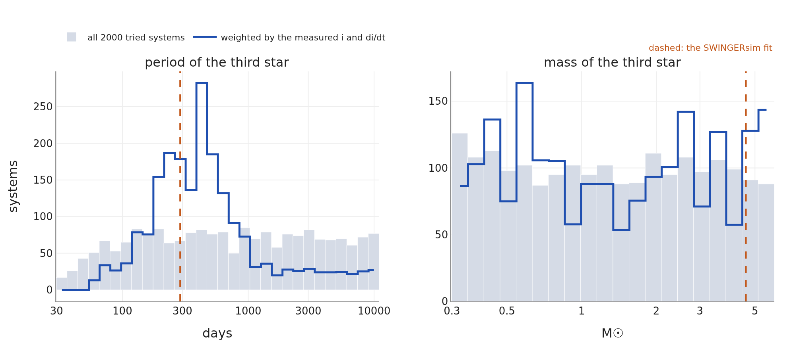

# QX Cas

## Co uvádějí práce

QX Cas je 6,0denní excentrická dvojhvězda ze dvou hvězd raného typu B v mladé otevřené hvězdokupě
NGC 7790. Její zákryty, hluboké asi 0,32 a 0,28 mag (Guinan et al. 2012b; abstrakt neuvádí pásmo), byly
pozorovány fotoelektricky kolem roku 1960 (Sandage & Tammann 1969) a 1980 (Moffett & Barnes 1983). Starší
okamžiky minim z let 1933–1974 pocházejí z fotografických desek a vizuálních odhadů. Guinan et al. (2012a,
obr. 2 a 3), kteří převzali řešení světelných křivek programem PHOEBE od Bonara et al. (2009, publikováno
jen jako abstrakt), uvádějí sklony asi 85,4° kolem roku 1960 a 82° kolem roku 1980 a z fotometrie FCAPT
z let 2003–2008 (více než 110 nocí, žádné zákryty) asi 76° od roku 2003. Uvádějí také, že fotometrie
A. Hendena z poloviny 90. let žádné zákryty neukazuje. Změna je připisována precesi poháněné neviděným
třetím tělesem. Žádná třetí hvězda nebyla zjištěna a práce neuvádějí, zda řešení světelných křivek
zahrnovala třetí světlo. Spektroskopická dráha (e = 0,22) z práce Kjurkchieva et al. (2007) je citována ve
fóru AAVSO (Henden 2020), ale samotnou publikaci se nám nepodařilo dohledat.

**Otázky pro SWINGERsim:** jaká třetí hvězda dokáže dráhu stáčet dostatečně rychle; byly staré zákryty dost
hluboké, aby byly vidět, a s jakým třetím světlem; a co bychom měli vidět dnes, když dvojhvězda už
nezakrývá?

## Kde může být neviděná třetí hvězda

Ansámbl se ptá, které třetí hvězdy dokážou stáčet dráhu naměřenou rychlostí. Bylo vylosováno 2000 soustav
se třetí hvězdou o 0,3–6 M☉, vnější periodou 30–11 000 d, vnější excentricitou 0–0,6 a libovolnou
orientací; ponechány byly jen soustavy stabilní podle Mardlinga & Aarsetha (2001). Každá soustava byla
zintegrována 30 let dopředu i dozadu a vážena podle toho, jak dobře dává sklon kolem roku 1980
(82 ± 1,5°) a jeho změnu (−0,23 ± 0,08°/rok, lineární rychlost plynoucí z Guinana et al. 2012a).

**Jak číst obrázek 7.** Šedé histogramy ukazují, co bylo vyzkoušeno (všechny periody a hmotnosti stejně
pravděpodobné v logaritmické škále). Modrá čára ukazuje, které z nich dokážou vytvořit pozorovanou
precesi. Rychlost precese roste s hmotností třetí hvězdy a strmě klesá s její vzdáleností (zhruba jako
m₃ P₁/P₃²), takže třetí hvězdy blíže než asi 100 d stáčejí dráhu příliš rychle (nebo jsou nestabilní)
a hvězdy vzdálenější než několik tisíc dní příliš pomalu. Samotná hmotnost je omezena málo, protože lehká
hvězda blízko a těžká hvězda dále dávají stejnou rychlost.

**Tabulka 4.** QX Cas: třetí hvězda podle váženého ansámblu (16 %, 50 %, 84 %; efektivní počet soustav
187).

| veličina | 16 % | medián | 84 % |
|---|---|---|---|
| perioda P₃ [d] | 193 | 414 | 1028 |
| hmotnost m₃ [M☉] | 0,46 | 1,33 | 3,87 |
| vzájemný sklon [°] | 44 | 85 | 135 |

80 % váhy leží na P₃ = 100–1000 d. Ve 13 % všech vyzkoušených soustav se obě hvězdy páru do 30 let
srazily; tyto soustavy měly dráhu třetí hvězdy téměř kolmou, což napumpuje excentricitu páru (efekt von
Zeipela–Lidova–Kozaie). QX Cas přežila desítky milionů let, takže její třetí hvězda na takové dráze
pravděpodobně není.

## Fit, který ví, že zákryty zmizely

Fit použil 96 minim z let 1933–1974 a osm informací o sklonu: dva sklony ze světelných křivek (~1960,
~1980), horní mez 75° pro roky 2003–2008, „pár zakrýval“ ve 30. letech a „žádné zákryty“ pro roky
2003–2008 (FCAPT) a pro TESS 2019, 2022 a 2024. Volných bylo devět parametrů (perioda, fáze, vektor
excentricity a sklon páru; vnější perioda, sklon a uzel; m₃), se širokými apriorními rozděleními
m₃ = 3 ± 2 M☉ a P₃ = 400 ± 300 d; vnější excentricita byla fixována na 0,2. „Pár zakrýval“ vstoupilo ve
své nejslabší podobě: sklon modelu musel být nad mezí zákrytů, tj. geometrický zákryt. Další oddíl
ukazuje, že to nestačí.

**Jak číst obrázek 8.** Publikovaná dvojhvězda (oranžově) je nakreslena na místě nafitovaného páru. Fit
přidává třetí hvězdu o 4,6 M☉ na 288denní dráze (velká elipsa vlevo). Prostřední panel ukazuje pár v roce
1980, referenčním datu fitu, při sklonu 81,8°: disky se překrývají, takže tehdy zakrýval. V pravém panelu
obíhá osa páru kolem celkového momentu hybnosti jednou asi za 137 let; žlutý prstenec opustila kolem roku
2000 a vrátí se do něj kolem roku 2070. Dráha osy se přesně neuzavírá, protože apsidální pohyb
excentrického páru pomalu mění mez zákrytů (tečkovaná kružnice).

**Jak číst obrázek 9.** Nafitovaný sklon zůstává pod 90°, takže pozorovatelná i rozložená křivka jsou
stejné. Překračuje mez zákrytů v roce 1933, kolem roku 1965 dosahuje 86°, v roce 1980 klesá přes 81,8°
a zákrytový rozsah opouští v roce 1999. Splňuje všech osm informací (χ² = 0,1). Horní okraj šedé oblasti,
mez zákrytů, není konstantní: závisí na vzdálenosti hvězd v konjunkci, která se mění, jak se excentrická
dráha páru stáčí (apsidální pohyb). Geometrické zákryty se v tomto fitu vracejí v roce 2071; MCMC (níže) klade návrat kamkoli mezi
začátek 70. let 21. století a dobu po roce 2150.

**Všimněte si zeleného křížku.** Leží přesně na mezi zákrytů (model 70,58°, mez 70,59° v roce 1933): fit
zvedl sklon 30. let právě tak vysoko, aby nastal geometrický zákryt, a ne výš. To je varovný signál a je
předmětem dalšího oddílu.

## Byly zákryty dost hluboké, aby byly vidět? Hloubka a třetí světlo

Geometrický zákryt blízko meze je tečný: jedna hvězda zakryje jen tenký okraj druhé. Abychom věděli, zda
mohl být zákryt **pozorován**, spočítali jsme jeho hloubku. Pro hvězdy fitu (R₁ = 3,5 R☉, 24 000 K;
R₂ = 5,1 R☉, 18 000 K, ze spektrálních typů a relativních poloměrů podle Guinana et al. 2012a) spočítal
SWINGERsim světelnou křivku samotného páru, s kulovými hvězdami a bez změn jasnosti mimo zákryty, pro sklony
66–90° a pro každou orientaci ω excentrické dráhy. Hloubka pak plyne podél nafitované historie sklonu.
Světlo třetí hvězdy nebo jakéhokoli jiného zdroje bylo přidáno jako podíl l₃ celkového světla.

**Jak číst obrázek 10.** Vlevo: geometrický zákryt začíná asi při 71°, ale mělčí než 0,02 mag zůstává až
do asi 73° a 0,1 mag dosahuje až při **78°** (74,5–78° podle ω; 79° s 20 % třetího světla). Pod asi 87° se
hvězdy nikdy nezakryjí úplně, proto hloubka roste až k tomuto sklonu. Vpravo: podél nafitované historie se
zákryty stávají zjistitelnými na fotografických deskách až od roku **1943** (1945 s 20 % třetího světla) do
roku 1987,5 a fotoelektricky od roku 1937 do 1994,5. V roce 1933 je modelový zákryt hluboký jen
**0,0006 mag**.

**Tabulka 5.** QX Cas: sklon potřebný pro zjistitelný primární zákryt v B, pro hvězdy fitu (orientace ω
z roku 1980; v závorce rozsah přes všechna ω).

| mez zjistitelnosti | bez třetího světla | 20 % třetího světla |
|---|---|---|
| fotografická, ≈ 0,10 mag | 78,0° (74,5–78,0°) | 79,0° (75,5–79,0°) |
| fotoelektrická, ≈ 0,02 mag | 73,5° (71,5–75,0°) | 74,0° (71,5–75,5°) |

**To je v rozporu s daty.** VarAstro uvádí 11 fotografických minim z let 1933–1942 (Kippenhahn, Perova,
Erleksova), první v roce 1933. V nafitovaném modelu by tyto zákryty byly na deskách neviditelné. Buď tedy
byl sklon ve 30. letech alespoň ~76–78°, výš, než dává náš fit, nebo tato raná minima nejsou tím, čím se
zdají (například okamžiky minim jiné hvězdy nebo několika desek s velkými chybami). Fit má pro třetí hvězdu
288 dní a uzlovou periodu 137 let; vyšší sklon ve 30. letech vyžaduje dřívější vzestup, tedy jinou fázi
precese nebo rychlejší precesi. Nezávisle by mohly rozhodnout desky harvardské sbírky (DASCH), které
pokrývají NGC 7790 zhruba v letech 1900–1950: jsou-li minima 30. let skutečná, měl by být na nich před
rokem 1943 vidět zákryt hluboký 0,1 mag nebo více. Další oddíl se ptá, zda vůbec může mít nějaký model ve
30. letech hluboké zákryty.

**Hloubky z 60. a 80. let vyžadují třetí světlo.** Při publikovaných sklonech dává model hlubší zákryty,
než jaké byly pozorovány (pásmo V, ω z roku 1980). Guinan et al. (2012b) neuvádějí, v jakém pásmu byly
hloubky z 60. let změřeny; jejich srovnání s modelovými hloubkami v pásmu V je náš předpoklad a tabulka 6
je v tomto rozsahu nejistá:

**Tabulka 6.** QX Cas: modelové hloubky zákrytů při publikovaných sklonech a třetí světlo potřebné k tomu,
aby byly tak mělké, jak byly pozorovány.

| epocha, sklon | zákryt | modelová hloubka (bez třetího světla) | pozorováno | potřebné třetí světlo |
|---|---|---|---|---|
| ~1960, 85,4° | primární | 0,50 mag | 0,32 mag | 31 % |
| ~1960, 85,4° | sekundární | 0,33 mag | 0,28 mag | 13 % |
| ~1980, 82° | primární | 0,24 mag | 0,12 mag | 47 % |

Jedna hodnota třetího světla nedokáže učinit oba zákryty z roku 1960 tak mělkými, jak byly pozorovány,
a hodnota potřebná v roce 1980 se liší od hodnoty z roku 1960. Samotné třetí světlo proto hloubky
nevysvětluje; poměr povrchových jasností obou hvězd (jejich teplot a poloměrů) a samotné sklony se musí
lišit od toho, co jsme převzali, jak nás upozornil J. Kolář. Nafitovaná třetí hvězda o 4,6 M☉ by přispívala
asi 12–14 % světla ve V (modely MIST, Choi et al. 2016, ve stáří NGC 7790), což je správný řád, ale ne
úplné vysvětlení. Mez zákrytů závisí jen na R₁ + R₂, takže geometrická data přechodů na třetím světle
nezávisejí; data zjistitelnosti ano, o 1–4 roky (obr. 10 vpravo).

## Druhý fit: hluboké zákryty ve 30. letech {#qx-fit-deep}

Abychom ověřili, zda lze stará fotografická minima sladit se zbytkem dat, zopakovali jsme fit se stejnými
96 minimy a apriorními rozděleními, ale fotografické zákryty jsme zadali jako **zjistitelné**: sklon
alespoň 76 ± 1,5° v letech 1933 a 1974, tedy hodnotu, při níž zákryt nafitovaných hvězd dosahuje v B asi
0,1 mag (tabulka 5, s jistou rezervou pro ω a třetí světlo). Všechny ostatní informace o sklonu jsou
stejné jako předtím.

**Tabulka 7.** QX Cas: fit se zjistitelnými fotografickými zákryty („hluboká 30. léta“) ve srovnání s fitem
výše („geometrická 30. léta“). Každý řádek je jedna veličina; hodnoty jsou nejlepší fity s linearizovanými
chybami 1σ. Hloubky jsou v B pro hvězdy fitu bez třetího světla. *Zjistitelný* znamená hlubší než 0,1 mag
(fotograficky) nebo 0,02 mag (fotoelektricky).

| veličina | geometrická 30. léta (výše) | hluboká 30. léta |
|---|---|---|
| χ² devíti informací o sklonu | 0,1 | 0,2 |
| sklon v roce 1933 | 70,6° (na mezi zákrytů) | 75,8° (0,1σ pod požadovanými 76°) |
| sklon ~1960, 1980 | 85,6°, 81,8° | 85,7°, 81,5° |
| hloubka zákrytu v roce 1933 | 0,0006 mag | 0,069 mag |
| geometrické zákryty | 1933–1999, návrat 2071 | 1922–2005,5, návrat 2058 |
| zjistitelné na deskách | 1943–1987,5 | 1936,5–1989,5 |
| zjistitelné fotoelektricky | 1937–1994,5 | do 1999,0 |
| třetí hvězda m₃, P₃ | 4,6 ± 0,6 M☉, 288 ± 1 d | 4,56 ± 0,68 M☉, 287,8 ± 0,9 d |
| sklon vnější dráhy | – | 72,5 ± 2,5° |
| rms 96 minim | 98 min (fotografická) | 101 min (všechny zdroje) |

Nový fit dosahuje v roce 1933 sklonu 75,8°, v rámci 0,1σ od požadavku, a stále splňuje sklony z let 1960
a 1980, horní mez z let 2003–2008 i nepřítomnost zákrytů v letech 2003–2024 (model 69,4° v roce 2006 proti
mezi zákrytů 70,0°). Třetí hvězda se nemění. Zákryty z roku 1933 mají nyní v B 0,069 mag: v tom roce stále
mělčí než 0,1 mag, ale na deskách zjistitelné od roku 1936,5, takže většina fotografických minim z let
1933–1942 padne do intervalu zjistitelnosti.

**Cenou jsou 90. léta.** Aby byl sklon brzy vysoko, musí stoupat dříve, a posune se celá historie:
geometrické zákryty nyní trvají do roku 2005,5 a zákryty zůstávají hlubší než 0,02 mag do roku 1999,0.
A. Henden v polovině 90. let žádné zákryty neviděl (Guinan et al. 2012a). S převzatými poloměry a teplotami
jdou hluboké zákryty ve 30. letech a nepřítomnost zákrytů v polovině 90. let proti sobě. Sladit je lze jen
tehdy, je-li hloubka zákrytu při daném sklonu jiná, než dávají naše hvězdy, tj. pokud se poloměry a poměr
světla obou hvězd (a třetí světlo) fitují společně se starými hloubkami. To je tentýž závěr, na který
ukazuje třetí světlo v tabulce 6: slabým článkem jsou převzaté parametry hvězd, ne dynamika.

**Co o datech říká ansámbl.** Oba fity jsou jednotlivé soustavy. Abychom získali rozsah dat, zintegrovali
jsme ansámbl z obrázku 7 (1654 z 2000 soustav, které nesou nějakou váhu; zbylých 346 má váhu nulovou) přes
roky 1900–2100 a zaznamenali, kdy každá soustava začíná a přestává geometricky zakrývat.

- **Vážen jen sklonem a jeho změnou kolem roku 1980** (187 efektivních soustav): 91 % váhy zakrývá v roce
  1933. Jen 15 % váhy končí své zákryty mezi lety 1900 a 2025, v letech 1997–2011,5–2021,5 (16–50–84 %).
  Z nich se 12 % vrací do roku 2100, v letech 2046–2058–2086. Většina soustav se správným sklonem
  a rychlostí v roce 1980 prostě zakrývá dál: dvě čísla z roku 1980 historii neurčují.
- **Vážen navíc celou historií sklonu** (1960, 1980, mez z roku 2005, žádné zákryty 2003–2024 a kterákoli
  podoba 30. let): zůstává jen jedna nebo dvě efektivní soustavy. Jejich zákryty končí asi v roce 2002
  a vracejí se kolem roku 2079.

Ansámbl tedy neobsahuje téměř žádné soustavy, které by splňovaly celou historii: losovat třetí hvězdu
náhodně a vážit až potom je zde příliš neefektivní, protože historie je úzký cíl v devítirozměrném prostoru.
Spolehlivý rozsah dat vyžaduje hledání podmíněné historií, tj. MCMC samotného fitu s historií sklonu jako
daty (*Fyzika a metody*, kapitola Fitování pozorovaných dat).

**MCMC fitu s hlubokými 30. léty.** Posteriorní rozdělení druhého fitu jsme vzorkovali se všemi jeho daty:
96 minimy a devíti informacemi o sklonu (emcee, 24 chodců × 6000 kroků, prvních 3000 vyřazeno).
Autokorelační doba je 311 kroků, takže ponechaný řetězec je dlouhý 9,6 autokorelační doby, těsně pod
obvykle požadovanými deseti; níže uvedené rozsahy jsou proto přibližné. 300 vzorků bylo integrováno
přes 1900–2150 a byla zaznamenána přepnutí zákrytů.

- **Konec zákrytů:** poslední přepnutí před rokem 2026 leží v letech 2000,0–2004,0–2006,5 (16–50–84 %).
  Data jej určují s přesností několika let.
- **Návrat:** 2071,9–2110,0–2130,1 a 12 z 300 vzorků (4 %) se nevrátí před rokem 2150. Návrat data
  neurčují: χ² je plochý v P₃ přibližně od 270 do 400 d a uzlová perioda, která návrat určuje, se s ní mění.
- **Třetí hvězda:** m₃ 2,5–3,9–5,2 M☉, sklon vnější dráhy 61,9–66,6–72,5°.

Nejlepší fity (konec 1999–2005,5, návrat 2058–2071) jsou tedy jednotlivé body širokého posteriorního
rozdělení. Konec zákrytů kolem let 2000–2006 je výsledek; návrat nikoli, s daty souhlasí cokoli od
začátku 70. let 21. století až po dobu po roce 2150.

**Tabulka 8.** QX Cas: práce a SWINGERsim.

| veličina | Guinan et al. (2012a,b) | SWINGERsim |
|---|---|---|
| sklon ~1960, ~1980 | 85,4°, 82° | 85,6°, 81,8 ± 1,5° |
| zákryty chybějí | polovina 90. let (Henden), 2003–2008 (FCAPT) | geometricky po roce 1999; hlubší než 0,02 mag jen do roku 1994,5 |
| pokles sklonu | ~0,23°/rok (85,4° kolem 1960 na ~76° od 2003) | ~0,5°/rok v roce 1980, 0,7–0,8°/rok kolem roku 2000; uzlová perioda 137 let |
| třetí hvězda | neviděna | ansámbl: P₃ 190–1030 d, m₃ 0,5–3,9 M☉; fit: 288 ± 1 d, 4,6 ± 0,6 M☉ |
| třetí světlo | neuvedeno | potřebné pro staré hloubky: 13–47 % (tab. 6); třetí hvězda o 4,6 M☉ dává ~12–14 % |
| excentricita páru | 0,21 | 0,23 |
| fotografická minima 1933–1942 | pozorována (VarAstro) | geometrický fit: nezjistitelná před rokem 1943; fit s hlubokými 30. léty: zjistitelná od 1936,5, ale zákryty pak trvají do 1999,0 |
| návrat zákrytů | – | geometricky 2058–2071 (oba fity); MCMC fitu s hlubokými 30. léty: 2072–2110–2130, 4 % ne před rokem 2150 |
| okamžiky minim: rms | – | fotoelektrická 45 min, fotografická 98 min, vizuální 107 min |

**Sklon musí klesat rychleji než podle publikované lineární rychlosti.** V SWINGERsimu je mez zákrytů páru
(z R₁ + R₂ = 0,27 a, relativních poloměrů podle Guinana et al. 2012a, a z excentrické dráhy) asi 70,5°.
Byl-li sklon v roce 1980 82° a do roku 2003 už nebyly zákryty, musel během 23 let klesnout pod 70,5°, tj.
v průměru alespoň o 0,5°/rok. Fit dělá přesně to: sklon vrcholí kolem roku 1965 a pak klesá stále
rychleji. Stálých 0,23°/rok by udrželo QX Cas zakrývající zhruba do roku 2030. Publikovaná hodnota asi 76°
od roku 2003 pochází z modelu světelné křivky, v němž 76° nedává zákryty, kdežto v našem modelu by
geometrický zákryt pokračoval až do 70,5°. Náš výpočet hloubek ukazuje, jak obojí sladit: při 76° je
modelový zákryt hluboký jen asi 0,06 mag a FCAPT, která žádný neviděla, by jej zachytila, takže 76° je
i v našem modelu horní mez. Proto jsme tuto hodnotu použili jen jako horní mez (75 ± 1°). Výše uvedený
ansámbl použil pomalejší lineární rychlost; rychlejší rychlost posouvá třetí hvězdu blíže nebo ji činí
těžší, takže rozsah ansámblu je na straně dlouhých period spíše příliš široký.

**Proč je nafitovaná třetí hvězda těžší než medián ansámblu.** Nafitovanou periodu třetí hvězdy (288 d)
určuje hlavně rychlost precese a apriorní rozdělení, protože 96 starých minim má rozptyl jedné až dvou
hodin a nedokáže změřit efekt světelného času o velikosti několika minut. Těžší třetí hvězda při stejné
periodě stáčí dráhu rychleji, čehož fit využívá, aby sklon klesal dost rychle. Výsledkem je rozsah ansámblu
(190–1030 d, 0,5–3,9 M☉); fit je jedna konkrétní soustava, která splňuje vše, co je o sklonech známo.

## Ověřená předpověď: dvojhvězda viděná bez zákrytů

Excentrická dvojhvězda mění jasnost i bez zákrytů. Poblíž periastra jsou si obě hvězdy nejblíže: jejich
slapová deformace (elipsoidální proměnnost) a ohřev jedné hvězdy druhou jsou největší a soustava se jednou
za oběh krátce zjasní („heartbeat“, tlukot srdce; Thompson et al. 2012). SWINGERsim to počítá ze stejného
modelu, který dává dráhy. Pro dnešní QX Cas předpovídá změnu asi 1 ppt, opakující se každých 6,0 dne.

**Proč je většina signálu na polovině a třetině periody.** Hvězda deformovaná slapy je protažená směrem ke
svému průvodci. Největší ji vidíme dvakrát za oběh (když se díváme na její dlouhou stranu, v kvadraturách)
a nejmenší také dvakrát (v konjunkcích), takže elipsoidální proměnnost má za oběh dvě maxima: její perioda
je P/2 (druhá harmonická oběžné frekvence). Na excentrické dráze je deformace silná jen během krátkého
průchodu periastrem a po zbytek oběhu slabá. Krátké zjasnění jednou za oběh není sinusovka. Zapsáno jako
součet sinusovek (Fourierova řada) potřebuje oběžnou periodu P spolu s jejími harmonickými P/2, P/3, P/4 …,
a pro e ≈ 0,2 je výkon největší na P/2 a P/3. Periodogram proto ukazuje dvojhvězdu nejsilněji na 3,0
a 2,0 dne, ne na 6,0 dne.

Tento signál jsme hledali ve světelných křivkách TESS z let 2019–2024 (osm sektorů SPOC mezi 18 a 85,
celkem asi 200 dní, 30minutové biny). QX Cas leží ve hvězdokupě a světlo sousedních hvězd proniká do
fotometrie: nejprve bylo odstraněno šest periodických signálů nesouvisejících s dvojhvězdou (1,04, 1,72,
3,18, 5,35, 5,63 a 6,43 d). Stejné kroky byly použity i na modelovou světelnou křivku SWINGERsimu, takže data
i model byly zpracovány stejně.

**Jak číst obrázek 11.** Levý panel ukazuje, jak silně je každá perioda ve světle přítomna. Nejvyšší
vrcholy leží na P/2 a P/3 periody dvojhvězdy: dvojhvězda je ve světle stále vidět. Pravý panel skládá všech
osm sektorů s periodou dvojhvězdy a průměruje je ve 40 binech.

**Tabulka 9.** QX Cas: amplituda signálu dvojhvězdy v TESS a v předpovědi SWINGERsimu (stejné zpracování).
Šum: 99 % náhodných period dává méně než 0,47 ppt.

| harmonická | perioda [d] | TESS [ppt] | SWINGERsim [ppt] |
|---|---|---|---|
| 1 | 6,005 | 0,55 ± 0,14 | 0,98 |
| 2 | 3,003 | **1,22 ± 0,09** | 0,84 |
| 3 | 2,002 | **0,81 ± 0,09** | 0,72 |
| 4 | 1,501 | 0,17 ± 0,06 | 0,53 |

**Dvojhvězda je zjištěna bez zákrytů, na předpovězené úrovni.** Nejvyšší vrchol celého periodogramu
(1,2–12 d) leží na 3,0019 d, polovině 6,0038 d, zatímco oběžná perioda ze zákrytů 20. století je
6,0039 d. Druhá a třetí harmonická jsou signály 14σ a 9σ s amplitudami v rámci asi 30 % od modelových.

**Tvar zatím nesedí.** Naměřené zjasnění je méně ostré než modelové a leží v jiné fázi (obr. 11 vpravo).
Shoda fáze se ani neočekává: model extrapoluje okamžiky průchodu periastrem z minim z let 1933–1974 přes
asi 2900 oběhů a samotná chyba periody fitu (±0,0002 d) posouvá fázi o ±0,1 oběhu; orientace dráhy (ω) po
50 letech apsidálního pohybu je stejně nejistá. Tvar závisí na ω, na sklonu a na parametrech hvězd, které
(viz výše) nejsou kalibrovány na starých zákrytech. Světelná křivka TESS proto nese informaci o dnešní
dráze, kterou stará minima dát nemohou, a její fit je přirozeným dalším krokem.

## Závěr

- **Potvrzuje**, že třetí hvězda dokáže stáčet dráhu QX Cas pozorovanou rychlostí a v 90. letech vypnout
  její zákryty. Stabilní soustava, která to dělá, existuje a splňuje všechny informace o sklonu, včetně
  nepřítomnosti zákrytů v letech 2003–2024.
- **Přidává:** kde může být třetí hvězda: nejpravděpodobněji P₃ ≈ 0,5–3 roku, m₃ ≈ 0,5–4 M☉,
  pravděpodobně ne na téměř kolmé dráze. Taková hvězda posouvá radiální rychlost páru o několik až
  25 km/s během měsíců až let, což mohou ověřit spektra.
- **Přidává:** dvojhvězda je v TESS zjištěna bez zákrytů, na své oběžné periodě a s předpovězenou
  amplitudou změn poblíž periastra.
- **Liší se:** sklon musel klesat nejméně dvakrát rychleji, než udává publikovaná lineární rychlost
  (≥ 0,5°/rok po roce 1980), a v našem modelu se zákryty stávají nezjistitelnými v letech 1987,5–1994,5, ne
  později.
- **Otevřený problém, nalezený výpočtem hloubek:** fotografická minima z let 1933–1942 vyžadují tehdejší
  sklon alespoň ~76–78°. Fit, který to vynucuje, existuje (75,8° v roce 1933, zákryty zjistitelné na
  deskách od roku 1936,5), ale jeho zákryty pak zůstávají zjistitelné až do roku 1999,0, v rozporu
  s nepřítomností zákrytů v polovině 90. let. Staré hloubky zákrytů navíc vyžadují třetí světlo, které se
  mění mezi zákryty i epochami. Obojí ukazuje na převzaté poloměry hvězd a poměr světla: ty je třeba
  fitovat společně se starými hloubkami a se světelnou křivkou TESS. Desky DASCH mohou 30. léta ověřit
  nezávisle.
- **Data:** MCMC fitu s hlubokými 30. léty klade konec geometrických zákrytů do let 2000,0–2006,5
  (16–84 %). Jejich návrat omezen není: 2072–2130 a 4 % vzorků ne před rokem 2150.
- **Opatrnost:** sklony z ~1960 a ~1980 jsou odečteny z Guinana et al. (2012a); jejich chyby jsou naše
  předpoklady a podkladová řešení (Bonaro et al. 2009) nejsou publikována. SWINGERsim proto dává omezení na
  třetí hvězdu, nikoli její detekci.
