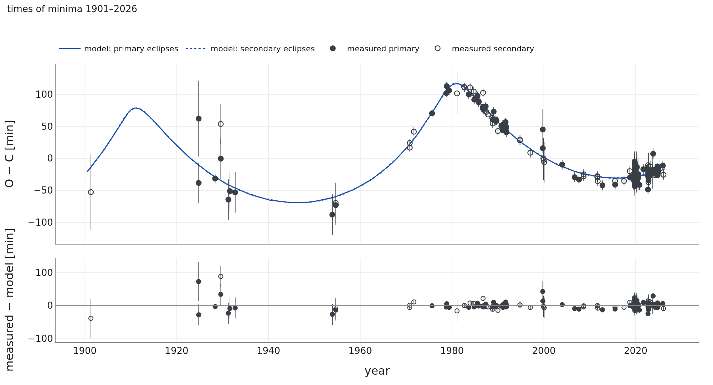

# AH Cep

## Co uvádějí práce

AH Cep je jedna z nejhmotnějších zákrytových dvojhvězd v Galaxii: dvě hvězdy B0.5 V o hmotnostech
16,14 ± 0,26 a 13,69 ± 0,21 M☉ na kruhové 1,775denní dráze se sklonem 69,81 ± 0,60° a s relativními
poloměry 0,340 a 0,295, téměř vyplňující své Rocheovy laloky (Pavlovski et al. 2018). Toto řešení pochází
ze světelných křivek ve Strömgrenově systému uvby od Bella et al. (1986), s poměrem světla obou hvězd
fixovaným na spektroskopickou hodnotu 0,715 ± 0,020 a bez třetího světla; spektra připouštějí nejvýše 2 %
třetího světla pro průvodce s podobnými čarami. Okamžiky zákrytů od roku 1901 ukazují dlouhou vlnu,
interpretovanou jako efekt světelného času způsobený třetím tělesem na ~68leté dráze s e ≈ 0,53
a poloviční amplitudou asi 0,059 d; byla navržena i druhá, ~9letá dráha možného čtvrtého tělesa (Kim et al.
2003, 2005). Drechsel et al. (1989) ohlásili dlouhodobou změnu amplitudy světelné křivky, což by znamenalo
změnu sklonu; Pavlovski et al. (2018) toto tvrzení označují za „nepodložené“, tj. nepodpořené pozdějšími
pracemi, sami je však netestovali.

**Otázka pro SWINGERsim:** je vlna v okamžicích zákrytů třetím tělesem, čím může být, může ono nebo čtvrté
těleso měnit sklon dvojhvězdy a co říkají světelné křivky TESS?

## Soustava: publikovaná a nafitovaná

**Jak číst obrázek 12.** Měřítko levého panelu jsou desítky au: pár se pohybuje po malé elipse kolem
společného těžiště, třetí těleso po velké, velmi excentrické. V prostředním panelu hvězdy téměř vyplňují
prostor mezi sebou, jde o dvojhvězdu blízkou kontaktu. V pravém panelu sedí osa páru v zákrytovém prstenci
a nehýbe se: třetí těleso je příliš daleko, aby během staletí stočilo dráhu páru.

## 125 let okamžiků zákrytů

**Jak číst obrázek 13.** Zákryty přicházejí až o hodinu a půl později nebo dříve ve srovnání s přesnými
hodinami. To je doba šíření světla napříč dráhou páru kolem třetího tělesa: zákryty se zpožďují, když je
pár na odvrácené straně této dráhy (kolem roku 1980). Strmá část v 70. letech je průchod excentrické vnější
dráhy periastrem, kdy se pár pohybuje nejrychleji. Dynamický účinek třetího tělesa je zde zanedbatelný
(vnější dráha je 14 000krát delší než vnitřní). Model sleduje minima z TESS s přesností 0,6–1 min
v nejlepších sektorech (S18, S78) a 125letou vlnu s přesností každého zdroje.

**Tabulka 10.** AH Cep: práce a SWINGERsim.

| veličina | práce | fit SWINGERsimu |
|---|---|---|
| hmotnosti páru | 16,14 ± 0,26, 13,69 ± 0,21 M☉ (Pavlovski et al. 2018; použito jako apriorní rozdělení) | 15,85 ± 0,19, 13,55 ± 0,19 M☉ |
| vnější perioda | ~68 let (Kim et al. 2003, 2005) | **69,7 ± 0,9 roku** |
| vnější excentricita | ~0,53 (Kim et al. 2003) | **0,63 ± 0,03** |
| poloviční amplituda efektu světelného času | ~0,059 d (Kim et al. 2003) | 0,058 d |
| třetí těleso | – | **m₃ sin i₃ ≈ 6,6 M☉, tedy m₃ ≥ 6,6 M☉** |
| změna sklonu | ohlášena (Drechsel et al. 1989), označena za nepodloženou (Pavlovski et al. 2018) | **0,02° za 400 let** od třetího tělesa |
| stabilita | – | velmi hierarchická (poměr Mardlinga–Aarsetha ≥ 52 pro jakýkoli vzájemný sklon) |
| okamžiky minim: rms | – | TESS 0,6–2,6 min (nejlepší sektory), CCD 8,5 min, fotoelektrická 6,6 min, vizuální 31 min |

Okamžiky zákrytů měří velikost dráhy páru kolem třetího tělesa a její periodu. Z nich plyne hmotová
funkce, která pro hmotnosti páru dává m₃ sin i₃ ≈ 6,6 M☉. Hmotnost a sklon dráhy třetího tělesa nelze
oddělit (ve fitu je jejich korelace −1,000): jakákoli m₃ ≥ 6,6 M☉ s odpovídajícím i₃ vyhovuje stejně
dobře.

## Čtvrté těleso?

Může čtvrté těleso skryté v okamžicích zákrytů naklánět pár? Byl zintegrován ansámbl 1500 čtvrtých těles
o 0,3–8 M☉ na drahách kolem páru (perioda 100–5000 d, excentricita 0–0,6, libovolná orientace) se třetím
tělesem podle fitu, 20 let dopředu i dozadu. Ponechány byly jen soustavy stabilní podle Mardlinga
& Aarsetha (2001); se 70letým excentrickým třetím tělesem to připouští periody jen asi do 2,8 roku. Pro
každou soustavu byl efekt světelného času páru na dráze čtvrtého tělesa přičten k reziduím fitu tří těles;
pokud se χ² zhoršilo o více než 25 (po novém proložení kvadratické efemeridy), čtvrté těleso by bylo
viděno.

**Jak číst obrázek 14.** Každý symbol je jedno možné čtvrté těleso. Hmotná tělesa (> 3 M☉) jsou okamžiky
zákrytů většinou vyloučena (84 %), lehká (< 1 M☉) většinou skrytá (89 %); největší skrytý signál efektu
světelného času je ±3 min. 859 z 1500 těles (57 %) je v okamžicích zákrytů skrytých. Skryté čtvrté těleso
může pár přesto naklánět: 153 z nich (18 % skrytých, většinou s periodami pod půl roku) by dnes měnilo
sklon o více než 0,06° za rok. Stálé hloubky zákrytů v TESS (další oddíl) je vylučují.

Plynou z toho dva závěry. Zaprvé, ~9leté čtvrté těleso Kima et al. (2003, 2005) nemůže obíhat kolem páru:
se 68–70letým třetím tělesem na dráze s e ≈ 0,5–0,6 je 9letá dráha kolem páru nestabilní podle kritérií
Mardlinga & Aarsetha (2001) i Vynatheyi et al. (2022) (poměry stability 0,3–0,6 místo > 1) pro jakoukoli
hmotnost a orientaci. Zadruhé, okamžiky zákrytů čtvrté těleso nepotřebují, a pokud existuje, mění sklon
páru dnes o méně než asi 0,06°/rok.

## Co říkají světelné křivky TESS: sklon a třetí světlo

Hvězda hlavní posloupnosti o ≥ 6,6 M☉ stejného stáří jako pár (asi 6 Myr) je hvězda raného typu B. Podle
modelů MIST (Choi et al. 2016) by jedna hvězda o 6,6–7 M☉ přispívala **7,0–7,9 %** světla v pásmu TESS
a pár hvězd o 3,5 + 3,3 M☉ se stejnou celkovou hmotností 3,2 %. Takové světlo ředí zákryty.

Co říkají zákryty v TESS, jsme zjišťovali dvěma způsoby.

1. **Publikovaný pár, prohledávání sklonu.** Pro sklony mezi 69,8° a 76° jsme spočítali světelnou křivku
   publikovaného páru (poloměry a teploty podle Pavlovského et al. 2018, Rocheovy plochy) a proložili jí
   sektory 77 a 78 (2024) a 18 (2019) s volným konstantním třetím světlem.
2. **Fit s volnými hvězdami.** Fit SWINGERsimu sektorů 77 a 78 s volným sklonem, oběma poloměry a teplotou
   sekundární složky, s Rocheovými plochami, s 216 minimy z TESS pro časování, se zohledněním
   korelovaného šumu světelné křivky (faktor červeného šumu β ≈ 2,2; Pont et al. 2006) a s hloubkou
   každého úseku světelné křivky škálovanou volným faktorem. Model obsahuje světlo třetí hvězdy o 7 M☉,
   takže škálovací faktor měří, kolik třetího světla zákryty potřebují.

**Jak číst obrázek 15.** Vlevo: publikovaný pár při 69,8° dává zákryty příliš mělké a příliš široké; fit
(modře) prokládá světelnou křivku s rms 3,0–7,1 ppt. Drobné zlomy křivky tam, kde zákryt začíná a končí
(kolem 7 a 20 hodin), jsou kontakty obou hvězd na obloze: tam zakrytá plocha začíná nebo přestává růst.
Zbývající zvlnění o velikosti několika ppt je zčásti instrumentální (opakuje se na koncích úseků TESS).
Vpravo: každá čára říká, kolik světla je třeba přidat (kladně) nebo ubrat (záporně), aby publikovaný pár
při daném sklonu odpovídal hloubkám zákrytů v TESS. Při 69,8° by bylo nutné světlo ubrat, což je nemožné;
bez jakéhokoli třetího světla vyžadují hloubky asi 71,7° a každé procento třetího světla to zvyšuje asi
o 0,2°. Fit s volnými hvězdami dává **i = 72,50 ± 0,21°** (formálně), R₁ = 6,25 ± 0,05 R☉
a R₂ = 5,88 ± 0,05 R☉ (publikováno 6,51 a 5,64 R☉), T₂ = 28 430 ± 120 K a **asi 5 % třetího světla**.

**Tabulka 11.** AH Cep: zákryty z 80. let a z TESS.

| | Pavlovski et al. (2018) | SWINGERsim, TESS 2024 |
|---|---|---|
| data | uvby, Bell et al. (1986) | sektory TESS 77, 78 |
| sklon | 69,81 ± 0,60° | 72,50 ± 0,21° (formálně) |
| poloměry | 6,51, 5,64 R☉ | 6,25 ± 0,05 R☉, 5,88 ± 0,05 R☉ |
| poměr světla hvězd | 0,715 ± 0,020 (spektra, fixováno) | 0,78 v B (publikované poloměry dávají ve stejném modelu 0,67) |
| třetí světlo | 0 (spektra: < 2 %) | asi 5 % (fitováno) |
| hmotnosti (∝ 1/sin³ i) | 16,14, 13,69 M☉ | 15,4, 13,0 M☉, zkombinují-li se tytéž rychlosti s tímto sklonem |

**Zákryty v TESS se za pět let nezměnily.** Při pevném sklonu potřebuje sektor 18 (2019) asi o 1,3 % více
třetího světla než sektory 77 a 78 (2024). Protože se potřebné třetí světlo mění asi o 4,8 % na stupeň
sklonu, odpovídá to nejvýše 0,27° za 4,4 roku, tj. |di/dt| ≤ 0,06°/rok; část rozdílu tvoří kalibrace TESS
mezi sektory pro tuto jasnou hvězdu.

**Liší se sklon AH Cep od publikovaného?** Otevřena zůstávají tři vysvětlení:

- sklon je vyšší a existuje několik procent třetího světla, světla třetího tělesa o ≥ 6,6 M☉. Hmotnosti
  páru by pak byly nižší. Spektra omezují třetí světlo na < 2 % pro hvězdu s čarami podobnými čarám páru,
  jaké by měla hvězda B2 o teplotě 21 000 K; velmi široké čáry rychle rotující hvězdy by mohly její
  odhalení ztížit;
- třetí těleso je na svou hmotnost slabší (dvě lehčí hvězdy, kompaktní objekt) a poloměry páru se liší od
  publikovaných;
- sklon se nezměnil, ale liší se modely světelných křivek. Pro stejné parametry jsou zákryty SWINGERsimu
  ve V asi o 5 % mělčí než zákryty z PHOEBE a u V907 Sco tatáž tendence posouvá sklon SWINGERsimu o zlomek
  stupně nahoru. U AH Cep byla hloubka každého úseku ponechána volná, takže sklon spočívá na tvaru
  světelné křivky (šířkách zákrytů a elipsoidální proměnnosti), který závisí na Rocheově modelu,
  gravitačním ztemnění a okrajovém ztemnění.

Změnu sklonu mezi 80. lety a rokem 2024 nemůže způsobit třetí těleso (0,02° za 400 let) a skryté čtvrté
těleso by dnes mohlo dát nejvýše asi 0,06°/rok. Rozhodujícím testem je nezávislá analýza světelných
křivek TESS programem PHOEBE nebo kódem Wilsona–Devinneyho s volným třetím světlem.

## Závěr

- **Potvrzuje** dráhu z efektu světelného času podle Kima et al. (2003, 2005): jedno třetí těleso na
  70leté excentrické dráze reprodukuje 125 let okamžiků zákrytů, od vizuálních odhadů po TESS, se stejnou
  poloviční amplitudou.
- **Nesouhlasí** s dynamickou změnou sklonu (Drechsel et al. 1989): třetí těleso mění sklon o 0,02° za
  400 let. To podporuje názor Pavlovského et al. (2018), kteří toto tvrzení označují za nepodložené,
  dynamickým argumentem, který sami neuvedli.
- **Přidává:** třetí těleso musí být hmotné (≥ 6,6 M☉); jako jediná hvězda hlavní posloupnosti by dávalo
  7,0–7,9 % světla. Čtvrté těleso není potřeba; dříve navržené ~9leté čtvrté těleso by bylo dynamicky
  nestabilní a skryté čtvrté těleso by dnes mohlo naklánět pár nejvýše o ~0,06°/rok.
- **Přidává, v rozporu se spektry:** zákryty v TESS (2019, 2024) nejlépe popisuje i ≈ 72,5° a asi 5 %
  třetího světla, ve shodě s předpovězenou třetí hvězdou, ale ne s publikovaným sklonem a spektroskopickou
  mezí třetího světla. Tento výsledek závisí na modelu světelné křivky a vyžaduje nezávislé ověření.
- **Lze ověřit pomocí Gaia a Hipparcos:** 70letá dráha urychluje pár na obloze (viz níže).
