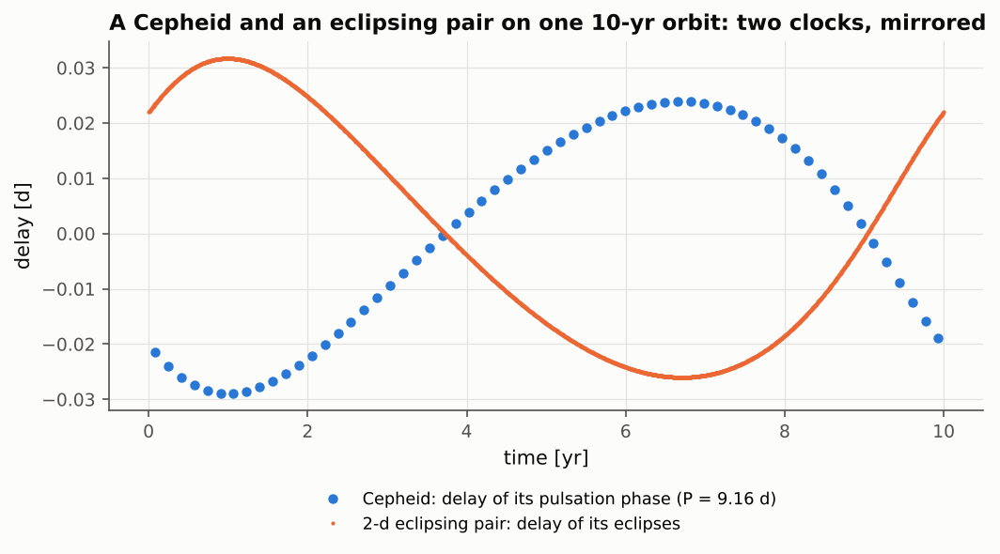

# Life-cycle examples {#life-cycles}

The examples of this chapter are not real systems. They follow a multiple star through a whole phase
of its life and test the coupling of dynamics and stellar evolution – the part of SWINGERsim that is
entirely its own code: the evolving backend, the mass-transfer and common-envelope modules, the
contact-binary model and the light curves with pulsations. Each example is a configuration in the
SWINGERsim distribution; the numbers below are those of its run with the final code. Where a published
result exists for the same physics, it is named; where none exists, the test is that the run obeys the
conservation laws and the published behaviour of each ingredient.

**Table 41.** The life-cycle examples. Column 2 gives the system, column 3 the backend and stellar
model, column 4 how the run ends, column 5 the reference for the physics.

| Example | System | Run | End | Reference |
|---|---|---|---|---|
| giant tertiary | 1.3 + 1.1 M☉ pair, 2.0 M☉ tertiary on a 7.6-au orbit, from 1.2 Gyr | evolving, MIST, winds | Roche-lobe overflow of the giant at 141.83 Myr | Jeans (1924); Cummings et al. (2018) |
| tertiary mass transfer | the same stars, outer orbit 3.62 au | evolving, MIST, tertiary transfer | end of the donor's track at 141.87 Myr | de Vries et al. (2014); Hamers et al. (2022) |
| Algol triple | 2.9 + 0.9 M☉ in 2.7 d (circular, the state at the onset of overflow), 1.6 M☉ tertiary in 680 d, from 390 Myr | evolving, MIST, mass transfer, tides | still transferring at 10 Myr | Hurley et al. (2002) |
| contact binary | 1.0 + 0.5 M☉, $a$ = 0.010 au | evolving, MIST, contact model | merger through L2 at 2.23 Gyr | Gazeas & Stępień (2008); Rasio (1995) |
| common envelope in a triple | 1.8 M☉ giant + 0.5 M☉ in a 10-yr outer orbit | N-body, common envelope | post-common-envelope binary | Hadjidemetriou (1963) |
| pulsating triples | δ Sct star in an eclipsing pair with a long-period-variable tertiary; Cepheid tertiary | light curves and minima | – | Irwin (1952) |

Table 41 is a map of the chapter: each row is one example, described in the section of the same name.

## A giant tertiary on the thermally pulsing AGB {#giant-tertiary}

**Question.** A 2.0 M☉ tertiary around a 1.3 + 1.1 M☉ pair on a 7.6-au orbit ($e$ = 0.3) climbs the giant
branch and the asymptotic giant branch, loses mass in winds and widens the outer orbit. Does it reach
its Roche lobe – that is, does it start to pour mass onto the inner binary?

**Result.** The giant reaches the **thermally pulsing AGB** (TP-AGB), on which the helium shell ignites
in flashes every 10⁴–10⁵ yr and the radius jumps by a factor of 2–4 at each pulse, for a few hundred
years only. The run ends with a Roche-lobe overflow of the giant at outer periastron at 141.83 Myr
(age 1341.8 Myr), on the peak of a thermal pulse, with $R$ = 452 R☉. At that moment the giant has
1.06 M☉ left, and the outer orbit has widened from 7.60 to 9.64 au. The widening follows the adiabatic
law $a\propto 1/M$ of Jeans (1924) to 4·10⁻¹⁵ – exactly, because the evolving backend applies it as an
invariant. Without the overflow the star would leave a white dwarf whose mass is checked against the
initial–final mass relation ([Chapter 3](#massive-giants)). Panel (a) of Figure 19 shows the last 6 Myr:
the radius of the giant (blue, logarithmic axis) rises in steps towards its Roche lobe at outer
periastron (dashed orange, about 420–450 R☉), which it touches at the star. Resolving the pulses
requires care, because they are short: SWINGERsim places the boundaries of its evolution segments at the
nodes of the MIST track and refines them until no radius changes by more than 1 % between two
boundaries ([Chapter 10](#problems-found)).

## Tertiary mass transfer {#tertiary-transfer}

**Definitions.** When a tertiary fills its Roche lobe around an inner binary, SWINGERsim transfers mass
at the BSE rate at outer periastron, decides whether the stream forms a circumbinary disc, lets the inner
binary accrete with the fractions of Hamers et al. (2022), and responds the inner orbit with an energy or
angular-momentum prescription. If the transfer is dynamically unstable (a donor much heavier than the
binary), the run ends in a **triple common envelope**. The stream is a prescription, not a
hydrodynamical calculation.

**Result.** With the same stars on a tighter outer orbit (3.62 au), the giant starts to transfer at
140.58 Myr and continues in episodes on the thermal pulses until its MIST track ends at 141.87 Myr. The
donor goes from 2.0 to 0.70 M☉, the inner pair gains only 0.002 M☉ (most of the mass leaves the
system), and the outer orbit widens from 3.62 to 5.15 au (panel b of Figure 19). The transfer is stable
because the donor is lighter than the inner pair (2.4 M☉). The opposite case is HD 181068
([Chapter 7](#catalogue-growing)): its 3.0 M☉ giant is heavier than its 1.8 M☉ inner pair, and SWINGERsim
ends the run in a triple common envelope at the first contact, as expected for an unstable transfer.

![**Figure 19.** Life-cycle examples from the final runs. (a) Giant tertiary: radius of the 2.0 M☉ giant (blue) and its Roche lobe at outer periastron (dashed orange) over the last 6 Myr before the overflow (red star, 141.83 Myr); logarithmic radius axis in R☉, time since the start of the run in Myr. (b) Tertiary mass transfer: mass of the donor (blue, left axis), mass of the inner pair minus 1.4 M☉ (green, left axis, shifted to share the axis) and the outer semi-major axis (dashed grey, right axis, au) during the transfer. (c) Algol triple: masses of the donor m1 (blue) and the gainer m2 (orange) (left axis, M☉) and the separation of the pair (dashed grey, right axis, au) over 10 Myr; dotted vertical line: the mass ratio reverses. (d) A binary evolving into contact: masses of the 1.0 M☉ (blue) and 0.5 M☉ (orange) stars (left axis) and their separation (dashed grey, right axis, R☉) from 1.2 to 2.23 Gyr; dotted red line: merger through L2.](../../figures/part1/life_cycles.png)

## An Algol triple with mass transfer {#algol-triple}

**Question.** The BSE Algol example (Hurley et al. 2002, Sect. 3.1) starts as 2.9 + 0.9 M☉ in an
orbit of $P$ = 8 d and $e$ = 0.7; when the primary fills its Roche lobe, tides have made the orbit
circular with $P$ = 2.7 d. The run starts from this state, here with a 1.6 M☉ tertiary in 680 d. The more massive star fills its lobe after the main sequence, transfers mass to its
companion, the mass ratio reverses and the orbit widens – the history of Algol itself.

**Result.** Panel (c) of Figure 19 follows the run with MIST tracks and tides. The donor fills its lobe
at 3.71 Myr. During the fast, thermal-time-scale phase the separation first shrinks (to 0.034 au, while
the donor is still the heavier star) and then grows; the mass ratio reverses at 4.91 Myr. After 10 Myr
the donor has 0.454 M☉ and the gainer 3.172 M☉, and the separation has grown from 0.059 to 0.170 au; the
donor is still transferring on its nuclear time scale. Tides keep the orbit circular ($e$ < 4·10⁻⁴); the
role of tides here is discussed in [Chapter 10](#problems-found). The quantitative test of this physics
is the BSE benchmark of [Chapter 3](#mass-transfer): with the SSE tracks that BSE uses, SWINGERsim
strips the donor to 0.404 M☉ (BSE 0.42 M☉, BSE in COSMIC 0.401 M☉), and it reproduces the published giant
phase to 1.2 %. With MIST tracks the slow phase is slower than with SSE, because a MIST track is labelled
by the initial mass, and a donor that has lost 2 M☉ keeps the large core of its initial mass. Which
tracks to use is a choice of the configuration; the difference is a property of the stellar models, not
of the dynamics.

## A binary evolving into contact {#contact-evolution}

**Result.** A 1.0 + 0.5 M☉ binary with $a$ = 0.010 au (panel d of Figure 19) starts to transfer mass from
the primary at 1.31 Gyr. The pair comes into contact at about 2.14 Gyr (the kink in the masses); after
that the lighter star feeds the primary while the orbit shrinks by angular-momentum loss (Gazeas &
Stępień 2008). At 2.23 Gyr, with masses 0.844 and 0.656 M☉ ($q$ = 0.78) and a separation of 0.0074 au,
the pair merges through the outer Lagrange point L2. That contact binaries lose angular momentum and
merge within gigayears is the published expectation; the merger here happens at L2 rather than at the
Darwin limit ($q\approx0.09$; Rasio 1995) because the mass ratio is far from extreme. The quantitative
benchmark of the angular-momentum loss is `contact-jdot` ([Chapter 3](#contact)), and the light curve
of a contact pair agrees with PHOEBE ([Chapter 4](#meshes)).

## A common envelope inside a triple {#ce-triple}

**Result.** A 1.8 M☉ giant (93 R☉) with a 0.5 M☉ companion fills its Roche lobe inside a circular 10-yr
outer orbit and goes through a common envelope (N-body backend). The 1.37 M☉ envelope leaves the system,
and the 0.43 M☉ core and the companion spiral in from 0.88 to 0.0093 au. The sudden loss of mass widens
the outer orbit and makes it eccentric: by 3.53 times instead of the impulsive 3.48, with $e$ = 0.717
instead of 0.713 (Hadjidemetriou 1963); these are the benchmarks `ce-impulsive-outer-a` and `-e`.

## Pulsating triples {#life-pulsators}

**Question.** Light curves and minima of triples with pulsating stars: a δ Sct star (pulsations of about
1 h) in an eclipsing pair with a long-period variable (LPV) red-giant tertiary, and an eclipsing pair with
a Cepheid tertiary. Do the pulsations bias the measured minima?

**Input.** A 60-d light curve in the TESS band and minima over 3 yr for the δ Sct triple; a 120-d V-band
light curve and minima over 10.5 yr for the Cepheid triple. The minima are measured from the light curves
as an observer would.

**Table 42.** Minima of the pulsating triples. Columns: number of minima, scatter of the O−C around the
model, mean offset, total range of the O−C.

| System | Minima | Scatter of O−C | Mean offset | O−C range |
|---|---|---|---|---|
| δ Sct + LPV triple | 730 | 136 s | +8.6 s | 17 s (no outer signal in 3 yr) |
| Cepheid triple | 3835 | 137 s | 0.0 s | 5891 s (light time of the outer orbit) |

![**Figure 20.** Pulsating triples. *Top left:* 60 days of the light curve of the δ Sct triple (relative flux); the slow fall by half is the long-period variable giant, the eclipses and the fast δ Sct pulsations are too small to be seen at this scale. *Top right:* 120 days of the Cepheid triple; the large waves are the 9-d Cepheid pulsations, the eclipses of the companion pair are the small notches. *Bottom:* the O−C of every synthetic minimum (blue primary, orange secondary) in seconds; on the right the black line is the light-time curve of the 10-yr outer orbit.](../../figures/part1/example_pulsators.png)

**Result (Table 42).** In Figure 20 (bottom left) the minima of the δ Sct triple scatter by about ±2 min around zero
– the pulsations under the eclipses disturb each measurement – but show no trend in 3 years: the long-period
variable changes the total light by 50 % in 60 days, yet the minima stay unbiased (mean offset
+8.6 ± 5 s). The scatter of 136–137 s is typical of observed δ Sct eclipsing binaries (tens to hundreds of
seconds). On the right, the minima of the Cepheid triple follow the light-time curve of the outer orbit
(black line, Irwin 1952) over its full range of 5891 s, with the same scatter. Figure 21 shows the two
clocks of the Cepheid triple: because the Cepheid and the pair are on opposite sides of the common centre
of mass, one is late when the other is early, and the amplitudes are in the inverse ratio of their masses.
One limitation appeared: the limb-darkening tables stop at 3500 K, and the 2867 K giant uses the nearest
node; SWINGERsim warns about it ([Chapter 10](#problems-found)).
