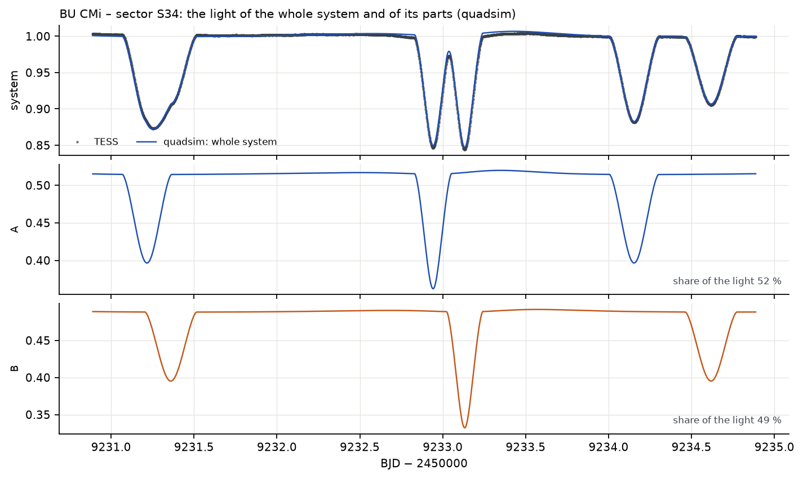
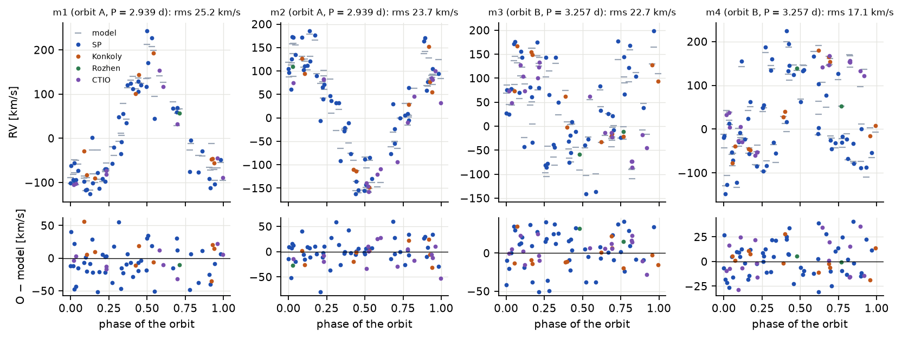
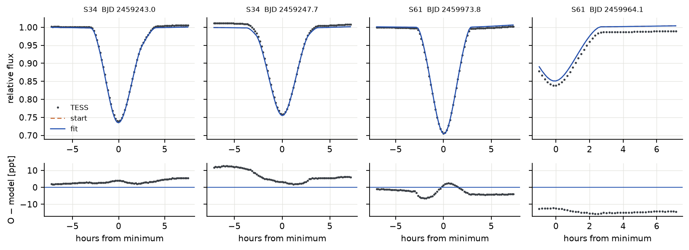
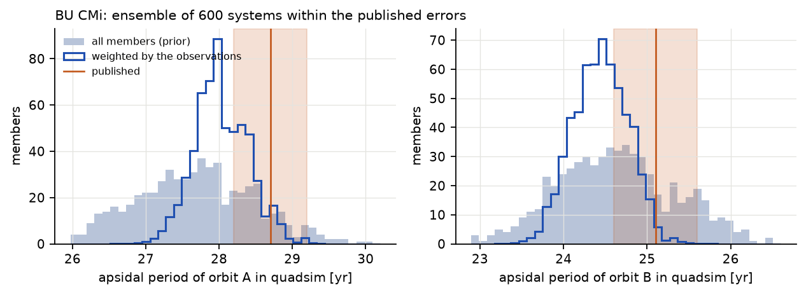

# BU CMi (2+2)

## The system according to Pribulla et al. (2023)

BU CMi consists of two eclipsing binaries of A-type stars, A (2.94 d) and B (3.26 d), each with an
eccentric orbit (e ≈ 0.22), which revolve around each other in only 121.8 days. All three orbits
lie within one degree of each other; the four stars have 2.3–2.5 solar masses and an age of about
260 Myr. The short outer period makes BU CMi a showcase of fast dynamical apsidal motion: both
pairs turn their orbits once in 25–29 years, and the eclipse times swing by hours. The authors
determined everything from TESS light curves, radial velocities of all four stars, 183 times of
minima since 2005 and the spectral energy distribution (Pribulla et al. 2023, Table 7).

## Stability

**Table 2.** Stability of the published BU CMi. A ratio above 1 means stable.

| sub-triple | a_in / a_out | e_in | e_out | i_mut | MA01 | V22 |
|---|---|---|---|---|---|---|
| A inside the A–B orbit (+B) | 0.066 | 0.219 | 0.273 | 0.4° | 2.53 | 2.89 |
| B inside the A–B orbit (+A) | 0.071 | 0.226 | 0.273 | 0.2° | 2.36 | 2.69 |

The machine-learning classifier of Vynatheya et al. (2023) for 2+2 quadruples gives *stable*, and
the N-body ghost test over 100 outer orbits (33 years) ends with a relative divergence of
1.2 × 10⁻³, far below the threshold of instability. BU CMi is compact (the outer periastron is
only about 2.4 times the critical distance) but clearly stable.

## A century forward and backward, and the apsidal motion

**How to read the figure.** The horizontal axis is time in years from the epoch of the published
elements (BJD 2458491.5, January 2019); left of zero is the past, computed by integrating backward.
Each panel shows one property of the three orbits (pair A, pair B and the outer orbit "out"). Top
right: a straight rising line is an orbit whose periastron turns at a constant rate; its slope is 360°
divided by the apsidal period. Bottom right: a pair eclipses only while its inclination stays close to
90°.

The system stays intact in both directions, the relative energy error stays below 2.3 × 10⁻¹¹, the
eccentricities oscillate within 0.210–0.229 (A), 0.209–0.232 (B) and 0.271–0.277 (outer), and both pairs
eclipse during the whole two centuries. The mutual inclinations stay small: A–B 0.52–0.62° (published
0.61°), outer–A 0.34–0.48° (0.45°), outer–B 0.11–0.21° (0.26°).

**Table 3.** Apsidal periods of BU CMi. The published values were measured from the authors' numerical
integration; SWINGERsim measures them from its own, with and without the tidal and rotational bulges of
the stars.

| | published (from the authors' integration) | SWINGERsim: point masses + relativity | SWINGERsim: + tides and rotation | ensemble with tides, weighted (16–84 %) |
|---|---|---|---|---|
| pair A | 28.7 ± 0.1 yr | 28.98 yr (+1.0 %) | 27.61 yr (−3.8 %) | 27.7 (26.8–28.5) yr |
| pair B | 25.1 ± 0.1 yr | 25.30 yr (+0.8 %) | 24.65 yr (−1.8 %) | 24.6 (23.9–25.4) yr |
| outer orbit | 145.3 yr | 145.08 yr (−0.15 %) | 145.07 yr | – |

The fast precession is caused by the other pair: with point masses SWINGERsim reproduces the published
apsidal periods to 1 %, and the outer orbit to 0.15 %. The bulges of the stars add an advance of
0.56°/yr for A (about 16″ per orbit) and 0.33°/yr for B, which shortens the periods by 4 % and 2 %. This
is the classical apsidal motion that the stellar structure predicts.

Pribulla et al. (2023, Table 7) estimate the same classical term analytically: Δω_tide = 18.73″ and
12.67″ per orbit. With the mean eclipse periods of the pairs (2.93959 and 3.26222 d, i.e. 124.3 and
112.0 orbits per year) this is **0.65°/yr for A and 0.39°/yr for B**, 15–20 % more than SWINGERsim's
0.56 and 0.33°/yr. The paper also lists apsidal periods from the analytic formula (31.75 and 28.96 yr)
and, from a separate fit of the spectra and the TESS light curves of sectors 7 and 34, fitted apsidal
periods of 24.91 ± 0.04 and 25.79 ± 0.08 yr (its Table 5). The values in the first column of Table 3
are different: they were measured from a numerical integration of the final photodynamical solution.

What does the comparison tell us about that integration? Lightcurvefactory can integrate the orbits with
tidal and rotational effects (Borkovits et al. 2019, Appendix A), and the paper's analytic tidal advance
is even larger than SWINGERsim's. If the published integration had contained a classical term of that
size, SWINGERsim should match the published apsidal periods only when it includes its own tidal and
rotational term. It does the opposite: the published periods agree with SWINGERsim's point-mass run to
1 % and differ from the run with bulges by 2–4 %. Either the tidal term in the published integration is
smaller than both estimates (for example because of different apsidal constants k₂ or radii), or it was
switched off. The paper does not say which, and we cannot decide it from the published numbers. This
matters for the fit below.

## TESS light curves

**How to read the figure.** Each pair of rows is one TESS sector. In the large panel every dip is an
eclipse of pair A or B (the deeper narrow dips around 0.75–0.8 of the flux are those where an eclipse of A
and of B overlap). If the model were perfect, the residual panel below would be a flat band of noise. In
the zoom the time axis is in hours, so that the shape of one eclipse can be compared: the orange dashed
curve shows where the eclipses of the *published* elements fall: in sector 7, the epoch of the elements,
almost right; by sector 61 (four years later) many hours off. The blue curve (fit) lies on the data.

**Table 4.** Residuals of the TESS light curves of BU CMi (rms of observed − model, ppt). Eclipse depths
are 150–250 ppt.

| sector (cadence) | points | published | anchored | fitted to the minima | scale a |
|---|---|---|---|---|---|
| 7 (30 min) | 1 086 | 9.8 | 7.0 | 7.1 | 0.98 |
| 34 (2 min) | 16 823 | 25.5 | 3.1 | 2.7 | 0.98 |
| 61 (2 min) | 15 774 | 27.9 | 2.8 | 2.0 | 0.98 |

The published elements reproduce sector 7 (the epoch of the elements) but miss sectors 34 and 61 by
25–28 ppt, because their eclipses fall at the wrong times. Once the periods and phases are anchored, the
light curves of all three sectors agree to 2–3 ppt in the two-minute data, about one per cent of the
eclipse depth. The scale factor a is fitted freely for each sector; its value of 0.98 means that the
depths that follow from the published radii and temperatures are right to 2 %. The remaining residuals are slow waves of a few ppt,
partly instrumental. Sector 7 has 30-min sampling, which blurs the eclipses; its larger rms reflects the
coarse data, not the model.

**How to read the figure.** The top panel repeats four days of the TESS light curve with the model.
The two panels below show what SWINGERsim knows and the telescope cannot see: the light of each pair
alone. Every dip in the top panel can be traced to one of the pairs below, and where both pairs
dip at the same time the system shows a double eclipse.

## Times of minima

**How to read the figure.** Each point is one measured eclipse; its height is how many minutes earlier
or later it happened than a strictly periodic ephemeris predicts. The two mirror-image waves of each
pair, primaries and secondaries moving in opposite directions over about 28 years, are the apsidal
motion; the small fast ripples on the curves are the 121.8-day outer orbit (light time and perturbations
by the other pair). The lower panels have a logarithmic scale: the orange points of the published
elements lie at hundreds to thousands of minutes, the anchored and fitted ones within ±10 minutes for
most minima.

With the published elements the eclipses drift by up to 32 hours (A) and 35 hours (B) over 18 years: the
osculating periods of the paper correspond in SWINGERsim to mean eclipse periods shorter by 3.3 × 10⁻⁴ (A)
and 4.0 × 10⁻⁴ (B). Anchoring two numbers per pair reduces the rms to 11–13 minutes, and the shape of the
O − C (amplitude and phase of the apsidal motion and the 121.8-d ripples) is reproduced without any
further adjustment.

**Table 5.** The minima of BU CMi by source: quoted errors and the extra error that the fit assigns to
each source (Pribulla et al. 2023, Tables 3–4). The six sources below give 182 of the 183 minima; the
remaining one is a single minimum of January 2005 from Ogloza et al. (2008), the oldest point of the
data set; one point cannot measure a scatter, so the fit adds no extra error to it. Volkov et al. (2021)
give no errors for their minima; the 9 s is the error of 0.0001 d that Pribulla et al. (2023) assigned to
them.

| source | years | minima | median quoted σ | extra error found by the fit |
|---|---|---|---|---|
| HAT | 2008–2009 | 10 | 55 s | 11.5 min |
| KELT | 2011–2013 | 13 | 118 s | 18.2 min |
| Volkov et al. (2021) | 2012–2021 | 8 | 9 s | 11.1 min |
| MASCARA | 2015–2016 | 39 | 41 s | 10.3 min |
| TESS | 2019–2023 | 87 | 6 s | 3.4 min |
| ground follow-up | 2021–2023 | 25 | 11 s | 2.8 min |

The survey minima (HAT, KELT, MASCARA) scatter by 10–18 min around any model, ten to twenty times their
quoted errors; TESS and the recent ground-based follow-up need only about 3 min. With these extra errors
the old minima still define the long-term apsidal motion but no longer pull the solution.

## The fit

**Table 6.** BU CMi: what each kind of data adds. *rms*: of the minima used, pairs A / B; e_out and ω_out:
the outer orbit (published 0.2728 ± 0.0037 and 141.0 ± 3.6°).

| fit | data | χ²_red | rms A / B [min] | e_out | ω_out [°] |
|---|---|---|---|---|---|
| minima alone, quoted errors | 179 minima | 1432 | 6.6 / 13.0 | 0.261 ± 0.003 | 131 ± 2 |
| + extra error per source | 176 | 0.98 | 6.9 / 8.8 | 0.261 ± 0.003 | 130 ± 2 |
| + priors | 177 | 0.99 | 8.3 / 9.4 | 0.262 ± 0.002 | 135 ± 2 |
| automatically from the published elements | 176 | 0.99 | 8.4 / 8.9 | 0.261 ± 0.002 | 136 ± 2 |
| + radial velocities | 176 + 305 RV | 1.00 | 7.8 / 9.3 | 0.263 ± 0.002 | 136 ± 2 |
| + light curves, red noise, MCMC (final) | 177 + 305 RV + 4147 LC | – | 7.6 / 9.1 | 0.263 ± 0.002 | 132 ± 1 |
| **point masses** + radial velocities | 176 + 305 RV | 1.00 | 8.7 / 10.3 | **0.271 ± 0.002** | **136 ± 2** |

**Table 7.** BU CMi: published elements (Pribulla et al. 2023, Table 7) and the final SWINGERsim fit
(minima, radial velocities, TESS sectors 34 and 61; posterior median and half the 16–84 % range).

| quantity | published | SWINGERsim | difference |
|---|---|---|---|
| e_A | 0.2191 ± 0.0008 | 0.2152 ± 0.0005 | −4.9σ (prior) |
| ω_A [°] | 101.41 ± 0.13 | 101.75 ± 0.13 | +1.9σ |
| e_B | 0.2257 ± 0.0009 | 0.2234 ± 0.0006 | −2.6σ (prior) |
| ω_B [°] | 257.52 ± 0.15 | 257.21 ± 0.12 | −1.6σ |
| P_out [d] | 121.793 ± 0.031 | 121.717 ± 0.015 | −2.5σ |
| e_out | 0.2728 ± 0.0037 | 0.2631 ± 0.0017 | −2.6σ |
| ω_out [°] | 141.0 ± 3.6 | 132.2 ± 1.4 | −2.4σ |
| masses [M☉] | 2.536, 2.384, 2.521, 2.320 | 2.51 ± 0.09, 2.33 ± 0.11, 2.55 ± 0.12, 2.20 ± 0.09 | −1 %, −2 %, +1 %, −5 % |
| inclinations A, B [°] | 83.35, 83.92 | 83.34 ± 0.10, 83.82 ± 0.09 | −0.01°, −0.10° |
| radii [R☉] | 2.249, 2.072, 2.235, 2.003 | 2.32 ± 0.06, 1.98 ± 0.07, 2.30 ± 0.07, 1.91 ± 0.08 | sums within 0.5 % |
| TESS light curve rms | – | 3.1 ppt (S34), 5.8 ppt (S61) | scale a = 0.985, 0.995 |

The masses and inclinations agree with the paper within their errors. The radii show the familiar
degeneracy of partial eclipses: the sum of the radii of each pair is fixed by the duration of the
eclipses and agrees with the paper to 0.5 %, but the ratio is weakly determined by the light curves. In the
paper the individual radii follow from the joint model of the light curves, the spectral energy
distribution and the PARSEC isochrones (Pribulla et al. 2023, Table 7, where the temperatures,
luminosities and gravities are marked as interpolated from PARSEC); our fit determines the radii from the
light curves alone, without the spectral energy distribution or isochrones.

**The outer orbit and the classical apsidal motion.** In every fit that includes the tidal and rotational
bulges of the stars, the outer eccentricity is about 0.263, 2.6σ below the published value, and e_A is
pulled below its prior. When the same fit is done with point masses, e_out = 0.271 ± 0.002 and all
priors are satisfied within 1.4σ. The explanation follows from Table 3: the measured apsidal waves in the
O − C diagram fix the total apsidal rate. With the classical term included, the dynamical part must be
smaller, and the fit makes it smaller by lowering the outer eccentricity. Both descriptions fit the
minima equally well. What is established is this: SWINGERsim's point-mass integration reproduces the
published apsidal periods to 1 %, and adding SWINGERsim's tidal and rotational term moves the fitted
e_out by 2.6σ. What is open is why the published solution does not need this shift. Both SWINGERsim
(0.56 and 0.33°/yr) and the paper's own analytic estimate (0.65 and 0.39°/yr) predict a classical advance
of this size; if the published integration contained a smaller tidal term or none, its outer
eccentricity absorbed the difference, and the true value would be closer to 0.263 than to 0.273. The
paper does not state which tidal model its integration used. The distinction would show in the next
decade of minima, because the two models predict slightly different apsidal waves.

**The apsidal constants set free.** The same fit with the apsidal constant of one star of each pair
free (stars m1 and m3; their partners keep the model values; models: 0.0042 for both) settles at
$k_2$ = 0.0003 for pair A (the lower bound) and 0.0045 ± 0.0021 for pair B. The outer eccentricity
moves only from 0.2631 to 0.2663 ± 0.0021, a third of the way to the published value. Because a value
at a bound has no meaningful linear error, the constraint comes from a χ² profile: seven fits with
$k_2$ of m1 fixed at 0.0003–0.009 and everything else free, all with the errors of the free fit held
fixed so that their χ² can be compared (**Table 3a**).

**Table 3a.** BU CMi: χ² profile in the apsidal constant of star m1 (pair A).

| $k_2$ (m1) | 0.0003 | 0.0010 | 0.0020 | 0.0030 | 0.0042 | 0.0060 | 0.0090 |
|---|---|---|---|---|---|---|---|
| Δχ² | 0 | 0.70 | 2.98 | 6.73 | 13.54 | 27.95 | 53.00 |
| $k_2$ (m3), fitted | 0.0044 | 0.0034 | 0.0020 | 0.0006 | 0.0003* | 0.0003* | 0.0003* |
| $e_\mathrm{out}$ | 0.2659 | 0.2658 | 0.2656 | 0.2655 | 0.2647 | 0.2637 | 0.2624 |

\* at the lower bound.

The data accept $k_2 \le 0.0012$ for pair A at Δχ² = 1 and $\le 0.0023$ at Δχ² = 4. The model value
0.0042 costs Δχ² = +13.5 even with the constant of pair B pushed to its lower bound. Up to
$k_{2,A}$ = 0.003 the two pairs trade off ($k_{2,A} + k_{2,B} \approx 0.0045$), so the minima measure
mainly their sum, about half of what the models give. The Δχ² values are conservative, because the frozen
errors include the red-noise factor of the light curves (χ²_red = 0.29). The tidal and rotational
advance the data want is therefore weaker than that of synchronously rotating stars with the model
constants. Lower $k_2$, sub-synchronous rotation (which lowers the rotational part) or physics missing
from the model would each explain it. The fit cannot tell them apart, and freeing the constants does
not explain the outer eccentricity of the paper.

**How to read the figure.** Each column is one star; the model ticks scatter around a sine curve because
the pairs move on the 121.8-d outer orbit. The residuals of 17–25 km/s (rms) are seven to ten times the
quoted errors of 2–3 km/s and show no clear pattern with phase or instrument.

**The radial velocities scatter by 17–25 km/s around any model**, also around a free Keplerian fit of each
pair with a linear drift of ω (24 and 20 km/s rms), and swapping the components does not reduce it. The
velocities were measured from broadening functions of four similar A stars whose lines blend at most
phases; Pribulla et al. (2023) note the blending and the difficulty of identifying the components and
quote no rms. The scatter is therefore a property of the velocities, not of the orbits; the fit gives
each instrument an extra error of 16–19 km/s, and the masses come out within 1–5 % of the published ones.

**How to read the figure.** Each column is one window of ±0.3 d around an eclipse, the time axis in hours
from the model minimum. The fit and the start model are almost identical: the anchored configuration
already matched the light curve (Table 4).

## Ensemble

600 systems were drawn within the published errors of the masses, eccentricities, inclinations, nodes and
the outer orbit, and integrated 40 years forward and backward. **All 600 stay intact in both directions
and are stable by MA01 and V22**; both pairs eclipse in all of them. Weighted by the published apsidal
periods (Gaussian, σ = 0.5 yr) and by eclipses of both pairs, n_eff = 238.

**How to read the figure.** Each histogram counts how many systems of the ensemble have a given apsidal
period. The filled histogram is what the published uncertainties allow; the outlined one gives more weight
to systems close to the published apsidal periods. The weighted distributions peak 1 year below the
published values: within the published uncertainties of masses and orbits, SWINGERsim's apsidal motion with
tides is systematically 2–4 % faster, the classical term of Table 3.

## Verdict

- **Confirms** the published solution: stable, the dynamical apsidal motion reproduced to 1 % with point
  masses, the light curves to 2–3 ppt, the 18-year O − C of both pairs with their apsidal waves and the
  121.8-d ripples, the masses to 1–5 % and the inclinations to 0.1°.
- **Adds:** realistic errors for every source of minima (surveys 10–18 min, TESS and follow-up 3 min).
- **Differs, cause partly open:** with the classical apsidal advance that stellar models predict, the
  timings require an outer eccentricity of 0.263 instead of 0.273 (2.6σ); with point masses they agree
  with the paper. The paper's own analytic tidal advance is of the same size, so the difference points
  to the tidal term in the published integration, which the paper does not describe.
  With the apsidal constants free the minima want a weaker tidal and rotational advance than the
  models give ($k_2 \le 0.0023$ for pair A at Δχ² = 4, against 0.0042), and e_out still stays at 0.266.
  Projected rotational velocities would separate the rotational part.
- **Data to check:** the radial velocities scatter by 17–25 km/s around any model, far beyond their quoted
  errors.
