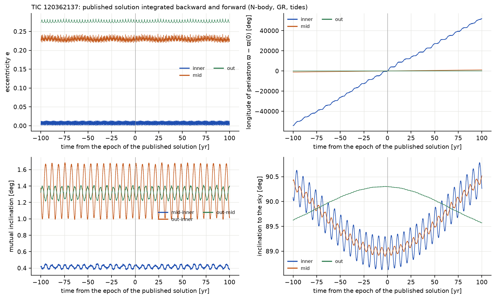
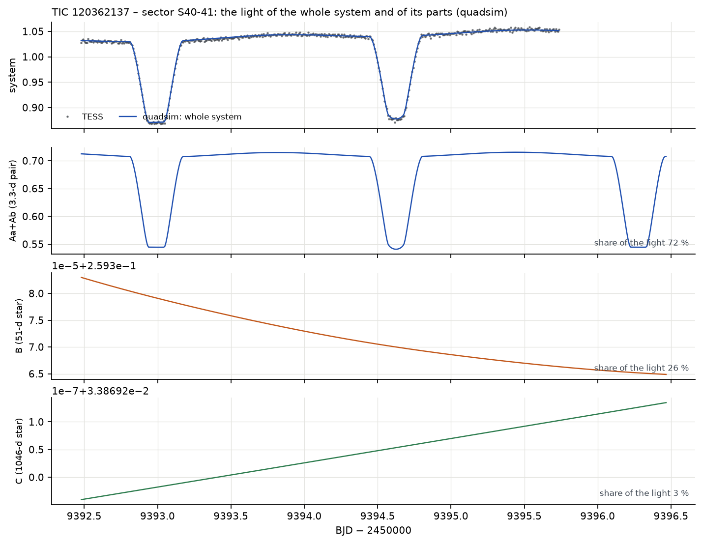
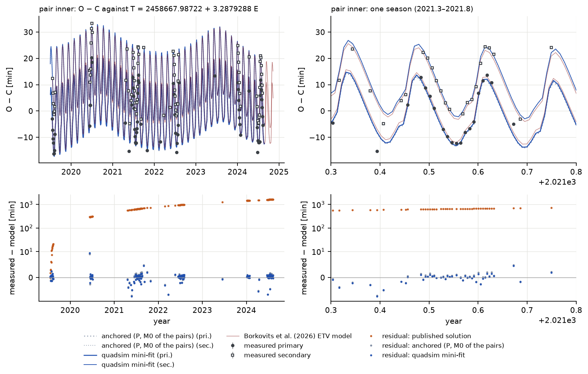
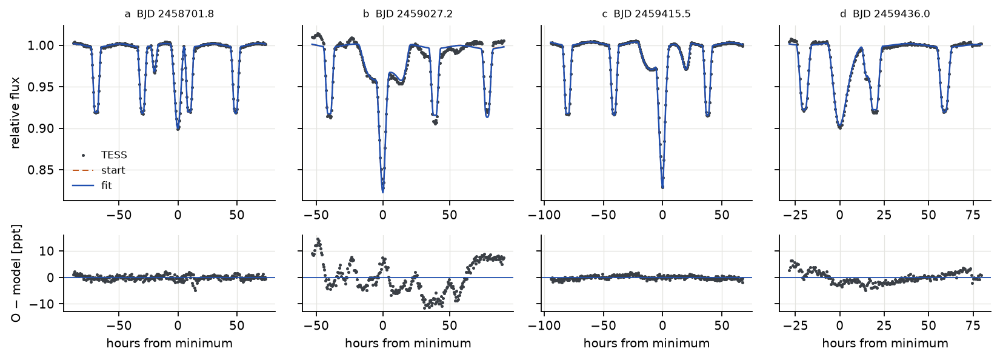
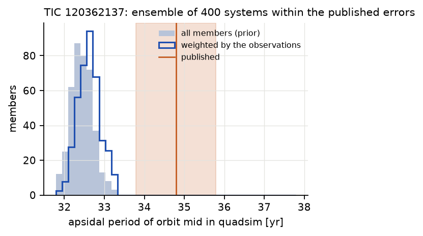

# TIC 120362137 (3+1)

## The system according to Borkovits et al. (2026)

TIC 120362137 is the most compact known quadruple of the 3+1 type: an eclipsing pair of F stars (Aa–Ab,
3.28 d, nearly circular), a third F star (B) orbiting the pair in 51.3 days, and a G star (C) orbiting the
triple in 1046 days. The 51-d orbit is so tight that B causes strong dynamical eclipse timing variations and
occasional *third-body eclipses*, when B passes in front of or behind the inner pair. Only Aa–Ab eclipses
regularly; everything about B and C is learnt from the timing of these eclipses, the third-body events,
radial velocities and the spectral energy distribution. A bright neighbour 27″ away contributes about half
of the light in the TESS aperture: the paper's Table 2 gives an extra light of ℓx(TESS) = 0.510 ± 0.007.

## Stability

**Table 8.** Stability of the published TIC 120362137.

| sub-triple | a_in / a_out | e_in | e_out | i_mut | MA01 | V22 |
|---|---|---|---|---|---|---|
| A–B orbit inside AB–C (+C) | 0.126 | 0.224 | 0.274 | 1.3° | 1.63 | 1.85 |
| Aa–Ab inside A–B (+B) | 0.141 | 0.007 | 0.224 | 0.4° | 1.48 | 1.86 |

Both ratios are well above 1 but lower than in BU CMi: TIC 120362137 is more compact relative to its
stability limit, although Borkovits et al. (2026) find the stability conditions "fulfilled very
robustly", and our ratios agree with that. The classifier of Vynatheya et al. (2023) gives *stable*, and the
ghost test over 100 outer orbits (286 years) ends with a divergence of 9.9 × 10⁻³, larger than in BU CMi,
as expected for such a compact system, but still stable.

## A century forward and backward, and the apsidal motion

**How to read the figure.** As for BU CMi. The eccentricity of the inner pair (top left, blue) oscillates
between almost zero and 0.014 within weeks: it is *forced* by the third star at every passage. Bottom
right: the inclinations of the inner and middle orbits to the sky oscillate by up to ±0.8° on time scales
of years to a century (the nodal precession of the orbits around the plane of the whole system); this is
why the depths of the eclipses change slowly.

The system stays intact for 200 years (energy error 7 × 10⁻¹³). The mutual inclination of the inner and
middle orbits stays at 0.38–0.45° (published 0.47 ± 0.25°), that of the outer orbit with the others at
1.0–1.7° (published 5.7°, with an uncertainty of +5.0/−3.9°).

SWINGERsim measures the apsidal period of the 51-d orbit as **32.4 yr** (a 300-yr run: 32.39 yr; the ensemble:
32.2–32.7 yr), and that of the outer orbit as 836–840 yr. The paper quotes 34.79 ± 0.07 yr and 896 yr, but
these are, in the words of its Table 1, "the nominal, theoretical apsidal motion periods" from an analytic
formula, not measured values. The 7 % difference is therefore between SWINGERsim's N-body integration and an
analytic approximation, not between SWINGERsim and the observations.

## TESS light curves

**How to read the figure.** The regular dips are the eclipses of the 3.3-d pair. The irregular, broader or
doubled events (e.g. sector 26 near BJD 2459026.6, sector 53 near 2459772.7) are third-body eclipses: star
B passes the inner pair during its 51-d orbit and partly covers one or both of its stars, or is covered by
them. These events are extremely sensitive to the orbits; they are the hardest test of the dynamics.

**Table 9.** Residuals of the TESS light curves of TIC 120362137 (rms, ppt). Eclipse depths of the inner
pair ≈ 150 ppt.

| sector | points | published | anchored | fitted to the minima alone |
|---|---|---|---|---|
| 14 | 778 | 21.7 | 21.5 | 22.2 |
| 26 | 915 | 32.5 | 8.3 | 11.4 |
| 40–41 | 6 763 | 27.0 | 3.4 | 4.1 |
| 53–54 | 6 391 | 36.1 | 4.2 | 6.1 |
| 74 | 9 923 | 42.9 | 14.1 | 15.8 |

The anchored model reproduces the regular eclipses to 3–4 ppt in sectors 40–41 and 53–54, and the
third-body eclipses qualitatively: they appear in the right sectors with the right depths and durations,
with their timing off by a few hours. A fit to the minima alone makes the third-body events worse (sector
53–54: 4.2 → 6.1 ppt), because it moves the outer orbit (below). Sectors 14 and 74 have strong instrumental
trends in the SPOC photometry that the quadratic baseline cannot remove; their rms is not a property of
the model.

**How to read the figure.** Only the 3.3-d pair varies; B and C contribute a constant light (the tiny drifts
in their panels, at the level of 10⁻⁵, are the light-travel time and Doppler beaming). During a third-body
eclipse the panel of B would dip as well.

## Times of minima

**How to read the figure.** The O − C of the inner pair is dominated by the 51-d orbit of B (dynamical ETV
with an amplitude of about ±15 min, every 51 days) and modulated by the 1046-d orbit of C (light time and
perturbation). Primary and secondary minima follow slightly different curves because the forced
eccentricity of the pair changes.

**Table 10.** Times of minima of TIC 120362137 (147 minima, 2019–2024).

| configuration | rms | median of the absolute O − C |
|---|---|---|
| published | 1039 min | 836 min |
| anchored | 1.74 min | 0.59 min |
| final fit | 1.24 min (143 minima) | – |
| for comparison: the model of Borkovits et al. (2026) on the same minima | 1.82 min | – |

The published osculating period of the pair corresponds in SWINGERsim to a mean eclipse period shorter by
6.2 × 10⁻⁴; within five years the eclipses drift by 27 hours. After anchoring, SWINGERsim's N-body model
reproduces the whole complex ETV, 51-d and 1046-d terms together, to 1.7 min rms, **about as well as the
photodynamical model of the paper itself (1.82 min on the same minima, from the model ETV the authors
published)**; the final fit reaches 1.24 min. The comparison is not quite like for like: the anchored
model tunes two numbers of the pair (period and phase) to exactly these minima, while the published
model was fitted to all its data jointly (light curves, velocities, minima and the spectral energy
distribution), so a slightly larger rms on the minima alone is expected from it.

## The fit

**Table 11.** TIC 120362137: what each kind of data adds. Published outer orbit: P_out = 1045.5 ± 7.9 d,
e_out = 0.274 ± 0.013, ω_out = 289.0 ± 4.8°.

| fit | data | χ²_red | rms [min] | P_out [d] | e_out | ω_out [°] |
|---|---|---|---|---|---|---|
| minima alone, quoted errors | 147 minima | 148 | 1.68 | 1074 ± 30 | 0.42 ± 0.13 | 239 ± 15 |
| + extra error per source | 145 | 1.00 | 1.45 | 1077 ± 23 | 0.42 ± 0.09 | 238 ± 27 |
| + priors | 143 | 1.00 | 1.15 | 1044 ± 6 | 0.278 ± 0.013 | 289.3 ± 3.3 |
| automatically from the published elements | 143 | 1.00 | 1.15 | 1044 ± 6 | 0.278 ± 0.013 | 289.4 ± 3.3 |
| + radial velocities | 141 + 380 RV | 1.00 | 1.02 | 1052.7 ± 3.3 | 0.277 ± 0.007 | 275.7 ± 2.0 |
| + third-body eclipses, red noise, MCMC (final) | 143 + 379 RV + 2676 LC | – | 1.24 | 1034.2 ± 2.2 | 0.271 ± 0.004 | 284.4 ± 1.6 |

With the minima alone the outer orbit wanders far from the published one (e_out 0.42, ω_out 239°): with
a single eclipsing pair, the outer orbit is seen only through a small modulation of the inner ETV, covered
by less than two outer periods, and many combinations of period, eccentricity, ω and phase fit equally
well. **With the priors the whole outer orbit returns to the published values within 0.3σ, at a better
quality of the timings** (rms 1.15 min). The excursion was the degeneracy of a weakly constrained orbit,
not a tension. Radial velocities and the third-body eclipses then fix the outer orbit without needing the
priors much (all within 1.4σ of them).

**Table 12.** TIC 120362137: published values (Borkovits et al. 2026, Tables 1–2) and the final SWINGERsim fit
(minima, radial velocities and nine light-curve windows with third-body eclipses from the paper's
supplementary data; posterior median and half the 16–84 % range).

| quantity | published | SWINGERsim |
|---|---|---|
| P_mid [d], e_mid, ω_mid [°] | 51.3111 ± 0.0043, 0.22367 ± 0.00072, 190.05 ± 0.32 | 51.3036 ± 0.0009, 0.2229 ± 0.0002, 190.30 ± 0.08 |
| P_out [d], e_out, ω_out [°] | 1045.5 ± 7.9, 0.274 ± 0.013, 289.0 ± 4.8 | 1034.2 ± 2.2, 0.271 ± 0.004, 284.4 ± 1.6 |
| masses Aa, Ab, B, C [M☉] | 1.748, 1.361, 1.483, 1.008 | 1.7635 ± 0.0012, 1.3716 ± 0.0023, 1.527 ± 0.008, 0.996 ± 0.014 |
| inclinations inner, middle [°] | 88.7, 89.05 | 88.80 ± 0.02, 88.89 ± 0.02 |
| radii Aa, Ab, B [R☉] | 2.996, 1.507, 1.768 | 3.001 ± 0.005, 1.568 ± 0.004, 1.921 ± 0.016 |
| radial velocities: rms | – | 3.8–4.3 km/s (Aa, Ab, C), 8.0 km/s (B) |
| third-body eclipses: rms | – | 0.7–2.4 ppt in eight windows, 5.9 ppt in one |
| depth scale a of the windows | ℓx = 0.510 ± 0.007 | a = 0.46–0.51 |

The masses of the inner pair agree with the paper to 1 %, the third star comes out 3 % heavier and the
fourth 1 % lighter. The radius of the third star grows by 9 % and that of the secondary of the pair by 4 %;
both are constrained mainly by the third-body eclipses, and the third star's radius is the least certain.
The depth scale of the windows, a = 0.46–0.51, is the extra light of the neighbouring star that the paper
gives (ℓx = 0.510): the supplementary light curves were not corrected for it, unlike the full-sector SPOC
light curves of Table 9 (a = 0.97–0.98). Roche surfaces instead of spheres change the residuals by less
than 0.1 ppt and the radii by ≤ 2 %: the pair is detached enough for spheres. The mass errors of
0.07–1.4 % are from the MCMC with the correlated noise of the light curves taken into account; without it,
the linear errors of a fit to 2676 photometric points were several times smaller and unrealistic.

**How to read the figure.** Each window contains several eclipses of the 3.28-d pair and one eclipse
involving the third star (the deep or wide extra dip). The fit reproduces the third-body eclipses to about
1 ppt in most windows; window b (BJD 2459027) keeps a structured residual of ±10 ppt.

**Predictions.** The final fit predicts the next third-body events about every 25 days through 2027
(e.g. BJD 2460559, 2460587, 2460610, 2460638, … 2461480). Testing them needs new TESS sectors or ground
photometry.

## Ensemble

400 systems within the published errors (masses, the middle and outer orbits, nodes) were integrated 100
years forward and backward. **All 400 stay intact and stable**, and the inner pair eclipses in all of them.
The apsidal period of the 51-d orbit is 32.4 yr (16–84 %: 32.2–32.7 yr) in all of them.

**How to read the figure.** As for BU CMi. The narrow distribution shows that the N-body apsidal period
hardly depends on the uncertainties of the masses and orbits; the published value is the analytic estimate
of the paper.

## Verdict

- **Confirms** the published solution: stable (stability ratios 1.5–1.9), the complex ETV reproduced to
  1.7 min after anchoring the period and phase to the minima (about as well as the jointly fitted
  published model), the TESS light curves to 3–4 ppt with the
  third-body eclipses in the right places, and, in the joint fit, the masses to 1–3 %, the inclinations to
  0.15° and the third-body eclipses to 1–2 ppt.
- **Adds:** the N-body apsidal period of the 51-d orbit, 32.4 yr (the published 34.79 yr is a theoretical
  value), and predictions of the next third-body events.
- **Shows a limit of timing-only fits:** with one eclipsing pair the outer orbit is not determined by the
  minima alone; priors, velocities or third-body eclipses are needed.
