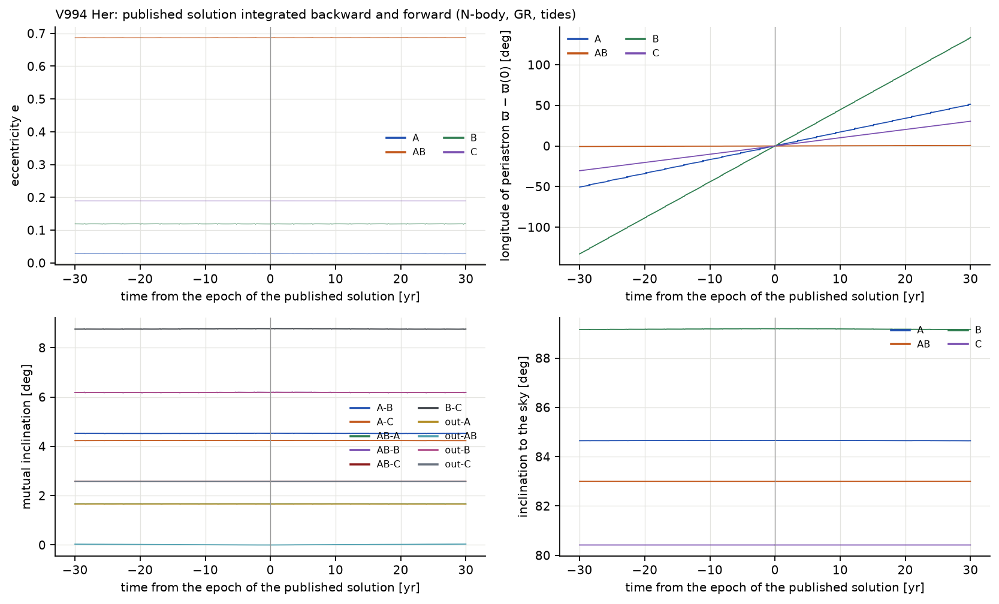
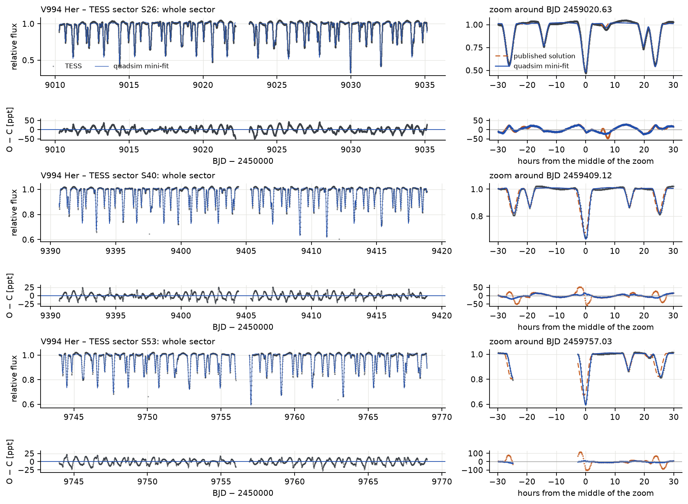
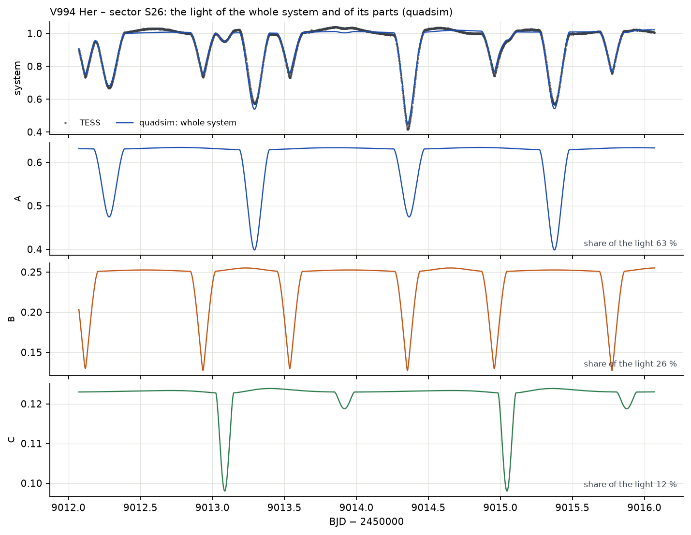
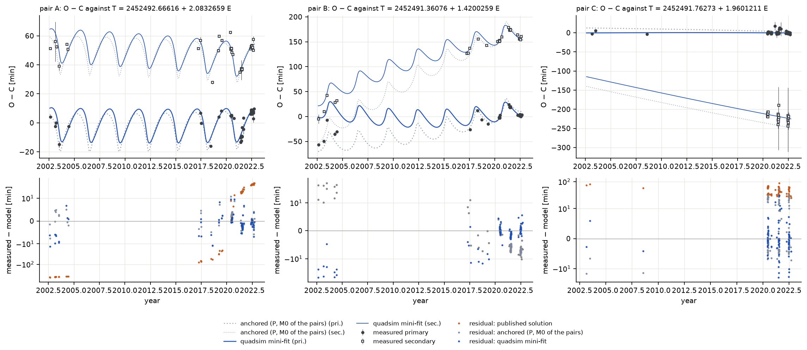
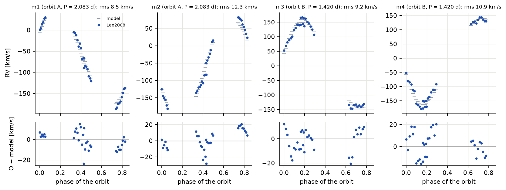
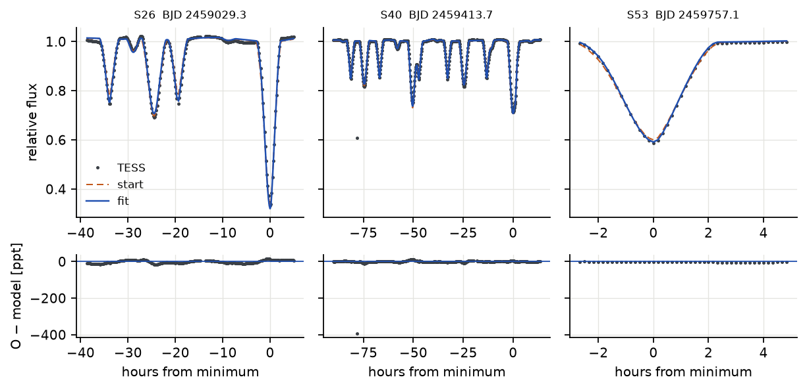
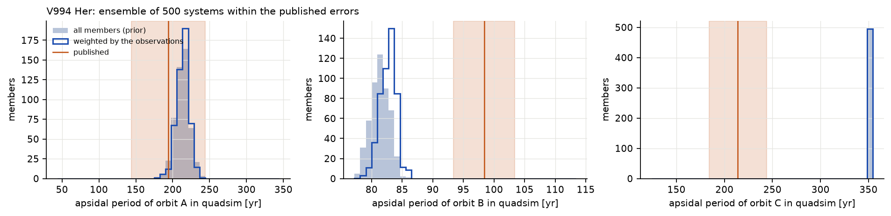

# V994 Her ((2+2)+2)

## The system according to Zasche et al. (2023)

V994 Her contains six stars in three eclipsing binaries: A (2.08 d) and B (1.42 d) orbit each other in 1062
days on a very eccentric orbit (e = 0.69), and the third binary C (1.96 d) is a visual companion 1.1″ away,
at a projected distance of about 300 au. The stars are young (about 80 Myr) B and A stars of 1.1–2.9 solar
masses; all three pairs have slightly eccentric orbits and measurable apsidal motion. The solution of
Zasche et al. (2023, Table 3) combines TESS light curves, radial velocities of A and B (Lee et al. 2008),
the ETVs of all three pairs and the spectral energy distribution. The minima span twenty years, and many
come from observers: S. Dallaporta and U. Munari (SD & UM, 2002–2004), R. Uhlař (RU, 2017–2022, 64 minima
from a private observatory), the robotic telescope FRAM, M. Mašek (MM) and others (Zasche et al. 2023,
Tables A1–A4).

The papers give neither the orbital nodes nor the orbit of C around A+B; we assumed Ω = 0 for all orbits
and an orbit of C with P = 3000 yr, e = 0.3. The orbit of C is so wide that it does not affect the timings
over 20 years except through a nearly constant light-time term.

## Stability

**Table 13.** Stability of V994 Her (with the assumed orbit of C).

| sub-triple | a_in / a_out | e_in | e_out | i_mut | MA01 | V22 |
|---|---|---|---|---|---|---|
| A inside A–B (+B) | 0.013 | 0.028 | 0.687 | 1.7° | 4.43 | 6.26 |
| B inside A–B (+A) | 0.009 | 0.119 | 0.687 | 6.2° | 5.65 | 7.53 |
| A–B inside the orbit of C (+C) | 0.009 | 0.687 | 0.300 | 0.0° | 21.0 | 19.9 |

All sub-systems are stable by a wide margin, and the classifier of Vynatheya et al. (2023) gives *stable*
for each sub-quadruple. The ghost test over one orbit of C (3000 years, about 1000 orbits of A–B) finds the
system stable (divergence 2.3 × 10⁻⁵).

## Thirty years forward and backward, and the apsidal motion

**How to read the figure.** As for BU CMi. Over 60 years almost nothing changes: the orbits are much wider
relative to the pairs than in BU CMi, the perturbations are small, and the slow apsidal motion of the pairs
(periods of a century and more) shows up as straight lines in the top right panel.

The system stays intact (energy error 5.6 × 10⁻¹¹), the eccentricities stay within 0.0274–0.0279 (A),
0.118–0.120 (B) and 0.6869–0.6874 (A–B), and all three pairs eclipse throughout. Unlike in BU CMi, the
precession is mostly *classical*: caused by the tidal and rotational bulges of the stars themselves, not
by the other pair.

**Table 14.** Apsidal periods of V994 Her. Published: 360° / ω̇ from Table 3 of Zasche et al. (2023).

| pair | published | SWINGERsim run | SWINGERsim ensemble, weighted (16–84 %) | pair alone (tides + rotation + GR) |
|---|---|---|---|---|
| A | 194 (158–271) yr | 212 yr | 213 (204–222) yr | 244 yr |
| B | 98 (94–103) yr | 81 yr | 81 (80–83) yr | 84 yr |
| C | 214 (188–250) yr | 355 yr | 355 yr | 355 yr |

For A SWINGERsim agrees within the (large) published uncertainty. For B SWINGERsim's precession is 17 % faster,
for C 40 % slower (a period 66 % longer). The two models do different things here. Zasche et al. (2023)
fitted a constant apsidal rate ω̇ for each of the three pairs as a free parameter of their analytic
Keplerian model; SWINGERsim computes the rates from the stars: the apsidal constants k₂ (Claret 2023, at
the MIST age), the radii and the rotation. The differences therefore compare a measured rate with the
rate that stellar structure predicts.
For C SWINGERsim's prediction is 0.78°/yr tidal, 0.10°/yr rotational and 0.14°/yr relativistic;
pseudo-synchronous instead of synchronous rotation adds only 0.05°/yr. Reaching the published
1.68 ± 0.24°/yr would need k₂ of both stars 1.76 times larger, far beyond the uncertainty of stellar
models (about 10 %). B would need k₂ multiplied by 0.81, A (with the perturbation by B, +0.22°/yr) by 1.12.

For B, Zasche et al. (2023, Sect. 4.1) made the same comparison themselves. After subtracting the
relativistic and dynamical parts they derive from the fitted rate log k₂ = −2.44 ± 0.05, against
−2.36 ± 0.02 from the models of Claret (2004), i.e. a measured k₂ about 0.83 times the theoretical one.
They discuss a slightly faster apsidal motion, sub-synchronous rotation or a higher metallicity as
explanations and find that metal-rich models (Z = 0.04, log k₂ = −2.40) agree better. Our factor of 0.81
for B therefore reproduces the authors' own finding with a different set of stellar models; it is a
confirmation, not a new discrepancy. They do not make the comparison for A and C. C is not perturbed in SWINGERsim (its outer orbit is assumed wide); the published rate of C is
2.8σ from the structural prediction, and a closer, unknown companion of C would be one explanation.

**A hidden companion of C.** To see which companion would do it, 3000 configurations of C with a third
star were integrated for 30 yr (0.1–2 M☉, period 8–3000 d log-uniform, eccentricity 0–0.6, isotropic
orientation, MA01-stable): 2592 stay intact, 403 collide through ZLK cycles (mutual inclinations
72–135°, periods ≤ 152 d) and 5 are ejected. Without a companion (periods above 2000 d) C precesses in
354 yr, as above. 172 members reach the published 214 ± 31 yr. Weighted by it, the companion has
0.17–0.44–1.36 M☉ on a 92–171–332-d orbit (16–50–84 %), which shifts the eclipses of C by 0.7–8.5 min
through light-time and by 0.4–1.5 min dynamically. The 56 primary minima of C (2003–2022, mostly TESS,
rms 3.8 min around a cubic ephemeris) limit any periodic signal of 80–400 d to below 2.4 min (2σ,
median over the period). That excludes 55 % of these companions. The remaining ones have
0.13–0.20–0.31 M☉ on 80–126–182-d orbits. The highest peak in the minima (80.9 d, 2.0 ± 0.5 min)
is not a detection, because aliases at 49–84 d are almost as high. A low-mass companion of C on
an orbit of a few months therefore remains possible. Dense timing of C over at least two such periods
would find or exclude it.

## TESS light curves

**How to read the figure.** Three binaries eclipse in the same light curve, so the dips come in three
interleaved rhythms (2.08, 1.42 and 1.96 days) and different depths; the deepest dips (to 0.5 of the flux
in sector 26) are eclipses of the brightest star of A. The zooms show that the published elements already
place the eclipses well (V994 Her is less compact, and its osculating and mean periods differ less) and that
the fit moves them onto the data.

**Table 15.** Residuals of the TESS light curves of V994 Her (rms, ppt). Eclipse depths 50–550 ppt.

| sector (cadence) | points | published | anchored | fitted to the minima | scale a of the depths |
|---|---|---|---|---|---|
| 26 (SPOC, 2 min) | 16 931 | 15.6 | 14.9 | 14.5 | 2.03 |
| 40 (QLP, 10 min) | 3 917 | 17.1 | 8.8 | 8.0 | 1.20 |
| 53 (QLP, 10 min) | 3 454 | 18.2 | 9.4 | 8.2 | 1.18 |

Two things stand out.

**An oscillation.** The residuals of 8–15 ppt are larger than in the other systems and show a regular
oscillation with a period of 0.663 d, present in QLP sectors 40 and 53 and in SPOC sector 26, with an
amplitude of 7.5–9 ppt in QLP and 15 ppt in SPOC (the same factor as the eclipse depths, see below).
Zasche et al. (2023, Sect. 3) found it before us: an oscillation of about 2 per cent with the period
P_A − P_B (2.0833 − 1.4200 d = 0.663 d), which they removed before fitting; it is not part of either model. When it is
removed from the light curve (a sum of sine waves at its period and harmonics, fitted outside the eclipses),
the residuals in sectors 40 and 53 fall to 3.4–3.6 ppt.

**The depths of sector 26.** The depths must be scaled by 1.2 in the QLP sectors and by 2.0 in the SPOC
sector 26. A scale above 1 means that the observed eclipses are deeper than SWINGERsim predicts for the total
light of the six stars, i.e. the photometry contains less light than the system emits. In sector 26 the
SPOC eclipses are 1.75 times deeper than in QLP (primary of A: 0.44 against 0.25). A likely cause is the
crowding correction of the SPOC pipeline (CROWDSAP), which counts the light of the 1.1″ companion C and of
neighbouring stars as contamination and subtracts it; we have not proved it. Zasche et al. (2023,
Sect. 3) also needed a separate extra light for sector 26 (0.058, against 0.181 for sectors 40 and 53),
but their case is not the same as ours: for sectors 40 and 53 they used their own photometry of the
full-frame images (the FITSH package), not QLP, and their sector-26 eclipses were only "a few per cent"
deeper than in the other two sectors. The large factor we find therefore depends on the pipelines we
used (SPOC against QLP) and tells nothing about the stars.

**How to read the figure.** The three lower panels separate what TESS records together. C is the faintest
pair and its eclipses are shallow in the total light, which is why its minima are the least precise.

## Times of minima

**How to read the figure.** For A and B the waves with a period of 2.9 years are the light-travel time across
the eccentric A–B orbit: when A is on the far side, its eclipses come later and those of B earlier, so the
waves of A and B are mirror images with amplitudes in the ratio of the masses. The slower opposite drifts of
primary and secondary minima are the apsidal motion. For C the primary and secondary minima lie 200 minutes
apart because of its eccentric orbit (e cos ω ≠ 0); the slow divergence is its apsidal motion.

**Table 16.** The minima of V994 Her by source, and the extra error that the fit assigns to each source.

| source | years | minima | median quoted σ | extra error found by the fit |
|---|---|---|---|---|
| SD & UM (Dallaporta, Munari) | 2002–2004 | 23 | 128 s | 10 min |
| RU (R. Uhlař) | 2017–2022 | 64 | 60 s | 4.9 min |
| TESS | 2020–2022 | 246 | 10 s | 1.1 min |
| FRAM | 2021–2022 | 7 | 45 s | 2.2 min |
| other observers (MR13, GP, MM) | 2008–2021 | 3 | 26–86 s | 5.5 min |

The recent ground-based minima of the observers (RU, FRAM, MM) agree with the model nearly as well as TESS;
the 2002–2004 minima lie on average 17 minutes earlier than the model and need an extra error of 10 min.
They are the only minima of the first decade and anchor the long-term trends. The published elements give
errors of hours only for A; after anchoring, the model reproduces A to 3.3 min and the LTTE waves of A and B
together, which confirms the masses and the A–B orbit.

## The fit

**Table 17.** V994 Her: what each kind of data adds. Published A–B orbit: P_AB = 1062.3 ± 2.6 d,
e_AB = 0.687 ± 0.044, ω_AB = 59.6 ± 3.8°.

| fit | data | χ²_red | rms A / B / C [min] | e_AB | ω_AB [°] |
|---|---|---|---|---|---|
| minima alone, quoted errors | 338 minima | 86 | 3.8 / 10.4 / 6.3 | 0.579 ± 0.016 | 30 ± 5 |
| + extra error per source | 337 | 1.00 | 4.0 / 3.5 / 5.3 | 0.511 ± 0.013 | 21 ± 8 |
| + priors | 337 | 1.00 | 5.0 / 3.4 / 5.4 | 0.570 ± 0.018 | 51 ± 3 |
| automatically from the published elements | 337 | 1.00 | 5.1 / 3.8 / 5.4 | 0.569 ± 0.018 | 51 ± 3 |
| + radial velocities | 337 + 128 RV | 1.00 | 7.4 / 5.2 / 5.3 | 0.590 ± 0.018 | 56 ± 3 |
| + light curves with the oscillation removed, red noise (final) | 333 + 128 RV + 9214 LC | – | 5.3 / 3.4 / 5.4 | 0.587 ± 0.018 | 52 ± 3 |
| radial velocities, no SD & UM minima, no priors | 314 + 128 RV | 1.00 | 3.0 / 2.2 / 5.3 | 0.533 ± 0.026 | 40 ± 8 |

The extra error per observer is the most effective single step: the rms of pair B falls from 10.4 to 3.5
min, because the oldest minima no longer dominate. The eccentricities and arguments of periastron of the
three pairs agree with the published ones within 2σ in every variant, a good independent confirmation. The
A–B orbit, however, is seen in the minima only through the light-time waves, and the fit prefers e_AB =
0.51–0.59 instead of 0.69 ± 0.04. With priors it stays 2.3σ below, and dropping the early SD & UM minima does
not bring it back (0.53). The published value rests also on the radial velocities of the A–B orbit and on the
light curves in a model that includes more than the timings; the difference remains open.

**The radial velocities and the masses of pair A.** The velocities of Lee et al. (2008), 32 per star from
quadruple-lined spectra taken in March–May 2006, pull the masses of pair A in the joint fit down to 2.38 ± 0.07 and
1.87 ± 0.06 M☉ (published 2.93 and 2.22 M☉) and leave pair B unchanged (1.92 and 1.97 against 1.91 and
1.89 M☉). A simple Keplerian fit of the same velocities, with a linear trend of the systemic velocity of
each pair over Lee's 60 days, gives K_A = 126–128 and 157–159 km/s, i.e. 2.82 and 2.29 M☉ at i = 84.7°,
in agreement with Zasche et al. (2.93 and 2.22 M☉). Over Lee's 60 days the systemic velocity of A − B
changes by −11.8 km/s per 30 days; the published A–B orbit gives −12.2, the joint fit −9.1. The low masses of
the joint fit are therefore an artefact: with its less eccentric A–B orbit, the fit absorbs part of the
orbital motion of the pairs into their velocity amplitudes. Lee et al. (2008) quote neither errors of
the individual velocities nor the rms of their orbital fits; they only note systematic offsets in pair B,
which they ascribe to the blending of the lines of four stars or to an unresolved companion. The errors
of 5 km/s per velocity used here were therefore assigned in this test, and the fit's extra error per
source decides how much the velocities are trusted.

**How to read the figure.** As for BU CMi. The model follows the velocity curves of all four stars; the
residuals of 9–11 km/s are about twice the errors of 5 km/s that we assigned to the velocities of Lee et
al. (2008), who give no errors themselves.

**How to read the figure.** The windows around the eclipses of the three pairs overlap, so that each panel
shows one to four days. With the 0.663-d oscillation removed from the data, the residuals are a few ppt
(with it, they were ±20 ppt).

With the oscillation removed, the light-curve fit of sectors 26, 40 and 53 gives 3.4–3.6 ppt in the QLP
sectors (9.7 ppt in sector 26), inclinations of 85.4 ± 0.8° (A), 89.0 ± 0.8° (B) and 80.6 ± 0.3° (C,
published 84.66°, 89.19°, 80.42°), and radii within 5 % of the published ones except the secondary of A (1.49
against 1.72 R☉, the radius-ratio degeneracy of partial eclipses).

## Ensemble

500 systems were drawn with the published masses and A–B orbit within their errors, random nodes of A and B
within ±30°, a random node of C, and a random orbit of C around A+B (period 500–20 000 yr, eccentricity
0–0.7, inclination 40–140°), keeping only those stable by MA01. Integrated 30 years forward and backward,
**all 500 stay intact**, and all three pairs keep eclipsing. Weighted by the published apsidal periods and
the eclipses, n_eff = 243.

**How to read the figure.** As for BU CMi. For A the ensemble covers the published value. For B the whole
ensemble lies at 78–86 years, well below the published 98 years: no system within the published masses and
orbits reaches the published precession. For C all members have the same 355 years: its precession is
entirely classical, and the random orbit of C around A+B never changes it. Both differences are therefore
between the measured (fitted) rates and the stellar structure, not properties of the orbits.

## Verdict

- **Confirms** that SWINGERsim handles a six-star, three-level hierarchy with three eclipsing pairs: stable,
  the light-time waves of A and B reproduced from the published masses, the eccentricities and orientations
  of the three pairs within 2σ of the published ones, the eclipse timings of all three pairs to 3–5 min
  (TESS to 1 min), and the light curves to 3.5 ppt once the oscillation is removed.
- **Confirms** the oscillation with the period P_A − P_B = 0.663 d that Zasche et al. (2023) removed, and
  the authors' own finding that the apsidal motion of B corresponds to an apsidal constant about
  0.8 times the theoretical one (their 0.83, our 0.81).
- **Adds:** realistic errors for every observer (TESS 1.1, FRAM 2.2, R. Uhlař 4.9, SD & UM 10 min).
- **Differs, explained:** the classical apsidal motion of C, which SWINGERsim predicts from stellar
  structure while the paper fitted it freely (C would need k₂ 1.8 times larger than stellar models give,
  or a companion of 0.13–0.31 M☉ on an 80–182-d orbit, which the present minima of C still allow);
  the low masses of pair A in the joint fit, an artefact of the less eccentric A–B orbit (Lee's velocities
  alone agree with the published masses).
- **Open:** the A–B eccentricity, which the minima put at 0.51–0.59 instead of 0.69 ± 0.04; the depth
  scale of 2.0 in SPOC sector 26 against 1.2 in QLP, probably the SPOC crowding correction but not proved,
  and not directly comparable with the paper, which used different photometry for sectors 40 and 53.
