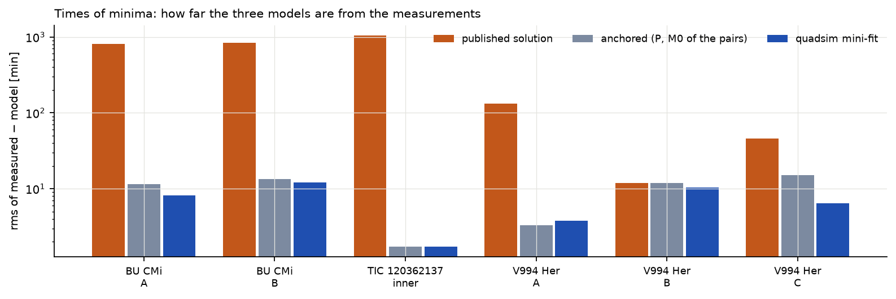

# The three systems compared

**How to read the figure.** Each group of three bars is one eclipsing pair. Orange: the published elements
taken literally; grey: after anchoring the period and phase of each pair; blue: after SWINGERsim's fit to the
minima. The logarithmic axis spans three orders of magnitude: from days of drift to a few minutes.

**Table 18.** Summary of the test. *yes*: agreement; *partly*: agreement with a qualification; *no*: a
difference, explained in the text.

| question | BU CMi | TIC 120362137 | V994 Her |
|---|---|---|---|
| stable (MA01, V22, ML, ghost test) | yes | yes (ratios 1.5–1.9) | yes |
| intact in all ensemble members, forward and backward | yes – 600/600 | yes – 400/400 | yes – 500/500 |
| dynamical apsidal motion vs published | yes – 1 % (point masses) | – (published value theoretical) | – (mostly classical) |
| classical apsidal motion | adds 2–4 %; the tidal term of the published integration is not stated | – | A yes, B −17 % (as the paper's own k₂ for B), C +66 % (fitted freely in the paper) |
| TESS light curves (best sectors, anchored) | yes – 2–3 ppt | yes – 3–4 ppt | yes – 3.5 ppt after removing the oscillation |
| third-body eclipses | – | yes – 1–2 ppt (fit) | – |
| times of minima, anchored | yes – 11–13 min (survey minima) | yes – 1.7 min | yes – 3.3 / 11.9 / 15.2 min |
| times of minima, final fit | 7.6 / 9.1 min; TESS and follow-up ~3 min | 1.2 min | 5.3 / 3.4 / 5.4 min; TESS ~1 min |
| masses (joint fit) vs published | yes – 1–5 % | yes – 1–3 % | partly – B yes, A −19 % (artefact, see text) |
| inclinations vs published | yes – 0.1° | yes – 0.15° | yes – within 1° |
| outer orbit vs published | partly – e_out −2.6σ with tides, agrees without | yes – within 1.4σ | partly – e_AB −2.3σ |
| radial velocities | no – rms 17–25 km/s (quoted 2–3) | yes – 3.8–4.3 km/s (B: 8.0) | partly – 9–11 km/s (no published errors; 5 km/s assumed) |
