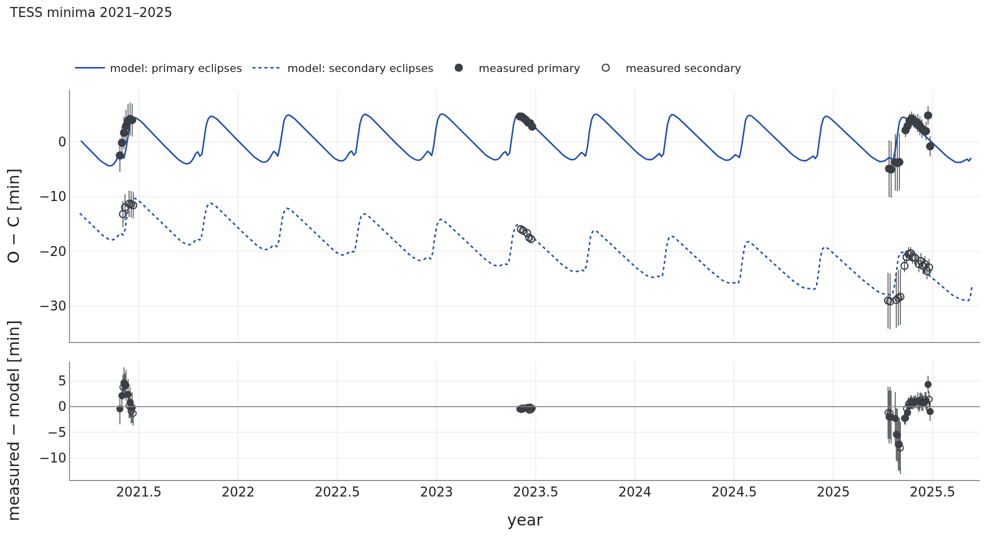

# V907 Sco

## What the papers say

V907 Sco is a pair of late-B stars on a 3.78-d orbit with a solar-type third star. Its eclipses were
seen on Harvard plates from 1899 to about 1918, again from 1963 to about 1986, and not in between
(Lacy et al. 1999). Lacy et al. (1999) explained this by a third star on a 99.3-d orbit and a nodal
period of about 68 years, and they predicted the return of the eclipses for 2030 ± 5. TESS saw shallow
eclipses already in 2019 (sector 13) and deeper ones in 2021 (Borkovits 2022; Zasche et al. 2023).
Zasche et al. (2023) measured radial velocities of all three stars in 2022 with CHIRON and found the
outer orbit to be **142.01 ± 0.05 d, e₂ = 0.47 ± 0.02, m₃ = 1.06 (+0.11/−0.10) M☉** (the mass with
90 % confidence limits). They first fitted the 14 inclinations of the pair, 1900–2022, with a secular
(orbit-averaged) model, but found the best fit "formally … statistically not acceptable", because the
eccentric outer orbit adds long-period perturbations that the secular model lacks. They therefore used a
fully numerical point-mass three-body model (their Sect. 3.2), constrained by the secular solution, and
derived a mutual inclination of **26.2 (+2.6/−2.2)°**, a nodal period of **63.5 (+3.3/−2.6) yr** (both
again 90 % confidence limits) and the end of the present eclipsing phase around **2049**. They did not
use the older velocities of Lacy et al.

**The question for SWINGERsim:** can an N-body fit of all these data, including the old velocities,
reproduce the switching eclipses, and does it confirm the third star and its orbit?

## The system: published and fitted

**How to read Figure 1.** The two systems are nearly identical. The third star (m3) moves on the
large eccentric orbit; the pair moves on the smaller ellipse around the common centre of mass. In the
middle panel the two discs just touch on the sky at their closest projected approach: in 2021 the
pair eclipses only partially (inclination 76.6°, eclipse limit 72.8°). In the right panel the axis of
the pair's orbit circles the total angular momentum (×) once in about 66 years. It enters the yellow
band in 2019, stays in it until the mid-2050s, and then leaves it for about 30 years.

## The inclination over 180 years

![**Figure 2.** Inclination of the 3.78-day pair, 1890–2070. Top: as a light curve measures it (0–90°); bottom: the same model unfolded to 0–180°. Points: the 14 measured inclinations (Zasche et al. 2023, Table 2; in the bottom panel drawn on the side of 90° where the model is). Blue line and band: the SWINGERsim fit and the 95 % range of 100 posterior samples. Orange dashed: the published system integrated by SWINGERsim. Grey: below the eclipse limit. Green bands: when eclipses were observed (Lacy et al. 1999; TESS).](../../figures/squadra_test3/v907_inclination.png)

**How to read Figure 2.** Both panels show the inclination of the pair computed by the N-body model.
Wherever the curve is above the grey area, the pair can eclipse; where it dips into the grey, the
eclipses stop. **Top panel:** this is what a light curve measures and what the published inclinations
are. In 1897–1911, 1964–1977 and 2031–2045 the curve has the "M" shape described above: the orbit
passes edge-on (90°), turns back, and passes edge-on again. **Bottom panel:** unfolded, the same curve
is one wave between about 57° and 93°. This is the precession of the orbit: the axis of the pair moves
on a cone around the total angular momentum, so the inclination swings by twice the cone angle around
the inclination of the total angular momentum (about 75°). Its period, the nodal period, sets how
often the eclipses come and go. The fitted orbit passes through 90° in each cycle; the published one
stays just below it. The 14 measured values cannot tell the two apart, because a light curve gives the
same result for i and 180° − i.

The model curve passes through the measured points and through all observed changes: eclipses on the
Harvard plates until 1918, eclipses in 1963–1986, the end seen by Lacy et al., and the rising
inclination seen by TESS and FRAM since 2019. The band is narrow where data exist and widens towards
the past and the future; the fit and the published model separate after 2040. The published errors of
the TESS and FRAM inclinations (0.02–0.10°, and 0.25° for the shallow eclipses of TESS sector 13) are
mostly smaller than the differences between light-curve models
(see the eclipse depths below), so the fit uses an error of at least 0.1°. With it the 14 inclinations
give χ² = 13.7 for the fit and 6.0 for the published system.

**Table 2.** V907 Sco: when the eclipses switch. "Geometric" is the moment when the model inclination
crosses the eclipse limit; the model eclipse depth in V (third light of the third star included, 1.7 %)
shows when the eclipses became too shallow to be detected.

| change | observed | published system in SWINGERsim | SWINGERsim fit, geometric (median, 95 % range) | SWINGERsim fit: model depth in V |
|---|---|---|---|---|
| eclipses stop | ~1918 (Lacy et al. 1999; last DASCH inclination 1918) | 1923.5 | **1923.5** (1921.7–1925.5) | 0.16 mag in 1918, 0.06 mag in 1920 |
| eclipses return | seen from ~1963 (Lacy et al. 1999; reported by Strohmeier et al. 1964) | 1956.5 | **1954.0** (1952.0–1955.5) | 0.08 mag in 1955, 0.28 mag in 1958 |
| eclipses stop | ~1986 (Lacy et al. 1999) | 1986.5 | **1989.0** (1988.0–1990.0) | 0.11 mag in 1986, 0.02 mag in 1988 |
| eclipses return | 2019, depth 0.6 % (TESS S13) | 2019.5 | **2019.5** | 0.002 mag in mid-2019 (eclipse alone; with the light variation outside eclipses 0.008 mag) |
| eclipses end | ~2049 (Zasche et al. 2023) | 2050.0 | **2054.5** (2052.5–2056.8) | 0.19 mag in 2052, 0.03 mag in 2055 |

Photographic and photoelectric photometry of the time could see eclipses deeper than about 0.05 mag.
The geometric crossing comes 1–3 years after the model eclipses become shallower than this, so the
model and the observations agree on all four observed changes. No eclipses were recorded between 1925
and 1960, in agreement with the model; the model switches them on in the mid-1950s, a few years before
the first reported observation (1963; Strohmeier et al. 1964 reported them as new). When the published
parameters are integrated by SWINGERsim, the switches and the end of the eclipses (2050.0; 0.014 mag in
2049) agree with the published numerical point-mass model (about 2049). This is an independent check of
SWINGERsim's N-body integration.

## The eclipse times

**How to read Figure 3.** The top panel is an O − C diagram: it shows by how many minutes the eclipses
come early or late compared with a strictly periodic clock. The lines are the model eclipse times
(conjunctions in the N-body model plus light-travel time), computed for every observed eclipse and
continued between them. The saw-tooth repeats with the 142-d outer period. The primary and secondary
eclipses drift apart (from 13 to 28 min in four years) because the third star slowly changes the
eccentricity and the orientation of the pair's slightly eccentric orbit (e ≈ 0.011): the secondary
eclipse moves relative to the primary one. The measured minima lie on the model; the residuals (bottom)
are 2.6 min rms, and the primary and secondary minima agree within 0.45 min (0.7σ). The larger scatter
in 2025 comes from the lower-quality QLP photometry of sectors 91–93.

**How to read Figure 4.** The model O − C has two parts.

- **The light-travel time** (orange): the pair moves on its orbit around the common centre of mass
  with the third star, so its light needs more or less time to reach us. For V907 Sco this is small:
  ±1.1 min.
- **The dynamical part** (green, 10.8 min peak to peak) dominates by a factor of about five, as
  Zasche et al. (2023, Sect. 4 and their Fig. 11) found both with analytic formulae and with a direct
  numerical integration. The third star's tidal pull stretches
  the pair's orbit and lengthens its period, the more the closer the third star is. On the eccentric
  outer orbit (e₂ = 0.47) the third star comes to 0.53 au at periastron, only about six times the size
  of the pair's orbit, and the pair's period is then longest. The eclipses therefore fall behind
  quickly for two to three weeks after each periastron (the steep rise of the saw-tooth). For the
  rest of the outer orbit the period is shorter than the mean, and the eclipses gradually come
  earlier (the slow decline).
- **The small notch just before each rise** is a single eclipse that comes about half a minute
  early. During the few days of the periastron passage the pull of the third star changes within one
  revolution of the pair, so it shifts the eclipse that falls closest to periastron differently from
  its neighbours. This is a property of the N-body model, not a numerical artefact: with a five times
  finer sampling of the integration the notch changes by less than 0.02 min. It is too brief (one
  eclipse) and too small to be checked with the present minima.

## The radial velocities and the 99-day question

**How to read Figure 5.** Each star moves towards us and away from us once per orbit, which gives
the sine-like curves. The grey ticks are the model at the same moments. They include the pair's
motion on the outer orbit, which shifts groups of points up or down by up to ±13 km/s; this is why
the ticks do not lie on one curve. The phase is computed from the model's own eclipses near each
observation, because the light-time effect and the precession shift the phase between 1983 and 2022.
The model fits the CHIRON velocities to 0.8 km/s rms. The velocities measured 30–40 years earlier
scatter by 6.6 km/s around the same model, which is consistent with their precision.

The velocities of Lacy et al. (1999) fit the 142-d orbit of Zasche et al. (2023) after a zero-point
shift of −1.8 ± 1.1 km/s. The two data sets together tie the phase of the outer orbit over about 80
outer cycles. To test the 99-d period directly, a second fit was started at P₂ = 99.3 d, e₂ = 0.3,
without priors and with P₂ free between 60 and 200 d. It left 99 d and stopped in a local minimum at
P₂ = 105.9 d with m₃ = 0.37 M☉. That solution fits the CHIRON velocities only to 7.1 km/s rms (the
quoted errors are about 0.7 km/s) and the best TESS minima twice worse; its likelihood is lower by
Δ(−2 ln L) ≈ 580. **The data rule out the 99-d outer orbit and confirm the 142-d one.**

## The eclipse depths: a prediction tested

**How to read Figure 6.** The fit used eclipse times, velocities and the 14 published inclinations,
but no light curves. Its synthetic light curve, with the radii and temperatures of Zasche et al.
(2023) and the third light of the third star (1.7 % in TESS, from its mass), predicts the growth of the
eclipses from 5.3 % (observed 5.5 %) in 2021 to 14.3 % (observed 15.0 %) in 2023. This is a real
prediction: the depths were not fitted. The residuals have a "W" shape: the measured eclipses are about
5 % deeper and slightly shorter than predicted.

When the TESS light curves are added to the fit, the fit removes this difference by raising the present
inclination by about 0.3° and shrinking the second star (R₂ = 2.51 instead of 2.68 R☉). The 14
published inclinations, which Zasche et al. derived with PHOEBE from the same kind of light curves, are
then matched much worse (χ² = 222 instead of 13.7). SWINGERsim's synthetic eclipses are shallower than
PHOEBE's for the same parameters, by about 5 % in depth (see also AH Cep); the published inclinations and
SWINGERsim's depths therefore differ by a fraction of a degree for the same light curve. We use the fit
without light curves as the result; the switch years and the end of the eclipses change by less than two
years between the two fits.

## Comparison

**Table 3.** V907 Sco: the published solution and SWINGERsim. Published ranges of m₃, the mutual
inclination and the nodal period are 90 % confidence limits (Zasche et al. 2023, Sect. 3.4).
SWINGERsim: posterior median and 16–84 % range of the MCMC (1000 steps), i.e. about 1σ.

| quantity | Zasche et al. (2023) | SWINGERsim |
|---|---|---|
| mass of the third star m₃ | 1.06 (+0.11/−0.10) M☉ (90 % C.L.) | **0.98 (+0.05/−0.04) M☉** |
| outer period P₂ | 142.01 ± 0.05 d | **142.09 ± 0.04 d** |
| outer eccentricity e₂ | 0.47 ± 0.02 | **0.467 (+0.010/−0.013)** |
| mutual inclination | 26.2 (+2.6/−2.2)° (90 % C.L.) | **25.8 ± 0.8°** |
| nodal period | 63.5 (+3.3/−2.6) yr (90 % C.L.) | **65.5 (+0.9/−1.0) yr** (the published system in SWINGERsim: 63.2 yr) |
| 14 inclinations: χ² | 6.0 (published system integrated by SWINGERsim) | 13.7 |
| end of the present eclipses | ~2049 | **2052–2057** (95 %) |
| TESS minima: rms | – | 2.6 min (58 minima) |
| radial velocities: rms | – | CHIRON 0.8 km/s, Lacy et al. 6.6 km/s |
| outer period from the 1983–1994 velocities | 99.3 d (Lacy et al. 1999) | 142.1 d; 99 d ruled out |

**How to read Table 3.** Each row compares one quantity; the bold values are SWINGERsim's. The two
columns do not quote errors at the same confidence level. For m₃, the mutual inclination and the nodal
period, Zasche et al. give 90 % limits, about 1.6 times wider than 1σ limits for a Gaussian distribution,
while SWINGERsim's ranges are 16–84 % (1σ). Scaled to the same level, the published ranges correspond
to roughly ±0.06–0.07 M☉, ±1.3–1.6° and +2.0/−1.6 yr. With this correction the differences (−0.08 M☉,
−0.4° and +2.0 yr) are still about one combined standard deviation or less. SWINGERsim's ranges are
narrower; its fit also uses the TESS eclipse times and the velocities of Lacy et al. (1999), which the
published long-term model did not.

## Verdict

- **Confirms** the third star, its 142-d orbit, the mutual inclination and the precession of
  Zasche et al. (2023); every quantity agrees within about one standard deviation once the different
  confidence levels (90 % in the paper, 16–84 % here) are taken into account. From the dynamics alone the N-body
  model reproduces 120 years of inclinations, all four observed switches of the eclipses and the
  growth of the eclipse depth in 2021–2023.
- **Adds:** the radial velocities of Lacy et al. (1999) fit the same 142-d orbit, and the 99-d outer
  period they proposed is ruled out. The old and the new velocities together fix the phase of the
  outer orbit over 40 years.
- **Adds:** the drift of the primary and secondary eclipses in TESS 2021–2025 is the change of the
  pair's orbit caused by the third star, and the model reproduces it.
- **Differs slightly:** the nodal period of the fit is 2.0 yr longer than the published value but
  within its 90 % limits, and the present eclipses end later: in 2052–2057 instead of about 2049. The
  inclination keeps rising until about 2035 in both models; the eclipse depths of the next ten years
  will decide between them.
- **Can be checked with Gaia** (see "Independent checks" below): the third star moves the light
  centre of the system on the 142-d orbit by about 0.14 au, which Gaia should see.
