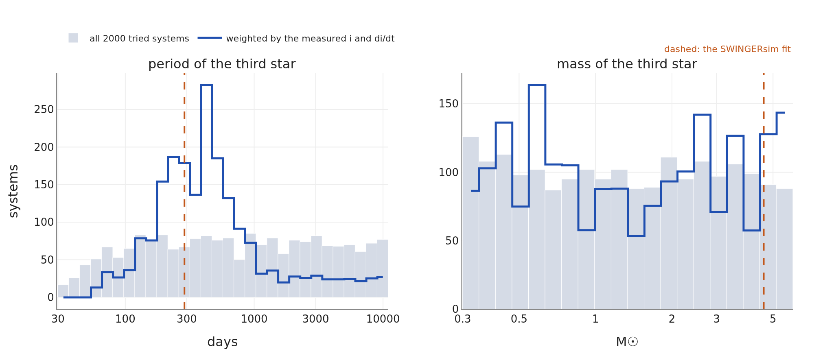

# QX Cas

## What the papers say

QX Cas is a 6.0-d eccentric binary of two early-B stars in the young open cluster NGC 7790. Its
eclipses, about 0.32 and 0.28 mag deep (Guinan et al. 2012b; the abstract does not name the band), were
observed photoelectrically around
1960 (Sandage & Tammann 1969) and 1980 (Moffett & Barnes 1983). Older times of minima, 1933–1974, come
from photographic plates and visual estimates. Guinan et al. (2012a, Figs. 2 and 3), adopting the
PHOEBE light-curve solutions of Bonaro et al. (2009, published only as an abstract), show inclinations
of about 85.4° around 1960 and 82° around 1980, and, from the FCAPT photometry of 2003–2008 (more than
110 nights, no eclipses), about 76° from 2003 onwards. They also note that photometry by A. Henden in
the mid-1990s shows no eclipses. The change is attributed to precession driven by an unseen third body.
No third star has been detected, and the papers do not state whether third light was included in the
light-curve solutions. A spectroscopic orbit (e = 0.22) by Kjurkchieva et al. (2007) is quoted in the
AAVSO forum (Henden 2020), but we could not locate the publication.

**The questions for SWINGERsim:** what third star can turn the orbit fast enough; were the old eclipses
deep enough to be seen, and with how much third light; and what should we see today, when the binary no
longer eclipses?

## Where the unseen third star can be

The ensemble asks which third stars can turn the orbit at the measured rate. 2000 systems were drawn
with a third star of 0.3–6 M☉, an outer period of 30–11 000 d, an outer eccentricity of 0–0.6 and an
arbitrary orientation; only systems stable by Mardling & Aarseth (2001) were kept. Each system was
integrated 30 years forward and backward and weighted by how well it gives the inclination around
1980 (82 ± 1.5°) and its rate of change (−0.23 ± 0.08°/yr, the linear rate implied by Guinan et al.
2012a).

**How to read Figure 7.** The grey histograms show what was tried (all periods and masses equally
likely on a logarithmic scale). The blue line shows which of them can produce the observed
precession. The precession rate grows with the mass of the third star and falls steeply with its
distance (roughly as m₃ P₁/P₃²), so third stars closer than about 100 d turn the orbit too fast
(or are unstable), and those farther than a few thousand days too slowly. The mass alone is hardly
constrained, because a light star close in and a heavy star farther out produce the same rate.

**Table 4.** QX Cas: the third star according to the weighted ensemble (16 %, 50 %, 84 %;
effective number of systems 187).

| quantity | 16 % | median | 84 % |
|---|---|---|---|
| period P₃ [d] | 193 | 414 | 1028 |
| mass m₃ [M☉] | 0.46 | 1.33 | 3.87 |
| mutual inclination [°] | 44 | 85 | 135 |

80 % of the weight lies at P₃ = 100–1000 d. In 13 % of all systems tried the two stars of the pair
collided within 30 years; these had the third star's orbit nearly perpendicular, which pumps the
eccentricity of the pair (the von Zeipel–Lidov–Kozai effect). QX Cas has survived for tens of
millions of years, so its third star is probably not on such an orbit.

## A fit that knows the eclipses are gone

The fit used the 96 minima of 1933–1974 and eight pieces of inclination information: the two
light-curve inclinations (~1960, ~1980), the upper limit of 75° for 2003–2008, "the pair eclipsed" in
the 1930s, and "no eclipses" for 2003–2008 (FCAPT) and for TESS 2019, 2022 and 2024. Nine parameters
were free (the pair's period, phase, eccentricity vector and inclination; the outer period, inclination
and node; m₃), with broad priors m₃ = 3 ± 2 M☉ and P₃ = 400 ± 300 d; the outer eccentricity was fixed at
0.2. "The pair eclipsed" was entered in its weakest form: the model inclination had to be above the
eclipse limit, i.e. a geometric eclipse. The next section shows that this is not enough.

**How to read Figure 8.** The published binary (orange) is drawn at the place of the fitted pair. The
fit adds a third star of 4.6 M☉ on a 288-d orbit (large ellipse, left). The middle panel shows the pair
in 1980, the reference date of the fit, at 81.8°: the discs overlap, so it eclipsed then. In the right
panel the pair's axis circles the total angular momentum once in about 137 years; it left the yellow
band around 2000 and returns to it around 2070. The track does not close exactly because the
apsidal motion of the eccentric pair slowly changes the eclipse limit (the dotted circle).

**How to read Figure 9.** The fitted inclination stays below 90°, so the observable and the unfolded
curves are the same. It rises through the eclipse limit in 1933, reaches 86° around 1965, falls
through 81.8° in 1980 and leaves the eclipsing range in 1999. It satisfies all eight pieces of
information (χ² = 0.1). The upper edge of the grey area, the eclipse limit, is not constant: it depends
on the separation of the stars at conjunction, which changes as the eccentric orbit of the pair turns
(apsidal motion). The geometric eclipses return in 2071 in this fit; an MCMC (below) places the return anywhere
between the early 2070s and after 2150.

**Note the green cross.** It sits exactly on the eclipse limit (model 70.58°, limit 70.59° in 1933):
the fit has pushed the inclination of the 1930s just high enough for a geometric eclipse and no higher.
That is a warning sign, and it is the subject of the next section.

## Were the eclipses deep enough to be seen? Depth and third light

A geometric eclipse near the limit is grazing: one star covers only a thin edge of the other. To know
whether an eclipse could have been **observed**, we computed its depth. For the stars of the fit
(R₁ = 3.5 R☉, 24 000 K; R₂ = 5.1 R☉, 18 000 K, from the spectral types and the fractional radii of
Guinan et al. 2012a) SWINGERsim calculated the light curve of the pair alone, with spherical stars and
without the light variation outside eclipses, for inclinations 66–90° and for every orientation ω of the
eccentric orbit. The depth then follows along the fitted inclination history. The light of a third
star or of any other source was added as a fraction l₃ of the total.

![**Figure 10.** QX Cas: was an eclipse deep enough to be seen? Left: depth of the primary eclipse in B (close to the photographic band) against the inclination, for the stars of the fit without third light; band: all orientations ω of the eccentric orbit. Right: the depth along the fitted inclination history for third light of 0, 10, 20 and 37 % (ω of 1980). Dashed: the approximate detection limits of photographic plates (0.10 mag) and of photoelectric photometry (0.02 mag). Green: the years of the photographic minima.](../../figures/squadra_test3/qx_depth.png)

**How to read Figure 10.** Left: a geometric eclipse begins at about 71°, but it stays shallower than
0.02 mag down to about 73° and reaches 0.1 mag only at **78°** (74.5–78° depending on ω; 79° with 20 %
third light). Below about 87° the stars never cover each other fully, which is why the depth keeps
growing up to that inclination. Right: along the fitted history the eclipses become detectable on
photographic plates only from **1943** (1945 with 20 % third light) to 1987.5, and photoelectrically from
1937 to 1994.5. In 1933 the model eclipse is only **0.0006 mag** deep.

**Table 5.** QX Cas: the inclination needed for a detectable primary eclipse in B, for the stars of the
fit (orientation ω of 1980; in brackets the range over all ω).

| detection limit | no third light | 20 % third light |
|---|---|---|
| photographic, ≈ 0.10 mag | 78.0° (74.5–78.0°) | 79.0° (75.5–79.0°) |
| photoelectric, ≈ 0.02 mag | 73.5° (71.5–75.0°) | 74.0° (71.5–75.5°) |

**This contradicts the data.** VarAstro lists 11 photographic minima from 1933 to 1942 (Kippenhahn,
Perova, Erleksova), the first in 1933. In the fitted model these eclipses would have been invisible on
plates. So either the inclination of the 1930s was at least ~76–78°, higher than our fit gives, or these
early minima are not what they seem (for example the times of minima of another star, or of a few
plates with large errors). The fit has 288 days for the third star and a nodal period of 137 years; a
higher inclination in the 1930s needs an earlier rise, i.e. a different phase of the precession or a
faster one. The plates of the Harvard collection (DASCH), which cover NGC 7790 from about 1900 to 1950,
could decide independently: an eclipse of 0.1 mag or more should be visible on them before 1943 if the
minima of the 1930s are real. The next section asks whether a model can have deep eclipses in the 1930s
at all.

**The depths of the 1960s and 1980s need third light.** At the published inclinations the model gives
deeper eclipses than observed (V band, ω of 1980). Guinan et al. (2012b) do not say in which band the
depths of the 1960s were measured; comparing them with V-band model depths is our assumption, and
Table 6 is uncertain to that extent:

**Table 6.** QX Cas: model eclipse depths at the published inclinations, and the third light needed to
make them as shallow as observed.

| epoch, inclination | eclipse | model depth (no third light) | observed | third light needed |
|---|---|---|---|---|
| ~1960, 85.4° | primary | 0.50 mag | 0.32 mag | 31 % |
| ~1960, 85.4° | secondary | 0.33 mag | 0.28 mag | 13 % |
| ~1980, 82° | primary | 0.24 mag | 0.12 mag | 47 % |

One value of third light cannot make both eclipses of 1960 as shallow as observed, and the value needed
in 1980 differs from that of 1960. Third light alone therefore does not explain the depths; the ratio of
the surface brightnesses of the two stars (their temperatures and radii) and the inclinations
themselves must differ from what we adopted, as J. Kolář pointed out to us. The fitted third star of
4.6 M☉ would contribute about 12–14 % of the V light (MIST models, Choi et al. 2016, at the age of
NGC 7790), which is of the right order but not a full explanation. The eclipse limit depends only on R₁ + R₂, so the
geometric switching dates do not depend on the third light; the detectable dates do, by 1–4 years
(Fig. 10, right).

## A second fit: deep eclipses in the 1930s {#qx-fit-deep}

To test whether the old photographic minima can be reconciled with the rest, we repeated the fit with
the same 96 minima and priors, but entered the photographic eclipses as **detectable**: an inclination
of at least 76 ± 1.5° in 1933 and in 1974, the value at which the eclipse of the fitted stars reaches
about 0.1 mag in B (Table 5, with some allowance for ω and third light). All other inclination
information is the same as before.

**Table 7.** QX Cas: the fit with detectable photographic eclipses ("deep 1930s") compared with the
fit above ("geometric 1930s"). Each row is one quantity; values are best fits with their linearised
1σ errors. Depths are in B for the stars of the fit without third light. *Detectable* means deeper than
0.1 mag (photographic) or 0.02 mag (photoelectric).

| quantity | geometric 1930s (above) | deep 1930s |
|---|---|---|
| χ² of the nine inclination items | 0.1 | 0.2 |
| inclination in 1933 | 70.6° (at the eclipse limit) | 75.8° (0.1σ below the required 76°) |
| inclination in ~1960, 1980 | 85.6°, 81.8° | 85.7°, 81.5° |
| eclipse depth in 1933 | 0.0006 mag | 0.069 mag |
| geometric eclipses | 1933–1999, return 2071 | 1922–2005.5, return 2058 |
| detectable on plates | 1943–1987.5 | 1936.5–1989.5 |
| detectable photoelectrically | 1937–1994.5 | until 1999.0 |
| third star m₃, P₃ | 4.6 ± 0.6 M☉, 288 ± 1 d | 4.56 ± 0.68 M☉, 287.8 ± 0.9 d |
| inclination of the outer orbit | – | 72.5 ± 2.5° |
| rms of the 96 minima | 98 min (photographic) | 101 min (all sources) |

The new fit reaches 75.8° in 1933, within 0.1σ of the requirement, and still satisfies the
inclinations of 1960 and 1980, the upper limit of 2003–2008 and the absence of eclipses in 2003–2024
(model 69.4° in 2006 against the eclipse limit of 70.0°). The third star does not change. The
eclipses of 1933 now have 0.069 mag in B: still shallower than 0.1 mag in that year, but detectable
on plates from 1936.5, so most of the photographic minima of 1933–1942 fall into the detectable
interval.

**The price is the 1990s.** To be high early, the inclination must rise earlier, and the whole
history shifts: the geometric eclipses now last until 2005.5, and the eclipses stay deeper than
0.02 mag until 1999.0. A. Henden saw no eclipses in the mid-1990s (Guinan et al. 2012a). With the
adopted radii and temperatures, deep eclipses in the 1930s and no eclipses in the mid-1990s pull
against each other. They can be reconciled only if the eclipse depth at a given inclination is
different from what our stars give, i.e. if the radii and the light ratio of the two stars (and the
third light) are fitted together with the old depths. This is the same conclusion that the third
light in Table 6 points to: the adopted stellar parameters are the weak link, not the dynamics.

**What the ensemble says about the dates.** Both fits are single systems. To obtain a range of dates
we integrated the ensemble of Figure 7 (the 1654 of the 2000 systems that carry any weight; the other 346 have zero weight) over 1900–2100 and recorded when each system starts and
stops eclipsing geometrically.

- **Weighted only by the inclination and its rate around 1980** (187 effective systems): 91 % of the
  weight eclipses in 1933. Only 15 % of the weight ends its eclipses between 1900 and 2025, in
  1997–2011.5–2021.5 (16–50–84 %). Of those, 12 % return by 2100, in 2046–2058–2086. Most systems with
  the right inclination and rate in 1980 simply keep eclipsing: two numbers from 1980 do not
  determine the history.
- **Weighted also by the whole inclination history** (1960, 1980, the limit of 2005, no eclipses
  2003–2024, and either form of the 1930s): only one or two effective systems remain. They end their
  eclipses in about 2002 and return around 2079.

The ensemble therefore contains almost no systems that satisfy the whole history: drawing the third
star at random and weighting afterwards is too inefficient here, because the history is a narrow
target in a nine-dimensional space. A reliable range of dates needs a search conditioned on the
history, i.e. an MCMC of the fit itself with the inclination history as data (*Physics and Methods*,
chapter Fitting observed data).

**An MCMC of the deep-1930s fit.** We sampled the posterior of the second fit with all its data:
the 96 minima and the nine inclination items (emcee, 24 walkers × 6000 steps, the first 3000
discarded). The autocorrelation time is 311 steps, so the kept chain is 9.6 autocorrelation times
long, just short of the ten usually asked for; the ranges below are therefore approximate. 300
samples were integrated over 1900–2150 and the eclipse switches recorded.

- **End of the eclipses:** the last switch before 2026 lies in 2000.0–2004.0–2006.5 (16–50–84 %).
  The data fix it to within a few years.
- **Return:** 2071.9–2110.0–2130.1, and 12 of the 300 samples (4 %) do not return before 2150.
  The return is not fixed by the data: χ² is flat in P₃ from about 270 to 400 d, and the nodal
  period, which sets the return, changes with it.
- **Third star:** m₃ 2.5–3.9–5.2 M☉, outer inclination 61.9–66.6–72.5°.

The best fits (end 1999–2005.5, return 2058–2071) are therefore single points of a wide posterior.
The end of the eclipses around 2000–2006 is a result; the return is not, anything from the early
2070s to after 2150 agrees with the data.

**Table 8.** QX Cas: the papers and SWINGERsim.

| quantity | Guinan et al. (2012a,b) | SWINGERsim |
|---|---|---|
| inclination ~1960, ~1980 | 85.4°, 82° | 85.6°, 81.8 ± 1.5° |
| eclipses absent | mid-1990s (Henden), 2003–2008 (FCAPT) | after 1999 geometrically; deeper than 0.02 mag only until 1994.5 |
| fall of the inclination | ~0.23°/yr (85.4° in ~1960 to ~76° from 2003) | ~0.5°/yr in 1980, 0.7–0.8°/yr around 2000; nodal period 137 yr |
| third star | unseen | ensemble: P₃ 190–1030 d, m₃ 0.5–3.9 M☉; fit: 288 ± 1 d, 4.6 ± 0.6 M☉ |
| third light | not stated | needed for the old depths: 13–47 % (Table 6); a 4.6-M☉ third star gives ~12–14 % |
| eccentricity of the pair | 0.21 | 0.23 |
| photographic minima 1933–1942 | observed (VarAstro) | geometric fit: not detectable before 1943; deep-1930s fit: detectable from 1936.5, but eclipses then last until 1999.0 |
| eclipses return | – | geometrically 2058–2071 (the two fits); MCMC of the deep-1930s fit: 2072–2110–2130, 4 % not before 2150 |
| times of minima: rms | – | photoelectric 45 min, photographic 98 min, visual 107 min |

**The inclination must fall faster than the published linear rate.** In SWINGERsim the eclipse limit
of the pair (from R₁ + R₂ = 0.27 a, the fractional radii of Guinan et al. 2012a, and the eccentric
orbit) is about 70.5°. If the inclination was 82° in 1980 and there were no eclipses by 2003, it must
have fallen below 70.5° within 23 years, i.e. at least 0.5°/yr on average. The fit does exactly that: the
inclination peaks around 1965 and then falls ever faster. A steady 0.23°/yr would have kept QX Cas
eclipsing until about 2030. The published value of about 76° from 2003 onwards comes from a light-curve
model in which 76° gives no eclipses, whereas in our model a geometric eclipse would continue down to
70.5°. Our depth calculation shows how the two can be reconciled: at 76° the model eclipse is only about
0.06 mag deep, and FCAPT, which saw none, would have detected that, so 76° is an upper limit in our model
as well. We therefore used it only as an upper limit (75 ± 1°). The ensemble above used the slower linear
rate; a faster rate moves the third star closer or makes it heavier, so the ensemble range is, if
anything, too wide on the long-period side.

**Why the fitted third star is heavier than the ensemble median.** The fitted period of the third star
(288 d) is set mainly by the precession rate and the prior, because the 96 old minima scatter by one to
two hours and cannot measure a light-time effect of a few minutes. A heavier third star at the same
period turns the orbit faster, which the fit uses to make the inclination fall fast enough. The ensemble
range (190–1030 d, 0.5–3.9 M☉) is the result; the fit is one concrete system that satisfies everything
known about the inclinations.

## A prediction tested: the binary seen without eclipses

An eccentric binary varies in light even without eclipses. Near periastron the two stars are closest:
their tidal distortion (ellipsoidal variation) and the heating of one star by the other are largest,
and the system brightens briefly once per orbit (a "heartbeat"; Thompson et al. 2012). SWINGERsim computes
this from the same model that gives the orbits. For QX Cas today it predicts a variation of about
1 ppt, repeating every 6.0 days.

**Why most of the signal is at half and a third of the period.** A star distorted by tides is
elongated towards its companion. We see it largest twice per orbit (when we look at the long side, at
the quadratures) and smallest twice (at the conjunctions), so the ellipsoidal variation has two maxima
per orbit: its period is P/2 (the second harmonic of the orbital frequency). In an eccentric orbit the
distortion is strong only during the short passage through periastron and weak for the rest of the
orbit. A brief brightening once per orbit is not a sine wave. Written as a sum of sine waves (a Fourier
series) it needs the orbital period P together with its harmonics P/2, P/3, P/4 …, and for e ≈ 0.2 the
power is largest at P/2 and P/3. The periodogram therefore shows the binary most strongly at 3.0 and
2.0 days, not at 6.0 days.

We searched the TESS light curves of 2019–2024 (eight SPOC sectors between 18 and 85, about 200 days in
all, 30-min bins) for this signal. QX Cas lies in a cluster, and light of neighbouring stars leaks into
the photometry: six periodic signals unrelated to the binary (1.04, 1.72, 3.18, 5.35, 5.63 and 6.43 d)
were removed first. The same steps were applied to the SWINGERsim model light curve, so that data and
model were treated identically.

**How to read Figure 11.** The left panel shows how strongly each period is present in the light. The
highest peaks lie at P/2 and P/3 of the binary period: the binary is still visible in the light. The
right panel folds all eight sectors on the binary period and averages them in 40 bins.

**Table 9.** QX Cas: amplitude of the binary signal in TESS and in the SWINGERsim prediction (same
processing). Noise: 99 % of random periods give less than 0.47 ppt.

| harmonic | period [d] | TESS [ppt] | SWINGERsim [ppt] |
|---|---|---|---|
| 1 | 6.005 | 0.55 ± 0.14 | 0.98 |
| 2 | 3.003 | **1.22 ± 0.09** | 0.84 |
| 3 | 2.002 | **0.81 ± 0.09** | 0.72 |
| 4 | 1.501 | 0.17 ± 0.06 | 0.53 |

**The binary is detected without eclipses, at the predicted level.** The highest peak of the whole
periodogram (1.2–12 d) lies at 3.0019 d, half of 6.0038 d, while the orbital period from the eclipses
of the 20th century is 6.0039 d. The second and third harmonics are 14σ and 9σ signals, with amplitudes
within about 30 % of the model's.

**The shape is not yet right.** The measured brightening is less sharply peaked than the model's and
sits at a different phase (Fig. 11, right). The phase is not expected to agree: the model extrapolates
the times of periastron from minima of 1933–1974 over about 2900 orbits, and the period error of the fit
(±0.0002 d) alone shifts the phase by ±0.1 orbit; the orientation of the orbit (ω) after 50 years of
apsidal motion is equally uncertain. The shape depends on ω, on the inclination and on the stellar
parameters, which (see above) are not calibrated on the old eclipses. The TESS light curve therefore
carries information on the present orbit that the old minima cannot give, and a fit of it is the
natural next step.

## Verdict

- **Confirms** that a third star can turn the orbit of QX Cas at the observed rate and switch off its
  eclipses in the 1990s. A stable system that does so exists and satisfies all inclination
  information, including the absence of eclipses in 2003–2024.
- **Adds:** where the third star can be: most likely P₃ ≈ 0.5–3 yr, m₃ ≈ 0.5–4 M☉, probably not on a
  nearly perpendicular orbit. Such a star moves the pair by a few to 25 km/s in radial velocity over
  months to years, which spectra can test.
- **Adds:** the binary is detected in TESS without eclipses, at its orbital period and with the
  predicted amplitude of the variation near periastron.
- **Differs:** the inclination must have fallen at least twice as fast as the published linear rate
  (≥ 0.5°/yr after 1980), and in our model the eclipses become undetectable in 1987.5–1994.5 rather than
  later.
- **Open problem, found by computing depths:** the photographic minima of 1933–1942 need an inclination
  of at least ~76–78° then. A fit that enforces this exists (75.8° in 1933, eclipses detectable on
  plates from 1936.5), but its eclipses then remain detectable until 1999.0, in tension with the
  absence of eclipses in the mid-1990s. The old eclipse depths also need third light that changes
  between eclipses and epochs. Both point to the adopted stellar radii and light ratio: they must be
  fitted together with the old depths and the TESS light curve. The DASCH plates can test the 1930s
  independently.
- **Dates:** an MCMC of the deep-1930s fit puts the end of the geometric eclipses in 2000.0–2006.5
  (16–84 %). Their return is not constrained: 2072–2130, and 4 % of the samples not before 2150.
- **Caution:** the inclinations of ~1960 and ~1980 are read from Guinan et al. (2012a); their errors
  are our assumptions, and the underlying solutions (Bonaro et al. 2009) are unpublished. SWINGERsim
  therefore gives a constraint on the third star, not a detection.
