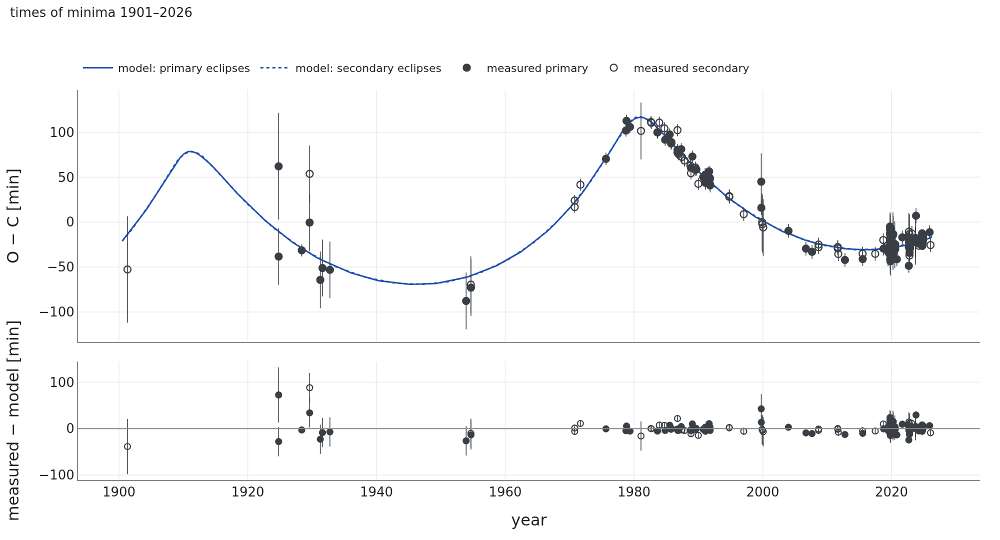

# AH Cep

## What the papers say

AH Cep is one of the most massive eclipsing binaries in the Galaxy: two B0.5 V stars of 16.14 ± 0.26
and 13.69 ± 0.21 M☉ on a circular 1.775-d orbit, inclined at 69.81 ± 0.60°, with fractional radii
0.340 and 0.295, close to filling their Roche lobes (Pavlovski et al. 2018). That solution comes
from the Strömgren uvby light curves of Bell et al. (1986), with the light ratio of the two stars fixed
at the spectroscopic value 0.715 ± 0.020 and no third light; the spectra allow at most 2 % of third
light for a companion with similar lines. The eclipse times since 1901 show a long wave, interpreted
as the light-time effect of a third body on a ~68-yr orbit with e ≈ 0.53 and a semi-amplitude of about
0.059 d; a second, ~9-yr light-time orbit of a possible fourth body was also proposed (Kim et al.
2003, 2005). Drechsel et al. (1989) reported a long-term change of the light-curve amplitude, which
would mean a change of the inclination; Pavlovski et al. (2018) call this claim "uncorroborated", i.e.
not supported by later work, but did not test it themselves.

**The question for SWINGERsim:** is the wave in the eclipse times a third body, what can it be, can it
or a fourth body change the inclination of the binary, and what do the TESS light curves say?

## The system: published and fitted

**How to read Figure 12.** The scale of the left panel is tens of au: the pair moves on the small
ellipse around the common centre of mass, the third body on the large, very eccentric one. In the
middle panel the two stars nearly fill the space between them, a near-contact binary. In the right
panel the axis of the pair sits in the eclipsing band and does not move: the third body is too far
away to turn the pair's orbit within centuries.

## 125 years of eclipse times

**How to read Figure 13.** The eclipses come up to an hour and a half late or early compared with a
strict clock. This is the light-travel time across the orbit of the pair around the third body: the
eclipses are late when the pair is on the far side of that orbit (around 1980). The steep part in the
1970s is the passage of the eccentric outer orbit through periastron, when the pair moves fastest.
Here the dynamical effect of the third body is negligible (the outer orbit is 14 000 times longer than
the inner one). The model follows the TESS minima to 0.6–1 min in the best sectors (S18, S78) and the
125-year wave to the precision of each source.

**Table 10.** AH Cep: the papers and SWINGERsim.

| quantity | papers | SWINGERsim fit |
|---|---|---|
| masses of the pair | 16.14 ± 0.26, 13.69 ± 0.21 M☉ (Pavlovski et al. 2018; used as priors) | 15.85 ± 0.19, 13.55 ± 0.19 M☉ |
| outer period | ~68 yr (Kim et al. 2003, 2005) | **69.7 ± 0.9 yr** |
| outer eccentricity | ~0.53 (Kim et al. 2003) | **0.63 ± 0.03** |
| light-time semi-amplitude | ~0.059 d (Kim et al. 2003) | 0.058 d |
| third body | – | **m₃ sin i₃ ≈ 6.6 M☉, so m₃ ≥ 6.6 M☉** |
| change of the inclination | claimed (Drechsel et al. 1989), called uncorroborated (Pavlovski et al. 2018) | **0.02° in 400 years** from the third body |
| stability | – | very hierarchical (Mardling–Aarseth ratio ≥ 52 for any mutual inclination) |
| times of minima: rms | – | TESS 0.6–2.6 min (best sectors), CCD 8.5 min, photoelectric 6.6 min, visual 31 min |

The eclipse times measure the size of the pair's orbit around the third body and its period. From
these follows the mass function, which for the masses of the pair gives m₃ sin i₃ ≈ 6.6 M☉. Mass and
orbital inclination of the third body are not separable (in the fit their correlation is −1.000):
any m₃ ≥ 6.6 M☉ with the matching i₃ fits equally well.

## A fourth body?

Can a fourth body, hidden in the eclipse times, tilt the pair? An ensemble of 1500 fourth bodies of
0.3–8 M☉ on orbits around the pair (period 100–5000 d, eccentricity 0–0.6, arbitrary orientation),
with the third body as fitted, was integrated 20 years forward and backward. Only systems stable by
Mardling & Aarseth (2001) were kept; with the 70-yr eccentric third body this allows periods up to
about 2.8 years only. For each system the light-time effect of the pair on the fourth body's orbit was
added to the residuals of the three-body fit; if χ² became worse by more than 25 (after refitting a
quadratic ephemeris), the fourth body would have been seen.

**How to read Figure 14.** Each symbol is one possible fourth body. Massive ones (> 3 M☉) are mostly
excluded by the eclipse times (84 %), light ones (< 1 M☉) mostly hidden (89 %); the largest hidden
light-time signal is ±3 min. 859 of the 1500 bodies (57 %) are hidden in the eclipse times. A hidden
fourth body can still tilt the pair: 153 of them (18 % of the hidden ones, mostly at periods below
half a year) would change the inclination by more than 0.06° per year today. The constant TESS eclipse
depths (next section) rule those out.

Two conclusions follow. First, the ~9-yr fourth body of Kim et al. (2003, 2005) cannot orbit the pair:
with the 68–70-yr third body on an orbit of e ≈ 0.5–0.6, a 9-yr orbit around the pair is unstable by
the criteria of Mardling & Aarseth (2001) and Vynatheya et al. (2022) (stability ratios 0.3–0.6
instead of > 1) for any mass and orientation. Second, a fourth body is not needed by the eclipse
times, and if it exists it changes the inclination of the pair by less than about 0.06°/yr today.

## What the TESS light curves say: the inclination and a third light

A main-sequence star of ≥ 6.6 M☉ of the age of the pair (about 6 Myr) is an early-B star. From MIST
models (Choi et al. 2016) one star of 6.6–7 M☉ would contribute **7.0–7.9 %** of the TESS light, and a
pair of 3.5 + 3.3 M☉ stars with the same total mass 3.2 %. Such light dilutes the eclipses.

We asked what the TESS eclipses say in two ways.

1. **The published pair, inclination scanned.** For inclinations between 69.8° and 76° we computed
   the light curve of the published pair (radii and temperatures of Pavlovski et al. 2018, Roche
   surfaces) and fitted sectors 77 and 78 (2024) and 18 (2019) with a free constant third light.
2. **A fit with the stars free.** A SWINGERsim fit of sectors 77 and 78 with the inclination, both radii
   and the temperature of the secondary free, Roche surfaces, the 216 TESS minima for the timing, the
   correlated noise of the light curve taken into account (red-noise factor β ≈ 2.2; Pont et al. 2006),
   and the depth of every light-curve segment scaled by a free factor. The model contains the light of
   a 7 M☉ third star, so the scale factor measures how much third light the eclipses need.

**How to read Figure 15.** Left: the published pair at 69.8° gives eclipses that are too shallow and
too broad; the fit (blue) matches the light curve to 3.0–7.1 ppt rms. The small changes of slope where an
eclipse begins and ends (around 7 and 20 hours) are the contacts of the two stars on the sky: there the
eclipsed area starts or stops growing. The remaining wiggles of a few ppt are partly instrumental (they
repeat at the ends of the TESS segments). Right: each line says how much light must be added (positive)
or removed (negative) for the published pair to match the TESS eclipse depths at a given inclination.
At 69.8° light would have to be removed, which is impossible; without any third light the depths need
about 71.7°, and every percent of third light raises this by about 0.2°. The fit with free stars gives **i = 72.50 ± 0.21°** (formal), R₁ = 6.25 ± 0.05 R☉ and
R₂ = 5.88 ± 0.05 R☉ (published 6.51 and 5.64 R☉), T₂ = 28 430 ± 120 K, and **about 5 % of third light**.

**Table 11.** AH Cep: the eclipses of the 1980s and of TESS.

| | Pavlovski et al. (2018) | SWINGERsim, TESS 2024 |
|---|---|---|
| data | uvby, Bell et al. (1986) | TESS sectors 77, 78 |
| inclination | 69.81 ± 0.60° | 72.50 ± 0.21° (formal) |
| radii | 6.51, 5.64 R☉ | 6.25 ± 0.05 R☉, 5.88 ± 0.05 R☉ |
| light ratio of the stars | 0.715 ± 0.020 (spectra, fixed) | 0.78 in B (published radii give 0.67 in the same model) |
| third light | 0 (spectra: < 2 %) | about 5 % (fitted) |
| masses (∝ 1/sin³ i) | 16.14, 13.69 M☉ | 15.4, 13.0 M☉ if the same velocities are combined with this inclination |

**The TESS eclipses did not change in five years.** At a fixed inclination, sector 18 (2019) needs
about 1.3 % more third light than sectors 77 and 78 (2024). Since the needed third light changes by
about 4.8 % per degree of inclination, this corresponds to at most 0.27° in 4.4 years, i.e. a
rate |di/dt| ≤ 0.06°/yr; part of the difference is the sector-to-sector calibration of TESS for this
bright star.

**Is the inclination of AH Cep different from the published one?** Three explanations remain open:

- the inclination is higher and there is a few percent of third light, the light of the ≥ 6.6 M☉
  third body. The masses of the pair would then be lower. The spectra limit the third light to < 2 % for
  a star with lines similar to those of the pair, which a 21 000 K B2 star would have; very broad lines
  of a fast rotator could make it harder to see;
- the third body is fainter for its mass (two lighter stars, a compact object), and the radii of the
  pair differ from the published ones;
- the inclination did not change, but the light-curve models differ. For the same parameters
  SWINGERsim's eclipses are about 5 % shallower than PHOEBE's in V, and for V907 Sco the same tendency
  shifts SWINGERsim's inclination upwards by a fraction of a degree. For AH Cep the depth of each segment
  was left free, so the inclination rests on the shape of the light curve (the widths of the eclipses
  and the ellipsoidal variation), which depends on the Roche model, gravity darkening and limb
  darkening.

A change of the inclination between the 1980s and 2024 cannot be caused by the third body (0.02° in
400 years), and a hidden fourth body could give at most about 0.06°/yr today. An independent analysis
of the TESS light curves with PHOEBE or the Wilson–Devinney code, with free third light, is the
decisive test.

## Verdict

- **Confirms** the light-time orbit of Kim et al. (2003, 2005): one third body on a 70-yr eccentric
  orbit reproduces 125 years of eclipse times, from visual estimates to TESS, with the same
  semi-amplitude.
- **Disagrees** with a dynamical change of the inclination (Drechsel et al. 1989): the third body
  changes the inclination by 0.02° in 400 years. This supports the view of Pavlovski et al. (2018), who
  call the claim uncorroborated, with a dynamical argument that they did not make.
- **Adds:** the third body must be massive (≥ 6.6 M☉); as a single main-sequence star it would give
  7.0–7.9 % of the light. A fourth body is not needed; the ~9-yr fourth body proposed earlier would be
  dynamically unstable, and a hidden fourth body could tilt the pair by at most ~0.06°/yr today.
- **Adds, in tension with the spectra:** the TESS eclipses (2019, 2024) are best described by
  i ≈ 72.5° and about 5 % third light, in agreement with the predicted third star but not with the
  published inclination and the spectroscopic limit on third light. This result depends on the
  light-curve model and needs an independent check.
- **Can be checked with Gaia and Hipparcos:** the 70-yr orbit accelerates the pair on the sky (see
  below).
