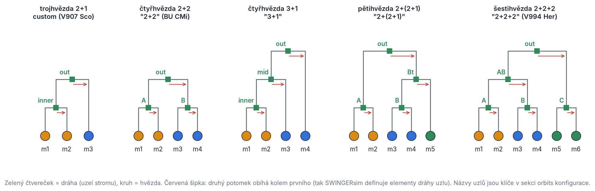
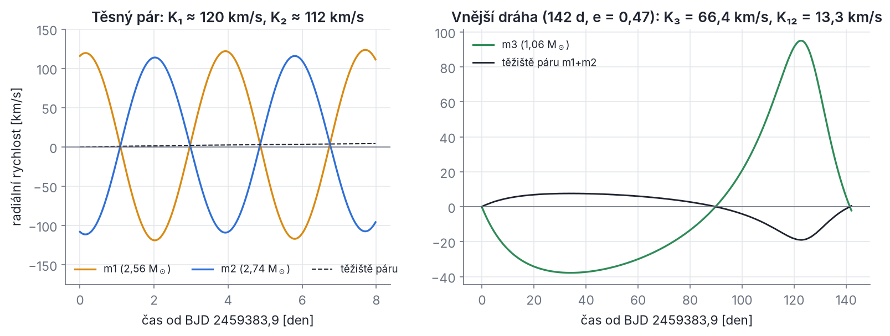
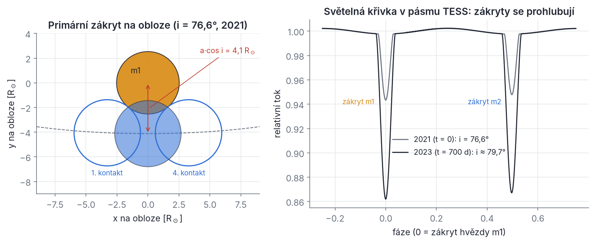
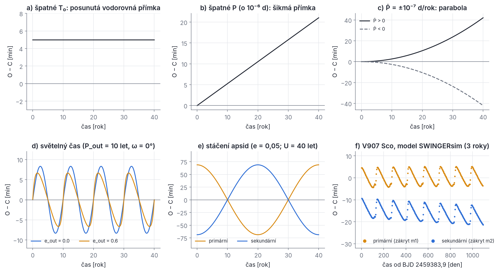
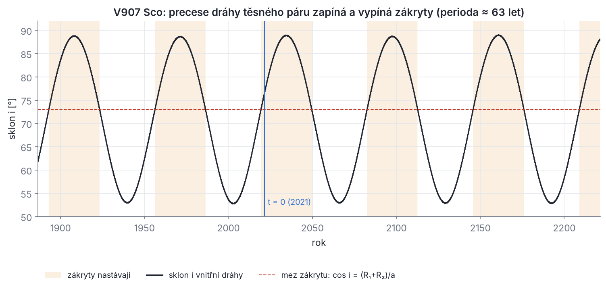

## Úvod

Tato skripta vysvětlují fyziku, rovnice a numerické metody, na kterých stojí program SWINGERsim: od Newtonova gravitačního zákona a Keplerovy úlohy přes sekulární dynamiku trojhvězd a čtyřhvězd, slapy, vývoj hvězd a přenos hmoty až po světelné křivky, diagramy O−C a fit pozorovaných dat metodou nejmenších čtverců a MCMC. Cílem je, aby v programu nezůstala žádná „černá skříňka“: každé číslo, které SWINGERsim vypíše, by sis měl umět aspoň řádově spočítat sám a vědět, za jakých předpokladů platí.

### Pro koho jsou skripta a co budeš potřebovat

Skripta jsou psána pro studenta prvního ročníku astrofyziky. Předpokládáme jen to, co se probírá v prvním semestru:

- **derivace a integrály** funkcí jedné proměnné, Taylorův rozvoj prvního a druhého řádu;
- **vektory** v trojrozměrném prostoru: skalární a vektorový součin, velikost vektoru, rozklad do složek;
- **Newtonovy pohybové zákony** a Newtonův gravitační zákon;
- základy **práce v terminálu** a v Pythonu (spustit příkaz, otevřít soubor CSV, nakreslit graf).

Vše ostatní – keplerovské elementy, rotační matice, středování přes oběh, Rocheův model, statistika fitování – v textu odvodíme. Matematické nástroje, které se v prvním ročníku teprve probírají (rotační matice, diferenciální rovnice, základy pravděpodobnosti), jsou shrnuty v Příloze A. Odvození píšeme celá, včetně mezikroků, které se v učebnicích obvykle „nechávají čtenáři“. Kdo je zná, může je přeskočit; kdo ne, nemusí nic hledat jinde.

> **Pozor.** Skripta nejsou návod k programu. Návod (User Guide) a popis metod (Methods) jsou součástí dokumentace SWINGERsim v adresáři `docs/`. Tady se učíme fyziku a numeriku, SWINGERsim je náš laboratorní přístroj.

### Jak skripta číst

Každá kapitola má stejnou stavbu:

1. **Motivace.** Krátce, proč tu látku potřebuješ a které skutečné soustavy (V907 Sco, CzeV343, BU CMi, QX Cas, V994 Her, AH Cep, Algol) ji ilustrují.
2. **Intuice.** Co se děje a proč, nejdřív bez rovnic, často s obrázkem.
3. **Fyzika.** Rovnice s úplným odvozením. Každý symbol je vysvětlen tam, kde se poprvé objeví.
4. **Jak to dělá SWINGERsim.** Který modul danou věc počítá, jaké klíče konfigurace ji ovládají a jakým příkazem si výsledek vyrobíš.
5. **Řešený příklad.** Konkrétní čísla, nejčastěji pro některou z našich vzorových soustav. Všechna čísla v řešených příkladech jsou přepočítána a všechny vytištěné příkazy jsou vyzkoušené.
6. **Pojmy kapitoly.** Tabulka českých pojmů, jejich anglických ekvivalentů a stručného významu. Literatura je převážně anglická, proto anglický termín uvádíme vždy.
7. **Vyzkoušej si a Řešení.** Šest až dvanáct úloh od snadných po náročnější: výpočty na papíře, pojmové otázky a běhy SWINGERsim. Ke každé úloze je na konci kapitoly stručné řešení s výsledným číslem.

V textu najdeš dva druhy rámečků. **Z historie** připomíná, jak se k dnešnímu poznání došlo – inverzní úloha „z pozorování k fyzice“ je v astronomii dvojhvězd stará přes dvě stě let. **Pozor** upozorňuje na místa, kde se často chybuje: záměny konvencí, zaměňované periody, chybně použité vzorce.

Obrázky jsou číslovány po kapitolách (Obr. 1.1, 1.2, …). Pod každým obrázkem je popisek, který říká nejen *co* obrázek ukazuje, ale i *jak ho číst*. Většinu obrázků vyrobil přímo SWINGERsim a v textu je uveden příkaz, kterým si je zopakuješ.

**Doporučené pořadí.** Kapitoly 1 a 2 jsou základ, bez kterého se dál neobejdeš. Kapitoly 3 až 6 tvoří dynamické jádro (hierarchie, stabilita, sekulární vývoj, numerická integrace). Kapitoly 7 až 9 dělají z hmotných bodů skutečné hvězdy. Kapitoly 10 a 11 spojují model s pozorováním. Kapitola 12 projde celý postup na soustavě V907 Sco. Kdo spěchá k datům, může po kapitole 2 skočit rovnou na kapitolu 10 a ke kapitolám 3–9 se vracet, když na ně narazí odkaz.

### Co je SWINGERsim

SWINGERsim je program v Pythonu (licence MIT) pro simulaci **hierarchických vícenásobných hvězd**: trojhvězd, čtyřhvězd typu 2+2 a 3+1 a vnořených hierarchií vyšších řádů, jako jsou 2+(2+1), 2+2+2 nebo 3+3. Hranice deseti hvězd není pevný limit programu, ale rozsah, do kterého byl program otestován. SWINGERsim pracuje ve dvou směrech.

**Dopředná úloha (model → pozorování).** Ze zadaných hmotností, drah a vlastností hvězd spočítá, jak se soustava vyvíjí, a převede to na veličiny, které měří pozorovatel: okamžiky zákrytů a diagramy O−C, radiální rychlosti, světelné křivky, změny sklonu dráhy a hloubek zákrytů. Pohyb hvězd počítá dvěma způsoby:

- **přímou integrací N těles** knihovnou REBOUND (integrátor IAS15, kapitola 6), k níž knihovna REBOUNDx přidává obecnou relativitu, slapy, rotaci hvězd a změny hmotnosti (kapitoly 6 a 7);
- **sekulárními (středovanými) rovnicemi** ve vektorových elementech, které jsou o mnoho řádů rychlejší a hodí se pro vývoj trvající miliony až miliardy let (kapitola 5).

Hvězdy nejsou hmotné body: SWINGERsim bere jejich poloměry, teploty, apsidální konstanty a momenty setrvačnosti z vývojových modelů MIST nebo z analytických vzorců SSE. Pokud máš nainstalovaný program MESA, umí z něj spočítat vlastní mřížku modelů (SWINGERsim MESA nedodává, jen ovládá místní instalaci). K tomu přidává přenos hmoty, společnou obálku, splynutí hvězd, magnetické brzdění a další procesy (kapitoly 8 a 9). Světelné křivky počítá vlastním modelem (koule nebo Rocheovy plochy, okrajové ztemnění, elipsoidální jev, odraz). Volitelně umí přímo zavolat program PHOEBE 2, pokud je nainstalován (kapitola 10).

**Inverzní úloha (pozorování → model).** Z naměřených okamžiků minim, radiálních rychlostí a světelných křivek hledá parametry soustavy. Používá k tomu jeden společný model N těles pro celou soustavu, nelineární metodu nejmenších čtverců (algoritmus s oblastí důvěry z knihovny SciPy, blízký příbuzný Levenbergovy–Marquardtovy metody) a vzorkování aposteriorního rozdělení metodou MCMC (knihovna emcee). Pro neurčité problémy počítá ensembly Monte Carlo vážené pozorováním a bayesovskou evidenci (kapitola 11).

Většina fyziky, celá sekulární a fitovací část, výpočet pozorovatelných veličin a webová aplikace jsou vlastní kód SWINGERsim. Převzaté knihovny (REBOUND, REBOUNDx, SciPy, emcee, volitelně PHOEBE a MESA) jsou vždy uvedeny tam, kde je program používá.

**Jak se s programem pracuje.** Soustavu popisuje textový **konfigurační soubor YAML**. Jeho hlavní sekce jsou:

| sekce | co obsahuje | kapitola |
| --- | --- | --- |
| `topology`, `hierarchy` | tvar hierarchie: hotový vzor (`"2+2"`, `"3+1"`, …) nebo vlastní strom (`custom`) | 1, 3 |
| `masses` | hmotnosti hvězd m1, m2, … v M☉ | 1, 2 |
| `orbits` | elementy každé dráhy: P (nebo a), e, i, Omega, omega, M0 | 2, 3 |
| `stars` | poloměry, teploty, rotace, apsidální konstanty jednotlivých hvězd | 7, 8 |
| `stellar_model` | zdroj modelů hvězd (MIST, SSE, MESA), stáří, metalicita | 8 |
| `physics` | přepínače fyziky: relativita, slapy, rotace, vývoj, přenos hmoty | 6–9 |
| `run` | délka integrace, počet výstupů, výpočetní metoda (`nbody`, `secular`) | 5, 6 |
| `fit`, `ensemble` | data a nastavení inverzní úlohy | 11, 12 |

Program se ovládá z příkazové řádky (`swingersim <příkaz>`) nebo z webové aplikace (`swingersim gui`), která staví formuláře ze stejných příkazů. Nejdůležitější příkazy, se kterými se ve skriptech setkáš:

| příkaz | co dělá |
| --- | --- |
| `swingersim run` | jedna simulace; zapíše soubor HDF5, souhrn, tabulky CSV, obrázky PNG a zprávu HTML |
| `swingersim timings` | okamžiky zákrytů (konjunkcí) a diagram O−C všech zákrytových párů |
| `swingersim minima` | minima změřená na syntetické světelné křivce (metodou Mikuláška 2015) |
| `swingersim lightcurve` | syntetická světelná křivka v zadaném pásmu (TESS, V, Gaia G, …) |
| `swingersim rv` | křivky radiálních rychlostí jednotlivých hvězd |
| `swingersim stability` | kritéria stability a numerický test |
| `swingersim apsidal` | stáčení přímky apsid rozložené na slapovou, rotační a relativistickou část |
| `swingersim fit` | fit okamžiků minim, radiálních rychlostí a světelných křivek |
| `swingersim ensemble` | ensemble Monte Carlo |
| `swingersim validate` | srovnání s publikovanými výsledky (testy programu) |

**Instalace** (Linux, macOS, ve Windows přes WSL; Python 3.11 nebo novější):

```bash
git clone https://github.com/uhlarmilan-create/SWINGERsim.git
cd SWINGERsim
./install.sh
source .venv/bin/activate
```

Skript `install.sh` vytvoří virtuální prostředí `.venv`, nainstaluje program a spustí krátký zkušební běh. Všechny příkazy ve skriptech předpokládají, že jsi v adresáři SWINGERsim a máš aktivované prostředí. Konfigurace vzorových soustav jsou v adresáři `configs/`. Doporučujeme pracovat s kopiemi: zkopíruj si soubor, který chceš měnit, do vlastního adresáře, a originál nech beze změny.

### Přehled kapitol

| kapitola | obsah | k čemu je v SWINGERsim |
| --- | --- | --- |
| 1 Vícenásobné hvězdy: co pozorujeme | statistika násobnosti, hierarchie, metody pozorování, diagram O−C, vzorové soustavy | zadání hierarchie, výstupy `timings`, `rv`, `lightcurve` |
| 2 Problém dvou těles | Keplerova úloha od Newtonových zákonů, elementy dráhy, Keplerova rovnice, orientace dráhy v prostoru | převod elementů na polohy a rychlosti (`kepler.py`) |
| 3 Hierarchické soustavy | Jacobiho souřadnice, rozvoj poruchové funkce, vzájemný sklon, invariantní rovina, časové škály | stavba počátečních podmínek (`hierarchy.py`) |
| 4 Stabilita | kritéria Mardlinga a Aarsetha a Vynatheyi a kol., indikátor MEGNO | `swingersim stability`, `chaosmap` |
| 5 Sekulární dynamika | středování, kvadrupól a oktupól, cykly ZLK, precese uzlů | sekulární výpočetní metoda |
| 6 Numerická integrace N těles | Euler, leapfrog, IAS15, chyby a kontroly | výpočetní metoda `nbody` |
| 7 Slapy, rotace, relativita a spin | apsidální pohyb, slapové tření, Cassiniho stavy | `physics.tides`, `rotation`, `gr`; `swingersim apsidal` |
| 8 Vývoj hvězd | rovnice stavby hvězdy, MIST, SSE, MESA, větry | `stellar_model`, `physics.evolution` |
| 9 Přenos hmoty a společná obálka | Rocheův model, stabilita přenosu, formalismus α–λ | `physics.mass_transfer` |
| 10 Od modelu k pozorování | zákryty, světelné křivky, světelný čas a dynamický efekt, radiální rychlosti | `timings`, `minima`, `lightcurve`, `rv` |
| 11 Od pozorování k modelu | χ², Levenbergova–Marquardtova metoda, kovarianční matice, MCMC, ensembly, evidence | `swingersim fit`, `ensemble` |
| 12 Celý postup na příkladu V907 Sco | od dat k předpovědi s nejistotou | všechny předchozí nástroje dohromady |
| Přílohy | matematické minimum, konstanty a úplná tabulka značení, slovníček, literatura | |

### Jednotky

SWINGERsim i skripta počítají v **astronomických jednotkách**. V nich mají čísla rozumnou velikost (hmotnosti hvězd jsou jednotky M☉, dráhy jednotky až stovky au) a numerické chyby zaokrouhlení zůstávají malé.

| veličina | jednotka v konfiguraci | jednotka uvnitř programu | poznámka |
| --- | --- | --- | --- |
| hmotnost | M☉ | M☉ | M☉ = 1,988 41 · 10³⁰ kg |
| délka | velká poloosa v au, poloměry hvězd v R☉ | au | 1 au = 149 597 870,7 km = 215,032 R☉; R☉ = 695 700 km |
| čas | periody ve dnech, délky běhů v rocích | juliánský rok | 1 rok = 365,25 dne (juliánský) |
| úhel | stupně | radiány | 1 rad = 57,2958° |
| rychlost | km/s (výstupy) | au/rok | 1 km/s = 0,2109 au/rok |
| okamžik pozorování | BJD_TDB | čas od t = 0 v rocích | t = 0 se váže na zadané BJD (`--bjd-t0`) |

Délkové a hmotnostní jednotky odpovídají nominálním hodnotám IAU z roku 2015 (R☉ = 6,957 · 10⁸ m, GM☉ = 1,327 124 4 · 10²⁰ m³ s⁻²). Starší česká literatura (například Mikulášek & Krtička 2005) používá trochu jiné hodnoty slunečních konstant. Rozdíly jsou v desetinách procenta, ale při porovnávání čísel o ně můžeš zakopnout.

**Gravitační konstanta.** V jednotkách au, M☉ a rok má gravitační konstanta v SWINGERsim hodnotu

```latex
G = (k \cdot 365{,}25)^2 = 39{,}476\,93\ \mathrm{au^3\,M_\odot^{-1}\,rok^{-2}},
\qquad k = 0{,}017\,202\,098\,95\ \mathrm{au^{3/2}\,M_\odot^{-1/2}\,den^{-1}}
```

kde k je **Gaussova gravitační konstanta**. Často se setkáš s tvrzením, že v těchto jednotkách je G = 4π² = 39,478 42. To platí jen přibližně: obě hodnoty se liší o 3,8 · 10⁻⁵ (relativně). Příčina je historická. Gaussova konstanta byla definována tak, aby těleso zanedbatelné hmotnosti na dráze s a = 1 au oběhlo Slunce za „Gaussův rok“ 2π/k = 365,2569 dne. SWINGERsim ale měří čas v juliánských rocích o 365,25 dne. Třetí Keplerův zákon (kapitola 2)

```latex
P^2 = \frac{4\pi^2}{G\,(m_1+m_2)}\,a^3
```

má proto v našich jednotkách tvar P² ≈ a³/M s relativní přesností 4 · 10⁻⁵ (M = m₁ + m₂ v M☉, a v au, P v rocích). Pro odhady je to víc než dost. Když ale budeš porovnávat výstup programu s vlastním výpočtem na pět a více platných číslic, použij stejnou hodnotu G jako program.

**Praktické tvary.** Pro těsné dvojhvězdy jsou au a roky nepohodlné. Z třetího Keplerova zákona odvodíme tvar s periodou ve dnech a poloosou v poloměrech Slunce. Dosadíme P[rok] = P[den]/365,25 a a[R☉] = 215,032 · a[au]:

```latex
a = 215{,}032\left(\frac{G}{4\pi^2}\right)^{1/3}\left(\frac{P}{365{,}25\ \mathrm{d}}\right)^{2/3} M^{1/3}
  = 4{,}2083\ R_\odot \left(\frac{P}{1\ \mathrm{d}}\right)^{2/3}\left(\frac{M}{M_\odot}\right)^{1/3}
```

**Řešený příklad.** Těsný pár V907 Sco má periodu P = 3,7749 d a hmotnosti 2,56 + 2,74 = 5,30 M☉. Pak a = 4,2083 · 3,7749^(2/3) · 5,30^(1/3) R☉ = 4,2083 · 2,4244 · 1,7435 R☉ = 17,79 R☉ = 0,0827 au. Světlo urazí 1 au za 499,0 s, tedy průměr dráhy páru (2a) za 82,6 s. Další užitečné převody: rychlost světla je c = 173,14 au/den; poloamplituda radiální rychlosti a hmotnostní funkce mají praktické tvary s konstantami 212,9 km/s a 1,0361 · 10⁻⁷ M☉, které odvodíme v oddílu 1.4.

### Značení

Používáme jednotné značení ve všech kapitolách. Úplná tabulka symbolů je v Příloze C. Tady je výtah těch, které potkáš nejčastěji:

| symbol | význam |
| --- | --- |
| **r**, **v** (tučně) | vektory polohy a rychlosti; r = \|**r**\| je velikost |
| m₁, m₂, … (v konfiguraci m1, m2, …) | hmotnosti hvězd |
| M | součet hmotností (podle souvislosti celé soustavy nebo jednoho uzlu hierarchie) |
| μ = G(m₁ + m₂) | gravitační parametr dráhy |
| m_r = m₁m₂/(m₁ + m₂) | redukovaná hmotnost |
| **h** = **r** × **v** | měrný moment hybnosti (na jednotku redukované hmotnosti) |
| ε | měrná energie dráhy; **e** vektor výstřednosti |
| a, e, i, Ω, ω, M₀ | elementy dráhy: velká poloosa, výstřednost, sklon, délka výstupného uzlu, argument pericentra, střední anomálie v t = 0 |
| ν, E, M | pravá, excentrická a střední anomálie |
| n = 2π/P | střední pohyb |
| in, out (a také A, B, mid, …) | vnitřní a vnější dráha; názvy uzlů hierarchie |
| i_mut | vzájemný sklon dvou drah |
| ℓ = L_in/L_out | poměr momentů hybnosti drah (pozor: γ je rychlost těžiště, ne tento poměr) |
| γ | radiální rychlost těžiště soustavy |
| K | poloamplituda radiální rychlosti |
| R, L, T_eff | poloměr, zářivý výkon, efektivní teplota hvězdy |
| k₂ | apsidální konstanta; Loveovo číslo k_L = 2k₂ |
| T₀, P, E | počáteční epocha, perioda a číslo epochy efemeridy |
| BJD_TDB | barycentrické juliánské datum v časové škále TDB |

Dvě konvence je třeba znát od začátku, protože se liší od části literatury:

1. **Osa z míří od pozorovatele.** Kladná radiální rychlost znamená vzdalování (rudý posuv). **Výstupný uzel** je bod, ve kterém těleso protíná rovinu oblohy směrem *od* nás (souřadnice z roste). Sklon i je úhel mezi vektorem momentu hybnosti dráhy a osou z: i = 90° je pohled přesně z boku; sklony i a 180° − i dávají stejné radiální rychlosti i stejnou světelnou křivku, ale průměty drah na oblohu jsou zrcadlově převrácené podle přímky uzlů a hvězdy po nich obíhají opačným smyslem (kapitola 2).
2. **Elementy uzlu popisují relativní dráhu druhé větve kolem první.** Pro dvojhvězdu m1 + m2 je to dráha m2 kolem m1. Argument pericentra hvězdy m1 vůči těžišti je proto ω₁ = ω + 180°. Spektroskopické katalogy obvykle uvádějí právě ω₁ – při přebírání hodnot z literatury je třeba úhel přepočítat (oddíl 1.4).

**Periody.** Slovo „perioda“ znamená v astronomii dvojhvězd několik různých věcí: **siderickou** periodu (oběh vůči pevným směrům v prostoru), **anomalistickou** (od pericentra k pericentru), **uzlovou** (od uzlu k uzlu) a **zákrytovou** (od zákrytu k zákrytu, tedy od konjunkce ke konjunkci při pohledu ze Země). U izolované dvojice bodových hmot splývají. Jakmile se dráha stáčí, liší se. Perioda P v konfiguraci SWINGERsim je **oskulační keplerovská perioda v čase t = 0** a s pozorovanou zákrytovou periodou se obecně neshoduje. U V907 Sco je to 3,77487 d v konfiguraci proti 3,77622 d mezi zákryty (oddíl 1.5). Ve skriptech vždy řekneme, kterou periodu myslíme.

### Literatura ke studiu

Kapitoly odkazují na původní práce, ze kterých SWINGERsim vychází, s autory, rokem, časopisem, ročníkem a stránkou. Pro souvislé studium doporučujeme tyto české texty, ze kterých skripta přebírají terminologii:

- Z. Mikulášek, J. Krtička: *Základy fyziky hvězd*. Masarykova univerzita, Brno, 2005.
- Z. Mikulášek, M. Zejda: *Úvod do studia proměnných hvězd*. Masarykova univerzita, Brno, 2013.
- Z. Pokorný, Z. Mikulášek, J. Grygar: *Astronomické vademecum* (přehled pojmů, historie dvojhvězd a proměnných hvězd).
- Učební texty M. Brože (MFF UK) o nebeské mechanice, slapech a numerické integraci jako doplněk k dynamice.

Úplný seznam literatury je v Příloze F.

## Kapitola 1 – Vícenásobné hvězdy: co pozorujeme

Podívej se v jasné noci na prostřední hvězdu oje Velkého vozu. Bystré oko vedle ní najde slabší Alkor, malý dalekohled ukáže, že samotný Mizar je dvojice, a spektrograf, že každá složka této dvojice je opět dvojhvězda. Dvojice Mizar–Alkor, pro oko dva „body“ na obloze, je tak ve skutečnosti nejméně pět hvězd (je-li Alkor s Mizarem gravitačně vázán). Vícenásobné hvězdy nejsou kuriozita: patří k nim podstatná část hvězd v Galaxii a mezi hmotnými hvězdami dokonce většina.

Tato kapitola má tři cíle. Za prvé ukáže, *kolik* hvězd žije ve dvojicích a skupinách, a naučí tě číst statistiky násobnosti správně (podíl soustav, podíl hvězd a počet průvodců jsou tři různá čísla). Za druhé zavede **hierarchii** – stromový zápis vícenásobné soustavy, ve kterém ji zadáváš do SWINGERsim. Za třetí projde metody, kterými vícenásobné hvězdy pozorujeme: vizuální a astrometrickou, spektroskopickou (radiální rychlosti), fotometrickou (zákryty a světelné křivky) a interferometrickou, a ukáže, co z nich lze změřit. Zvlášť podrobně se budeme věnovat **diagramu O−C**, protože je to hlavní okno, kterým se do dynamiky vícenásobných hvězd díváme. Na konci kapitoly představíme sedm soustav, které nás budou provázet celými skripty, a otázky, na které SWINGERsim odpovídá.

### 1.1 Kolik hvězd žije ve skupinách

#### Tři různá čísla

V populárních knihách se dočteš, že „většina hvězd jsou dvojhvězdy“, v jiných, že „většina hvězd je osamělá“. Obě tvrzení mohou být pravdivá zároveň, protože mluví o různých veličinách. Představ si vzorek N **soustav** (každý „cíl“ na obloze je jedna soustava: osamělá hvězda, dvojhvězda, trojhvězda, …). Označme f_n podíl soustav, které mají přesně n hvězd, takže f₁ + f₂ + f₃ + … = 1. Pak rozlišujeme:

1. **Podíl vícenásobných soustav** (multiplicity fraction) – kolik soustav má aspoň jednoho průvodce:

```latex
f_M = \sum_{n\ge 2} f_n = 1 - f_1 .
```

2. **Podíl hvězd ve vícenásobných soustavách** – kolik ze všech hvězd vzorku má aspoň jednoho souseda. Soustava s n složkami přispívá n hvězdami, takže

```latex
F_\star = \frac{\sum_{n\ge 2} n f_n}{\sum_{n\ge 1} n f_n} .
```

3. **Frekvence průvodců** (companion frequency) – průměrný počet průvodců na jednu soustavu, tedy na jednu primární (nejhmotnější) hvězdu:

```latex
f_C = \sum_{n\ge 1} (n-1)\, f_n .
```

Na rozdíl od f_M a F_⋆ může být f_C větší než 1.

Pro samé dvojhvězdy (f₃ = f₄ = … = 0) dostaneme F_⋆ = 2f₂/(1 + f₂) a f_C = f_M = f₂. Už tady je vidět, že F_⋆ > f_M: například při f₂ = 0,46 je F_⋆ = 0,92/1,46 = 0,63. Polovina soustav je osamělá, ale dvě třetiny hvězd osamělé nejsou.

#### Hvězdy slunečního typu

Nejlépe prozkoumaný vzorek jsou trpaslíci typu F a G ve slunečním okolí. Tokovinin (2014, AJ 147, 87) zpracoval 4847 takových cílů do vzdálenosti 67 pc s hmotnostmi primárních složek 0,9–1,5 M☉. Po opravě o výběrové efekty (průvodce, kterého nevidíme, nezapočítáme, a tak je potřeba odhadnout, kolik jich chybí) dostal podíly soustav s 1, 2, 3, 4 a 5 složkami v poměru 54 : 33 : 8 : 4 : 1. Podíl vícenásobných soustav je f_M = 0,46 ± 0,01 a soustavy se třemi a více složkami tvoří 13 % *soustav*. Mezi pozorovanými čtyřhvězdami převládá typ 2+2 (dvě dvojice): 37 z 55, tedy 67 %, po opravě na výběrové efekty asi 74 %. Na jednu čtyřhvězdu jiného typu (3+1) tak připadají zhruba dvě až tři čtyřhvězdy 2+2.

**Řešený příklad.** Z Tokovininových opravených podílů f₁…f₅ = 0,543; 0,323; 0,076; 0,043; 0,013 spočítáme všechna tři čísla:

- f_M = 1 − 0,543 = 0,457 (46 % soustav má průvodce);
- počet hvězd na soustavu: 1 · 0,543 + 2 · 0,323 + 3 · 0,076 + 4 · 0,043 + 5 · 0,013 = 0,543 + 0,646 + 0,228 + 0,172 + 0,065 = 1,654;
- F_⋆ = (1,654 − 0,543)/1,654 = 1,111/1,654 = 0,67 – **dvě třetiny hvězd** slunečního typu žijí ve dvojhvězdě nebo vícenásobné soustavě;
- f_C = 0,323 + 2 · 0,076 + 3 · 0,043 + 4 · 0,013 = 0,656 průvodce na primární hvězdu (Tokovinin sám uvádí f_C ≈ 0,6–0,65).

Nezávislý vzorek 454 hvězd slunečního typu do 25 pc (Raghavan a kol. 2010, ApJS 190, 1) dává pozorované podíly 56 : 33 : 8 : 3 % pro osamělé hvězdy, dvojhvězdy, trojhvězdy a soustavy vyšší násobnosti; po opravě na neúplnost je osamělých 54 %. Obě studie se tedy shodují.

#### Závislost na hmotnosti

Násobnost silně roste s hmotností primární hvězdy. Moe & Di Stefano (2017, ApJS 230, 15) shrnuli spektroskopické, fotometrické a interferometrické přehlídky hvězd hlavní posloupnosti a spočítali frekvenci průvodců s poměrem hmotností q = m₂/m₁ > 0,1 a periodou kratší než 10⁸ dní. Ta roste od **0,50 ± 0,04** u hvězd slunečního typu po **2,1 ± 0,3** u hvězd typu O. (Číslo 0,50 je menší než Tokovininovo f_C ≈ 0,65, protože Moe & Di Stefano nepočítají průvodce lehčí než desetina primární hvězdy ani nejširší páry. Při srovnávání statistik vždy zkontroluj, jaké průvodce autoři započítali.) Na opačném konci stojí červení trpaslíci: Lada (2006, ApJ 640, L63) shrnul, že jen asi čtvrtina soustav s primární hvězdou typu M má průvodce. Protože červených trpaslíků je v Galaxii většina, jsou asi dvě třetiny všech hvězdných *soustav* v Galaxii osamělé hvězdy – i když hvězdy slunečního typu a hmotnější žijí převážně ve skupinách.

**Řešený příklad (Poissonovo rozdělení).** Pro hmotné hvězdy Moe & Di Stefano předpokládají, že počet průvodců jedné hvězdy se řídí Poissonovým rozdělením. Pravděpodobnost k průvodců při střední hodnotě λ je P(k) = λᵏ e^(−λ)/k!. Pro hvězdy typu O s λ = 2,1:

- bez průvodce: P(0) = e^(−2,1) = 0,12;
- dvojhvězda: P(1) = 2,1 · 0,122 = 0,26;
- trojhvězda a víc: 1 − P(0) − P(1) = 0,62.

Typická hvězda O je tedy členem trojhvězdy nebo čtyřhvězdy, ne prosté dvojhvězdy. (Poissonův model je zjednodušení; pro hvězdy slunečního typu ho autoři nepoužívají.)

> **Pozor.** Když v článku čteš „X % hvězd jsou dvojhvězdy“, ptej se: (1) jde o podíl soustav, nebo hvězd? (2) jaké hmotnosti, periody a poměry hmotností průvodců byly započítány? (3) byl výsledek opraven na průvodce, které přehlídka nemohla najít? Bez odpovědí se čísla z různých prací nedají srovnávat. Starší i populární texty často uvádějí 70–85 % – většinou jde o podíl hvězd (F_⋆), a navíc z neopravených vzorků.

#### Těsné páry mají téměř vždy třetí hvězdu

Pro naše téma je nejdůležitější jiná statistika. Tokovinin a kol. (2006, A&A 450, 681) hledali vzdálené průvodce u spektroskopických dvojhvězd slunečního typu. U dvojhvězd s periodou kratší než 3 dny našli třetí těleso v 96 % případů, u dvojhvězd s periodou nad 12 dní jen ve 34 %. Těsné dvojhvězdy jsou tedy téměř vždy vnitřní dvojicí trojhvězdy. To naznačuje, že třetí těleso pomohlo dvojici „utáhnout“ (oddíl 1.3), a pro pozorovatele z toho plyne praktický důsledek: kdo dlouho měří okamžiky zákrytů těsné dvojhvězdy, dříve či později v diagramu O−C uvidí vliv třetího tělesa.

### 1.2 Hierarchie

#### Proč musí být stabilní soustavy hierarchické

Tři hvězdy srovnatelných hmotností ve vzájemných vzdálenostech téhož řádu tvoří chaotickou soustavu. Hvězdy si vyměňují energii při blízkých setkáních, až jedna z nich (obvykle nejlehčí) dostane dost energie, aby unikla, a zbude dvojhvězda. Takové „demokratické“ trojice se rozpadají během desítek až stovek oběhů (kapitola 4). Dlouhodobě přežívají jen soustavy uspořádané **hierarchicky**: hvězdy se sdružují do těsných dvojic, a ty obíhají kolem sebe nebo kolem další hvězdy po mnohem větších drahách. Těsná dvojice se pak ze vzdálenosti vnější dráhy jeví téměř jako jediný hmotný bod a vnější těleso ji jen mírně ruší. (Pro velmi rozdílné hmotnosti existují i jiná stabilní uspořádání, například Lagrangeova rovnostranná konfigurace Slunce–Jupiter–trojan. Pro hvězdy srovnatelných hmotností nemají význam.)

Hierarchická soustava se dá v prvním přiblížení rozložit na **dvojhvězdy**: každá dráha je keplerovská dráha dvou „těles“, z nichž každé může být buď hvězda, nebo celá menší podsoustava soustředěná do svého těžiště. To je klíčová myšlenka celých skript. Problém dvou těles (kapitola 2) umíme vyřešit přesně, a hierarchická soustava je „problém dvou těles na každé úrovni plus malé poruchy“ (kapitola 3).

#### Zápis hierarchie: strom a závorky

Hierarchii zapisujeme jako **strom**. Listy jsou hvězdy, každý vnitřní uzel je jedna dráha a jeho dva potomci jsou dvě obíhající tělesa. Ekvivalentní je závorkový zápis, ve kterém závorka sdružuje dvě tělesa jedné dráhy:

- trojhvězda **2+1**: ((1+2)+3) – těsná dvojice a vzdálená třetí hvězda (V907 Sco, Algol, AH Cep);
- čtyřhvězda **2+2**: ((1+2)+(3+4)) – dvě dvojice obíhající kolem společného těžiště (BU CMi, CzeV343, V994 Her A+B);
- čtyřhvězda **3+1**: (((1+2)+3)+4) – trojhvězda, kolem které obíhá čtvrtá hvězda;
- vyšší hierarchie skládáme stejně: 2+(2+1) je dvojhvězda a trojhvězda, 2+2+2 jsou tři dvojhvězdy, z nichž dvě tvoří čtyřhvězdu a třetí obíhá kolem ní (V994 Her).

Pro čtyři hvězdy existují jen dvě stabilní hierarchie, 2+2 a 3+1 (Mikulášek & Krtička 2005). Pozorování ukazují, že 2+2 je častější (oddíl 1.1).



*Obr. 1.1 – Hierarchie vícenásobných hvězd jako stromy, přesně v podobě, v jaké je zná SWINGERsim. Čti zdola: kruhy jsou hvězdy m1, m2, …, zelené čtverečky jsou dráhy (uzly stromu) a jejich jména (inner, out, A, B, mid, Bt, AB, C) jsou klíče v sekci `orbits` konfigurace. Každý uzel má právě dva potomky; červená šipka ukazuje, že elementy uzlu popisují pohyb druhého potomka kolem prvního. Trojhvězda 2+1 nemá hotový vzor a zadává se jako `topology: custom`; ostatní stromy jsou vzory `"2+2"`, `"3+1"`, `"2+(2+1)"` a `"2+2+2"`.*

#### Jak hierarchii zadává SWINGERsim

V konfiguraci SWINGERsim hierarchii popisuje klíč `topology`. Hotové vzory (soubor `config.py`, slovník `PRESETS`) jsou:

| `topology` | strom (uzel: [první potomek, druhý potomek]) | příklad |
| --- | --- | --- |
| `"2+2"` | out: [A, B], A: [m1, m2], B: [m3, m4] | BU CMi, CzeV343 |
| `"3+1"` | out: [mid, m4], mid: [inner, m3], inner: [m1, m2] | |
| `"2+2+1"` | out5: [out, m5], out: [A, B], A: [m1, m2], B: [m3, m4] | |
| `"3+1+1"` | out5: [out, m5], out: [mid, m4], mid: [inner, m3], inner: [m1, m2] | |
| `"2+(2+1)"` | out: [A, Bt], A: [m1, m2], Bt: [B, m5], B: [m3, m4] | CzeV4315 (hypotéza) |
| `"2+2+2"` | out: [AB, C], AB: [A, B], A: [m1, m2], B: [m3, m4], C: [m5, m6] | V994 Her |
| `"3+3"` | out: [T1, T2], T1: [A, m3], A: [m1, m2], T2: [B, m6], B: [m4, m5] | |

Všimni si, že **pro trojhvězdu 2+1 hotový vzor není**. Trojhvězdy (a jakékoli jiné stromy) se zadávají vlastní topologií `custom` s klíčem `hierarchy`. Takto vypadá začátek konfigurace V907 Sco (`configs/squadra_test3/v907_sco_published.yaml`):

```yaml
topology: custom
hierarchy: {out: [inner, m3], inner: [m1, m2]}
masses: {m1: 2.56, m2: 2.74, m3: 1.06}
orbits:
  inner: {P: 3.77487065, e: 0.008, i: 76.61, Omega: 17.27, omega: 302.6, M0: 223.7284}
  out:   {P: 142.01,    e: 0.467, i: 68.80, Omega: -8.97, omega: 22.7,  M0: 40.7}
```

Jména uzlů si volíš sám (Algol v `configs/catalog/algol.yaml` má vnitřní dráhu pojmenovanou `A`). Program kontroluje, že každý uzel má právě dva potomky, že každá hvězda i dráha je potomkem jen jednou, že existuje jediný nejvyšší uzel a že hvězdy jsou očíslovány m1 … mN bez mezer (funkce `check_hierarchy`).

Dvě pravidla musíš znát, abys elementy zadával správně:

1. **Elementy uzlu popisují relativní dráhu druhého potomka kolem prvního.** U uzlu `inner: [m1, m2]` je to dráha m2 kolem m1. U uzlu `out: [inner, m3]` je to dráha hvězdy m3 kolem *těžiště* dvojice m1 + m2. Takové souřadnice (poloha každého tělesa vůči těžišti všeho, co je pod ním ve stromu) se nazývají **Jacobiho souřadnice** a podrobně je probereme v kapitole 3.
2. **Hmotnost uzlu je součet všech hvězd pod ním.** Převod periody na velkou poloosu uzlu `out` u V907 Sco používá M = m₁ + m₂ + m₃ = 6,36 M☉, převod u uzlu `inner` jen m₁ + m₂ = 5,30 M☉.

#### Poměr period

Míru hierarchie vyjadřuje **poměr period** vnější a vnitřní dráhy P_out/P_in (nebo poměr velkých poloos a_out/a_in ∝ (P_out/P_in)^(2/3) · (M_out/M_in)^(1/3)). U pozorovaných stabilních soustav sahá od zhruba pěti (nejtěsnější známé trojhvězdy) až po 10⁸ a víc (vzdálený průvodce ve vzdálenosti tisíců au kolem páru s periodou dne). Pod několika jednotkami se hierarchie rozpadá; kde přesně leží hranice, závisí na hmotnostech, výstřednosti a vzájemném sklonu (kapitola 4). Naše vzorové soustavy pokrývají velký rozsah:

| soustava | P_in [d] | P_out [d] | P_out/P_in |
| --- | --- | --- | --- |
| AH Cep | 1,7747 | ≈ 25 000 (68 let) | 14 000 |
| Algol | 2,8673 | 680,2 | 237 |
| CzeV343 | 1,2093 (A) | 1454 | 1202 |
| V994 Her | 2,0832 (A) | 1062 | 510 |
| QX Cas (hypotéza) | 6,0047 | 300 | 50 |
| BU CMi | 2,9375 (A) | 121,8 | 41 |
| V907 Sco | 3,7749 | 142,0 | 38 |

Čím menší poměr, tím silnější a rychlejší jsou vzájemné poruchy drah. Proto jsou BU CMi a V907 Sco tak zajímavé: jejich dráhy se mění tak rychle, že to vidíme během několika let.

### 1.3 Jak vícenásobné hvězdy vznikají

Hvězdy vznikají gravitačním kolapsem chladných, hustých jader molekulových mračen. Vícenásobné soustavy se podle současných představ (přehled Offner a kol. 2023, Protostars and Planets VII, ASP Conf. Ser. 534, 275) rodí hlavně dvěma cestami:

- **Fragmentace jádra** (turbulentní fragmentace). Kolabující jádro se rozpadne na několik zárodků vzdálených stovky až tisíce au. Tak vznikají široké páry a široké vnější dráhy.
- **Fragmentace disku.** Hmotný akreční disk kolem mladé hvězdy se stane gravitačně nestabilním a rozpadne se na další zárodky ve vzdálenostech desítek až stovek au. Zárodky vznikají v rovině disku, proto takové soustavy mají dráhy zhruba v jedné rovině.

Ani jedna cesta nevytvoří přímo pár s periodou několika dní: mladé hvězdy jsou v rané fázi mnohem větší než na hlavní posloupnosti a dvojice tak těsná by se „nevešla“. Těsné páry tedy musely svou dráhu zmenšit později. Navrhované mechanismy jsou migrace v plynném disku (tření o plyn odnáší moment hybnosti), dynamické interakce v mladých soustavách, při kterých se energie předává vnější hvězdě, a cykly von Zeipela–Lidova–Kozaie se slapovým třením (kapitoly 5 a 7). Moe & Kratter (2018, ApJ 854, 44) ukázali, že samotné cykly ZLK se slapovým třením na hlavní posloupnosti nestačí vysvětlit, kolik těsných párů pozorujeme; většina se musela utáhnout už v době před hlavní posloupností, kdy byly hvězdy velké a disky ještě přítomné.

Pro SWINGERsim z toho plynou dvě praktické věci. Za prvé: pozorované těsné trojhvězdy mají často dráhy blízko jedné roviny, ale ne vždy – Algol má dráhy téměř navzájem kolmé (oddíl 1.5). Vzájemný sklon je proto jeden z nejdůležitějších parametrů, které chceme z pozorování zjistit. Za druhé: počáteční podmínky, které zadáváme, nejsou „počátkem“ soustavy, ale jejím dnešním stavem. Simulace vpřed ukazuje budoucnost, simulace vzad (záporná délka běhu, `--t-max-yr -130`) minulost, kterou můžeme srovnat se staršími pozorováními.

### 1.4 Jak vícenásobné hvězdy pozorujeme

Většinu vícenásobných hvězd nevidíme rozlišeně: v dalekohledu splynou do jediného bodu. O jejich drahách se dozvídáme nepřímo – z pohybu na obloze, z Dopplerova posuvu spektrálních čar, ze zákrytů a z drobných změn okamžiků, kdy zákryty nastávají. Každá metoda vidí jinou průmětnu prostorového pohybu, a proto jsou nejcennější soustavy, u kterých můžeme metody kombinovat.

Nejdřív si připravme geometrii, kterou budou používat všechny metody. Mějme relativní dráhu hvězdy 2 kolem hvězdy 1 s elementy a, e, i, Ω, ω (kapitola 2). Vzdálenost hvězd je r = a(1 − e²)/(1 + e cos ν) a úhel měřený v rovině dráhy od výstupného uzlu k hvězdě je **argument šířky** u = ω + ν. Rozložíme polohu na složku podél zorného paprsku (osa z, od pozorovatele) a na průmět do roviny oblohy (x, y). Rovina dráhy je vůči rovině oblohy skloněna o úhel i a protíná ji v přímce uzlů. Bod dráhy ve vzdálenosti r pod úhlem u od uzlu leží ve výšce r sin u nad přímkou uzlů *v rovině dráhy*; složka této výšky kolmá k obloze je r sin u sin i. Tedy

```latex
z = r \sin u \,\sin i, \qquad x^2 + y^2 = r^2 - z^2 = r^2\left(1 - \sin^2 u\,\sin^2 i\right).
```

První rovnice je základem radiálních rychlostí a světelného času, druhá – **promítnutá vzdálenost** δ = √(x² + y²) – základem zákrytů a vizuálních drah. (Obě plynou i z úplného převodu elementů na souřadnice rotačními maticemi v kapitole 2.)

#### 1.4.1 Vizuální a astrometrické dvojhvězdy

**Vizuální dvojhvězda** je pár, jehož složky rozlišíme přímo. Rozlišovací schopnost dalekohledu o průměru D je omezena ohybem světla: Rayleighovo kritérium dává θ_min = 1,22 λ/D, empirická Dawesova mez R ≈ 11,6″/D[cm]. Dalekohled o průměru 10 cm tak rozliší páry vzdálené asi 1,2″, metrový dalekohled ve viditelném světle (λ = 550 nm) asi 0,14″ – pokud to dovolí neklid atmosféry. Opakovaným měřením úhlové vzdálenosti a pozičního úhlu sledujeme **relativní dráhu** jedné složky kolem druhé jako elipsu na obloze (průmět skutečné elipsy).

Z relativní dráhy získáme úhlovou velkou poloosu a″ a periodu P. Známe-li paralaxu ϖ (obě v obloukových vteřinách), je skutečná poloosa a = a″/ϖ v au a třetí Keplerův zákon dává **celkovou hmotnost**:

```latex
m_1 + m_2 \approx \frac{a^3}{P^2} = \frac{(a''/\varpi)^3}{P^2}
\qquad [M_\odot;\ a \text{ v au},\ P \text{ v rocích}].
```

Hmotnost tedy závisí na třetí mocnině paralaxy: chyba paralaxy 3 % dá chybu hmotnosti 9 %. Jednotlivé hmotnosti dostaneme, když změříme i pohyb každé složky vůči hvězdám pozadí: poměr velikostí drah kolem těžiště je a₁/a₂ = m₂/m₁.

**Řešený příklad.** Interferometrická dráha třetí hvězdy Algolu kolem vnitřního páru (Baron a kol. 2012, ApJ 752, 20) má úhlovou poloosu asi 93,4 mas a periodu 680,17 d = 1,862 roku; paralaxa je 34,7 mas. Pak a = 93,4/34,7 au = 2,69 au a celková hmotnost 2,69³/1,862² = 19,5/3,47 = 5,6 M☉ – v souladu se součtem 3,17 + 0,70 + 1,76 = 5,63 M☉ v konfiguraci SWINGERsim.

**Astrometrická dvojhvězda** je pár, ve kterém vidíme jen jednu složku, ale její vlastní pohyb po obloze není přímočarý: kolísá kolem pohybu těžiště. Neviditelný průvodce se prozradí gravitací. U nerozlišených dvojic měříme pohyb **fotocentra** (těžiště světla), který je menší než pohyb jasnější složky, protože i slabší složka přispívá ke světlu. Družice Gaia měří polohy jasných hvězd s přesností řádu desítek mikroobloukových vteřin a astrometrické dráhy se tak stávají běžnou metodou i pro dvojhvězdy s periodami let.

> **Z historie.** Mizar byl patrně první dvojhvězdou objevenou dalekohledem: Benedetto Castelli o ní psal Galileovi v roce 1617. John Michell v roce 1767 statisticky ukázal, že těsných párů je na obloze mnohem víc, než by odpovídalo náhodnému seskupení hvězd v různých vzdálenostech, takže většina musí být fyzicky vázaná. William Herschel katalogizoval dvojhvězdy od roku 1779, protože doufal, že na nich změří paralaxu. Místo toho po pětadvaceti letech měření ohlásil (1803), že se vzájemné polohy složek u Castoru a dalších párů mění – složky obíhají. Félix Savary v roce 1827 spočítal první dráhu dvojhvězdy (ξ UMa) z Newtonova zákona, a tím ukázal, že gravitace platí i mimo Sluneční soustavu. Friedrich Wilhelm Bessel v roce 1844 odvodil z kolísání vlastního pohybu Síria a Prokyonu, že mají neviditelné průvodce; Sírius B uviděl Alvan Graham Clark v roce 1862.

#### 1.4.2 Spektroskopické dvojhvězdy a radiální rychlosti

Když se hvězda pohybuje podél zorného paprsku rychlostí v_r, posunou se její spektrální čáry podle Dopplerova vztahu (pro v_r ≪ c)

```latex
\frac{\Delta\lambda}{\lambda} = \frac{v_r}{c} .
```

Kladné v_r (vzdalování) dává posuv k delším vlnovým délkám. Při v_r = 120 km/s se čára Hα (656,28 nm) posune o 0,26 nm – to změří i středně velký spektrograf. **Spektroskopická dvojhvězda** je pár, jehož oběh prozradí periodické posuvy čar. Vidíme-li čáry jen jedné složky, je to **jednočárová** dvojhvězda (SB1), vidíme-li čáry obou, **dvoučárová** (SB2).

**Odvození křivky radiálních rychlostí.** Polohy hvězd vůči těžišti dvojice jsou **r**₁ = −(m₂/M) **r** a **r**₂ = +(m₁/M) **r**, kde **r** je relativní poloha hvězdy 2 vůči hvězdě 1 a M = m₁ + m₂ (kapitola 2). Stačí tedy spočítat rychlost ż relativního pohybu. Derivujeme z = r sin i sin u podle času (i a ω jsou konstantní, u̇ = ν̇):

```latex
\dot z = \sin i\,\left(\dot r \sin u + r\dot\nu \cos u\right).
```

Potřebujeme radiální a příčnou složku rychlosti na keplerovské dráze. Z rovnice dráhy r = p/(1 + e cos ν), kde p = a(1 − e²) = h²/μ, a ze zákona ploch h = r²ν̇ (h je velikost měrného momentu hybnosti, μ = GM):

```latex
\dot r = \frac{p\,e\sin\nu\,\dot\nu}{(1+e\cos\nu)^2} = \frac{r^2\dot\nu}{p}\,e\sin\nu = \frac{h}{p}\,e\sin\nu = \frac{\mu}{h}\,e\sin\nu,
\qquad
r\dot\nu = \frac{h}{r} = \frac{h}{p}(1+e\cos\nu) = \frac{\mu}{h}(1+e\cos\nu).
```

Dosadíme a použijeme součtový vzorec cos ν cos u + sin ν sin u = cos(u − ν) = cos ω:

```latex
\dot z = \frac{\mu}{h}\sin i\left[e\sin\nu\sin u + (1+e\cos\nu)\cos u\right]
       = \frac{\mu}{h}\sin i\left[\cos(\nu+\omega) + e\cos\omega\right].
```

Zbývá vyjádřit μ/h. Protože h = √(μ a(1 − e²)) a n²a³ = μ (třetí Keplerův zákon se středním pohybem n = 2π/P), je μ/h = √(μ/(a(1 − e²))) = n a/√(1 − e²). Pro hvězdu 2 (rychlost m₁/M krát relativní) a pro hvězdu 1 (−m₂/M krát relativní) dostaneme

```latex
v_{r,2}(t) = \gamma + K_2\left[\cos(\nu+\omega) + e\cos\omega\right],
\qquad
v_{r,1}(t) = \gamma + K_1\left[\cos(\nu+\omega_1) + e\cos\omega_1\right],\quad \omega_1 = \omega + 180^\circ,
```

```latex
K_{1} = \frac{2\pi}{P}\,\frac{a_{1}\sin i}{\sqrt{1-e^2}},\qquad
K_{2} = \frac{2\pi}{P}\,\frac{a_{2}\sin i}{\sqrt{1-e^2}},\qquad
a_1 = \frac{m_2}{M}\,a,\quad a_2 = \frac{m_1}{M}\,a .
```

Znaménko minus u hvězdy 1 jsme pohltili do posunu ω₁ = ω + 180° (cos(x + 180°) = −cos x). γ je **radiální rychlost těžiště** soustavy a K₁, K₂ jsou **poloamplitudy**. Rovnice platí v konvenci, kterou používá SWINGERsim i klasická spektroskopie: z od pozorovatele, kladná rychlost = vzdalování, ω měřené od výstupného uzlu, ve kterém se hvězda vzdaluje.

Proč je ve vzorci člen e cos ω? Souřadnice z je periodická, takže její derivace má za oběh nulovou střední hodnotu: ⟨ż⟩ = 0. Odtud ⟨cos(ν + ω)⟩ = −e cos ω (střed přes čas, ne přes úhel ν!). Člen e cos ω tedy zaručuje, že průměrná radiální rychlost hvězdy je přesně γ. Pro kruhovou dráhu (e = 0) je křivka sinusoida, pro výstřednou dráhu je zkosená: rychlost se nejrychleji mění v pericentru (obr. 1.2 vpravo).

**Hmotnosti.** Dosadíme a = (GMP²/4π²)^(1/3):

```latex
K_1 = \left(\frac{2\pi G}{P}\right)^{1/3}\frac{m_2\sin i}{M^{2/3}}\,\frac{1}{\sqrt{1-e^2}} .
```

U jednočárové dvojhvězdy změříme jen K₁, P a e. Umocníme na třetí a přeskupíme – dostaneme **hmotnostní funkci**, kombinaci neznámých hmotností a sklonu, kterou určíme přímo z pozorování:

```latex
f(m) \equiv \frac{m_2^3\sin^3 i}{(m_1+m_2)^2} = \frac{P\,K_1^3\,(1-e^2)^{3/2}}{2\pi G} .
```

Protože sin i ≤ 1 a m₁ > 0, je f(m) dolní mez hmotnosti neviditelného průvodce: m₂ > f(m). U dvoučárové dvojhvězdy známe obě poloamplitudy. Jejich poměr dává poměr hmotností (z definice těžiště m₁a₁ = m₂a₂)

```latex
q = \frac{m_2}{m_1} = \frac{a_1}{a_2} = \frac{K_1}{K_2},
```

součet K₁ + K₂ = (2π/P) a sin i/√(1 − e²) dává a sin i a třetí Keplerův zákon pak obě hmotnosti až na faktor sin³ i:

```latex
m_{1}\sin^3 i = \frac{P(1-e^2)^{3/2}}{2\pi G}\,(K_1+K_2)^2 K_{2},\qquad
m_{2}\sin^3 i = \frac{P(1-e^2)^{3/2}}{2\pi G}\,(K_1+K_2)^2 K_{1} .
```

(Odvození: M sin³ i = 4π²(a sin i)³/(GP²) = (K₁ + K₂)³P(1 − e²)^(3/2)/(2πG) a m₁ = M · K₂/(K₁ + K₂).)

**Praktické tvary.** S P ve dnech, K v km/s a hmotnostmi v M☉ (GM☉ = 1,327 124 4 · 10²⁰ m³ s⁻²):

```latex
K_1 = 212{,}91\ \mathrm{km\,s^{-1}}\;\frac{m_2\sin i}{M^{2/3}}\left(\frac{P}{1\,\mathrm d}\right)^{-1/3}\frac{1}{\sqrt{1-e^2}},
\qquad
f(m) = 1{,}0361\cdot10^{-7}\,(1-e^2)^{3/2}\,K_1^3\,P\ \ M_\odot,
```

```latex
m_{1,2}\sin^3 i = 1{,}0361\cdot10^{-7}\,(1-e^2)^{3/2}\,(K_1+K_2)^2\,K_{2,1}\,P\ \ M_\odot,
\qquad
a\sin i = 0{,}019\,766\,(K_1+K_2)\,P\,\sqrt{1-e^2}\ \ R_\odot .
```

**Řešený příklad (V907 Sco).** Pár má m₁ = 2,56 M☉, m₂ = 2,74 M☉, P = 3,7749 d, e = 0,008, i = 76,61°. Pak M^(2/3) = 5,30^(2/3) = 3,040, P^(−1/3) = 0,6422, sin i = 0,9728 a

K₁ = 212,91 · 2,74 · 0,9728/3,040 · 0,6421 km/s = 119,9 km/s, K₂ = K₁ · m₁/m₂ = 112,0 km/s.

Obráceně: kdybychom změřili K₁ = 119,9 km/s a K₂ = 112,0 km/s, dostaneme m₁ sin³ i = 1,0361 · 10⁻⁷ · 231,9² · 112,0 · 3,7749 = 2,356 M☉ a m₂ sin³ i = 2,522 M☉, a sin i = 17,30 R☉. Až fotometrie řekne, že i = 76,61° (sin³ i = 0,9206), budou m₁ = 2,56 M☉, m₂ = 2,74 M☉ a a = 17,79 R☉. Hmotnostní funkce, kterou bychom změřili, kdyby byly vidět jen čáry hvězdy 1, je f(m) = 0,674 M☉.

**Jak to dělá SWINGERsim.** Příkaz `swingersim rv` nepoužívá keplerovský vzorec, ale bere rychlosti v_z všech hvězd přímo z integrace N těles (vůči těžišti celé soustavy) a přičte γ. Vnější hvězda tak automaticky „hýbe“ s těžištěm těsného páru. Obrázek 1.2 vznikl příkazem (v kopii adresáře `configs/squadra_test3`, výpočet trvá asi půl minuty):

```bash
swingersim rv v907_sco_published.yaml --bjd-t0 2459383.9 --start 2459383.9 --end 2459526 --step 0.02 -o rv_v907
```

Výstupem je tabulka `rv_v907/rv_model.csv` (sloupce `bjd_tdb`, `rv_m1`, `rv_m2`, `rv_m3`), obrázek a zpráva `rv_v907.html`.



*Obr. 1.2 – Radiální rychlosti hvězd V907 Sco z modelu N těles (γ = 0). Vlevo: prvních 8 dní; hvězdy těsného páru se pohybují v protifázi s poloamplitudami K₁ ≈ 120 km/s a K₂ ≈ 112 km/s, lehčí hvězda m1 má větší amplitudu. Čárkovaná čára je rychlost těžiště páru, která se během těchto dní jen pomalu mění. Vpravo: celá vnější perioda 142 d. Zkosený tvar křivek je důsledek výstřednosti e = 0,47: v okolí pericentra (kolem 126. dne) se rychlosti mění rychle, jinde pomalu. Poloamplitudy K₃ = 66,4 km/s a K₁₂ = 13,3 km/s souhlasí s keplerovskými vzorci na 0,1 km/s; jejich poměr je m₁₂/m₃ = 5,30/1,06 = 5.*

U vícenásobných soustav se radiální rychlosti skládají: rychlost hvězdy m1 je součet jejího pohybu v páru (±120 km/s) a pohybu těžiště páru po vnější dráze (±13 km/s). Proto v tabulce `rv_model.csv` sahá rv_m1 od −140 do +127 km/s, tedy o ±133 km/s ≈ K₁ + K₁₂.

> **Pozor.** Spektroskopické katalogy uvádějí obvykle argument pericentra *primární* (zde první) hvězdy vůči těžišti, ω₁. SWINGERsim chce ω relativní dráhy druhé složky kolem první, ω = ω₁ − 180°. U vnitřního páru V907 Sco uvádí publikované řešení ω₁ = 122,6°, v konfiguraci je proto ω = 302,6°. Rozhodnout to umějí okamžiky minim: s ω = 122,6° by sekundární minima modelu ukotveného na minima TESS vyšla v průměru o 41 min jinde než pozorovaná, s ω = 302,6° sedí primární i sekundární minima na několik minut (oddíl 1.4.3). Stejná past čeká u vnější dráhy: v konfiguraci V907 Sco je ω_out = 22,7° pro dráhu třetí hvězdy kolem páru, zatímco z rychlostí těžiště páru vychází ω = 202,7°.

> **Z historie.** První spektroskopickou dvojhvězdou byl opět Mizar. V roce 1889 si na harvardských spektrogramech všimli, že čáry Mizaru A se periodicky zdvojují; Edward C. Pickering to ohlásil a Antonia Maury brzy nato našla stejný jev u β Aurigae. Hermann Carl Vogel v roce 1889 změřil Dopplerovy posuvy Algolu a dokázal, že se jasná složka pohybuje kolem neviditelného průvodce – Algol byl první jednočárovou spektroskopickou dvojhvězdou se známou zákrytovou periodou. Mizar A má periodu asi 20,5 dne; i Mizar B se později ukázal jako spektroskopická dvojhvězda.

#### 1.4.3 Zákrytové dvojhvězdy

**Podmínka zákrytu.** Hvězdy se zakrývají, když jejich promítnutá vzdálenost δ klesne pod součet poloměrů R₁ + R₂. Ze vztahu výše je δ² = r²(1 − sin²u sin²i). Nejmenší je δ v **konjunkcích**, kdy sin²u = 1, tedy u = 90° nebo u = 270°; tam je δ = r|cos i|. Zákryt nastane, když

```latex
|\cos i| < \frac{R_1 + R_2}{r_{\mathrm{konj}}},
```

kde r_konj je vzdálenost hvězd v konjunkci, pro kruhovou dráhu r_konj = a. (Přesné minimum promítnuté vzdálenosti nastává u výstředné dráhy nepatrně mimo konjunkci, protože se v jejím okolí mění i r. Pro malé e je posun zanedbatelný; SWINGERsim hledá minimum δ numericky.)

Jako geometrický parametr se často používá **parametr zákrytu** b = r_konj cos i/(R₁ + R₂): zákryt nastane pro b < 1, centrální zákryt má b = 0. Program `swingersim timings` ho pro každý zákryt vypisuje ve sloupci `impact`.

**Pravděpodobnost zákrytu.** Jsou-li dráhy v prostoru orientovány náhodně, míří normála dráhy rovnoměrně do všech směrů. Plošný element na jednotkové sféře je sin i di dφ = −d(cos i) dφ, takže cos i je rovnoměrně rozdělen na intervalu [−1, 1]. Pravděpodobnost, že náhodně orientovaná kruhová dráha bude zákrytová, je tedy

```latex
p_{\mathrm{zákryt}} = \frac{R_1+R_2}{a} .
```

Pro V907 Sco je to (2,53 + 2,68)/17,79 = 0,29. Pro dvojici Sluncí ve vzdálenosti 1 au jen 2 · 0,00465 = 0,93 %. Zákrytové dvojhvězdy proto jsou převážně těsné páry s periodami dnů – a právě těsné páry mají téměř vždy třetí těleso (oddíl 1.1).

**Okamžiky kontaktů a délka zákrytu.** Pro kruhovou dráhu měřme fázový úhel φ od konjunkce (u = 270° + φ). Pak sin²u = cos²φ a

```latex
\delta^2(\varphi) = a^2\left(\cos^2 i + \sin^2 i\,\sin^2\varphi\right).
```

První a čtvrtý kontakt nastávají při δ = R₁ + R₂, druhý a třetí (jen u úplného nebo prstencového zákrytu) při δ = |R₁ − R₂|. Odtud

```latex
\sin^2\varphi_{14} = \frac{\left(\frac{R_1+R_2}{a}\right)^2 - \cos^2 i}{\sin^2 i},
\qquad
t_4 - t_1 = \frac{P}{\pi}\,\varphi_{14}.
```

**Řešený příklad.** V907 Sco v roce 2021: (R₁ + R₂)/a = 5,21/17,79 = 0,2929, cos i = cos 76,61° = 0,2316. Pak sin²φ₁₄ = (0,0858 − 0,0536)/0,9464 = 0,0340, sin φ₁₄ = 0,184, φ₁₄ = 10,62° = 0,1853 rad a t₄ − t₁ = 3,7762 d · 0,1853/π = 0,223 d = 5,35 h. Syntetická světelná křivka SWINGERsim dává 5,37 h (rozdíl jsou nepatrná výstřednost a změna sklonu během zákrytu). Zákryt je **částečný**: promítnutá vzdálenost v minimu a cos i = 4,1 R☉ je větší než |R₁ − R₂|, takže hvězdy se překrývají jen okrajem (obr. 1.3 vlevo).

**Hloubka zákrytu.** Proč je jedno minimum hlubší? U kruhové dráhy je v obou konjunkcích stejná promítnutá vzdálenost, takže se překrývá **stejná plocha** S obou kotoučů. Zakrytá hvězda ztratí tok úměrný ploše S krát své **povrchové jasnosti** (zářivému toku z jednotky plochy kotouče, bolometricky ∝ T_eff⁴; okrajové ztemnění tento obraz jen upravuje). Hlubší je proto zákryt hvězdy s vyšší povrchovou jasností, tedy obvykle teplejší hvězdy – ne nutně větší ani hmotnější. U Algolu je teplá hvězda B8 zakryta chladným podobrem a primární minimum je hluboké asi 1,3 mag, zatímco sekundární (zákryt chladného podobra) je sotva patrné.

V astronomii proměnných hvězd se **primárním** nazývá hlubší minimum. SWINGERsim používá jinou, jednoznačnou definici: primární zákryt je zákryt **první hvězdy uzlu** (m1 v páru A, m3 v páru B) její společnicí. U V907 Sco mají obě hvězdy téměř stejnou teplotu (10 004 a 10 000 K). Větší je hvězda m2, a přesto je v roce 2021 o něco hlubší „primární“ zákryt hvězdy m1: dráha je nepatrně výstředná a primární konjunkce leží blíž pericentru, takže promítnutá vzdálenost hvězd je v ní menší a překrývají se víc (vzdálenosti v konjunkcích viz odstavec o výstředné dráze níže; obr. 1.3). Při srovnávání s literaturou si proto vždy ověř, kterou hvězdu katalog za primární považuje.

**Výstředná dráha.** U výstředné dráhy nejsou konjunkce od sebe přesně půl periody a vzdálenosti hvězd v nich se liší. V konvenci SWINGERsim (z od pozorovatele, dráha m2 kolem m1) leží m2 *před* m1, když z < 0, tedy při u = 270°; to je primární zákryt. Sekundární zákryt nastává při u = 90°. Pravé anomálie konjunkcí jsou ν_I = 270° − ω a ν_II = 90° − ω, a protože cos(270° − ω) = −sin ω a cos(90° − ω) = sin ω, jsou vzdálenosti

```latex
r_{\mathrm I} = \frac{a(1-e^2)}{1 - e\sin\omega},\qquad r_{\mathrm{II}} = \frac{a(1-e^2)}{1 + e\sin\omega}.
```

Při pohledu z boku je délka zákrytu úměrná vzdálenosti v konjunkci (příčná rychlost je r ν̇ = h/r ∝ 1/r a dráha, kterou musí hvězda urazit, je pevná), takže poměr délek zákrytů měří e sin ω. Časový odstup konjunkcí spočítáme ze střední anomálie. Pro malé e platí M ≈ ν − 2e sin ν (Keplerova rovnice rozvinutá do prvního řádu v e, kapitola 2), takže

```latex
t_{\mathrm{II}} - t_{\mathrm I} = \frac{P}{2\pi}\Big[(\nu_{\mathrm{II}} - \nu_{\mathrm I}) - 2e(\sin\nu_{\mathrm{II}} - \sin\nu_{\mathrm I})\Big]
= \frac{P}{2} - \frac{2P}{\pi}\,e\cos\omega ,
```

kde jsme použili ν_II − ν_I = 180° (po přičtení 360°), sin ν_II = cos ω a sin ν_I = −cos ω. Posun sekundárního minima od fáze 0,5 tedy měří **e cos ω**. Pro sklon i ≠ 90° se vzorec mírně mění (přibližně násobí faktorem (1 + 1/sin²i)/2), viz kapitola 10.

**Řešený příklad.** Pro V907 Sco (e = 0,008, ω = 302,6°, cos ω = +0,539) dává vzorec t_II − t_I − P/2 = −(2 · 3,7762/π) · 0,008 · 0,539 d = −0,0104 d = −14,9 min: sekundární minimum přichází asi o čtvrt hodiny dřív než v polovině mezi primárními. Přesné řešení úlohy dvou těles se sklonem 76,61° dává −15,3 min. Model N těles (`swingersim timings`) dává na začátku −13,9 min a za tři roky −17,6 min: třetí hvězda mění e a ω páru tak rychle, že se odstup minim mění měřitelně z roku na rok (obr. 1.4 f).

**Světelné křivky.** Mimo zákryty není jasnost dvojhvězdy úplně stálá. Slapově protažené hvězdy ukazují pozorovateli během oběhu různě velkou plochu (**elipsoidální proměnnost**, dvě vlny za periodu), přivrácené strany hvězd jsou ohřáté zářením společnice (**odraz**) a pohyb zdroje mění pozorovaný tok (**dopplerovské zjasnění**, beaming). Každé světlo, které se zákrytů neúčastní – třeba třetí hvězdy – zmenšuje relativní hloubky zákrytů (**třetí světlo**). Podle tvaru světelné křivky dělí katalog GCVS zákrytové dvojhvězdy do tří tříd:

| třída | prototyp | světelná křivka | typický stav |
| --- | --- | --- | --- |
| EA | Algol (β Per) | ostrá minima, mezi nimi téměř stálá jasnost | oddělené i polodotykové páry, periody od zlomků dne po roky |
| EB | β Lyrae | plynulá změna i mimo zákryty, minima nestejně hluboká | deformované hvězdy, často polodotykové |
| EW | W UMa | spojitá změna, minima téměř stejně hluboká, P < 1 d | dotykové (kontaktní) dvojhvězdy se společnou obálkou |

Tato klasifikace je **fenomenologická**: popisuje vzhled křivky, ne fyzikální stav. Fyzikální dělení (Kopal) podle zaplnění Rocheových laloků na **oddělené**, **polodotykové** a **dotykové** dvojhvězdy probereme v kapitole 9. Většina našich vzorových soustav jsou oddělené páry typu EA; Algol je prototyp polodotykové dvojhvězdy, ve které chladný podobr zaplňuje svůj Rocheův lalok a předává hmotu teplejší hvězdě.

**Jak to dělá SWINGERsim.** Příkaz `swingersim lightcurve` počítá tok v zadaném pásmu z poloh hvězd v integraci N těles, s okrajovým ztemněním a (pokud nezadáš `--no-proximity`) s elipsoidálním jevem, odrazem a dopplerovským zjasněním; podrobnosti jsou v kapitole 10. Obrázek 1.3 vpravo vznikl dvěma běhy:

```bash
swingersim lightcurve v907_sco_published.yaml --days 4 --cadence-min 1 -o v907_lc0.csv
swingersim lightcurve v907_sco_published.yaml --days 8 --start-day 700 --cadence-min 5 --band TESS -o v907_lc.csv --plot v907_lc.png
```

Program vypíše podíl každé hvězdy na celkovém světle (pro V907 Sco v pásmu TESS 46,4 %, 51,9 % a 1,7 %), největší ztrátu světla každé zakryté hvězdy a nejmenší celkový tok (0,867 v druhém běhu).



*Obr. 1.3 – Vlevo: primární zákryt V907 Sco na obloze v roce 2021, v měřítku. Hvězda m2 (modrá) přechází po čárkované dráze před hvězdou m1 (oranžová); prázdné kružnice jsou polohy m2 v prvním a čtvrtém kontaktu. Nejmenší promítnutá vzdálenost a·cos i = 4,1 R☉ je o něco menší než R₁ + R₂ = 5,2 R☉, zákryt je tedy částečný a mělký. Vpravo: modelová světelná křivka v pásmu TESS složená do fáze v roce 2021 (šedá) a o 700 dní později (černá). Sklon páru se mezitím zvětšil z 76,6° na 79,7°, a hloubka zákrytů vzrostla z necelých 6 % na necelých 14 %. Mírné vlnění mimo zákryty je elipsoidální jev a odraz.*

> **Z historie.** Proměnnost Algolu („démonické hvězdy“ v Perseovi) zaznamenal Geminiano Montanari kolem roku 1670. Osmnáctiletý neslyšící amatér John Goodricke v letech 1782–1783 změřil, že se Algol zeslabuje s periodou necelých 2 dny a 21 hodin, a navrhl vysvětlení zákryty tmavším tělesem (Goodricke 1783, Phil. Trans. R. Soc. 73, 474). Za objev dostal od Královské společnosti Copleyho medaili. Edward Pickering v roce 1880 ze světelné křivky odhadl relativní rozměry složek a Vogelovo spektroskopické měření z roku 1889 zákrytovou hypotézu potvrdilo. Interferometrem CHARA se podařilo všechny tři složky Algolu rozlišit a zobrazit až v roce 2012 (Baron a kol. 2012).

#### 1.4.4 Okamžiky minim, efemerida a diagram O−C

Zákrytová dvojhvězda je přesné hodiny: každý zákryt je „tiknutí“ a okamžik minima lze z dobré světelné křivky změřit s přesností sekund až desítek sekund. Okamžiky zákrytů jsou proto nejcitlivějším pozorovatelným projevem dynamiky vícenásobných soustav.

**Okamžik minima a čas.** Okamžik minima udáváme v **barycentrickém juliánském datu v časové škále TDB**, BJD_TDB. Barycentrické znamená, že čas je přepočten na příchod světla do těžiště Sluneční soustavy – tím odstraníme zpoždění až ±8,3 minuty, které vzniká oběhem Země kolem Slunce (světlo urazí 1 au za 499 s). Starší data jsou často v heliocentrickém juliánském datu (HJD), vztaženém ke středu Slunce, a v čase UTC. Rozdíl mezi BJD_TDB a HJD_UTC dosahuje desítek sekund: střed Slunce je od těžiště Sluneční soustavy vzdálen až asi 2 R☉ (rozdíl až ~4,6 s) a TDB se od UTC liší o 69,184 s (stav od roku 2017; TT − UTC = 32,184 s + počet přestupných sekund). Při přesnosti minim v sekundách se takové časy nesmějí míchat.

**Efemerida.** Kdyby dvojhvězda byla dokonalé hodiny, následovala by minima **lineární efemeridu**

```latex
C(E) = T_0 + P\,E ,
```

kde T₀ je okamžik zvoleného (nultého) primárního minima, P zákrytová perioda a E celé číslo – **epocha**, počet oběhů od T₀. Sekundární minima dostávají poloviční epochy E + 0,5. Epochu pozorovaného minima T určíme zaokrouhlením E = round[(T − T₀)/P]. To funguje jen tehdy, když chyba periody nenahromadí za celou dobu pozorování víc než půl periody, |ΔP| · E_max < P/2; jinak přiřadíme minimum ke špatnému oběhu (nejednoznačnost počtu cyklů).

**Diagram O−C.** Rozdíl pozorovaného (observed) a vypočteného (calculated) okamžiku minima

```latex
(O-C)_E = T_{\mathrm{obs}}(E) - (T_0 + P\,E)
```

vynášíme proti epoše nebo proti času. Diagram O−C je zvětšovací sklo: odchylky několika minut za desítky let, které by v samotných okamžicích (miliony dní) zanikly, jsou v něm hned vidět. Jeho tvar prozrazuje fyziku (obr. 1.4):

- **Vodorovná přímka v nule:** efemerida je správná.
- **Vodorovná přímka mimo nulu:** perioda je správná, ale T₀ je posunuto o tuto hodnotu (obr. 1.4 a).
- **Šikmá přímka:** T₀ je správné, perioda je špatně. Je-li skutečná perioda P + ΔP, je O − C = ΔP · E, takže směrnice přímky v diagramu O−C proti epoše je přímo ΔP (obr. 1.4 b).
- **Parabola:** perioda se mění lineárně s časem (obr. 1.4 c), viz dále.
- **Periodická vlna:** třetí těleso – světelný čas a dynamický efekt. Sinusoida je to jen pro kruhovou vnější dráhu; pro výstřednou dráhu je vlna zkosená (obr. 1.4 d).
- **Primární a sekundární minima se pohybují proti sobě:** stáčení přímky apsid výstředné dráhy (obr. 1.4 e).

Skutečné diagramy obsahují obvykle kombinaci několika jevů. Mikulášek & Zejda (2013) to výstižně shrnují: čím déle hvězdu sledujeme, tím složitější její O−C bývá.

**Kvadratický člen.** Mění-li se perioda rovnoměrně, přidáme do efemeridy kvadratický člen:

```latex
T(E) = T_0 + P\,E + Q\,E^2 .
```

Co znamená Q? Okamžitá perioda (doba mezi sousedními minimy) je derivace T podle E: P(E) = dT/dE = P + 2QE. Za jeden oběh se perioda změní o dP/dE = 2Q. Časová změna periody (bezrozměrná, např. dny za den) je

```latex
\dot P = \frac{dP}{dt} = \frac{dP/dE}{dt/dE} = \frac{2Q}{P}
\qquad\Longrightarrow\qquad
Q = \tfrac12\,P\,\dot P ,
\qquad
(O-C)_E = \tfrac12\,P\,\dot P\,E^2 = \frac{\dot P}{2P}\,(t-T_0)^2 .
```

Parabola otevřená nahoru (Q > 0) znamená prodlužující se periodu. **Řešený příklad.** Dvojhvězda s P = 1 d, jejíž perioda roste o 10⁻⁷ d za rok (Ṗ = 10⁻⁷/365,25 = 2,74 · 10⁻¹⁰), bude mít za 20 let O − C = 2,74 · 10⁻¹⁰ · (7305 d)²/(2 · 1 d) = 0,0073 d = 10,5 min. Změna periody o necelých 9 milisekund za rok je tedy za dvacet let vidět jako odchylka deseti minut.

Jednou z příčin paraboly je **přenos hmoty** mezi složkami. Předpokládejme, že je konzervativní: celková hmotnost M i moment hybnosti dráhy J = m₁m₂√(Ga/M) (kruhová dráha, kapitola 2) se zachovávají. Pak a ∝ (m₁m₂)⁻² a podle třetího Keplerova zákona P ∝ a^(3/2) ∝ (m₁m₂)⁻³. Logaritmickou derivací a s ṁ₂ = −ṁ₁ dostaneme

```latex
\frac{\dot P}{P} = -3\left(\frac{\dot m_1}{m_1} + \frac{\dot m_2}{m_2}\right) = \frac{3\,\dot m_1\,(m_1 - m_2)}{m_1 m_2} .
```

Teče-li hmota z lehčí složky na těžší (ṁ₁ > 0 pro těžší m₁), perioda roste; teče-li z těžší na lehčí, perioda se zkracuje. Podrobně, i pro nekonzervativní přenos, v kapitole 9. Parabolu ale mohou napodobit i jiné jevy – například část dlouhoperiodické vlny od vzdáleného průvodce, pokud pozorujeme jen kousek jeho oběhu, nebo magnetická aktivita (Applegateův mechanismus, kapitola 10).

**Třetí těleso: světelný čas.** Obíhá-li zákrytový pár kolem těžiště trojhvězdy, mění se jeho vzdálenost od nás, a světlo ze zákrytu k nám letí jednou déle, jindy kratší dobu. Zpoždění je Δt = z₁₂/c, kde z₁₂ je souřadnice těžiště páru podél zorného paprsku (od pozorovatele) vůči těžišti celé soustavy. Těžiště páru obíhá po dráze s velkou poloosou a₁₂ = a_out · m₃/M, takže

```latex
\Delta t_{\mathrm{LTTE}} = \frac{a_{12}\sin i_{\mathrm{out}}}{c}\;\frac{1-e_{\mathrm{out}}^2}{1+e_{\mathrm{out}}\cos\nu_{\mathrm{out}}}\;\sin(\nu_{\mathrm{out}} + \omega_{12}),
\qquad
A_{\mathrm{LTTE}} = \frac{a_{12}\sin i_{\mathrm{out}}}{c}\sqrt{1 - e_{\mathrm{out}}^2\cos^2\omega_{12}} .
```

Tady ω₁₂ je argument pericentra *dráhy páru* kolem těžiště soustavy; v SWINGERsim, kde ω_out patří dráze třetí hvězdy kolem páru, je ω₁₂ = ω_out + 180°. A_LTTE je poloamplituda (polovina rozdílu největšího a nejmenšího zpoždění). Tento jev se nazývá **efekt světelného času** (light-travel time effect, LTTE) a jeho vzorec odvodil Irwin (1952, ApJ 116, 211). Irwin k němu přidal ještě konstantní člen e sin ω, který jen posouvá nulový bod; v moderních výpočtech se vynechává. SWINGERsim světelný čas nepočítá vzorcem: k okamžiku každého zákrytu přičte z_com/c skutečné polohy těžiště páru z integrace.

**Třetí těleso: dynamický efekt.** Třetí hvězda páru také mění dráhu gravitačně: během vnějšího oběhu se mírně mění perioda i tvar vnitřní dráhy, a zákryty se posouvají, i kdyby světlo letělo nekonečně rychle. Řádový odhad amplitudy tohoto **dynamického efektu** (Borkovits a kol. 2016, MNRAS 455, 4136) je

```latex
A_{\mathrm{dyn}} \approx \frac{1}{2\pi}\,\frac{m_3}{M}\,\frac{P_{\mathrm{in}}^2}{P_{\mathrm{out}}}\,\left(1-e_{\mathrm{out}}^2\right)^{-3/2} .
```

Skutečná amplituda závisí i na vzájemném sklonu a na výstřednostech obou drah, vzorec je tedy jen odhad řádu. Důležité je škálování: A_dyn ∝ P_in²/P_out, kdežto A_LTTE ∝ P_out^(2/3). Dynamický efekt převládá v kompaktních soustavách s krátkou vnější periodou, světelný čas v soustavách s dlouhou vnější periodou.

**Řešený příklad (V907 Sco).** a_out = 0,987 au, m₃/M = 1,06/6,36 = 0,1667, a₁₂ = 0,1645 au, a₁₂/c = 0,1645 · 499,0 s = 82,1 s. S sin 68,8° = 0,932 a √(1 − 0,467² cos² 22,7°) = 0,903 je A_LTTE = 69 s = 1,15 min. Dynamický efekt: A_dyn ≈ 0,1667 · 3,7749²/142,01 · (1 − 0,218)^(−3/2)/(2π) d = 0,1667 · 0,1003 · 1,446/6,283 d = 0,003 85 d = 5,5 min. U V907 Sco tedy převládá dynamický efekt, asi pětkrát. SWINGERsim, který oba jevy počítá dohromady z integrace, dává poloamplitudu O−C primárních minim 4,77 min.

**Stáčení přímky apsid.** U výstředné dráhy se přímka apsid pomalu stáčí (vlivem slapové a rotační deformace hvězd, relativity a třetího tělesa, kapitola 7). Protože posun sekundárního minima je úměrný e cos ω, mění se s otáčením ω periodicky – a primární a sekundární minima se v diagramu O−C pohybují **v protifázi** kolem společné střední efemeridy s poloamplitudou řádu (P/π) e (obr. 1.4 e). Perioda té vlny je apsidální perioda U. Z ní se dá změřit apsidální konstanta k₂, a tedy koncentrace hmoty k centru hvězdy (kapitoly 7 a 8).



*Obr. 1.4 – Tvary diagramu O−C. a) Špatně zvolené T₀ (o 5 min): konstanta. b) Perioda efemeridy o 10⁻⁶ d kratší než skutečná (P = 1 d): přímka se směrnicí ΔP. c) Perioda rostoucí nebo klesající o 10⁻⁷ d za rok: parabola. d) Světelný čas pro a₁₂ sin i = 1 au a P_out = 10 let; kruhová dráha dává sinusoidu s poloamplitudou 8,3 min, výstředná (e = 0,6, ω = 0°) zkosenou vlnu s menší poloamplitudou 8,3 · √(1 − 0,36) = 6,7 min. e) Stáčení apsid páru s e = 0,05 a P = 3 d: primární (oranžová) a sekundární (modrá) minima v protifázi. f) Model V907 Sco ze SWINGERsim: vlna s periodou 142 d (hlavně dynamický efekt, se strmým skokem při průchodu vnějším pericentrem), sekundární minima přicházející o 14–18 min dřív, než by odpovídalo fázi 0,5 (e cos ω > 0), a postupně se vzdalující od primárních, jak třetí hvězda mění e a ω páru.*

**Jak to dělá SWINGERsim.** Příkaz `swingersim timings` integruje soustavu, pro každý pár složený ze dvou hvězd hledá minima promítnuté vzdálenosti (konjunkce) a za zákryt je považuje, když je promítnutá vzdálenost menší než R₁ + R₂. K okamžiku přičte světelný čas těžiště páru a lineární efemeridu T₀ + PE proloží metodou nejmenších čtverců primárními zákryty. Výstupní tabulka má sloupce `binary`, `kind` (primary/secondary), `epoch`, `t_yr`, `t_obs_yr`, `o_c_d` (O − C ve dnech), `impact`, `T0_yr`, `P_d`. Obrázek 1.4 f vznikl příkazem

```bash
swingersim timings v907_sco_published.yaml --years 3 -o v907_oc.csv --plot v907_oc.png
```

který za několik sekund spočítá 290 primárních a 290 sekundárních zákrytů, zákrytovou periodu P = 3,776 226 9 d a poloamplitudu O−C 4,77 min, a zapíše i zprávu `v907_oc.html`.

> **Pozor.** `swingersim timings` vrací okamžiky **konjunkcí** (minim promítnuté vzdálenosti), ne minima světelné křivky. U výstředných a částečných zákrytů se mohou lišit o sekundy až minuty. Minima změřená na syntetické světelné křivce stejným postupem, jako se měří na pozorovaných datech (metoda Mikuláška 2015, A&A 584, A8), počítá příkaz `swingersim minima`. Dále: časy z `timings` neobsahují Dopplerův faktor 1 + γ/c od radiální rychlosti těžiště soustavy. Pozorovaná perioda je tímto faktorem násobena: při γ = −10 km/s je zdánlivá perioda páru V907 Sco kratší o 3,3 · 10⁻⁵ · 3,776 d = 11 s. Perioda proložená skutečnými daty je proto „zdánlivá“ perioda.

#### 1.4.5 Interferometrie a další metody

**Interferometrie** skládá světlo z více dalekohledů vzdálených o základnu B a dosahuje rozlišení řádu λ/B – jako by měl dalekohled průměr B. Interferometr CHARA s nejdelší základnou 331 m dosahuje v pásmu H (λ = 1,65 µm) rozlišení λ/B = 1,0 mas. Algol ve vzdálenosti 28,8 pc (paralaxa 34,7 mas) má vnitřní dráhu s úhlovou poloosou 0,062 au · 34,7 mas/au = 2,2 mas a vnější s 93 mas; obě jsou tedy interferometricky rozlišitelné, a Baron a kol. (2012) z nich určili vzájemný sklon drah 90,20° ± 0,32°. Interferometrie a astrometrie jsou jediné metody, které určí i délky výstupných uzlů Ω, a tím i skutečný vzájemný sklon drah. Fotometrie a radiální rychlosti závisí jen na i (přes sin i a |cos i|) a nerozliší i od 180° − i ani neurčí Ω.

Typická kompaktní trojhvězda ve vzdálenosti 100 pc s vnitřní dráhou 0,1 au má vnitřní pár velký 1 mas – na samé hranici možností i největších interferometrů (Baron a kol. 2012 uvádějí pro CHARA v pásmu H rozlišení asi 0,5 mas, tj. λ/2B). Vnější dráhu s poloosou několika au rozlišit lze snadno.

**Další hodiny.** Kromě zákrytů mohou jako hodiny sloužit **pulzace** hvězd (pulzující složka v trojhvězdě ukazuje stejný světelný čas jako zákryty, kapitola 10) a u pulzarů jejich rádiové pulzy.

#### 1.4.6 Co dá kombinace metod

Žádná metoda sama neurčí všechno. Teprve kombinace dává úplný obraz:

| z čeho | co získáme |
| --- | --- |
| světelná křivka zákrytové dvojhvězdy | i, relativní poloměry R₁/a, R₂/a, poměr povrchových jasností (teplot), e cos ω, e sin ω, třetí světlo |
| radiální rychlosti SB2 | P, e, ω, K₁, K₂ → q, a sin i, m₁,₂ sin³ i |
| obojí dohromady | **absolutní hmotnosti a poloměry** (často s přesností lepší než 1 %) |
| + teploty, fotometrie | zářivé výkony, vzdálenost |
| okamžiky minim (O−C) | světelný čas → a₁₂ sin i_out, hmotnostní funkce třetího tělesa; dynamický efekt → hmotnosti a vzájemný sklon; apsidální pohyb → k₂ |
| astrometrie, interferometrie | Ω, skutečné vzájemné sklony, celková hmotnost (s paralaxou) |

Zákrytové dvojhvězdy, které jsou zároveň dvoučárovými spektroskopickými dvojhvězdami, proto poskytují nejpřesnější hmotnosti a poloměry hvězd, jaké známe. Slouží jako základní test teorie stavby a vývoje hvězd (kapitola 8).

### 1.5 Vzorové soustavy této knihy

Celými skripty nás bude provázet sedm skutečných soustav. Vybrali jsme je tak, aby každá ukazovala jiný jev, a všechny mají v SWINGERsim připravenou konfiguraci. Čísla v tabulce jsou převzata z těchto konfigurací (a tedy z publikovaných řešení, která uvádějí v hlavičce); velké poloosy jsme dopočítali třetím Keplerovým zákonem s G programu.

| soustava | hierarchie | konfigurace | hmotnosti [M☉] | dráhy | zvláštnost |
| --- | --- | --- | --- | --- | --- |
| V907 Sco | 2+1 | `configs/squadra_test3/v907_sco_published.yaml` | 2,56 + 2,74; 1,06 | in: 3,7749 d, e = 0,008, a = 17,8 R☉; out: 142,0 d, e = 0,467, a = 0,99 au | zákryty se střídavě zapínají a vypínají |
| CzeV343 | 2+2 | `configs/special/czev343.yaml` | 1,76 + 1,27; 1,36 + 1,20 | A: 1,2093 d, e = 0,114; B: 0,8069 d; out: 1454 d, e = 0,70 | periody párů blízko poměru 3 : 2 |
| BU CMi | 2+2 | `configs/squadra_test/bu_cmi_published.yaml` | 2,54 + 2,38; 2,52 + 2,32 | A: 2,9375 d, e = 0,22; B: 3,2558 d, e = 0,23; out: 121,8 d, e = 0,27 | nejkompaktnější známá čtyřhvězda 2+2, dráhy v jedné rovině |
| QX Cas | 2+1 (hypotéza) | `configs/squadra_test3/qx_cas_published.yaml` | 5,5 + 6,5; (3,0) | in: 6,0047 d, e = 0,21; out: (300 d) | zákryty zmizely, třetí těleso neznámé |
| V994 Her | 2+2+2 | `configs/squadra_test/v994_her_published.yaml` | 2,93 + 2,22; 1,91 + 1,89; 1,81 + 1,08 | A: 2,0832 d; B: 1,4201 d; AB: 1062 d, e = 0,69; C: 1,9601 d | trojnásobně zákrytová šestihvězda |
| AH Cep | 2+1 | `configs/squadra_test3/ah_cep_published.yaml` | 16,14 + 13,69; (7,5) | in: 1,7747 d, e = 0; out: ≈ 68 let, e = 0,57 | hmotné hvězdy raného typu B, třetí těleso ze světelného času |
| Algol (β Per) | 2+1 | `configs/catalog/algol.yaml` | 3,17 + 0,70; 1,76 | in: 2,8707 d (zákryty po 2,8673 d); out: 680,2 d, e = 0,227 | polodotyková dvojhvězda, dráhy navzájem kolmé |

Hodnoty v závorkách nejsou změřené: jsou to hypotézy nebo odhady, se kterými konfigurace pracuje.

**V907 Sco** (HD 163302) je trojhvězda složená z těsného páru hvězd pozdního typu B (2,56 a 2,74 M☉, poloměry 2,53 a 2,68 R☉, teploty kolem 10 000 K) a třetí hvězdy slunečního typu (1,06 M☉) na výstředné dráze s periodou 142 dní. Publikované řešení je Zasche a kol. (2023a, AJ 165, 81). Vzájemný sklon drah je 26,2°, a protože je poměr period jen 38, precesuje dráha páru kolem celkového momentu hybnosti s periodou asi 63 let. Sklon páru proto kolísá mezi 53° a 89° a zákryty nastávají jen tehdy, když je sklon větší než asi 73° (oddíl 1.6, obr. 1.5). V konfiguraci si všimni, že perioda vnitřní dráhy je 3,774 871 d, kdežto zákryty jdou s periodou 3,776 22 d: rozdíl 0,00135 d (1,94 min) má dvě hlavní příčiny, obě způsobené třetí hvězdou. Větší část (0,00092 d = 1,33 min) je rozdíl mezi oskulační a střední periodou: třetí hvězda dráhu páru během vnějšího oběhu periodicky ruší, takže okamžitá velká poloosa v t = 0 je o 0,016 % menší než její střední hodnota. Zbytek (0,00044 d = 0,64 min) přidává středovaná (sekulární) porucha od třetí hvězdy, která zpomaluje střední pohyb páru; zahrnuje i stáčení přímky apsid. Precese uzlu promítnutá na oblohu přispívá jen −0,00002 d. (Podrobný rozbor je v oddílu 2.16 a číselně v oddílu 12.3.1.) V907 Sco je hlavní příklad kapitoly 12.

**CzeV343** je dvakrát zákrytová čtyřhvězda 2+2 objevená v katalogu českých proměnných hvězd. Pejcha a kol. (2022, A&A 667, A53) určili periody párů 1,2093 d a 0,8069 d – jejich poměr 1,4988 je velmi blízko 3 : 2 – a vzájemnou dráhu párů s periodou 1454 d a výstředností 0,70. Pár A je výstředný (e = 0,114) s apsidální periodou asi 33 let. Oba páry vidíme téměř z boku, ale vnější dráhu s malým sklonem (asi 12°), takže dráhy párů jsou vůči vnější dráze silně skloněné. Uzly drah změřeny nejsou; konfigurace předpokládá Ω_A = Ω_B = 90°, které dávají vzájemné sklony 87,5° a 74,7°. Na CzeV343 v kapitole 9 zkoumáme budoucnost soustavy: co se stane, až se hvězdy začnou rozpínat a přenášet hmotu.

**BU CMi** je nejkompaktnější známá čtyřhvězda 2+2 (Pribulla a kol. 2023, MNRAS 524, 4220): dva výstředné zákrytové páry hvězd typu A s periodami 2,94 d a 3,26 d obíhají kolem sebe za pouhých 121,8 dne a všechny tři dráhy leží do 1° v jedné rovině. Poměr vnější a vnitřní periody je jen asi 40, takže poruchy jsou silné: publikované apsidální periody párů jsou 28,7 a 25,1 roku a O−C obou párů má amplitudu desítek minut. Model SWINGERsim dává za rok poloamplitudy O−C 17 min (A) a 23 min (B). BU CMi slouží v kapitole 7 jako příklad apsidálního pohybu a v kapitole 11 jako testovací případ fitu.

**QX Cas** je zákrytová dvojhvězda hvězd typů B1.5 V a B3 IV (5,5 a 6,5 M☉) s periodou 6,0047 d, člen otevřené hvězdokupy NGC 7790. V polovině 20. století měla hluboké zákryty, sklon dráhy se ale zmenšoval (asi 85° kolem roku 1960, 82° kolem 1980) a na počátku 21. století zákryty zmizely (kolem let 2003–2008 byl sklon asi 75°; Guinan a kol. 2012, JAAVSO 40, 467). Družice TESS je v letech 2019–2024 také nevidí. Změna sklonu vyžaduje třetí těleso, které ale nikdo neviděl. Konfigurace SWINGERsim je proto **hypotéza**: hvězda 3 M☉ na dráze s periodou 300 d a vzájemným sklonem 16,5°, která tři změřené sklony reprodukuje. Na QX Cas se učíme, jak se s takovou neurčitostí pracuje (ensembly, kapitola 11).

**V994 Her** byla dlouho známa jako dvakrát zákrytová čtyřhvězda 2+2 s páry 2,083 d a 1,420 d na vzájemné dráze s periodou 1062 d (podrobný rozbor Zasche & Uhlář 2016, A&A 588, A121). Zasche a kol. (2023b, MNRAS 520, 3127) ukázali, že vizuální průvodce vzdálený 1,1″ je třetí zákrytová dvojhvězda (C, 1,960 d) – V994 Her je tedy trojnásobně zákrytová **šestihvězda** s hierarchií (A + B) + C. Dráha páru C kolem čtyřhvězdy (promítnutá vzdálenost asi 300 au) změřena není; konfigurace předpokládá periodu 3000 let. Všechny tři páry jsou výstředné a stáčejí apsidy rychlostí 1,86°, 3,66° a 1,68° za rok.

**AH Cep** je těsná dvojice hmotných hvězd raného typu B (16,14 a 13,69 M☉, poloměry 6,51 a 5,64 R☉, Pavlovski, Southworth & Tamajo 2018, MNRAS 481, 3129) s periodou 1,7747 d a kruhovou dráhou. Hvězdy zaplňují asi 80 % svých Rocheových laloků, takže světelná křivka vyžaduje Rocheovu geometrii. Okamžiky minim z let 1901–2026 ukazují světelný čas: Kim et al. (2003) uvádějí periodu asi 68 let a poloamplitudu 0,059 d, fit 325 minim v SWINGERsim dává 69,7 ± 0,9 roku a 0,058 d, z čehož vychází hmotnost třetího tělesa nejméně 6,6 M☉. Taková hvězda by ale přispívala 5–8 % světla, zatímco ve spektru je třetího světla méně než 2 % – napětí, které lze řešit hypotézou o kompaktním nebo podvojném třetím tělese. Konfigurace používá m₃ = 7,5 M☉, pro kterou vychází A_LTTE = 0,062 d.

**Algol** (β Per) je prototyp polodotykové dvojhvězdy: horká hvězda B8 V (3,17 M☉) a chladný podobr K0 IV (0,70 M☉), který zaplňuje svůj Rocheův lalok, obíhají s periodou 2,8673 d, a hvězda typu Am (1,76 M☉) kolem nich obíhá s periodou 680,2 d. Interferometrie CHARA (Baron a kol. 2012) určila vzájemný sklon drah 90,20° ± 0,32° – dráhy jsou téměř kolmé. To je přesně okno, ve kterém by měly nastávat silné cykly ZLK (kapitola 5); u Algolu je ale potlačuje rychlé stáčení apsid způsobené slapovou a rotační deformací hvězd. Algol připomíná i **Algolův paradox**: méně hmotná hvězda je vývojově dál, což dává smysl jen tehdy, když byla původně hmotnější a o hmotu přišla přenosem na společnici (kapitola 9).

> **Pozor.** Perioda P v konfiguraci je oskulační keplerovská perioda v t = 0, ne pozorovaná zákrytová perioda. Konfigurace Algolu proto obsahuje P = 2,870 666 d, ačkoli pozorovaná perioda je 2,867 328 d: se zapnutými slapy a rotací dává zákrytovou periodu modelu 2,8673 d, tedy právě pozorovanou, kdežto s bodovými hmotami (`physics: {gr: false, tides: false, rotation: false}`) by dala 2,8707 d (`swingersim timings` s `--years` 1 až 10; poslední platná číslice se s délkou řady mění o jednotky). Kdybys do konfigurace zadal přímo pozorovanou periodu 2,867 328 d, vyšla by zákrytová perioda modelu se slapy a rotací jen 2,8640 d a model by se od pozorovaných minim vzdaloval o 4,7 min za oběh. Deformace hvězd přidává ke gravitaci členy, se kterými skutečná perioda neodpovídá keplerovské periodě pro danou okamžitou polohu a rychlost. Chceš-li, aby model zákryty skutečně trefil, musíš periodu a fázi „ukotvit“ k pozorovaným minimům (`swingersim fit --anchor`, kapitola 11) – přesně tak vznikly vnitřní perioda 2,870 666 d a M₀ = 321,07° v konfiguraci Algolu i perioda 3,774 871 d v konfiguraci V907 Sco.

### 1.6 Proč simulovat a na co SWINGERsim odpovídá

U dvojice bodových hmot stačí Keplerovy zákony: dráha je pevná elipsa a vše se dá spočítat analyticky (kapitola 2). Skutečné hvězdy ale nejsou body. I v izolované dvojhvězdě se přímka apsid stáčí kvůli slapové a rotační deformaci a relativitě (kapitola 7). U vícenásobné soustavy přistupuje vzájemné působení drah: vzdálená hvězda působí na vnitřní pár slabě, ale stále stejným směrem, a během mnoha oběhů přetvoří jeho dráhu – mění se sklon, výstřednost i orientace. Typická doba, za kterou se to stane (časová škála cyklů ZLK), je řádově

```latex
t_{\mathrm{ZLK}} \approx \frac{M}{m_3}\,\frac{P_{\mathrm{out}}^2}{P_{\mathrm{in}}}\,\left(1-e_{\mathrm{out}}^2\right)^{3/2},
\qquad M = m_1+m_2+m_3 .
```

Tak ji ve výpisu souhrnu (`ZLK time`) počítá SWINGERsim. Je to odhad řádu bez číselného prefaktoru; přesné definice a konvence prefaktorů, které se v literatuře liší o faktory řádu jednotek, probereme v kapitole 5. Pro V907 Sco dává 6,0 · (142,01²/3,7749) d · 0,690 ≈ 60,7 roku, tedy asi 150 vnějších oběhů – v souladu s naměřenou periodou precese uzlů 63 let.

K tomu přistupují vývoj hvězd, přenos hmoty a slapy. A problém tří a více těles nemá řešení v uzavřeném tvaru. Bruns (1887) a Poincaré (1890) ukázali, že kromě deseti klasických integrálů pohybu (energie, tři složky momentu hybnosti, šest integrálů pohybu těžiště) neexistují žádné další algebraické, resp. analytické integrály. Sundman (1912) sice pro tři tělesa našel konvergentní nekonečnou řadu, ta však konverguje tak pomalu, že je prakticky nepoužitelná. Skutečnou překážkou je **deterministický chaos**: v obecné soustavě tří těles se blízké počáteční podmínky časem exponenciálně rozcházejí (kapitola 4). Pohyb proto počítáme numericky.



*Obr. 1.5 – Sklon dráhy těsného páru V907 Sco podle SWINGERsim, integrace 135 let do minulosti a 200 let do budoucnosti od t = 0 (BJD 2459383,9, rok 2021). Sklon kolísá s periodou asi 63 let mezi 53° a 89°, protože dráha páru precesuje kolem celkového momentu hybnosti soustavy. Červená čárkovaná čára je mez zákrytu cos i = (R₁ + R₂)/a, tedy i ≈ 73°; v oranžově podbarvených obdobích zákryty nastávají. Model dává bez jakéhokoli fitu období bez zákrytů 1923–1956 a 1986–2019 a předpovídá další v letech 2050–2083.*

SWINGERsim odpovídá na otázky, na které analytické vzorce nestačí:

- **Kdy zákryty přestanou nebo začnou?** U V907 Sco model reprodukuje obě historická období bez zákrytů a předpovídá, že zákryty znovu zmizí kolem roku 2050 a vrátí se kolem roku 2083 (obr. 1.5, `swingersim run v907_sco_published.yaml`). U QX Cas hypotetické třetí těleso dává konec zákrytů kolem roku 2010 (poslední už jen tečné, prakticky neměřitelné) a jejich návrat kolem roku 2103.
- **Je soustava stabilní?** Co se stane s CzeV343, až se hvězdy rozepnou a začnou si předávat hmotu? Kdy se čtyřhvězda stane dynamicky nestabilní (kapitoly 4 a 9)?
- **Jaké hmotnosti a dráhy vysvětlí naměřené O−C?** Fit všech minim jedním modelem N těles u BU CMi a V994 Her (kapitola 11).
- **Jaká je hierarchie?** U CzeV4315 je v O−C páru B vidět perioda 119 dní. Patří vlastní třetí hvězdě páru B (hierarchie 2+(2+1)), nebo je to vzájemná dráha obou dvojhvězd (2+2)? Ensembly obou hypotéz se srovnají s pozorováním (kapitola 11).
- **Co je třetí těleso?** U AH Cep musí být dost hmotné, aby vysvětlilo světelný čas, a přitom dost slabé, aby nebylo vidět ve spektru.
- **Proč nevidíme cykly ZLK u Algolu,** přestože jsou jeho dráhy navzájem kolmé (kapitoly 5 a 7)?

Pozorování přichází „zespodu“ (okamžiky minim, rychlosti, světelné křivky), model „shora“ (hmotnosti, dráhy, fyzika hvězd). SWINGERsim je most mezi nimi: **dopředný model** převádí fyziku na pozorovatelné veličiny, **inverzní úloha** hledá fyziku, která data vysvětlí, i s nejistotami. Obě poloviny mostu postavíme v následujících kapitolách – a začneme od jeho nejpevnějšího pilíře, problému dvou těles.

### Pojmy kapitoly

| pojem | anglicky | význam |
| --- | --- | --- |
| podíl vícenásobných soustav f_M | multiplicity fraction | podíl soustav, které mají aspoň jednoho průvodce |
| frekvence průvodců f_C | companion frequency | průměrný počet průvodců na jednu primární hvězdu |
| hierarchická soustava | hierarchical system | soustava rozložitelná na vnořené dvojice s velkými poměry period |
| trojhvězda 2+1, čtyřhvězda 2+2, 3+1 | triple, 2+2 / 3+1 quadruple | typy hierarchie |
| uzel hierarchie | node (orbit) of the hierarchy | jedna dráha; její elementy popisují pohyb druhého potomka kolem prvního |
| Jacobiho souřadnice | Jacobi coordinates | poloha tělesa vůči těžišti všeho pod ním ve stromu |
| fragmentace jádra / disku | core / disc fragmentation | hlavní cesty vzniku vícenásobných hvězd |
| vizuální dvojhvězda | visual binary | pár s rozlišenými složkami |
| astrometrická dvojhvězda | astrometric binary | průvodce prozrazený kolísáním polohy viditelné složky |
| fotocentrum | photocentre | těžiště světla nerozlišeného páru |
| spektroskopická dvojhvězda SB1 / SB2 | single-/double-lined spectroscopic binary | ve spektru jsou vidět čáry jedné / obou složek |
| radiální rychlost | radial velocity | složka rychlosti podél zorného paprsku (kladná = vzdalování) |
| zorný paprsek | line of sight | směr od pozorovatele k hvězdě (osa z) |
| poloamplituda K | semi-amplitude | polovina rozkmitu křivky radiálních rychlostí |
| rychlost těžiště γ | systemic velocity | radiální rychlost těžiště soustavy |
| hmotnostní funkce | mass function | f(m) = m₂³ sin³ i/(m₁ + m₂)², dolní mez hmotnosti průvodce |
| zákrytová dvojhvězda | eclipsing binary | pár, jehož složky se navzájem zakrývají |
| konjunkce | conjunction | okamžik nejmenší promítnuté vzdálenosti složek |
| parametr zákrytu b | impact parameter | promítnutá vzdálenost v konjunkci dělená R₁ + R₂ |
| povrchová jasnost | surface brightness | zářivý tok z jednotky plochy kotouče hvězdy |
| primární / sekundární minimum | primary / secondary minimum | v SWINGERsim zákryt první / druhé hvězdy uzlu, jinde často hlubší / mělčí minimum |
| třetí světlo | third light | světlo, které se zákrytu neúčastní |
| okamžik minima | time of minimum | okamžik nejmenší jasnosti během zákrytu |
| efemerida | ephemeris | předpověď okamžiků minim, např. T₀ + PE |
| epocha | epoch (cycle number) | pořadové číslo oběhu E |
| O−C | observed minus calculated | odchylka pozorovaného minima od efemeridy |
| efekt světelného času | light-travel time effect (LTTE) | zpoždění zákrytů změnou vzdálenosti páru od pozorovatele |
| dynamický efekt | dynamical (physical) delay | posun zákrytů gravitační poruchou dráhy páru |
| stáčení přímky apsid | apsidal motion | otáčení výstředné dráhy v její rovině |
| BJD_TDB | barycentric Julian date (TDB) | čas vztažený k těžišti Sluneční soustavy v barycentrické dynamické škále |
| interferometrie | interferometry | skládání světla z dalekohledů vzdálených o základnu B, rozlišení ~λ/B |
| oskulační perioda | osculating period | keplerovská perioda odpovídající okamžité poloze a rychlosti |

### Vyzkoušej si

Úlohy se SWINGERsim předpokládají, že pracuješ v kopii adresáře `configs/squadra_test3` (nebo jiného uvedeného adresáře) s aktivovaným prostředím.

1. **Soustavy a hvězdy.** Raghavan a kol. (2010) pozorovali podíly 56 : 33 : 8 : 3 % pro osamělé hvězdy, dvojhvězdy, trojhvězdy a čtyřhvězdy (předpokládej, že „vyšší násobnost“ znamená čtyři hvězdy). Jaký podíl soustav má průvodce a jaký podíl *hvězd* žije ve vícenásobných soustavách?
2. **Hvězdy typu O.** Při Poissonově rozdělení počtu průvodců se střední hodnotou λ = 2,1 spočítej pravděpodobnost, že hvězda O má právě dva průvodce. Kolik procent hvězd O by bylo osamělých, kdyby λ bylo jen 0,5?
3. **Velikost dráhy a pravděpodobnost zákrytu.** Pomocí vzorce a = 4,2083 R☉ (P/d)^(2/3) (M/M☉)^(1/3) spočítej velkou poloosu páru BU CMi A (P = 2,9375 d, m₁ + m₂ = 4,92 M☉) a pravděpodobnost, že by náhodně orientovaná dráha s poloměry 2,25 a 2,07 R☉ byla zákrytová.
4. **Hmotnosti ze spektroskopie.** Dvoučárová dvojhvězda má P = 3,7749 d, e = 0,008, K₁ = 119,9 km/s, K₂ = 112,0 km/s a ze světelné křivky i = 76,61°. Spočítej q, a sin i, a a obě hmotnosti.
5. **Hmotnostní funkce třetí hvězdy.** Těžiště páru V907 Sco má na vnější dráze (P = 142,01 d, e = 0,467) poloamplitudu radiální rychlosti K₁₂ = 13,3 km/s. Spočítej hmotnostní funkci a nejmenší možnou hmotnost třetí hvězdy, je-li hmotnost páru 5,30 M☉.
6. **Mez a délka zákrytu.** Při jakém sklonu přestanou zákryty V907 Sco nastávat (kruhová dráha, a = 17,79 R☉, R₁ = 2,53 R☉, R₂ = 2,68 R☉)? Jak dlouhý by byl zákryt při i = 90°?
7. **Které minimum je hlubší?** Dvě hvězdy hlavní posloupnosti F0 V (R₁ = 1,6 R☉, T = 7200 K) a F5 V (R₂ = 1,4 R☉, T = 6400 K) na kruhové dráze se zakrývají centrálně (i = 90°). Za předpokladu stejnoměrně jasných kotoučů a bolometrického toku ∝ R²T⁴ spočítej hloubky obou minim v magnitudách.
8. **Kvadratická efemerida.** Fit okamžiků minim dvojhvězdy s P = 2,867 d dal kvadratický koeficient Q = 2 · 10⁻¹⁰ d. O kolik sekund se perioda prodlouží za rok? Teče hmota z lehčí složky na těžší, nebo naopak (konzervativní přenos)?
9. **Světelný čas, nebo dynamický efekt?** Spočítej A_LTTE a A_dyn pro V907 Sco. Pak spusť `swingersim timings v907_sco_published.yaml --years 3 -o v907_oc.csv --plot v907_oc.png`, otevři `v907_oc.html` a najdi poloamplitudu a periodu vlny. Zkopíruj konfiguraci, změň v ní hmotnost třetí hvězdy `m3` z 1,06 na 2,0 M☉ a výpočet zopakuj. Jak se změnila poloamplituda a jak bys to vysvětlil?
10. **Světelná křivka.** Spusť `swingersim lightcurve v907_sco_published.yaml --days 8 --start-day 700 --cadence-min 5 --band TESS -o v907_lc.csv --plot v907_lc.png` a v souhrnu a ve zprávě `v907_lc.html` najdi nejmenší relativní tok a podíl hvězdy m3 na světle. Která hvězda je v tomto běhu zakrývána hlouběji?
11. **Kdy zmizí zákryty?** Spusť `swingersim run v907_sco_published.yaml -o v907_run.h5` (asi 2–3 minuty) a v tabulce `v907_run_timeseries.csv` najdi, kdy sklon `i_inner_deg` klesne pod mez z úlohy 6. Rok t = 0 je 2021,47. Stejnou úlohu vyřeš pro QX Cas (`qx_cas_published.yaml`, t = 0 = 1980,6, R₁ + R₂ = 8,6 R☉, a = 31,8 R☉): kdy se podle hypotetického modelu zákryty vrátí? Pro výstřednou dráhu QX Cas použij vzdálenost v bližší konjunkci a(1 − e²)/(1 + e|sin ω|).
12. **Proč perioda nesedí?** Konfigurace Algolu (`configs/catalog/algol.yaml`) obsahuje vnitřní periodu P = 2,870 666 d, ačkoli pozorovaná zákrytová perioda je 2,867 328 d. Spusť `swingersim timings` pro tuto konfiguraci a pro její kopii s vypnutými slapy, rotací a relativitou a porovnej zákrytové periody. Vysvětli, proč konfigurace neobsahuje přímo pozorovanou periodu, co by se stalo, kdyby ji obsahovala, a jak se P v konfiguraci najde.

### Řešení

1. f_M = 1 − 0,56 = 0,44. Hvězd je 0,56 + 2 · 0,33 + 3 · 0,08 + 4 · 0,03 = 1,58 na soustavu, z toho 1,02 ve vícenásobných soustavách: F_⋆ = 1,02/1,58 = 0,65. Ve vícenásobných soustavách žije 65 % hvězd, přestože 56 % soustav je osamělých.
2. P(2) = λ²e^(−λ)/2 = 4,41 · 0,1225/2 = 0,27. Při λ = 0,5 je P(0) = e^(−0,5) = 0,61, tedy 61 % osamělých.
3. a = 4,2083 · 2,9375^(2/3) · 4,92^(1/3) = 4,2083 · 2,051 · 1,701 R☉ = 14,7 R☉. Pravděpodobnost zákrytu (2,25 + 2,07)/14,7 = 0,29.
4. q = m₂/m₁ = K₁/K₂ = 119,9/112,0 = 1,071, tj. hvězda 2 je těžší (obráceně m₁/m₂ = K₂/K₁ = 0,934). a sin i = 0,019 766 · 231,9 · 3,7749 R☉ = 17,30 R☉, a = 17,30/0,9728 = 17,79 R☉. m₁ sin³ i = 2,356 M☉, m₂ sin³ i = 2,522 M☉; děleno sin³ i = 0,9206: m₁ = 2,56 M☉, m₂ = 2,74 M☉.
5. f = 1,0361 · 10⁻⁷ · (1 − 0,467²)^(3/2) · 13,3³ · 142,01 M☉ = 1,0361 · 10⁻⁷ · 0,691 · 2353 · 142,01 M☉ = 0,0239 M☉. Z rovnice m₃³/(5,30 + m₃)² = 0,0239 (sin i = 1) vychází nejmenší hmotnost m₃ = 0,98 M☉; se sklonem i_out = 68,8° vychází 1,06 M☉, přesně hodnota v konfiguraci.
6. cos i = 5,21/17,79 = 0,293, i = 72,97° (a symetricky 107,03°). Při i = 90° je sin φ₁₄ = 0,293, φ₁₄ = 17,03° = 0,2973 rad, t₄ − t₁ = 3,7762 · 0,2973/π d = 0,357 d = 8,6 h.
7. L₁ ∝ 1,6² · 7200⁴ = 6,88 · 10¹⁵, L₂ ∝ 1,4² · 6400⁴ = 3,29 · 10¹⁵, celkem 10,17 · 10¹⁵. Když menší hvězda F5 přechází přes F0, zakryje podíl (1,4/1,6)² = 0,766 jejího kotouče: Δm = 2,5 log[10,17/(10,17 − 0,766 · 6,88)] = 0,79 mag. Když se F5 schová za F0, zmizí celé L₂: Δm = 2,5 log(10,17/6,88) = 0,42 mag. Hlubší je zákryt teplejší hvězdy F0.
8. Ṗ = 2Q/P = 4 · 10⁻¹⁰/2,867 = 1,40 · 10⁻¹⁰; za rok 1,40 · 10⁻¹⁰ · 365,25 d = 5,1 · 10⁻⁸ d = 4,4 ms. Perioda roste, takže při konzervativním přenosu teče hmota z lehčí složky na těžší (Ṗ/P = 3ṁ₁(m₁ − m₂)/(m₁m₂) > 0 pro ṁ₁ > 0 a m₁ > m₂).
9. A_LTTE = 1,15 min, A_dyn ≈ 5,5 min (výpočet v oddílu 1.4.4). SWINGERsim: poloamplituda 4,77 min, perioda vlny 142 d. S m₃ = 2,0 M☉ vzroste poloamplituda na 7,66 min. Oba efekty jsou zhruba úměrné m₃/M (u světelného času přes a₁₂ = a_out m₃/M, kde a_out se s M zvětší jen jako M^(1/3)); podíl m₃/M vzroste z 0,167 na 0,274.
10. Nejmenší tok 0,867, podíl m3 na světle 1,7 %. Zakrytá hvězda m1 ztratí v nejhlubším bodě 29,2 % svého světla, m2 25,1 %. Hvězda m2 sice dává víc světla (51,9 % proti 46,4 %), ale celkový pokles je přesto větší při zákrytu m1 (0,292 · 0,464 = 0,135 proti 0,251 · 0,519 = 0,130). Minima jsou tedy téměř stejně hluboká, o něco hlubší je „primární“ zákryt m1: primární konjunkce leží blíž pericentru, hvězdy jsou v ní blíž u sebe a překrývají se víc.
11. V907 Sco: sklon klesne pod 72,97° v t ≈ 28,3 roku, tj. v roce 2049,7, a znovu tuto mez překročí v t ≈ 61,2 roku (2082,7). QX Cas: zákryty skončily podle modelu v roce 2010,3 (v posledních letech už jen tečné) a vrátí se kolem roku 2103 (sklon mezitím klesne až na asi 59,2° kolem roku 2056). Mez se tu s časem mění, protože třetí těleso stáčí přímku apsid o asi 1,5° za rok a s ω se mění vzdálenost v bližší konjunkci. Pozor, pro QX Cas je to předpověď hypotézy, ne pozorování.
12. Konfigurace zadává oskulační keplerovskou periodu bodových hmot v t = 0. Se zapnutými slapy a rotací působí mezi deformovanými hvězdami přídavné síly (zploštění rotací, slapové výdutě; podobr zaplňuje Rocheův lalok), takže skutečný oběh je rychlejší: konfigurace s P = 2,870 666 d dává zákrytovou periodu 2,8673 d, právě pozorovanou. S bodovými hmotami zbude jen malá porucha od třetí hvězdy a zákrytová perioda vyjde 2,8707 d, skoro stejná jako P v konfiguraci. Kdyby konfigurace obsahovala přímo pozorovanou periodu 2,867 328 d, dala by se slapy a rotací jen 2,8640 d a modelová minima by se od pozorovaných vzdalovala o 4,7 min za oběh. Proto se perioda (a fáze) ukotvuje k pozorovaným minimům příkazem `swingersim fit --anchor`, který najde takovou oskulační periodu, že modelová zákrytová perioda souhlasí s pozorovanou; tak vzniklo P = 2,870 666 d a M₀ = 321,07°.
