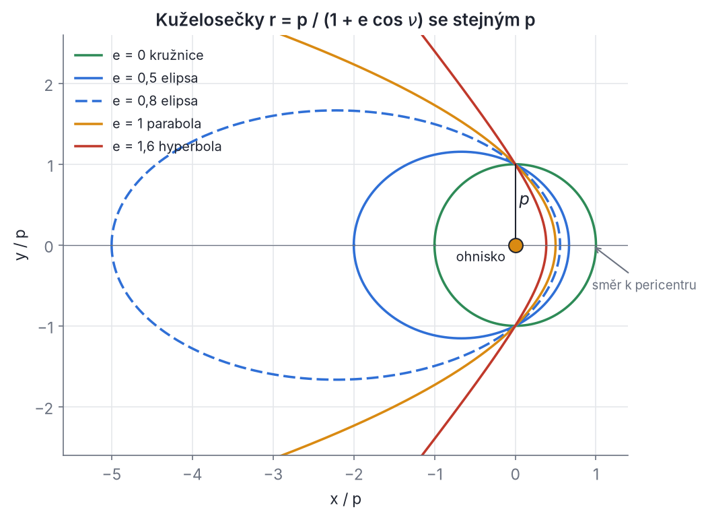
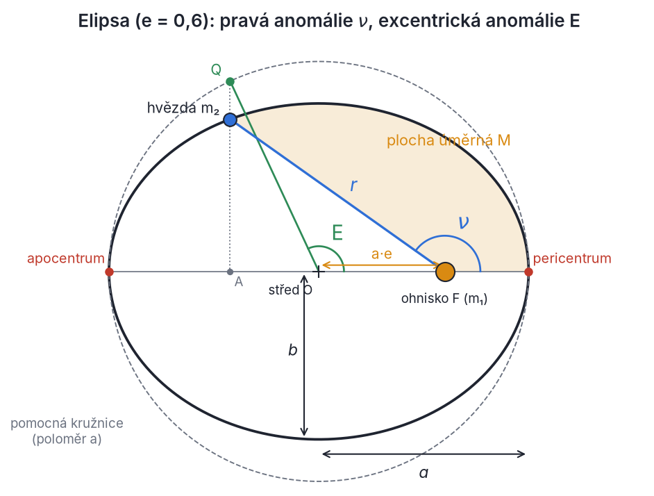
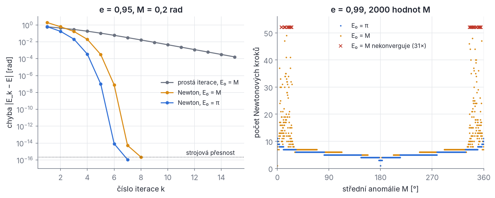
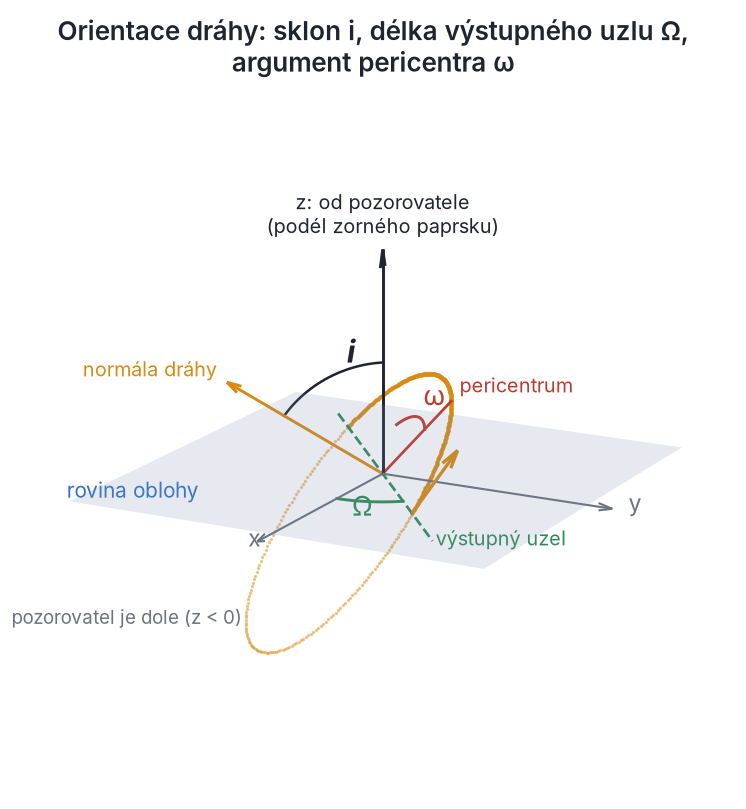
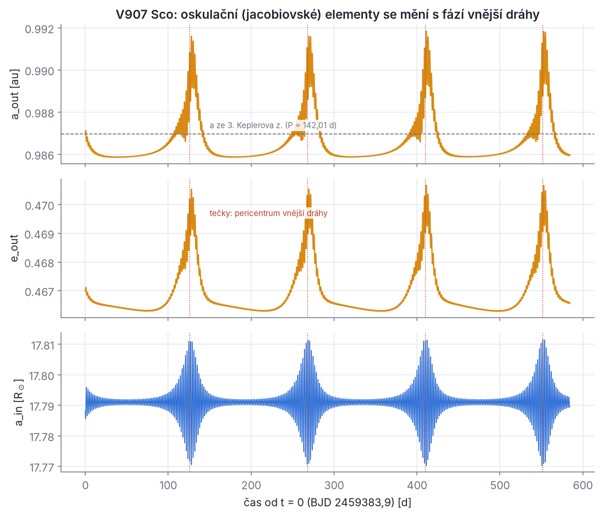

## Kapitola 2 – Problém dvou těles

Dvě hvězdy, které na sebe působí jen gravitací, jsou jediným případem problému N gravitujících těles, který umíme vyřešit obecně a do konce: pro libovolné počáteční polohy a rychlosti známe dráhu i polohu na ní v každém čase. Je-li dvojice gravitačně vázaná (má zápornou energii), obě hvězdy obíhají po elipsách se společným ohniskem v těžišti. Nevázaná dvojice (energie nulová nebo kladná) se jednou potká a navždy rozletí po parabole či hyperbole. Pro tři a více těles takové obecné řešení neexistuje. Známe jen zvláštní řešení (Eulerova přímková a Lagrangeova rovnostranná konfigurace) a numerickou integraci.

Proč je tahle kapitola nejdelší z „dynamických“? Problém dvou těles je stavebním kamenem všeho dalšího. Každý uzel hierarchického stromu (obr. 1.1) je v prvním přiblížení jeden problém dvou těles. Vnitřní pár V907 Sco obíhá s periodou 3,78 dne, třetí hvězda kolem něj se 142 dny. CzeV343 jsou dvě takové dvojice obíhající kolem sebe. SWINGERsim zakládá každou simulaci tak, že pro každý uzel převede šest dráhových elementů na polohu a rychlost, a ve výstupu dělá opak. Vzorce této kapitoly tedy běží v každém spuštění programu. Kdo jim rozumí, rozumí i tomu, co znamenají čísla v konfiguraci a ve výstupu.

Postup kapitoly: z Newtonova zákona odvodíme relativní pohyb (2.1–2.2), zákony zachování (2.3), tvar dráhy (2.4–2.5) a Keplerovy zákony (2.6). Pak se naučíme najít polohu na dráze v daném čase (2.7–2.11), umístit dráhu do prostoru a spočítat z ní radiální rychlost (2.12–2.13), a nakonec jít opačným směrem, od polohy a rychlosti k elementům (2.14–2.16).

### 2.1 Pohybové rovnice a těžiště

**Intuice.** Hvězdy se přitahují stejně velkými a opačně orientovanými silami (zákon akce a reakce). Lehčí hvězda proto zrychluje víc a obíhá po větší dráze, těžší po menší. Bod mezi nimi, těžiště, zůstává v klidu nebo se pohybuje rovnoměrně přímočaře.

**Fyzika.** Hvězdy o hmotnostech m₁, m₂ jsou v polohách **r**₁, **r**₂ vůči libovolné inerciální soustavě. Newtonův gravitační zákon a druhý pohybový zákon dávají

```latex
m_1\,\ddot{\mathbf r}_1 = +\frac{G m_1 m_2}{|\mathbf r_2-\mathbf r_1|^3}\,(\mathbf r_2-\mathbf r_1), \qquad
m_2\,\ddot{\mathbf r}_2 = -\frac{G m_1 m_2}{|\mathbf r_2-\mathbf r_1|^3}\,(\mathbf r_2-\mathbf r_1)
```

Tečky nad symbolem značí derivace podle času (r̈ je zrychlení). Síla na hvězdu 1 míří k hvězdě 2 (vektor **r**₂ − **r**₁), síla na hvězdu 2 opačně.

*Krok 1: součet rovnic.* Pravé strany se přesně odečtou:

```latex
m_1\ddot{\mathbf r}_1 + m_2\ddot{\mathbf r}_2 = \mathbf 0
\quad\Longrightarrow\quad
\frac{\mathrm d^2}{\mathrm dt^2}\left(m_1\mathbf r_1 + m_2\mathbf r_2\right) = \mathbf 0
```

Zavedeme **těžiště** (barycentrum) a celkovou hmotnost

```latex
\mathbf R = \frac{m_1\mathbf r_1 + m_2\mathbf r_2}{m_1+m_2}, \qquad m = m_1+m_2
```

Druhá derivace **R** je nulová, takže **R** se mění lineárně s časem. Dvojí integrace dává

```latex
\dot{\mathbf R} = \mathbf V_0 = \text{konst.}, \qquad \mathbf R(t) = \mathbf R_0 + \mathbf V_0\,t
```

To je šest integračních konstant (tři složky **V**₀ a tři složky **R**₀). K tomuto výsledku stačil zákon akce a reakce, tvar gravitačního zákona jsme nepotřebovali. Zvolíme soustavu, v níž těžiště stojí v počátku (**R**₀ = **V**₀ = 0). Tak to dělá i SWINGERsim: po založení simulace volá `sim.move_to_com()` (soubor `backends/nbody.py`), který odečte polohu a rychlost těžiště všech hvězd.

*Krok 2: rozdíl rovnic.* Vydělíme první rovnici m₁ a druhou m₂, takže na levé straně zůstanou čistá zrychlení:

```latex
\ddot{\mathbf r}_1 = +\frac{G m_2}{|\mathbf r_2-\mathbf r_1|^3}\,(\mathbf r_2-\mathbf r_1), \qquad
\ddot{\mathbf r}_2 = -\frac{G m_1}{|\mathbf r_2-\mathbf r_1|^3}\,(\mathbf r_2-\mathbf r_1)
```

Odečteme první od druhé a zavedeme **relativní polohu** **r** = **r**₂ − **r**₁ (vektor od hvězdy 1 ke hvězdě 2) s velikostí r = |**r**|:

```latex
\ddot{\mathbf r} = \ddot{\mathbf r}_2-\ddot{\mathbf r}_1 = -\frac{G(m_1+m_2)}{r^3}\,\mathbf r
\qquad\Longrightarrow\qquad
\boxed{\;\ddot{\mathbf r} = -\frac{\mu}{r^3}\,\mathbf r, \qquad \mu = G\,(m_1+m_2)\;}
```

Veličina μ je **gravitační parametr** dvojice. Dvě tělesa jsme převedli na jedno těleso, které se pohybuje v poli nehybného „centra“ o hmotnosti m₁ + m₂. Úloze se říká **redukovaný problém dvou těles**.

> **Pozor.** V mnoha učebnicích znamená μ redukovanou hmotnost. V těchto skriptech (a v kódu SWINGERsim) je μ = G(m₁ + m₂), tedy veličina s rozměrem au³ rok⁻². Redukovanou hmotnost značíme m_r (oddíl 2.2).

### 2.2 Relativní pohyb, redukovaná hmotnost a dráhy kolem těžiště

**Zpět k jednotlivým hvězdám.** V těžišťové soustavě platí m₁**r**₁ + m₂**r**₂ = 0 a zároveň **r**₂ − **r**₁ = **r**. Ze dvou lineárních rovnic pro dvě neznámé dostaneme

```latex
\mathbf r_1 = -\frac{m_2}{m_1+m_2}\,\mathbf r, \qquad \mathbf r_2 = +\frac{m_1}{m_1+m_2}\,\mathbf r
```

(dosaď **r**₂ = **r**₁ + **r** do m₁**r**₁ + m₂**r**₂ = 0 a vyjádři **r**₁). Totéž platí pro rychlosti, protože jde o lineární vztahy s konstantními koeficienty. Plynou z toho tři důležité důsledky:

1. Obě hvězdy opisují **podobné** dráhy, zmenšené kopie relativní dráhy v poměrech m₂/m a m₁/m. Velké poloosy jejich drah kolem těžiště jsou
   ```latex
   a_1 = \frac{m_2}{m_1+m_2}\,a, \qquad a_2 = \frac{m_1}{m_1+m_2}\,a, \qquad \frac{a_1}{a_2} = \frac{m_2}{m_1}, \qquad a_1 + a_2 = a
   ```
   Výstřednost je u všech tří drah stejná a periody také.
2. Hvězdy jsou vždy na **opačných stranách** těžiště a pericentrem procházejí **současně**. Pericentrum hvězdy 1 tedy leží na opačné straně než pericentrum hvězdy 2 a jejich argumenty pericentra se liší o 180°.
3. SWINGERsim zadává elementy **relativní dráhy druhé větve kolem první** (`config.py`: „The orbit of a node is the motion of the second child around the first“). Argument pericentra ω v konfiguraci je proto argumentem pericentra hvězdy 2 vůči hvězdě 1, a tedy i dráhy hvězdy 2 kolem těžiště. Pro hvězdu 1 platí **ω₁ = ω + 180°**. Spektroskopické katalogy obvykle uvádějí právě ω₁ (dráhu primární složky), takže při přebírání hodnot z literatury je třeba přičíst nebo odečíst 180°.

**Řešený příklad.** Vnitřní pár V907 Sco má m₁ = 2,56 M☉, m₂ = 2,74 M☉ a velkou poloosu relativní dráhy a = 17,79 R☉ (spočítáme ji v oddílu 2.6). Hvězda 1 obíhá kolem těžiště ve vzdálenosti a₁ = 17,79 · 2,74/5,30 = 9,20 R☉, hvězda 2 ve vzdálenosti a₂ = 8,59 R☉. Těžší hvězda má menší dráhu.

**Energie a moment hybnosti dvojice.** V těžišťové soustavě je **v**₁ = −(m₂/m)**v** a **v**₂ = (m₁/m)**v**, kde **v** = ṙ je relativní rychlost. Kinetická energie obou hvězd je

```latex
T = \tfrac12 m_1 v_1^2 + \tfrac12 m_2 v_2^2
  = \tfrac12\,\frac{m_1 m_2^2 + m_2 m_1^2}{(m_1+m_2)^2}\,v^2
  = \tfrac12\,\frac{m_1 m_2}{m_1+m_2}\,v^2
  \equiv \tfrac12\, m_r\, v^2
```

kde jsme zavedli **redukovanou hmotnost**

```latex
m_r = \frac{m_1 m_2}{m_1+m_2}
```

Potenciální energie je −Gm₁m₂/r = −m_r μ/r (ověř: m_r μ = G m₁m₂). Celková energie dvojice a její moment hybnosti vůči těžišti jsou proto

```latex
E_\text{tot} = m_r\left(\frac{v^2}{2} - \frac{\mu}{r}\right) = m_r\,\varepsilon, \qquad
\mathbf L = m_1\,\mathbf r_1\times\mathbf v_1 + m_2\,\mathbf r_2\times\mathbf v_2 = m_r\,\mathbf r\times\mathbf v = m_r\,\mathbf h
```

Veličiny ε (**měrná orbitální energie**) a **h** = **r** × **v** (**měrný moment hybnosti**) jsou energie a moment hybnosti připadající na jednotku redukované hmotnosti. Jejich výhoda je, že nezávisejí na tom, jak je celková hmotnost rozdělena mezi hvězdy. SWINGERsim i tato kapitola pracují s ε a **h**. Kontrola zachování energie a momentu hybnosti ve výstupu simulace (`max |dE/E|`, `max |dL/L|`) ovšem používá celkové E a **L** všech hvězd.

Pro m₂ ≪ m₁ (planeta u hvězdy) je m_r ≈ m₂ a těžiště leží téměř ve hvězdě 1. U dvojhvězd srovnatelných hmotností je těžiště zhruba uprostřed a obě hvězdy se pohybují znatelně.

### 2.3 Co se zachovává a proč

Pohybová rovnice r̈ = −μ**r**/r³ je soustava tří diferenciálních rovnic druhého řádu, tedy šesti rovnic prvního řádu pro (**r**, **v**). Úplné řešení potřebuje šest integračních konstant. Najdeme je z **integrálů pohybu**, tedy z funkcí polohy a rychlosti, které se s časem nemění. Každý důkaz má stejnou strukturu: zderivujeme veličinu podle času, dosadíme r̈ z pohybové rovnice a ukážeme, že vyjde nula.

**1. Moment hybnosti.** Pro **h** = **r** × **v**:

```latex
\dot{\mathbf h} = \dot{\mathbf r}\times\mathbf v + \mathbf r\times\dot{\mathbf v}
= \underbrace{\mathbf v\times\mathbf v}_{=\,\mathbf 0} + \mathbf r\times\left(-\frac{\mu}{r^3}\mathbf r\right)
= \mathbf 0 - \frac{\mu}{r^3}\underbrace{\mathbf r\times\mathbf r}_{=\,\mathbf 0} = \mathbf 0
```

K důkazu stačilo, že síla míří podél spojnice (je **centrální**), tvar 1/r² jsme nepotřebovali. Důsledky:

- *Pohyb je rovinný.* Vektor **r** je v každém okamžiku kolmý na stálé **h** (vlastnost vektorového součinu), takže leží v pevné rovině procházející počátkem a kolmé k **h**. Výjimkou je **h** = 0: tehdy se hvězdy pohybují po přímce, tj. padají přímo na sebe.
- *Zákon ploch (2. Keplerův zákon).* Za krátký čas dt se průvodič posune o d**r** = **v** dt a opíše trojúhelník o ploše dA = ½|**r** × d**r**| = ½|**r** × **v**| dt. Plošná rychlost je tedy
  ```latex
  \frac{\mathrm dA}{\mathrm dt} = \frac{h}{2} = \text{konst.}
  ```
  Za stejné časy opisuje průvodič stejné plochy. Ve složkách: v polárních souřadnicích (r, φ) v rovině dráhy má rychlost složku ṙ podél průvodiče a rφ̇ kolmo k němu, takže h = r · rφ̇ = r²φ̇. Úhlová rychlost hvězdy je největší tam, kde je r nejmenší.

> **Z historie.** Johannes Kepler našel zákon ploch v Praze kolem roku 1602, ještě před eliptickým tvarem dráhy, z měření Tycha Brahe (přesnost asi 1′). Oba první zákony vydal v *Astronomia nova* (1609), třetí objevil 15. května 1618 a vydal v *Harmonices mundi* (1619). Newton je v *Principiích* (1687) odvodil z gravitačního zákona. Ukázal přitom i opak: zákon ploch platí právě pro centrální síly.

**2. Energie.** Pro ε = v²/2 − μ/r (v² = **v**·**v**). Derivace r podle času je ṙ = (**r**·**v**)/r, protože r² = **r**·**r**, a tedy 2rṙ = 2**r**·**v**. Pak

```latex
\dot\varepsilon = \mathbf v\cdot\dot{\mathbf v} + \frac{\mu}{r^2}\,\dot r
= \mathbf v\cdot\left(-\frac{\mu}{r^3}\mathbf r\right) + \frac{\mu}{r^2}\,\frac{\mathbf r\cdot\mathbf v}{r} = 0
```

Tentokrát jsme potřebovali, aby síla byla gradientem potenciálu −μ/r (je **konzervativní**).

**3. Vektor výstřednosti (Laplaceův–Rungeův–Lenzův vektor).** Definujeme

```latex
\mathbf e = \frac{\mathbf v\times\mathbf h}{\mu} - \frac{\mathbf r}{r}
```

Derivace prvního členu (**h** je stálé):

```latex
\frac{\mathrm d}{\mathrm dt}(\mathbf v\times\mathbf h) = \dot{\mathbf v}\times\mathbf h
= -\frac{\mu}{r^3}\,\mathbf r\times(\mathbf r\times\mathbf v)
= -\frac{\mu}{r^3}\left[\mathbf r\,(\mathbf r\cdot\mathbf v) - \mathbf v\,r^2\right]
= \mu\left[\frac{\mathbf v}{r} - \frac{\mathbf r\,\dot r}{r^2}\right]
```

Použili jsme identitu **a** × (**b** × **c**) = **b**(**a**·**c**) − **c**(**a**·**b**) a **r**·**v** = rṙ. Derivace druhého členu je podle pravidla pro podíl

```latex
\frac{\mathrm d}{\mathrm dt}\left(\frac{\mathbf r}{r}\right) = \frac{\mathbf v}{r} - \frac{\mathbf r\,\dot r}{r^2}
```

To je přesně výraz v hranaté závorce. Po vydělení μ se oba členy odečtou a ė = 0. Na rozdíl od předchozích dvou integrálů zde rozhodl přesný tvar 1/r²: s jinou mocninou by se závorky neodečetly.

Vektor **e** je bezrozměrný. Fyzikové častěji používají rozměrový **Laplaceův–Rungeův–Lenzův vektor** **A** = **p** × **L** − m_r k r̂, kde **p** = m_r**v**, **L** = m_r**h**, k = Gm₁m₂ = m_r μ a r̂ = **r**/r. Dosazením vyjde **A** = m_r² μ **e**, takže **e** = **A**/(m_r k).

> **Z historie.** Zachovávající se vektor znali už Jakob Hermann a Johann Bernoulli (1710), později Laplace (1799). Jména Runge a Lenz pocházejí z učebnice vektorové analýzy C. Runge (1919) a z článku W. Lenze (1924, Z. Phys. 24, 197) o kvantovém atomu vodíku. Historii popisuje H. Goldstein (1975, Am. J. Phys. 43, 737; 1976, tamtéž 44, 1123).

**Proč je stálý vektor e „zvláštní“.** Bertrandova věta (J. Bertrand 1873) říká, že mezi centrálními silami mají všechny vázané dráhy uzavřené jen dvě: síla ∝ 1/r² a síla pružiny ∝ r. Stálé **e** je algebraický projev uzavřenosti keplerovské elipsy. Jakákoli další síla (třetí těleso, slapová a rotační deformace hvězd, obecná relativita) způsobí ė ≠ 0. Vektor **e** se pak **stáčí**, tj. pericentrum precesuje (kapitola 7), a **mění i velikost**: výstřednost osciluje v cyklech ZLK (kapitola 5) nebo klesá slapovým zakulacováním (kapitola 7). Ve výstupu SWINGERsim to vidíš jako pomalé změny elementů ω a e.

**Kolik je integrálů? (Brunsova věta).** Spočítejme konstanty problému dvou těles. Pro dvě tělesa máme 12 rovnic prvního řádu (tři souřadnice a tři složky rychlosti pro každé), řešení tedy potřebuje 12 konstant:

| integrál | počet konstant | potřebuje |
| --- | --- | --- |
| rychlost těžiště **V**₀ | 3 | akci a reakci |
| poloha těžiště **R**₀ (obsahuje t) | 3 | akci a reakci |
| moment hybnosti **h** | 3 | centrální sílu |
| energie ε | 1 | konzervativní sílu |
| směr **e** v rovině dráhy | 1 | přesný zákon 1/r² |
| okamžik průchodu pericentrem τ | 1 | Keplerovu rovnici (2.7) |

Proč přidá vektor **e** jen jednu konstantu, když má tři složky? Splňuje dvě vazby: je kolmý k **h**, protože (**v** × **h**)·**h** = 0 a **r**·**h** = 0, a jeho velikost je určena ε a h vztahem e² = 1 + 2εh²/μ² (odvodíme v oddílu 2.4). Nového je jen to, kam v rovině dráhy míří.

Prvních deset integrálů (3 + 3 + 3 + 1) existuje pro libovolný počet těles: jsou to **klasické integrály** problému N těles. H. Bruns (1887, Acta Math. 11, 25) dokázal, že pro tři tělesa neexistuje žádný další integrál, který by byl algebraickou funkcí souřadnic, rychlostí a času. H. Poincaré (1890, Acta Math. 13, 1) rozšířil výsledek na analytické jednoznačné integrály. Pro dvě tělesa máme všech 12 konstant, a tedy úplné řešení. Pro tři tělesa jich chybí právě tolik, že obecné řešení v uzavřeném tvaru není. K. F. Sundman (1912, Acta Math. 36, 105) sice našel konvergentní řadu pro problém tří těles, ta však konverguje tak pomalu, že je prakticky nepoužitelná. Proto SWINGERsim integruje numericky (kapitola 6).

### 2.4 Vektor výstřednosti a rovnice dráhy

**Proč e míří k pericentru.** Vynásobíme definici **e** skalárně vektorem **r**. Pro smíšený součin platí **r**·(**v** × **h**) = (**r** × **v**)·**h** = **h**·**h** = h² (cyklická záměna). Proto

```latex
\mathbf e\cdot\mathbf r = \frac{h^2}{\mu} - r
```

Označíme ν úhel mezi **e** a **r**, tj. **e**·**r** = e r cos ν, a zavedeme **parametr dráhy** (semilatus rectum) p = h²/μ. Rovnice přejde na e r cos ν = p − r, odkud

```latex
\boxed{\;r(\nu) = \frac{p}{1 + e\cos\nu}, \qquad p = \frac{h^2}{\mu}\;}
```

Vzdálenost r je **nejmenší pro cos ν = 1**, tj. tehdy, když **r** míří ve směru **e**. Vektor výstřednosti tedy ukazuje k **pericentru** (bodu nejmenšího přiblížení) a úhel ν, měřený od pericentra ve smyslu oběhu, je **pravá anomálie**. Totéž lze vidět přímo: v pericentru je ṙ = 0, takže **v** ⊥ **r**. Vektor **v** × **h** je pak rovnoběžný s **r** (míří ven) a **e** = (v_p h/μ − 1) r̂. Kladnou velikost zajišťuje to, že v pericentru je rychlost větší než kruhová, v_p² > μ/r_p.

**Velikost e z energie.** Spočítáme e² = **e**·**e**. Protože **v** ⊥ **h**, je |**v** × **h**|² = v²h². Smíšený člen jsme už spočítali: (**v** × **h**)·**r**/r = h²/r. Tedy

```latex
e^2 = \frac{v^2h^2}{\mu^2} - \frac{2h^2}{\mu r} + 1
    = 1 + \frac{2h^2}{\mu^2}\left(\frac{v^2}{2}-\frac{\mu}{r}\right)
\quad\Longrightarrow\quad
\boxed{\;e^2 = 1 + \frac{2\,\varepsilon\,h^2}{\mu^2}\;}
```

Výstřednost je tedy určena energií a momentem hybnosti. Znaménko energie rozhoduje o typu dráhy:

| energie | výstřednost | dráha | vzdálenost |
| --- | --- | --- | --- |
| ε = −μ²/(2h²) (nejmenší možná) | e = 0 | kružnice | r = p |
| ε < 0 | 0 < e < 1 | elipsa | p/(1 + e) ≤ r ≤ p/(1 − e) |
| ε = 0 | e = 1 | parabola | r → ∞ pro ν → ±180° |
| ε > 0 | e > 1 | hyperbola | r → ∞ pro cos ν → −1/e |



*Obr. 2.1 – Kuželosečky r = p/(1 + e cos ν) se společným ohniskem (oranžový bod) a stejným parametrem p (svislá úsečka; je to vzdálenost dráhy od ohniska v ν = 90°). Všechny mají pericentrum vpravo, ve směru vektoru e. S rostoucí výstředností se elipsa protahuje doleva. Pro e = 1 se uzavírá „v nekonečnu“ (parabola), pro e > 1 se dráha otevírá do hyperboly, po níž těleso odlétá s nenulovou rychlostí.*

Rovnice r(ν) je polární rovnice **kuželosečky** s ohniskem v počátku. Tvar dráhy jsme dostali bez integrování, jen ze zákonů zachování. To je první Keplerův zákon v Newtonově zobecnění: dráha relativního pohybu je kuželosečka s jedním ohniskem v hvězdě 1. Vůči těžišti obíhají obě hvězdy po podobných kuželosečkách s ohniskem v těžišti.

**Elipsa a její rozměry.** Pro 0 ≤ e < 1 má dráha pericentrum r_p = p/(1 + e) a apocentrum r_a = p/(1 − e). Velká poloosa je polovina hlavní osy:

```latex
a = \frac{r_p + r_a}{2} = \frac{p}{2}\left(\frac{1}{1+e}+\frac{1}{1-e}\right) = \frac{p}{1-e^2}
\quad\Longrightarrow\quad
p = a\,(1-e^2), \qquad r_p = a(1-e), \qquad r_a = a(1+e)
```

Vzdálenost ohniska od středu elipsy je (r_a − r_p)/2 = ae a malá poloosa je b = a√(1 − e²) (bod na konci vedlejší osy leží nad středem, tedy cos ν = −e, a rovnice dráhy pro něj dává r = a; Pythagorova věta pak dává b² = a² − a²e²). Rovnici dráhy budeme od teď psát jako

```latex
r(\nu) = \frac{a\,(1-e^2)}{1+e\cos\nu}
```

> **Pozor.** Česká středoškolská geometrie nazývá „výstředností“ délku ae (vzdálenost ohniska od středu) a bezrozměrné číslo e nazývá „číselná výstřednost“. V astronomii i v těchto skriptech je výstřednost e vždy bezrozměrná. Apsidy (pericentrum a apocentrum) mají u hvězd jména periastron a apastron, u Slunce perihel a afel, u Země perigeum a apogeum. Spojnice apsid je **přímka apsid**.

**Druhá cesta: Binetova rovnice.** Kdo nemá rád „kouzlo“ se skalárním součinem, může rovnici dráhy dostat mechanicky. V polárních souřadnicích v rovině dráhy má zrychlení radiální složku r̈ − rφ̇². Radiální složka pohybové rovnice je tedy r̈ − rφ̇² = −μ/r². Substituce u = 1/r a eliminace času pomocí φ̇ = hu² dávají ṙ = −h du/dφ a r̈ = −h²u² d²u/dφ². Po dosazení

```latex
\frac{\mathrm d^2u}{\mathrm d\varphi^2} + u = \frac{\mu}{h^2}
```

To je rovnice harmonického oscilátoru v úhlu. Jejím řešením je u = (μ/h²)[1 + e cos(φ − ϖ)] se dvěma konstantami e a ϖ (směr pericentra), tedy znovu r = p/(1 + e cos ν) s ν = φ − ϖ. Tuto cestu použijeme v kapitole 7 pro relativistické stáčení pericentra: člen navíc na pravé straně způsobí, že se ϖ pomalu posouvá.

### 2.5 Energie, vis-viva a složky rychlosti

**Energie určuje velkou poloosu.** V pericentru a apocentru je rychlost kolmá k průvodiči, takže h = r_p v_p = r_a v_a. Rovnost energií v obou bodech zapíšeme s v = h/r:

```latex
\frac{h^2}{2r_p^2} - \frac{\mu}{r_p} = \frac{h^2}{2r_a^2} - \frac{\mu}{r_a}
\quad\Longrightarrow\quad
\frac{h^2}{2}\left(\frac{1}{r_p}-\frac{1}{r_a}\right)\left(\frac{1}{r_p}+\frac{1}{r_a}\right) = \mu\left(\frac{1}{r_p}-\frac{1}{r_a}\right)
```

(rozdíl čtverců). Po zkrácení závorkou (r_p ≠ r_a, kružnici dostaneme limitou) vyjde h² = 2μ r_p r_a/(r_p + r_a). Dosazením zpět do energie v pericentru:

```latex
\varepsilon = \frac{\mu\,r_a}{r_p(r_p+r_a)} - \frac{\mu}{r_p}
= \frac{\mu}{r_p}\,\frac{r_a - r_p - r_a}{r_p + r_a}
= -\frac{\mu}{r_p + r_a}
\quad\Longrightarrow\quad
\boxed{\;\varepsilon = -\frac{\mu}{2a}\;}
```

Energie vázané dráhy závisí jen na velké poloose, nikoli na výstřednosti. Kontrola: h²/μ = 2r_p r_a/(r_p + r_a) = 2a²(1 − e²)/(2a) = a(1 − e²) = p, ve shodě s oddílem 2.4. A dosazení ε = −μ/(2a) a h² = μa(1 − e²) do e² = 1 + 2εh²/μ² dává e² = 1 − (1 − e²) = e², jak má být. Pro hyperbolu definujeme a = p/(e² − 1) > 0 a stejný postup dává ε = +μ/(2a).

**Rovnice vis-viva.** Spojíme ε = v²/2 − μ/r s ε = −μ/(2a):

```latex
\boxed{\;v^2 = \mu\left(\frac{2}{r} - \frac{1}{a}\right)\;}
```

Latinské *vis viva* („živá síla“) je starý název kinetické energie. Rovnice říká, jak rychle se hvězda pohybuje v libovolném místě dráhy, a SWINGERsim ji používá v obou směrech: z elementů na rychlost, a z rychlosti na a = 1/(2/r − v²/μ). Zvláštní případy:

- kruhová rychlost (r = a): v_k = √(μ/r);
- úniková (parabolická) rychlost (a → ∞): v_u = √(2μ/r) = √2 · v_k;
- pericentrum a apocentrum: v_p = √(μ/a) · √((1 + e)/(1 − e)), v_a = √(μ/a) · √((1 − e)/(1 + e)), a tedy v_p/v_a = (1 + e)/(1 − e) = r_a/r_p.

**Složky rychlosti.** Derivací r = p/(1 + e cos ν) podle času a užitím r²ν̇ = h (zákon ploch, ν roste stejně jako polární úhel φ):

```latex
\dot r = \frac{p\,e\sin\nu\;\dot\nu}{(1+e\cos\nu)^2} = \frac{e\sin\nu}{p}\,r^2\dot\nu = \frac{h\,e\sin\nu}{p},
\qquad
r\dot\nu = \frac{h}{r} = \frac{h\,(1+e\cos\nu)}{p}
```

S p = h²/μ je h/p = μ/h, takže

```latex
\boxed{\;v_r = \dot r = \frac{\mu}{h}\,e\sin\nu, \qquad v_t = r\dot\nu = \frac{\mu}{h}\,(1+e\cos\nu), \qquad \frac{\mu}{h} = \frac{n\,a}{\sqrt{1-e^2}}\;}
```

Poslední rovnost plyne z h = √(μa(1 − e²)) a μ = n²a³ (3. Keplerův zákon v oddílu 2.6, n = 2π/P je **střední pohyb**). Radiální složka v_r je kladná od pericentra k apocentru (hvězdy se vzdalují) a záporná na zpáteční cestě. Pro kontrolu sečti čtverce: v² = (μ/h)²(1 + 2e cos ν + e²). Dosazením e cos ν = p/r − 1 dostaneš (μ/h)²(2p/r − 1 + e²) = μ(2/r − 1/a), tedy znovu vis-viva.

Složky rychlosti mají i pěknou geometrickou interpretaci. V soustavě, kde osa x míří k pericentru, je **v** = (μ/h)(−sin ν, e + cos ν). Konec vektoru rychlosti proto opisuje kružnici o poloměru μ/h se středem posunutým o eμ/h (**hodograf**). Složky rychlosti budeme potřebovat v oddílu 2.13 pro křivku radiálních rychlostí.

**Časový průměr 1/r a viriálová věta.** Užitečný výsledek pro kapitoly 6 a 8: ⟨1/r⟩ = 1/a (časový průměr přes periodu). Odvodíme ho v oddílu 2.7 pomocí excentrické anomálie (cvičení 3). Z něj plyne střední potenciální energie ⟨V⟩ = −m_r μ/a = 2E_tot a střední kinetická ⟨T⟩ = E_tot − ⟨V⟩ = −½⟨V⟩. To je **viriálová věta** 2⟨T⟩ + ⟨V⟩ = 0 pro keplerovskou dráhu.

**Řešený příklad (Země).** Pro dráhu Země (a = 1 au, e = 0,0167, μ ≈ G M☉) je √(μ/a) = 29,78 km/s. V perihelu (začátkem ledna) má Země rychlost 29,78 · √(1,0167/0,9833) = 30,29 km/s, v afelu (začátkem července) 29,29 km/s. Největší radiální rychlost Země vůči Slunci je (μ/h) e = 29,78 · 0,0167/√(1 − 0,0167²) = 0,50 km/s, kterou má v ν = ±90°. Úniková rychlost ze sluneční soustavy ve vzdálenosti 1 au je √2 · 29,78 = 42,1 km/s.

### 2.6 Keplerovy zákony jako důsledky a jednotky SWINGERsim

Všechny tři Keplerovy zákony teď máme, nebo k nim zbývá jeden krok.

**1. zákon** (oddíl 2.4): vázaná relativní dráha je elipsa s hvězdou 1 v ohnisku. Obě hvězdy obíhají kolem těžiště po podobných elipsách s ohniskem v těžišti. Kepler znal jen speciální případ m₂ ≪ m₁ (planeta u Slunce).

**2. zákon** (oddíl 2.3): plošná rychlost je stálá, dA/dt = h/2.

**3. zákon.** Za jednu periodu P opíše průvodič celou plochu elipsy πab plošnou rychlostí h/2:

```latex
\pi a b = \frac{h}{2}\,P, \qquad b = a\sqrt{1-e^2}, \qquad h = \sqrt{\mu\,p} = \sqrt{\mu\,a\,(1-e^2)}
```

Odtud

```latex
P = \frac{2\pi a^2\sqrt{1-e^2}}{\sqrt{\mu\,a\,(1-e^2)}} = 2\pi\sqrt{\frac{a^3}{\mu}}
\qquad\Longrightarrow\qquad
\boxed{\;P^2 = \frac{4\pi^2}{G\,(m_1+m_2)}\,a^3, \qquad n^2a^3 = \mu\;}
```

kde n = 2π/P je střední pohyb. Perioda závisí jen na velké poloose a celkové hmotnosti, ne na výstřednosti. Keplerova podoba „P²/a³ je pro všechny planety stejné“ platí jen přibližně, protože m₁ + m₂ se od planety k planetě liší (pro Jupiter o 0,1 %). Přesná podoba se součtem hmotností je základem všech měření hmotností dvojhvězd.

**Jednotky SWINGERsim.** Program počítá v astronomických jednotkách (au), hmotnostech Slunce (M☉) a **juliánských rocích** (365,25 dne), úhly vnitřně v radiánech (`units.py`). Gravitační konstanta má v těchto jednotkách hodnotu

```latex
G = (k \cdot 365{,}25)^2 = 39{,}476\,926\ \mathrm{au^3\,M_\odot^{-1}\,rok^{-2}}, \qquad k = 0{,}017\,202\,098\,95\ \mathrm{au^{3/2}\,M_\odot^{-1/2}\,d^{-1}}
```

kde k je **Gaussova gravitační konstanta**. Hodnota G je o 3,8 · 10⁻⁵ (relativně) menší než 4π² = 39,478 418. Proč? Gauss (1809, *Theoria motus*) určil k z periody a hmotnosti Země. Těleso zanedbatelné hmotnosti na kruhové dráze o poloměru 1 au kolem Slunce má pak periodu 2π/k = 365,2569 d (tzv. gaussovský rok). V gaussovských rocích by platilo přesně G = 4π². SWINGERsim ale měří čas v juliánských rocích, které jsou o 0,0069 d kratší.

Proto platí vztah P²[rok] = a³[au]/(m₁ + m₂)[M☉] **jen přibližně**, s relativní přesností 4 · 10⁻⁵ v P² (2 · 10⁻⁵ v P). Pro výpočty „na papíře“ je to zanedbatelné. Kdo by ale převáděl a na P se 4π² místo s G, spletl by se pro P = 142 d o 3,9 minuty, což je u přesných časů zákrytů měřitelné. SWINGERsim proto převádí P ↔ a vždy přesným vztahem se svým G (`units.period_to_sma`, `units.sma_to_period`).

> **Z historie.** Mezinárodní astronomická unie přijala k v roce 1938 jako definiční konstantu: astronomická jednotka byla definována jako délka, pro niž má k přesně Gaussovu hodnotu. Od roku 2012 (rezoluce IAU B2) je au pevná délka 149 597 870 700 m a k už definiční není. Hodnota k spočtená z dnešního GM☉ = 1,327 124 400 41 · 10²⁰ m³ s⁻² (hodnota pro časovou škálu TDB) a z au se od Gaussovy liší jen o 4 · 10⁻¹² (relativně). Proto je volba SWINGERsim konzistentní s moderními konstantami.

Pro dvojhvězdy je pohodlný tvar s poloměry Slunce a dny. S konstantami SWINGERsim (1 R☉ = 695 700 km, 1 au = 215,032 R☉) vychází

```latex
a\,[R_\odot] = 4{,}2083\;\left(\frac{m_1+m_2}{M_\odot}\right)^{1/3}\left(\frac{P}{\mathrm d}\right)^{2/3}
```

**Řešený příklad.** (a) Dvě hvězdy o hmotnosti Slunce s periodou 1 rok mají velkou poloosu relativní dráhy a = (G · 2/4π²)^{1/3} = 1,259 91 au. Se zaokrouhleným G = 4π² vyjde 1,259 92 au. Pozor, a je velká poloosa, ne vzdálenost hvězd: ta se na výstředné dráze mění mezi a(1 − e) a a(1 + e).
(b) Vnitřní pár V907 Sco (m₁ + m₂ = 5,30 M☉) má v konfiguraci P = 3,774 871 d. Vzorec dává a = 4,2083 · 5,30^{1/3} · 3,774 871^{2/3} = 17,79 R☉ = 0,082 72 au. Ve výstupu simulace (`v907_timeseries.csv`, sloupec `a_inner_au`, čas 0) najdeš 0,082 723 275 au.
(c) Vnější dráha V907 Sco (P = 142,01 d, celková hmotnost 6,36 M☉) má a = 0,9870 au = 212,2 R☉. Rychlosti na ní: √(μ/a) = 75,6 km/s, v periastronu 125,4 km/s, v apastronu 45,6 km/s (e = 0,467).

**Jak to dělá SWINGERsim.** Orbita každého uzlu se v konfiguraci zadává buď periodou `P` [d], nebo velkou poloosou `a` [au], ne oběma (`config.py`). Je-li zadána perioda, převede ji `hierarchy._to_elements` na a pomocí 3. Keplerova zákona. Do μ přitom vstupuje **součet hmotností všech hvězd pod uzlem**: pro vnější dráhu V907 Sco m₁ + m₂ + m₃, pro vnější dráhu čtyřhvězdy 2+2 všechny čtyři hvězdy. Ztrácejí-li hvězdy hmotu větrem, použijí se hmotnosti v čase t = 0 simulace (`build_tree(..., kepler_masses=...)`), aby perioda v t = 0 byla ta zadaná. REBOUND dostane stejné G (`sim.G = units.G`).

### 2.7 Anomálie a Keplerova rovnice

Tvar dráhy známe. Zbývá najít, **kde na ní hvězda je v daném čase t**. Úhel ν neroste rovnoměrně: podle zákona ploch je ν̇ = h/r², takže v pericentru se hvězda po dráze žene a v apocentru loudá. Jak spočítat ν(t)? Pomohou dvě pomocné veličiny, excentrická anomálie a střední anomálie.



*Obr. 2.2 – Elipsa s e = 0,6 a pomocná kružnice o poloměru a (čárkovaně) se společným středem O. Hvězda m₂ je v bodě na elipse a m₁ v ohnisku F, vzdáleném ae od středu. Kolmice k hlavní ose vedená hvězdou protne hlavní osu v bodě A a kružnici v bodě Q. Pravá anomálie ν je úhel u ohniska mezi směrem k pericentru a hvězdou, excentrická anomálie E je úhel u středu mezi směrem k pericentru a bodem Q. Vybarvená plocha mezi průvodičem a pericentrem roste rovnoměrně s časem a je úměrná střední anomálii M.*

**Excentrická anomálie E (geometrie).** Elipsu x²/a² + y²/b² = 1 dostaneme z kružnice x² + y² = a² tak, že každou svislou souřadnici vynásobíme b/a. Bod na kružnici (a cos E, a sin E) přejde na bod elipsy (a cos E, b sin E). Úhel E je tedy parametr elipsy, měřený u středu (obr. 2.2). Souřadnice hvězdy měřené od ohniska F = (ae, 0), s osou ξ k pericentru:

```latex
\xi = a\,(\cos E - e) = r\cos\nu, \qquad \eta = b\sin E = a\sqrt{1-e^2}\,\sin E = r\sin\nu
```

Vzdálenost od ohniska:

```latex
r^2 = a^2(\cos E - e)^2 + a^2(1-e^2)\sin^2E
    = a^2\left[\cos^2E - 2e\cos E + e^2 + \sin^2E - e^2\sin^2E\right]
    = a^2\left(1 - e\cos E\right)^2
```

(v hranaté závorce cos²E + sin²E = 1 a e² − e² sin²E = e² cos²E), tedy

```latex
\boxed{\;r = a\,(1 - e\cos E)\;}
```

Vzdálenost je jednoduchou funkcí E. Pro E = 0 je r = a(1 − e) (pericentrum), pro E = π je r = a(1 + e) (apocentrum).

**Vztah ν a E.** Z rovnic pro ξ a η plyne

```latex
\cos\nu = \frac{\cos E - e}{1 - e\cos E}, \qquad \sin\nu = \frac{\sqrt{1-e^2}\,\sin E}{1 - e\cos E}
```

Dosazením do 1 ∓ cos ν dostaneme

```latex
1 - \cos\nu = \frac{(1+e)(1-\cos E)}{1-e\cos E}, \qquad 1 + \cos\nu = \frac{(1-e)(1+\cos E)}{1-e\cos E}
```

(ověř roznásobením čitatelů). Se vzorci pro poloviční úhly 1 − cos x = 2 sin²(x/2) a 1 + cos x = 2 cos²(x/2):

```latex
\sin\frac{\nu}{2} = \sqrt{\frac{1+e}{1-e\cos E}}\;\sin\frac{E}{2}, \qquad
\cos\frac{\nu}{2} = \sqrt{\frac{1-e}{1-e\cos E}}\;\cos\frac{E}{2}
```

Znaménka odmocnin jsou kladná, protože ν/2 a E/2 leží vždy ve stejném kvadrantu (obě jsou v intervalu [0°, 90°) pro horní polovinu elipsy a v [90°, 180°) pro dolní). Podíl dává známý vzorec

```latex
\tan\frac{\nu}{2} = \sqrt{\frac{1+e}{1-e}}\;\tan\frac{E}{2}
```

> **Pozor.** Vzorec s tangentami je numericky nebezpečný. V apocentru (E = π) je tan(E/2) nekonečný a výsledek vyjde jen díky zaokrouhlení. Arkus tangens navíc vrací úhel jen v intervalu (−90°, 90°), takže kvadrant je třeba hlídat ručně. Robustní tvar používá funkci se dvěma argumenty atan2(y, x), která vrací úhel bodu (x, y) v celém rozsahu (−180°, 180°]. Kladný společný faktor 1/√(1 − e cos E) se v ní zkrátí:

```latex
\nu = 2\,\operatorname{atan2}\!\left(\sqrt{1+e}\,\sin\frac{E}{2},\;\sqrt{1-e}\,\cos\frac{E}{2}\right), \qquad
E = 2\,\operatorname{atan2}\!\left(\sqrt{1-e}\,\sin\frac{\nu}{2},\;\sqrt{1+e}\,\cos\frac{\nu}{2}\right)
```

Druhý vzorec používá SWINGERsim při převodu stavu na elementy (`kepler.py`, funkce `state_to_elements`). Rovnocenný robustní tvar je ν = E + 2 atan2(β sin E, 1 − β cos E) s β = e/(1 + √(1 − e²)). Výhodou je, že rozdíl ν − E je malý a spojitý i při přechodu přes 360°.

**Keplerova rovnice ze zákona ploch.** Plocha, kterou opíše průvodič od průchodu pericentrem v čase τ, roste podle zákona ploch lineárně. Celou plochu elipsy πab opíše za periodu P:

```latex
A(t) = \pi a b\,\frac{t-\tau}{P}
```

Stejnou plochu spočítáme geometricky. Plocha elipsy mezi ohniskem F, pericentrem a hvězdou je (b/a)-násobkem odpovídající plochy kruhu mezi F, pericentrem a bodem Q, protože elipsa vzniká z kruhu stlačením svislých souřadnic v poměru b/a. Kruhová plocha je kruhová výseč OPQ minus trojúhelník OFQ:

```latex
A_\text{kruh} = \underbrace{\tfrac12 a^2 E}_{\text{výseč }OPQ} - \underbrace{\tfrac12\,(ae)\,(a\sin E)}_{\text{trojúhelník }OFQ}
= \tfrac12 a^2\,(E - e\sin E), \qquad
A(t) = \frac{b}{a}A_\text{kruh} = \tfrac12 ab\,(E - e\sin E)
```

(trojúhelník má základnu OF = ae a výšku a sin E). Porovnáním obou výrazů dostaneme

```latex
\boxed{\;M \equiv \frac{2\pi}{P}\,(t-\tau) = n\,(t-\tau) = E - e\sin E\;}
```

To je **Keplerova rovnice**. Veličina M je **střední anomálie**: úhel, který by urazilo fiktivní těleso obíhající rovnoměrně s úhlovou rychlostí n. Střední anomálie nemá na obrázku vlastní úhel, ale je úměrná vybarvené ploše (2π odpovídá celé elipse). Pro kontrolu: zderivuj Keplerovu rovnici podle času. Vyjde n = (1 − e cos E) Ė = (r/a)Ė, takže Ė = na/r. Totéž dostaneš ze zákona ploch, h = ξη̇ − ηξ̇ = a²√(1 − e²)(1 − e cos E)Ė, s h = na²√(1 − e²).

**Tři anomálie pohromadě:**

| anomálie | symbol | jak roste s časem | geometrie |
| --- | --- | --- | --- |
| pravá | ν | nerovnoměrně, ν̇ = h/r² | úhel u ohniska od pericentra ke hvězdě |
| excentrická | E | nerovnoměrně, Ė = na/r | úhel u středu od pericentra k bodu Q |
| střední | M | rovnoměrně, Ṁ = n | úměrná ploše opsané od pericentra |

Ve všech třech je 0 v pericentru a 180° v apocentru. Po průchodu pericentrem předbíhá ν obě ostatní (ν > E > M pro 0 < M < 180°), na druhé polovině dráhy je pořadí obrácené. Užitečné jsou i diferenciální vztahy, které budeme potřebovat pro řady v oddílu 2.9:

```latex
\frac{\mathrm dM}{\mathrm dE} = 1 - e\cos E = \frac{r}{a}, \qquad
\frac{\mathrm d\nu}{\mathrm dM} = \frac{\dot\nu}{n} = \frac{h}{n r^2} = \sqrt{1-e^2}\,\frac{a^2}{r^2}
```

**Časový průměr 1/r.** Pomocí dM = (r/a) dE je časový průměr ⟨1/r⟩ = (1/2π)∮ dM/r = (1/2π)∮ dE/a = 1/a. Je to slíbený výsledek pro viriálovou větu (oddíl 2.5).

**Jak to dělá SWINGERsim.** Místo okamžiku průchodu pericentrem τ zadává konfigurace **střední anomálii v čase t = 0**, klíč `M0` [°]. Střední anomálie v čase t je pak

```latex
M(t) = M_0 + n\,t
```

Čas t = 0 simulace odpovídá okamžiku, který se zadává zvlášť jako BJD_TDB: volbou `--bjd-t0` u příkazů `timings`, `minima`, `rv` a `fit --anchor`, nebo klíčem `fit.stage2.bjd_t0` v konfiguraci. Pro V907 Sco je to BJD 2459383,9 (komentář v `v907_sco_published.yaml`). Okamžik průchodu pericentrem z literatury převedeš na M₀ vztahem M₀ = n(t₀ − τ), kde t₀ je BJD bodu t = 0. Výsledek uprav do intervalu [0°, 360°). Pro vnější dráhu V907 Sco s τ = BJD 2459651,86 vychází M₀ = 360° · (2459383,9 − 2459651,86)/142,01 = −679,3°, po přičtení 2 · 360° tedy 40,7°, přesně jak stojí v konfiguraci.

### 2.8 Řešení Keplerovy rovnice

Keplerova rovnice dává M z E jednoduchým vzorcem. Opačný směr, který potřebujeme (máme čas, tedy M, a chceme E), vede na **transcendentní rovnici**: E z ní nelze vyjádřit konečným vzorcem z elementárních funkcí. Existují nekonečné řady (oddíl 2.9), v praxi se ale rovnice řeší iterací. Hledáme kořen funkce

```latex
f(E) = E - e\sin E - M, \qquad f'(E) = 1 - e\cos E, \qquad f''(E) = e\sin E
```

Pro 0 ≤ e < 1 je f′(E) ≥ 1 − e > 0, takže f je rostoucí a kořen je **právě jeden**. Pro M ∈ [0, π] leží v intervalu [M, M + e], protože f(M) = −e sin M ≤ 0 a f(M + e) = e(1 − sin(M + e)) ≥ 0.

**Metoda 1: prostá iterace (pevný bod).** Rovnici přepíšeme na E = g(E), g(E) = M + e sin E, a opakujeme E_{k+1} = M + e sin E_k, nejčastěji od E₀ = M. *Důkaz konvergence:* podle věty o střední hodnotě je pro dvě libovolná E, E′

```latex
|g(E) - g(E')| = e\,|\cos\xi|\,|E - E'| \le e\,|E - E'|
```

pro nějaké ξ mezi nimi. Funkce g je tedy **kontrakce** s koeficientem e < 1. Chyba ε_k = E_k − E* (E* je přesný kořen) splňuje |ε_{k+1}| = |g(E_k) − g(E*)| ≤ e|ε_k|, a tedy |ε_k| ≤ e^k |ε₀|. Konvergence je **lineární**: každý krok zmenší chybu aspoň e-krát. Pro dráhu Země (e = 0,0167) přidá každý krok skoro dvě platné číslice a stačí 7–9 kroků. Pro e = 0,95 však chyba klesá jen o 5 % na krok a k přesnosti 10⁻¹² potřebuje až ~480 kroků, pro e = 0,99 až ~2400 (měřeno pro 720 hodnot M).

**Metoda 2: Newtonova–Raphsonova.** Funkci f nahradíme v bodě E_k tečnou a vezmeme její průsečík s osou:

```latex
E_{k+1} = E_k - \frac{f(E_k)}{f'(E_k)} = E_k - \frac{E_k - e\sin E_k - M}{1 - e\cos E_k}
```

*Důkaz kvadratické konvergence.* Taylorův rozvoj f kolem E_k s Lagrangeovým zbytkem, vyčíslený v kořeni E*:

```latex
0 = f(E^*) = f(E_k) + f'(E_k)\,(E^*-E_k) + \tfrac12 f''(\xi)\,(E^*-E_k)^2
```

pro nějaké ξ mezi E_k a E*. Vydělíme f′(E_k) a použijeme definici kroku, E_{k+1} − E_k = −f(E_k)/f′(E_k):

```latex
E_{k+1} - E^* = \frac{f''(\xi)}{2f'(E_k)}\,(E_k - E^*)^2
\qquad\Longrightarrow\qquad
|\varepsilon_{k+1}| \le \frac{e}{2(1-e)}\,|\varepsilon_k|^2
```

(odhad |f″| ≤ e a f′ ≥ 1 − e). Chyba nového kroku je úměrná **čtverci** chyby předchozího: počet platných číslic se blízko kořene každým krokem zhruba zdvojnásobí. Pro e = 0,3 je konstanta 0,21. Z chyby 10⁻² se stane 2 · 10⁻⁵, pak 10⁻¹⁰ a pak strojová přesnost. Pro e → 1 konstanta e/(2(1 − e)) roste nade všechny meze. Kvadratická konvergence platí jen „dost blízko“ kořene a o tom rozhoduje **počáteční odhad**.

**Volba počátečního odhadu.** Změřili jsme počet Newtonových kroků pro 2000 rovnoměrně rozložených hodnot M ∈ [0°, 360°). Iterace končí, když je |E_{k+1} − E_k| < 1,1 · 10⁻¹⁴ rad (stejné kritérium jako v SWINGERsim) a poslední krok se započítává. Zjednodušený kód pro první dva starty je ve cvičení 5:

| e | E₀ = M | E₀ = π | E₀ = M + e sin M | E₀ = M ± 0,85e | E₀ = M ± 0,71e |
| --- | --- | --- | --- | --- | --- |
| 0,0167 | 4 | 5 | 3 | 3 | 3 |
| 0,3 | 5 | 6 | 4 | 4 | 4 |
| 0,6 | 6 | 7 | 5 | 5 | 5 |
| 0,9 | 8 | 9 | 7 | 7 | 7 |
| 0,95 | 9 | 10 | 8 | 8 | 7 |
| 0,99 | **31 selhání** (jinak až 49) | 11 | 10 | 9 | 8 |
| 0,999 | **31 selhání** | 14 | **7 selhání** | 8 | 11 |

V tabulce je největší počet kroků. „Selhání“ znamená, že iterace nedokonvergovala do 50 kroků. Znaménko ± je znaménko sin M. Starty typu E₀ = M + k e sgn(sin M) s k = 0,85 uvádí Danby (1992, *Fundamentals of Celestial Mechanics*, 2. vyd.). REBOUND 5.2 používá k = 0,71 (funkce `reb_M_to_E` v `tools.c`; komentář ve zdrojovém kódu odkazuje na Danbyho a Burkardta 1983 a na K. J. Napiera 2024, arXiv:2411.15374).



*Obr. 2.3 – Vlevo: chyba E_k − E (logaritmicky) v závislosti na čísle iterace pro e = 0,95 a M = 0,2 rad. Prostá iterace (šedě) klesá po přímce, chyba se každým krokem zmenší jen zhruba na polovinu (koeficient e cos E* ≈ 0,51). Newtonova metoda nejprve „hledá“ a pak klesá stále strměji, protože počet platných číslic se zdvojnásobuje. Start E₀ = π je zde o krok rychlejší než E₀ = M. Vpravo: počet Newtonových kroků pro e = 0,99 a 2000 hodnot M. Start E₀ = M (oranžově) potřebuje poblíž pericentra (M blízko 0° a 360°) desítky kroků a 31× nedokonverguje (křížky). Start E₀ = π (modře) konverguje vždy, nejvýše za 11 kroků.*

**Proč start E₀ = M selhává.** Vezmi e = 0,99 a M = 7,2° = 0,1257 rad. Funkce f je v E₀ = M velmi plochá: f′(M) = 1 − 0,99 cos 7,2° = 0,018. Tečna proto protne osu daleko: první krok dá E₁ = M + e sin M/(1 − e cos M) = 7,09 rad, tedy přes celou otočku. Odtud vede další tečna na −12,6 rad, pak na 1257 rad a dál na hodnoty řádu 10⁵ až 10⁷ rad. Iterace „bloudí“ a nikdy se k přesnému kořeni E* = 0,903 nevrátí. Takové chaotické chování Newtonovy metody pro e blízké 1 podrobně popsali E. D. Charles a J. B. Tatum (1997, Celest. Mech. Dyn. Astron. 69, 357).

**Proč start E₀ = π konverguje vždy.** Důkaz je krásně názorný. Pro M ∈ [0, π] leží kořen E* v [0, π]. Na tomto intervalu je f″(E) = e sin E ≥ 0, takže f je **konvexní** (prohnutá nahoru) a její graf leží nad každou tečnou. V bodě E₀ = π je f(π) = π − M ≥ 0, jsme tedy vpravo od kořene. Tečna v bodě vpravo od kořene konvexní rostoucí funkce protne osu mezi kořenem a tímto bodem. Kdyby ji protnula vlevo od kořene, ležela by v kořeni nad osou, a graf by tam byl pod tečnou, což konvexita nedovoluje. Platí proto E* ≤ E_{k+1} ≤ E_k a posloupnost je klesající a zdola omezená, tedy konverguje, a to ke kořeni. Celou dobu zůstává v [E*, π], kde je f konvexní. Pro M ∈ [π, 2π] je situace zrcadlová (f je tam konkávní, f(π) ≤ 0, posloupnost roste). Start E₀ = π tedy konverguje pro **každé** e < 1 a každé M. Počet kroků se pro e → 1 jen mírně zvětšuje.

**Jak to dělá SWINGERsim.** Funkce `kepler.solve_kepler` (a vektorová `solve_kepler_array`) nejprve převede M do [0, 2π), pak startuje od E₀ = M pro e < 0,8 a od E₀ = π pro e ≥ 0,8. Iteruje Newtonovou metodou, dokud krok neklesne pod 8ε_mach · 2π ≈ 1,1 · 10⁻¹⁴ rad, nejvýše 100krát. Když to nestačí, přijme výsledek s reziduem pod 10⁻¹², jinak skončí chybou. Přepínání u e = 0,8 je bezpečné: pro e < 0,8 start E₀ = M v testu výše nikdy neselhal a je o krok rychlejší. Keplerovu rovnici SWINGERsim řeší jen při zakládání počátečního stavu z elementů (a v analytických modulech), samotná simulace N těles ji nepotřebuje.

Následující kód je zjednodušená kopie postupu SWINGERsim. Počítá polohy na dráze s P a a vnitřního páru V907 Sco, ale výstřednost je zvětšena z 0,008 na 0,3, aby byly rozdíly mezi anomáliemi vidět:

```python
import numpy as np

def kepler_E(M, e, tol=1e-14, max_iter=50):
    """Excentrická anomálie E z M [rad] a e < 1 (Newtonova metoda)."""
    M = np.mod(M, 2*np.pi)              # M do intervalu [0, 2π)
    E = M if e < 0.8 else np.pi         # start jako v SWINGERsim (kepler.py)
    for k in range(1, max_iter + 1):
        dE = -(E - e*np.sin(E) - M) / (1 - e*np.cos(E))
        E += dE
        if abs(dE) < tol:
            return E, k
    raise RuntimeError("Keplerova rovnice nekonvergovala")

def true_anomaly(E, e):
    """Pravá anomálie ν z E bez singularity v E = π."""
    return 2*np.arctan2(np.sqrt(1+e)*np.sin(E/2), np.sqrt(1-e)*np.cos(E/2))

P, a = 3.77487065, 17.79  # d, R_sun: vnitřní pár V907 Sco
e = 0.3                    # POZOR: zvětšeno pro názornost (skutečně e = 0,008)
for t in np.linspace(0, P, 5):
    M = 2*np.pi*t/P        # zde t = 0 v pericentru, tj. M0 = 0
    E, k = kepler_E(M, e)
    nu = np.degrees(true_anomaly(E, e)) % 360
    r = a*(1 - e*np.cos(E))
    print(f"t={t:5.2f} d  M={np.degrees(M):6.1f}°  E={np.degrees(E):6.1f}°  "
          f"ν={nu:6.1f}°  r={r:5.2f} R_sun  kroků: {k}")
```

Výstup:

```text
t= 0.00 d  M=   0.0°  E=   0.0°  ν=   0.0°  r=12.45 R_sun  kroků: 1
t= 0.94 d  M=  90.0°  E= 106.5°  ν= 122.5°  r=19.30 R_sun  kroků: 5
t= 1.89 d  M= 180.0°  E= 180.0°  ν= 180.0°  r=23.13 R_sun  kroků: 1
t= 2.83 d  M= 270.0°  E= 253.5°  ν= 237.5°  r=19.30 R_sun  kroků: 5
t= 3.77 d  M= 360.0°  E=   0.0°  ν=   0.0°  r=12.45 R_sun  kroků: 1
```

Za čtvrt periody od pericentra urazila hvězda pravou anomálii 122,5°, tedy víc než třetinu oběhu. Zpáteční cesta od 237,5° do 360° trvá také čtvrt periody. V pericentru je r = a(1 − e) = 12,45 R☉, v apocentru a(1 + e) = 23,13 R☉.

### 2.9 Řady: Lagrangeova, Besselova a rovnice středu

Pro malé výstřednosti (planety, většina těsných dvojhvězd) je užitečné mít E a ν jako explicitní funkce M. Nejen kvůli rychlosti výpočtu, ale hlavně proto, že z takových rozvojů vznikají přibližné vzorce používané v pozorovací praxi. Příkladem je posun sekundárního minima proti fázi 0,5 o (P/π) e cos ω (1 + 1/sin² i) (kapitola 10), který stojí na stejném rozvoji jako rovnice středu níže.

**Lagrangeova řada (mocniny e).** Dosaďme do pravé strany E = M + e sin E opakovaně sebe samu a rozviňme do Taylorovy řady v e. Po prvním dosazení je E = M + e sin(M + e sin M + …) = M + e sin M + e² sin M cos M + O(e³). Další dosazení dává

```latex
E = M + e\sin M + \frac{e^2}{2}\sin 2M + \frac{e^3}{8}\left(3\sin 3M - \sin M\right) + O(e^4)
```

Stejný výsledek do druhého řádu dá jeden Newtonův krok z E₀ = M: E₁ = M + e sin M/(1 − e cos M) = M + e sin M + ½ e² sin 2M + O(e³). Laplace ukázal, že mocninná řada v e konverguje pro všechna M jen pro e < 0,662 743 (**Laplaceova mez**). Pro výstřednější dráhy je třeba jiný přístup.

**Besselova řada (Fourierova řada v M).** Rozdíl E − M = e sin E je lichá periodická funkce M s periodou 2π. Lze ji tedy rozvinout do sinové Fourierovy řady E − M = Σ b_k sin kM s koeficienty

```latex
b_k = \frac{2}{\pi}\int_0^\pi (E - M)\sin kM\,\mathrm dM
```

Integrujme per partes (u = E − M, dv = sin kM dM). Okrajový člen −(E − M)cos kM/k zmizí na obou mezích, protože v M = 0 je E = 0 a v M = π je E = π. Zbude

```latex
b_k = \frac{2}{k\pi}\int_0^\pi \cos kM\;\mathrm d(E - M)
    = \frac{2}{k\pi}\int_0^\pi \cos\!\big(k(E - e\sin E)\big)\,\mathrm dE - \frac{2}{k\pi}\underbrace{\int_0^\pi\cos kM\,\mathrm dM}_{=\,0}
```

V prvním integrálu jsme změnili proměnnou z M na E (meze 0 a π se nemění) a dosadili M = E − e sin E. Integrál je přesně definice **Besselovy funkce** J_k(x) = (1/π)∫₀^π cos(kθ − x sin θ) dθ v bodě x = ke. Proto

```latex
E = M + \sum_{k=1}^{\infty} \frac{2}{k}\,J_k(ke)\,\sin kM
```

F. W. Bessel zavedl funkce J_k právě při této úloze (1824). Fourierova řada konverguje pro každé e < 1, ale pro e → 1 pomalu. Pro e = 0,5 dává 39 členů E s chybou nejvýše 1,3 · 10⁻¹⁰ rad (pod 10⁻¹¹ je třeba 45 členů), pro e = 0,9 a M = 0,3 rad je chyba po 40 členech ještě 3 · 10⁻³ rad a po 80 členech 2 · 10⁻⁴ rad. Laplaceova mez se týká jen řady v mocninách e, kterou dostaneš dalším rozvinutím J_k(ke) do mocnin e.

**Rovnice středu.** Rozdíl ν − M mezi skutečnou a „rovnoměrnou“ polohou hvězdy se nazývá **rovnice středu**. Odvodíme ji do druhého řádu v e z diferenciálního vztahu dν/dM = √(1 − e²)(a/r)² (oddíl 2.7). Nejprve a/r = dE/dM. Derivace Lagrangeovy řady dává

```latex
\frac{a}{r} = \frac{\mathrm dE}{\mathrm dM} = 1 + e\cos M + e^2\cos 2M + O(e^3)
```

Umocníme (cos²M = ½ + ½ cos 2M):

```latex
\frac{a^2}{r^2} = 1 + 2e\cos M + e^2\cos^2M + 2e^2\cos 2M + O(e^3) = 1 + 2e\cos M + \frac{e^2}{2} + \frac52 e^2\cos 2M + O(e^3)
```

Vynásobíme √(1 − e²) = 1 − e²/2 + O(e⁴). Konstantní člen e²/2 se přesně zruší:

```latex
\frac{\mathrm d\nu}{\mathrm dM} = 1 + 2e\cos M + \frac52 e^2\cos 2M + O(e^3)
```

Integrace od pericentra (ν = M = 0) dává

```latex
\boxed{\;\nu - M = 2e\sin M + \frac54\,e^2\sin 2M + O(e^3)\;}
```

Obrácený vztah do prvního řádu je M ≈ ν − 2e sin ν (dosaď M = ν − 2e sin ν + … do pravé strany), a právě ten použijeme v kapitole 10 pro posun sekundárního minima. Další člen rovnice středu je (e³/12)(13 sin 3M − 3 sin M). Numericky lze ověřit, že se tím odstraní chyba řádu e³ a zbude chyba řádu e⁴ (pro Zemi klesne z 1,3″ na 0,02″). Fyzikální smysl prvního členu: skutečná hvězda předbíhá rovnoměrně obíhající fiktivní hvězdu nejvýše o úhel 2e (v radiánech), a to čtvrt periody po pericentru.

| e | max\|ν − M\| | chyba 1. řádu | chyba 2. řádu |
| --- | --- | --- | --- |
| 0,0167 (Země) | 1,914° | 0,020° | 0,000 36° = 1,3″ |
| 0,1 | 11,47° | 0,75° | 0,076° |
| 0,467 (vnější dráha V907 Sco) | 55,0° | 19,6° | 7,7° |

Pro Zemi jsou koeficienty 2e = 1,9137° a (5/4)e² = 0,019 97°. Rovnice středu Slunce je jednou ze dvou složek časové rovnice (rozdílu pravého a středního slunečního času). Pro vnější dráhu V907 Sco je řada nepoužitelná a nezbývá než řešit Keplerovu rovnici.

> **Z historie.** Ptolemaios popsal nerovnoměrný pohyb planet kružnicí, jejíž střed je posunut od Země, s rovnoměrným úhlovým pohybem kolem dalšího bodu, ekvantu. Rozvoj ukazuje, proč to fungovalo tak dobře. Kruhová dráha se středem posunutým o ae a rovnoměrný úhlový pohyb kolem ekvantu posunutého o 2ae od Slunce dávají rovnici středu správně v prvním řádu v e, chyba je až ve členu e². Numerický výpočet dává: pro Zemi je nejvýše 0,25′, pro Mars (e = 0,093) až 9′. Kepler narazil u Marsu na podobnou odchylku, slavných osm obloukových minut, a ta ho přiměla kružnice opustit.

### 2.10 Řešený příklad: proč je zima kratší než léto

Hipparchos ve 2. století př. n. l. zjistil, že roční doby nejsou stejně dlouhé: jaro trvalo asi 94½ dne, léto 92½ dne. Vysvětlení dává Keplerova rovnice. Roční doby začínají v okamžicích, kdy má Slunce na ekliptice délku λ = 0° (jarní rovnodennost), 90° (letní slunovrat), 180° a 270°. Země prochází perihelem začátkem ledna. Pozorováno ze Země je to tak, jako by Slunce obíhalo Zemi po stejné elipse a perigeum mělo ekliptikální délku λ_p = 282,94° (stav kolem roku 2000). Pravá anomálie Slunce je tedy ν = λ − λ_p a pro každý začátek roční doby spočítáme M přes E a z M čas.

*Postup:* (1) ν = λ − λ_p; (2) E z ν robustním vzorcem z oddílu 2.7; (3) M = E − e sin E; (4) t = M/(2π) · P s anomalistickým rokem P = 365,2596 d (od perihelu k perihelu); (5) rozdíly časů.

```python
import numpy as np

e, P = 0.0167, 365.2596          # výstřednost a anomalistický rok Země [d]
lam_p = 282.94                   # ekliptikální délka perigea Slunce [°]

def mean_anomaly(nu):            # ν -> E -> M  (vztahy z oddílu 2.7)
    E = 2*np.arctan2(np.sqrt(1-e)*np.sin(nu/2), np.sqrt(1+e)*np.cos(nu/2))
    return E - e*np.sin(E)

lam = np.radians([0, 90, 180, 270, 360])          # délka Slunce na začátku ročních dob
M = mean_anomaly(lam - np.radians(lam_p))
t = np.unwrap(M) / (2*np.pi) * P                   # čas od průchodu perigeem [d]
for name, dt in zip(["jaro", "léto", "podzim", "zima"], np.diff(t)):
    print(f"{name:7s} {dt:6.2f} d")
```

Výstup (pro severní polokouli):

```text
jaro     92.76 d
léto     93.65 d
podzim   89.85 d
zima     89.00 d
```

Hodnoty souhlasí s almanachovými délkami ročních dob kolem roku 2000 (92,76; 93,65; 89,84; 88,99 d) na setiny dne. Léto (od slunovratu ke slunovratu přes afel začátkem července) je o 4,7 dne delší než zima, protože kolem afelu se Země pohybuje nejpomaleji. Rozdíl lze odhadnout i z prvního řádu rovnice středu: délka roční doby je P/4 − (P/2π) · 2e · [sin(λ₁ − λ_p) − sin(λ₀ − λ_p)]. Pro léto to dává 93,64 d, pro zimu 88,99 d.

Dvě poznámky. Součet ročních dob je zde 365,2596 d, kdežto skutečné roční doby se opakují s tropickým rokem 365,2422 d. Rozdíl 0,017 d vzniká tím, že se perigeum vůči jarnímu bodu pomalu posouvá (precese jarního bodu a stáčení perihelu), a v naší přesnosti je zanedbatelný. Perihel nastává 12,7 dne po zimním slunovratu (ν = 270° − 282,94°), tedy kolem 3. ledna. Za Hipparchových časů mělo perigeum Slunce ekliptikální délku kolem 246°, proto byly délky ročních dob jiné. Dnešní rozdíl zimy a léta na jižní polokouli má opačné znaménko: tam je léto (od prosince do března) kratší než zima.

Ze stejného výpočtu dostaneš i časy pro jiné úhly. Země urazí od perihelu pravou anomálii 90° za 89,37 d a dalších 90° (k afelu) za 93,26 d.

### 2.11 Funkce f a g a univerzální proměnné

Keplerova rovnice předpokládá, že známe elementy. Integrátor N těles ale zná jen polohu **r**₀ a rychlost **v**₀ v čase t₀ a chce stav po kroku Δt. Převádět tam a zpět na elementy je zbytečné a pro skoro kruhové nebo skoro parabolické dráhy nepřesné. Elegantnější je **Gaussova metoda funkcí f a g**.

**Myšlenka.** Pohyb probíhá v rovině, kterou určují vektory **r**₀ a **v**₀ (pokud nejsou rovnoběžné). Každý vektor v této rovině je jejich lineární kombinací, takže

```latex
\mathbf r(t) = f(t)\,\mathbf r_0 + g(t)\,\mathbf v_0, \qquad \mathbf v(t) = \dot f(t)\,\mathbf r_0 + \dot g(t)\,\mathbf v_0
```

se skalárními funkcemi f, g. Z počátečních podmínek je f(t₀) = 1 a g(t₀) = 0.

**Odvození pomocí E.** V soustavě s osou ξ k pericentru je ξ = a(cos E − e), η = b sin E a derivace jsou ξ̇ = −a sin E · Ė, η̇ = b cos E · Ė s Ė = na/r. Rovnici **r** = f**r**₀ + g**v**₀ zapíšeme ve složkách a řešíme jako soustavu dvou lineárních rovnic pro f a g (Cramerovo pravidlo). Determinant je ξ₀η̇₀ − η₀ξ̇₀ = h = nab. Výsledek:

```latex
f = \frac{\xi\,\dot\eta_0 - \eta\,\dot\xi_0}{h} = \frac{a}{r_0}\left(\cos\Delta E - e\cos E_0\right), \qquad
g = \frac{\xi_0\,\eta - \eta_0\,\xi}{h} = \frac{1}{n}\left[\sin\Delta E - e\left(\sin E - \sin E_0\right)\right]
```

kde ΔE = E − E₀. Dvě úpravy: z r₀ = a(1 − e cos E₀) je e cos E₀ = 1 − r₀/a. Z Keplerovy rovnice ve dvou časech je e(sin E − sin E₀) = ΔE − nΔt. Dostaneme Gaussovy vzorce

```latex
f = 1 - \frac{a}{r_0}\left(1-\cos\Delta E\right), \qquad
g = \Delta t - \frac{\Delta E - \sin\Delta E}{n}, \qquad
\dot f = -\frac{\sqrt{\mu a}}{r\,r_0}\,\sin\Delta E, \qquad
\dot g = 1 - \frac{a}{r}\left(1-\cos\Delta E\right)
```

Neznámé ΔE se najde z Keplerovy rovnice v rozdílovém tvaru, kde vystupují jen počáteční podmínky:

```latex
n\,\Delta t = \Delta E - \left(1 - \frac{r_0}{a}\right)\sin\Delta E + \frac{\mathbf r_0\cdot\mathbf v_0}{\sqrt{\mu a}}\left(1-\cos\Delta E\right)
```

(využili jsme e sin E₀ = **r**₀·**v**₀/√(μa), což plyne z rṙ = **r**·**v** a ṙ = (na²/r) e sin E). Zachování momentu hybnosti dává kontrolu: **r** × **v** = (fġ − ḟg) **r**₀ × **v**₀, takže musí platit fġ − ḟg = 1 (cvičení 11).

**Univerzální proměnné.** Vzorce s E platí jen pro elipsy. Pro hyperbolu by bylo třeba hyperbolické anomálie a jiných vzorců, pro parabolu zase jiných. Pro e → 1 se oba tvary numericky kazí. Řešením je **univerzální anomálie** X, definovaná vztahem dX/dt = 1/r. Pro elipsu je X = ΔE · √(a/μ), ale samotná definice tvar dráhy nepotřebuje. Zavedeme β = 2μ/r₀ − v₀² (podle vis-viva je β = μ/a, kladné pro vázanou dráhu a záporné pro hyperbolu), η₀ = **r**₀·**v**₀ a ζ₀ = μ − βr₀. Keplerova rovnice dostane univerzální tvar

```latex
r_0\,X + \eta_0\,G_2(\beta, X) + \zeta_0\,G_3(\beta, X) = \Delta t, \qquad G_n(\beta, X) = X^n c_n(\beta X^2)
```

kde c_n jsou **Stumpffovy funkce**:

```latex
c_n(z) = \sum_{j=0}^{\infty}\frac{(-z)^j}{(n+2j)!}, \qquad
c_2(z) = \frac{1-\cos\sqrt z}{z}, \qquad c_3(z) = \frac{\sqrt z - \sin\sqrt z}{z^{3/2}} \quad (z>0)
```

Pro z < 0 přejdou kosiny a siny v hyperbolické funkce a pro z = 0 (parabola) zbydou samé faktoriály: c₂(0) = 1/2, c₃(0) = 1/6. Řada konverguje pro všechna z, takže jeden vzorec pokrývá všechny kuželosečky bez singularity v e = 0 i e = 1. Funkce f a g pak jsou

```latex
f = 1 - \frac{\mu\,G_2}{r_0}, \qquad g = \Delta t - \mu\,G_3, \qquad
r = r_0 + \eta_0\,G_1 + \zeta_0\,G_2, \qquad \dot f = -\frac{\mu\,G_1}{r\,r_0}, \qquad \dot g = 1 - \frac{\mu\,G_2}{r}
```

Univerzální proměnné podrobně vykládá Danbyho učebnice (1992).

**Jak to dělá REBOUND (a co z toho používá SWINGERsim).** Symplektický integrátor WHFast (Rein & Tamayo 2015, MNRAS 452, 376) rozkládá pohyb N těles na keplerovské kroky v jacobiovských souřadnicích a malé „kopnutí“ od vzájemného působení (Wisdom & Holman 1991, AJ 102, 1528). Keplerovský krok provádí přesně těmito vzorci: funkce `reb_integrator_whfast_kepler_solver` v `integrator_whfast.c` spočítá β, η₀ a ζ₀, řeší univerzální Keplerovu rovnici pro X Newtonovou metodou (pro velké kroky metodou Laguerreova typu, jako pojistku bisekcí) a vrací **r** = f**r**₀ + g**v**₀. Stumpffovy funkce počítá řadou, kterou předtím zrychlí opakovaným dělením z čtyřmi a zpětnými vzorci pro dvojnásobný úhel. SWINGERsim WHFast nepoužívá: integrátor je vždy IAS15 (`run.integrator: ias15`, jediná povolená hodnota v `config.py`), protože těsné, výstředné a navzájem srovnatelně hmotné páry WHFast nezvládá (kapitola 6). Univerzální proměnné jsou ale nejčistší ukázkou toho, že problém dvou těles je „vyřešený“: krok libovolné délky stojí jen pár iterací. Lze to ověřit na vnější dráze V907 Sco: krok Δt = 0,3 P spočítaný vzorci s E i univerzálními proměnnými (4 Newtonovy kroky) souhlasí s řešením přes elementy na 10⁻¹⁵ au. WHFast se dvěma tělesy a krokem 0,3 P drží polohu po 3,3 oběhu na 10⁻¹³ (relativně).

### 2.12 Orientace dráhy v prostoru

Zatím jsme pracovali v rovině dráhy. Pozorujeme ale z určitého směru a v hierarchické soustavě je drah několik, každá jinak skloněná. Potřebujeme proto popsat, jak rovina dráhy a elipsa v ní leží vůči **vztažné soustavě**. U pozorovaných soustav je to soustava (x, y, z), v níž rovina x–y je **rovina oblohy** (tečná rovina k nebeské sféře ve směru soustavy) a osa z leží v **zorném paprsku**.

**Konvence SWINGERsim.** Osa z míří **od pozorovatele**. Soustava (x, y, z) je pravotočivá (všechny vektorové součiny v kódu to předpokládají). Důsledky:

- radiální rychlost je v_z, kladná při vzdalování (rudý posuv), jak je v astronomii zvykem;
- světlo z hvězdy v hloubce z dorazí o z/c později, než kdyby byla v rovině oblohy (efekt světelného času, kapitola 10);
- sklon i je úhel mezi vektorem momentu hybnosti dráhy **h** a osou z (`inc = arccos(h_z/h)` v `kepler.py`). Leží v rozsahu 0–180°. Pro i < 90° má **h** složku od pozorovatele, pro i > 90° k pozorovateli. Pro i = 90° vidíme dráhu z boku a zákryty jsou možné.

**Šest elementů.** Tvar a orientaci dráhy určuje pět čísel, šesté udává polohu tělesa na ní:

| element | klíč v konfiguraci | význam |
| --- | --- | --- |
| a nebo P | `a` [au] nebo `P` [d] | velikost; převod P ↔ a vyžaduje i hmotnost uzlu (součet všech hvězd pod uzlem) |
| e | `e` | tvar, 0 ≤ e < 1 |
| i | `i` [°] | sklon: úhel mezi **h** a osou z, 0–180° |
| Ω | `Omega` [°] | délka výstupného uzlu, měřená v rovině oblohy od osy x k ose y |
| ω | `omega` [°] | argument pericentra, měřený v rovině dráhy od výstupného uzlu ve směru oběhu |
| M₀ | `M0` [°] | střední anomálie v čase t = 0 (poloha na dráze) |

Dráha protíná rovinu oblohy v **uzlové přímce**. Bod, kde těleso přechází na stranu z > 0, tedy kde se **vzdaluje od pozorovatele**, je **výstupný uzel**. Opačný bod je sestupný uzel. Ω je úhel výstupného uzlu od osy x (kód: Ω = atan2(n_y, n_x), kde **n** = ẑ × **h** je uzlový vektor).

> **Pozor.** U spektroskopických a zákrytových dvojhvězd obvykle nevíme, kam na obloze míří osa x, a Ω jednotlivé dráhy proto nelze změřit. Fyzikální význam má jen **rozdíl** ΔΩ dvou drah téže soustavy, protože určuje jejich vzájemný sklon (viz níže). Jak se osy x, y vážou ke světovým stranám (sever, východ) u astrometrických drah, rozebírá příloha A.10.

**Tři otočení.** Polohu v rovině dráhy popíšeme v **perifokální soustavě** (x′, y′, z′): počátek v ohnisku, osa x′ k pericentru, osa y′ v rovině dráhy o 90° dál ve směru oběhu, osa z′ podél **h**. V ní je

```latex
\mathbf r' = \begin{pmatrix} r\cos\nu \\ r\sin\nu \\ 0 \end{pmatrix}
= \begin{pmatrix} a(\cos E - e) \\ a\sqrt{1-e^2}\,\sin E \\ 0 \end{pmatrix}, \qquad
\mathbf v' = \frac{\sqrt{\mu a}}{r}\begin{pmatrix} -\sin E \\ \sqrt{1-e^2}\,\cos E \\ 0 \end{pmatrix}
```

(rychlost je derivace polohy s Ė = na/r = √(μ/a)/r). Vektor z perifokální soustavy převedeme do vztažné třemi **aktivními** otočeními. Aktivní otočení otáčí vektor, nikoli souřadnicovou soustavu: R_z(θ) otočí vektor kolem osy z o úhel θ proti směru hodinových ručiček, díváme-li se ze špičky osy z k počátku. Matice jsou

```latex
R_z(\theta) = \begin{pmatrix} \cos\theta & -\sin\theta & 0 \\ \sin\theta & \cos\theta & 0 \\ 0 & 0 & 1 \end{pmatrix}, \qquad
R_x(\theta) = \begin{pmatrix} 1 & 0 & 0 \\ 0 & \cos\theta & -\sin\theta \\ 0 & \sin\theta & \cos\theta \end{pmatrix}
```

a poloha ve vztažné soustavě je

```latex
\mathbf r = R_z(\Omega)\,R_x(i)\,R_z(\omega)\,\mathbf r', \qquad \mathbf v = R_z(\Omega)\,R_x(i)\,R_z(\omega)\,\mathbf v'
```

Čteno zprava doleva: (1) otočíme elipsu v její rovině o ω, takže pericentrum je o ω za osou x, která zatím představuje uzel; (2) nakloníme rovinu dráhy kolem osy x (uzlové přímky) o i; (3) otočíme celek kolem osy z o Ω, aby uzel ležel ve správném směru.

> **Pozor.** Mnohé učebnice (i české skriptum Obecná astronomie) používají **pasivní** matice, které otáčejí souřadnicovou soustavu. Mají opačná znaménka u sinů, takže týž převod se s pasivními maticemi zapíše se zápornými úhly, **r** = R_z(−Ω)R_x(−i)R_z(−ω)**r**′. Obrácený převod ze vztažné do perifokální soustavy je s pasivními maticemi **r**′ = R_z(ω)R_x(i)R_z(Ω)**r**, tedy s kladnými úhly v opačném pořadí. Výsledek je stejný, ale míchat obě konvence nelze. SWINGERsim používá aktivní matice v pořadí výše (`kepler.rotation_matrix`).



*Obr. 2.4 – Orientace dráhy. Šedomodrá plocha je rovina oblohy (x, y), svislá osa z míří od pozorovatele, který je „dole“. Oranžová elipsa je dráha, plnou čarou za rovinou oblohy (z > 0), slabě před ní. Zelená čárkovaná přímka je uzlová přímka. Oranžová šipka ukazuje pohyb ve výstupném uzlu, kde těleso přechází za rovinu oblohy, tj. vzdaluje se od nás. Ω je úhel uzlu od osy x, i úhel normály dráhy (směru h) od osy z, ω úhel pericentra od uzlu v rovině dráhy.*

**Roznásobení.** Součin matic je (ověř si aspoň jeden prvek)

```latex
R_z(\Omega)R_x(i)R_z(\omega) =
\begin{pmatrix}
\cos\Omega\cos\omega - \sin\Omega\sin\omega\cos i & -\cos\Omega\sin\omega - \sin\Omega\cos\omega\cos i & \sin\Omega\sin i \\
\sin\Omega\cos\omega + \cos\Omega\sin\omega\cos i & -\sin\Omega\sin\omega + \cos\Omega\cos\omega\cos i & -\cos\Omega\sin i \\
\sin\omega\sin i & \cos\omega\sin i & \cos i
\end{pmatrix}
```

To je přesně matice v `kepler.rotation_matrix`. Její sloupce mají názorný význam: první je jednotkový vektor k pericentru, druhý jednotkový vektor ve směru pohybu v pericentru a třetí je jednotkový vektor **ĥ** = (sin Ω sin i, −cos Ω sin i, cos i) ve směru momentu hybnosti. Odtud cos i = h_z/h, jak má být. Vynásobením vektorem **r**′ = (r cos ν, r sin ν, 0) a se součtovými vzorci pro cos(ω + ν) a sin(ω + ν) dostaneme

```latex
\begin{aligned}
x &= r\left[\cos\Omega\cos(\omega+\nu) - \sin\Omega\sin(\omega+\nu)\cos i\right]\\
y &= r\left[\sin\Omega\cos(\omega+\nu) + \cos\Omega\sin(\omega+\nu)\cos i\right]\\
z &= r\,\sin(\omega+\nu)\,\sin i
\end{aligned}
```

Úhel u = ω + ν se nazývá **argument šířky**: je to úhel hvězdy od výstupného uzlu v rovině dráhy. Ve výstupném uzlu je u = 0, tedy z = 0 a ż > 0. Ve vzorci pro z je celá geometrie zákrytů a radiálních rychlostí: hvězda je nejdál za rovinou oblohy pro u = 90° a nejblíž k nám pro u = 270°.

**Kdy jsou obě hvězdy v zákrytu.** Zákryt nastává, když je promítnutá vzdálenost √(x² + y²) = r√(1 − sin²u sin²i) nejmenší, tedy pro u ≈ 90° (hvězda 2 je za hvězdou 1, ta zakrývá hvězdu 2) a u ≈ 270° (hvězda 2 je před hvězdou 1 a zakrývá ji). SWINGERsim nazývá primárním zákrytem zákryt hvězdy m₁, tedy ten při u ≈ 270°, bez ohledu na to, který je hlubší. Promítnutá vzdálenost závisí jen na sin² i, takže i a 180° − i dávají stejné zákryty.

**Nejednoznačnost i ↔ 180° − i.** Zákryty závisejí jen na |cos i|. Radiální rychlosti závisejí na sin i (oddíl 2.13), které je pro i a 180° − i stejné. Fotometrie ani spektroskopie proto nerozliší, zda dráha obíhá „po“ nebo „proti“ směru hodinových ručiček na obloze. To rozliší až astrometrie nebo interferometrie, které vidí pohyb na obloze. U dvojhvězdy to nevadí, u vícenásobné soustavy ano. **Vzájemný sklon** dvou drah je úhel mezi jejich vektory **ĥ**. Skalární součin třetích sloupců matic dává (je to sférická kosinová věta pro trojúhelník s vrcholy ẑ, **ĥ**₁, **ĥ**₂)

```latex
\cos i_\text{mut} = \hat{\mathbf h}_1\cdot\hat{\mathbf h}_2 = \cos i_1\cos i_2 + \sin i_1\sin i_2\cos(\Omega_1 - \Omega_2)
```

**Řešený příklad (V907 Sco).** Konfigurace má i_in = 76,61°, Ω_in = 17,27° a i_out = 68,80°, Ω_out = −8,97°. Vzorec dává i_mut = 26,20°, ve shodě s výstupem `swingersim run` (`imut_out-inner_deg` = 26,1998 v čase 0) i s publikovanou hodnotou 26,2°. Kdybychom vnější dráhu otočili na i_out = 180° − 68,80° = 111,20°, zákryty i radiální rychlosti by vypadaly stejně, ale i_mut by vyšel 43,1° a soustava by se vyvíjela jinak (kapitola 5).

### 2.13 Radiální rychlost z polohy z(t)

Teď můžeme odvodit vzorec pro křivku radiálních rychlostí, který kapitola 1 jen uvedla. Radiální rychlost relativního pohybu je v_z = ż. Derivujeme z = r sin(ω + ν) sin i podle času. Elementy ω a i jsou konstantní, mění se r a ν:

```latex
\dot z = \sin i\left[\dot r\,\sin(\omega+\nu) + r\dot\nu\,\cos(\omega+\nu)\right]
```

Dosadíme složky rychlosti z oddílu 2.5, ṙ = (μ/h) e sin ν a rν̇ = (μ/h)(1 + e cos ν):

```latex
\dot z = \frac{\mu}{h}\sin i\left[\cos(\omega+\nu) + e\left(\cos\nu\cos(\omega+\nu) + \sin\nu\sin(\omega+\nu)\right)\right]
= \frac{\mu}{h}\sin i\left[\cos(\omega+\nu) + e\cos\omega\right]
```

(závorka u e je cos((ω + ν) − ν) = cos ω). S μ/h = na/√(1 − e²) = 2πa/(P√(1 − e²)) je

```latex
v_z^{\,\text{rel}} = K\left[\cos(\omega+\nu) + e\cos\omega\right], \qquad K = \frac{2\pi a\sin i}{P\sqrt{1-e^2}}
```

**Jednotlivé hvězdy.** Vůči těžišti je **v**₂ = (m₁/m)**v** a **v**₁ = −(m₂/m)**v** (oddíl 2.2). Znaménko minus u hvězdy 1 můžeme vstřebat do argumentu pericentra: −cos(ω + ν) − e cos ω = cos(ω + 180° + ν) + e cos(ω + 180°). Proto

```latex
v_{r,k} = \gamma + K_k\left[\cos(\omega_k+\nu) + e\cos\omega_k\right], \qquad
K_1 = \frac{m_2}{m_1+m_2}K, \quad K_2 = \frac{m_1}{m_1+m_2}K, \qquad \omega_2 = \omega, \quad \omega_1 = \omega + 180^\circ
```

kde γ je **systémová rychlost** (rychlost těžiště podél zorného paprsku) a K₁, K₂ jsou **poloamplitudy**. Ze vzorce je vidět, proč spektroskopie dává jen a sin i a proč je ω v katalozích obvykle ω₁ (dráha primární, jasnější složky).

**Proč je tam člen e cos ω.** Časový průměr derivace periodické funkce je nulový: ⟨ż⟩ = [z(t + P) − z(t)]/P = 0. Proto musí platit ⟨cos(ω + ν)⟩ = −e cos ω, a člen e cos ω zaručuje, že střední hodnota v_r přes periodu je přesně γ. Pro výstřednou dráhu tedy γ **není** aritmetický průměr maximální a minimální rychlosti. Ten je γ + K e cos ω.

**Hmotnosti.** Z K₁ a 3. Keplerova zákona plyne **funkce hmotnosti**

```latex
f(m) = \frac{(m_2\sin i)^3}{(m_1+m_2)^2} = \frac{P\,K_1^3\,(1-e^2)^{3/2}}{2\pi G}
= 1{,}0361\cdot10^{-7}\,(1-e^2)^{3/2}\left(\frac{K_1}{\mathrm{km\,s^{-1}}}\right)^3\frac{P}{\mathrm d}\ M_\odot
```

Je to dolní mez hmotnosti m₂. U dvojhvězdy se spektry obou složek (SB2) dostaneme hmotnosti až na faktor sin³ i:

```latex
m_{1,2}\sin^3 i = 1{,}0361\cdot10^{-7}\,(1-e^2)^{3/2}\,(K_1+K_2)^2\,K_{2,1}\,P \quad [M_\odot;\ \mathrm{km\,s^{-1}},\ \mathrm d]
```

Prakticky se hodí i tvar K₁ = 212,9 km/s · (m₂ sin i/M☉)(m/M☉)^{−2/3}(P/d)^{−1/3}/√(1 − e²). Sklon i dodají zákryty.

**Řešený příklad (V907 Sco, vnitřní pár).** Konfigurace má a = 0,082 723 au, P = 3,774 871 d, e = 0,008, i = 76,61°. Odtud 2πa/P = 238,4 km/s, K = 231,9 km/s, K₁ = 231,9 · 2,74/5,30 = 119,9 km/s a K₂ = 112,0 km/s. Zpětná kontrola: m₁ sin³ i = 1,0361 · 10⁻⁷ · (231,9)² · 112,0 · 3,7749 = 2,356 M☉. Po vydělení sin³ 76,61° = 0,9207 dostaneme 2,56 M☉. V čase t = 0 je v_z relativní dráhy podle `kepler.elements_to_state` rovno −223,75 km/s a vzorec v_z = K[cos(ω + ν) + e cos ω] dává totéž na 15 platných číslic. Hvězda 1 se tedy v t = 0 vzdaluje rychlostí (2,74/5,30) · 223,75 = 115,7 km/s vůči těžišti páru. `swingersim rv` (cvičení 9) dává 115,8 km/s. Malý rozdíl je pohyb těžiště páru po vnější dráze a světelný čas, které program na rozdíl od našeho vzorce započítává.

### 2.14 Ze stavových vektorů na elementy

Simulace pracuje s polohami a rychlostmi (**stavovými vektory**), astronom s elementy. Převod zpět, z **r** a **v** na (a, e, i, Ω, ω, M), stojí na zákonech zachování z oddílu 2.3. SWINGERsim ho dělá ve funkci `kepler.state_to_elements` (a vektorově `states_to_elements`) takto:

1. **h** = **r** × **v**; sklon i = arccos(h_z/h) ∈ [0°, 180°]. Tady arccos stačí, protože sklon je z definice v tomto rozsahu.
2. **Energie a velká poloosa:** ε = v²/2 − μ/r, a = −μ/(2ε). Je-li ε ≥ 0, dráha není vázaná. `state_to_elements` pak skončí chybou, `states_to_elements` vrátí NaN.
3. **Uzlový vektor** **n** = ẑ × **h** = (−h_y, h_x, 0) míří k výstupnému uzlu. Že je to výstupný uzel, ověříš dosazením: v bodě **r** ∥ **n** míří rychlost podél **ĥ** × **n̂** = (ẑ − **ĥ** cos i)/sin i, jehož složka z je sin i ≥ 0. Délka uzlu je Ω = atan2(n_y, n_x) ∈ (−180°, 180°], na konci převedená do [0°, 360°).
4. **Vektor výstřednosti** **e** = **v** × **h**/μ − **r**/r dává e = |**e**| a jednotkový vektor k pericentru **p̂** = **e**/e.
5. **Argument pericentra** je úhel od **n̂** k **p̂** v rovině dráhy, měřený ve směru oběhu:
   ```latex
   \omega = \operatorname{atan2}\!\left((\hat{\mathbf n}\times\hat{\mathbf p})\cdot\hat{\mathbf h},\ \hat{\mathbf n}\cdot\hat{\mathbf p}\right)
   ```
6. **Pravá anomálie** stejně, od **p̂** k **r**: ν = atan2((**p̂** × **r**)·**ĥ**, **p̂**·**r**).
7. **E a M:** E = 2 atan2(√(1 − e) sin(ν/2), √(1 + e) cos(ν/2)), M = E − e sin E.

**Proč atan2, a ne arccos.** Učebnice často píší cos ω = **n̂**·**p̂** a cos ν = **p̂**·**r**/r. Arkus kosinus ale vrací úhel jen v intervalu [0°, 180°] a nerozliší ω od 360° − ω. Ručně je pak třeba opravit kvadrant: je-li e_z < 0 (pericentrum je před rovinou oblohy), platí ω → 360° − ω. Je-li **r**·**v** < 0 (hvězda se blíží k pericentru), platí ν → 360° − ν. Funkce atan2 se znaménkem smíšeného součinu to dělá automaticky a je přesná i pro úhly blízko 0° a 180°, kde je arccos numericky špatně podmíněný. Příklad: dráha s e = 0,4, i = 60°, Ω = 30°, ω = 250°, M = 300°. Arccos dá ω = 110° a ν = 106,7°, správné hodnoty jsou 250° a 253,3° (e_z = −0,33 < 0 a **r**·**v** < 0).

**Degenerované případy.** Pro kruhovou dráhu (e = 0) není pericentrum definováno, pro dráhu v rovině oblohy (i = 0 nebo 180°) není definován uzel. Numericky je problém už při e nebo sin i ≈ 10⁻¹²: směr **p̂** nebo **n̂** je tvořen zaokrouhlovacím šumem. SWINGERsim má konvenci (`kepler.py`): je-li |**n**| < 10⁻¹² h, položí Ω = 0 a za **n̂** vezme osu x. Je-li e < 10⁻¹², položí ω = 0 a za **p̂** vezme **n̂**. Úhly se pak sečtou do toho, který definován je:

| případ | co vrací SWINGERsim | co je skutečně dobře definované |
| --- | --- | --- |
| e = 0, i ≠ 0 | ω = 0, M = u | argument šířky u = ω + ν |
| e ≠ 0, i = 0 | Ω = 0, ω = ϖ | délka pericentra ϖ = Ω + ω |
| e = 0, i = 0 | Ω = ω = 0, M = λ | pravá délka λ = Ω + ω + ν |

Ověřit to lze převodem tam a zpět: dráha s e = 0, i = 30°, Ω = 70°, ω = 50°, M = 20° se vrátí jako Ω = 70°, ω = 0°, M = 70° (= 50° + 20°).

**Řešený příklad (převod tam a zpět).** S funkcemi SWINGERsim:

```python
import numpy as np
from swingersim import units
from swingersim.kepler import Elements, elements_to_state, state_to_elements

m1, m2, P_d = 2.56, 2.74, 3.77487065           # vnitřní pár V907 Sco
mu = units.G * (m1 + m2)                         # au^3 / rok^2
a = units.period_to_sma(P_d / 365.25, m1 + m2)   # 3. Keplerův zákon
el = Elements(a=a, e=0.008, inc=np.radians(76.61), Omega=np.radians(17.27),
              omega=np.radians(302.6), M=np.radians(223.7284))
r, v = elements_to_state(mu, el)                 # relativní poloha m2 vůči m1
print("a =", a, "au =", a / units.RSUN_AU, "R_sun")
print("r =", r, "au;  v_z =", v[2] / units.KMS_TO_AUYR, "km/s")
back = state_to_elements(mu, r, v)
print("zpět:", back.a, back.e, np.degrees([back.inc, back.Omega, back.omega, back.M]))
```

Výstup:

```text
a = 0.08272327537894496 au = 17.788164228862872 R_sun
r = [-0.0784038  -0.01939086  0.01999364] au;  v_z = -223.74601449102144 km/s
zpět: 0.08272327537894499 0.00799999999999954 [ 76.61    17.27   302.6    223.7284]
```

Elementy se vrátí na 14–16 platných číslic. Výstřednost 0,008 je zatížena chybou 5 · 10⁻¹⁶, tedy relativně 6 · 10⁻¹⁴. Pro velmi malé e jsou ω a M citlivé na zaokrouhlení (jejich součet méně), proto se u skoro kruhových drah fitují raději e cos ω a e sin ω (klíče `ecosw`, `esinw` ve fitu).

### 2.15 Oskulační elementy a jacobiovské souřadnice

Ve vícenásobné soustavě dráhy nejsou keplerovské: každý pár ruší ostatní hvězdy. V každém okamžiku ale můžeme vzít polohu a rychlost a postupem z oddílu 2.14 spočítat elementy. Dostaneme **oskulační elementy** (latinsky *osculari*, líbat): elementy keplerovské elipsy, která se skutečné dráze v daném okamžiku „dotýká“, tj. má stejnou polohu i rychlost. Po této elipse by se těleso pohybovalo, kdyby v tom okamžiku všechny poruchy zmizely.

**Které polohy a rychlosti?** Výsledek závisí na tom, co přesně do převodu dáme. SWINGERsim to dělá takto (`hierarchy.relative_state`, `hierarchy.node_elements`): pro každý uzel hierarchického stromu vezme **těžiště první větve** a **těžiště druhé větve** a jejich relativní polohu a rychlost. Za gravitační parametr vezme μ = G · (součet hmotností všech hvězd uzlu). Pro V907 Sco tedy:

- vnitřní dráha: relativní stav m₂ vůči m₁ s μ = G(m₁ + m₂);
- vnější dráha: relativní stav m₃ vůči těžišti páru (m₁ + m₂) s μ = G(m₁ + m₂ + m₃).

To jsou **jacobiovské souřadnice** (podrobně v oddílu 3.3). Ve stromu 2+2 jde o jejich hierarchické zobecnění: vnější dráha spojuje těžiště páru A s těžištěm páru B. Stejnou volbu používá SWINGERsim i při zakládání simulace (`hierarchy.initialize`), takže oskulační elementy v t = 0 jsou přesně ty zadané. Jiná volba (např. poloha m₃ vůči m₁ místo vůči těžišti páru) by dala jiné oskulační elementy téže simulace. Oskulační elementy nejsou vlastností dráhy samotné, ale i zvolených souřadnic.



*Obr. 2.5 – Oskulační elementy V907 Sco ze simulace SWINGERsim (1,6 roku, 3001 výstupů, jinak konfigurace `v907_sco_published.yaml`). Nahoře velká poloosa vnější dráhy, uprostřed její výstřednost, dole velká poloosa vnitřního páru v R☉. Tečkované svislé čáry jsou průchody periastronem vnější dráhy. Mimo periastron jsou elementy téměř stálé, při průchodu periastronem se prudce mění. Rychlé kmity mají periodu asi 2 d (maximum periodogramu je v 1,99 d). To je polovina synodické periody páru vůči směru ke třetí hvězdě (změřeno periodogramem). Protáhlé rozložení hmoty páru se vůči třetí hvězdě natočí stejně dvakrát za synodický oběh, takže 2π/P = 2(n_in − ν̇_out). V periastronu je n_in = 1,664 rad/d a ν̇_out = 0,138 rad/d, což dává P = 2,06 d. Čárkovaná čára nahoře je a = 0,98696 au z 3. Keplerova zákona pro zadanou P = 142,01 d. Rovná se oskulační hodnotě v t = 0, nikoli průměru.*

**Řešený příklad.** Spusť

```bash
swingersim run configs/squadra_test3/v907_sco_published.yaml -o v907.h5
```

(200 let; podle rychlosti počítače trvá výpočet od zhruba půl minuty do několika minut). Ve shrnutí `v907_summary.txt` (a na obrazovce) najdeš

```text
  out    a = 0.98582..0.99288 AU  e = 0.4663..0.4712
  inner  a = 0.082634..0.082839 AU  e = 0.0041..0.0131
```

Z 3. Keplerova zákona pro P = 142,01 d vychází a_out = 0,98696 au, což je jen oskulační hodnota v t = 0. Během simulace se a_out mění v rozsahu 0,9858–0,9929 au (o 0,7 %) a e_out mezi 0,466 a 0,471. Výstřednost vnitřního páru kolísá mezi 0,004 a 0,013, i když je zadáno 0,008. Žádná z těchto změn neznamená, že se dráha „rozpadá“. Velká poloosa se dlouhodobě nemění (v kapitole 5 ukážeme, že střední a je zachovávající se veličina sekulární teorie). Vidíme krátkoperiodické poruchy.

Rozlišuj proto dva druhy elementů. **Oskulační** jsou okamžité a obsahují i krátkoperiodické kmity. **Střední** (středované) elementy vzniknou průměrováním přes rychlé oběhy a mění se jen pomalu, sekulárně. Výstupy N-body simulace SWINGERsim jsou oskulační jacobiovské elementy (hlavička `*_timeseries.csv`: „elements osculating, Jacobi“), sekulární backend (`run.backend: secular`) vypisuje střední elementy. Při srovnání s literaturou je třeba vědět, které z nich autoři uvádějí. Spektroskopická dráha z několika sezón je blíž středním, okamžitá dráha z fitu N těles oskulačním.

### 2.16 Periody: siderická, anomalistická, drakonická a zákrytová

V problému dvou těles je jen jedna perioda. Jakmile se dráha mění, je třeba říct, **vůči čemu** se oběh počítá:

- **siderická perioda**: návrat do stejného směru v prostoru (vůči „hvězdám“, vůči inerciální soustavě);
- **anomalistická perioda**: od pericentra k pericentru. Postupuje-li pericentrum rychlostí ω̇ ve směru oběhu, je anomalistická perioda delší: 1/P_anom = 1/P_sid − ω̇/(2π) (přibližně, pro pomalou precesi);
- **drakonická (uzlová) perioda**: od výstupného uzlu k výstupnému uzlu, tj. perioda argumentu šířky u = ω + ν;
- **zákrytová perioda**: časový odstup zákrytů, tedy průchodů hvězdy zorným paprskem (u ≈ 90° a 270°). Pro skoro kruhovou dráhu je téměř rovna drakonické periodě vůči rovině oblohy.

Příklad ze sluneční soustavy: siderický rok trvá 365,256 36 d, anomalistický 365,259 64 d, protože perihel Země postupuje vůči hvězdám o 11,6″ za rok a celou otočku vykoná za ~112 000 let. Tropický rok (vůči jarnímu bodu) 365,242 19 d je kratší, protože jarní bod precesuje proti směru oběhu.

**Pozor na P v konfiguraci.** Perioda `P` v konfiguraci SWINGERsim je **oskulační keplerovská perioda v čase t = 0**, tedy 2π√(a³/μ) pro oskulační a. Není to žádná z „pozorovaných“ period. U V907 Sco je P_inner = 3,774 871 d, ale zákryty v simulaci následují po 3,776 218 d (lineární efemerida proložená primárními i sekundárními zákryty z `swingersim timings` v prvních pěti vnějších obězích, 0–710 d; samotné primární zákryty za tři roky v cvičení 12 dávají 3,776 227 d). Rozdíl je 0,001 35 d = 1,94 min na jeden oběh, za rok (97 oběhů) to dělá 3,1 hodiny. Odkud se bere? Rozdíl má dvě hlavní příčiny a obě způsobuje třetí hvězda. **Zaprvé**, oskulační velká poloosa páru kolísá s relativní amplitudou ±0,12 % (obr. 2.5) a v t = 0 leží o 0,016 % pod svou střední hodnotou. Keplerovská perioda spočítaná ze střední poloosy je proto delší o +0,000 92 d (+1,33 min). **Zadruhé**, středovaná (sekulární) porucha od třetího tělesa zpomaluje střední pohyb páru. V kvadrupólovém přiblížení je

```latex
\frac{\delta n}{n} \approx -\frac{m_3}{M}\left(\frac{P_\mathrm{in}}{P_\mathrm{out}}\right)^{2}\frac{2-3\sin^{2} i_\mathrm{mut}}{2\,(1-e_\mathrm{out}^{2})^{3/2}}
```

pro V907 Sco s m₃/M = 0,167, P_in/P_out = 0,0266, i_mut = 26,2° a e_out = 0,467 vychází δn/n ≈ −1,2·10⁻⁴, kde M = m₁ + m₂ + m₃; to prodlužuje periodu o dalších +0,000 44 d (+0,64 min). Tento člen v sobě zahrnuje i stáčení přímky apsid: rozdělení na anomalistickou periodu a pohyb pericentra je při e = 0,008 špatně podmíněné, robustní je jen jejich součet. **Precese uzlu** sama o sobě hraje malou roli. Zákryty nastávají, když argument šířky u = ω + ν, měřený od výstupného uzlu na obloze, projde 90° nebo 270°. Uzel na obloze se pohybuje rychlostí Ω̇, ale do tempa u se promítne jen člen −Ω̇ cos i, a protože je sklon blízko 90° (průměrné cos i je ≈ 0,21 v prvních pěti a ≈ 0,12 v prvních 25 vnějších obězích), přispívá jen −0,000 02 d (−0,025 min). Součet +0,000 923 + 0,000 442 − 0,000 017 = 0,001 348 d (1,94 min) přesně odpovídá zákrytové periodě z `swingersim timings` a s pozorovanou střední periodou 3,776 205 ± 0,000 012 d (Zasche a kol. 2023a) souhlasí na 1,3·10⁻⁵ d, tedy v mezích její nejistoty. Systémová rychlost γ ≈ −17 km/s by pozorovanou periodu zkrátila o dalších 0,000 22 d (−0,31 min, Dopplerův faktor 1 + γ/c); model ji nezahrnuje. Protože je ukotven přímo na minima TESS, je jeho perioda už perioda zdánlivá a vlastní (klidová) perioda páru by byla o 0,000 22 d delší. Proto SWINGERsim při fitování zákrytů nejdřív „ukotví“ P a M₀ každého zákrytového páru (`swingersim fit --anchor`): hledá takovou oskulační P v t = 0, aby simulované zákryty měly pozorovanou periodu a fázi. Číselný rozbor po krocích je v oddílu 12.3.1, Dopplerův faktor (1 + γ/c) v oddílu 12.3.2.

### Pojmy kapitoly

| pojem | anglicky | význam |
| --- | --- | --- |
| těžiště (barycentrum) | centre of mass, barycentre | bod (m₁**r**₁ + m₂**r**₂)/(m₁ + m₂), pohybuje se rovnoměrně přímočaře |
| redukovaný problém dvou těles | reduced two-body problem | pohyb **r** = **r**₂ − **r**₁ v poli hmotnosti m₁ + m₂ |
| gravitační parametr μ | gravitational parameter | μ = G(m₁ + m₂) (v těchto skriptech ne redukovaná hmotnost!) |
| redukovaná hmotnost m_r | reduced mass | m₁m₂/(m₁ + m₂); E_tot = m_r ε, **L** = m_r **h** |
| měrný moment hybnosti **h** | specific angular momentum | **r** × **v**, kolmý k rovině dráhy |
| měrná orbitální energie ε | specific orbital energy | v²/2 − μ/r = −μ/(2a) |
| vektor výstřednosti **e** | eccentricity (Laplace–Runge–Lenz) vector | **v** × **h**/μ − **r**/r, míří k pericentru, \|**e**\| = e |
| integrál pohybu | integral (constant) of motion | funkce polohy a rychlosti stálá v čase |
| kuželosečka | conic section | kružnice, elipsa, parabola, hyperbola |
| parametr dráhy p | semilatus rectum | h²/μ = a(1 − e²) |
| pericentrum, apocentrum (periastron, apastron) | pericentre, apocentre | nejbližší a nejvzdálenější bod dráhy |
| přímka apsid | line of apsides | spojnice pericentra a apocentra |
| vis-viva | vis-viva equation | v² = μ(2/r − 1/a) |
| zákon ploch | law of areas | dA/dt = h/2 (2. Keplerův zákon) |
| střední pohyb n | mean motion | 2π/P, n²a³ = μ |
| pravá / excentrická / střední anomálie | true / eccentric / mean anomaly | ν, E, M |
| Keplerova rovnice | Kepler's equation | M = E − e sin E |
| Laplaceova mez | Laplace limit | e = 0,6627, mez konvergence mocninné řady v e |
| rovnice středu | equation of the centre | ν − M = 2e sin M + (5/4)e² sin 2M + … |
| funkce f a g | f and g functions | **r** = f**r**₀ + g**v**₀ |
| univerzální proměnná, Stumpffovy funkce | universal variable, Stumpff functions | tvar Keplerovy rovnice platný pro všechny kuželosečky |
| dráhové elementy | orbital elements | a (nebo P), e, i, Ω, ω, M₀ |
| výstupný uzel | ascending node | průsečík dráhy s rovinou oblohy, kde těleso přechází na z > 0 (vzdaluje se) |
| argument šířky u | argument of latitude | ω + ν, úhel od výstupného uzlu |
| aktivní / pasivní otočení | active / passive rotation | otáčíme vektor / souřadnicovou soustavu |
| perifokální soustava | perifocal frame | osa x′ k pericentru, z′ podél **h** |
| vzájemný sklon | mutual inclination | úhel mezi **h** dvou drah |
| poloamplituda K | semi-amplitude | K = 2πa sin i/(P√(1 − e²)) pro relativní dráhu |
| funkce hmotnosti | mass function | (m₂ sin i)³/(m₁ + m₂)² |
| oskulační elementy | osculating elements | okamžitá keplerovská elipsa se stejnou polohou a rychlostí |
| střední elementy | mean elements | elementy středované přes krátkoperiodické kmity |
| jacobiovské souřadnice | Jacobi coordinates | relativní stav těžišť dvou větví každého uzlu |
| siderická / anomalistická / drakonická / zákrytová perioda | sidereal / anomalistic / draconic (nodal) / eclipse period | návrat ke směru v prostoru / k pericentru / k uzlu / zákryt |
| Gaussova gravitační konstanta | Gaussian gravitational constant | k = 0,017 202 098 95 au^{3/2} M☉^{−1/2} d^{−1} |
| juliánský rok | Julian year | 365,25 d, časová jednotka SWINGERsim |

### Vyzkoušej si

1. **Dvě Slunce.** Spočítej velkou poloosu relativní dráhy dvou hvězd o hmotnosti 1 M☉ s periodou 1 juliánský rok, jednou s G = 39,476 926 a jednou s G = 4π². O kolik minut by se lišila perioda vnější dráhy V907 Sco (142,01 d), kdybychom ji počítali z téže velké poloosy jednou s G a jednou se 4π²?
2. **Vis-viva u V907 Sco.** Pro vnitřní pár (a = 17,79 R☉, e = 0,008, P = 3,7749 d) spočítej vzdálenost hvězd v periastronu a apastronu a relativní rychlost v obou bodech. Ověř, že r_p v_p = r_a v_a.
3. **Průměry přes oběh.** Pomocí dM = (1 − e cos E) dE dokaž ⟨1/r⟩ = 1/a a ⟨r⟩ = a(1 + e²/2). Spočítej ⟨r⟩ pro vnější dráhu V907 Sco. Proč není ⟨r⟩ = 1/⟨1/r⟩?
4. **Kód z oddílu 2.8.** Spusť jej a ověř, že v pericentru (t = 0) je r = a(1 − e) a v polovině periody r = a(1 + e). Pak nastav e = 0,9. Jakou pravou anomálii má hvězda čtvrt periody po pericentru a jak je daleko?
5. **Selhání startu E₀ = M.** Spusť
   ```python
   import numpy as np

   def newton_steps(M, e, E0, max_iter=50):
       E = E0
       for k in range(1, max_iter + 1):
           dE = -(E - e*np.sin(E) - M) / (1 - e*np.cos(E))
           E += dE
           if abs(dE) < 1e-14:
               return k
       return None                          # nekonvergovalo

   e = 0.99
   Ms = np.linspace(0, 2*np.pi, 2001)[:-1]
   for name, start in [("E0 = M", lambda M: M), ("E0 = pi", lambda M: np.pi)]:
       n = [newton_steps(M, e, start(M)) for M in Ms]
       bad = sum(k is None for k in n)
       print(f"{name:8s} max kroků {max(k for k in n if k):3d}, nekonvergovalo {bad}×")
   print("M = 7,2°, E0 = M, první krok:", 0.12566 + 0.99*np.sin(0.12566)/(1 - 0.99*np.cos(0.12566)))
   ```
   Kolikrát start E₀ = M selže a kolik nejvýše kroků potřebuje E₀ = π? Zkus totéž pro e = 0,95.
6. **Kvadratická konvergence.** Pro e = 0,6 odhadni z nerovnosti |ε_{k+1}| ≤ e/(2(1 − e)) |ε_k|² počet Newtonových kroků, které z chyby 10⁻² dosáhnou strojové přesnosti 10⁻¹⁶.
7. **Rovnice středu.** Spočítej koeficienty 2e a (5/4)e² ve stupních pro Zemi (e = 0,0167) a pro Mars (e = 0,0934). U které střední anomálie je ν − M největší?
8. **Roční doby na Marsu.** Uprav kód z oddílu 2.10: e = 0,0934, P = 686,98 d a délka perihelu (měřená od jarní rovnodennosti severní polokoule Marsu) λ_p = 251°. Jak dlouhé jsou roční doby?
9. **Radiální rychlosti V907 Sco.** Spočítej K₁ a K₂ vnitřního páru z elementů v `v907_sco_published.yaml` a ověř, že K₁/K₂ = m₂/m₁. Pak spusť
   ```bash
   swingersim rv configs/squadra_test3/v907_sco_published.yaml --bjd-t0 2459383.9 --start 2459383.9 --end 2459391.5 --step 0.01 --stars m1 m2 m3 -o v907_rv --no-html
   ```
   a porovnej první řádek `v907_rv/rv_model.csv` s odhadem z oddílu 2.13.
10. **Nejednoznačnost sklonu.** Spočítej vzájemný sklon drah V907 Sco pro (i_out, Ω_out) = (68,80°, −8,97°), (111,20°, −8,97°) a (111,20°, 171,03°). Které z těchto možností dávají v daném okamžiku stejné zákryty a radiální rychlosti jako první? Co znamená třetí případ fyzikálně?
11. **Funkce f a g.** Dokaž, že fġ − ḟg = 1. Pro vnější dráhu V907 Sco a krok Δt = 0,3P vychází f = −0,324 15, g = 0,077 348 rok, ḟ = −14,0162 rok⁻¹, ġ = 0,259 54. Ověř numericky.
12. **Oskulační a zákrytová perioda (SWINGERsim).** Spusť
    ```bash
    swingersim run configs/squadra_test3/v907_sco_published.yaml -o v907.h5
    swingersim timings configs/squadra_test3/v907_sco_published.yaml --years 3 -o v907_timings.csv --no-html
    ```
    Porovnej rozsah a_out ve shrnutí s hodnotou z 3. Keplerova zákona a periodu zákrytů s `P` vnitřního páru v konfiguraci. Vysvětli oba rozdíly.

### Řešení

1. a = (G · 2 · 1²/4π²)^{1/3}: 1,259 905 au s G SWINGERsim, 1,259 921 au se 4π² (rozdíl 1,3 · 10⁻⁵, relativně). Perioda P ∝ G^{−1/2}, takže se liší o ½ · 3,8 · 10⁻⁵ · 142,01 d = 2,7 · 10⁻³ d = 3,9 min.
2. r_p = 17,79 · 0,992 = 17,65 R☉, r_a = 17,93 R☉. S 2πa/P = √(μ/a) = 238,4 km/s je v_p = 238,4 · √(1,008/0,992) = 240,3 km/s a v_a = 236,5 km/s. r_p v_p = 17,65 · 240,3 = 4241 a r_a v_a = 17,93 · 236,5 = 4241 (R☉ km/s).
3. ⟨1/r⟩ = (1/2π)∮ dM/r = (1/2π)∮ (r/a) dE/r = 1/a. ⟨r⟩ = (1/2π)∮ a(1 − e cos E)² dE = a(1 + e²/2), protože ⟨cos E⟩ = 0 a ⟨cos² E⟩ = ½. Pro V907 Sco: 0,987 · (1 + 0,467²/2) = 1,095 au. Průměr převrácené hodnoty není převrácená hodnota průměru (funkce 1/r je konvexní, Jensenova nerovnost). Hvězda tráví víc času daleko, kde je pomalejší, a to zvyšuje ⟨r⟩.
4. r(0) = 12,45 R☉ = 17,79 · 0,7 a r(P/2) = 23,13 R☉ = 17,79 · 1,3. Pro e = 0,9 a M = 90° je E = 129,7°, ν = 167,7° a r = 1,575a. Za čtvrt periody proletí hvězda skoro půl oběhu. Úsek kolem apocentra od ν = 167,7° do 192,3° (jen 25° pravé anomálie) jí zabere polovinu periody.
5. Pro e = 0,99 start E₀ = M 31× nedokonverguje (z 2000 hodnot M), E₀ = π potřebuje nejvýše 11 kroků. První krok z M = 7,2° skočí na E₁ = 7,09 rad. Pro e = 0,95 konvergují oba starty (nejvýše 9 a 10 kroků).
6. Konstanta je 0,6/0,8 = 0,75. Posloupnost chyb je 10⁻² → 7,5 · 10⁻⁵ → 4,2 · 10⁻⁹ → 1,3 · 10⁻¹⁷, tedy 3 kroky (měření v tabulce oddílu 2.8 dává nejvýše 5–6 kroků včetně kroků „hledání“ daleko od kořene a závěrečného kontrolního kroku).
7. Země: 2e = 1,914°, (5/4)e² = 0,0200°. Mars: 2e = 10,70°, (5/4)e² = 0,625°. Rozdíl ν − M je největší skoro čtvrt periody po pericentru: pro Zemi u M = 88,8°, pro Mars u M = 83,3° (maximum 10,71°). Druhý člen posouvá maximum k menším M.
8. Jaro 198,6 d, léto 183,5 d, podzim 146,7 d, zima 158,2 d (součet 686,98 d). Marsovské severní jaro je o 52 dní delší než podzim, protože afelem prochází Mars koncem severního jara (při délce λ_p + 180° = 71°).
9. K = 231,9 km/s, K₁ = 119,9 km/s, K₂ = 112,0 km/s, K₁/K₂ = 1,070 = 2,74/2,56. První řádek CSV: rv_m1 = 115,77 km/s, rv_m2 = −108,04 km/s. Odhad z oddílu 2.13: +115,7 km/s a −(2,56/5,30) · 223,75 = −108,1 km/s. Zbytek je pohyb těžiště páru (+0,06 km/s) a světelný čas.
10. i_mut = 26,2°, 43,1° a 153,8°. V daném okamžiku jsou zákryty i radiální rychlosti stejné ve všech třech případech. Zákryty vnitřního páru se týkají jen vnitřní dráhy a z = r sin(ω + ν) sin i vnější dráhy (tedy radiální rychlosti i světelný čas) obsahuje jen sin i_out, které je pro všechny tři stejné. Liší se jen x a y, tedy poloha na obloze. Třetí případ (Ω + 180°, 180° − i) obrací vektor **ĥ**_out: vnější dráha obíhá opačně a i_mut = 180° − 26,2°. To je retrográdní soustava s úplně jinou dynamikou. Rozhodnout mohou jen astrometrie, nebo dynamické efekty v časech zákrytů a v precesi (kapitoly 5 a 10).
11. **r** × **v** = (f**r**₀ + g**v**₀) × (ḟ**r**₀ + ġ**v**₀) = (fġ − gḟ)**r**₀ × **v**₀, protože **r**₀ × **r**₀ = **v**₀ × **v**₀ = 0. Zachování **h** vyžaduje fġ − ḟg = 1. Numericky: (−0,324 15)(0,259 54) − (−14,0162)(0,077 348) = −0,084 13 + 1,084 13 = 1,000 00.
12. Shrnutí ukáže a_out = 0,98582–0,99288 au, kdežto z P = 142,01 d plyne 0,98696 au. To je oskulační hodnota v t = 0 a a_out kolem ní kmitá v rytmu vnější dráhy (obr. 2.5). `timings` vypíše P = 3,776 226 87 d, zatímco v konfiguraci je P = 3,774 870 65 d (rozdíl 1,95 min; přes prvních pět vnějších oběhů 1,94 min). Konfigurační P je oskulační perioda v t = 0. Zákryty jdou se střední drakonickou periodou vůči rovině oblohy, kterou třetí hvězda prodlužuje: +1,33 min dává rozdíl oskulační a střední poloosy, +0,64 min sekulární zpomalení středního pohybu a −0,025 min pohyb uzlu na obloze (oddíl 2.16).
