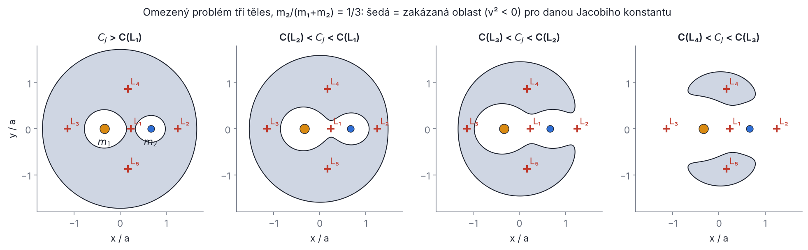
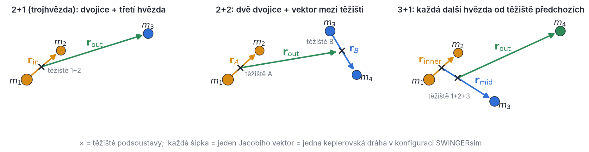
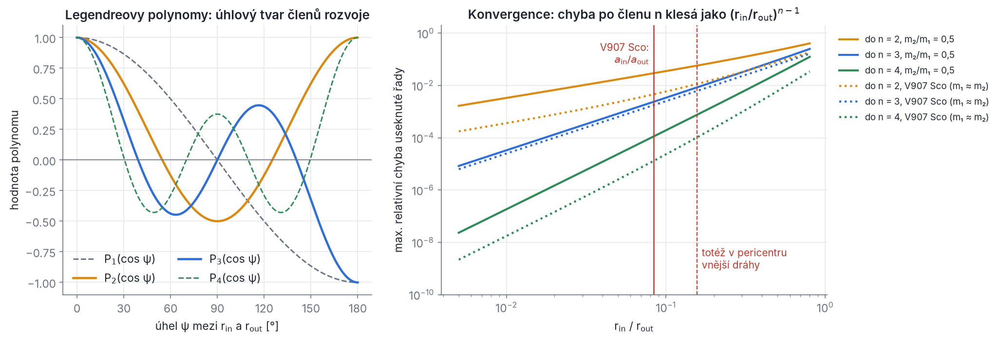
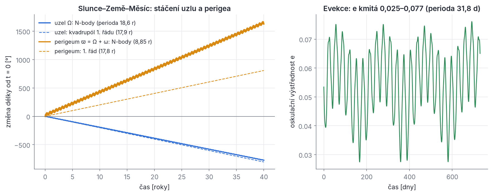
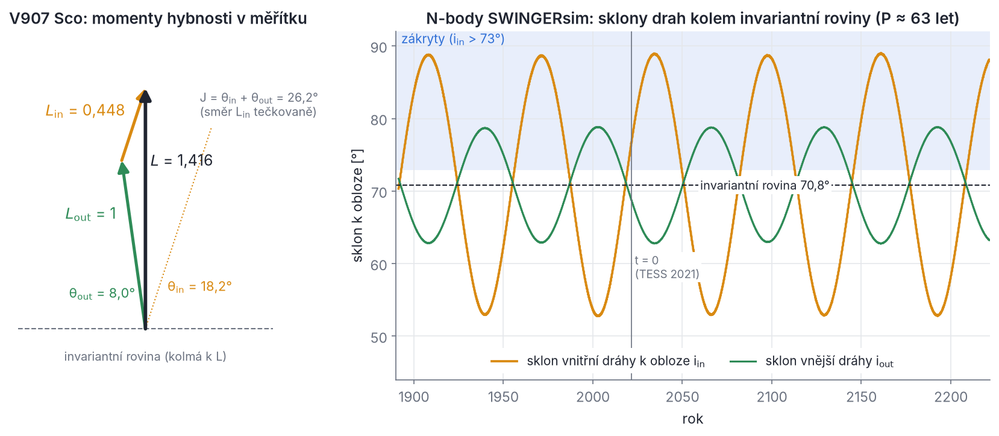

## Kapitola 3 – Hierarchické soustavy

V kapitole 2 jsme vyřešili problém dvou těles úplně: dráha je kuželosečka a stačí ji popsat šesti elementy. Pro tři a více těles takové řešení neexistuje. Přesto se vícenásobné hvězdy, které pozorujeme, chovají překvapivě „slušně“. V907 Sco je už staletí dvojhvězda s periodou 3,78 dne, kterou ve vzdálenosti asi 1 au obíhá třetí hvězda s periodou 142 dní. BU CMi jsou dvě těsné dvojhvězdy, které spolu obíhají jednou za 122 dní. Slunce, Země a Měsíc tvoří stejný typ soustavy. Všechny mají společné to, že se dají rozložit na **vnořené dvojice**: těsný pár, který z dálky vypadá jako jediné těleso, a vzdálenější průvodce.

Tato kapitola ukazuje, jak z té intuice udělat přesnou matematiku. Nejdřív na nejjednodušším modelu, omezeném problému tří těles, uvidíme, kdy částice „patří“ k jednomu tělesu. Pak zavedeme **Jacobiho souřadnice**, ve kterých se kinetická energie i moment hybnosti rozpadnou *přesně* na součet členů jednotlivých dvojic. Potenciální energie se rozpadne jen přibližně: na keplerovské členy a malou poruchu. Poruchu rozvineme do řady (multipólový rozvoj) a spočítáme, jak je malá. Nakonec probereme vzájemný sklon drah, invariantní rovinu, Měsíc jako vzorovou hierarchickou trojici, časové škály a to, jak hierarchii zadáváš do SWINGERsim.

Všechno, co tu odvodíme, se dál používá. Efektivní potenciál z oddílu 3.2 je Rocheův potenciál z kapitoly 9. Kvadrupólový člen z oddílu 3.5 je výchozí bod sekulární dynamiky a cyklů ZLK v kapitole 5. Poměry z oddílu 3.6 vstupují do kritérií stability v kapitole 4. A Jacobiho souřadnice jsou přesně to, co SWINGERsim čte z konfigurace.

### 3.1 Proč hierarchie

**Pozorovaný fakt.** Trojhvězdy a čtyřhvězdy, které vydrží miliony let, mají téměř vždy hierarchické uspořádání: vzdálenosti (a periody) se liší aspoň několikrát, obvykle mnohem víc. U V907 Sco je poměr period P_out/P_in = 142,01/3,775 ≈ 37,6, u BU CMi asi 41 a 37 (pro dvojice A a B), u CzeV343 (P_out ≈ 1454 d, dvojice 1,21 d a 0,81 d) dokonce 1200 a 1800. Soustavy tří srovnatelných hvězd ve srovnatelných vzdálenostech („demokratické“ konfigurace) jsou chaotické a během několika desítek až stovek oběhů se rozpadnou: jedna hvězda, obvykle nejlehčí, je vymrštěna a zbylé dvě vytvoří těsnější dvojhvězdu (kapitola 4). Co dnes vidíme, je tedy z velké části výsledek výběru: přežily hierarchie.

**Fyzikální důvod.** Proč je hierarchie stabilní? Představ si těsnou dvojici o hmotnostech m₁, m₂ se vzájemnou vzdáleností r_in a třetí hvězdu m₃ ve vzdálenosti r_out ≫ r_in. Třetí hvězda přitahuje obě složky dvojice, ale *téměř stejně*. Na pohyb dvojice kolem jejího těžiště působí jen **rozdíl** přitažlivosti na obě složky, tedy slapové (diferenciální) zrychlení. Spočítáme ho pro složky ležící na spojnici s m₃, jedna ve vzdálenosti r_out, druhá ve vzdálenosti r_out + r_in:

```latex
\Delta a = \frac{G m_3}{r_\mathrm{out}^2} - \frac{G m_3}{(r_\mathrm{out}+r_\mathrm{in})^2}
= \frac{G m_3}{r_\mathrm{out}^2}\left[1 - \left(1+\frac{r_\mathrm{in}}{r_\mathrm{out}}\right)^{-2}\right]
\approx \frac{G m_3}{r_\mathrm{out}^2}\cdot 2\,\frac{r_\mathrm{in}}{r_\mathrm{out}} = \frac{2 G m_3\, r_\mathrm{in}}{r_\mathrm{out}^3}
```

V posledním kroku jsme použili (1 + x)⁻² ≈ 1 − 2x pro malé x = r_in/r_out. Vlastní přitažlivost dvojice, která drží složky pohromadě, je G(m₁ + m₂)/r_in². Poměr obou zrychlení je **slapový parametr**

```latex
\varepsilon_\mathrm{tid} \equiv \frac{\Delta a}{G m_{12}/r_\mathrm{in}^2} = 2\,\frac{m_3}{m_{12}}\left(\frac{r_\mathrm{in}}{r_\mathrm{out}}\right)^{3}, \qquad m_{12} = m_1 + m_2
```

To je první a nejdůležitější „malý parametr“ hierarchické soustavy. Všimni si dvou věcí. Poměr vzdáleností vystupuje ve *třetí* mocnině, takže už malé zvětšení r_out poruchu silně potlačí. A záleží i na poměru hmotností: velmi hmotná třetí hvězda ruší víc.

**Řešený příklad (paradox Měsíce).** Slunce přitahuje Měsíc zrychlením GM☉/(1 au)² = 1,327·10²⁰/(1,496·10¹¹)² ≈ 5,93·10⁻³ m s⁻². Země ho přitahuje zrychlením GM⊕/r☾² = 3,986·10¹⁴/(3,844·10⁸)² ≈ 2,70·10⁻³ m s⁻². Slunce tedy táhne Měsíc 2,2krát silněji než Země! Proč tedy Měsíc obíhá Zemi? Protože Slunce stejně silně táhne i Zemi a na relativní pohyb Měsíce vůči Zemi působí jen rozdíl. Slapový parametr je ε_tid = 2 · (1/3,04·10⁻⁶) · (0,00257)³ ≈ 0,011, tedy asi 1 %. Pro vnitřní dvojici V907 Sco (a_in = 0,0827 au, a_out = 0,987 au, m₃/m₁₂ = 0,20) vyjde ε_tid = 2 · 0,20 · 0,0838³ ≈ 2,4·10⁻⁴ při střední vzdálenosti a 1,6·10⁻³ v pericentru vnější dráhy, kde r_out = a_out(1 − e_out) = 0,53 au. Dvojice V907 Sco je tedy „lepší hierarchie“ než Země s Měsícem, i když poměr velikostí drah a_in/a_out = 0,084 je u ní 33krát větší než u Měsíce (0,00257). Rozhoduje kombinace poměru vzdáleností a poměru hmotností.

> **Pozor.** Hierarchii nelze posoudit jen podle poměru velkých poloos. Síla poruchy závisí na poměru a_in/a_out, na poměrech hmotností a na výstřednosti vnější dráhy (v pericentru se třetí těleso přiblíží). Ve vzorcích této kapitoly uvidíš všechny tři.

**Co z toho plyne pro výpočty.** Hierarchická soustava je skoro součet nezávislých problémů dvou těles: vnitřní dvojice obíhá kolem svého těžiště, a toto těžiště spolu s třetí hvězdou tvoří další dvojici. Porucha mezi nimi je malá, ale působí stále stejným směrem, takže se za tisíce oběhů nasčítá ve velké pomalé (sekulární) změny drah: stáčení uzlů a přímky apsid, kolísání sklonu a výstřednosti. Abychom to mohli spočítat, potřebujeme souřadnice, ve kterých je „součet dvojic“ přesný (oddíl 3.3), a rozvoj poruchy (oddíl 3.5). Než se do toho pustíme, prohlédneme si nejjednodušší případ, kdy jde o tři tělesa a jedno z nich je nehmotné.

### 3.2 Omezený problém tří těles

**Zadání.** Dvě hvězdy o hmotnostech m₁ ≥ m₂ obíhají po kruhových drahách kolem společného těžiště se vzájemnou vzdáleností a a středním pohybem n, kde podle třetího Keplerova zákona n² = G(m₁ + m₂)/a³. Třetí těleso má zanedbatelnou hmotnost (planetka, částice plynu, prachové zrnko): hvězdy cítí, ale samo je neovlivňuje. To je **omezený kruhový problém tří těles**. Zavedeme hmotnostní podíl

```latex
\kappa = \frac{m_2}{m_1+m_2}, \qquad 0 < \kappa \le \tfrac12
```

(písmeno μ si šetříme pro gravitační parametr G(m₁ + m₂)). Těžiště leží v počátku, m₁ ve vzdálenosti κa na jednu stranu, m₂ ve vzdálenosti (1 − κ)a na druhou.

**Rotující soustava.** V inerciální soustavě se obě hvězdy pohybují. V soustavě, která se otáčí spolu s nimi úhlovou rychlostí **n** = n **ẑ**, stojí na místě: m₁ v bodě (−κa, 0, 0), m₂ v bodě ((1 − κ)a, 0, 0). Za tuto výhodu zaplatíme zdánlivými zrychleními. Odvodíme je. Jednotkové vektory rotující soustavy se otáčejí, a proto se mění v čase: dê_x/dt = **n** × ê_x a stejně pro ê_y, ê_z. Pro libovolný vektor **u** = u_x ê_x + u_y ê_y + u_z ê_z s rotujícími složkami tedy platí

```latex
\left(\frac{d\mathbf u}{dt}\right)_\mathrm{inerc} = \underbrace{\dot u_x\,\hat{\mathbf e}_x + \dot u_y\,\hat{\mathbf e}_y + \dot u_z\,\hat{\mathbf e}_z}_{(d\mathbf u/dt)_\mathrm{rot}} + u_x\,\mathbf n\times\hat{\mathbf e}_x + u_y\,\mathbf n\times\hat{\mathbf e}_y + u_z\,\mathbf n\times\hat{\mathbf e}_z
= \left(\frac{d\mathbf u}{dt}\right)_\mathrm{rot} + \mathbf n\times\mathbf u
```

Použijeme to dvakrát, nejdřív na polohu **r**, pak na rychlost (**n** je konstantní):

```latex
\mathbf v_\mathrm{inerc} = \dot{\mathbf r} + \mathbf n\times\mathbf r, \qquad
\mathbf a_\mathrm{inerc} = \ddot{\mathbf r} + 2\,\mathbf n\times\dot{\mathbf r} + \mathbf n\times(\mathbf n\times\mathbf r)
```

kde tečky znamenají derivace v rotující soustavě. Newtonův zákon platí v inerciální soustavě: **a**_inerc = −∇Φ_g, kde Φ_g = −Gm₁/r₁ − Gm₂/r₂ je gravitační potenciál obou hvězd a r₁, r₂ jsou vzdálenosti částice od nich. Po přeskupení

```latex
\ddot{\mathbf r} = -\nabla\Phi_g \;\underbrace{-\,2\,\mathbf n\times\dot{\mathbf r}}_{\text{Coriolisovo}} \;\underbrace{-\,\mathbf n\times(\mathbf n\times\mathbf r)}_{\text{odstředivé}}
```

Odstředivé zrychlení míří od osy rotace a má velikost n²R, kde R = √(x² + y²) je vzdálenost od osy. Dá se napsat jako gradient: −**n** × (**n** × **r**) = n²(x, y, 0) = −∇(−½n²(x² + y²)). Spojíme ho s gravitací do **efektivního potenciálu**

```latex
\Phi_\mathrm{eff}(x,y,z) = -\frac{G m_1}{r_1} - \frac{G m_2}{r_2} - \frac12\,n^2\left(x^2+y^2\right),
\qquad \ddot{\mathbf r} = -\nabla\Phi_\mathrm{eff} - 2\,\mathbf n\times\dot{\mathbf r}
```

Právě tento potenciál se v kapitole 9 jmenuje **Rocheův potenciál** Φ_R. Je to tatáž funkce; jen tam místo zkušební částice sledujeme plyn na povrchu hvězdy.

**Jacobiho integrál.** Rovnici vynásobíme skalárně rychlostí ṙ. Coriolisův člen vypadne, protože vektor **n** × ṙ je kolmý k ṙ, takže (**n** × ṙ) · ṙ = 0. Coriolisova síla tedy nekoná práci, jen zatáčí. Zbude

```latex
\dot{\mathbf r}\cdot\ddot{\mathbf r} = -\dot{\mathbf r}\cdot\nabla\Phi_\mathrm{eff}
\quad\Longrightarrow\quad
\frac{d}{dt}\left(\tfrac12 v^2\right) = -\frac{d\Phi_\mathrm{eff}}{dt}
\quad\Longrightarrow\quad
\frac{d}{dt}\left(\tfrac12 v^2 + \Phi_\mathrm{eff}\right) = 0
```

kde v = |ṙ| je rychlost v rotující soustavě a použili jsme řetízkové pravidlo dΦ_eff/dt = ∇Φ_eff · ṙ (Φ_eff v rotující soustavě explicitně na čase nezávisí). Veličina v závorce se zachovává. Tradičně se zapisuje jako **Jacobiho konstanta**

```latex
C_J = -2\,\Phi_\mathrm{eff}(x,y,z) - v^2 = n^2(x^2+y^2) + \frac{2Gm_1}{r_1} + \frac{2Gm_2}{r_2} - v^2 = \text{konst.}
```

Je to jediný známý integrál omezeného problému. Neříká nám, jak dráha vypadá, ale říká, *kam se částice nikdy nedostane*.

**Křivky nulové rychlosti.** Protože v² ≥ 0, může se částice s danou konstantou C_J pohybovat jen tam, kde −2Φ_eff ≥ C_J. Hranice −2Φ_eff = C_J je **plocha nulové rychlosti** (v rovině dráhy **křivka nulové rychlosti**): na ní by se částice v rotující soustavě zastavila. Na obr. 3.1 jsou zakázané oblasti pro čtyři hodnoty C_J. Velké C_J (pomalá částice blízko jedné z hvězd) znamená malou dovolenou oblast: částice je uzavřena v „bublině“ kolem m₁ nebo kolem m₂ a k druhé hvězdě se nikdy nedostane. To je přesná, ne empirická, podmínka stability: **Hillova stabilita**. S klesajícím C_J se bubliny zvětšují, nejdřív se spojí v bodě L₁, pak se otevře cesta ven za L₂, potom za L₃ a nakonec zakázaná oblast zůstane jen kolem L₄ a L₅.


*Obr. 3.1 – Omezený kruhový problém tří těles v rotující soustavě, m₂/(m₁ + m₂) = 1/3 (poměr hmotností 0,5, jako na obr. 9.1). Oranžová je hmotnější hvězda m₁, modrá m₂, červené křížky Lagrangeovy body. Šedá plocha je pro danou Jacobiho konstantu zakázaná (tam by muselo být v² < 0). Zleva doprava C_J klesá: (1) částice je uvězněna u jedné hvězdy; (2) bubliny se spojily v L₁, částice může přecházet mezi hvězdami, ale ne ven; (3) otevřel se průchod za L₂; (4) zakázané zůstaly jen „ledviny“ kolem L₄ a L₅. Pro m₂/(m₁+m₂) = 1/3 je v jednotkách G(m₁+m₂)/a: C(L₁) = 3,946, C(L₂) = 3,547, C(L₃) = 3,321, C(L₄) = C(L₅) = 2,778.*

**Lagrangeovy body.** Body, kde je ∇Φ_eff = 0, jsou rovnovážné polohy: částice tam v rotující soustavě může stát (Coriolisova síla na stojící částici nepůsobí). Hledáme je v rovině z = 0. V jednotkách a = 1, G(m₁ + m₂) = 1 (pak n = 1) je

```latex
\frac{\partial\Phi_\mathrm{eff}}{\partial x} = \frac{(1-\kappa)(x+\kappa)}{r_1^3} + \frac{\kappa\,(x-1+\kappa)}{r_2^3} - x = 0, \qquad
\frac{\partial\Phi_\mathrm{eff}}{\partial y} = y\left[\frac{1-\kappa}{r_1^3} + \frac{\kappa}{r_2^3} - 1\right] = 0
```

Druhá rovnice má dvě možnosti. Buď y = 0: pak leží bod na spojnici hvězd a první rovnice (s r₁ = |x + κ|, r₂ = |x − 1 + κ|) má právě tři kořeny, **kolineární body** L₁ (mezi hvězdami), L₂ (za lehčí hvězdou) a L₃ (za těžší). Najdeš je numericky (cvičení 3). Nebo je rovna nule hranatá závorka. Zkusíme r₁ = r₂ = 1: závorka je (1 − κ) + κ − 1 = 0 a první rovnice dá (1 − κ)(x + κ) + κ(x − 1 + κ) − x = x − x + κ − κ² − κ + κ² = 0. Obě rovnice jsou splněny pro *jakýkoli* poměr hmotností: body **L₄ a L₅** tvoří s oběma hvězdami rovnostranné trojúhelníky. Jacobiho konstanta v nich je C(L₄) = 3 − κ(1 − κ) (cvičení 3).

Body L₁, L₂, L₃ jsou sedla Φ_eff a jsou vždy nestabilní. Body L₄ a L₅ jsou maxima Φ_eff, a přesto mohou být stabilní díky Coriolisově síle, ale jen pro κ(1 − κ) < 1/27, tedy κ < 0,0385 (m₁/m₂ > 24,96). Proto v soustavě Slunce–Jupiter (κ ≈ 0,001) existují trojané v L₄ a L₅, kdežto u dvou hvězd srovnatelných hmotností tam nic dlouho nevydrží.

> **Z historie.** Kolineární řešení problému tří těles našel L. Euler (1767), rovnostranné J.-L. Lagrange (1772). Integrál pohybu v rotující soustavě publikoval C. G. J. Jacobi (1836) a G. W. Hill (1878) z něj odvodil křivky nulové rychlosti při studiu pohybu Měsíce. Podmínku stability bodů L₄, L₅ odvodili M. Gascheau (1843) a E. J. Routh (1875).

**Hillův poloměr.** Pro m₂ ≪ m₁ leží L₁ a L₂ blízko lehčí hvězdy a jejich vzdálenost od ní se dá spočítat jednoduše. Bod ve vzdálenosti r od m₂ směrem k m₁ cítí (na jednotku hmotnosti, kladně ve směru k m₁): přitažlivost m₁, přitažlivost m₂ opačným směrem a odstředivé zrychlení od osy (těžiště je pro malé κ prakticky v m₁):

```latex
\frac{G m_1}{(a-r)^2} - \frac{G m_2}{r^2} - n^2 (a-r) = 0, \qquad n^2 \approx \frac{G m_1}{a^3}
```

Pro r ≪ a rozvineme: Gm₁/(a − r)² ≈ (Gm₁/a²)(1 + 2r/a) a n²(a − r) = Gm₁/a² − Gm₁r/a³. Členy Gm₁/a² se odečtou a zbude

```latex
\frac{2 G m_1 r}{a^3} + \frac{G m_1 r}{a^3} = \frac{G m_2}{r^2}
\quad\Longrightarrow\quad
r_H = a\left(\frac{m_2}{3 m_1}\right)^{1/3}
```

Trojka ve jmenovateli má názornou interpretaci: 2 je slapové zrychlení z oddílu 3.1, 1 je rozdíl odstředivého zrychlení. Uvnitř **Hillovy sféry** o poloměru r_H převládá gravitace m₂ nad slapovým působením m₁.

**Řešený příklad.** Hillův poloměr Země vůči Slunci: r_H = 1 au · (3,04·10⁻⁶/3)^{1/3} ≈ 1,50·10⁶ km. (Přesný kořen rovnice pro L₁ dává 1,498·10⁶ km od Země.) Měsíc obíhá ve vzdálenosti 0,384·10⁶ km, tedy ve čtvrtině Hillova poloměru (0,26 r_H); numerické simulace ukazují, že prográdní měsíce planet vydrží zhruba do poloviny r_H. Pozor, vzorec platí jen pro malý poměr hmotností. Pro m₂/m₁ = 0,5 dává 0,550a, kdežto přesná vzdálenost L₁ od m₂ je 0,429a (cvičení 3). Pro hvězdy srovnatelných hmotností proto v kapitole 9 používáme přesný Rocheův lalok a Eggletonův vzorec.

> **Pozor.** Omezený problém je *model*: zanedbává hmotnost třetího tělesa a předpokládá kruhovou dráhu hvězd. U trojhvězdy V907 Sco má třetí hvězda 17 % celkové hmotnosti a vnější dráha je výstředná (e_out = 0,47), takže Jacobiho konstanta neexistuje. Zůstává ale obraz „zakázaných oblastí“ a měřítko r_H, ze kterého vycházejí empirická kritéria stability (kapitola 4). SWINGERsim omezený problém zvlášť neřeší: integruje vždy plný problém N těles.

### 3.3 Jacobiho souřadnice

**Myšlenka.** Těsnou dvojici vidí vzdálená hvězda jako jedno těleso o hmotnosti m₁ + m₂ v těžišti dvojice. Proto nebudeme popisovat polohy hvězd, ale pro každou dvojici (každý **uzel** stromu hierarchie) jeden **relativní vektor** od těžiště jedné větve k těžišti druhé. Takové vektory se nazývají **Jacobiho souřadnice** (hierarchické Jacobiho souřadnice). Každý z nich se pohybuje skoro jako v problému dvou těles, a proto mu můžeme přiřadit keplerovskou dráhu s elementy a, e, i, Ω, ω, M₀. Na obr. 3.2 jsou nakreslené pro tři nejběžnější hierarchie.


*Obr. 3.2 – Jacobiho vektory tří hierarchií. Křížky jsou těžiště podsoustav. Každá šipka vede od těžiště první větve uzlu k těžišti druhé větve a odpovídá jedné dráze v konfiguraci SWINGERsim: vlevo dráhy inner a out trojhvězdy (V907 Sco), uprostřed A, B a out čtyřhvězdy 2+2 (BU CMi), vpravo inner, mid a out čtyřhvězdy 3+1. Šipka vnější dráhy nikdy nezačíná u hvězdy, vždy v těžišti.*

**Základní krok: dvě tělesa.** Mějme dvě tělesa (nebo dvě podsoustavy) o hmotnostech m_L a m_R s těžišti v bodech **R**_L a **R**_R. Zavedeme těžiště a relativní vektor

```latex
\mathbf R = \frac{m_L\mathbf R_L + m_R\mathbf R_R}{M}, \quad M = m_L + m_R, \qquad \mathbf r = \mathbf R_R - \mathbf R_L
```

Inverzní vztahy dostaneš vyřešením těchto dvou rovnic:

```latex
\mathbf R_L = \mathbf R - \frac{m_R}{M}\,\mathbf r, \qquad \mathbf R_R = \mathbf R + \frac{m_L}{M}\,\mathbf r
```

Dosadíme do kinetické energie (body nad písmeny jsou časové derivace):

```latex
\begin{aligned}
T &= \tfrac12 m_L\left|\dot{\mathbf R} - \tfrac{m_R}{M}\dot{\mathbf r}\right|^2 + \tfrac12 m_R\left|\dot{\mathbf R} + \tfrac{m_L}{M}\dot{\mathbf r}\right|^2 \\
&= \tfrac12 (m_L + m_R)\,|\dot{\mathbf R}|^2 + \dot{\mathbf R}\cdot\dot{\mathbf r}\left(-\frac{m_L m_R}{M} + \frac{m_R m_L}{M}\right) + \tfrac12\left(\frac{m_L m_R^2}{M^2} + \frac{m_R m_L^2}{M^2}\right)|\dot{\mathbf r}|^2 \\
&= \tfrac12 M\,|\dot{\mathbf R}|^2 + \tfrac12\, m_r\,|\dot{\mathbf r}|^2, \qquad m_r = \frac{m_L m_R}{M}
\end{aligned}
```

Smíšený člen zmizel, protože závorka je nulová, a v posledním členu jsme vytkli m_L m_R(m_R + m_L)/M² = m_L m_R/M. Veličina m_r je **redukovaná hmotnost** uzlu (kapitola 2). Stejným postupem s vektorovým součinem dostaneme moment hybnosti:

```latex
\mathbf L = m_L\,\mathbf R_L\times\dot{\mathbf R}_L + m_R\,\mathbf R_R\times\dot{\mathbf R}_R = M\,\mathbf R\times\dot{\mathbf R} + m_r\,\mathbf r\times\dot{\mathbf r}
```

(smíšené členy R × ṙ a r × Ṙ mají opět koeficient −m_L m_R/M + m_R m_L/M = 0).

**Podsoustavy: Königova věta.** Co když „těleso“ L je samo dvojhvězda? Pak má kromě pohybu svého těžiště ještě vnitřní pohyb. Pro libovolnou soustavu hmotných bodů m_j s polohami **R** + **ρ**_j, kde **R** je těžiště a Σ m_j **ρ**_j = 0, platí

```latex
\sum_j \tfrac12 m_j\,|\dot{\mathbf R} + \dot{\boldsymbol\rho}_j|^2 = \tfrac12 M |\dot{\mathbf R}|^2 + \dot{\mathbf R}\cdot\underbrace{\sum_j m_j\dot{\boldsymbol\rho}_j}_{=\,0} + \sum_j\tfrac12 m_j|\dot{\boldsymbol\rho}_j|^2 = \tfrac12 M|\dot{\mathbf R}|^2 + T_\mathrm{vnitřní}
```

a obdobně **L** = M **R** × Ṙ + **L**_vnitřní. Kinetická energie (i moment hybnosti) soustavy je tedy součet členu těžiště a vnitřního členu. To je **Königova věta**. Použijeme ji opakovaně: celou soustavu rozdělíme v kořeni stromu na dvě větve, každá větev má energii svého těžiště plus vnitřní energii, a dva členy těžišť dají podle základního kroku ½M_tot V² + ½m_r,out |ṙ_out|². Vnitřní energie každé větve se rozloží stejně o patro níž. Rekurze skončí u jednotlivých hvězd. Výsledek je **přesný**:

```latex
T = \tfrac12 M_\mathrm{tot}\,V_\mathrm{cm}^2 + \sum_{k\,\in\,\text{uzly}} \tfrac12\, m_{\mathrm r,k}\,|\dot{\mathbf r}_k|^2, \qquad
\mathbf L = M_\mathrm{tot}\,\mathbf R_\mathrm{cm}\times\mathbf V_\mathrm{cm} + \sum_{k\,\in\,\text{uzly}} m_{\mathrm r,k}\,\mathbf r_k\times\dot{\mathbf r}_k
```

kde m_r,k = m_L,k m_R,k/(m_L,k + m_R,k) a m_L,k, m_R,k jsou *celkové* hmotnosti obou větví uzlu k. V soustavě těžiště (V_cm = 0, R_cm = 0) první členy odpadnou. Soustava N hvězd má N − 1 uzlů a tedy N − 1 Jacobiho vektorů: přesně tolik, kolik má mít (3N souřadnic minus 3 souřadnice těžiště).

**Konkrétně pro tři hierarchie.** Pro trojhvězdu **2+1**:

```latex
\mathbf r_\mathrm{in} = \mathbf r_2 - \mathbf r_1, \qquad
\mathbf r_\mathrm{out} = \mathbf r_3 - \frac{m_1\mathbf r_1 + m_2\mathbf r_2}{m_{12}}, \qquad
m_{\mathrm r,\mathrm{in}} = \frac{m_1 m_2}{m_{12}}, \quad m_{\mathrm r,\mathrm{out}} = \frac{m_{12}\, m_3}{m_{123}}
```

kde m₁₂ = m₁ + m₂ a m₁₂₃ = m₁ + m₂ + m₃. Pro čtyřhvězdu **2+2** (dvojice A = (1, 2), B = (3, 4)):

```latex
\mathbf r_A = \mathbf r_2 - \mathbf r_1, \quad \mathbf r_B = \mathbf r_4 - \mathbf r_3, \quad
\mathbf r_\mathrm{out} = \frac{m_3\mathbf r_3 + m_4\mathbf r_4}{M_B} - \frac{m_1\mathbf r_1 + m_2\mathbf r_2}{M_A}, \qquad
m_{\mathrm r,\mathrm{out}} = \frac{M_A M_B}{M_A + M_B}
```

s M_A = m₁ + m₂, M_B = m₃ + m₄, m_r,A = m₁m₂/M_A, m_r,B = m₃m₄/M_B. Pro čtyřhvězdu **3+1** postupujeme zevnitř ven:

```latex
\mathbf r_\mathrm{inner} = \mathbf r_2 - \mathbf r_1, \quad
\mathbf r_\mathrm{mid} = \mathbf r_3 - \frac{m_1\mathbf r_1 + m_2\mathbf r_2}{m_{12}}, \quad
\mathbf r_\mathrm{out} = \mathbf r_4 - \frac{m_1\mathbf r_1 + m_2\mathbf r_2 + m_3\mathbf r_3}{m_{123}}
```

s redukovanými hmotnostmi m₁m₂/m₁₂, m₁₂m₃/m₁₂₃ a m₁₂₃m₄/m₁₂₃₄. Stromy 2+2 a 3+1 mají oba tři Jacobiho vektory, ale jinak spárované, a proto je nelze převést jeden na druhý jen přejmenováním. Kinetická energie i moment hybnosti se v obou případech rozloží přesně. Ověřili jsme to numericky pro náhodné polohy, rychlosti a hmotnosti; rozdíl byl na úrovni zaokrouhlovací chyby 10⁻¹⁶ (cvičení 4).

> **Pozor.** Rozklad T = Σ ½ m_r,k |ṙ_k|² platí jen v soustavě těžiště. V jiné soustavě přibude člen ½ M_tot V_cm². Podobně moment hybnosti obsahuje navíc M_tot **R**_cm × **V**_cm. SWINGERsim proto staví počáteční stav vždy v soustavě těžiště (oddíl 3.12).

**Proč ne jednodušší souřadnice?** Mohli bychom měřit polohy všech hvězd od hvězdy 1 („astrocentrické“ souřadnice, jak je zvykem pro planety vůči Slunci). Pak ale kinetická energie obsahuje smíšené členy a do pohybu každého tělesa vstupuje i tzv. nepřímá porucha: zrychlení, kterým ostatní tělesa urychlují samotný počátek. U hierarchické hvězdné soustavy by vnější hvězda měla „dráhu kolem hvězdy 1“, která se s periodou vnitřní dvojice kymácí o velikost a_in. Jacobiho vektor **r**_out začíná v těžišti dvojice, takže toto kymácení v něm není. Proto jsou oskulační elementy vnější dráhy v Jacobiho souřadnicích téměř konstantní (V907 Sco: a_out kolísá jen o 0,7 %, viz výstup v oddílu 3.12).

> **Z historie.** Relativní souřadnice tohoto typu použil C. G. J. Jacobi kolem roku 1842 při zjednodušování problému tří těles. Jeho „eliminace uzlů“ využívá toho, že v soustavě vázané na celkový moment hybnosti mají vnitřní a vnější dráha uzly vzdálené přesně o 180° (oddíl 3.10). Dnes Jacobiho souřadnice používají i symplektické integrátory typu Wisdom–Holman (kapitola 6).

### 3.4 Hamiltonova funkce hierarchické soustavy

**Hybnosti.** Ke každému Jacobiho vektoru přiřadíme hybnost **p**_k = m_r,k ṙ_k. Kinetická energie v soustavě těžiště je pak Σ p_k²/(2m_r,k). **Hamiltonova funkce** H je celková energie zapsaná pomocí souřadnic **r**_k a hybností **p**_k. Pohybové rovnice z ní plynou jako dr_k/dt = ∂H/∂p_k, dp_k/dt = −∂H/∂r_k (to v kapitole 5 využijeme pro středované rovnice); tady nám jde hlavně o to, rozdělit H na velké a malé části.

**Trojhvězda 2+1.** Potřebujeme vzdálenosti hvězd vyjádřit Jacobiho vektory. V soustavě s počátkem v těžišti dvojice leží m₁ v bodě −(m₂/m₁₂)**r**_in, m₂ v bodě +(m₁/m₁₂)**r**_in a m₃ v bodě **r**_out. Proto

```latex
\mathbf r_3 - \mathbf r_1 = \mathbf r_\mathrm{out} + \frac{m_2}{m_{12}}\mathbf r_\mathrm{in}, \qquad
\mathbf r_3 - \mathbf r_2 = \mathbf r_\mathrm{out} - \frac{m_1}{m_{12}}\mathbf r_\mathrm{in}
```

a přesná Hamiltonova funkce je

```latex
H = \frac{p_\mathrm{in}^2}{2m_{\mathrm r,\mathrm{in}}} + \frac{p_\mathrm{out}^2}{2m_{\mathrm r,\mathrm{out}}} - \frac{G m_1 m_2}{r_\mathrm{in}} - \frac{G m_1 m_3}{\left|\mathbf r_\mathrm{out} + \frac{m_2}{m_{12}}\mathbf r_\mathrm{in}\right|} - \frac{G m_2 m_3}{\left|\mathbf r_\mathrm{out} - \frac{m_1}{m_{12}}\mathbf r_\mathrm{in}\right|}
```

Teď přičteme a odečteme člen −G m₁₂ m₃/r_out (energii, kterou by m₃ měla, kdyby celá dvojice byla bod v těžišti):

```latex
H = \underbrace{\frac{p_\mathrm{in}^2}{2m_{\mathrm r,\mathrm{in}}} - \frac{G m_1 m_2}{r_\mathrm{in}}}_{H_\mathrm{in}:\ \text{Kepler, vnitřní}}
+ \underbrace{\frac{p_\mathrm{out}^2}{2m_{\mathrm r,\mathrm{out}}} - \frac{G m_{12} m_3}{r_\mathrm{out}}}_{H_\mathrm{out}:\ \text{Kepler, vnější}}
+ \Phi_\mathrm{pert}
```

```latex
\Phi_\mathrm{pert} = -\frac{G m_1 m_3}{\left|\mathbf r_\mathrm{out} + \frac{m_2}{m_{12}}\mathbf r_\mathrm{in}\right|} - \frac{G m_2 m_3}{\left|\mathbf r_\mathrm{out} - \frac{m_1}{m_{12}}\mathbf r_\mathrm{in}\right|} + \frac{G m_{12} m_3}{r_\mathrm{out}}
```

Zatím jsme nic nezanedbali. H_in je přesně energie problému dvou těles s hmotnostmi m₁, m₂, H_out problému dvou těles s hmotnostmi m₁₂ a m₃. **Interakční (poruchová) energie** Φ_pert je rozdíl dvou téměř stejných velkých čísel a pro r_in ≪ r_out je malá. Kdyby byla nulová, obě dráhy by byly přesně keplerovské s μ_in = G m₁₂ a μ_out = G m₁₂₃.

**Čtyřhvězda 2+2.** Stejným postupem: H = H_A + H_B + H_out + Φ_pert, kde H_A = p_A²/(2m_r,A) − Gm₁m₂/r_A, H_B obdobně, H_out = p_out²/(2m_r,out) − G M_A M_B/r_out a

```latex
\Phi_\mathrm{pert} = -\sum_{a\in\{1,2\}}\ \sum_{b\in\{3,4\}} \frac{G m_a m_b}{|\mathbf r_b - \mathbf r_a|} + \frac{G M_A M_B}{r_\mathrm{out}}
```

Čtyři členy přitažlivosti mezi hvězdami různých dvojic minus energie dvou bodů v těžištích. V oddílu 3.7 ji rozložíme na tři části: působení B (jako bodu) na dvojici A, působení A (jako bodu) na dvojici B a přímou vazbu tvarů obou dvojic.

**Čtyřhvězda 3+1.** H = H_inner + H_mid + H_out + Φ_pert, kde H_mid = p_mid²/(2m_r,mid) − Gm₁₂m₃/r_mid a H_out = p_out²/(2m_r,out) − Gm₁₂₃m₄/r_out. Porucha obsahuje dvě „trojhvězdy“ za sebou: působení m₃ na dvojici (1, 2) a působení m₄ na trojici (1, 2, 3).

> **Pozor.** Rozdělení na H_in, H_out a Φ_pert je přesné, ale H_in a H_out se *nezachovávají* každé zvlášť: energie se mezi nimi přelévá přes Φ_pert. Zachovává se jen jejich součet H. Proto oskulační velké poloosy v N-body výpočtu kolísají. Ve středované (sekulární) teorii z kapitoly 5 se ukáže, že po středování přes oběhy se velké poloosy nemění.

### 3.5 Multipólový rozvoj poruchy

**Cíl.** Porucha Φ_pert trojhvězdy obsahuje převrácené vzdálenosti 1/|**r**_out ± (…)**r**_in|. Pro r_in ≪ r_out je chceme rozvinout do řady v mocninách r_in/r_out. Každý člen řady bude mít jasný fyzikální význam a jasnou velikost.

**Generující funkce Legendreových polynomů.** Vezmi dva vektory **R** a **s** s úhlem χ mezi sebou, x = cos χ, a označ t = s/R < 1. Z kosinové věty je |**R** − **s**|² = R² − 2Rs x + s² = R²(1 − 2xt + t²), takže

```latex
\frac{1}{|\mathbf R - \mathbf s|} = \frac{1}{R}\,\left(1 + u\right)^{-1/2}, \qquad u = t^2 - 2xt
```

Binomický rozvoj (1 + u)^{−1/2} = 1 − ½u + ⅜u² − (5/16)u³ + … dosadíme a seřadíme podle mocnin t. Užitečné jsou u² = 4x²t² − 4xt³ + t⁴ a u³ = −8x³t³ + (členy t⁴ a vyšší):

```latex
\begin{aligned}
t^0:&\quad 1\\
t^1:&\quad -\tfrac12(-2x) = x\\
t^2:&\quad -\tfrac12\cdot 1 + \tfrac38\cdot 4x^2 = \tfrac12\left(3x^2 - 1\right)\\
t^3:&\quad \tfrac38\cdot(-4x) - \tfrac5{16}\cdot(-8x^3) = \tfrac12\left(5x^3 - 3x\right)
\end{aligned}
```

Koeficienty jsou **Legendreovy polynomy** P_n(x):

```latex
\frac{1}{|\mathbf R - \mathbf s|} = \frac1R\sum_{n=0}^{\infty}\left(\frac sR\right)^{n} P_n(\cos\chi), \qquad
P_0 = 1,\ \ P_1 = x,\ \ P_2 = \tfrac12(3x^2-1),\ \ P_3 = \tfrac12(5x^3-3x)
```

Funkci (1 − 2xt + t²)^{−1/2} se proto říká **generující funkce** Legendreových polynomů. Pro |x| ≤ 1 řada konverguje, kdykoli t < 1, tedy když je bod **s** blíž počátku než bod **R**. Platí |P_n(x)| ≤ 1 a P_n(−x) = (−1)ⁿ P_n(x): sudé polynomy jsou sudé funkce, liché liché. Průběh P₁ až P₄ ukazuje obr. 3.3 vlevo.

**Rozvoj pro trojhvězdu.** Počátek dáme do těžiště vnitřní dvojice. Hvězda 1 je v bodě **s**₁ = −(m₂/m₁₂)**r**_in, hvězda 2 v bodě **s**₂ = +(m₁/m₁₂)**r**_in a m₃ v bodě **r**_out. Označíme ψ úhel mezi **r**_in a **r**_out. Úhel mezi **s**₁ a **r**_out je 180° − ψ, proto P_n(cos χ₁) = P_n(−cos ψ) = (−1)ⁿ P_n(cos ψ). Potenciální energie m₃ v poli obou hvězd je

```latex
U_3 = -\frac{G m_1 m_3}{|\mathbf r_\mathrm{out} - \mathbf s_1|} - \frac{G m_2 m_3}{|\mathbf r_\mathrm{out} - \mathbf s_2|}
= -\frac{G m_3}{r_\mathrm{out}}\sum_{n=0}^{\infty}\left(\frac{r_\mathrm{in}}{r_\mathrm{out}}\right)^{n} P_n(\cos\psi)\left[m_1\left(-\frac{m_2}{m_{12}}\right)^{n} + m_2\left(\frac{m_1}{m_{12}}\right)^{n}\right]
```

Závorku upravíme vytknutím m₁m₂/m₁₂ⁿ a použitím (−1)ⁿ m₂^{n−1} = −(−m₂)^{n−1}:

```latex
M_n \equiv m_1\left(-\frac{m_2}{m_{12}}\right)^{n} + m_2\left(\frac{m_1}{m_{12}}\right)^{n} = \frac{m_1 m_2\left[m_1^{\,n-1} - (-m_2)^{\,n-1}\right]}{m_{12}^{\,n}}
```

Podívejme se na první členy:

- **n = 0:** M₀ = m₁ + m₂, člen je −G m₁₂ m₃/r_out. To je potenciální energie vnější dráhy, kterou už obsahuje keplerovský člen H_out. V Φ_pert se proto odečte (právě kvůli tomu jsme v oddílu 3.4 přičetli +G m₁₂m₃/r_out).
- **n = 1:** M₁ = m₁m₂(1 − 1)/m₁₂ = 0. **Dipólový člen vymizí**, protože jsme rozvíjeli kolem těžiště dvojice: Σ m_j **s**_j = 0. To je hlavní důvod, proč používáme Jacobiho souřadnice. (V astrocentrických souřadnicích by se dipól vyrušil s nepřímou poruchou, ale jen po delším počítání.)
- **n = 2:** M₂ = m₁m₂(m₁ + m₂)/m₁₂² = m₁m₂/m₁₂ = m_r,in. Člen se jmenuje **kvadrupól**.
- **n = 3:** M₃ = m₁m₂(m₁² − m₂²)/m₁₂³ = m_r,in (m₁ − m₂)/m₁₂. **Oktupól** vymizí pro dvě stejné hvězdy.

Výsledek je přesná řada pro interakční energii trojhvězdy:

```latex
\Phi_\mathrm{pert} = -\frac{G m_3}{r_\mathrm{out}}\sum_{n\ge 2} M_n\left(\frac{r_\mathrm{in}}{r_\mathrm{out}}\right)^{n} P_n(\cos\psi)
= \Phi_\mathrm{quad} + \Phi_\mathrm{oct} + \dots
```

```latex
\Phi_\mathrm{quad} = -\frac{G m_3\, m_{\mathrm r,\mathrm{in}}\, r_\mathrm{in}^2}{r_\mathrm{out}^3}\,P_2(\cos\psi), \qquad
\Phi_\mathrm{oct} = -\frac{G m_3\, m_{\mathrm r,\mathrm{in}}}{r_\mathrm{out}}\,\frac{m_1 - m_2}{m_{12}}\left(\frac{r_\mathrm{in}}{r_\mathrm{out}}\right)^{3} P_3(\cos\psi)
```

Znaménko oktupólu závisí na tom, kterou hvězdu nazveš m₁ (prohozením se otočí **r**_in, tedy cos ψ → −cos ψ, a P₃ změní znaménko; fyzika se nezmění).

**Kdy řada konverguje.** Rozvoj kolem těžiště vyžaduje, aby obě vnitřní hvězdy byly blíž těžišti než m₃, tedy max(m₁, m₂) r_in/m₁₂ < r_out. Nestačí to splnit „v průměru“, musí to platit v každém okamžiku, nejhůř v pericentru vnější dráhy. Pro V907 Sco je max(m₁, m₂) r_in/m₁₂ ≈ 0,52 · 0,083 au = 0,043 au a nejmenší r_out = 0,53 au, poměr 0,08: řada konverguje rychle. Na obr. 3.3 vpravo vidíš, že po useknutí za členem n klesá relativní chyba jako (r_in/r_out)^{n−1}. Pro V907 Sco dává samotný kvadrupól chybu pod 1 % celé poruchy; pro nestejné hmotnosti (m₂/m₁ = 0,5) je chyba kvadrupólu kolem 3 % a s oktupólem klesne pod 0,3 %.


*Obr. 3.3 – Vlevo: Legendreovy polynomy P₁ až P₄ v závislosti na úhlu ψ mezi vnitřním a vnějším Jacobiho vektorem. Kvadrupól P₂ je symetrický vůči ψ → 180° − ψ (nezáleží na tom, která hvězda dvojice je blíž), oktupól P₃ antisymetrický. Vpravo: největší (přes všechny úhly ψ) relativní chyba poruchové energie, když řadu usekneš za členem n = 2, 3 nebo 4; plné čáry pro m₂/m₁ = 0,5, tečkované pro hmotnosti V907 Sco (m₁ ≈ m₂, oktupól téměř chybí). Červená svislice je poměr a_in/a_out = 0,084 pro V907 Sco, čárkovaná totéž v pericentru vnější dráhy. Sklony přímek v logaritmickém měřítku jsou 1, 2 a 3.*

**Kvadrupól ve vektorovém tvaru.** Protože r_in r_out cos ψ = **r**_in · **r**_out, lze kvadrupól zapsat bez úhlů:

```latex
\Phi_\mathrm{quad} = -\frac{G m_3\, m_{\mathrm r,\mathrm{in}}}{2\, r_\mathrm{out}^5}\left[3\left(\mathbf r_\mathrm{in}\cdot\mathbf r_\mathrm{out}\right)^2 - r_\mathrm{in}^2\, r_\mathrm{out}^2\right]
```

Je to energie „slapového“ pole m₃ působícího na protáhlé rozložení hmoty dvojice. Zápornou derivací podle **r**_in dostaneš přesně slapové zrychlení z oddílu 3.1 (na složku podél spojnice 2G m₃ r_in/r_out³, cvičení 6).

**Středování přes obě dráhy (náhled kapitoly 5).** Okamžitý kvadrupól se mění s fázemi obou drah. Na dlouhodobý vývoj má vliv jen jeho průměr. Spočítáme ho pro kruhovou vnitřní dráhu (e_in = 0, poloměr a_in) a výstřednou vnější dráhu; úhel mezi rovinami drah je vzájemný sklon i_mut. Potřebujeme dva průměry.

*1. Průměr přes vnitřní dráhu.* Bod obíhá po kružnici v rovině s jednotkovou normálou **ĵ**_in, jednotkový vektor **ŝ** = **r**_in/a_in rovnoměrně obíhá. Pro pevný jednotkový směr **û** = **r̂**_out platí (**ŝ** · **û**)² = sin²θ cos²φ, kde θ je úhel mezi **û** a **ĵ**_in a φ fáze bodu na kružnici; průměr cos²φ je ½:

```latex
\left\langle(\hat{\mathbf s}\cdot\hat{\mathbf u})^2\right\rangle_\mathrm{in} = \tfrac12\left[1 - (\hat{\mathbf j}_\mathrm{in}\cdot\hat{\mathbf u})^2\right]
```

*2. Průměr přes vnější dráhu.* Čas strávený v úseku pravé anomálie dν je dt = r² dν/h, kde h = √(μ_out a_out(1 − e_out²)) je měrný moment hybnosti (kapitola 2). Proto průměr veličiny r⁻³ f(ν) přes periodu P_out je

```latex
\left\langle\frac{f}{r^3}\right\rangle = \frac{1}{P_\mathrm{out}}\oint \frac{f(\nu)}{r^3}\,\frac{r^2\,d\nu}{h} = \frac{1}{P_\mathrm{out}\,h}\oint f(\nu)\,\frac{1+e_\mathrm{out}\cos\nu}{a_\mathrm{out}(1-e_\mathrm{out}^2)}\,d\nu
```

kde jsme dosadili rovnici kuželosečky 1/r = (1 + e cos ν)/[a(1 − e²)]. Pro f = 1 a s P_out = 2π√(a_out³/μ_out) vyjde ⟨r⁻³⟩ = a_out⁻³(1 − e_out²)^{−3/2}. Pro f = (**ĵ**_in · **r̂**_out)² = sin²i_mut sin²(ν + ω_out′), kde ω_out′ je úhel pericentra měřený od společné uzlové přímky, obsahuje f jen harmoniky 0 a 2ν; součin s cos ν se proto vyintegruje na nulu a průměr se rozpadne na součin ⟨r⁻³⟩ · ½ sin²i_mut. Dohromady

```latex
\langle\cos^2\psi\rangle = \tfrac12\left(1 - \tfrac12\sin^2 i_\mathrm{mut}\right), \qquad
\langle P_2(\cos\psi)\rangle = \frac{3\cos^2 i_\mathrm{mut} - 1}{8}
```

```latex
\langle\Phi_\mathrm{quad}\rangle = -\frac{G m_3\, m_{\mathrm r,\mathrm{in}}\, a_\mathrm{in}^2}{8\, a_\mathrm{out}^3\,(1-e_\mathrm{out}^2)^{3/2}}\left(3\cos^2 i_\mathrm{mut} - 1\right) \qquad (e_\mathrm{in} = 0)
```

Tento výsledek použijeme v oddílu 3.9 pro Měsíc a v kapitole 5 ho zobecníme na výstřednou vnitřní dráhu.

> **Pozor.** Oktupól *před* středováním je úměrný (m₁ − m₂) při jakékoli výstřednosti vnější dráhy. Po středování přes oba oběhy (kapitola 5) je navíc úměrný e_out, takže pro kruhovou vnější dráhu vymizí. Jeho sílu proto měří parametr

```latex
\varepsilon_\mathrm{oct} = \frac{|m_1 - m_2|}{m_1 + m_2}\;\frac{a_\mathrm{in}}{a_\mathrm{out}}\;\frac{e_\mathrm{out}}{1 - e_\mathrm{out}^2}
```

(SWINGERsim ho vypisuje jako `eps_oct` s absolutní hodnotou rozdílu hmotností.)

### 3.6 Jak velká je porucha

Říct „porucha je malá“ nestačí; musíme říct, *vůči čemu*. Pro V907 Sco použijeme hodnoty z konfigurace (oddíl 3.12): m₁ = 2,56, m₂ = 2,74, m₃ = 1,06 M☉, P_in = 3,77487 d, P_out = 142,01 d, e_in = 0,008, e_out = 0,467, i_mut = 26,2°. Z třetího Keplerova zákona s G = 39,4769 au³ M☉⁻¹ rok⁻² vyjde a_in = 0,08272 au a a_out = 0,98696 au, takže α_a ≡ a_in/a_out = 0,08381, α_a² = 0,00702 a α_a³ = 5,89·10⁻⁴. Hmotnostní faktor kvadrupólu je m_r,in/m₁₂ = m₁m₂/m₁₂² = 0,2497.

| poměr | vzorec | V907 Sco | co měří |
| --- | --- | --- | --- |
| (a) okamžitý kvadrupól vůči potenciální energii vnější dráhy | (m₁m₂/m₁₂²) (r_in/r_out)² P₂(cos ψ) | ≤ 0,25 · 0,00702 = **0,18 %** (pro r = a, P₂ = 1) | jak moc se liší pole dvojice od pole bodu |
| (b) středovaný kvadrupól vůči vazbové energii vnější dráhy | ⟨Φ_quad⟩/(G m₁₂m₃/2a_out) = (m₁m₂/m₁₂²) α_a² (3cos²i_mut − 1)/[4(1 − e_out²)^{3/2}] | 0,25 · 0,00702 · 1,415/2,766 = **0,090 %** | dlouhodobý vliv na vnější dráhu |
| (c) středovaný kvadrupól vůči vazbové energii vnitřní dráhy | ⟨Φ_quad⟩/(G m₁m₂/2a_in) = (m₃/m₁₂) α_a³ (3cos²i_mut − 1)/[4(1 − e_out²)^{3/2}] | 0,20 · 5,89·10⁻⁴ · 0,512 = **6,0·10⁻⁵** | dlouhodobý vliv na vnitřní dráhu |
| (d) slapové zrychlení vůči vlastní gravitaci dvojice | 2(m₃/m₁₂)(r_in/r_out)³ | **2,4·10⁻⁴** (při a_out), **1,6·10⁻³** (v pericentru) | okamžitá síla na vnitřní dráhu |
| (e) oktupól vůči kvadrupólu (před středováním) | (∣m₁ − m₂∣/m₁₂)(r_in/r_out) | 0,034 · 0,084 = **0,0028** | význam oktupólu |
| (f) oktupólový parametr | ε_oct (oddíl 3.5) | **0,0017** | oktupól po středování |

Čísla (a) a (b) se liší asi dvakrát a mají k tomu dva důvody, které působí proti sobě. V (a) bereme největší hodnotu P₂ = 1, kdežto středováním přes obě dráhy dostaneme ⟨P₂⟩/(1 − e_out²)^{3/2} = (3cos²i_mut − 1)/[8(1 − e_out²)^{3/2}] = 0,256. V (b) ale dělíme vazbovou energií |E_out| = G m₁₂m₃/(2a_out), která je polovinou potenciální energie G m₁₂m₃/a_out; tím se poměr zdvojnásobí na 2 · 0,256 = 0,512 násobek hodnoty (a). Obě čísla jsou správná, odpovídají na jinou otázku. V literatuře se proto objevují „0,09 %“ i „0,18 %“; hodnota 0,7 % (samotné α_a²) je ale špatně, protože chybí hmotnostní faktor m₁m₂/m₁₂² ≈ ¼.

Pro vývoj vnitřní dráhy, o který nám jde nejvíc (zákryty!), je podstatné číslo (c) nebo (d): relativní porucha řádu 10⁻⁴. Za jeden vnitřní oběh se dráha změní jen nepatrně, ale za ~10⁴ oběhů (asi 100 let) se změny nasčítají do řádu jedna. Proto má V907 Sco nodální periodu kolem 63 let (oddíl 3.10). Obecně platí, že relativní síla poruchy vnitřní dráhy je řádově

```latex
\frac{m_3}{m_{12}}\,\frac{\alpha^3}{(1-e_\mathrm{out}^2)^{3/2}} \approx 1{,}7\cdot10^{-4} \quad\text{(V907 Sco)}
```

Vyděl touto hodnotou vnitřní periodu: P_in/(1,7·10⁻⁴) = 3,775 d/1,70·10⁻⁴ ≈ 2,2·10⁴ d ≈ 61 let. To je (po dosazení třetího Keplerova zákona přesně) sekulární časová škála t_ZLK z oddílu 3.11: tak dlouho trvá, než se poruchy řádu 10⁻⁴ za oběh nasčítají do změn řádu jedna.

### 3.7 Čtyřhvězdy: 2+2 a 3+1

**2+2: dvě trojhvězdy a jedna vazba navíc.** V oddílu 3.4 jsme napsali poruchu 2+2 jako součet čtyř přitažlivostí mezi hvězdami různých dvojic. Hvězdy dvojice A mají vůči jejímu těžišti polohy **s**_a (a = 1, 2), hvězdy dvojice B vůči jejímu těžišti **s**_b (b = 3, 4); platí Σ m_a **s**_a = 0 a Σ m_b **s**_b = 0. Vektor od hvězdy a ke hvězdě b je **r**_out + **s**_b − **s**_a. Rozvoj 1/|**r**_out + **d**| s **d** = **s**_b − **s**_a do Taylorovy řady obsahuje tři druhy členů:

1. členy jen se **s**_a: to je přesně rozvoj trojhvězdy „dvojice A + bod o hmotnosti M_B v těžišti B“ s koeficienty M_n z oddílu 3.5;
2. členy jen se **s**_b: trojhvězda „dvojice B + bod M_A“;
3. smíšené členy se součinem mocnin **s**_a^p **s**_b^q, p, q ≥ 1.

Smíšené členy s p = 1 obsahují po sečtení přes hvězdy dvojice A výraz Σ m_a **s**_a = 0, takže vymizí; totéž pro q = 1. První nenulový smíšený člen má p = q = 2, tedy je čtvrtého řádu v malém parametru ε ≈ r_A/r_out ≈ r_B/r_out. Je to **vazba kvadrupólu A s kvadrupólem B**:

```latex
\Phi_\mathrm{pert} = \underbrace{-\frac{G M_B}{r_\mathrm{out}}\sum_{n\ge2} M_{A,n}\left(\frac{r_A}{r_\mathrm{out}}\right)^{n}P_n(\cos\psi_A)}_{\text{trojhvězda A + bod } M_B}
\;\underbrace{-\,\frac{G M_A}{r_\mathrm{out}}\sum_{n\ge2} M_{B,n}\left(\frac{r_B}{r_\mathrm{out}}\right)^{n}P_n(-\cos\psi_B)}_{\text{trojhvězda B + bod } M_A}
\;+\;\Phi_{AB} + \mathcal O(\varepsilon^5)
```

kde M_A,n a M_B,n jsou koeficienty z oddílu 3.5 pro hmotnosti dvojic, cos ψ_A = **r̂**_A · **r̂**_out a cos ψ_B = **r̂**_B · **r̂**_out (pro dvojici B leží „rušící bod“ ve směru −**r**_out, odtud záporný argument). Vazební člen jsme odvodili ze čtvrtého členu Taylorova rozvoje, ve kterém smíšená část má koeficient (4 nad 2)/4! = ¼, a z tenzorů Σ m_a **s**_a**s**_a = m_r,A **r**_A**r**_A:

```latex
\Phi_{AB} = -\frac{3\,G\,m_{\mathrm r,A}\,m_{\mathrm r,B}\,r_A^2\,r_B^2}{4\,r_\mathrm{out}^5}\left[1 - 5\kappa_A^2 - 5\kappa_B^2 + 2\kappa_{AB}^2 - 20\,\kappa_A\kappa_B\kappa_{AB} + 35\,\kappa_A^2\kappa_B^2\right]
```

s κ_A = cos ψ_A, κ_B = cos ψ_B a κ_AB = **r̂**_A · **r̂**_B. Tvar jsme ověřili numericky: rozdíl přesné poruchy a obou trojhvězdných řad (do n = 40) se s klesajícím ε blíží tomuto výrazu (poměr 0,94 pro ε = 0,1, 0,98 pro 0,03 a 0,994 pro 0,01; zbytek je člen řádu ε⁵). Vokrouhlický (2016, MNRAS 461, 3964, rov. 10) uvádí pro tento člen hranatou závorku v jiném tvaru; při naší numerické kontrole se s přesným potenciálem shodoval tvar uvedený zde.

**Jak velký je vazební člen?** Vůči kvadrupólu „trojhvězdy A“ je

```latex
\frac{|\Phi_{AB}|}{|\Phi_{\mathrm{quad},A}|} \sim \frac{m_{\mathrm r,B}}{M_B}\left(\frac{r_B}{r_\mathrm{out}}\right)^2
```

Pro BU CMi (m₁ … m₄ = 2,536; 2,384; 2,521; 2,320 M☉, P_A = 2,9375 d, P_B = 3,2558 d, P_out = 121,79 d) vyjde a_A = 0,0683 au, a_B = 0,0727 au, a_out = 1,028 au, ε ≈ 0,07 a poměr (m_r,B/M_B)(a_B/a_out)² = 0,25 · 0,0050 = 1,2·10⁻³. Čtyřhvězda 2+2 se tedy na úrovni kvadrupólu chová jako **dvě trojhvězdy se společnou vnější dráhou**. Dvojice A a B o sobě „vědí“ hlavně nepřímo: každá stáčí vnější dráhu a vnější dráha stáčí tu druhou. Přímá vazba je o tři řády slabší. To vysvětluje, proč se ve 2+2 může každá dvojice chovat jinak (například jen jedna z nich je uvnitř okna ZLK) a proč je i tak důležitá jejich společná vnější dráha.

**3+1: dvě vnořené trojhvězdy.** Nejvnitřnější dvojici (1, 2) ruší hlavně m₃ (kvadrupól ∝ (r_inner/r_mid)²). Čtvrtá hvězda vidí trojici (1, 2, 3) jako těleso s hmotností m₁₂₃ a s tenzorem kvadrupólového momentu Σ_j m_j **ρ**_j**ρ**_j (**ρ**_j jsou polohy vůči těžišti trojice). Stejná algebra jako u kinetické energie dává přesnou identitu

```latex
\sum_{j=1}^{3} m_j\,\boldsymbol\rho_j\boldsymbol\rho_j = m_{\mathrm r,\mathrm{inner}}\,\mathbf r_\mathrm{inner}\mathbf r_\mathrm{inner} + m_{\mathrm r,\mathrm{mid}}\,\mathbf r_\mathrm{mid}\mathbf r_\mathrm{mid}
```

takže kvadrupólové působení m₄ se rozpadne na člen „m₄ ruší dráhu mid“ (dominantní) a člen „m₄ ruší dráhu inner“, který je menší o faktor (m_r,inner/m_r,mid)(r_inner/r_mid)². Ve 3+1 tedy vznikne řetěz: m₄ stáčí dráhu mid, ta stáčí dráhu inner. Tato zprostředkovaná vazba vede k zajímavým rezonancím mezi precesními frekvencemi (kapitola 5).

> **Jak to dělá SWINGERsim.** N-body backend (kapitola 6) integruje přesné newtonovské síly mezi všemi hvězdami, takže obsahuje všechny multipóly i vazbu Φ_AB automaticky. Sekulární backend pro 2+2 (`secular/twotwo.py`, podle Vokrouhlického 2016) středuje kvadrupólové a oktupólové členy obou „trojhvězd“ a vazbu Φ_AB řádu ε⁴ zanedbává; v dokumentaci modulu je to uvedeno mezi omezeními. Diagnostika po běhu (výpis `orbit pairs`) proto u 2+2 vypisuje dvojice „A in out“ a „B in out“, každou jako samostatnou trojhvězdu, kde rušící hmota je celková hmotnost druhé dvojice.

### 3.8 Vzájemný sklon

**Definice.** Dynamiku hierarchické soustavy neurčují sklony drah vůči obloze (ty závisejí jen na tom, odkud se díváme), ale **vzájemný sklon** i_mut: úhel mezi rovinami dvou drah, přesněji mezi jejich vektory momentu hybnosti. Pro V907 Sco ho označujeme i J, jak je zvykem v literatuře. Kvadrupól ⟨Φ_quad⟩ ∝ (3cos²i_mut − 1) z oddílu 3.5 závisí jen na něm.

**Výpočet z elementů vůči obloze.** Normála dráhy (jednotkový vektor ve směru momentu hybnosti) je obrazem osy z′ dráhové soustavy po otočení R_z(Ω)R_x(i)R_z(ω) z kapitoly 2. Rotace R_z(ω) osu z′ nemění, R_x(i) ji pootočí do (0, −sin i, cos i) a R_z(Ω) ji otočí kolem osy z:

```latex
\hat{\mathbf j} = \left(\sin i\,\sin\Omega,\; -\sin i\,\cos\Omega,\; \cos i\right)
```

Osa z míří od pozorovatele, takže dráha se sklonem i < 90° má moment hybnosti odkloněný od nás a dráha se sklonem i > 90° k nám; obě obíhají po obloze opačným směrem. Vzájemný sklon dvou drah 1 a 2 je úhel mezi normálami, cos i_mut = **ĵ**₁ · **ĵ**₂:

```latex
\cos i_\mathrm{mut} = \sin i_1\sin i_2\left(\sin\Omega_1\sin\Omega_2 + \cos\Omega_1\cos\Omega_2\right) + \cos i_1\cos i_2
= \cos i_1\cos i_2 + \sin i_1\sin i_2\cos(\Omega_1 - \Omega_2)
```

Je to **kosinová věta sférické trigonometrie** pro sférický trojúhelník s vrcholy v ose z (směr od pozorovatele) a v obou normálách: strany i₁, i₂ a i_mut, úhel u vrcholu z je Ω₁ − Ω₂.

**Řešený příklad.** V907 Sco: i₁ = 76,61°, i₂ = 68,80°, Ω₁ − Ω₂ = 17,27° − (−8,97°) = 26,24°. Pak cos i_mut = cos 76,61° cos 68,80° + sin 76,61° sin 68,80° cos 26,24° = 0,2316 · 0,3616 + 0,9728 · 0,9323 · 0,8970 = 0,0837 + 0,8136 = 0,8973 a i_mut = 26,20°. Dráhy se sklony vůči obloze lišícími se jen o 7,8° jsou tedy vůči sobě skloněny o 26°: rozhodující je rozdíl uzlů.

**Co se z pozorování dá a nedá zjistit.** Tady je past, do které se snadno spadne.

1. **Uzel Ω** neurčí fotometrie ani radiální rychlosti; změří ho jen astrometrie nebo interferometrie (relativní dráha na obloze). U většiny zákrytových soustav ho tedy neznáme.
2. **Sklon zákrytové dvojhvězdy** je ze světelné křivky znám jen až na záměnu i ↔ 180° − i. Světelná křivka vypadá stejně, ať pár obíhá po obloze jedním nebo druhým směrem. Radiální rychlosti dávají jen K ∝ sin i, tedy stejnou dvojznačnost.
3. **Sklon vnější dráhy** často neznáme vůbec: efekt světelného času (LTTE) a radiální rychlosti dávají jen a sin i. U V907 Sco pochází i_out = 68,8° z dynamického modelu: z historie hloubky zákrytů Zasche, Vokrouhlický, Barlow & Mašek (2023, AJ 165, 81) určili vzájemný sklon a sklon invariantní roviny, a z nich teprve sklon vnější dráhy (oddíl 3.10).

Když neznáme rozdíl uzlů ΔΩ, kosinová věta dá pro pevné i₁, i₂ rozsah od cos ΔΩ = 1 do cos ΔΩ = −1:

```latex
|i_1 - i_2| \;\le\; i_\mathrm{mut} \;\le\; \min\left(i_1 + i_2,\; 360^\circ - i_1 - i_2\right)
```

Neznáme-li navíc smysl oběhu (i₂ můžeme nahradit 180° − i₂), rozsah se pro i₁, i₂ ≤ 90° rozšíří na |i₁ − i₂| ≤ i_mut ≤ 180° − |i₁ − i₂|. Pro sklony V907 Sco je to 7,8° až 145,4°, s neznámým smyslem oběhu dokonce 7,8° až 172,2°. Se záměnou i₂ → 111,2° a stejným ΔΩ by vyšlo i_mut = 43,1° místo 26,2°. Dvě dráhy s podobnými sklony k obloze tedy mohou být vůči sobě skloněné prakticky libovolně.

> **Jak to dělá SWINGERsim.** Výstup `mutual_inclination/<nadřazená>-<vnořená>` (v HDF5 v radiánech) počítá úhel mezi normálami Jacobiho drah v každém výstupním okamžiku; u 2+2 navíc i úhel `A-B` mezi oběma dvojicemi. V Monte Carlo souborech (kapitola 11) můžeš neznámé úhly losovat: v sekci `ensemble.vary` zápis `orbits.out.Omega: angle` dává rovnoměrný uzel 0–360°, `isotropic` izotropní sklon a rozdělení s volbou `mirror: true` nahradí sklon hodnotou 180° − i s pravděpodobností ½. Pozorování (hloubky zákrytů, časy minim) pak rozhodnou, které kombinace sedí.

### 3.9 Slunce, Země a Měsíc: vzorová hierarchická trojice

Nejlépe prozkoumaná hierarchická trojice je ta, ve které žijeme. Vnitřní „dvojhvězda“ je Země s Měsícem (m₁ = 3,003·10⁻⁶ M☉, m₂ = m₁/81,3, a_in = 3,844·10⁵ km = 0,00257 au, e_in = 0,055), třetí těleso je Slunce (m₃ = 1 M☉, P_out = 1 rok, e_out = 0,0167). Dráha Měsíce je skloněná o 5,145° k ekliptice, tedy k rovině vnější dráhy. Jacobiho vektor **r**_out vede od těžiště Země–Měsíc ke Slunci (přesněji: dráha out popisuje pohyb Slunce vůči tomuto těžišti). Poměr period je P_out/P_in = 365,256/27,322 = 13,37, takže m ≡ n_out/n_in = 0,0748. Hierarchie je zde horší než u V907 Sco: slapový parametr je 1 % (oddíl 3.1), protože Slunce je 330 000krát hmotnější než Země s Měsícem.

Pozorování: **uzlová přímka** dráhy Měsíce se stáčí *proti* směru oběhu (ustupuje) s periodou 18,61 roku (6798 d) a **přímka apsid** se stáčí *ve směru* oběhu s periodou 8,85 roku (3233 d). Teď to zkusíme spočítat z kvadrupólu.

**Stáčení uzlů z momentu síly.** Pro kruhovou dráhu Měsíce máme ze středování v oddílu 3.5 energii, která závisí jen na úhlu mezi normálami **ĵ**_in a **ĵ**_out:

```latex
\langle\Phi_\mathrm{quad}\rangle = -K\left[3(\hat{\mathbf j}_\mathrm{in}\cdot\hat{\mathbf j}_\mathrm{out})^2 - 1\right], \qquad
K = \frac{G m_3\, m_{\mathrm r,\mathrm{in}}\, a_\mathrm{in}^2}{8\, a_\mathrm{out}^3\,(1-e_\mathrm{out}^2)^{3/2}}
```

Vystředovaná dráha je jako tuhý prstenec s momentem hybnosti **L**_in = L_in **ĵ**_in. Moment síly na prstenec najdeme z práce: pootočíme-li prstenec o malý úhel δφ kolem osy **ê**, změní se normála o δ**ĵ** = δφ **ê** × **ĵ**_in a práce momentu síly **τ** je **τ** · **ê** δφ = −δ⟨Φ⟩ = −(∂⟨Φ⟩/∂**ĵ**_in) · (**ê** × **ĵ**_in) δφ = −**ê** · (**ĵ**_in × ∂⟨Φ⟩/∂**ĵ**_in) δφ. Protože to platí pro každou osu **ê**,

```latex
\boldsymbol\tau = -\hat{\mathbf j}_\mathrm{in}\times\frac{\partial\langle\Phi\rangle}{\partial\hat{\mathbf j}_\mathrm{in}} = 6Kc\;\hat{\mathbf j}_\mathrm{in}\times\hat{\mathbf j}_\mathrm{out}, \qquad c = \cos i_\mathrm{mut}
```

Věta o momentu hybnosti d**L**_in/dt = **τ** dává

```latex
\frac{d\hat{\mathbf j}_\mathrm{in}}{dt} = \frac{6Kc}{L_\mathrm{in}}\;\hat{\mathbf j}_\mathrm{in}\times\hat{\mathbf j}_\mathrm{out} = \boldsymbol\omega\times\hat{\mathbf j}_\mathrm{in}, \qquad \boldsymbol\omega = -\frac{6Kc}{L_\mathrm{in}}\;\hat{\mathbf j}_\mathrm{out}
```

To je rovnice **precese**: normála Měsíce se otáčí kolem normály ekliptiky úhlovou rychlostí |**ω**| při stálém sklonu, a protože **ω** míří proti **ĵ**_out (pro c > 0), uzly ustupují. Dosadíme K a L_in = m_r,in n_in a_in² (kruhová dráha) a použijeme G m₁₂₃/a_out³ = n_out²:

```latex
\dot\Omega = -\frac{6Kc}{L_\mathrm{in}} = -\frac34\,\frac{m_3}{m_{123}}\,\frac{n_\mathrm{out}^2}{n_\mathrm{in}}\,\frac{\cos i_\mathrm{mut}}{(1-e_\mathrm{out}^2)^{3/2}},
\qquad
P_\Omega = \frac{2\pi}{|\dot\Omega|} = \frac43\,\frac{t_\mathrm{ZLK}}{\cos i_\mathrm{mut}}
```

kde t_ZLK = (P_out²/P_in)(m₁₂₃/m₃)(1 − e_out²)^{3/2} je sekulární časová škála z oddílu 3.11. Pro Měsíc: P_Ω = (4/3) · 13,369 · 1 rok · (1 − 0,0167²)^{3/2}/cos 5,145° = **17,9 roku**. Pozorovaných 18,61 roku je jen o 4 % víc. Jednoduchý kvadrupól tedy vysvětluje stáčení uzlů Měsíce velmi dobře.

**Stáčení apsid: problém, se kterým zápasil Newton.** Pro přímku apsid použijeme jiný postup. V rovině dráhy (sklon zanedbáme) působí na Měsíc kromě Země vystředované pole slunečního prstence. Pro bod v rovině prstence ve vzdálenosti r od středu je průměr P₂ přes prstenec (3 · ½ − 1)/2 = ¼, takže potenciál na jednotku hmotnosti je

```latex
\phi(r) = -\frac{G m_{12}}{r} - \frac14\,n_\mathrm{out}^2\, r^2 \qquad (m_3/m_{123}\approx 1,\ e_\mathrm{out}\approx 0)
```

Pro skoro kruhovou dráhu v takovém potenciálu se úhlová rychlost oběhu Ω_c a frekvence malých radiálních kmitů κ (epicyklická frekvence; s hmotnostním podílem κ z oddílu 3.2 nemá nic společného) liší. Z rovnováhy sil na kruhové dráze je Ω_c² r = dφ/dr. Radiální pohyb s konstantním měrným momentem hybnosti h má efektivní potenciál φ + h²/(2r²); jeho druhá derivace v minimu je κ² = φ″ + 3h²/r⁴ = φ″ + 3Ω_c², což se dá přepsat na κ² = 4Ω_c² + r dΩ_c²/dr. Dosadíme, n_K² ≡ G m₁₂/r³:

```latex
\Omega_c^2 = n_K^2 - \tfrac12 n_\mathrm{out}^2, \qquad \kappa^2 = n_K^2 - 2\,n_\mathrm{out}^2
\quad\Longrightarrow\quad
\Omega_c - \kappa \approx \frac{n_\mathrm{out}^2}{n_K}\left(1 - \frac14\right) = \frac34\,\frac{n_\mathrm{out}^2}{n_\mathrm{in}}
```

Měsíc oběhne o něco rychleji, než stihne jeden radiální kmit; pericentrum proto postupuje rychlostí ϖ̇ = Ω_c − κ, tedy ϖ̇/n_in = ¾ m². Perioda je 27,3217 d/(¾ · 0,0748²) = 17,8 roku, ale pozorovaných je 8,85 roku: **teorie prvního řádu se mýlí dvakrát.**

> **Z historie.** I. Newton v Principiích (1687) dostal z gravitačního zákona jen asi polovinu pozorovaného pohybu apogea Měsíce. A. C. Clairaut v roce 1747 dokonce navrhl upravit zákon převrácených čtverců. V letech 1748–1749 ale zjistil, že chyba je v useknutí řady: členy vyšších řádů v m jsou velké. Řada, dnes známá do vysokých řádů, ϖ̇/n_in = ¾ m² + (225/32) m³ + (4071/128) m⁴ + (265 493/2048) m⁵ + … konverguje pomalu: částečné součty jsou 0,00420; 0,00714; 0,00813; 0,00844, pozorovaná hodnota 0,00845 (odvození vyšších řádů viz Fitzpatrick 2012, kap. 11). Uzly se takto „nepokazí“: oprava druhého řádu je u nich jen několik procent.

Poučení pro hvězdné soustavy: středovaná teorie prvního řádu je tím horší, čím menší je poměr P_out/P_in, a některé veličiny (zde pohyb apsid) jsou na to citlivější než jiné. U Měsíce je P_out/P_in = 13,4, u V907 Sco 37,6, u mnoha kompaktních trojhvězd jen 10–30. Proto SWINGERsim počítá v základním nastavení přímou integraci N těles a sekulární backend nabízí jako rychlou aproximaci s varováním (kapitola 5).

**Řešený příklad: Měsíc v SWINGERsim.** Soubor `moon.yaml` (Země = m1, Měsíc = m2, Slunce = m3, ekliptika = referenční rovina):

```yaml
topology: custom
hierarchy: {out: [inner, m3], inner: [m1, m2]}
masses: {m1: 3.00349e-6, m2: 3.69430e-8, m3: 1.0}
orbits:
  inner: {a: 0.00257185, e: 0.05343, i: 5.145, Omega: 0.0, omega: 135.0, M0: 0.0}
  out:   {P: 365.25636,  e: 0.0167,  i: 0.0,   Omega: 0.0, omega: 102.9, M0: 0.0}
physics: {gr: false, tides: false, rotation: false}
run: {t_max_yr: 40, n_output: 20001}
```

Příkaz `swingersim run moon.yaml -o moon.h5` trvá na běžném počítači zhruba minutu. Stáčení uzlu a perigea změřené lineárním proložením úhlů Ω a Ω + ω z `orbits/inner`, ze kterých jsme odstranili skoky o 360° (`np.unwrap`), vyjde 18,61 roku (6797 d) a 8,85 roku (3234 d), tedy na 0,1 % pozorované hodnoty, viz obr. 3.4. Bodové hmoty a newtonovská gravitace tří těles tedy stačí; potřebné vyšší řády obsahuje přímá integrace sama. Výstřednost přitom kmitá mezi 0,025 a 0,077 s periodou 31,8 d: to je **evekce**, nejsilnější periodická porucha Měsíce, známá už Ptolemaiovi.


*Obr. 3.4 – Vlevo: změna délky výstupného uzlu Ω (modře) a délky perigea ϖ = Ω + ω (oranžově) Měsíce za 40 let z N-body výpočtu SWINGERsim (plné čáry) a z kvadrupólové teorie prvního řádu (čárkovaně, perioda 17,9 roku pro uzel a 17,8 roku pro perigeum). Pro uzel se teorie a výpočet liší o 4 %, pro perigeum dvakrát. Drobné zvlnění plných čar způsobují periodické (nesekulární) poruchy. Vpravo: oskulační výstřednost Měsíce během prvních dvou let; kmity s periodou 31,8 d jsou evekce.*

> **Pozor.** Počáteční elementy v konfiguraci jsou *oskulační*, kdežto tabulkové hodnoty (a = 384 400 km, e = 0,0549) jsou *střední*. Když zadáš přímo střední hodnoty, vyjde střední hvězdný měsíc 27,286 d místo 27,322 d a střední výstřednost 0,056; uzlová perioda se skoro nezmění (18,62 roku). Rozdíl vypadá malý, ale Měsíc se pak za každý oběh opozdí o 0,47° a za rok o víc než 6°. Hodnoty v `moon.yaml` jsou proto zvolené tak, aby *střední* hvězdný měsíc vyšel 27,3217 d a střední výstřednost 0,055. Stejný rozdíl mezi oskulační a střední (pozorovanou) periodou potkáš u V907 Sco (oddíl 3.12). Také výpis kritéria stability („UNSTABLE“) pro Měsíc ignoruj: kritéria z kapitoly 4 jsou kalibrovaná pro hvězdy srovnatelných hmotností, ne pro m₃/m₁₂ ≈ 3·10⁵.

### 3.10 Moment hybnosti a invariantní rovina

**Rozpočet momentu hybnosti.** Z oddílu 3.3 víme, že celkový moment hybnosti soustavy (v soustavě těžiště) je *přesně* součet momentů hybnosti Jacobiho drah, **L** = Σ m_r,k **r**_k × ṙ_k. Pro keplerovskou dráhu je |**r** × ṙ| = h = √(μ a(1 − e²)) (kapitola 2), takže

```latex
L_k = m_{\mathrm r,k}\sqrt{G M_k\, a_k\,(1-e_k^2)}
```

kde M_k je součet hmotností obou větví uzlu k. Celkový moment hybnosti **L** se zachovává (vnější síly nepůsobí), a proto je rovina k němu kolmá v prostoru pevná. Jmenuje se **invariantní rovina** (Laplaceova rovina). Jednotlivé momenty hybnosti **L**_in a **L**_out se zachovávat nemusí, jen jejich součet.

**Řešený příklad (V907 Sco).** V jednotkách M☉, au, rok: m_r,in = 2,56 · 2,74/5,30 = 1,3235, m_r,out = 5,30 · 1,06/6,36 = 0,8833. Pak

```latex
\begin{aligned}
L_\mathrm{in} &= 1{,}3235\sqrt{39{,}477\cdot 5{,}30\cdot 0{,}08272\cdot(1-0{,}008^2)} = 5{,}506\\
L_\mathrm{out} &= 0{,}8833\sqrt{39{,}477\cdot 6{,}36\cdot 0{,}98696\cdot(1-0{,}467^2)} = 12{,}296\\
\ell &= L_\mathrm{in}/L_\mathrm{out} = 0{,}4478
\end{aligned}
```

Vnitřní dráha má tedy skoro polovinu momentu hybnosti vnější. To je u trojhvězd neobvykle mnoho (dvojice je těžká a třetí hvězda lehká) a znamená to, že vnitřní dráha silně „vrací úder“: vnější dráha se kolem invariantní roviny kývá také.

**Sklony k invariantní rovině.** Označme θ_in, θ_out úhly vektorů **L**_in, **L**_out od **L**. Leží v jedné rovině s **L** a na opačných stranách, takže θ_in + θ_out = i_mut. Složky kolmé k **L** se musí vyrušit (jinak by součet neměl směr **L**):

```latex
L_\mathrm{in}\sin\theta_\mathrm{in} = L_\mathrm{out}\sin\theta_\mathrm{out}, \qquad \theta_\mathrm{in} + \theta_\mathrm{out} = i_\mathrm{mut}
```

To je sinová věta v trojúhelníku vektorů (obr. 3.5 vlevo). Dosazením θ_in = i_mut − θ_out a rozepsáním sinu rozdílu dostaneš

```latex
\tan\theta_\mathrm{out} = \frac{\ell\,\sin i_\mathrm{mut}}{1 + \ell\cos i_\mathrm{mut}}, \qquad
\tan\theta_\mathrm{in} = \frac{\sin i_\mathrm{mut}}{\ell + \cos i_\mathrm{mut}}, \qquad
\frac{L}{L_\mathrm{out}} = \sqrt{1 + \ell^2 + 2\ell\cos i_\mathrm{mut}}
```

(poslední vztah je kosinová věta). Pro V907 Sco: tan θ_out = 0,4478 · 0,4415/(1 + 0,4478 · 0,8973) = 0,1410, tedy **θ_out = 8,0°** a **θ_in = 18,2°**; L/L_out = 1,4157. Sklon invariantní roviny k obloze (úhel mezi **L** a osou z) vychází z vektorového součtu 70,8°, ve shodě s „asi 71°“ podle Zasche et al. (2023a).

> **Pozor.** V komentáři konfigurace `v907_sco_published.yaml` stojí rozdělení 17,5° a 8,7°. To odpovídá ℓ ≈ 0,50, ne poměru 0,448, který plyne z elementů. Zasche et al. (2023a) uvádějí ℓ ≈ 0,47 (jejich γ), což by dalo 17,9° a 8,3°. Samotné úhly v článku číselně uvedeny nejsou. Výstup N-body výpočtu dává na začátku 18,17° a 8,03° (cvičení 8).

**Obě dráhy precesují kolem L.** V oddílu 3.9 jsme pro Měsíc spočítali moment síly na vnitřní dráhu, **τ** = 6Kc **ĵ**_in × **ĵ**_out. Podle zákona akce a reakce působí na vnější dráhu moment −**τ** (celkový **L** se zachovává). Přepíšeme **τ** pomocí **L**_out = **L** − **L**_in a využijeme **L**_in × **L**_in = 0:

```latex
\frac{d\mathbf L_\mathrm{in}}{dt} = \frac{6Kc}{L_\mathrm{in}L_\mathrm{out}}\,\mathbf L_\mathrm{in}\times\mathbf L_\mathrm{out} = \frac{6Kc}{L_\mathrm{in}L_\mathrm{out}}\,\mathbf L_\mathrm{in}\times\mathbf L
= \boldsymbol\omega\times\mathbf L_\mathrm{in}, \qquad \boldsymbol\omega = -\frac{6Kc}{L_\mathrm{in}}\,\frac{L}{L_\mathrm{out}}\,\hat{\mathbf L}
```

Obě dráhy tedy precesují (v kvadrupólovém přiblížení s e_in = 0 přesně) kolem *celkového* momentu hybnosti, ne kolem normály vnější dráhy, a to rychleji o faktor L/L_out. Úhly θ_in, θ_out i i_mut zůstávají stálé. Nodální perioda je

```latex
P_\mathrm{node} = \frac43\,\frac{t_\mathrm{ZLK}}{\cos i_\mathrm{mut}}\,\frac{L_\mathrm{out}}{L} = \frac43\,\frac{t_\mathrm{ZLK}}{\cos i_\mathrm{mut}\sqrt{1 + \ell^2 + 2\ell\cos i_\mathrm{mut}}}
```

což je vzorec, který používají Zasche et al. (2023a) s γ = ℓ. Pro V907 Sco: (4/3) · 60,68/0,8973 = 90,2 roku pro nehmotnou vnitřní dráhu, děleno 1,4157 dává **63,7 roku**. Pozorováno je 63,5 (+3,3/−2,6) roku (Zasche et al. 2023a), N-body výpočet SWINGERsim dává 63,2 roku. Pro Měsíc je ℓ ≈ 10⁻⁴ a oprava zanedbatelná.

**Co vidí pozorovatel.** Normála vnitřní dráhy opisuje kužel s poloosou θ_in kolem **L̂**, který je od osy z skloněn o i_inv = 70,8°. Sklon k obloze proto kolísá; podle sférické kosinové věty

```latex
\cos i_\mathrm{in}(t) = \cos i_\mathrm{inv}\cos\theta_\mathrm{in} + \sin i_\mathrm{inv}\sin\theta_\mathrm{in}\cos\Omega_\mathrm{inv}(t)
```

kde Ω_inv(t) je uzel vnitřní dráhy na invariantní rovině, který rovnoměrně ustupuje s periodou P_node. Sklon k obloze tedy probíhá interval i_inv ± θ_in = 52,6° až 89,0°. Zákryty nastávají, jen když cos i_in < (R₁ + R₂)/a_in = (2,53 + 2,68) R☉/17,79 R☉ = 0,293, tedy pro i_in > 73,0°. Na obr. 3.5 vpravo vidíš výsledek N-body výpočtu: zákryty mizí v letech 1923–1956 a 1986–2019 a znovu zmizí kolem roku 2050. Přesně takové vypínání a zapínání zákrytů je u V907 Sco pozorováno: družice TESS zachytila návrat mělkých zákrytů v roce 2019 (sektor 13) a v roce 2021 (sektor 39, okamžik t = 0 konfigurace) už zákryty hlubší (Zasche et al. 2023a).


*Obr. 3.5 – Vlevo: trojúhelník momentů hybnosti V907 Sco v měřítku (L_out = 1). Celkový moment L je stálý; L_in a L_out leží na opačných stranách a svírají s ním 18,2° a 8,0°. Vpravo: sklon vnitřní (oranžově) a vnější (zeleně) dráhy k obloze v N-body výpočtu SWINGERsim z konfigurace `v907_sco_published.yaml`, spojený z běhu do minulosti (−130 let) a do budoucnosti (+200 let) od t = 0 (TESS 2021). Obě křivky kmitají kolem sklonu invariantní roviny 70,8° v protifázi s periodou asi 63 let, vnitřní s amplitudou 18°, vnější 8°. V modrém pásu (i_in > 73°) nastávají zákryty.*

> **Jak to dělá SWINGERsim.** Ve výstupu HDF5 je pro každou dráhu kromě sklonu k obloze `orbits/<dráha>/inc` i sklon k invariantní rovině `inc_inv` a uzel na ní `Omega_inv` (v radiánech). Invariantní rovinu program určí z celkového orbitálního momentu hybnosti hvězd na začátku výpočtu (rotace hvězd se nezapočítává). Ve výpisu po běhu je řádek `precession period : 90.2 yr estimated, 63.2 yr measured`: odhad je (4/3)t_ZLK/cos i_mut bez korekce L/L_out, změřená hodnota pochází z ustupování `Omega_inv`.

### 3.11 Časové škály

**Tři druhy poruch.** V hierarchické trojhvězdě se poruchy dělí podle své periody do tří tříd (klasifikace E. W. Browna, jak ji pro hvězdné soustavy shrnuje Borkovits 2022, Galaxies 10, 9):

| třída | typická perioda | relativní amplituda | jak se projeví |
| --- | --- | --- | --- |
| krátkoperiodické | ~ P_in | ~ (P_in/P_out)² | téměř nikdy neměřitelné |
| dlouhoperiodické | ~ P_out | ~ P_in/P_out | dynamický příspěvek k O−C, skoky hloubky zákrytu kolem pericentra vnější dráhy |
| apsidálně-uzlové (sekulární) | ~ P_out²/P_in | až řádu 1 | stáčení uzlů a apsid, změny sklonu, cykly ZLK, mizení zákrytů |

Nejpozoruhodnější je třetí řádek: u sekulárních poruch na „těsnosti“ hierarchie nezávisí *amplituda*, jen *časová škála*. Vzdálená třetí hvězda může změnit sklon dráhy o desítky stupňů nebo výstřednost z 0 na 0,9; vzdálenost rozhoduje jen o tom, jak dlouho to potrvá. (V nebeské mechanice se terminologie liší: tam se krátkoperiodickými nazývají členy s P_in i P_out. Při čtení literatury dávej pozor.)

**Sekulární časová škála.** V celé knize i ve výpisech SWINGERsim používáme

```latex
t_\mathrm{ZLK} \equiv \frac{P_\mathrm{out}^2}{P_\mathrm{in}}\;\frac{m_\mathrm{tot}}{m_\mathrm{pert}}\;\left(1 - e_\mathrm{out}^2\right)^{3/2}
```

**bez číselného prefaktoru**. Zde m_tot je celková hmotnost vnější dráhy (u trojhvězdy m₁₂₃) a m_pert hmotnost rušícího tělesa (u trojhvězdy m₃, u dvojice A ve 2+2 celková hmotnost dvojice B). Přesně tento výraz počítá `diagnostics/zlk.py` a vypisuje jako `ZLK time`. Odkud se bere? Z oddílu 3.6: relativní porucha vnitřní dráhy za jeden její oběh je (m₃/m₁₂)α_a³/(1 − e_out²)^{3/2}, a s třetím Keplerovým zákonem α_a³ = (m₁₂/m_tot)(P_in/P_out)² je P_in vydělené touto poruchou právě t_ZLK.

| škála | V907 Sco (2+1) | BU CMi, dvojice A (2+2) | Měsíc |
| --- | --- | --- | --- |
| P_in | 3,775 d | 2,938 d | 27,32 d |
| P_out | 142,0 d | 121,8 d | 365,26 d |
| P_out/P_in | 37,6 | 41,5 | 13,4 |
| (P_in/P_out)² (krátkoperiodické) | 7·10⁻⁴ | 6·10⁻⁴ | 6·10⁻³ |
| P_in/P_out (dlouhoperiodické) | 0,027 | 0,024 | 0,075 |
| t_ZLK | 60,7 roku | 24,8 roku | 13,4 roku |
| (4/3)t_ZLK/cos i_mut (uzly, L_in ≪ L_out) | 90,2 roku | 33 let | 17,9 roku |
| uzly s korekcí L_out/L | 63,7 roku | – | 17,9 roku |
| uzly: N-body / pozorování | 63,2 / 63,5 roku | – | 18,61 / 18,61 roku |
| apsidy od GR (ve výpisu SWINGERsim) | 5,4·10³ roku | 3,6·10³ roku | 2·10⁹ let |

**Upřímně o přesnosti.** t_ZLK je **řádový odhad**, ne předpověď periody. V literatuře se pod jménem „časová škála ZLK“ (ve starší literatuře „Kozaiova“) objevují výrazy, které se od našeho t_ZLK liší číselným faktorem: například t_ZLK/(2π) ≈ 0,16 t_ZLK, 16/(30π) t_ZLK ≈ 0,17 t_ZLK (Antognini 2015, MNRAS 452, 3610) nebo 2/(3π) t_ZLK ≈ 0,21 t_ZLK (Fabrycky & Tremaine 2007, ApJ 669, 1298). Při přebírání vzorců proto vždy zkontroluj, jakou konvenci autor používá. Skutečné periody pak závisí na geometrii: nodální perioda je (4/3)t_ZLK/cos i_mut krát L_out/L (oddíly 3.9 a 3.10), perioda cyklů ZLK se pohybuje zhruba od zlomku t_ZLK po několik t_ZLK a roste, čím menší je počáteční výstřednost (kapitola 5). Shoda t_ZLK = 60,7 roku s nodální periodou V907 Sco 63,5 roku je **náhodná**: dva faktory (4/3)/cos i_mut = 1,49 a L_out/L = 0,71 se skoro vyruší. U soustavy se vzájemným sklonem blízkým 90° (například Algol) je nodální perioda mnohonásobně delší než t_ZLK.

Velký rozdíl škál je zároveň to, co umožňuje sekulární teorii: na škále t_ZLK se fáze obou drah mnohokrát otočí, a lze tedy přes ně středovat (kapitola 5). Čím menší je P_out/P_in, tím hůř to funguje; Měsíc (P_out/P_in = 13) byl pro to výstrahou už v 18. století (oddíl 3.9).

### 3.12 Jak hierarchii staví SWINGERsim

**Strom v konfiguraci.** Hierarchii popisuje klíč `topology`. Hotové předvolby (slovník `PRESETS` v `config.py`) jsou:

| `topology` | strom (dráha: [potomek 1, potomek 2]) | příklad |
| --- | --- | --- |
| `"2+2"` | out: [A, B], A: [m1, m2], B: [m3, m4] | BU CMi, CzeV343 |
| `"3+1"` | out: [mid, m4], mid: [inner, m3], inner: [m1, m2] | `configs/examples/example_3p1.yaml` |
| `"2+2+1"` | out5: [out, m5] a pod ním 2+2 | pátá hvězda kolem čtyřhvězdy |
| `"3+1+1"` | out5: [out, m5] a pod ním 3+1 | |
| `"2+(2+1)"` | out: [A, Bt], A: [m1, m2], Bt: [B, m5], B: [m3, m4] | dvojice + trojhvězda |
| `"2+2+2"` | out: [AB, C], AB: [A, B], A, B, C dvojice | V994 Her |
| `"3+3"` | out: [T1, T2], T1: [A, m3], T2: [B, m6] | dvě trojhvězdy |

Jakýkoli jiný strom zadáš jako `topology: custom` s klíčem `hierarchy`, který každé dráze přiřadí dva potomky (hvězdy `m1`, `m2`, … nebo jiné dráhy). Trojhvězda V907 Sco se zadává právě tak. Funkce `check_hierarchy` kontroluje, že každá dráha má přesně dva potomky, hvězdy se jmenují m1 až mN bez mezer, každá hvězda a dráha se objeví jako potomek nejvýš jednou, existuje právě jedna nejvnější dráha a drah je N − 1 (strom je souvislý). Sekce `orbits` musí obsahovat přesně dráhy stromu a sekce `masses` přesně hvězdy. Když předvolbu spleteš s drahami, program skončí hned při načtení, například:

```text
Value error, topology 2+2 needs orbits ['A', 'B', 'out']
```

**Co znamenají elementy.** Toto je nejdůležitější odstavec pro práci s programem. Dráha uzlu (třeba `out: [inner, m3]`) popisuje **relativní pohyb těžiště potomka 2 vůči těžišti potomka 1**, tedy přesně Jacobiho vektor z oddílu 3.3, s gravitačním parametrem μ = G(M₁ + M₂), kde M₁, M₂ jsou celkové hmotnosti obou potomků (`hierarchy.py`, funkce `build_tree` a `initialize`). Elementy jsou vztažené k rovině oblohy, osa z míří od pozorovatele a uzel Ω se měří od osy x (kapitola 2). Každá dráha má buď periodu `P` [d], nebo velkou poloosu `a` [au], nikdy obojí; z periody se poloosa spočítá třetím Keplerovým zákonem s celkovou hmotností uzlu. U 3+1 tedy perioda dráhy `mid` je perioda m₃ kolem těžiště m₁ + m₂ s hmotností m₁ + m₂ + m₃ a perioda `out` je perioda m₄ kolem těžiště trojice. Argument pericentra ω patří relativní dráze potomka 2 kolem potomka 1; barycentrická dráha potomka 1 má ω + 180°. Sklon `i` smí být 0° až 180°, takže smysl oběhu zadáváš volbou i nebo 180° − i.

**Z elementů ke hvězdám.** Funkce `initialize` jde stromem od kořene dolů. Kořen má těžiště **R** = 0 a rychlost **V** = 0. V každém uzlu spočítá z elementů relativní polohu a rychlost **r**, **v** (Keplerova rovnice, kapitola 2) a těžiště potomků umístí podle inverzních vztahů z oddílu 3.3:

```latex
\mathbf R_1 = \mathbf R - \frac{M_2}{M_1+M_2}\,\mathbf r, \quad \mathbf V_1 = \mathbf V - \frac{M_2}{M_1+M_2}\,\mathbf v, \qquad
\mathbf R_2 = \mathbf R + \frac{M_1}{M_1+M_2}\,\mathbf r, \quad \mathbf V_2 = \mathbf V + \frac{M_1}{M_1+M_2}\,\mathbf v
```

Totéž opakuje v potomcích, dokud nedojde ke hvězdám. Výsledek jsou polohy a rychlosti hvězd v soustavě těžiště, které dostane integrátor (kapitola 6).

**Ze hvězd zpět k elementům.** Při výstupu jde program opačnou cestou: pro každý uzel spočítá těžiště obou potomků, jejich rozdíl **r** a **v** a z nich oskulační elementy s μ = G(M₁ + M₂) (`node_elements`). Ve výstupu HDF5 jsou pod `orbits/<dráha>/` (a, e, inc, Omega, omega, M, inc_inv, Omega_inv; úhly v radiánech). Protože jde o Jacobiho elementy, jsou téměř konstantní a jejich pomalé změny jsou fyzikální (sekulární a dlouhoperiodické poruchy), ne artefakt volby počátku.

**Kontrola stromu za běhu.** Hvězdy si mohou „vyměnit partnery“, odtud jméno programu (swing). Modul `diagnostics/hierarchy.py` proto ze stavů určuje aktuální strom: začne s každou hvězdou zvlášť, opakovaně najde dvojici objektů s vázanou relativní drahou a nejmenší velkou poloosou a nahradí ji jejím těžištěm, dokud zbývá nějaká vázaná dvojice. Výsledek porovná se zadaným stromem. Je to algoritmická podoba otázky z oddílu 3.2: „ke komu která hvězda gravitačně patří“.

**Řešený příklad: V907 Sco.** Konfigurace `configs/squadra_test3/v907_sco_published.yaml` (zkráceno):

```yaml
topology: custom
hierarchy: {out: [inner, m3], inner: [m1, m2]}
masses: {m1: 2.56, m2: 2.74, m3: 1.06}
orbits:
  inner: {P: 3.77487065, e: 0.008, i: 76.61, Omega: 17.27, omega: 302.6, M0: 223.7284}
  out:   {P: 142.01,    e: 0.467, i: 68.80, Omega: -8.97, omega: 22.7,  M0: 40.7}
physics: {gr: true, tides: true, rotation: true}
run: {t_max_yr: 200, n_output: 4001, extremes_every_orbits: 20}
```

Příkaz `swingersim run v907_sco_published.yaml -o v907.h5` (podle rychlosti počítače asi 1–4 minuty) vypíše mimo jiné:

```text
integrated to t = 200 yr (4001 outputs, osculating elements)
  out    a = 0.98582..0.99288 AU  e = 0.4663..0.4712
  inner  a = 0.082634..0.082839 AU  e = 0.0041..0.0131
  i_mut out-inner    25.57..  26.28 deg
hierarchy: configured [[1,2],3]
  no change detected
    precession period : 90.2 yr estimated, 63.2 yr measured, closest periastron = 3.37 x (R1+R2)
    stability ratio Mardling-Aarseth = 1.67 (stable), Vynatheya+22 = 2.20 (stable), eps_oct = 0.0017, eps_SA = 0.0064
    tidal+rotational apsidal period 1.5e+03 yr, ZLK time 60.7 yr
```

Všimni si: oskulační a_in kolísá jen o 0,25 %, a_out o 0,7 %, vzájemný sklon o 0,7°; ε_oct = 0,0017 a t_ZLK = 60,7 roku souhlasí s oddíly 3.6 a 3.11.

> **Pozor.** Perioda `P` v konfiguraci je *oskulační keplerovská* perioda Jacobiho dráhy v okamžiku t = 0, ne pozorovaná perioda zákrytů. U V907 Sco je P = 3,77487065 d o 1,35·10⁻³ d (1,94 min) kratší než perioda zákrytů modelu 3,7762183 d (pozorovaná střední perioda je 3,7762049 ± 0,0000122 d). Rozdíl způsobuje třetí hvězda: +1,33 min dává rozdíl mezi oskulační velkou poloosou v t = 0 a její střední hodnotou, +0,64 min sekulární zpomalení středního pohybu páru (včetně stáčení přímky apsid); precese uzlu promítnutá na oblohu přispívá jen −0,025 min (oddíl 2.16, číselně oddíl 12.3.1). Tak to uvádí i komentář v konfiguraci, podle kterého jsou P a M₀ ukotveny na 58 minim TESS z let 2021–2025. Kdo do konfigurace zadá přímo pozorovanou periodu, dostane po stovkách oběhů posunuté zákryty. SWINGERsim proto umí periodu „ukotvit“ k měřeným minimům (`swingersim fit --anchor`, kapitola 11).

### Pojmy kapitoly

| pojem | anglicky | význam |
| --- | --- | --- |
| hierarchická soustava | hierarchical system | soustava rozložitelná na vnořené dvojice s velmi rozdílnými velikostmi drah |
| slapové (diferenciální) zrychlení | tidal (differential) acceleration | rozdíl přitažlivosti vzdáleného tělesa na dvě složky dvojice, 2Gm₃r_in/r_out³ |
| slapový parametr | tidal parameter | ε_tid = 2(m₃/m₁₂)(r_in/r_out)³, poměr slapového a vlastního zrychlení dvojice |
| omezený problém tří těles | restricted three-body problem | dvě hvězdy na kruhové dráze a nehmotné třetí těleso |
| rotující soustava | rotating (co-rotating) frame | soustava otáčející se s dvojicí; objeví se Coriolisovo a odstředivé zrychlení |
| efektivní potenciál | effective potential | Φ_eff = gravitační potenciál − ½n²(x² + y²); v kap. 9 Rocheův potenciál |
| Jacobiho konstanta (integrál) | Jacobi constant (integral) | C_J = −2Φ_eff − v², zachovává se v omezeném problému |
| křivka (plocha) nulové rychlosti | zero-velocity curve (surface) | hranice −2Φ_eff = C_J oblasti, kam částice smí |
| Lagrangeovy (librační) body | Lagrange (libration) points | rovnovážné body L₁–L₅, kde ∇Φ_eff = 0 |
| Hillův poloměr (sféra) | Hill radius (sphere) | r_H = a(m₂/3m₁)^{1/3}, oblast převahy gravitace lehčího tělesa |
| Jacobiho souřadnice | Jacobi coordinates | relativní vektory mezi těžišti větví každého uzlu stromu |
| redukovaná hmotnost uzlu | reduced mass | m_r,k = m_L m_R/(m_L + m_R) z celkových hmotností větví |
| Königova věta | König's theorem | T (i L) = člen těžiště + vnitřní člen |
| Hamiltonova funkce | Hamiltonian | celková energie jako funkce souřadnic a hybností |
| interakční (poruchová) energie | interaction (perturbing) energy | Φ_pert = H − součet keplerovských členů |
| Legendreovy polynomy | Legendre polynomials | P_n(x), koeficienty rozvoje 1/∣R − s∣ |
| generující funkce | generating function | (1 − 2xt + t²)^{−1/2} = Σ P_n(x)tⁿ |
| kvadrupól, oktupól | quadrupole, octupole | členy rozvoje úměrné (r_in/r_out)², (r_in/r_out)³ |
| oktupólový parametr | octupole parameter | ε_oct = (∣m₁−m₂∣/m₁₂)(a_in/a_out) e_out/(1 − e_out²) |
| středování | averaging | průměr přes rychlé oběhy, základ sekulární teorie |
| vzájemný sklon | mutual inclination | úhel mezi momenty hybnosti dvou drah, i_mut |
| sférická kosinová věta | spherical law of cosines | cos i_mut = cos i₁cos i₂ + sin i₁sin i₂cos ΔΩ |
| invariantní (Laplaceova) rovina | invariable (Laplace) plane | rovina kolmá k celkovému momentu hybnosti |
| poměr momentů hybnosti | angular-momentum ratio | ℓ = L_in/L_out |
| precese, precesovat | precession, to precess | otáčení vektoru (normály dráhy) kolem jiného směru |
| ustupování uzlů | nodal regression | stáčení uzlové přímky proti směru oběhu |
| stáčení přímky apsid | apsidal motion | otáčení směru pericentra |
| evekce | evection | největší periodická porucha výstřednosti Měsíce (31,8 d) |
| sekulární | secular | pomalý, dlouhodobý (od lat. saeculum, věk) |
| oskulační element | osculating element | element keplerovské dráhy, kterou by těleso mělo, kdyby porucha v daném okamžiku zmizela |

### Vyzkoušej si

1. **Slapový parametr.** Spočítej ε_tid = 2(m₃/m₁₂)(r_in/r_out)³ (a) pro Zemi s Měsícem a Slunce (m₃/m₁₂ = 3,29·10⁵, r_in/r_out = 0,00257), (b) pro V907 Sco při r_out = a_out a v pericentru vnější dráhy, (c) pro dvojici A v BU CMi (M_B/M_A = 0,98, a_A/a_out = 0,0664). Která soustava je „nejhierarchičtější“?

2. **Hillův poloměr.** Spočítej Hillův poloměr Země vůči Slunci v km a jakou jeho část zaujímá dráha Měsíce. Pak spočítej Hillův poloměr třetí hvězdy V907 Sco vůči vnitřní dvojici v pericentru vnější dráhy (dosaď m₂ → m₃, m₁ → m₁₂, a → a_out(1 − e_out)). Do jaké vzdálenosti by kolem ní mohla obíhat planeta?

3. **Lagrangeovy body numericky.** Pro κ = m₂/(m₁ + m₂) = 1/3 najdi v jednotkách a = 1, G(m₁ + m₂) = 1 kořeny ∂Φ_eff/∂x = 0 na ose x (v Pythonu `scipy.optimize.brentq` na intervalech (−κ, 1 − κ), (1 − κ, 3) a (−3, −κ)). Spočítej vzdálenost L₁ od m₂ a porovnej s Hillovým poloměrem. Ověř, že C(L₄) = 3 − κ(1 − κ).

4. **Königova věta pro trojhvězdu.** Dokaž, že pro trojhvězdu v soustavě těžiště platí T = ½m_r,in|ṙ_in|² + ½m_r,out|ṙ_out|². Nápověda: použij dvakrát základní krok z oddílu 3.3. Pak to ověř numericky pro náhodné hmotnosti, polohy a rychlosti v Pythonu.

5. **Koeficienty M_n.** Spočítej M₀ až M₄ pro hmotnosti V907 Sco (m₁ = 2,56, m₂ = 2,74). Ukaž, že M₁ = 0 pro jakékoli hmotnosti a M₃ = 0 pro m₁ = m₂. Co se stane se znaménkem M₃, když hvězdy přejmenuješ?

6. **Kvadrupól a slapy.** Z vektorového tvaru Φ_quad (oddíl 3.5) spočítej sílu −∂Φ_quad/∂**r**_in pro **r**_in rovnoběžný s **r**_out a vyděl ji m_r,in. Ukaž, že dostaneš slapové zrychlení 2Gm₃r_in/r_out³ z oddílu 3.1.

7. **Vzájemný sklon a jeho dvojznačnost.** Z elementů V907 Sco spočítej i_mut. Pak spočítej, jaký by vyšel při záměně i₂ → 180° − i₂ a stejných uzlech, a jaký je rozsah i_mut, když neznáš ani ΔΩ, ani smysl oběhu vnější dráhy.

8. **Invariantní rovina ze simulace.** Spusť `swingersim run configs/squadra_test3/v907_sco_published.yaml -o v907.h5` a načti výsledek (úhly jsou v radiánech):

```python
import h5py, numpy as np
f = h5py.File("v907.h5", "r")
t = f["time_yr"][:]
th_in = np.degrees(f["orbits/inner/inc_inv"][:])    # sklon vnitřní dráhy k invariantní rovině
th_out = np.degrees(f["orbits/out/inc_inv"][:])
J = np.degrees(f["mutual_inclination/out-inner"][:])
i_in = np.degrees(f["orbits/inner/inc"][:])          # sklon k obloze
print(th_in[0], th_out[0], J[0], th_in[0] + th_out[0])
print(i_in.min(), i_in.max(), (i_in > 73.0).mean())
```

Porovnej θ_in, θ_out se vzorcem tan θ_out = ℓ sin J/(1 + ℓ cos J) a ověř θ_in + θ_out = J. Jakou část z 200 let má dvojice zákryty?

9. **Měsíc.** Spočítej periodu ustupování uzlů Měsíce z kvadrupólového vzorce (oddíl 3.9) a periodu stáčení perigea z teorie prvního řádu. Pak spusť `swingersim run moon.yaml -o moon.h5` s konfigurací z oddílu 3.9 a změř obě periody lineárním proložením `np.unwrap(Omega)` a `np.unwrap(Omega + omega)` z `orbits/inner`.

10. **Co dělají uzly.** Změň v konfiguraci V907 Sco `Omega` vnitřní dráhy ze 17,27° na −8,97° (stejný jako vnější) a spusť výpočet znovu. Jaký je teď vzájemný sklon, sklon vnitřní dráhy k invariantní rovině a rozsah i_in? Jakou část času má dvojice zákryty? Předpověz nodální periodu z oddílu 3.10 a porovnej s výpisem.

11. **Vazba dvojic ve 2+2 (těžší).** Vysvětli, proč ve smíšených členech rozvoje poruchy 2+2 vymizí všechny členy lineární v **s**_a nebo **s**_b, takže první smíšený člen je řádu ε⁴. Odhadni poměr |Φ_AB|/|Φ_quad,A| pro BU CMi. Pro odvážné: ověř tvar Φ_AB numericky (přesná porucha minus dvě trojhvězdné řady do vysokého n, pro ε = 0,1; 0,03; 0,01).

12. **Těžší třetí hvězda (těžší).** Jak by se změnily ℓ, θ_in, θ_out, t_ZLK a nodální perioda V907 Sco, kdyby třetí hvězda měla 2,0 M☉ místo 1,06 M☉ při stejné vnější periodě, výstřednosti a vzájemném sklonu? Proč se θ_in zvětší?

### Řešení

1. (a) 2 · 3,29·10⁵ · (0,00257)³ = 0,011. (b) 2 · 0,200 · 0,0838³ = 2,4·10⁻⁴; v pericentru děleno (1 − 0,467)³ = 0,151, tedy 1,6·10⁻³. (c) 2 · 0,98 · 0,0664³ = 5,8·10⁻⁴. Nejlepší hierarchie je V907 Sco (při střední vzdálenosti), Měsíc je nejhorší kvůli obrovské hmotnosti Slunce.

2. r_H = 1,496·10⁸ km · (3,04·10⁻⁶/3)^{1/3} = 1,50·10⁶ km; Měsíc obíhá ve 0,26 r_H. Pro V907 Sco: r_H = 0,526 au · (1,06/15,9)^{1/3} = 0,526 · 0,405 = 0,21 au. Planeta kolem třetí hvězdy by měla šanci zhruba do poloviny, ~0,1 au (perioda kolem 11 dní).

3. L₁ v x = 0,2374, L₂ v 1,2490, L₃ v −1,1364 (m₁ v −1/3, m₂ v 2/3). L₁ je 0,429a od m₂, Hillův vzorec dává (1/6)^{1/3} = 0,550a: pro tento poměr hmotností je o 28 % mimo. C(L₁) = 3,946, C(L₂) = 3,547, C(L₃) = 3,321, C(L₄) = 3 − (1/3)(2/3) = 2,778 (v L₄ je r₁ = r₂ = 1 a x² + y² = 1 − κ + κ²).

4. Základní krok pro dvojici (1, 2) dá T = ½m₁₂|Ṙ₁₂|² + ½m_r,in|ṙ_in|²; druhý krok pro „těleso“ m₁₂ a hvězdu m₃ dá ½m₁₂|Ṙ₁₂|² + ½m₃|ṙ₃|² = ½m₁₂₃V_cm² + ½m_r,out|ṙ_out|², a V_cm = 0. Numericky je rozdíl ~10⁻¹⁶ (zaokrouhlení).

5. M₀ = 5,30; M₁ = 0; M₂ = 1,3235 (= m_r,in); M₃ = −0,0449; M₄ = 0,332. M₁ = m₁m₂(1 − 1)/m₁₂ = 0 vždy; M₃ ∝ m₁² − m₂² = 0 pro m₁ = m₂. Přejmenováním hvězd se M₃ změní na +0,0449, ale zároveň se otočí **r**_in (cos ψ → −cos ψ, P₃ → −P₃), takže Φ_oct se nezmění.

6. Pro **r**_in ∥ **r**_out je (**r**_in · **r**_out)² = r_in²r_out², tedy Φ_quad = −G m₃ m_r,in r_in²/r_out³ a −∂Φ_quad/∂r_in = 2Gm₃m_r,in r_in/r_out³. Vyděleno m_r,in: 2Gm₃r_in/r_out³, ve směru od m₃ pryč od těžiště (dvojice se natahuje podél spojnice).

7. i_mut = 26,20°. Se záměnou i₂ = 111,20° vyjde cos i_mut = 0,2316 · (−0,3616) + 0,8136 = 0,7299, i_mut = 43,1°. Bez znalosti ΔΩ: 7,8° až 145,4°; bez znalosti ΔΩ i smyslu oběhu: 7,8° až 172,2°.

8. Ze vzorce: tan θ_out = 0,1410, θ_out = 8,03°, θ_in = 18,17°. Výstup: θ_in(0) = 18,17°, θ_out(0) = 8,03°, J(0) = 26,20° = θ_in + θ_out; během 200 let θ_in kolísá 17,7–18,2°. Sklon k obloze i_in = 52,8° až 89,0°, zákryty (i_in > 73°) má dvojice 50 % času.

9. P_Ω = (4/3) · 13,369/cos 5,145° · (1 − 0,0167²)^{3/2} rok = 17,9 roku; perigeum prvního řádu 27,3217 d/(0,75 · 0,0748²) = 17,8 roku. N-body (40 let, asi minuta výpočtu): uzel 18,61 roku (6797 d), perigeum 8,85 roku (3234 d), stejně jako pozorované 6798 d a 3233 d. Teorie prvního řádu se pro uzel liší o 4 %, pro perigeum dvakrát.

10. i_mut = |76,61° − 68,80°| = 7,81° (pro stejné uzly je i_mut rozdíl sklonů), θ_in = 5,4°, θ_out = 2,4°, sklon invariantní roviny 71,2°. Simulace: i_mut 7,6–7,9°, i_in = 65,8° až 76,6°, zákryty asi 39 % času (období se zákryty trvají asi 22 let, pauzy mezi nimi asi 34 let). Předpověď: (4/3) · 60,68/cos 7,81° = 81,7 roku, děleno L/L_out = √(1 + 0,2005 + 2 · 0,4478 · 0,9907) = 1,445 dává 56,5 roku; výpis uvádí 81,7 roku odhadem bez korekce a 56,4 roku změřeno.

11. Smíšený člen s jedinou mocninou **s**_a má po sečtení přes hvězdy A tvar (…) · Σ_a m_a **s**_a = 0 (rozvoj kolem těžiště A); totéž pro B. Zbývají jen členy s alespoň dvěma **s**_a a dvěma **s**_b, nejnižší je čtvrtého řádu. Pro BU CMi je poměr (m_r,B/M_B)(a_B/a_out)² = 0,250 · 0,0050 = 1,2·10⁻³. Numerický poměr „přesný zbytek / Φ_AB“ vyjde 0,94; 0,98; 0,994 pro ε = 0,1; 0,03; 0,01.

12. Pro m₃ = 2,0 M☉: ℓ = 0,248, θ_out = 5,1°, θ_in = 21,1°, t_ZLK = 36,9 roku, nodální perioda (4/3) · 36,9/cos 26,2° / √(1 + ℓ² + 2ℓ cos J) = 44,7 roku (místo 63,7). Těžší třetí hvězda nese větší moment hybnosti vnější dráhy, takže **L** leží blíž **L**_out; vnitřní dráha je od **L** dál a její sklon k obloze kolísá s větší amplitudou. Zároveň silnější porucha zkrátí všechny sekulární škály.
