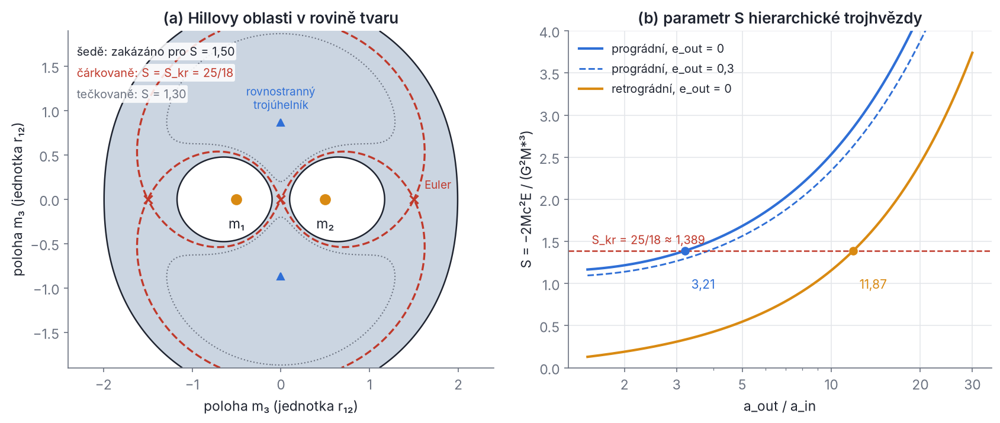
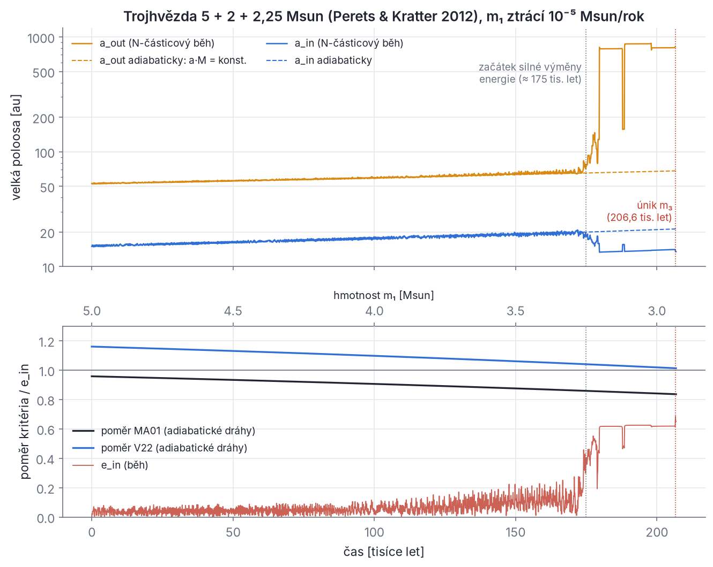
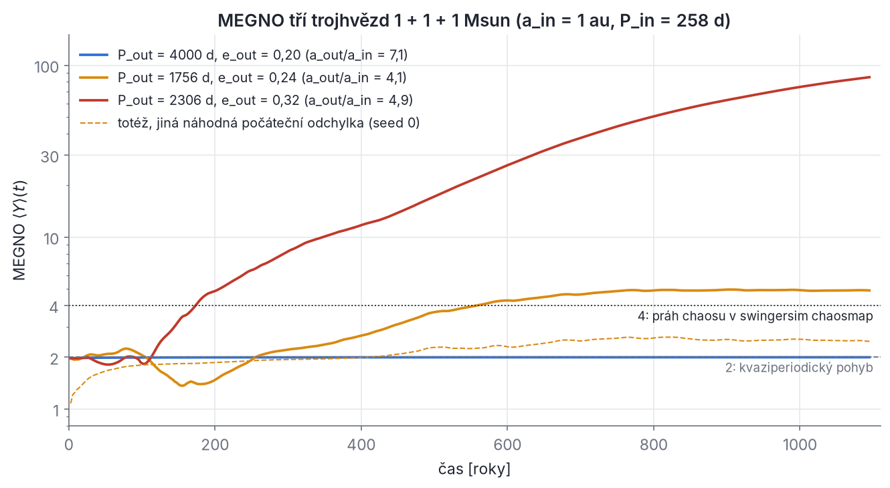
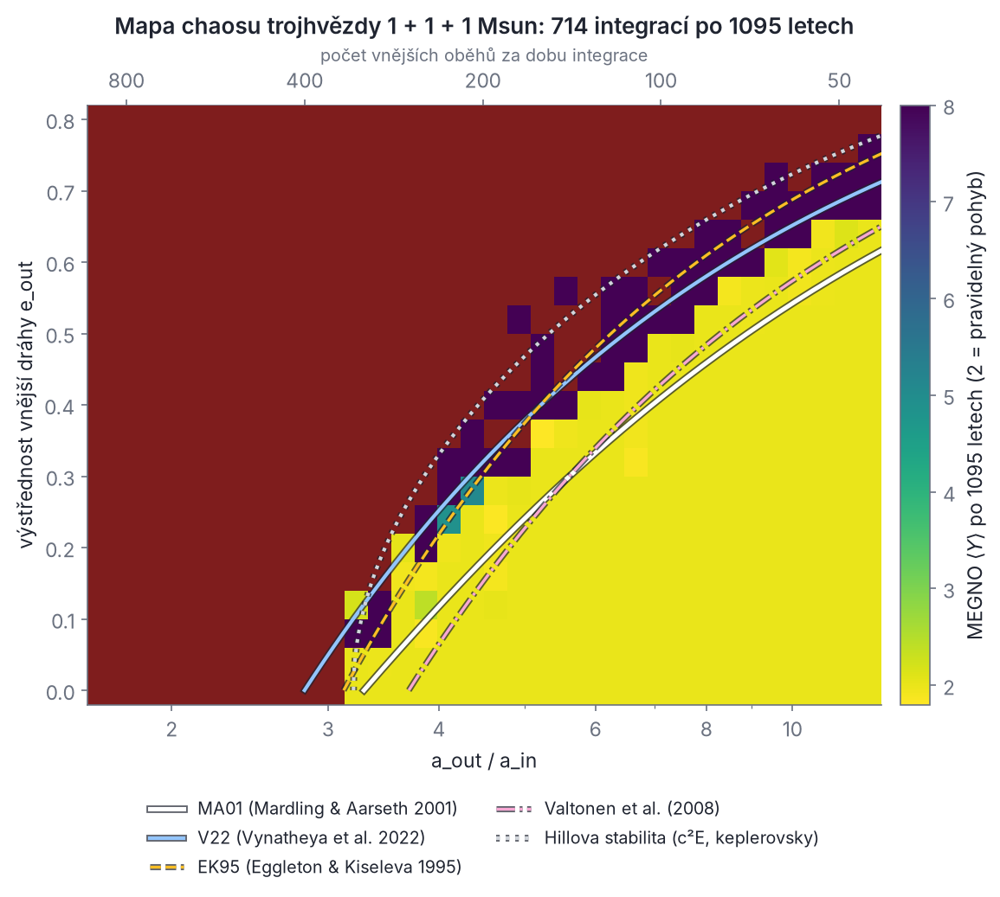

## Kapitola 4 – Stabilita

V kapitole 3 jsme hierarchickou soustavu rozložili na několik keplerovských drah, které se navzájem slabě ruší. To funguje jen tehdy, když jsou dráhy dost daleko od sebe. Přiblíží-li se vnější hvězda v pericentru k vnitřní dvojici na vzdálenost srovnatelnou s její velikostí, porucha přestane být malá. Hvězdy si pak začnou nepravidelně vyměňovat energii a dříve nebo později se soustava rozpadne. Tato kapitola odpovídá na tři otázky. Co přesně znamená, že je soustava „stabilní“? Proč leží hranice stability tam, kde leží? A jak se dá rychle a spolehlivě zjistit, na které straně hranice konkrétní soustava je?

Odpověď potřebuješ u každé soustavy, kterou budeš modelovat. Nestabilní konfiguraci nemá smysl fitovat k pozorováním, protože by v přírodě nevydržela. SWINGERsim proto stabilitu hlídá na několika úrovních:

- **algebraická kritéria** vypisuje v souhrnu každého běhu (Mardling–Aarseth 2001, Vynatheya et al. 2022);
- pro čtyřhvězdy nabízí **klasifikátory strojového učení** (Vynatheya et al. 2023);
- obsahuje přímý N-částicový **test duchem** (příkaz `swingersim stability`);
- umí počítat **mapy chaosu** s indikátorem MEGNO (příkaz `swingersim chaosmap`).

Na reálných soustavách uvidíš, k čemu to je:

- V907 Sco je stabilní s rezervou asi 70 %.
- CzeV343 je dnes stabilní s velkou rezervou, ale ve vývojových modelech se může stát nestabilní za 1–2 miliardy let, až se jedna z jejích dvojhvězd rozepne.
- Podobný osud čeká trojhvězdy, jejichž složka ztrácí hmotu.

### 4.1 Osudy vícenásobných soustav

**Intuice.** Představ si vnitřní dvojhvězdu jako rychle se točící činku a třetí hvězdu jako pomalé těleso, které kolem ní obíhá po široké dráze. Když je vnější dráha daleko, třetí hvězda „vidí“ činku jen jako mírně protáhlé těleso. Její působení se během jednoho vnitřního oběhu skoro zprůměruje a zbudou jen pomalé sekulární změny (kapitola 5): precese uzlů a pericenter, případně cykly ZLK. Velké poloosy se přitom v průměru nemění, takže energie obou drah zůstává (až na malé kmity) stejná. Když se ale vnější hvězda v pericentru přiblíží natolik, že průlet trvá jen několik vnitřních oběhů nebo méně, každý průlet předá vnitřní dvojici **kopanec**, tedy konečnou změnu energie a momentu hybnosti. Velikost i znaménko kopance závisí na tom, v jaké fázi oběhu se činka při průletu právě nachází. Pokud jsou fáze při po sobě jdoucích průletech na sobě nezávislé, energie se mění jako náhodná procházka. Dříve nebo později pak nabere jedna hvězda tolik energie, že soustavu opustí.

Užitečné hrubé dělení dynamických režimů trojhvězd se srovnatelnými hmotnostmi uvádí přehled Peretse (2025, odd. 4). Hranice jsou jen orientační:

| režim | podmínka (srovnatelné hmotnosti) | chování |
| --- | --- | --- |
| silně hierarchický, malý sklon | a\_out/a\_in ≳ 7,5 a i\_mut ≲ 40° nebo ≳ 140° | jen pomalá precese drah |
| sekulární | a\_out/a\_in ≳ 7,5 a 40° ≲ i\_mut ≲ 140° | cykly ZLK, excentrický ZLK (kapitola 5) |
| kvazisekulární | 3 ≲ a\_out/a\_in ≲ 7,5 | výstřednost se mění už během jednoho vnějšího oběhu, středování selhává |
| chaotický (nehierarchický) | a\_out/a\_in ≲ 3 | „demokratická“ výměna energie, rozpad během desítek až stovek charakteristických časů |

Nestabilní soustava může skončit několika **osudy**. SWINGERsim je rozpoznává tak, že v každém výstupu znovu sestaví strom soustavy. Začne s jednotlivými hvězdami, opakovaně spojí tu dvojici objektů, jejíž vzájemná dráha je vázaná a má nejmenší velkou poloosu, a nahradí ji jejím těžištěm, dokud žádná vázaná dvojice nezbude. Výsledný strom porovná s původním (kapitola 3). Změnu, která trvá alespoň `run.hierarchy_persistence` výstupů (výchozí 3), pojmenuje:

| osud | anglicky (název v SWINGERsim) | co se stane |
| --- | --- | --- |
| nedotčená soustava | intact | hierarchie trvá |
| vyvržení | ejection | jedna hvězda se odpoutá; z trojhvězdy zůstane dvojhvězda, ze čtyřhvězdy trojhvězda |
| rozpad | breakup | soustava se rozdělí jinak než na „zbytek + jedna hvězda“, např. čtyřhvězda 2+2 na dvě volné dvojhvězdy |
| výměna | exchange | stejný tvar stromu, ale jiní partneři: vnější hvězda nahradí jednu složku dvojice („swing“, odtud jméno programu) |
| přeskupení | reconfiguration | stejný počet podsoustav, ale jiný tvar stromu (např. 2+2 → 3+1) |
| zachycení | capture | dříve volná tělesa se navzájem vážou |
| srážka | collision | hvězdy se dotknou, často po vybuzení vysoké výstřednosti (zastaví běh, nebo s `physics.mergers` pokračuje se splynulou hvězdou) |

Numerické experimenty s rozpadajícími se trojhvězdami ukazují dvě pravidelnosti (Perets 2025, odd. 4.5):

1. **Nejčastěji uniká nejlehčí hvězda.** Zbylá dvojhvězda je pak hmotnější, a protože odnášená hvězda si vzala kladnou energii, i těsněji vázaná.
2. **Heggieho zákon:** „tvrdé“ dvojhvězdy (vazebná energie větší než m₃v²\_rel, kde v\_rel je relativní rychlost přilétající hvězdy) se při setkáních dál zpevňují, „měkké“ se rozvolňují.

V obr. 4.2 (oddíl 4.7) uvidíš Heggieho zákon přímo v simulaci. Uvidíš tam ale i to, že první pravidlo platí jen statisticky: uniká tam hvězda, která nejlehčí není.

> **Pozor.** Srážka není jen „technický“ konec výpočtu. Hills (1984) upozornil, že při rozpadu bývají důležitější změny momentu hybnosti než změny energie. Malý moment hybnosti vnitřní dráhy znamená vysokou výstřednost, a tedy blízké pericentrum. Proto se rozpadající se soustavy hvězd s konečnými poloměry často „vyřeší“ srážkou dřív, než stihne kterákoli hvězda uniknout.

### 4.2 Co znamená „stabilní“

Slovo „stabilní“ se v nebeské mechanice používá v několika různých významech. Proto se snadno stane, že dvě kritéria „nesouhlasí“ jen proto, že odpovídají na jinou otázku.

- **Lagrangeovská stabilita:** všechny vzájemné vzdálenosti zůstanou navždy omezené zdola i shora. Žádná hvězda neunikne a žádné dvě se nesrazí. Pro obecný problém tří těles neexistuje žádné kritérium, které by ji dokazovalo. Je to vlastnost nekonečně dlouhého chování a ta se konečnou integrací ověřit nedá.
- **Hillova stabilita:** pořadí vzdáleností se nikdy nezmění. Vnitřní dvojice zůstane vnitřní dvojicí, takže nemůže dojít k výměně a třetí hvězda se k dvojici nikdy nepřiblíží víc než na jistý násobek její velikosti. Hillova stabilita ale **nezakazuje únik** třetí hvězdy do nekonečna. Pro ni existuje přísné analytické kritérium, které odvodíme v této kapitole.
- **Praktická (numerická) stabilita:** soustava se během zvolené doby nerozpadne a její velké poloosy se příliš nezmění, například během 100 vnějších oběhů. Takto jsou definovány všechny moderní empirické meze a klasifikátory. Číslo „100 oběhů“ je volba, ne přírodní zákon.
- **Pravidelnost (absence chaosu):** blízké trajektorie se nerozbíhají exponenciálně. Chaotická soustava ale může zůstat vázaná velmi dlouho („stabilní chaos“, oddíl 4.8). Pravidelná (kvaziperiodická) trajektorie naopak zůstává v omezené oblasti fázového prostoru, a proto neuniká.

#### 4.2.1 Hillova stabilita v omezeném problému: Jacobiho integrál

Nejjednodušší je případ, kdy je třetí těleso nehmotné a dvě hmotná tělesa obíhají po kružnici se střední úhlovou rychlostí n (kruhový omezený problém tří těles). V soustavě souřadnic s počátkem v těžišti, která rotuje s úhlovou rychlostí n kolem osy z, jsou obě hmotná tělesa v klidu. Pohyb částice v ní popisuje efektivní potenciál

```latex
\Phi_{\mathrm{eff}}(x,y,z) = -\frac{G m_1}{r_1} - \frac{G m_2}{r_2} - \frac12 n^2 (x^2+y^2)
```

kde r₁ a r₂ jsou vzdálenosti částice od obou těles a poslední člen je odstředivý potenciál. Pohybové rovnice v rotující soustavě obsahují navíc Coriolisovo zrychlení:

```latex
\ddot x - 2n\dot y = -\frac{\partial \Phi_{\mathrm{eff}}}{\partial x}, \qquad
\ddot y + 2n\dot x = -\frac{\partial \Phi_{\mathrm{eff}}}{\partial y}, \qquad
\ddot z = -\frac{\partial \Phi_{\mathrm{eff}}}{\partial z}
```

Vynásob první rovnici ẋ, druhou ẏ, třetí ż a sečti je. Coriolisovy členy se vyruší (−2nẏẋ + 2nẋẏ = 0), protože Coriolisova síla je kolmá na rychlost a nekoná práci. Na levé straně zbude derivace kinetické energie, na pravé záporně vzatá derivace Φ\_eff podél trajektorie:

```latex
\frac{\mathrm d}{\mathrm dt}\left[\tfrac12\left(\dot x^2+\dot y^2+\dot z^2\right) + \Phi_{\mathrm{eff}}\right] = 0
\quad\Longrightarrow\quad v^2 = -2\Phi_{\mathrm{eff}} - C_J
```

Konstanta C\_J je **Jacobiho integrál**. Protože v² ≥ 0, částice se může pohybovat jen tam, kde −2Φ\_eff ≥ C\_J. Hranice dovolené oblasti, kde v = 0, se jmenují **plochy nulové rychlosti**. Jsou to přesně ekvipotenciály Rocheova potenciálu z kapitoly 9: Rocheův lalok je plocha nulové rychlosti, která prochází Lagrangeovým bodem L₁. Má-li částice obíhající kolem m₁ hodnotu C\_J větší než C\_J(L₁), je její dovolená oblast kolem m₁ uzavřená a od m₂ oddělená. K m₂ se nikdy nedostane, ať se pohybuje sebesložitěji. To je první přísné tvrzení o stabilitě, které odvodíme, a nepotřebuje k němu žádnou numerickou integraci.

#### 4.2.2 Obecný problém tří těles: kritérium c²E

Pro tři hmotné hvězdy rotující soustava, ve které by všechno stálo, neexistuje. Zachovávají se ale celková energie E a velikost celkového momentu hybnosti c (v těžišťové soustavě). Z nich lze sestavit zobecnění Jacobiho integrálu. Myšlenka pochází od Golubeva (1968), kritérium podrobně rozpracovali Marchal & Saari (1975), Szebehely & Zare (1977) a Marchal & Bozis (1982). Odvození zvládneš se třemi nástroji.

**Krok 1 – Sundmanova nerovnost.** Označme moment setrvačnosti vůči těžišti I = Σ mᵢ rᵢ² a kinetickou energii T = ½ Σ mᵢ vᵢ². Pro moment hybnosti platí

```latex
c = \left|\sum_i m_i\,\mathbf r_i\times\mathbf v_i\right| \le \sum_i m_i\, r_i v_i
= \sum_i \left(\sqrt{m_i}\,r_i\right)\left(\sqrt{m_i}\,v_i\right)
\le \sqrt{\sum_i m_i r_i^2}\,\sqrt{\sum_i m_i v_i^2} = \sqrt{I\cdot 2T}
```

První nerovnost je trojúhelníková nerovnost a |**r** × **v**| ≤ rv. Druhá je Cauchyho–Schwarzova nerovnost pro vektory se složkami √mᵢ rᵢ a √mᵢ vᵢ. Odtud c² ≤ 2IT, neboli

```latex
T \ge \frac{c^2}{2I}
```

Při daném momentu hybnosti tedy soustava nemůže mít libovolně malou kinetickou energii. Část energie je „uvězněná“ v rotaci.

**Krok 2 – zápis pomocí vzájemných vzdáleností.** Pro body v těžišťové soustavě platí Lagrangeova identita

```latex
I = \sum_i m_i r_i^2 = \frac{1}{M}\sum_{i<j} m_i m_j\, r_{ij}^2, \qquad M = m_1+m_2+m_3
```

Důkaz: Σ\_{i<j} mᵢmⱼ|**r**ᵢ − **r**ⱼ|² = ½ Σᵢ Σⱼ mᵢmⱼ(rᵢ² + rⱼ² − 2**r**ᵢ·**r**ⱼ) = M Σᵢ mᵢrᵢ² − |Σᵢ mᵢ**r**ᵢ|². Poslední člen je v těžišťové soustavě nula. Zavedeme dvě „střední vzdálenosti“ s vahami mᵢmⱼ: kvadratickou ρ a harmonickou ν (zde ν není pravá anomálie),

```latex
M_*\,\rho^2 = \sum_{i<j} m_i m_j\, r_{ij}^2, \qquad
\frac{M_*}{\nu} = \sum_{i<j} \frac{m_i m_j}{r_{ij}}, \qquad
M_* = m_1m_2 + m_1m_3 + m_2m_3
```

Pak I = M\*ρ²/M a potenciální energie je U = −G M\*/ν. Poměr ρ/ν závisí jen na **tvaru** trojúhelníku, ne na jeho velikosti. Protože kvadratický průměr není nikdy menší než harmonický, platí ρ/ν ≥ 1. Rovnost nastává jen pro rovnostranný trojúhelník (všechna r\_ij stejná).

**Krok 3 – zakázané tvary.** Z E = T + U a kroku 1 plyne E ≥ c²/(2I) + U. Dosadíme I a U a označíme u = 1/ρ a s = ρ/ν (pak 1/ν = su):

```latex
E \ge \frac{c^2 M}{2M_*}\,u^2 - G M_*\, s\, u
\qquad\Longleftrightarrow\qquad
\frac{c^2 M}{2M_*}\,u^2 - G M_*\, s\, u + |E| \le 0
```

Pro vázanou soustavu je E < 0, a proto jsme psali −E = |E|. Kvadratická funkce proměnné u s kladným koeficientem u u² může být nekladná pro nějaké u > 0 jen tehdy, když má reálné kořeny. Diskriminant proto musí být nezáporný: G²M\*²s² − 4·(c²M/2M\*)·|E| ≥ 0. Odtud

```latex
\left(\frac{\rho}{\nu}\right)^2 \;\ge\; S \equiv -\frac{2 M c^2 E}{G^2 M_*^3}
```

Bezrozměrný parametr S závisí jen na zachovávaných veličinách, takže je po celou dobu pohybu stejný. Nerovnost říká, že **tvary trojúhelníku, pro které je (ρ/ν)² < S, jsou zakázané**. Soustava se do nich nikdy nedostane. Čím větší je c²|E|, tím větší část „prostoru tvarů“ je zakázaná.

**Krok 4 – kdy se dovolená oblast rozpadne.** Funkce (ρ/ν)² má nad prostorem tvarů minimum 1 v rovnostranném trojúhelníku a sedlové body v **Eulerových kolineárních konfiguracích** (všechny tři hvězdy na přímce, tak, jak by mohly rigidně rotovat). Dokud je S menší než hodnota v sedle, dovolené tvary tvoří jednu souvislou oblast a soustava může přecházet mezi konfiguracemi „m₃ daleko od (m₁m₂)“, „m₁ daleko od (m₂m₃)“ atd. Když S překročí kritickou hodnotu S\_kr v příslušném sedle, dovolená oblast se rozpadne na oddělené ostrovy. Hierarchie (m₁m₂)m₃ se pak už nikdy nemůže změnit v (m₁m₃)m₂: to je **Hillova stabilita**.

Pro tři stejné hmotnosti m se sedla dají spočítat zpaměti. Hvězdy leží na přímce ve vzdálenostech r, r a 2r, takže M\*ρ² = m²(r² + r² + 4r²) = 6m²r², M\* = 3m², a tedy ρ² = 2r². Dále M\*/ν = m²(1/r + 1/r + 1/(2r)) = 5m²/(2r), tedy ν = 6r/5. Odtud

```latex
S_{\mathrm{kr}} = \left(\frac{\rho}{\nu}\right)^2_{\mathrm{Euler}} = \frac{2r^2}{(6r/5)^2} = \frac{25}{18} \approx 1{,}389
```

Pro nestejné hmotnosti je potřeba najít polohu prostřední hvězdy v Eulerově konfiguraci jako kladný kořen rovnice pátého stupně. Navíc je třeba vybrat tu ze tří kolineárních konfigurací, která odděluje právě zkoumanou hierarchii. Postup popisují Szebehely & Zare (1977). Každý takový program si ověř na případě stejných hmotností: tam musí kořen, tedy poměr vzdáleností prostřední hvězdy od obou krajních, vyjít x = 1 (prostřední hvězda přesně uprostřed) a S\_kr = 25/18.



*Obr. 4.1 – (a) Rovina tvaru trojúhelníku: m₁ a m₂ jsou pevně v bodech (∓0,5; 0), poloha m₃ udává tvar (délky se měří v jednotkách r₁₂, takže velikost trojúhelníku nehraje roli). Šedá plocha je zakázaná pro S = 1,50 > S\_kr. Dovolené jsou tři oddělené bílé ostrovy: m₃ daleko (vnější bílá oblast za tmavou křivkou) a m₃ blízko m₁ nebo m₂. Při S = S\_kr (červeně čárkovaně) se ostrovy dotýkají v Eulerových bodech (křížky). Při S = 1,30 < S\_kr (tečkovaně) jsou zakázané jen dvě malé oblasti kolem rovnostranných konfigurací (trojúhelníčky) a všechny tvary jsou propojené. (b) Parametr S hierarchické trojhvězdy 1 + 1 + 1 M☉ s a\_in = 1 au, spočítaný z keplerovských energií a momentů hybnosti obou drah (čárkovaně prográdní soustava s e\_out = 0,3). Prográdní kruhová soustava je Hillovsky stabilní pro a\_out/a\_in > 3,21, retrográdní až pro a\_out/a\_in > 11,9.*

**Řešený příklad: Hillova mez pro tři stejné hvězdy.** Vezmi m₁ = m₂ = m₃ = m, vnitřní dráhu s a\_in, vnější s a\_out, obě kruhové a koplanární. Interakční energii mezi dráhami (kvadrupól z kapitoly 3) zanedbáme. Pak

```latex
E \approx -\frac{G m^2}{2a_{\mathrm{in}}} - \frac{G (2m)\, m}{2a_{\mathrm{out}}}, \qquad
c \approx \underbrace{\tfrac{m}{2}\sqrt{2Gm\,a_{\mathrm{in}}}}_{L_{\mathrm{in}}} \pm \underbrace{\tfrac{2m}{3}\sqrt{3Gm\,a_{\mathrm{out}}}}_{L_{\mathrm{out}}}
```

Redukované hmotnosti jsou μ\_in = m/2 a μ\_out = 2m·m/(3m) = 2m/3. Znaménko + platí pro prográdní (souběžné) dráhy, znaménko − pro retrográdní. Při M = 3m a M\* = 3m² dostaneme S = −6c²E/(27G²m⁵). V jednotkách G = m = a\_in = 1 a s X = a\_out/a\_in:

- X = 3: L\_in = 0,707, L\_out = (2/3)·3 = 2,000, c = 2,707, E = −0,5 − 1/3 = −0,833, takže S = 6·7,33·0,833/27 = 1,36 < 1,389;
- X = 3,5: L\_out = 2,160, c = 2,867, E = −0,786, S = 6·8,22·0,786/27 = 1,44 > 1,389.

Mez leží mezi nimi; numerickým řešením rovnice S(X) = 25/18 dostaneš X = 3,21. Přesný výpočet včetně interakční energie dává podle okamžité fáze vnitřní dvojice 3,0 až 3,3. Pro retrográdní dráhy (c = L\_out − L\_in) vyjde až X = 11,9.

Tady je vidět síla i slabost Hillova kritéria. Je přísné a nevyžaduje žádnou integraci. Je ale jen **postačující**: soustava, která ho nesplní, může být klidně stabilní. Retrográdní trojhvězdy jsou ve skutečnosti stabilnější než prográdní (oddíl 4.3), kritérium c²E je ale „trestá“, protože opačně orientované dráhy mají menší celkový moment hybnosti. Navíc Hillova stabilita nezakazuje únik třetí hvězdy. Na mapě chaosu v obr. 4.4 uvidíš, že při e\_out ≳ 0,1 hvězdy unikají i z oblasti, kterou kritérium c²E označí za Hillovsky stabilní.

> **Z historie.** Harrington (1972) numericky zjistil, že tři stejné hvězdy jsou stabilní, když vnější pericentrum leží dál než asi 3,5 a\_in pro prográdní dráhy a 2,75 a\_in pro retrográdní. Analytická kritéria typu c²E ze sedmdesátých let (Marchal & Saari 1975; Bozis 1976; Szebehely & Zare 1977) předpovídala opak, tedy větší stabilitu prográdních drah (Perets 2025, odd. 4.5.2). Je to pěkný příklad toho, jak numerický experiment opravil analytickou intuici: postačující podmínka neříká nic o tom, kde leží skutečná hranice.

### 4.3 Odkud se bere nestabilita: rezonance a jejich překryv

Kritérium c²E nevysvětluje, proč se soustava za hranicí rozpadá. Fyzikální mechanismus popisuje teorie **překryvu rezonancí** (Chirikov 1979), kterou na hierarchické trojhvězdy aplikovala Mardlingová (Mardling 2008, 2013). Na ní stojí i kritérium Mardlingové a Aarsetha (2001).

#### 4.3.1 Vnitřní dvojice jako kopaný oscilátor

Vnější hvězda působí na vnitřní dvojici slapovou silou (kvadrupólový člen z kapitoly 3). Ta se mění s polohou činky a opakuje se s dvojnásobnou frekvencí vnitřního oběhu, protože činka otočená o 180° vypadá stejně. Dvojice se tedy chová jako **oscilátor** s vlastní frekvencí řádu n\_in = 2π/P\_in. Pro vnější hvězdu na výstředné dráze je síla silná jen krátce kolem pericentra. Úhlová rychlost vnější hvězdy v pericentru vychází z momentu hybnosti h = √(GMa\_out(1 − e\_out²)) = R\_p²Ω\_p, kde R\_p = a\_out(1 − e\_out):

```latex
\Omega_p = \frac{\sqrt{G M a_{\mathrm{out}}(1-e_{\mathrm{out}}^2)}}{R_p^2} = \sqrt{\frac{G M (1+e_{\mathrm{out}})}{R_p^3}}
```

Průlet pericentrem trvá zhruba t\_p ≈ 1/Ω\_p. Jak velký kopanec průlet předá, závisí na poměru n\_in/Ω\_p, tedy na tom, kolik vnitřních oběhů se vejde do jednoho průletu:

- **n\_in/Ω\_p ≲ 1 (impulzní průlet):** dvojice se během průletu skoro nepohne a dostane silný kopanec;
- **n\_in/Ω\_p ≫ 1 (adiabatický průlet):** dvojice se během průletu mnohokrát otočí, síla se zprůměruje a předaná energie je **exponenciálně** malá, úměrná přibližně exp(−κ n\_in/Ω\_p) s konstantou κ řádu jedna. Je to stejný důvod, proč má hladký puls ve Fourierově spektru exponenciálně málo vysokých frekvencí.

Poměr n\_in/Ω\_p vyjádříme pomocí veličin, které vystupují v kritériích. Dosadíme n\_in = √(G m\_in/a\_in³) a M = m\_in(1 + q\_out), kde q\_out = m\_out/m\_in je poměr hmotnosti vnějšího tělesa a vnitřní dvojice:

```latex
\frac{n_{\mathrm{in}}}{\Omega_p} = \left(\frac{R_p}{a_{\mathrm{in}}}\right)^{3/2}\left[(1+q_{\mathrm{out}})(1+e_{\mathrm{out}})\right]^{-1/2}
```

#### 4.3.2 Kdy se fáze „rozmíchají“: Chirikovovo kritérium

Jeden kopanec soustavu nezničí. Rozhoduje, co se děje při mnoha průletech po sobě. Kopanec ΔE změní energii vnější dráhy, a tím i její periodu. Z třetího Keplerova zákona P ∝ a^(3/2) ∝ |E|^(−3/2) plyne

```latex
\frac{\Delta P_{\mathrm{out}}}{P_{\mathrm{out}}} = \frac32\,\frac{\Delta E}{|E_{\mathrm{out}}|}
```

Fáze vnitřní dvojice při příštím průletu se proto posune o Δφ ≈ n\_in ΔP\_out. Rozlišíme dva případy:

- **Δφ ≪ 1:** fáze při po sobě jdoucích průletech jsou svázané a kopance se střídají tak, že se v průměru vyruší. Energie jen kmitá kolem střední hodnoty a pohyb je pravidelný.
- **Δφ ≳ 1:** fáze se při každém průletu prakticky náhodně rozmíchá, kopance se sčítají jako náhodná procházka, energie bloudí a pohyb je chaotický.

Stejný obraz lze popsat jazykem rezonancí. Pokud je P\_out přesně N-násobkem P\_in (rezonance N:1), opakuje se průlet vždy ve stejné fázi. Kolem každé rezonance existuje pásmo hodnot P\_out (šířka rezonance), ve kterém je pohyb „zachycen“ a fáze pomalu kmitá. Sousední rezonance N:1 a (N+1):1 leží od sebe ve vzdálenosti ΔP\_out = P\_in. Dokud jsou pásma úzká, leží mezi nimi pravidelné trajektorie, které soustavu „drží“. Jakmile šířka pásem dosáhne zhruba jejich rozestupu, pásma se **překryjí**, trajektorie může přeskakovat z jedné rezonance do druhé a pohyb se stane globálně chaotickým. To je **Chirikovovo kritérium překryvu rezonancí** (Chirikov 1979). Pro modelový „kopaný rotor“ dává mez parametru síly kopanců K ≈ 1. Parametr K je přitom právě posun fáze způsobený jedním kopancem, takže mez odpovídá podmínce Δφ ≈ 1 výše. Totéž pozorovala Mardlingová u slapově kmitajících hvězd ve výstředných dvojhvězdách (Mardling 1995a, b). Tam se přenos energie do slapových kmitů stane chaotickým, jakmile jeden průlet pericentrem změní oběžnou dobu natolik, že fáze kmitu při příštím průletu je náhodná (Vick & Lai 2018 to shrnují jako podmínku ω ΔP ≳ 1, kde ω je frekvence kmitu).

#### 4.3.3 Kvalitativní odvození tvaru kritéria

Spojme oba kroky. Hranice chaosu leží tam, kde

```latex
n_{\mathrm{in}}\,P_{\mathrm{out}}\;\frac32\,\frac{\Delta E}{|E_{\mathrm{out}}|} \approx 1, \qquad \Delta E \propto \exp\!\left(-\kappa\,\frac{n_{\mathrm{in}}}{\Omega_p}\right)
```

Zlogaritmujeme: κ n\_in/Ω\_p ≈ ln(n\_in P\_out · A), kde A obsahuje pomalu proměnné předfaktory. Pravá strana závisí na parametrech jen **logaritmicky**. V prvním přiblížení je proto hranice dána podmínkou n\_in/Ω\_p ≈ konst. S rovnicí z odd. 4.3.1 to dává

```latex
\frac{R_p}{a_{\mathrm{in}}} \approx C\left[(1+q_{\mathrm{out}})(1+e_{\mathrm{out}})\right]^{1/3}
```

Logaritmický člen je zodpovědný za zbytek. Při pevném pericentru R\_p roste perioda P\_out s výstředností jako (1 − e\_out)^(−3/2), protože P\_out ∝ a\_out^(3/2) = [R\_p/(1 − e\_out)]^(3/2). Mezi průlety tak uplyne víc vnitřních oběhů, každý kopanec víc posune fázi a k rozmíchání stačí menší kopanec. Vysoce výstředné soustavy proto potřebují o něco větší R\_p, než by plynulo z čisté podmínky n\_in/Ω\_p = konst. Mardlingová a Aarseth tuto slabou závislost spolu s výsledky integrací vyjádřili jedinou mocninou. Exponent 1/3 se změnil na 2/5 a přibyl faktor (1 − e\_out)^(−1/5).

> **Pozor.** Tento odstavec je **zdůvodnění tvaru**, ne odvození konstant. Mardling & Aarseth (2001) vyšli z obdoby s mezí chaosu ve slapově interagujících dvojhvězdách (Mardling 1995a). Z této obdoby pochází tvar kritéria s exponentem 2/5, konstanta C ≈ 2,8 byla určena empiricky z integrací (Mardling & Aarseth 1999; Aarseth & Mardling 2001). Kritérium bylo odvozeno pro **koplanární prográdní** dráhy a zanedbává slabou závislost na e\_in a na poměru hmotností vnitřní dvojice.

#### 4.3.4 Kritérium Mardlingové a Aarsetha (MA01)

Kritérium publikovali Mardling & Aarseth (2001, MNRAS 321, 398). Ve tvaru, který používá SWINGERsim (funkce `ma01_ratio` v `stability.py`, zapsaná podle Vynatheyi et al. 2022, rov. 2), zní takto:

```latex
\frac{R_p}{a_{\mathrm{in}}} = \frac{a_{\mathrm{out}}(1-e_{\mathrm{out}})}{a_{\mathrm{in}}} \;>\; \frac{R_{p,\mathrm{kr}}}{a_{\mathrm{in}}} = 2{,}8\left[(1+q_{\mathrm{out}})\,\frac{1+e_{\mathrm{out}}}{(1-e_{\mathrm{out}})^{1/2}}\right]^{2/5}\left(1-\frac{0{,}3\, i_{\mathrm{mut}}}{\pi}\right), \qquad q_{\mathrm{out}} = \frac{m_{\mathrm{out}}}{m_{\mathrm{in}}}
```

Vzájemný sklon i\_mut je tu v radiánech. Ve stupních se poslední závorka píše (1 − 0,3 i\_mut/180°), což je totéž. Levá strana je vnější pericentrum v jednotkách vnitřní velké poloosy. Jak číst pravou stranu:

- **(1 + q\_out)^(2/5):** hmotnější vnější hvězda ruší víc, takže musí být dál. Závislost je ale slabá: zdvojnásobení 1 + q\_out posune mez jen o faktor 2^0,4 = 1,32.
- **Výstřednost:** výstředná vnější dráha se v pericentru přiblíží víc a průlet je rychlejší. Jak jsme viděli v 4.3.3, delší oběh navíc usnadňuje rozmíchání fází. Proto musí být výstředná dráha několikrát širší než kruhová. Pro e\_out = 0,5 je mez na a\_out/a\_in (ne na R\_p) větší než pro kruhovou dráhu o faktor 1,5^0,4/0,5^1,2 = 2,70.
- **Sklon:** faktor (1 − 0,3 i\_mut/π) je **heuristická oprava**. Mardling & Aarseth ji přidali na základě dalších numerických testů (Aarseth & Mardling 2001, s poznámkou, že kvalitativně souhlasí s Harringtonovým výsledkem pro retrográdní dráhy). Pro i\_mut = 180° snižuje mez o 30 %. Retrográdní soustavy jsou stabilnější, protože vůči rotující dvojici se vnější hvězda pohybuje rychleji: relativní úhlová rychlost je zhruba n\_in + Ω\_p místo n\_in − Ω\_p. Průlet tak působí na dvojici s vyšší frekvencí a je „adiabatičtější“. Pro střední sklony je oprava nepřesná: cykly ZLK tam vnitřní výstřednost zvětšují a stabilitu zhoršují (oddíl 4.4).

Pro tři stejné hmotnosti (q\_out = 0,5), kruhovou vnější dráhu a i\_mut = 0 vychází mez a\_out/a\_in > 2,8·1,5^0,4 = 3,29.

**Tvar s periodami.** Pozorovatel zná spíš periody než velké poloosy. Podle třetího Keplerova zákona je P ∝ a^(3/2)M^(−1/2), takže

```latex
\frac{P_{\mathrm{out}}}{P_{\mathrm{in}}} = \left(\frac{a_{\mathrm{out}}}{a_{\mathrm{in}}}\right)^{3/2}\left(\frac{m_{\mathrm{in}}}{M}\right)^{1/2} = \left(\frac{a_{\mathrm{out}}}{a_{\mathrm{in}}}\right)^{3/2}(1+q_{\mathrm{out}})^{-1/2}
```

Kritérium MA01 přepíšeme na a\_out/a\_in > 2,8(1 + q\_out)^(2/5)(1 + e\_out)^(2/5)(1 − e\_out)^(−6/5) f\_i. Exponent −6/5 vznikne spojením (1 − e\_out)^(−1) z levé strany a (1 − e\_out)^(−1/5) z pravé, f\_i je sklonový faktor. Umocníme na 3/2 a vynásobíme (1 + q\_out)^(−1/2):

```latex
\left(\frac{P_{\mathrm{out}}}{P_{\mathrm{in}}}\right)_{\mathrm{kr}} = 4{,}69\,(1+q_{\mathrm{out}})^{1/10}\,\frac{(1+e_{\mathrm{out}})^{3/5}}{(1-e_{\mathrm{out}})^{9/5}}\left(1-\frac{0{,}3\, i_{\mathrm{mut}}}{\pi}\right)^{3/2}
```

Tady 4,69 = 2,8^(3/2) a exponent hmotnostního členu je 3/5 − 1/2 = 1/10. V periodách tedy mez na hmotnostech **skoro nezávisí**, zato na výstřednosti vnější dráhy závisí velmi silně. Pro tři stejné hvězdy na kruhových koplanárních drahách je (P\_out/P\_in)\_kr = 4,69·1,5^0,1 = 4,88. Pro e\_out = 0,3 je to 10,9, pro e\_out = 0,5 už 21,7.

**Jak to dělá SWINGERsim.** Souhrn každého běhu (soubor `*_summary.txt`) vypisuje pro každou dvojici drah řádek `stability ratio Mardling-Aarseth = …`. Je to poměr levé a pravé strany kritéria, spočítaný z oskulačních elementů v čase t = 0. Hodnota větší než 1 znamená „stabilní“, menší než 1 `UNSTABLE`. Do řádku za q\_out dosazuje poměr hmotnosti druhé větve uzlu a hmotnosti větve, jejíž dráhu vyšetřuje. Příkaz `swingersim stability config.yaml` vypíše tentýž poměr pro všechny vnořené trojice (oddíl 4.5) spolu s a\_in/a\_out, e\_in, e\_out, i\_mut a q\_out.

**Řešený příklad: V907 Sco.** Z elementů v kapitole 3 je a\_in ≈ 0,083 au, a\_out ≈ 0,99 au, e\_out = 0,47, q\_out = 1,06/5,30 = 0,20 a i\_mut = 26° = 0,454 rad. Levá strana je 0,99·0,53/0,083 = 6,32. Pravá strana:

- hmotnost a výstřednost: (1,20·1,47/√0,53)^0,4 = (1,764/0,728)^0,4 = 2,423^0,4 = 1,425;
- sklon: 1 − 0,3·26/180 = 0,957;
- celkem: 2,8·1,425·0,957 = 3,82.

Poměr je 6,32/3,82 = 1,66. S přesnými elementy z konfigurace (a\_in/a\_out = 0,0838, e\_out = 0,467, i\_mut = 26,2°) vypíše `swingersim stability` hodnotu 1,67. V907 Sco je tedy stabilní s rezervou asi 70 %. V periodách: (P\_out/P\_in)\_kr = 17,4, kdežto pozorovaný poměr je 142,01/3,775 = 37,6.

### 4.4 Další algebraická kritéria a kritérium Vynatheyi et al. (2022)

MA01 není jediná algebraická mez. Všechna kritéria mají společnou strukturu: porovnávají vnější pericentrum s velikostí vnitřní dráhy a liší se tím, jak započítávají hmotnosti, výstřednosti a sklon. V dalších vzorcích je q\_out = m₃/(m₁ + m₂) a q\_in = m₂/m₁ ≤ 1.

**Eggleton & Kiseleva (1995), EK95.** Empirický fit k integracím, ve kterých se za stabilní považovala soustava, jež si udrží hierarchii po 100 vnějších oběhů. Porovnává vnější pericentrum s vnitřním **apocentrem** (zápis podle Vynatheyi et al. 2022, rov. 1):

```latex
Y = \frac{a_{\mathrm{out}}(1-e_{\mathrm{out}})}{a_{\mathrm{in}}(1+e_{\mathrm{in}})} > Y_{\mathrm{kr}} = 1 + \frac{3{,}7}{q_{\mathrm{out}}^{-1/3}} - \frac{2{,}2}{1+q_{\mathrm{out}}^{-1/3}} + \frac{1{,}4}{q_{\mathrm{in}}^{-1/3}}\,\frac{q_{\mathrm{out}}^{-1/3}-1}{q_{\mathrm{out}}^{-1/3}+1}
```

Pro tři stejné hvězdy je q\_out^(−1/3) = 2^(1/3) = 1,260 a Y\_kr = 1 + 2,937 − 0,973 + 1,4·0,260/2,260 = 3,12. EK95 nemá žádnou závislost na sklonu a na e\_out závisí jen přes levou stranu.

**Valtonen et al. (2008).** Kritérium ve tvaru, který použili Perets & Kratter (2012, rov. 1), má jednoduchou závislost na sklonu i (vzájemný sklon):

```latex
Q = \frac{a_{\mathrm{out}}(1-e_{\mathrm{out}})}{a_{\mathrm{in}}} > Q_{\mathrm{st}} = 3\,(1+q_{\mathrm{out}})^{1/3}(1-e_{\mathrm{out}})^{-1/6}\left(\frac74 + \frac12\cos i - \cos^2 i\right)^{1/3}
```

Všimni si exponentu 1/3 u hmotnostního členu, přesně jako v našem odhadu z odd. 4.3.3. Sklonový člen je pro i = 0 roven 1,25^(1/3) = 1,077. Pro i = 90° vychází 1,75^(1/3) = 1,205, takže kolmé dráhy jsou podle tohoto kritéria *méně* stabilní než koplanární prográdní. Pro i = 180° je to 0,25^(1/3) = 0,630. Pro tři stejné hvězdy, e\_out = 0 a i = 0 dostaneme Q\_st = 3·1,145·1,077 = 3,70.

**Vynatheya et al. (2022), V22.** MA01 i EK95 přehlížejí cykly ZLK (kapitola 5). Při vzájemném sklonu mezi asi 40° a 140° vnitřní výstřednost periodicky roste, apocentrum vnitřní dráhy se přibližuje k vnější hvězdě a soustava je méně stabilní, než by odpovídalo počáteční e\_in. Numerické integrace proto ukazují „propad“ stability u středních sklonů (Grishin et al. 2017), který lineární faktor MA01 nepostihne. Vynatheya et al. (2022, MNRAS 516, 4146) vytvořili soubor 10⁶ trojhvězd, integrovali je kódem MSTAR (bez postnewtonovských členů, takže na skutečných hmotnostech a vzdálenostech nezáleží, jen na jejich poměrech) a za stabilní považovali soustavu, která zůstane vázaná 100 vnějších oběhů a jejíž velké poloosy se nezmění o více než 10 %. Na tomto souboru zkalibrovali nové kritérium. Nejprve definovali efektivní vnitřní výstřednost:

```latex
e_{\mathrm{in,max}} = \sqrt{1-\tfrac53\cos^2 i_{\mathrm{mut}}}, \qquad
e_{\mathrm{in,avg}} = \tfrac12\, e_{\mathrm{in,max}}^2, \qquad
\tilde e_{\mathrm{in}} = \max\left(e_{\mathrm{in}},\, e_{\mathrm{in,avg}}\right)
```

Pro |cos i\_mut| > √(3/5), tedy mimo okno ZLK 39,2°–140,8°, je výraz pod odmocninou záporný a e\_in,max se bere jako 0. První rovnice je kvadrupólový odhad maximální výstřednosti v cyklech ZLK pro testovací částici a počáteční kruhovou dráhu (kapitola 5). Odkud se bere druhá? Časově středovaná vzdálenost složek na keplerovské dráze s výstředností e je

```latex
\langle r\rangle = \frac{1}{P}\int_0^P r\,\mathrm dt = \frac{1}{2\pi}\int_0^{2\pi} a(1-e\cos E)\,(1-e\cos E)\,\mathrm dE = a\left(1+\frac{e^2}{2}\right)
```

Použili jsme r = a(1 − e cos E) a z Keplerovy rovnice M = E − e sin E plyne dt = (P/2π)(1 − e cos E) dE. Člen s cos E se vyintegruje na nulu a ⟨cos² E⟩ = ½. Vynatheya et al. zvolili ẽ\_in tak, aby „apocentrum“ a(1 + ẽ\_in) bylo rovno této střední vzdálenosti na dráze s výstředností e\_in,max. Je to heuristika: ẽ\_in představuje výstřednost, která je pro stabilitu „typická“ během cyklu ZLK. Kritérium pak zní

```latex
\tilde Y = \frac{a_{\mathrm{out}}(1-e_{\mathrm{out}})}{a_{\mathrm{in}}(1+\tilde e_{\mathrm{in}})} > \tilde Y_{\mathrm{kr}} = 2{,}4\left[\frac{1+q_{\mathrm{out}}}{(1+\tilde e_{\mathrm{in}})(1-e_{\mathrm{out}})^{1/2}}\right]^{2/5}\left[\frac{1-0{,}2\,\tilde e_{\mathrm{in}}+e_{\mathrm{out}}}{8}\left(\cos i_{\mathrm{mut}}-1\right)+1\right]
```

Levá strana porovnává vnější pericentrum s (efektivním) vnitřním apocentrem, což je fyzikálně přirozenější než MA01. První hranatá závorka je podobná MA01, jen nemá faktor (1 + e\_out)^(2/5) a má novou závislost na ẽ\_in. Druhá závorka nahrazuje lineární sklonový faktor. Pro i\_mut = 0 je rovna 1, pro i\_mut = 180° a ẽ\_in = 0 je rovna 1 − (1 + e\_out)/4. Kritérium funguje lépe pro prográdní než pro retrográdní dráhy a na testovacím souboru klasifikuje správně 93 % trojhvězd. Neuronová síť ze stejné práce dosahuje 95 %.

**Jak to dělá SWINGERsim.** Funkce `v22_ratio` v `stability.py` počítá přesně tyto vzorce. Hodnotu e\_max bere jako √max(0, 1 − 5/3 cos² i\_mut) a ẽ\_in = max(e\_in, ½e\_max²) a vrací poměr Ỹ/Ỹ\_kr. V souhrnu běhu je to `Vynatheya+22 = …`, v příkazu `swingersim stability` sloupec `Vynatheya+22`.

**Řešený příklad: e\_max a ẽ\_in.** Pro i\_mut = 60° je cos² i\_mut = 0,25. Pak e\_in,max = √(1 − 5/12) = 0,764 a e\_in,avg = ½·0,583 = 0,292. Kruhová vnitřní dráha se tedy pro účely kritéria chová jako dráha s výstředností 0,29. Pro tři stejné hvězdy a e\_out = 0 dává V22 mez a\_out/a\_in > Ỹ\_kr(1 + ẽ\_in) = 2,40·1,292 = 3,10. Pro i\_mut = 0 je to jen 2,82. Kritérium MA01 dává pro i\_mut = 60° mez 2,96, tedy *nižší* než pro koplanární dráhy, a propad stability u středních sklonů nevidí.

**Srovnání kritérií.** Pro tři stejné hvězdy na koplanárních prográdních drahách (e\_in = 0) dávají kritéria tyto meze na a\_out/a\_in. Poslední sloupec uvádí hranici z mapy MEGNO v obr. 4.4 (oddíl 4.8): mezi posledním nepravidelným a prvním bodem mřížky, od něhož dál jsou všechny body pravidelné.

| e\_out | MA01 | V22 | EK95 | Valtonen | Hill (c²E) | mapa MEGNO |
| --- | --- | --- | --- | --- | --- | --- |
| 0 | 3,29 | 2,82 | 3,12 | 3,70 | 3,21 | 3,04–3,23 |
| 0,28 | 5,39 | 4,19 | 4,34 | 5,43 | 3,76 | 4,37–4,64 |
| 0,48 | 8,44 | 6,19 | 6,01 | 7,93 | 5,11 | 6,67–7,08 |

MA01 leží pro tuto soustavu vždy na „bezpečné“ straně, tedy při větších a\_out/a\_in než skutečná hranice chaosu. To je obecně známý rys MA01 pro trojhvězdy (Toonen et al. 2016: kritérium je konzervativní). V22 a EK95 leží blíž hranici, ale na opačné, „optimistické“ straně (nebo přímo v hraničním pásu). Soustava těsně napravo od nich tedy může být chaotická. Kritéria se navzájem liší o 10–40 % a žádné nepostihne jemnou strukturu hranice, kterou vytvářejí jednotlivé rezonance N:1. Poloha soustavy vůči rezonanci závisí i na argumentu pericentra a na počáteční fázi, a ty kritéria vůbec neobsahují (Vynatheya et al. 2022 to výslovně uvádějí).

### 4.5 Čtyřhvězdy: vnořené trojice nestačí

Všechna kritéria z oddílů 4.3 a 4.4 jsou odvozena pro trojhvězdy. Čtyřhvězdu lze přibližně rozložit na **vnořené trojice**: v každé trojici je jedna vnitřní dráha a jedna vnější a zbytek soustavy se nahradí hmotným bodem v jeho těžišti.

**Jak to dělá SWINGERsim.** Funkce `nested_triples` projde všechny uzly stromu. Pro každou větev, která je sama drahou, vytvoří trojici „větev v rodiči (+ sourozenec)“. Sourozenec je druhá větev téhož uzlu brána jako hmotný bod, q\_out je poměr hmotnosti sourozence a hmotnosti větve. Pro obě kritéria použije oskulační elementy obou drah a vzájemný sklon jejich momentů hybnosti:

- **2+2** (dráhy A, B, out) dává dvě trojice: `A in out (+B)` a `B in out (+A)`;
- **3+1** (inner, mid, out) dává také dvě: `inner in mid (+m3)` a `mid in out (+m4)`.

Čtyřhvězda je podle MA01 (či V22) stabilní, jen když jsou stabilní obě vnořené trojice.

**Proč to nestačí.** Vynatheya, Mardling & Hamers (2023, MNRAS 525, 2388) vytvořili pro 2+2 i 3+1 po 5·10⁵ čtyřhvězd a rozhodli o stabilitě každé z nich přímou integrací (testem duchem, oddíl 4.6). Pak porovnali, jak úspěšná jsou různá kritéria. Úspěšnost Acc (accuracy; písmeno S necháváme bezrozměrnému parametru S = −2Mc²E/(G²M\*³) z oddílu 4.2) je podíl správně klasifikovaných soustav, přesnost P\_stab je podíl skutečně stabilních mezi soustavami prohlášenými za stabilní a úplnost R\_stab je podíl skutečně stabilních, které klasifikátor za stabilní označil (jejich tab. 3 a 4):

| klasifikátor | 2+2: Acc | P\_stab | R\_stab | 3+1: Acc | P\_stab | R\_stab |
| --- | --- | --- | --- | --- | --- | --- |
| MA01 na vnořené trojice | 0,83 | 0,77 | 0,95 | 0,56 | 0,54 | 0,95 |
| MLP pro trojhvězdy na vnořené trojice | 0,88 | 0,85 | 0,93 | 0,66 | 0,59 | 0,96 |
| MLP pro čtyřhvězdy | 0,94 | 0,94 | 0,94 | 0,93 | 0,91 | 0,91 |

Důležitý je **směr chyby**. Úplnost R\_stab je u MA01 vysoká (0,95), takže skoro všechny skutečně stabilní čtyřhvězdy kritérium pozná. Přesnost P\_stab je ale nízká: ze čtyřhvězd 3+1, které MA01 prohlásí za stabilní, je skutečně stabilní jen 54 %. **Vnořené trojice stabilitu čtyřhvězd přeceňují.** U trojhvězd je MA01 opatrné, u čtyřhvězd posuzovaných po trojicích ne. Fyzikální důvod je u 3+1 nejzřetelnější. Vnější hvězda m₄ budí výstřednost prostřední dráhy (mid) a ta pak destabilizuje vnitřní trojici, i když každá trojice zvlášť vypadá stabilně (Vynatheya et al. 2023, odd. 5.1). U 2+2 se zase obě dvojhvězdy navzájem ovlivňují přes společnou vnější dráhu, což model vnořených trojic nezachytí, protože v něm je druhá dvojhvězda jen hmotným bodem.

**Klasifikátory MLP.** Vynatheya et al. (2023) proto natrénovali na svých souborech **vícevrstvý perceptron** (MLP, multi-layer perceptron): síť se 4 skrytými vrstvami po 50 neuronech s logistickou aktivační funkcí. Výstupem je pravděpodobnost, že je soustava nestabilní, a soustava se prohlásí za stabilní, když je tato pravděpodobnost menší než 0,5. Trénovací soubory měly hmotnosti losované log-rovnoměrně v rozsahu jednoho řádu (nejhmotnější hvězda nejvýš 10× hmotnější než nejlehčí), výstřednosti rovnoměrně 0–0,95 a izotropně orientované dráhy. Výběr byl omezen na okolí hranice MA01 a vyvážen tak, aby obsahoval srovnatelně stabilních a nestabilních soustav (80 % sloužilo k tréninku, 20 % k testu). Argumenty pericenter a počáteční fáze mezi vstupy nejsou.

> **Pozor (mimo trénovací oblast).** Kritérium platí jen tam, kde bylo natrénováno. SWINGERsim to ověřil na 1200 čtyřhvězdách 2+2 podobných CzeV343 po přenosu hmoty: dvojice A má 2,77 + 0,26 M☉, takže poměr hmotností 10,7 leží těsně za trénovací hranicí 10. O stabilitě každé z nich rozhodla přímá integrace přes 200 vnějších oběhů. Ty, které zůstaly pohromadě, ale byly chaotické nebo pod mezí MA01, se integrovaly přes 10⁴ oběhů. Z 245 soustav, které se do 4·10⁴ let rozpadly:
>
> - MA01 (poměr < 1) jich našlo 98 %;
> - V22 (poměr < 1) 51 %;
> - MLP pro čtyřhvězdy jen 25 %.
>
> I mezi soustavami, které jako nestabilní označil test duchem, na kterém byla síť natrénována, jich MLP poznala jen 32 %. Pro tak nerovné dvojice je proto bezpečnější MA01 (podrobně Part IV dokumentace, CzeV343).

**Jak to dělá SWINGERsim.** Klasifikátory jsou volně dostupné v repozitáři autorů. SWINGERsim je použije, najde-li ho v `$SWINGERSIM_VYNATHEYA_DIR`, v adresáři `data/quadruple-stability` v kořeni repozitáře SWINGERsim nebo v podadresáři `data/quadruple-stability` aktuálního adresáře. Hledá soubory `classify_quad_2p2.py` a `mlp_model_2p2_ghost_v1.2.2.pkl`, případně verzi v1.0.2 nebo soubor bez označení verze (pro 3+1 obdobně `classify_quad_3p1.py` a `mlp_model_3p1_ghost_….pkl`). Funkce `_quad_parameters` připraví 11 bezrozměrných vstupů přesně podle konvencí autorů (sklony v radiánech, skript autorů je sám vydělí π):

- **2+2:** b₁ je *hmotnější* dvojhvězda, b₂ lehčí. Vstupy jsou q\_i1 = min/max hmotností složek b₁, q\_i2 totéž pro b₂, q\_o = M(b₂)/M(b₁) ≤ 1, α\_i1o = a(b₁)/a\_out, α\_i2o = a(b₂)/a\_out, e\_i1, e\_i2, e\_o, i\_i1i2, i\_i1o, i\_i2o;
- **3+1:** q\_i = min/max hmotností vnitřní dvojice, q\_m = m₃/m\_in, q\_o = m₄/(m\_in + m₃), α\_im = a\_in/a\_mid, α\_mo = a\_mid/a\_out, e\_i, e\_m, e\_o, i\_im, i\_io, i\_mo.

Hmotnosti a elementy jsou ty, se kterými N-částicový backend začíná. Jsou-li zapnuté změny hmotnosti (`physics.mass_loss`), použijí se okamžité hmotnosti hvězd v čase t = 0 a periody přepočtené s nimi (funkce `initial_state`). Pro hierarchie s více než čtyřmi hvězdami SWINGERsim klasifikuje každou obsaženou dílčí čtyřhvězdu typu 2+2 i 3+1 zvlášť (hlubší podsoustavy nahradí hmotnými body) a za stabilní soustavu prohlásí, jen když jsou stabilní všechny. To už je za hranicí trénovacích dat, tedy aproximace. Výsledek vypíše `swingersim stability` jako `machine-learning classifier (Vynatheya+23): stable`, případně `not installed`.

> **Pozor.** MLP odpovídá na otázku „přežije soustava test duchem po 100 vnějších oběhů?“. Mimo rozsah trénovacích dat (například poměr hmotností nad 10 nebo e > 0,95) je jeho odpověď extrapolace bez záruky. Klasifikátor nezná slapy, relativitu ani vývoj hvězd.

**Řešený příklad: CzeV343 dnes a v budoucnu.** CzeV343 je čtyřhvězda 2+2 se dvěma zákrytovými dvojhvězdami (P\_A = 1,209 d, P\_B = 0,807 d) na společné vnější dráze s P\_out = 1454 d a e\_out = 0,703. Příkaz

```bash
swingersim stability configs/special/czev343.yaml --no-nbody
```

vypíše pro dnešní stav:

```text
stability of configs/special/czev343.yaml (2+2)
nested triples (ratio > 1 = stable):
  A in out (+B)          a_in/a_out = 0.0072, e_in = 0.114, e_out = 0.703, i_mut = 87.5 deg, q_out = 0.845: Mardling-Aarseth 8.55, Vynatheya+22 10.23
  B in out (+A)          a_in/a_out = 0.0052, e_in = 0.002, e_out = 0.703, i_mut = 74.7 deg, q_out = 1.184: Mardling-Aarseth 10.80, Vynatheya+22 12.87
machine-learning classifier (Vynatheya+23): stable
```

Poměry obou vnořených trojic jsou 8,6 až 12,9, tedy daleko nad 1, a MLP souhlasí. Dnešní CzeV343 tedy na prahu nestability **není**. Zajímavá je její budoucnost. Ve vývojovém modelu (dokumentace SWINGERsim, část IV, studie CzeV343) se dvojhvězda A přenosem hmoty rozšiřuje. Poměr MA01 je úměrný 1/a\_A, a pokud se ostatní veličiny nemění, klesne na 1, až a\_A vzroste z dnešních 6,9 R☉ na 6,9·8,55 ≈ 59 R☉. To souhlasí se vzdáleností 57–62 R☉, při které vývojové běhy končí. V těchto bězích se integrace zastaví právě v okamžiku, kdy MA01 klesne na 1, takže MA01 = 1,00 je v tom okamžiku **z konstrukce**. Kritérium V22 přitom dává 1,19–1,24 a soustavu by ještě považovalo za stabilní. K nestabilitě dojde jen asi u 14 % tahů základního řešení (u alternativního řešení u 1 %), a to 1,0–2,1 miliardy let od současnosti. Rozpor kritérií v budoucím stavu je přesně ten případ, kdy musí rozhodnout přímá integrace.

### 4.6 Test duchem: přímá N-částicová odpověď

Vynatheya et al. (2023) definovali stabilitu čtyřhvězdy testem, který napodobuje měření Ljapunovova exponentu (oddíl 4.8), ale je jednoduchý a robustní. Integrují se dvě kopie soustavy: původní a „duch“, který se od ní liší jen tím, že jedna vnitřní dráha má velkou poloosu větší o 10⁻⁶ au. Pravidelná soustava zůstane duchovi podobná, chaotická se od něj exponenciálně vzdálí.

**Jak to dělá SWINGERsim** (funkce `ghost_test` v `stability.py`, příkaz `swingersim stability`):

1. **Fyzika:** z konfigurace se udělá kopie, ve které je vypnutá relativita, slapy, rotace i srážky (`physics.gr`, `physics.tides`, `physics.rotation`, `run.collisions`). Integrují se newtonovsky hmotné body. Okamžité hmotnosti při změnách hmotnosti se převezmou jako v N-částicovém backendu.
2. **Která dráha se posune:** u 3+1 nejvnitřnější dvojhvězda (`inner`). U 2+2 *lehčí* z obou dvojhvězd (A, je-li m₁ + m₂ < m₃ + m₄, jinak B, tedy i při rovnosti). U jiných stromů je to nejlehčí dvojhvězda složená ze dvou hvězd, takže u trojhvězdy vnitřní dráha.
3. **Počáteční podmínky:** z prvního sestavení simulace se zjistí velká poloosa a₀ této dráhy (s okamžitými hmotnostmi). V původní kopii se dráha zadá velkou poloosou a₀, v duchovi a₀ + 10⁻⁶ au. V obou se zadání periodou zruší a všechny ostatní elementy, včetně střední anomálie, zůstanou stejné.
4. **Délka:** t\_end = N\_out · P\_out, kde P\_out je perioda nejvyšší (kořenové) dráhy spočítaná z její velké poloosy a celkové hmotnosti a N\_out je hodnota `--orbits` (výchozí 100).
5. **Kontroly:** v max(50, 10 N\_out) rovnoměrně rozložených okamžicích (pro 100 oběhů tedy každou desetinu vnějšího oběhu) se obě kopie dointegrují přesně do daného času. Spočítají se oskulační elementy všech uzlů stromu.
6. **Rozvázání:** je-li některá dráha v některé kopii nevázaná ve **třech po sobě jdoucích** kontrolách, test končí s výsledkem `UNSTABLE (unbound)`. Tři kontroly se vyžadují proto, že hvězda prolétající kolem dvojice může krátce udělat oskulační energii dvojice kladnou, aniž by se dvojice rozpadla.
7. **Rozbíhání:** jinak se spočítá δ = |a\_orig − a\_duch|/a\_orig posunuté dráhy. Překročí-li δ v kterékoli kontrole 10⁻², výsledek je `UNSTABLE (diverged)`.
8. Projde-li soustava všemi kontrolami, je `stable`. Výpis uvádí počet uběhlých vnějších oběhů a největší dosažené δ. Funkce umí test ukončit po nastaveném výpočetním čase (výsledek `timeout`), příkaz `swingersim stability` ale tento limit nenastavuje.

> **Pozor.** Posun 10⁻⁶ au je absolutní. Relativní počáteční rozdíl je proto 10⁻⁶ au/a₀: pro a₀ = 1 au je to 10⁻⁶, pro V907 Sco (a\_in = 0,083 au) asi 1,2·10⁻⁵, pro dvojhvězdu B v CzeV343 (0,023 au) asi 4·10⁻⁵. U chaotické soustavy roste rozdíl exponenciálně, takže to dobu do dosažení 10⁻² změní jen o malý přírůstek úměrný logaritmu poměru. Výsledek testu to prakticky neovlivní. U pravidelné soustavy je δ omezené a zůstává hluboko pod prahem. Pro V907 Sco vychází δ\_max ≈ 10⁻³, protože se oskulační velké poloosy obou kopií mírně rozfázují.

**Řešený příklad.** Pro trojhvězdu z cvičení (soubor `triple_equal.yaml`, oddíl 4.8) dává `swingersim stability triple_equal.yaml`:

```text
stability of triple_equal.yaml (custom)
nested triples (ratio > 1 = stable):
  inner in out (+m3)     a_in/a_out = 0.2232, e_in = 0.000, e_out = 0.300, i_mut = 0.0 deg, q_out = 0.500: Mardling-Aarseth 0.80, Vynatheya+22 1.03
N-body ghost test (100 outer orbits, Newtonian): UNSTABLE (diverged) after 13.6 outer orbits, max relative divergence 1.17e-02  [1.6 s]
```

MA01 hlásí nestabilitu s velkou rezervou, V22 je těsně nad hranicí a test duchem rozhodne. Obě kopie se rozejdou už po 13,6 vnějších obězích. Pro V907 Sco projde test všemi 100 oběhy za necelou půlminutu. Pro CzeV343 trvá kvůli krátkým vnitřním periodám (asi 180 000 oběhů dvojhvězdy B během 100 vnějších oběhů) asi 9–11 minut a také dopadne `stable`.

### 4.7 Nestabilita vyvolaná ztrátou hmoty

Stabilní soustava se může stát nestabilní, když se změní hmotnosti hvězd. Hvězda, která opouští hlavní posloupnost, ztrácí hmotu hvězdným větrem (kapitola 8). Dráhy se přitom rozšiřují, ale **nestejně rychle**. Perets & Kratter (2012) tento jev nazvali TEDI (triple evolution dynamical instability).

**Odvození: adiabatický invariant a·M.** Uvažujme dráhu dvou těles s celkovou hmotností M(t), která pomalu klesá. Vítr je izotropní v soustavě hvězdy, takže na hvězdu nepůsobí žádnou reaktivní silou. Unikající hmota si odnáší právě svou rychlost (takzvaný Jeansův mód). Poloha a rychlost se proto v okamžiku ztráty nemění, mění se jen síla −GM(t)**r**/r³. Ta je stále centrální, takže se **přesně** zachovává specifický moment hybnosti **h** = **r** × **v**. Specifická energie ε = ½v² − GM/r se mění jen přes M:

```latex
\frac{\mathrm d\varepsilon}{\mathrm dt} = -\frac{G\dot M}{r}
\qquad\Longrightarrow\qquad
\left\langle\frac{\mathrm d\varepsilon}{\mathrm dt}\right\rangle = -\,G\dot M\left\langle\frac1r\right\rangle = -\frac{G\dot M}{a}
```

Středovali jsme přes jeden oběh, během něhož se M skoro nezmění. Časová střední hodnota ⟨1/r⟩ = 1/a plyne z r = a(1 − e cos E) a dt ∝ (1 − e cos E) dE: integrand je konstanta 1/a. Na druhé straně ε = −GM/(2a), takže dε/dt = −GṀ/(2a) + GMȧ/(2a²). Porovnáním obou výrazů:

```latex
-\frac{G\dot M}{a} = -\frac{G\dot M}{2a} + \frac{G M \dot a}{2a^2}
\quad\Longrightarrow\quad
\frac{\dot a}{a} = -\frac{\dot M}{M}
\quad\Longrightarrow\quad
a\,M = \text{konst.}
```

Protože h² = GMa(1 − e²) se zachovává a Ma je konstantní, zůstává konstantní i výstřednost. To je klasický výsledek Hadjidemetriou (1963). Platí, pokud se hmotnost během jednoho oběhu změní jen nepatrně, tedy pro malý **index ztráty hmoty** (Veras et al. 2011):

```latex
\Psi = \frac{|\dot M|/M}{n} \ll 1
```

**Proč to trojhvězdu destabilizuje.** Ztrácí-li hmotu hvězda m₁ vnitřní dvojice, každá dráha drží svůj součin a·M, ale s *vlastní* hmotností. Vnitřní dráha má hmotnost m₁ + m₂, vnější m₁ + m₂ + m₃:

```latex
\frac{a_{\mathrm{in},f}}{a_{\mathrm{in},i}} = \frac{m_{1,i}+m_2}{m_{1,f}+m_2} \;>\; \frac{m_{1,i}+m_2+m_3}{m_{1,f}+m_2+m_3} = \frac{a_{\mathrm{out},f}}{a_{\mathrm{out},i}}
```

Nerovnost platí, protože přičtení téže kladné hodnoty m₃ k čitateli i jmenovateli zlomku většího než 1 ho zmenší. Vnitřní dráha se tedy rozšíří relativně víc a poměr a\_out/a\_in **klesá** jako (m₁ + m₂)/M ∝ 1/(1 + q\_out). Zároveň roste q\_out = m₃/(m₁ + m₂), a s ním i pravá strana MA01. Soustava se k hranici blíží ze dvou stran naráz.

> **Pozor.** V přehledu Perets (2025, odd. 5.2.2) stojí, že poměr vnější a vnitřní velké poloosy při ztrátě hmoty *roste*. To je přehozené, poměr klesá (Perets & Kratter 2012, rov. 3). Závěr, že soustava je pak méně hierarchická, je správný.

**Jak to dělá SWINGERsim.** Změny hmotnosti se zapínají klíčem `physics.mass_loss`. Buď `source: track` (hmotnosti podle vývojových stop MIST nebo SSE, kapitola 8), nebo `source: rates` (stálé rychlosti dM/dt v M☉/rok pro vybrané hvězdy, vhodné pro parametrické studie). N-částicový backend mění hmotnosti během integrace operátorem `modify_mass` z REBOUNDx a rychlosti ponechává beze změny. To je přesně Jeansův mód a platí pro libovolně rychlou ztrátu hmoty, od adiabatické po impulzní. Sekulární backend místo toho používá orbitálně středovanou odezvu da/dt = −a Ṁ/M. Pokud Ψ některé dráhy překročí `max_psi` (výchozí 0,05), odmítne běh spustit a doporučí N-částicový backend.

**Řešený příklad: TEDI v soustavě Peretse a Krattera.** Trojhvězda má m₁ = 5 M☉, m₂ = 2 M☉ a m₃ = 2,25 M☉, a\_in = 15 au, a\_out = 53 au a e\_out = 0,1 (Perets & Kratter 2012, obr. 1). Ruční výpočet pro koplanární dráhy:

- *na začátku* je q\_out = 2,25/7 = 0,321 a a\_out/a\_in = 3,53. Mez MA01 je 2,8·(1,321·1,1/√0,9)^0,4/0,9 = 3,69, takže soustava je podle MA01 už na začátku těsně nestabilní (poměr 0,96). Kritérium V22 dává 1,16;
- *kdyby m₁ adiabaticky klesla na 1 M☉:* a\_in = 15·7/3 = 35 au, a\_out = 53·9,25/5,25 = 93,4 au, poměr 2,67. Mez MA01 je nyní 4,13 a soustava je jasně nestabilní.

Teď to spočítejme přímo. Konfigurace (soubor `tedi_pk12.yaml`) nechá m₁ ztrácet 10⁻⁵ M☉ za rok:

```yaml
# Trojhvězda Peretse & Krattera (2012, obr. 1): m1 = 5, m2 = 2, m3 = 2,25 Msun, a_in = 15 au,
# a_out = 53 au, e_out = 0,1; m1 ztrácí 4 Msun pomalým izotropním větrem (5 -> 1 Msun za 4e5 let).
topology: custom
hierarchy: {out: [A, m3], A: [m1, m2]}
masses: {m1: 5.0, m2: 2.0, m3: 2.25}
orbits:
  A:   {a: 15.0, e: 0.0, i: 0.0}
  out: {a: 53.0, e: 0.1, i: 0.5, M0: 90.0}
physics:
  gr: false
  mass_loss: {source: rates, rates: {m1: -1.0e-5}}
run: {t_max_yr: 4.0e5, n_output: 4001, stop_on_hierarchy_change: true}
```

```bash
swingersim run tedi_pk12.yaml -o tedi_pk12.h5
```

Vnější dráha má sklon 0,5° (jako v příkladu `example_mass_loss.yaml` ze SWINGERsim), takže dráhy nejsou přesně koplanární a jejich uzlová přímka je definovaná. Periody jsou P\_in = √(15³/7) = 22,0 let a P\_out = √(53³/9,25) = 127 let. Index ztráty hmoty je pro vnější dráhu Ψ = (10⁻⁵/9,25)/(2π/127) = 2,2·10⁻⁵, takže ztráta je hluboce adiabatická. Běh trvá asi minutu a skončí událostí

```text
EVENT: hierarchy_change at t = 206600 yr {'kind': 'ejection', 'from': '[[1,2],3]', 'to': '[1,2] | 3', 'label': 'binary + single'}
```



*Obr. 4.2 – Běh `tedi_pk12.yaml`. Nahoře: oskulační velké poloosy vnitřní (modře) a vnější (oranžově) dráhy v N-částicovém běhu, čárkovaně adiabatická předpověď a·M = konst. Dole: poměry kritérií MA01 a V22 spočítané z adiabatických drah (hodnoty pod 1 znamenají „nestabilní“) a výstřednost vnitřní dráhy z běhu. Horní osa dolního panelu ukazuje okamžitou hmotnost m₁. Asi do 170 tisíc let sledují dráhy adiabatickou předpověď. Kolem 175 tisíc let (m₁ ≈ 3,25 M☉) začne silná výměna energie: m₃ je vymrštěna na dráhu s a\_out ≈ 800 au a e\_out ≈ 0,95, vnitřní dvojhvězda se zpevní z 20 na 13–14 au. Při dalším průchodu pericentrem kolem 206,6 tisíce let m₃ unikne.*

Co z obrázku vyčteš:

1. **Dlouho platí adiabatická teorie.** Velké poloosy rostou podle a·M = konst. a výstřednosti jen kmitají kolem malých hodnot.
2. **MA01 je opatrné.** Soustava byla „nestabilní podle MA01“ od začátku, a přesto přečkala 175 tisíc let (asi 1100 vnějších oběhů). Silná výměna energie začala, až když poměr MA01 klesl asi na 0,86. Kritérium V22 tou dobou dávalo 1,04, tedy skoro přesně hranici. Vynatheyova kalibrace zde vystihla začátek nestability výrazně lépe.
3. **Heggieho zákon v akci.** Po výměně energie je vnitřní dvojice těsnější (a\_in ≈ 13,4 au místo adiabatických 20 au) a m₃ je slabě vázaná na velmi výstředné dráze. Celková energie se přitom (až na pomalou ztrátu hmoty) zachovává. Úbytek vazebné energie vnější dráhy vyrovná nárůst vazby vnitřní dvojice (ověříš si to ve cvičení).
4. **Únik není okamžitý.** Mezi vymrštěním a únikem uplynulo asi 30 tisíc let, tedy několik oběhů po široké dráze. Tak vypadají „Lévyho lety“ z teorie rozpadu trojhvězd: hvězda se dlouho vzdaluje po skoro nevázané dráze, než ji další průchod pericentrem definitivně vyhodí (Manwadkar et al. 2020).

> **Pozor.** Uniká tu m₃ (2,25 M☉), ačkoli nejlehčí hvězdou je v tu chvíli m₂ (2 M☉). Pravidlo „nejčastěji uniká nejlehčí hvězda“ je statistické a pro jednotlivou soustavu nic nezaručuje. Navíc je m₃ jako vnější hvězda od začátku vázaná nejslaběji.

V SWINGERsim najdeš i mírnější příklad, `configs/examples/example_mass_loss.yaml`. Tam má vnější dráha a\_out = 4,244 au při a\_in = 1 au a m₁ ztratí 3 M☉ za 8000 let. Poměr MA01 klesne z 1,15 pod 1 asi za 5650 let (adiabatický výpočet). Do konce běhu (8000 let) se soustava nerozpadne, ale vnitřní výstřednost vyroste z 0 až na 0,29 a vnější velká poloosa začne nepravidelně kolísat. Překročení meze tedy neznamená okamžitý rozpad, ale začátek chaotické výměny energie.

### 4.8 Chaos: Ljapunovův exponent, variační rovnice a MEGNO

Algebraická kritéria odpovídají okamžitě, ale jen přibližně. Test duchem odpoví přímo, ale jen ano/ne a jen pro jednu dobu. Podrobnější obraz dává **měření chaosu**: sledujeme, jak rychle se od sebe vzdalují dvě nekonečně blízké trajektorie.

#### 4.8.1 Ljapunovův exponent

Stav soustavy N hvězd je bod **X** = (**r**₁, …, **r**\_N, **v**₁, …, **v**\_N) v 6N-rozměrném fázovém prostoru a pohybové rovnice mají tvar Ẋ = **F**(**X**). Vezmi druhou trajektorii, která začíná o nepatrnou odchylku **δ**₀ vedle. U chaotického pohybu roste odchylka v průměru exponenciálně:

```latex
\lambda = \lim_{t\to\infty}\frac1t\,\ln\frac{|\boldsymbol\delta(t)|}{|\boldsymbol\delta_0|}
```

Veličina λ je (největší) **Ljapunovův exponent** a T\_L = 1/λ **Ljapunovův čas**, tedy doba, za kterou se odchylka zvětší e-krát. Pravidelný (kvaziperiodický) pohyb má λ = 0. Odchylka u něj může růst, ale nanejvýš mocninně, typicky lineárně. Ljapunovův čas určuje **horizont předpověditelnosti**: za dobu asi dvaceti T\_L (ln 10⁸ ≈ 18) naroste relativní nejistota počátečních podmínek 10⁻⁸ na velikost samotné dráhy. Delší předpověď pak má smysl jen statisticky, souborem simulací (kapitola 11).

#### 4.8.2 Variační rovnice

S konečnou odchylkou by se počítalo špatně: jakmile naroste, přestane být malá a exponenciální růst se nasytí. Proto se integrují **variační rovnice**, tedy linearizované rovnice pro nekonečně malou odchylku. Rozvineme **F**(**X** + **δ**) ≈ **F**(**X**) + (∂**F**/∂**X**)**δ** a dostaneme

```latex
\dot{\boldsymbol\delta} = \mathsf J\big(\mathbf X(t)\big)\,\boldsymbol\delta, \qquad \mathsf J = \frac{\partial \mathbf F}{\partial \mathbf X}
```

Matice J se počítá podél skutečné trajektorie **X**(t). Rovnice je lineární v **δ**, takže velikost odchylky můžeme kdykoli přeškálovat bez změny jejího směru. Pro jedno těleso v poli hmotnosti M je **F** = (**v**, −GM**r**/r³). Derivací zrychlení podle polohy, ∂(rⱼ/r³)/∂rₖ = δⱼₖ/r³ − 3rⱼrₖ/r⁵, dostaneme

```latex
\delta\dot{\mathbf r} = \delta\mathbf v, \qquad
\delta\dot{\mathbf v} = -\frac{GM}{r^3}\left[\delta\mathbf r - 3\left(\hat{\mathbf r}\cdot\delta\mathbf r\right)\hat{\mathbf r}\right]
```

Druhý člen je slapový tenzor: odchylka podél spojnice se natahuje, kolmo k ní stlačuje. Pro N těles je to totéž pro každou dvojici. REBOUND integruje variační rovnice stejným integrátorem jako samotný pohyb; u IAS15 se variační částice počítají v témže Gaussově–Radauově rozvoji jako skutečné. Implementaci MEGNO v REBOUND popisují Rein & Tamayo (2015). Výpočet MEGNO proto stojí zhruba jako dvě obyčejné integrace.

#### 4.8.3 MEGNO a proč keplerovský pohyb dává 2

Odhadovat λ přímo z ln|δ(t)|/t konverguje pomalu, protože počáteční přechodové jevy se vytrácejí jako 1/t. Cincotta & Simó (2000) zavedli **MEGNO** (Mean Exponential Growth factor of Nearby Orbits):

```latex
Y(t) = \frac{2}{t}\int_0^t \frac{\dot\delta(s)}{\delta(s)}\, s\,\mathrm ds, \qquad
\langle Y\rangle(t) = \frac1t\int_0^t Y(s)\,\mathrm ds
```

Tady δ = |**δ**| a δ̇/δ = d ln δ/ds je okamžitá rychlost logaritmického růstu. Váha s potlačuje začátek integrace. Co Y vlastně měří, vidíme po integraci per partes:

```latex
\int_0^t s\,\frac{\mathrm d\ln\delta}{\mathrm ds}\,\mathrm ds = t\ln\delta(t) - \int_0^t \ln\delta(s)\,\mathrm ds
\quad\Longrightarrow\quad
Y(t) = 2\left[\ln\delta(t) - \overline{\ln\delta}\right]
```

kde ln δ s pruhem je časový průměr ln δ přes interval [0, t]. **Y je dvojnásobek toho, o kolik je dnešní ln δ větší než jeho průměr za celou dobu.** Odtud vyčteme tři typické případy:

- **Chaos, δ = δ₀ e^(λs):** ln δ roste lineárně, ln δ(t) − průměr = λt − λt/2 = λt/2. Proto Y = λt a ⟨Y⟩ = λt/2. MEGNO roste lineárně se sklonem λ/2, a tedy λ = 2 d⟨Y⟩/dt.
- **Kvaziperiodický pohyb se střihem frekvencí:** u keplerovské dráhy se perioda mění s velkou poloosou. Odchylka δa způsobí odchylku středního pohybu δn = −(3/2)(n/a)δa a fázová odchylka roste lineárně, δφ = δn·t. Pro dlouhé časy je tedy δ ∝ t, ln δ = ln t + konst., a průměr ln t přes [0, t] je ln t − 1. Proto Y → 2 a také ⟨Y⟩ → 2. Obecněji pro mocninný růst δ ∝ t^p vyjde Y → 2p. Keplerova dráha je sice periodická, ale protože sousední dráhy mají jiné periody, dává MEGNO 2, ne 0.
- **Izochronní periodický pohyb** (perioda nezávisí na amplitudě, třeba harmonický oscilátor): δ jen omezeně kmitá, ln δ(t) kolísá kolem svého průměru, Y osciluje kolem nuly a ⟨Y⟩ → 0.

Přesný průběh pro lineární růst δ = δ₀(1 + s/τ) si můžeš spočítat sám: δ̇/δ = 1/(τ + s), takže Y(t) = 2 − 2(τ/t) ln(1 + t/τ). Hodnota se blíží ke 2 zdola, jen pomalu (jako ln t/t). Proto potřebuje MEGNO několik set oběhů, než se ustálí.

**Jak to dělá SWINGERsim (a REBOUND).** REBOUND po zavolání `sim.init_megno()` přidá ke každé hvězdě variační částici. Počáteční odchylka každé hvězdy je náhodný šestirozměrný vektor (poloha i rychlost) normovaný na jednotkovou délku. V každém kroku REBOUND sčítá Σ(δ**v**·δ**r** + δ**a**·δ**v**)/Σ(δr² + δv²), tedy d ln δ/dt pro celou soustavu (součet přes hvězdy). Integruje Y i ⟨Y⟩ a `sim.megno()` vrací ⟨Y⟩. Počáteční směr odchylky vybírá generátor náhodných čísel. Příkaz `swingersim chaosmap` (stejně jako diagnostika MEGNO v `swingersim run`) proto volá `init_megno(seed=1)` s **pevným semínkem** (seed; konstanta `MEGNO_SEED = 1` v `backends/nbody.py`), takže opakovaný výpočet dá tutéž mapu. Pevné semínko dělá výsledek reprodukovatelným, ne jistějším: s jiným semínkem by se MEGNO slabě chaotických bodů mohlo znatelně lišit (obr. 4.3). Za chaotický považuje SWINGERsim bod, jehož ⟨Y⟩ na konci integrace je **alespoň 4** (konstanta `MEGNO_CHAOTIC = 4.0` v `chaosmap.py`). Je to praktický práh s rezervou nad hodnotou 2. Konečná integrace nedosáhne přesně 2 a přechodové jevy mohou ⟨Y⟩ krátce zvednout. Hodnota 4 odpovídá růstu odchylky zhruba jako t², tedy výrazně rychlejšímu než u kvaziperiodického pohybu.

> **Pozor.** REBOUND umí vrátit i „Ljapunovovo charakteristické číslo“ `sim.lyapunov()`. Je to sklon lineární regrese ⟨Y⟩ proti t, a protože ⟨Y⟩ ≈ λt/2, je roven λ/2, ne λ (REBOUND definuje Y se stejným faktorem 2 jako výše). Dokumentace REBOUND sama upozorňuje, že se definice liší o faktor řádu jedna. SWINGERsim to přepočítává: sloupec `lyapunov_yr` v mapě i „Lyapunov time“ v souhrnu běhu jsou T\_L = 1/λ = 1/(2·`sim.lyapunov()`). Past je v tom, že přímočaré 1/`sim.lyapunov()` dává Ljapunovův čas dvakrát delší; tuto chybu měly starší verze SWINGERsim. Sklon z konečné integrace je navíc jen odhad, takže Ljapunovovy časy z mapy ber jako orientační. Chceš-li λ změřit pečlivě, spočítej sklon ⟨Y⟩ sám a vynásob ho dvěma, nebo fituj přímo ln δ(t).



*Obr. 4.3 – MEGNO ⟨Y⟩(t) tří trojhvězd 1 + 1 + 1 M☉ se stejným nastavením jako mapa na obr. 4.4; oranžová a červená jsou body její mřížky (vnitřní dráha a\_in = 1 au, P\_in = 258 d, koplanární, integrace 1095 let jako v mapě, logaritmická svislá osa). Modře: široká soustava (P\_out = 4000 d, e\_out = 0,20), ⟨Y⟩ se rychle ustálí na 2, pohyb je pravidelný. Červeně: silně chaotická soustava (P\_out = 2306 d, e\_out = 0,32), ⟨Y⟩ po asi 150 letech začne lineárně růst (v logaritmické ose to vypadá jako ohnutá křivka) a dosáhne 85. Oranžově: slabě chaotická soustava u hranice (P\_out = 1756 d, e\_out = 0,24). Se semínkem 1, které používá `swingersim chaosmap`, skončí na 4,9 (stejně jako v mapě), s jinou náhodnou počáteční odchylkou (semínko 0, čárkovaně) jen na 2,5 a byla by klasifikována jako pravidelná. Se semínky 2 a 3 vyjde 5,0 a 4,8. Čím slabší chaos, tím delší integraci potřebuje MEGNO k jednoznačnému rozhodnutí.*

#### 4.8.4 Stabilní chaos

Chaos a nestabilita nejsou totéž. Chaotická trajektorie může zůstat po velmi dlouhou dobu uvězněná v omezené oblasti fázového prostoru: její elementy se nepravidelně „mlí na místě“, ale nikam neodcházejí. Klasickým příkladem je planetka (522) Helga, jejíž dráha je chaotická s Ljapunovovým časem o mnoho řádů kratším než stáří Sluneční soustavy, a přesto zůstává stabilní (Milani & Nobili 1992). Pro tento jev se ujal název **stabilní chaos**. V obecném problému tří těles bývají tenké chaotické vrstvy rozptýlené i mezi pravidelnými trajektoriemi, takže „pravidelný“ bod mapy znamená pravidelný pohyb na dobu integrace.

Na mapě v obr. 4.4 to uvidíš přímo. Fialové body (⟨Y⟩ ≥ 4) jsou chaotické, a přesto během integrace neunikly. Mnohé z nich by se rozpadly při delší integraci, některé možná nikdy. MEGNO tedy odpovídá na otázku „je pohyb pravidelný?“, ne na otázku „rozpadne se soustava?“. Pravidelná oblast (⟨Y⟩ ≈ 2) je spolehlivě stabilní, o osudu chaotických bodů rozhodne jen delší integrace.

#### 4.8.5 Mapa chaosu

Příkaz `swingersim chaosmap` spočítá MEGNO na mřížce jednoho nebo dvou parametrů konfigurace. Parametry se zadávají cestami jako v souborech simulací (kapitola 11), např. `orbits.out.P`, `orbits.B.e`, `masses.m3`. Každý bod mřížky je samostatná newtonovská integrace hmotných bodů. Relativita a struktura hvězd se vynechají, protože variační rovnice REBOUND pokrývají jen newtonovskou gravitaci. Bod se ukončí předčasně a počítá se jako nestabilní, když se některé těleso vzdálí na víc než 20násobek největší počáteční velké poloosy (únik), nebo když se dvě hvězdy srazí (pokud `run.collisions` je zapnuté, což je výchozí stav). Body se třídí do tříd:

| třída | podmínka |
| --- | --- |
| regular | integrace doběhla a ⟨Y⟩ < 4 |
| chaotic | integrace doběhla a ⟨Y⟩ ≥ 4 |
| escape | únik nebo srážka |
| wall\_time | bod přerušil limit výpočetního času `--max-wall` (výchozí 300 s na bod); jeho MEGNO není hodnotou pro celou dobu a nezařazuje se |
| error | konfiguraci nebylo možné sestavit nebo integrace selhala |

**Délka integrace je pro celou mapu stejná.** Je dána jako `--orbits` × nejdelší perioda *základní* konfigurace (tedy té ze souboru YAML, ne jednotlivých bodů mřížky), pokud ji nepřepíšeš přímo v letech volbou `--t-max`. Bod se širší vnější drahou tak během integrace oběhne méně vnějších oběhů než základní konfigurace.

Výsledky se průběžně ukládají do adresáře zadaného volbou `-o`:

- `grid.jsonl`: jeden řádek na bod, s hodnotami parametrů, MEGNO, odhadem Ljapunovova času (`lyapunov_yr`), stavem a časem konce;
- `chaosmap.json`: popis mřížky, doba integrace a celá konfigurace;
- `summary.txt`: počty bodů v jednotlivých třídách;
- `map.png`: obrázek mapy.

Přerušený výpočet se dá navázat volbou `--resume`. SWINGERsim přitom zkontroluje, že se mřížka, doba ani konfigurace nezměnily.

**Konfigurace mapy z obr. 4.4.** Trojhvězda se třemi stejnými hmotnostmi, vnitřní dráha a\_in = 1 au (P\_in = 258 d), obě dráhy koplanární (stejné i a Ω). Poloměry hvězd jsou zmenšené na 0,01 R☉, aby se srážky omezily na skutečně těsná přiblížení a výsledek se blížil úloze hmotných bodů (soubor `triple_equal.yaml`):

```yaml
# koplanární trojhvězda se stejnými hmotnostmi pro mapu stability MEGNO (skripta, kapitola 4)
topology: custom
hierarchy: {out: [inner, m3], inner: [m1, m2]}
masses: {m1: 1.0, m2: 1.0, m3: 1.0}
orbits:
  inner: {a: 1.0, e: 0.0, i: 90.0, Omega: 0.0, omega: 0.0, M0: 0.0}
  out:   {P: 2000.0, e: 0.3, i: 90.0, Omega: 0.0, omega: 0.0, M0: 90.0}
stars:
  m1: {R: 0.01}
  m2: {R: 0.01}
  m3: {R: 0.01}
physics: {gr: false, tides: false, rotation: false}
run: {t_max_yr: 100, n_output: 101}
```

Periody jsou ve dnech, velké poloosy v au a úhly ve stupních. Hodnota `run.t_max_yr` se pro mapu nepoužije. Mapu spočítá příkaz

```bash
swingersim chaosmap triple_equal.yaml -o megno_map --x orbits.out.P --x-range 450 9000 --nx 34 --log-x --y orbits.out.e --y-range 0 0.8 --ny 21 --orbits 200 -j 0
```

Mřížka má 34 × 21 = 714 bodů: P\_out logaritmicky od 450 do 9000 d (a\_out/a\_in od 1,66 do 12,2) a e\_out lineárně od 0 do 0,8 po 0,04. Volba `-j 0` použije všechna jádra procesoru. Doba integrace je 200 × 2000 d = 1095 let, tedy 200 oběhů *základní* vnější dráhy. Bod s P\_out = 450 d oběhne 889 vnějších oběhů, bod s P\_out = 9000 d jen 44. Vnitřní dvojice oběhne v každém bodě asi 1550krát. Na dvoujádrovém počítači trvala celá mapa 27 minut. Souhrn mapy z obr. 4.4 vypadá takto:

```text
chaos map: orbits.out.P x orbits.out.e, 714 points, 1095.14 yr each
  regular (MEGNO < 4): 252
  chaotic (MEGNO >= 4): 53
  escape or collision: 409
```

Protože má počáteční odchylka MEGNO pevné semínko, dá opakování téhož příkazu (na témže počítači a se stejnou verzí REBOUND) tutéž mapu. Starší verze SWINGERsim semínko nefixovaly a dva výpočty téže mapy se lišily: druhý dal 252 pravidelných, 48 chaotických a 414 bodů s únikem nebo srážkou. Počet pravidelných bodů se nezměnil, ale několik slabě chaotických bodů u hranice se tentokrát rozpadlo, protože jiná počáteční odchylka MEGNO může ovlivnit i volbu kroku integrátoru a chaotická trajektorie pak skončí jinak. Pravidelná oblast a poloha hranice zůstaly stejné. Totéž platí i dnes při změně semínka: o klasifikaci některých slabě chaotických bodů u hranice rozhoduje volba semínka, o poloze hranice ne.



*Obr. 4.4 – Mapa MEGNO koplanární trojhvězdy 1 + 1 + 1 M☉ (konfigurace `triple_equal.yaml`, 714 integrací, každá 1095 let). Vodorovně je a\_out/a\_in (dolní osa, přepočteno z P\_out mřížky) a počet vnějších oběhů, které bod za dobu integrace stihne (horní osa). Svisle je výstřednost vnější dráhy. Žlutě: pravidelný pohyb (⟨Y⟩ ≈ 2). Zeleně až fialově: chaos (⟨Y⟩ ≥ 4, barevná škála je oříznutá na 8). Tmavě červeně: únik nebo srážka během integrace. Čáry jsou meze kritérií pro e\_in = 0 a i\_mut = 0. Soustava je podle kritéria stabilní napravo od čáry. Bílá: MA01, modrá: V22, žlutá čárkovaná: EK95, růžová čerchovaná: Valtonen et al., šedá tečkovaná: Hillova stabilita c²E (keplerovské přiblížení). Při e\_out = 0 leží hranice chaosu mezi a\_out/a\_in = 3,04 a 3,23 a s rostoucí výstředností strmě stoupá. Čára MA01 leží v celém rozsahu napravo od ní (na straně větších P\_out). Kritérium je pro tuto trojhvězdu opatrné a soustavy napravo od něj jsou na mapě všechny pravidelné. Čára V22 prochází přímo chaotickým pásem. Hranice je „roztřepená“: jednotlivé pravidelné body leží mezi nestabilními (např. a\_out/a\_in = 3,23 při e\_out = 0,12 nebo 3,64 při e\_out = 0,20). Poloha bodu vůči rezonancím N:1 a počáteční fáze, které hladká kritéria neobsahují, hranici místně posouvají. Body s velkým P\_out byly integrovány jen několik desítek vnějších oběhů, takže hranice je tam určena méně spolehlivě.*

### 4.9 Kterému nástroji věřit

| nástroj | rychlost | na co odpovídá | slabina |
| --- | --- | --- | --- |
| Hillovo kritérium c²E | okamžitě | přísně: výměna je nemožná | jen postačující, nezakazuje únik, retrográdní dráhy „trestá“ |
| MA01 | okamžitě | hrubá mez chaosu trojhvězdy | opatrné pro trojhvězdy, ignoruje ZLK a e\_in; na vnořené trojice čtyřhvězd stabilitu přeceňuje |
| V22 | okamžitě | mez s ohledem na ZLK a e\_in | stále jen pro trojhvězdy, horší pro retrográdní dráhy |
| MLP (Vynatheya et al. 2023) | milisekundy | přežije čtyřhvězda 2+2 nebo 3+1 test duchem po 100 obězích? | jen v rozsahu trénovacích dat, bez slapů a vývoje |
| test duchem | sekundy až minuty | přímá N-částicová odpověď pro 100 vnějších oběhů | krátká doba, hraniční případy |
| MEGNO a mapa chaosu | minuty až hodiny | je pohyb pravidelný? kde je hranice chaosu? | chaos ≠ rozpad, slabý chaos potřebuje dlouhou integraci |
| dlouhá integrace (`swingersim run`) | minuty až dny | skutečný osud včetně slapů, relativity, vývoje hvězd | nákladná, jediná realizace chaotického pohybu nic nezaručuje |

V praxi se postupuje odshora dolů. Algebraická kritéria jsou první síto a souhrn každého běhu je vypisuje. U čtyřhvězd přidej MLP. U hraničních soustav použij test duchem (`swingersim stability`). Když potřebuješ vědět, jak daleko je soustava od hranice a jak hranice vypadá, spočítej mapu MEGNO. O skutečném osudu rozhoduje integrace se vší fyzikou. Když se kritéria rozcházejí, je to signál, že je potřeba integrace. Typickým příkladem je CzeV343 v budoucím okamžiku, kdy rozpínající se dvojhvězda A ve vývojovém modelu dosáhne meze MA01 (MA01 = 1,00, V22 = 1,19–1,24). Přesně tuto otázku testuje studie S2 v kampani „otevřené otázky“.

### Pojmy kapitoly

| pojem | anglicky | význam |
| --- | --- | --- |
| lagrangeovská stabilita | Lagrange stability | všechny vzdálenosti zůstanou navždy omezené (žádný únik, žádná srážka) |
| Hillova stabilita | Hill stability | pořadí vzdáleností se nikdy nezmění, výměna je nemožná, únik ale ne |
| Jacobiho integrál | Jacobi integral | zachovávaná veličina kruhového omezeného problému tří těles |
| plocha nulové rychlosti | zero-velocity surface | hranice oblasti, kam se těleso při dané energii může dostat |
| Sundmanova nerovnost | Sundman inequality | c² ≤ 2IT, spojuje moment hybnosti, moment setrvačnosti a kinetickou energii |
| Eulerova (kolineární) konfigurace | Euler collinear configuration | tři tělesa na přímce, rigidně rotující; sedlo funkce ρ/ν |
| kopanec | kick | konečná změna energie a momentu hybnosti při jednom průletu pericentrem |
| překryv rezonancí | resonance overlap | překrytí pásem sousedních rezonancí, vede ke globálnímu chaosu (Chirikov) |
| vnořená trojice | nested triple | dvě sousední dráhy, zbytek soustavy nahrazen hmotným bodem |
| vícevrstvý perceptron (MLP) | multi-layer perceptron | neuronová síť použitá jako klasifikátor stability |
| test duchem | ghost test | integrace soustavy a její kopie s velkou poloosou větší o 10⁻⁶ au |
| index ztráty hmoty | mass-loss index | Ψ = (\|Ṁ\|/M)/n; adiabatická ztráta pro Ψ ≪ 1 |
| adiabatický invariant | adiabatic invariant | veličina zachovaná při pomalé změně parametrů, zde a·M |
| TEDI | triple evolution dynamical instability | nestabilita trojhvězdy vyvolaná vývojem (ztrátou hmoty) složky |
| Ljapunovův exponent | Lyapunov exponent | rychlost exponenciálního rozbíhání blízkých trajektorií |
| Ljapunovův čas | Lyapunov time | T\_L = 1/λ, horizont předpověditelnosti |
| variační rovnice | variational equations | linearizované rovnice pro nekonečně malou odchylku od trajektorie |
| MEGNO | Mean Exponential Growth factor of Nearby Orbits | indikátor chaosu: 2 kvaziperiodický pohyb, 0 izochronní periodický, λt/2 chaos |
| stabilní chaos | stable chaos | chaotický pohyb, který po velmi dlouhou dobu zůstává omezený |
| mapa chaosu | chaos map | MEGNO na mřížce parametrů (`swingersim chaosmap`) |

### Vyzkoušej si

1. **MA01 pro V907 Sco.** Spočítej poměr MA01 ručně pro a\_in = 0,083 au, a\_out = 0,99 au, e\_out = 0,47, q\_out = 1,06/5,30 a i\_mut = 26°. Pak spusť `swingersim stability configs/squadra_test3/v907_sco_published.yaml --no-nbody` a výsledek porovnej (stejné číslo najdeš v souhrnu běhu `*_summary.txt`).
2. **Tvar s periodami.** Odvoď koeficient 4,69 a exponent 1/10 v periodovém tvaru MA01. Jaký je kritický poměr P\_out/P\_in pro tři stejné hvězdy na koplanárních drahách při e\_out = 0, 0,3 a 0,5? A jak daleko od meze je V907 Sco s P\_out/P\_in = 37,6?
3. **Střední vzdálenost a ẽ\_in.** Dokaž, že časově středovaná vzdálenost na keplerovské dráze je ⟨r⟩ = a(1 + e²/2) a ⟨1/r⟩ = 1/a. Spočítej e\_in,max a ẽ\_in kritéria V22 pro i\_mut = 30°, 60° a 90°.
4. **Lagrangeova identita a ρ/ν ≥ 1.** Dokaž Lagrangeovu identitu I = (1/M) Σ mᵢmⱼ r²ᵢⱼ. Pak ukaž, že ρ/ν ≥ 1 (nápověda: označ wᵢⱼ = mᵢmⱼ/M\*, takže Σ wᵢⱼ = 1, a použij Cauchyho–Schwarzovu nerovnost dvakrát: pro vektory se složkami √(wᵢⱼ rᵢⱼ) a √(wᵢⱼ/rᵢⱼ) a pro vektory se složkami √wᵢⱼ a √wᵢⱼ rᵢⱼ). Ověř, že pro Eulerovu konfiguraci tří stejných hmotností je (ρ/ν)² = 25/18.
5. **Hillova mez.** Spočítej v keplerovském přiblížení parametr S pro tři stejné hvězdy s a\_out/a\_in = 4 na prográdní a na retrográdní kruhové dráze. Je soustava Hillovsky stabilní? Proč je výsledek pro retrográdní dráhu v rozporu s numerickými výsledky?
6. **Dvojí tlak ztráty hmoty.** V trojhvězdě 5 + 2 + 2,25 M☉ (a\_in = 15 au, a\_out = 53 au, e\_out = 0,1) ztrácí m₁ hmotu adiabaticky. Při jaké hmotnosti m₁ klesne poměr MA01 (koplanárně) na 0,86, kde začala nestabilita v obr. 4.2? Jaké jsou tehdy a\_in, a\_out a poměr V22?
7. **MEGNO z per partes.** Ukaž, že pro δ ∝ t^p platí Y(t) → 2p. Pro harmonický oscilátor se dvěma blízkými počátečními podmínkami ukaž, že δ zůstává omezené a ⟨Y⟩ → 0. Proč tedy keplerovská dráha, která je také periodická, dává 2?
8. **Test duchem.** Spusť `swingersim stability triple_equal.yaml` (YAML v oddílu 4.8). Pak změň P\_out na 4000 d a spusť znovu. Porovnej obě odpovědi s polohou bodů na mapě v obr. 4.4.
9. **TEDI.** Spusť `swingersim run tedi_pk12.yaml -o tedi_pk12.h5` (YAML v oddílu 4.7). Z HDF5 souboru (`orbits/A/a`, `orbits/out/a`, `stars/m1/mass_msun`, `time_yr`) najdi okamžik, kdy se a\_out poprvé odchýlí od adiabatické předpovědi 53·9,25/(m₁ + 4,25) o víc než 10 %. Zkontroluj, že se součet keplerovských energií obou drah před výměnou (t ≈ 170 tisíc let) a po ní (t ≈ 180 tisíc let) liší jen o několik procent.
10. **CzeV343.** Spusť `swingersim stability configs/special/czev343.yaml --no-nbody`. Na jakou velkou poloosu (v R☉) by se musela rozšířit dvojhvězda A, aby poměr MA01 klesl na 1, když se ostatní veličiny nezmění? Porovnej s 57–62 R☉ z vývojových běhů. Proč nemusí tato úvaha platit přesně?
11. **Mapa chaosu a retrográdní dráhy.** Spočítej mapu z obr. 4.4 (příkaz v oddílu 4.8; trvá dlouho, proto si nejdřív vyzkoušej hrubou mřížku `--nx 12 --ny 6`). Pak si v kopii `triple_equal.yaml` nastav u vnější dráhy `e: 0.0` a `Omega: 180.0`. Při `i: 90.0` obou drah leží obě dráhy ve stejné rovině, ale vnější obíhá opačným směrem (i\_mut = 180°, ověř příkazem `swingersim stability`). Ulož ji jako `triple_retro_e0.yaml` a spočítej jednorozměrný řez `swingersim chaosmap triple_retro_e0.yaml -o retro_scan --x orbits.out.P --x-range 250 1500 --nx 20 --log-x --orbits 200 -j 1`. Kde leží hranice pravidelného pohybu? Porovnej s prográdní hranicí (3,04–3,23) a s mezí MA01 pro i\_mut = 180°.

### Řešení

1. Levá strana je 0,99·0,53/0,083 = 6,32. Pravá strana je 2,8·(1,20·1,47/0,728)^0,4·0,957 = 3,82, takže poměr je 1,66. SWINGERsim s přesnými elementy vypíše `Mardling-Aarseth 1.67, Vynatheya+22 2.20`.
2. Platí 2,8^(3/2) = 4,685 a 3/5 − 1/2 = 1/10. Pro q\_out = 0,5 vychází kritický poměr 4,88 (e\_out = 0), 10,9 (0,3) a 21,7 (0,5). Pro V907 Sco (q\_out = 0,2, e\_out = 0,467, i\_mut = 26,2°) je kritický poměr 17,4 a pozorovaný 37,6, tedy 2,2krát víc. V periodách je rezerva větší než v poloosách: 2,2 ≈ 1,67^(3/2).
3. ⟨r⟩ = (a/2π)∫(1 − e cos E)² dE = a(1 + e²/2). ⟨1/r⟩ = (1/2π)∫(1 − e cos E)/(a(1 − e cos E)) dE = 1/a. Pro i\_mut = 30° je cos² i\_mut = 0,75, výraz pod odmocninou je 1 − 1,25 < 0, takže e\_max = 0 a ẽ\_in = e\_in. Pro 60° je e\_max = 0,764 a ẽ\_in = 0,292. Pro 90° je e\_max = 1 a ẽ\_in = 0,5.
4. Viz odd. 4.2.2. S vahami wᵢⱼ = mᵢmⱼ/M\* je ρ² = Σ wᵢⱼr²ᵢⱼ a 1/ν = Σ wᵢⱼ/rᵢⱼ. První Cauchyho–Schwarzova nerovnost dává 1 = (Σ wᵢⱼ)² ≤ (Σ wᵢⱼrᵢⱼ)(Σ wᵢⱼ/rᵢⱼ), tedy Σ wᵢⱼrᵢⱼ ≥ ν. Druhá dává (Σ wᵢⱼrᵢⱼ)² ≤ (Σ wᵢⱼ)(Σ wᵢⱼr²ᵢⱼ) = ρ². Dohromady ρ ≥ Σ wᵢⱼrᵢⱼ ≥ ν (kvadratický průměr ≥ aritmetický ≥ harmonický). Pro Eulerovu konfiguraci: ρ² = 2r², ν = 6r/5, (ρ/ν)² = 2/(36/25) = 25/18.
5. Pro X = 4: L\_in = 0,707, L\_out = (2/3)√12 = 2,309, E = −0,75. Prográdně je c = 3,016 a S = 6·9,10·0,75/27 = 1,52 > 1,389, soustava je Hillovsky stabilní. Retrográdně je c = 1,602 a S = 0,43, kritérium stabilitu nedokáže. Kritérium c²E je jen postačující. Menší celkový moment hybnosti retrográdní soustavy zvětšuje dovolenou oblast tvarů, ale o skutečné dynamice (kratší průlety, méně rezonancí) nic neříká. Numericky jsou retrográdní soustavy stabilnější (MA01: 2,31 proti 3,29).
6. Pro adiabatické dráhy je a\_in = 105/(m₁ + 2) a a\_out = 490,25/(m₁ + 4,25). Řešením rovnice „poměr MA01 = 0,86“ vyjde m₁ ≈ 3,27 M☉. Tehdy je a\_in = 19,9 au, a\_out = 65,2 au, a\_out/a\_in = 3,27, mez MA01 je 3,27/0,86 = 3,81 a V22 dává 1,04.
7. Pro δ = Ctᵖ je ln δ = p ln t + konst. Průměr p ln s přes [0, t] je p(ln t − 1), proto Y = 2[p ln t − p(ln t − 1)] = 2p. U harmonického oscilátoru je perioda nezávislá na amplitudě, takže se fáze dvou blízkých řešení nerozcházejí. δ je omezená periodická funkce a Y = 2(ln δ − průměr ln δ) kmitá kolem nuly, takže ⟨Y⟩ → 0. Keplerova perioda závisí na velké poloose (P ∝ a^(3/2)): sousední dráhy se fázově rozcházejí lineárně v čase (p = 1), proto ⟨Y⟩ → 2.
8. Pro P\_out = 2000 d: `Mardling-Aarseth 0.80, Vynatheya+22 1.03`, test duchem `UNSTABLE (diverged) after 13.6 outer orbits`. Bod leží v chaotickém pásu mapy (a\_out/a\_in = 4,48, e\_out = 0,3). Pro P\_out = 4000 d vypíše `Mardling-Aarseth 1.27, Vynatheya+22 1.64` (a\_in/a\_out = 0,1406, tedy a\_out/a\_in = 7,1) a test duchem `stable after 100.0 outer orbits` s největším δ = 1,8·10⁻⁴. Bod leží v pravidelné oblasti mapy.
9. Odchylka 10 % nastane při t ≈ 172 tisíc let (m₁ ≈ 3,28 M☉), výrazný skok a\_out kolem 177 tisíc let. Před výměnou (t = 170 tisíc let: m₁ = 3,30, a\_in = 20,2 au, a\_out = 65,7 au) je E\_in + E\_out = −G(3,30·2/40,4 + 5,30·2,25/131,4) = −0,254 G (v M☉²/au). Po ní (t = 180 tisíc let: m₁ = 3,20, a\_in = 13,4 au, a\_out = 790 au) je −G(3,20·2/26,8 + 5,20·2,25/1580) = −0,246 G. Rozdíl asi 3 % pochází ze ztráty hmoty mezi oběma okamžiky a z kolísání oskulačních elementů. Vnitřní dvojhvězda získala vazebnou energii asi 0,075 G, vnější dráha ji ztratila asi 0,083 G.
10. Dnes je a\_A = 0,0321 au = 6,9 R☉. MA01 je úměrné 1/a\_in, takže pro MA01 = 1 je potřeba a\_A ≈ 6,9·8,55 ≈ 59 R☉, ve shodě s 57–62 R☉. Přesně to platit nemusí, protože přenos hmoty mění i hmotnosti složek a vývojový model počítá s okamžitými e\_out a i\_mut, které se sekulárně mění.
11. Řez trvá asi 80 s. Body s P\_out ≤ 440 d (a\_out/a\_in ≤ 1,63) skončí únikem nebo srážkou, od P\_out = 484 d (a\_out/a\_in = 1,74) dál je pohyb pravidelný (⟨Y⟩ ≈ 2). Souhrn vypíše `smallest orbits.out.P with regular motion from there outwards: 483.757`. Retrográdní hranice tedy leží asi na 1,7, zhruba v polovině prográdní (3,0–3,2). MA01 s faktorem 0,7 dává mez 0,7·3,29 = 2,31, takže je pro retrográdní dráhy ještě opatrnější než pro prográdní. Přísné kritérium c²E dává až 11,9 (cvičení 5). Integrace trvala 1095 let, tedy asi 800 vnějších oběhů na hranici, takže jde o praktickou stabilitu na tuto dobu.
