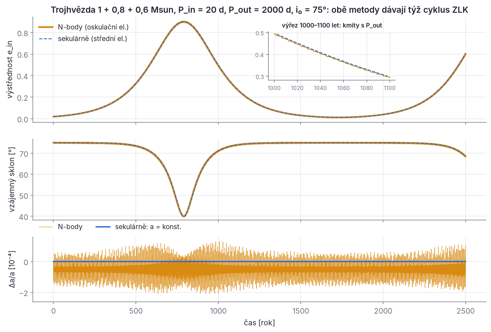
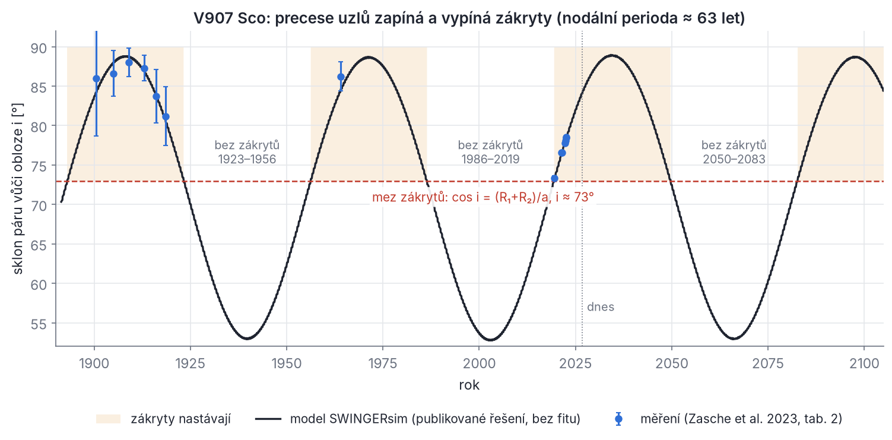
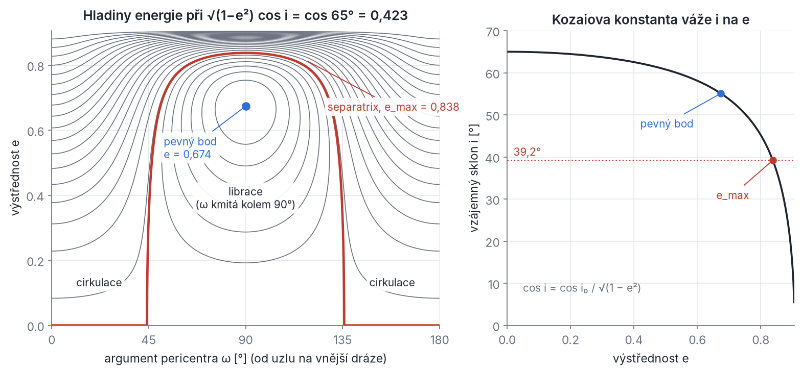
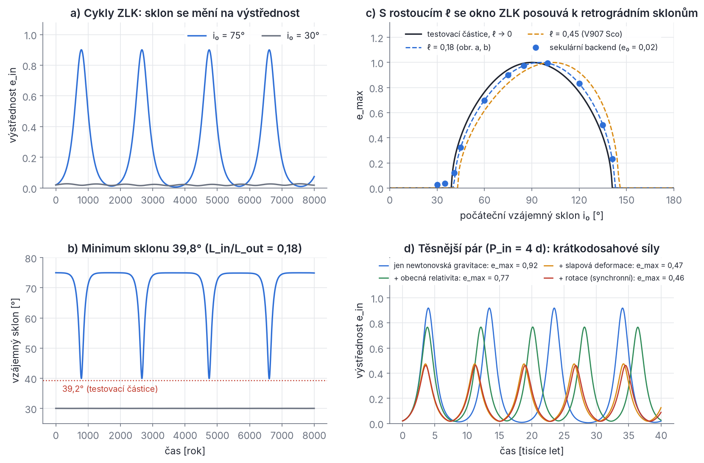
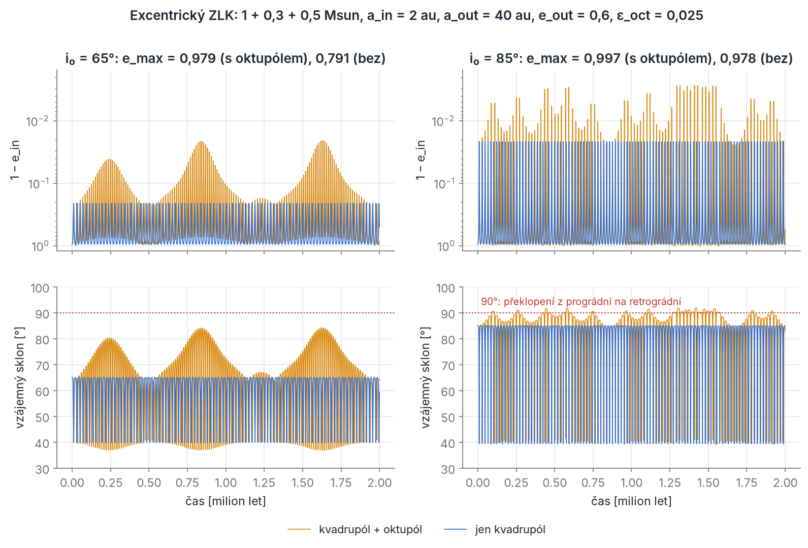

## Kapitola 5 – Sekulární dynamika

V hierarchické soustavě se během jednoho oběhu vnější hvězdy skoro nic nestane: vnitřní dvojice se jen nepatrně „zachvěje“. Za tisíce oběhů se ale malé poruchy sčítají do pomalých a velkých změn. Roviny drah se stáčejí (precesují), vzájemný sklon se může vyměňovat za výstřednost (cykly von Zeipela–Lidova–Kozaie, ZLK) a zákrytová dvojhvězda může na desítky let přestat zakrývat. U V907 Sco to pozorujeme přímo: zákryty zmizely přibližně v letech 1923–1956 a 1986–2019 a zase se vrátily (Zasche et al. 2023a). **Sekulární teorie** tyto pomalé změny počítá tak, že pohyb nejdřív zprůměruje přes oběhy. Je to nejdůležitější teoretický nástroj pro hierarchické hvězdy. SWINGERsim ho má jako samostatný **sekulární backend** (`run.backend: secular`), který spočítá miliony let za sekundy až minuty, a sekulární vzorce používá i v diagnostice každého N-částicového běhu.

V této kapitole uvidíš celou cestu od potenciální energie z kapitoly 3 až k rovnicím, které SWINGERsim integruje. Budeme potřebovat jen derivace, integrály přes jeden oběh a zákon zachování momentu hybnosti. Tam, kde se objeví Hamiltonovy rovnice, si je nejdřív zavedeme.

Pracujeme se značením z kapitol 2 a 3. Vnitřní dráha má hmotnosti m₁, m₂, celkovou hmotnost m₁₂ = m₁ + m₂ a redukovanou hmotnost m_r = m₁m₂/m₁₂. Rušitel má hmotnost m₃ a m_tot = m₁₂ + m₃. Velké poloosy jsou a_in a a_out, výstřednosti e_in a e_out. Pro výstřednost vnější dráhy budeme často psát j_out = √(1 − e_out²). Velikost momentu hybnosti dráhy je L = m_r√(G M a(1 − e²)) (M je součet hmotností obou větví), poměr momentů ℓ = L_in/L_out a i (nebo i_mut) je vzájemný sklon. Gravitační konstanta je v SWINGERsim G = (k·365,25)² ≈ 39,4769 au³ M☉⁻¹ rok⁻², relativně o 3,8·10⁻⁵ méně než 4π².

### 5.1 Proč středování funguje

**Tři hodiny.** V hierarchické trojhvězdě tikají troje hodiny s velmi různým tempem. Vnitřní perioda P_in trvá dny. Vnější perioda P_out trvá týdny až tisíce let. Třetí, nejpomalejší „sekulární“ škálu odhadneme z poměru síly poruchy a vazby dráhy (kapitola 3, oddíl 3.6):

```latex
t_0 \equiv \frac{P_{\mathrm{out}}^2}{P_{\mathrm{in}}}\,\frac{m_{\mathrm{tot}}}{m_3}\,\left(1-e_{\mathrm{out}}^2\right)^{3/2}
```

Pro V907 Sco (P_in = 3,775 d, P_out = 142,01 d, m₁₂ = 5,30 M☉, m₃ = 1,06 M☉, e_out = 0,467) vychází t₀ = 60,7 roku. Na jeden vnější oběh tedy připadá 37,6 vnitřních a na jednu sekulární škálu asi 156 vnějších. Tak velký rozdíl tempa je klíčem ke všemu, co následuje. Symbol t₀ budeme v celé kapitole používat jako *základní měřítko bez číselného předfaktoru*. Literatura používá různé předfaktory a v oddílu 5.6 si je srovnáme v tabulce.

**Gaussův prstenec.** Představ si, že vyfotografuješ vnitřní dvojici s expozicí delší, než je P_in. Hvězda se „rozmaže“ podél své elipsy do prstence. Hustota prstence je úměrná času, který tam hvězda tráví, tedy nepřímo úměrná rychlosti: v apocentru je prstenec hustší, v pericentru řidší. Na vzdálenou třetí hvězdu působí tento prstenec stejně jako průměr skutečné dvojice. Totéž platí obráceně: vnitřní dvojice „vidí“ třetí hvězdu rozmazanou podél vnější elipsy. Sekulární interakce je interakce dvou hmotných prstenců (Gaussova metoda). Prstence se nemohou navzájem roztáčet ani brzdit podél dráhy, mohou se jen naklánět a deformovat. Vyměňují si proto moment hybnosti, ale ne energii, a jejich velké poloosy zůstávají stálé. Teď totéž tvrzení dokážeme přesně.

**Hamiltonovské minimum.** Mechaniku lze psát v proměnných „souřadnice q a k ní sdružená hybnost p“. Celková energie vyjádřená v těchto proměnných, 𝓗(q, p), se jmenuje hamiltonián a pohyb plyne z Hamiltonových rovnic

```latex
\dot q = \frac{\partial \mathcal H}{\partial p}, \qquad \dot p = -\frac{\partial \mathcal H}{\partial q}
```

Pro jedno těleso na pružině s 𝓗 = p²/(2m) + kq²/2 dostaneš q̇ = p/m a ṗ = −kq, tedy přesně Newtonův zákon. Nejdůležitější důsledek: **nezávisí-li 𝓗 na některé souřadnici q, je k ní sdružená hybnost p konstantní**, protože ṗ = −∂𝓗/∂q = 0. Všechny zákony zachování v této kapitole vzniknou tímto způsobem.

> **Pozor.** V této knize je 𝓗 vždy *fyzikální energie* (u vázané dráhy záporná). Část literatury, například Naoz (2016) a Naoz et al. (2013), píše 𝓗 = −E, aby byl hamiltonián kladný. Potom mají všechny členy opačné znaménko a Hamiltonovy rovnice také. Obě konvence dávají stejný pohyb, ale **nesmíš je míchat**. Kdybys dosadil hamiltonián z jedné konvence do rovnic druhé, dostal bys opačný smysl precese.

**Keplerova dráha v proměnných úhel–účinek.** Pro keplerovskou dráhu je výhodné zvolit za „souřadnici“ střední anomálii M, která roste rovnoměrně s časem, a za sdruženou hybnost veličinu

```latex
\Lambda = m_r\sqrt{G M a}
```

(M = m₁ + m₂). Λ je moment hybnosti kruhové dráhy se stejnou velkou poloosou. Energie keplerovské dráhy E_K = −GMm_r/(2a) vyjádřená pomocí Λ je (dosaď a = Λ²/(m_r²GM))

```latex
E_K(\Lambda) = -\frac{G^2 M^2 m_r^3}{2\Lambda^2}
```

Ověříme, že Hamiltonova rovnice pro M dává správnou rychlost:

```latex
\dot M = \frac{\partial E_K}{\partial \Lambda} = \frac{G^2M^2m_r^3}{\Lambda^3} = \frac{G^2M^2 m_r^3}{m_r^3\,(GMa)^{3/2}} = \sqrt{\frac{GM}{a^3}} = n
```

Střední anomálie tedy roste se středním pohybem n, jak má. E_K na M nezávisí, takže Λ̇ = 0 a velká poloosa nerušené dráhy je stálá.

**Přidáme poruchu.** S třetí hvězdou je hamiltonián 𝓗 = E_K,in(Λ_in) + E_K,out(Λ_out) + Φ, kde Φ je poruchová energie z kapitoly 3 (oddíly 3.4 a 3.5). Φ závisí na polohách hvězd na drahách, tedy i na středních anomáliích M_in a M_out. Proto

```latex
\dot\Lambda_{\mathrm{in}} = -\frac{\partial \Phi}{\partial M_{\mathrm{in}}} \neq 0
```

a velká poloosa během oběhu kmitá. Rozložme Φ na průměr přes obě střední anomálie a zbytek, který má nulový průměr:

```latex
\Phi = \langle\langle \Phi\rangle\rangle + \tilde\Phi, \qquad \langle\langle \Phi\rangle\rangle = \frac{1}{4\pi^2}\int_0^{2\pi}\!\!\int_0^{2\pi}\Phi\;\mathrm dM_{\mathrm{in}}\,\mathrm dM_{\mathrm{out}}
```

Zbytek Φ̃ je součet členů typu cos(k M_in + k′ M_out + …) s celými čísly k, k′, z nichž aspoň jedno není nula. Integrál takového členu přes čas je

```latex
\int_0^t \cos\!\big[(k n_{\mathrm{in}} + k' n_{\mathrm{out}})\,t'\big]\,\mathrm dt' = \frac{\sin\!\big[(k n_{\mathrm{in}} + k' n_{\mathrm{out}})\,t\big]}{k n_{\mathrm{in}} + k' n_{\mathrm{out}}}
```

a ten neroste, jen kmitá s malou amplitudou (dělitel je velký, řádu n_in nebo n_out). Účinek Φ̃ se tedy za mnoho oběhů nesčítá. Sčítá se jen účinek ⟨⟨Φ⟩⟩, který na čase periodicky nezávisí. Proto pomalý (sekulární) vývoj řídí jen zprůměrovaná energie. Protože ⟨⟨Φ⟩⟩ už na M_in ani M_out nezávisí, platí

```latex
\dot\Lambda_{\mathrm{in}} = -\frac{\partial\langle\langle\Phi\rangle\rangle}{\partial M_{\mathrm{in}}} = 0, \qquad \dot\Lambda_{\mathrm{out}} = 0
```

**Velké poloosy se v sekulárním přiblížení nemění.** Dráhy si nevyměňují energii, jen moment hybnosti. Formálně se tento krok dělá kanonickou (von Zeipelovou) transformací, která krátkoperiodické členy převede do malých rozdílů mezi *oskulačními* a *středními* elementy. My vystačíme s fyzikálním argumentem výše.

> **Pozor.** Argument selže, když je dělitel k n_in + k′ n_out malý, tedy blízko **rezonance středních pohybů** n_in/n_out ≈ −k′/k. Pak člen Φ̃ roste dlouho jedním směrem a středovat se nesmí (oddíly 5.11 a 5.12). Druhý předpoklad je, že se elementy během jednoho vnějšího oběhu změní jen málo. To selhává pro slabé hierarchie (oddíl 5.12).

Obrázek 5.1 ukazuje, jak středování funguje v praxi. Stejnou trojhvězdu jsme spočítali dvakrát: N-částicovým backendem, který sleduje každý oběh, a sekulárním backendem, který integruje jen zprůměrované rovnice.



*Obr. 5.1 – Trojhvězda 1 + 0,8 + 0,6 M☉ (P_in = 20 d, P_out = 2000 d, e_out = 0,3, počáteční vzájemný sklon 75°; soubory `zlk.yaml` a `zlk_nbody.yaml` z cvičení). Nahoře výstřednost vnitřní dráhy, uprostřed vzájemný sklon, dole relativní změna velké poloosy vnitřní dráhy. Oranžově N-částicový výpočet (oskulační elementy), modře čárkovaně sekulární backend (střední elementy). Obě křivky se v horních panelech kryjí. Výřez ukazuje drobné „schůdky“ s periodou P_out, které středování vynechává. Dole je vidět, že oskulační velká poloosa kmitá jen řádově o 10⁻⁴ a nikam neutíká, zatímco sekulární je přesně stálá. N-částicový běh na 2500 let trval asi 4 minuty, sekulární na 8000 let asi 6 s.*

**Proč dvakrát.** Středujeme nejdřív přes rychlou vnitřní dráhu a pak přes vnější. Výsledek se jmenuje **dvojité středování** (double averaging). Při jednom středování (jen přes vnitřní dráhu) by energie stále závisela na poloze třetí hvězdy na vnější dráze. To je takzvaný kvazisekulární režim, ke kterému se vrátíme v oddílu 5.12.

> **Z historie.** Myšlenka prstenců pochází od C. F. Gausse (1818), který tak počítal sekulární poruchy planet. Laplace a Lagrange v 18. století z poruchové funkce vyvinuté do nízkých mocnin výstředností a sklonů odvodili, že velké poloosy planet se v prvním řádu sekulárně nemění. Tím vysvětlili, proč je Sluneční soustava dlouhodobě stabilní, aspoň v první aproximaci.

### 5.2 Dvojité středování krok za krokem

Teď ⟨⟨Φ⟩⟩ opravdu spočítáme. Omezíme se na nejnižší, **kvadrupólový** člen rozvoje z kapitoly 3 (n = 2, koeficient M₂ = m₁m₂/m₁₂ = m_r):

```latex
\Phi_{\mathrm{quad}} = -\frac{G m_3 m_r\, r_{\mathrm{in}}^2}{r_{\mathrm{out}}^3}\,P_2(\cos\psi) = -\frac{G m_3 m_r}{r_{\mathrm{out}}^3}\left[\frac32\left(\mathbf r_{\mathrm{in}}\cdot\hat{\mathbf r}_{\mathrm{out}}\right)^2 - \frac12 r_{\mathrm{in}}^2\right]
```

Použili jsme P₂(x) = (3x² − 1)/2 a cos ψ = r̂_in · r̂_out (stříška značí jednotkový vektor). Vektor **r**_in spojuje hvězdy 1 a 2, **r**_out vede z těžiště dvojice ke třetí hvězdě (Jacobiho vektory z kapitoly 3).

**Krok 1: středování přes vnější dráhu.** Vektor **r**_in držíme pevný (vnitřní hvězdy se během jednoho vnějšího oběhu přesunou mnohokrát, ale pořadí integrace je jedno, protože obě anomálie jsou nezávislé) a průměrujeme přes střední anomálii vnější dráhy. Integrály s 1/r³ se snadno počítají přes **pravou anomálii** ν. Z druhého Keplerova zákona (r² ν̇ = konst.) plyne

```latex
\mathrm dM = \frac{r^2}{a^2\sqrt{1-e^2}}\,\mathrm d\nu
```

(ověř: pro kruhovou dráhu r = a a dM = dν). S rovnicí elipsy 1/r = (1 + e cos ν)/[a(1 − e²)] pak pro libovolnou funkci f(ν):

```latex
\left\langle \frac{f}{r^3}\right\rangle = \frac{1}{2\pi}\int_0^{2\pi}\frac{f}{r^3}\,\frac{r^2\,\mathrm d\nu}{a^2\sqrt{1-e^2}} = \frac{1}{2\pi a^3\,(1-e^2)^{3/2}}\int_0^{2\pi} f\,(1+e\cos\nu)\,\mathrm d\nu
```

Pro f = 1 dostaneme ⟨(a/r)³⟩ = (1 − e²)^(−3/2). Výstředná vnější dráha tedy působí silněji než kruhová se stejným a: hvězda tráví málo času v pericentru, ale tam je velmi blízko a 1/r³ tam rychle roste.

Pro f = (**r**_in · r̂_out)² rozložíme r̂_out = cos ν **ê** + sin ν **q̂**, kde **ê** míří do pericentra vnější dráhy a **q̂** je kolmý k **ê** v rovině dráhy. Označíme x_e = **r**_in·**ê**, x_q = **r**_in·**q̂**. Pak f = x_e² cos²ν + 2x_e x_q sin ν cos ν + x_q² sin²ν. Integrály přes celý oběh: ∫cos²ν dν = ∫sin²ν dν = π, ∫sin ν cos ν dν = 0 a všechny členy s lichou mocninou cos ν nebo sin ν (včetně těch, které vzniknou násobením e cos ν) dají nulu. Zbude

```latex
\left\langle\frac{(\mathbf r_{\mathrm{in}}\cdot\hat{\mathbf r}_{\mathrm{out}})^2}{r_{\mathrm{out}}^3}\right\rangle = \frac{x_e^2+x_q^2}{2a_{\mathrm{out}}^3j_{\mathrm{out}}^3} = \frac{r_{\mathrm{in}}^2-(\mathbf r_{\mathrm{in}}\cdot\hat{\mathbf n})^2}{2a_{\mathrm{out}}^3j_{\mathrm{out}}^3}
```

kde **n̂** je jednotková normála vnější dráhy (x_e² + x_q² je kvadrát průmětu **r**_in do roviny vnější dráhy). Po dosazení:

```latex
\langle\Phi_{\mathrm{quad}}\rangle_{\mathrm{out}} = -\frac{G m_3 m_r}{a_{\mathrm{out}}^3j_{\mathrm{out}}^3}\left[\frac{r_{\mathrm{in}}^2}{4} - \frac34\left(\mathbf r_{\mathrm{in}}\cdot\hat{\mathbf n}\right)^2\right]
```

Všimni si, co zmizelo: výsledek nezávisí na směru pericentra vnější dráhy, jen na její normále **n̂** a na j_out. **Zprůměrovaná vnější dráha je v kvadrupólovém řádu osově souměrný prstenec.** Tato „šťastná náhoda“ je původem Kozaiovy konstanty (oddíl 5.3).

**Krok 2: středování přes vnitřní dráhu.** Potřebujeme ⟨r²⟩ a ⟨(**r** · **n̂**)²⟩ pro vnitřní dráhu (index „in“ teď vynecháme). Kladné mocniny r se průměrují nejsnáze přes **excentrickou anomálii** E. V soustavě dráhy (osa x do pericentra, osa y v rovině dráhy o 90° dál ve směru pohybu) platí (kapitola 2)

```latex
x = a(\cos E - e), \qquad y = a\sqrt{1-e^2}\,\sin E, \qquad \mathrm dM = (1-e\cos E)\,\mathrm dE
```

Poslední vztah je derivace Keplerovy rovnice M = E − e sin E. Průměry cos E a cos³ E přes oběh jsou nulové, ⟨cos² E⟩ = ⟨sin² E⟩ = 1/2. Rozepíšeme:

```latex
\begin{aligned}
\langle x^2\rangle &= \frac{a^2}{2\pi}\int_0^{2\pi}(\cos E-e)^2(1-e\cos E)\,\mathrm dE \\
&= \frac{a^2}{2\pi}\int_0^{2\pi}\left(\cos^2E - 2e\cos E + e^2 - e\cos^3E + 2e^2\cos^2E - e^3\cos E\right)\mathrm dE \\
&= a^2\left(\tfrac12 + e^2 + e^2\right) = \frac{a^2}{2}\left(1+4e^2\right)
\end{aligned}
```

```latex
\langle y^2\rangle = a^2(1-e^2)\,\langle \sin^2E\,(1-e\cos E)\rangle = \frac{a^2}{2}\left(1-e^2\right), \qquad \langle xy\rangle = 0
```

(⟨xy⟩ obsahuje lichou mocninu sin E). Sečtením ⟨r²⟩ = ⟨x² + y²⟩ = a²(1 + 3e²/2). Totéž dostaneš z r = a(1 − e cos E) přímo: ⟨r²⟩ = a²⟨(1 − e cos E)³⟩ = a²(1 + 3e²/2). Hvězda se v průměru drží dál od těžiště, než je a, protože dlouho pobývá u apocentra.

Zbývá průmět na normálu **n̂** vnější dráhy. Zvolíme osu z podél **n̂**. Vnitřní dráha má vůči vnější rovině sklon i a argument pericentra ω měřený od uzlové přímky na vnější rovině. Ze stejných matic rotace jako v kapitole 2 jsou z-složky jednotkových vektorů do pericentra **P̂** a kolmého **Q̂**

```latex
\hat{\mathbf P}\cdot\hat{\mathbf n} = \sin\omega\,\sin i, \qquad \hat{\mathbf Q}\cdot\hat{\mathbf n} = \cos\omega\,\sin i
```

Protože **r** = x**P̂** + y**Q̂** a ⟨xy⟩ = 0:

```latex
\left\langle(\mathbf r\cdot\hat{\mathbf n})^2\right\rangle = \sin^2 i\left(\langle x^2\rangle\sin^2\omega + \langle y^2\rangle\cos^2\omega\right) = \frac{a^2\sin^2 i}{2}\left(1-e^2+5e^2\sin^2\omega\right)
```

**Krok 3: výsledek v elementech.** Dosazením do výsledku kroku 1:

```latex
\langle\langle\Phi_{\mathrm{quad}}\rangle\rangle = -\frac{G m_3 m_r a_{\mathrm{in}}^2}{8\,a_{\mathrm{out}}^3j_{\mathrm{out}}^3}\left[2+3e^2-3\sin^2 i\left(1-e^2+5e^2\sin^2\omega\right)\right]
```

Tento tvar je nejnázornější. Literatura ho obvykle přepisuje pomocí sin²i = 1 − cos²i a sin²ω = (1 − cos 2ω)/2. Závorka se tak rozpadne na

```latex
2+3e^2-\sin^2 i\left(3+\tfrac92 e^2\right)+\tfrac{15}{2}e^2\sin^2 i\cos2\omega = \tfrac12\left[(2+3e^2)(3\cos^2 i-1)+15e^2\sin^2i\cos2\omega\right]
```

(použili jsme 1 − (3/2)sin²i = (3cos²i − 1)/2). Dostáváme hlavní výsledek této kapitoly, se **správným znaménkem energie**:

```latex
\langle\langle\Phi_{\mathrm{quad}}\rangle\rangle = -C_2\left[(2+3e_{\mathrm{in}}^2)(3\cos^2 i-1)+15\,e_{\mathrm{in}}^2\sin^2 i\cos2\omega_{\mathrm{in}}\right], \qquad C_2 = \frac{G\,m_1m_2m_3}{16\,(m_1+m_2)}\,\frac{a_{\mathrm{in}}^2}{a_{\mathrm{out}}^3\left(1-e_{\mathrm{out}}^2\right)^{3/2}}
```

Zde i je vzájemný sklon a ω_in se měří od společné uzlové přímky obou drah. Naoz (2016, rov. 22) píše stejný výraz s kladným znaménkem, protože její 𝓗 = −E.

**Kontrola znaménka fyzikou.** Pro kruhovou vnitřní dráhu v rovině vnější dráhy (e = 0, i = 0) je závorka 2·2 = 4 a ⟨⟨Φ⟩⟩ = −4C₂ < 0: prstenec vně dráhy ji přitahuje a energie je nižší než pro bodovou dvojici. Pro kolmou kruhovou dráhu (i = 90°) je ⟨⟨Φ⟩⟩ = +2C₂ > 0. Soustava má tedy nejnižší energii, když dráhy leží v jedné rovině, a to dává smysl: rozprostřená hmota v rovině prstence je k prstenci v průměru blíž.

**Vektorový tvar.** Pro numeriku i pro pochopení je lepší tvar bez úhlů. Zavedeme vektor výstřednosti **e** (velikost e, míří do pericentra; je úměrný Laplaceovu–Rungeovu–Lenzovu vektoru z kapitoly 2) a normovaný moment hybnosti **j** = √(1 − e²) **ĵ** (**ĵ** je jednotková normála vnitřní dráhy). Výsledky kroku 2 lze zapsat tenzorově:

```latex
\langle \mathbf r\,\mathbf r\rangle_{\mathrm{in}} = \frac{a_{\mathrm{in}}^2}{2}\left[(1-e^2)\left(\mathsf I-\hat{\mathbf j}\hat{\mathbf j}\right)+5\,\mathbf e\,\mathbf e\right]
```

(𝖨 je jednotková matice). Ověř: podél **ê** dostaneš a²(1 − e² + 5e²)/2 = a²(1 + 4e²)/2 = ⟨x²⟩, podél **Q̂** a²(1 − e²)/2 = ⟨y²⟩ a stopa je a²(2 + 3e²)/2 = ⟨r²⟩. Odtud ⟨(**r** · **n̂**)²⟩ = (a²/2)[1 − e² − (**j** · **n̂**)² + 5(**e** · **n̂**)²] a po dosazení

```latex
\langle\langle\Phi_{\mathrm{quad}}\rangle\rangle = \frac{\Phi_0}{8}\left[1-6e^2-3\left(\mathbf j\cdot\hat{\mathbf n}\right)^2+15\left(\mathbf e\cdot\hat{\mathbf n}\right)^2\right], \qquad \Phi_0 = \frac{G\,m_3\, m_r\, a_{\mathrm{in}}^2}{a_{\mathrm{out}}^3\,j_{\mathrm{out}}^3}
```

Dosazením (**j** · **n̂**)² = (1 − e²)cos²i a (**e** · **n̂**)² = e² sin²i sin²ω se vrátíš k tvaru v elementech (zkus to). Konstanty souvisí jako Φ₀ = 16C₂. Vektorový tvar je ten, který SWINGERsim skutečně počítá (`secular/kernel.py`). Píše ho s vektorem vnější dráhy **K**_out = j_out **n̂**:

```latex
H_2 = -c_2\left[j_{\mathrm{out}}^{-3}\left(6e_{\mathrm{in}}^2-1\right)+j_{\mathrm{out}}^{-5}\left(3\,(\mathbf K_{\mathrm{in}}\cdot\mathbf K_{\mathrm{out}})^2-15\,(\boldsymbol\pi_{\mathrm{in}}\cdot\mathbf K_{\mathrm{out}})^2\right)\right], \qquad c_2 = \frac{G\,m_r M_o\,a_{\mathrm{in}}^2}{8\,a_{\mathrm{out}}^3}
```

kde **K**_in = **j**, **π**_in = **e** a M_o je hmotnost druhé větve vnější dráhy (pro trojhvězdu m₃, pro 2+2 hmotnost druhé dvojice). Protože (**K**_in · **K**_out)² = j_out²(**j** · **n̂**)², je to přesně výraz výše s c₂ = Φ₀j_out³/8 (Vokrouhlický 2016, rov. 18).

> **Pozor.** Ne každý vzorec z literatury je správně. Například encyklopedická kapitola Perets (2025, rov. 1) uvádí kvadrupólový hamiltonián bez m₃ a s úhlovou závorkou (1 − e²)(3cos²i − 1) + 5e² sin²i cos 2ω, která s naším výsledkem není shodná: pro e = 1, i = 0 dává 0 místo 10. Odvození, které jsi právě udělal, je nejlepší obranou.

**Řešený příklad (numerická kontrola).** Je výsledek opravdu správný? Spočítej dvojný průměr numericky. Zvol m₁ = 1, m₂ = 0,8, m₃ = 0,6 M☉, a_in = 1 au, e_in = 0,4, i = 60°, ω_in = 50°, a_out = 12 au, e_out = 0,35. Rozděl obě střední anomálie na 2000 stejných dílků, pro každý pár (M_in, M_out) vyřeš Keplerovu rovnici, spočítej polohy, dosaď do Φ_quad a zprůměruj 4·10⁶ hodnot. Výsledek 4,3197·10⁻⁴ M☉ au² rok⁻² se se vzorcem shoduje relativně na řádově 10⁻¹⁵, tedy na zaokrouhlovací chyby. (Hodnota je kladná, protože při i = 60° je 3cos²i − 1 < 0.)

### 5.3 Delaunayho proměnné a Hamiltonovy rovnice

Zprůměrovaná energie závisí na e, i, ω a Ω. Abychom z ní dostali pohybové rovnice, potřebujeme kanonické proměnné, tedy dvojice úhel–hybnost, pro které platí Hamiltonovy rovnice. Pro jednu keplerovskou dráhu jsou to **Delaunayho proměnné**:

| úhel | sdružená hybnost | význam hybnosti |
| --- | --- | --- |
| M (střední anomálie) | Λ = m_r√(GMa) | moment hybnosti kruhové dráhy s touž a |
| ω (argument pericentra) | L = Λ√(1 − e²) | skutečná velikost momentu hybnosti |
| Ω (délka výstupného uzlu) | L_z = L cos i | průmět momentu hybnosti na osu z |

V literatuře se značí (l, g, h) a (L, G, H). My se písmenu G vyhneme, aby se nepletlo s gravitační konstantou, a L_in bude dál velikost momentu hybnosti vnitřní dráhy jako v kapitole 3. Hamiltonovy rovnice mají tvar

```latex
\dot M = \frac{\partial\mathcal H}{\partial\Lambda},\quad \dot\omega = \frac{\partial\mathcal H}{\partial L},\quad \dot\Omega = \frac{\partial\mathcal H}{\partial L_z},\qquad
\dot\Lambda = -\frac{\partial\mathcal H}{\partial M},\quad \dot L = -\frac{\partial\mathcal H}{\partial\omega},\quad \dot L_z = -\frac{\partial\mathcal H}{\partial\Omega}
```

Derivace se berou vždy při stálých ostatních proměnných. Elementy z nich spočítáš jako e = √(1 − (L/Λ)²) a cos i = L_z/L.

Proč právě tyto dvojice? Že (M, Λ) je kanonická dvojice, jsme ověřili v oddílu 5.1. Pro (Ω, L_z) to plyne z toho, že otočení celé dráhy kolem osy z o úhel δΩ je generováno průmětem momentu hybnosti na tuto osu, stejně jako posunutí je generováno hybností. Podobně otočení pericentra v rovině dráhy je generováno momentem hybnosti kolmým k dráze, tedy L. Úplný důkaz najdeš v učebnicích nebeské mechaniky (Murray & Dermott 1999, kap. 2).

**Testovací částice.** Nejjednodušší případ: vnitřní dráha má zanedbatelný moment hybnosti oproti vnější (L_in ≪ L_out, „testovací částice“). Vnější dráha se pak nemění, její normála **n̂** je pevná a zvolíme ji za osu z. Hamiltonián vnitřní dráhy je E_K(Λ) + ⟨⟨Φ_quad⟩⟩(L, L_z, ω), kde jsme vyjádřili

```latex
e^2 = 1-\frac{L^2}{\Lambda^2}, \qquad \cos^2 i = \frac{L_z^2}{L^2}
```

**Kozaiova konstanta.** ⟨⟨Φ_quad⟩⟩ nezávisí na Ω, protože prstenec vnější dráhy je osově souměrný. Proto L̇_z = −∂⟨⟨Φ⟩⟩/∂Ω = 0 a s Λ = konst. dostáváme

```latex
j_z \equiv \sqrt{1-e_{\mathrm{in}}^2}\,\cos i = \frac{L_z}{\Lambda} = \text{konst.}
```

To je **Kozaiova konstanta**. Druhý integrál je energie ⟨⟨Φ⟩⟩ sama (nezávisí na čase). Na dva stupně volnosti (e, ω) a (i, Ω) máme dva integrály, takže úloha je integrabilní: lze ji vyřešit až na integrály (oddíl 5.6).

**Pohybové rovnice v elementech.** Derivujme ⟨⟨Φ⟩⟩ = −C₂B, kde B = (2 + 3e²)(3cos²i − 1) + 15e² sin²i cos 2ω. Rovnice pro výstřednost: ∂⟨⟨Φ⟩⟩/∂ω = −C₂ · 15e² sin²i · (−2 sin 2ω) = 30C₂e² sin²i sin 2ω, takže L̇ = −30C₂ e² sin²i sin 2ω. Z L = Λ√(1 − e²) je L̇ = −Λe ė/√(1 − e²) a tedy

```latex
\dot e = \frac{30\,C_2}{L}\;e\,(1-e^2)\,\sin^2 i\,\sin 2\omega
```

Rovnici pro ω dostaneme derivací podle L při stálých Λ a L_z. Je pohodlné psát j = L/Λ, takže e² = 1 − j² a cos²i = j_z²/j². Pak B = (5 − 3j²)(3j_z²/j² − 1) + 15(1 − j²)(1 − j_z²/j²)cos 2ω. Derivace podle j (počítej člen po členu, je to dobré cvičení):

```latex
\frac{\partial B}{\partial j} = 6j - \frac{30\,j_z^2}{j^3} + 30\cos2\omega\left(\frac{j_z^2}{j^3}-j\right)
```

S ω̇ = ∂⟨⟨Φ⟩⟩/∂L = −(C₂/Λ)∂B/∂j a j_z²/j² = cos²i vyjde po úpravě

```latex
\dot\omega = \frac{6\,C_2}{L}\left[4\cos^2 i + \left(5\cos 2\omega - 1\right)\left(1-e^2-\cos^2 i\right)\right]
```

Stejně pro uzel: ⟨⟨Φ⟩⟩ závisí na L_z jen přes cos²i = L_z²/L². Pro kruhovou dráhu je ⟨⟨Φ⟩⟩ = −2C₂(3L_z²/L² − 1), a tedy

```latex
\dot\Omega = \frac{\partial\langle\langle\Phi\rangle\rangle}{\partial L_z} = -\frac{12\,C_2\,L_z}{L^2} = -\frac{12\,C_2}{L}\cos i \qquad (e_{\mathrm{in}} = 0)
```

Pro prográdní dráhu (cos i > 0) je Ω̇ < 0: **uzel ustupuje** (regreduje). Tak to opravdu pozorujeme u Měsíce, jehož uzly obíhají proti směru oběhu (oddíl 5.4). Kdybychom použili Naozin hamiltonián (𝓗 = −E) s našimi rovnicemi, vyšlo by Ω̇ > 0, což je špatně.

Kombinace, která se ve vzorcích stále opakuje, je

```latex
A \equiv \frac{6\,C_2}{\Lambda_{\mathrm{in}}} = \frac38\,\frac{m_3}{m_{\mathrm{tot}}}\,\frac{n_{\mathrm{out}}^2}{n_{\mathrm{in}}\,j_{\mathrm{out}}^3} = \frac{3\pi}{4\,t_0}
```

Odvození: Λ_in = m_r n_in a_in², takže 6C₂/Λ_in = (3/8) G m₃/(n_in a_out³ j_out³), a z třetího Keplerova zákona G m_tot = n_out² a_out³. Poslední rovnost plyne z n_out²/n_in = 2π P_in/P_out². Rychlost A je tedy řádově 1/t₀, s předfaktorem 3π/4 ≈ 2,4.

**Lagrangeovy planetární rovnice.** V nebeské mechanice se místo Delaunayho proměnných často používají přímo elementy a **poruchová funkce** 𝓡 = −Φ/m_r (poruchová energie na jednotku redukované hmotnosti s opačným znaménkem, takže síla je +∇𝓡). Řetízkovým pravidlem z Hamiltonových rovnic plynou Lagrangeovy rovnice. Pro zprůměrovanou 𝓡, která nezávisí na M, mají tvar

```latex
\begin{aligned}
\dot a &= 0, &\qquad \dot e &= -\frac{\sqrt{1-e^2}}{n a^2 e}\,\frac{\partial\mathcal R}{\partial\omega}, &\qquad \dot i &= \frac{1}{n a^2\sqrt{1-e^2}\,\sin i}\left(\cos i\,\frac{\partial\mathcal R}{\partial\omega}-\frac{\partial\mathcal R}{\partial\Omega}\right),\\
\dot\Omega &= \frac{1}{n a^2\sqrt{1-e^2}\,\sin i}\,\frac{\partial\mathcal R}{\partial i}, &\qquad \dot\omega &= \frac{\sqrt{1-e^2}}{n a^2 e}\,\frac{\partial\mathcal R}{\partial e}-\frac{\cos i}{n a^2\sqrt{1-e^2}\,\sin i}\,\frac{\partial\mathcal R}{\partial i}
\end{aligned}
```

Ukažme jednu: z L̇ = −∂Φ/∂ω, L = Λ√(1 − e²) a Λ = m_r n a² dostaneš ė = (√(1 − e²)/(Λe)) ∂Φ/∂ω = −(√(1 − e²)/(na²e)) ∂𝓡/∂ω. Ostatní plynou stejně (Murray & Dermott 1999, oddíl 6.8; česky Brož, skripta *Fyzika sluneční soustavy*). Lagrangeovy rovnice učí jednu důležitou věc: derivace podle *úhlů* (ω, Ω, M) mění *hybnosti* (e, i, a) a naopak. Velkou poloosu může změnit jen závislost poruchy na poloze na dráze (∂𝓡/∂M), a ta po středování zmizí.

> **Pozor.** Rovnice v elementech jsou singulární pro e → 0 (dělení e) a i → 0 (dělení sin i). Úhel ω kruhové dráhy nemá smysl, přesto ho rovnice potřebují. Proto SWINGERsim integruje rovnice ve vektorových elementech (oddíl 5.9), které tyto singularity nemají. Rovnice v elementech používáme jen k porozumění a k odvozování vzorců.

**Konečný moment hybnosti vnitřní dráhy.** Když L_in není zanedbatelné, vnější dráha se také naklání. Pak je výhodné měřit úhly od **invariantní roviny** kolmé k celkovému momentu hybnosti **L** = **L**_in + **L**_out (kapitola 3). Uzly obou drah na ní leží proti sobě (Ω_in − Ω_out = 180°), takže hamiltonián závisí jen na jejich rozdílu. To je „eliminace uzlů“ (Jacobi). Vzájemný sklon pak plyne z kosinové věty

```latex
\cos i = \frac{L^2 - L_{\mathrm{in}}^2 - L_{\mathrm{out}}^2}{2\,L_{\mathrm{in}}L_{\mathrm{out}}}
```

a závisí tedy na L_in. Při derivování podle L_in proto přibudou členy úměrné cos i/L_out. Naoz et al. (2013) ukázali, že v řadě starších prací se po eliminaci uzlů chybně usuzovalo, že L_in cos i_in je zachováno. Správné rovnice pro sklony plynou ze zachování celkového momentu hybnosti. SWINGERsim tuto past obchází tak, že integruje vektory (oddíl 5.9), kde se zachování **L** splní samo.

### 5.4 Precese uzlů

Začneme jednodušším ze dvou sekulárních jevů. Vnitřní dráha je skoro kruhová a vzájemný sklon je malý nebo střední. Moment síly prstence se snaží dráhy srovnat do jedné roviny. Jako u setrvačníku ale moment síly kolmý k momentu hybnosti dráhu nesklopí. Otáčí její normálu po kuželi, a to je **precese**.

**Testovací částice: Söderhjelmův vzorec.** Z rovnice pro Ω̇ v oddílu 5.3 a z A = 6C₂/Λ_in = 3π/(4t₀) dostáváme pro e_in = 0 úhlovou rychlost |Ω̇| = 2A cos i = (3π/2) cos i/t₀. Perioda precese je

```latex
P_{\mathrm{prec}} = \frac{2\pi}{|\dot\Omega|} = \frac{4}{3}\,\frac{t_0}{\cos i} = \frac43\,\frac{P_{\mathrm{out}}^2}{P_{\mathrm{in}}}\,\frac{m_{\mathrm{tot}}}{m_3}\,\frac{\left(1-e_{\mathrm{out}}^2\right)^{3/2}}{\cos i}
```

To je vzorec Söderhjelma (1975). Čím blíž je sklon 90°, tím je precese pomalejší, protože moment síly má menší složku, která dráhu stáčí.

**Řešený příklad: Měsíc.** Soustava Země–Měsíc–Slunce je hierarchická trojhvězda: vnitřní dráha je Měsíc kolem Země (P_in = 27,3217 d), vnější je Země s Měsícem kolem Slunce (P_out = 365,2564 d, e_out = 0,0167), rušitel je Slunce, takže m_tot/m₃ ≈ 1. Pak t₀ = (1,0000²/0,07480) rok · 1,000003 · 0,99958 = 13,36 roku. Se sklonem 5,145° vychází P_prec = (4/3) · 13,36/0,99597 = 17,9 roku. Pozorovaná perioda ústupu měsíčních uzlů je 18,6 roku. Rozdíl 4 % pochází z vyšších řádů poruchové teorie: poměr P_in/P_out = 0,075 není pro Měsíc zanedbatelný.

**Konečné ℓ = L_in/L_out.** U V907 Sco nese vnitřní dráha skoro polovinu momentu hybnosti vnější (ℓ = 0,45, kapitola 3), takže vnější dráha není pevná. Pro e_in = 0 závisí kvadrupólová energie jen na úhlu mezi normálami, ⟨⟨Φ⟩⟩ = −2C₂(3c² − 1) s c = **L̂**_in · **L̂**_out. Pohybovou rovnici vektoru momentu hybnosti dostaneme z obecného pravidla d**L**/dt = ∇_**L**𝓗 × **L** (pro testovací částici dává právě Ω̇ = −(12C₂/L)cos i, jak se snadno ověří):

```latex
\frac{\mathrm d\mathbf L_{\mathrm{in}}}{\mathrm dt} = -\frac{12\,C_2\,c}{L_{\mathrm{in}}L_{\mathrm{out}}}\;\mathbf L_{\mathrm{out}}\times\mathbf L_{\mathrm{in}}, \qquad
\frac{\mathrm d\mathbf L_{\mathrm{out}}}{\mathrm dt} = -\frac{12\,C_2\,c}{L_{\mathrm{in}}L_{\mathrm{out}}}\;\mathbf L_{\mathrm{in}}\times\mathbf L_{\mathrm{out}}
```

Součet je nula, celkový moment se zachovává. A protože **L**_out × **L**_in = (**L**_in + **L**_out) × **L**_in = **L** × **L**_in, platí

```latex
\frac{\mathrm d\mathbf L_{\mathrm{in}}}{\mathrm dt} = \boldsymbol\nu\times\mathbf L_{\mathrm{in}}, \qquad \frac{\mathrm d\mathbf L_{\mathrm{out}}}{\mathrm dt} = \boldsymbol\nu\times\mathbf L_{\mathrm{out}}, \qquad \boldsymbol\nu = -\frac{12\,C_2\cos i}{L_{\mathrm{in}}}\,\frac{|\mathbf L|}{L_{\mathrm{out}}}\,\hat{\mathbf L}
```

**Obě dráhy precesují kolem celkového momentu hybnosti se stejnou úhlovou rychlostí** a vzájemný sklon se nemění. Rychlost je oproti testovací částici zvětšena faktorem |**L**|/L_out. Z kosinové věty |**L**|² = L_in² + L_out² + 2L_inL_out cos i plyne

```latex
P_\nu = \frac{4}{3}\,\frac{P_{\mathrm{out}}^2}{P_{\mathrm{in}}}\,\frac{m_{\mathrm{tot}}}{m_3}\,\frac{\left(1-e_{\mathrm{out}}^2\right)^{3/2}}{\cos i\,\sqrt{1+\ell^2+2\ell\cos i}}, \qquad \ell = \frac{L_{\mathrm{in}}}{L_{\mathrm{out}}}
```

To je vzorec, který pro V907 Sco použili Zasche et al. (2023a, rov. 2–3). Pro e_in = 0 je v kvadrupólovém řádu přesný (e_out se zachovává, protože H₂ na směru pericentra vnější dráhy nezávisí). Pro ℓ → 0 přechází v Söderhjelmův vzorec.

**Řešený příklad: V907 Sco.** Z elementů konfigurace (`configs/squadra_test3/v907_sco_published.yaml`): a_in = 0,08272 au = 17,79 R☉, a_out = 0,9870 au, e_out = 0,467, vzájemný sklon i = 26,2°. Momenty hybnosti L = m_r√(GMa(1 − e²)) dávají ℓ = 0,448. Dále t₀ = 60,68 roku a Söderhjelmův vzorec P_prec = (4/3)·60,68/cos 26,2° = 90,2 roku. Oprava √(1 + 0,448² + 2·0,448·cos 26,2°) = 1,416 dává

```latex
P_\nu = \frac{90{,}2\ \text{roku}}{1{,}416} = 63{,}7\ \text{roku}
```

Zasche et al. (2023a) z pozorování dostali P_ν = 63,5 (+3,3 / −2,6) roku a N-částicový běh SWINGERsim s publikovaným řešením dává naměřenou nodální periodu 63,2 roku. Sklony obou drah k invariantní rovině plynou ze sinové věty L_in sin θ_in = L_out sin θ_out (kapitola 3):

```latex
\tan\theta_{\mathrm{in}} = \frac{\sin i}{\ell+\cos i} \;\Rightarrow\; \theta_{\mathrm{in}} = 18{,}2^\circ, \qquad \theta_{\mathrm{out}} = 26{,}2^\circ-18{,}2^\circ = 8{,}0^\circ
```

Invariantní rovina má vůči obloze sklon asi 71°, takže sklon zákrytového páru k obloze kolísá mezi 71° − 18,2° ≈ 53° a 71° + 18,2° ≈ 89°. Zákryty nastávají jen tehdy, když cos i < (R₁ + R₂)/a = (2,53 + 2,68)/17,79, tedy pro i > 73,0°. Obrázek 5.2 ukazuje, co z toho plyne.



*Obr. 5.2 – Sklon zákrytového páru V907 Sco vůči obloze v letech 1890–2105. Černě N-částicový model SWINGERsim s publikovaným řešením Zasche et al. (2023a), spočítaný dvěma běhy z referenční epochy 2021,5 (BJD 2459383,9) dopředu (200 let) a dozadu (130 let), bez fitu na sklony (k okamžikům minim z TESS jsou ukotveny jen perioda a počáteční fáze vnitřní dráhy, které sklon neovlivňují). Modře sklony změřené z archivních fotografických desek (DASCH, APPLAUSE) a z dat TESS a FRAM (Zasche et al. 2023a, tab. 2). Sklon i a 180° − i dávají stejnou světelnou křivku, proto je vynesen menší z nich. Červená čárkovaná čára je mez zákrytů 73°; oranžově jsou podbarvena období, kdy zákryty nastávají. Model vysvětluje, proč zákryty chyběly v letech 1923–1956 a 1986–2019, a předpovídá další zmizení v letech asi 2050–2083. Křivka kmitá s nodální periodou 63 let mezi 53° a 89°.*

**Laplaceova–Lagrangeova teorie jako kontrola.** Pro malé sklony a výstřednosti se poruchová funkce rozvíjí do druhého řádu v e a i a pohybové rovnice jsou lineární (Laplaceova–Lagrangeova sekulární teorie; Murray & Dermott 1999, kap. 7). Pro sklony dvou drah se zavádějí proměnné p_k = i_k sin Ω_k, q_k = i_k cos Ω_k (sklony vůči pevné rovině) a rovnice mají tvar ṗ_k = Σ B_kl q_l, q̇_k = −Σ B_kl p_l. Matice B má pro dvě dráhy B₁₂ = −B₁₁ a B₂₁ = −B₂₂. Zachování vodorovné složky celkového momentu hybnosti, d/dt Σ L_k(p_k, q_k) = 0, vynutí L_inB₁₁ = L_outB₂₂. Vlastní čísla matice jsou 0 (obě dráhy leží v invariantní rovině, nic se neděje) a

```latex
s = B_{11}+B_{22} = B_{11}\left(1+\frac{L_{\mathrm{in}}}{L_{\mathrm{out}}}\right)
```

kde B₁₁ je rychlost precese vnitřní dráhy kolem pevné vnější. Pro malý vzájemný sklon je √(1 + ℓ² + 2ℓ cos i) ≈ 1 + ℓ, takže lineární teorie dává týž faktor jako náš přesnější vektorový výpočet. Stejná lineární teorie popisuje i dlouhoperiodické kmity výstředností a sklonů planet Sluneční soustavy (Milankovičovy cykly zemské dráhy s periodou asi 100 000 let).

> **Pozor.** Söderhjelmův vzorec i vzorec se ℓ platí jen mimo oblast cyklů ZLK a pro skoro kruhovou vnitřní dráhu. SWINGERsim vypisuje v diagnostice orbitálních párů odhad „precession period … estimated“ podle Söderhjelmova vzorce (bez faktoru ℓ) a vedle něj periodu naměřenou v běhu. Pro V907 Sco dává 90,2 roku odhadnuto a 63,2 roku naměřeno, rozdíl je téměř přesně faktor 1,42. Uvnitř okna ZLK (oddíl 5.5) odhad ztrácí smysl: pro trojhvězdu z obr. 5.1 dává 9 790 let, ale naměřená perioda je 3 160 let.

### 5.5 Kozaiova konstanta a cykly ZLK

**Překvapení.** Když je vzájemný sklon velký, děje se něco, co bys od precese nečekal. Vnitřní dráha, zpočátku skoro kruhová, se začne protahovat. Výstřednost vyroste třeba na 0,9 a vzájemný sklon přitom klesne ke 40°. Pak se obojí vrátí a cyklus se opakuje. Velká poloosa se přitom nemění. To jsou **cykly von Zeipela–Lidova–Kozaie (ZLK)**. Moment síly prstence dráhu nejen stáčí (uzel dál precesuje), ale mění i *velikost* momentu hybnosti vnitřní dráhy L = Λ√(1 − e²), a tedy výstřednost.

> **Z historie.** Jev objevil švédský astronom Hugo von Zeipel (1910, *Astron. Nachr.* 183, 345) při studiu drah komet rušených Jupiterem. Jeho práce byla zapomenuta. Znovu ho nezávisle odvodili Michail Lidov (1962, *Planet. Space Sci.* 9, 719) pro dráhy umělých družic Země rušených Měsícem a Jošihide Kozai (1962, *AJ* 67, 591) pro planetky se sklonem rušené Jupiterem. Lidov ukázal, že dráha družice s velkým sklonem se působením Měsíce protahuje, až její pericentrum klesne do atmosféry, a družice zanikne. Dnes se jménem von Zeipela jev značí ZLK (dříve „Kozaiův“ nebo „Lidovův–Kozaiův“ mechanismus).

**Dva integrály.** V limitě testovací částice máme z oddílu 5.3 dva zákony zachování:

```latex
j_z = \sqrt{1-e^2}\,\cos i = \text{konst.}, \qquad B = (2+3e^2)(3\cos^2 i-1)+15\,e^2\sin^2 i\cos2\omega = \text{konst.}
```

Kozaiova konstanta říká: **když roste výstřednost, musí růst |cos i|**. U prográdní dráhy tedy sklon klesá, u retrográdní roste k 180° (vzdaluje se od 90°). Výstřednost tak může růst jen „na úkor“ sklonu. Proto se cykly ZLK říká výměna sklonu za výstřednost.

**Kde jsou extrémy.** Z rovnice ė = (30C₂/L) e(1 − e²) sin²i sin 2ω (oddíl 5.3) je ė = 0, když sin 2ω = 0, tedy pro ω = 0°, 90°, 180° nebo 270°. Maxima výstřednosti leží při ω = 90° nebo 270° (cos 2ω = −1), minima při ω = 0° nebo 180°.

**Maximální výstřednost.** Vyjdeme z téměř kruhové dráhy, e₀ ≈ 0, se sklonem i₀. Označme c = cos²i₀ a x = 1 − e_max². Kozaiova konstanta dává v maximu cos²i = c/x. Energie na začátku je B₀ = 2(3c − 1). V maximu (cos 2ω = −1) je

```latex
B_{\max} = (5-3x)\left(\frac{3c}{x}-1\right) - 15\,(1-x)\left(1-\frac{c}{x}\right)
```

(použili jsme 2 + 3e² = 5 − 3x a sin²i = 1 − c/x). Položíme B_max = B₀ a vynásobíme x:

```latex
\begin{aligned}
(5-3x)(3c-x) - 15(1-x)(x-c) &= 2(3c-1)\,x\\
15c - 5x - 9cx + 3x^2 - 15x + 15c + 15x^2 - 15cx &= 6cx - 2x\\
18x^2 - (18+30c)\,x + 30c &= 0\\
(3x-5c)(x-1) &= 0
\end{aligned}
```

Kořen x = 1 je počáteční stav (e = 0). Netriviální kořen x = 5c/3 dává

```latex
e_{\max} = \sqrt{1-\tfrac53\cos^2 i_0}
```

Má smysl jen pro x < 1, tedy cos²i₀ < 3/5. Odtud **okno ZLK** pro testovací částici:

```latex
39{,}23^\circ < i_0 < 140{,}77^\circ
```

A v maximu je cos²i = c/x = 3/5, tedy **minimální sklon je vždy 39,23°** (nebo 140,77°), nezávisle na i₀. Dráha, která začala se sklonem 80°, se v maximu výstřednosti „sklopí“ právě na mez okna.

**Fázový portrét.** Při daném j_z je energie B funkcí dvou proměnných (e, ω). Pohyb probíhá po vrstevnicích B, protože B se zachovává. Obrázek 5.3 ukazuje tyto vrstevnice pro j_z = cos 65°.



*Obr. 5.3 – Vlevo: vrstevnice zprůměrované kvadrupólové energie v rovině (ω, e) pro testovací částici s Kozaiovou konstantou √(1 − e²) cos i = cos 65° = 0,423. Každá šedá křivka je jedna možná dráha v sekulárním vývoji. Uvnitř červené separatrix ω **libruje** (kmitá kolem 90°) a výstřednost kmitá mezi dvěma hodnotami. Vně separatrix ω **cirkuluje** (proběhne všechny hodnoty) a výstřednost se mění jen málo. Separatrix prochází bodem e = 0 (asi při ω ≈ 45° a 135°) a nahoře dosahuje e_max = √(1 − (5/3)cos²65°) = 0,838. Modrý bod je stabilní pevný bod e = 0,674, ω = 90°. Vpravo: Kozaiova konstanta váže sklon na výstřednost, cos i = cos i₀/√(1 − e²). V maximu výstřednosti na separatrix (červený bod) je sklon právě 39,2°.*

Pevný bod najdeš z podmínky ω̇ = 0 při ω = 90° (cos 2ω = −1): 4cos²i − 6(1 − e² − cos²i) = 0, tedy cos²i = (3/5)(1 − e²). S j_z² = (1 − e²)cos²i odtud (1 − e²)² = (5/3)j_z² a e_fix = √(1 − √(5/3)·j_z). Pro j_z = 0,423 je e_fix = 0,674.

Dráha, která začíná s e₀ ≈ 0, leží těsně u separatrix (bod e = 0 na ní leží). Proto právě ona dosahuje e_max. Dráha, která začíná s větší výstředností, může librovat (malé kmity kolem pevného bodu) nebo cirkulovat. **Cirkulující dráhy kmitají ve výstřednosti i pod 39,2°.** Kdo říká, že pod mezí okna se nic neděje, má na mysli jen dráhy se skoro nulovou počáteční výstředností.

**Proč 39,2° ještě jednou: lineární stabilita.** Mez okna lze odvodit i jinak, a tím pochopíme, proč cyklus začíná pomalu. Pro malou výstřednost zavedeme složky k = e cos ω a h = e sin ω (vektor výstřednosti v rovině dráhy, měřený od uzlu). Z rovnic pro ė a ω̇ (oddíl 5.3) s e → 0 a A = 6C₂/Λ:

```latex
\dot e = 5A\,e\,\sin^2 i\,\sin2\omega, \qquad \dot\omega = A\left[4\cos^2 i+(5\cos2\omega-1)\sin^2 i\right]
```

S k̇ = ė cos ω − e ω̇ sin ω, ḣ = ė sin ω + e ω̇ cos ω, sin 2ω = 2hk/e² a cos 2ω = (k² − h²)/e² vyjde po krátké úpravě (zkus ji)

```latex
\dot k = A\left(6-10\cos^2 i\right)h, \qquad \dot h = 4A\,k \qquad\Rightarrow\qquad \ddot k = 8A^2\left(3-5\cos^2 i\right)k
```

Pro cos²i < 3/5 je koeficient kladný: kruhová dráha je **nestabilní** a výstřednost roste exponenciálně jako e^(λt) s

```latex
\lambda = 2\sqrt2\,A\sqrt{3-5\cos^2 i_0} = \frac{3\pi}{\sqrt2\,t_0}\sqrt{3-5\cos^2 i_0}
```

Pro cos²i > 3/5 je koeficient záporný a k, h jen kmitají: kruhová dráha je stabilní. Mez je opět cos²i = 3/5. Pro i₀ = 75° je λ = 10,9/t₀, takže výstřednost vzroste z 0,01 na 0,1 za (ln 10)/λ = 0,21 t₀. Čím menší je e₀, tím déle trvá rozběh, a perioda cyklu proto roste s ln(1/e₀) (oddíl 5.6).

**Konečné ℓ: okno se posouvá.** Když vnitřní dráha nese nezanedbatelnou část momentu hybnosti, Kozaiova konstanta neplatí. Zachovává se celkový moment hybnosti **L** = **L**_in + **L**_out a (v kvadrupólu) výstřednost vnější dráhy. Do rovnice pro ω̇ přibude člen, který pochází z derivace cos i z kosinové věty podle L_in (oddíl 5.3). Pro e → 0 má tvar 2Aℓ cos i, kde ℓ = L_in/L_out (Naoz et al. 2013, dodatek A):

```latex
\dot\omega = A\left[4\cos^2 i+(5\cos2\omega-1)\sin^2 i + 2\ell\cos i\right] \qquad (e\to0)
```

Stejným postupem jako výše dostaneš k̇ = A(6 − 10cos²i − 2ℓ cos i)h a ḣ = A(4 + 2ℓ cos i)k. Kruhová dráha je nestabilní, když je součin obou závorek kladný. Pro ℓ < 2 je druhá závorka vždy kladná a podmínka zní

```latex
5\cos^2 i_0 + \ell\cos i_0 - 3 < 0 \qquad\Longleftrightarrow\qquad \frac{-\ell-\sqrt{\ell^2+60}}{10} < \cos i_0 < \frac{-\ell+\sqrt{\ell^2+60}}{10}
```

To je zobecnění okna ZLK, které odvodili Lidov & Ziglin (1976) a v tomto tvaru uvádějí Anderson, Lai & Storch (2017, rov. 20). Pro ℓ → 0 dává ±√(3/5) a meze 39,2° a 140,8°. Pro ℓ > 0 se okno **posouvá k retrográdním sklonům**: prográdní mez roste, retrográdní také. Pro ℓ > 2 přibude ještě podmínka cos i₀ > −2/ℓ.

**Řešený příklad: okno pro V907 Sco.** S ℓ = 0,448 je √(ℓ² + 60) = 7,759 a meze cos i₀ jsou (−0,448 ± 7,759)/10 = 0,7311 a −0,8207. Okno je tedy

```latex
43{,}0^\circ < i_0 < 145{,}2^\circ \qquad (\text{V907 Sco},\ \ell = 0{,}45)
```

a je nesouměrné kolem 90°. Ověřili jsme to kvadrupólovými rovnicemi Naoz et al. (2013), které SWINGERsim integruje v diagnostice (`secular/quadrupole.py`): s hmotnostmi a drahami V907 Sco a e₀ = 0,001 dává i₀ = 42,9° jen omezené kmity kolem stabilní kruhové dráhy (e do 0,014), i₀ = 43,2° nestabilitu a růst na 0,06, i₀ = 145,0° růst na 0,09 a i₀ = 145,4° opět jen omezené kmity (e do 0,009). (Těsně vně okna je jedna ze závorek u k̇, ḣ malá, a proto i omezené kmity mají relativně velkou amplitudu.) Skutečný vzájemný sklon V907 Sco 26,2° leží daleko pod oknem, a soustava proto jen precesuje (oddíl 5.4).

**Řešený příklad: trojhvězda z obr. 5.1 a 5.4.** Soubor `zlk.yaml` (1 + 0,8 + 0,6 M☉, P_in = 20 d, P_out = 2000 d, e_out = 0,3, i₀ = 75°, e₀ = 0,02, ω₀ = 30°) má ℓ = 0,184 a okno 40,9°–142,5°. Sekulární backend dává e_max = 0,901 a nejmenší vzájemný sklon 39,8°. Vzorec pro testovací částici by dal 0,943 a 39,2°. Rozdíl nezpůsobuje oktupól (ε_oct = 0,0015, oddíl 5.8), ale zpětný vliv vnitřní dráhy na vnější: místo Kozaiovy konstanty se zachovává celkové **L**. Kvadrupólová teorie s konečným ℓ (Naoz et al. 2013) dává e_max = 0,901 a i_min = 39,9°, tedy totéž co simulace. Běhy s jinými počátečními sklony (cvičení 8) dávají e_max = 0,12 pro i₀ = 41° (uvnitř posunutého okna, těsně u meze), 0,70 pro 60°, 0,975 pro 85°, 0,995 pro 100° a 0,23 pro 141°. Poslední případ leží mimo okno testovací částice (140,8°), ale uvnitř okna pro ℓ = 0,184.



*Obr. 5.4 – a), b) Trojhvězda `zlk.yaml` spočítaná sekulárním backendem na 8000 let. Při vzájemném sklonu 75° (modře) vystřelí výstřednost čtyřikrát na 0,90 a sklon pokaždé klesne na 39,8°; perioda cyklu je asi 1940 let. Při 30° (šedě) výstřednost jen nepatrně kolísá a sklon se nemění. c) Maximální výstřednost v závislosti na počátečním sklonu: černě vzorec pro testovací částici, čárkovaně kvadrupólová teorie pro konečné ℓ (modře ℓ = 0,18 jako v panelech a, b; oranžově ℓ = 0,45 jako u V907 Sco), body jsou sekulární běhy s e₀ = 0,02. S rostoucím ℓ se okno posouvá doprava, k retrográdním sklonům. Body mimo okno (30°, 35°) mají malou nenulovou e, protože začínají s e₀ = 0,02 a cirkulují. d) Tatáž trojhvězda s těsnějším párem P_in = 4 d, 40 000 let. Bez dalších sil dosáhne výstřednost 0,92 (periastron by byl jen 0,65 součtu poloměrů hvězd, hvězdy by se srazily). Obecná relativita omezí maximum na 0,77, slapová deformace hvězd na 0,47 a rotace přidá málo (0,46). Další vysvětlení v oddílu 5.7.*

**Proč je ZLK tak důležité.** Při e = 0,9 klesne pericentrum na desetinu velké poloosy. Hvězdy se k sobě periodicky velmi přiblíží, slapy jim berou energii, dráha se zkracuje a zakulacuje. Tento mechanismus, **cykly ZLK se slapovým třením** (KCTF), rozpracovali pro vznik těsných dvojhvězd Kiseleva, Eggleton & Mikkola (1998) a populačně ho propočítali Fabrycky & Tremaine (2007). Těsné spektroskopické dvojhvězdy s periodou pod 3 dny mají třetí složku v 96 % případů (Tokovinin et al. 2006), a to je jeden z argumentů pro tento kanál. Novější práce ale ukazují, že KCTF nevysvětlí všechny těsné dvojhvězdy a že většina kompaktních trojhvězd vznikla už téměř plochá (Moe & Kratter 2018; Tokovinin & Moe 2020). KCTF je tedy *jeden* z možných kanálů. U CzeV343 (kapitola 9) by vysoká výstřednost ze ZLK mohla vést ke srážce hvězd, pokud ji nezastaví síly z oddílu 5.7.

### 5.6 Časové škály a skutečná perioda cyklu ZLK

**Konvence.** Literatura používá pro „časovou škálu ZLK“ různé předfaktory a snadno se splete faktor deset. Tabulka shrnuje nejčastější definice vyjádřené pomocí našeho t₀ (oddíl 5.1). Převody jsou jednoduchá cvičení s třetím Keplerovým zákonem a n = 2π/P. Například pro t_k: z a_out³/a_in³ = (m_tot/m₁₂)(P_out/P_in)² dostaneš t_k = (m₁₂/m₃)(a_out/a_in)³j_out³/n_in = t₀/(2π).

| symbol, autor | definice | v jednotkách t₀ | `zlk.yaml` | V907 Sco |
| --- | --- | --- | --- | --- |
| t₀ (tato kniha, SWINGERsim `t_zlk_yr`) | (P_out²/P_in)(m_tot/m₃)j_out³ | 1 | 1901 let | 60,7 roku |
| t_k (Anderson, Lai & Storch 2017; Hamers & Lai 2017) | 1/t_k = (m₃/m₁₂)(a_in/a_out)³ n_in/j_out³ | 1/(2π) = 0,159 | 303 let | 9,66 roku |
| t_quad (Antognini 2015; Naoz 2016) | (16/30π) t₀ | 0,170 | 323 let | 10,3 roku |
| τ (Kiseleva et al. 1998; Fabrycky & Tremaine 2007) | (2/3π) t₀ | 0,212 | 404 let | 12,9 roku |
| 1/A (oddíl 5.3) | 4t₀/(3π) | 0,424 | 807 let | 25,8 roku |
| nodální perioda (Söderhjelm 1975, e_in = 0, ℓ → 0) | (4/3) t₀/cos i | 1,333/cos i | – | 90,2 roku |

SWINGERsim v diagnostice vypisuje jako „ZLK time“ právě t₀, bez předfaktoru (`diagnostics/zlk.py`).

> **Pozor.** Věta „skutečná perioda cyklu je několik t_ZLK“, kterou najdeš v literatuře, platí jen pro škálu s předfaktorem, například t_quad = 0,17 t₀. Pro t₀ je perioda řádově 0,5–2 t₀. Pro `zlk.yaml` je perioda 1940 let, tedy 1,02 t₀ nebo 6,0 t_quad.

**Přesná perioda: eliptický integrál.** V limitě testovací částice lze periodu spočítat přesně. Označme x = e². Z ẋ = 2eė a ė z oddílu 5.3 je

```latex
\dot x = 10A\,x\sqrt{1-x}\,\sin^2 i\,\sin2\omega
```

Funkci sin²2ω = 1 − cos²2ω vyjádříme z energie B a sin²i, cos²i z Kozaiovy konstanty (cos²i = j_z²/(1 − x)). Po umocnění a úpravě (rozdíl čtverců) dostaneme

```latex
\dot x^2 = \frac{4A^2}{9}\left(12x + 6j_z^2 - 2 - B\right)\left[-18x^2 + (16-24j_z^2-B)\,x + B + 2 - 6j_z^2\right]
```

Pravá strana je kubický polynom v x se záporným vedoucím koeficientem (−96A²) a třemi reálnými kořeny r₁ < r₂ < r₃. Kladný je jen mezi r₂ a r₃, takže x = e² kmitá mezi r₂ = e_min² a r₃ = e_max². Perioda je dvojnásobek doby přechodu z r₂ do r₃. Integrál ∫dx/√((x − r₁)(x − r₂)(r₃ − x)) přes tento interval je standardní a dává úplný eliptický integrál prvního druhu K(k) = ∫₀^(π/2) dφ/√(1 − k² sin²φ):

```latex
P_{\mathrm{ZLK}} = \frac{4\,K(k)}{A\sqrt{96\,(r_3-r_1)}} = \frac{4\,t_0}{3\sqrt6\,\pi}\,\frac{K(k)}{\sqrt{r_3-r_1}}, \qquad k^2 = \frac{r_3-r_2}{r_3-r_1}
```

Podobné řešení odvodili Kinoshita & Nakai (2007) a Antognini (2015). Vzorec jsme ověřili numerickou integrací vektorových rovnic testovací částice na pět platných číslic:

| i₀ | e₀ | ω₀ | e_max | P_ZLK / t₀ |
| --- | --- | --- | --- | --- |
| 75° | 0,1 | 0° | 0,944 | 0,616 |
| 75° | 0,02 | 30° | 0,943 | 0,992 |
| 75° | 0,01 | 0° | 0,943 | 1,039 |
| 75° | 10⁻³ | 0° | 0,943 | 1,462 |
| 75° | 10⁻⁴ | 0° | 0,943 | 1,886 |
| 60° | 0,01 | 0° | 0,764 | 1,212 |
| 60° | 0,3 | 90° | 0,764 | 0,457 (librace) |

**Logaritmus.** Pro e₀ → 0 se kořeny r₁ a r₂ přibližují k nule, k → 1 a K(k) roste jako ln(4/√(1 − k²)). Perioda proto roste jako

```latex
P_{\mathrm{ZLK}} \approx \frac{4\,t_0}{3\sqrt6\,\pi\,e_{\max}}\,\ln\frac{1}{e_0} + \text{konst.} = \frac{2}{\lambda}\,\ln\frac{1}{e_0} + \text{konst.}
```

Každé zmenšení e₀ desetkrát přidá (2/λ)ln 10 = 0,42 t₀ (pro i₀ = 75°), přesně jak ukazuje tabulka. Druhá rovnost spojuje výsledek s lineární stabilitou z oddílu 5.5: λ = (3√6π/2)e_max/t₀, protože √(3 − 5cos²i₀) = √3 e_max. Dráha tráví většinu cyklu „rozjezdem“ z malé výstřednosti a návratem k ní. Fáze vysoké výstřednosti je krátká (obr. 5.4a).

**Řešený příklad: `zlk.yaml`.** Vzorec pro testovací částici s e₀ = 0,02, ω₀ = 30° dává 0,992 t₀ = 1886 let. Kvadrupólová teorie s konečným ℓ = 0,18 v diagnostice SWINGERsim dává 1850 let a sekulární backend s oktupólem 1940 let (průměr ze 3 úplných cyklů mezi prvním a posledním vzestupem výstřednosti v běhu na 8000 let). N-částicový výpočet (obr. 5.1) se se sekulárním shoduje. Rozdíly několika procent mezi přiblíženími jsou typické. Proto se perioda v praxi počítá, ne odhaduje.

### 5.7 Krátkodosahové síly potlačují ZLK

**Mechanismus.** Cyklus ZLK potřebuje, aby argument pericentra ω „setrval“ u 90° nebo 270° dost dlouho, než výstřednost vyroste (librační ostrov na obr. 5.3). Pericentrum ale stáčejí i jiné vlivy: obecná relativita, slapová deformace hvězd a jejich rotační zploštění (kapitola 7). Všechny tři stáčejí pericentrum **prográdně** a tím rychleji, čím je dráha výstřednější. Když je jejich stáčení srovnatelné s rychlostí ZLK nebo rychlejší, ω proběhne celý kruh dřív, než výstřednost stihne narůst. Fáze se „rozjede“ a cyklus se zastaví na menší výstřednosti.

**Jak se přidávají do hamiltoniánu.** Každý z těchto jevů lze po středování přes vnitřní oběh popsat energií, která závisí jen na výstřednosti vnitřní dráhy, tedy na j = √(1 − e²). Rychlost stáčení je ω̇ = ∂𝓗/∂L = (1/Λ)∂𝓗/∂j. SWINGERsim používá (`secular/twotwo.py`, `_precession_terms`):

```latex
\mathcal H_{\mathrm{GR}} = -\frac{\Lambda\,\dot\omega_{\mathrm{GR},0}}{j}, \qquad
\mathcal H_{\mathrm{tide}} = -\Lambda n\,\beta\,\frac{1+3e^2+\frac38e^4}{15\,j^9}, \qquad
\mathcal H_{\mathrm{rot}} = -\Lambda n\,\gamma\,\frac{1}{3\,j^3}
```

kde

```latex
\dot\omega_{\mathrm{GR},0} = \frac{3\,(G m_{12})^{3/2}}{c^2 a_{\mathrm{in}}^{5/2}}, \qquad
\beta = 15\sum_{k}\frac{m_l}{m_k}\,k_{2,k}\left(\frac{R_k}{a_{\mathrm{in}}}\right)^5, \qquad
\gamma = \sum_{k}\left(1+\frac{m_l}{m_k}\right)\left(\frac{\Omega_{s,k}}{n}\right)^2 k_{2,k}\left(\frac{R_k}{a_{\mathrm{in}}}\right)^5
```

(součet přes obě hvězdy k dvojice, l je druhá hvězda, k₂ apsidální konstanta, R poloměr, Ω_s úhlová rychlost rotace, c rychlost světla). Derivací dostaneš známé vzorce: ω̇_GR = ω̇_GR,0/(1 − e²), slapový člen Sterneho 15nk₂(m_l/m_k)(R/a)⁵(1 + 3e²/2 + e⁴/8)/(1 − e²)⁵ a rotační člen nk₂(1 + m_l/m_k)(Ω_s/n)²(R/a)⁵/(1 − e²)² (kapitola 7). Slapový člen roste s výstředností nejrychleji, jako (1 − e²)⁻⁵.

**Kritérium pro relativitu.** Porovnáme rychlost relativistického stáčení při e = 0 s rychlostí ZLK. Bezrozměrný parametr je

```latex
\varepsilon_{\mathrm{GR}} = \dot\omega_{\mathrm{GR},0}\;t_k = \dot\omega_{\mathrm{GR},0}\,\frac{t_0}{2\pi} = \frac{3\,G\,m_{12}^2\,a_{\mathrm{out}}^3\,j_{\mathrm{out}}^3}{c^2\,m_3\,a_{\mathrm{in}}^4}
```

(Liu, Muñoz & Lai 2015). V jednotkách Φ₀ je 𝓗_GR = −ε_GR Φ₀/j, protože Φ₀/Λ = 1/t_k. Zopakujme výpočet e_max z oddílu 5.5 s tímto členem (testovací částice, e₀ = 0, energie v jednotkách Φ₀/8). Na začátku je energie 1 − 3cos²i₀ − 8ε_GR, v maximu (ω = 90°) 1 − 6e² − 3j_z² + 15e²(1 − j_z²/j²) − 8ε_GR/j. Rovnost, dosazení e² = 1 − j² a vydělení (1 − j) dávají rovnici pro j_min = √(1 − e_max²):

```latex
\left(1+j_{\min}\right)\left(9\,j_{\min}^2 - 15\cos^2 i_0\right) = 8\,\varepsilon_{\mathrm{GR}}\,j_{\min}
```

Pro ε_GR = 0 se vrátíš k j_min² = (5/3)cos²i₀. Okno ZLK se zúží: z limity j_min → 1 plyne cos²i₀ < 3/5 − (4/15)ε_GR. **Pro ε_GR ≥ 9/4 ZLK nenastane při žádném sklonu** (Fabrycky & Tremaine 2007 to píší jako τω̇_GR ≥ 3; s τ = (4/3)t_k je to totéž).

**Jak to dělá SWINGERsim.** Diagnostika každého páru drah vypisuje „GR apsidal period“ t_GR = 2π/ω̇_GR (při počáteční výstřednosti) a vedle něj t₀ („ZLK time“). Je-li t_GR < t₀, připíše „GR faster than ZLK“ (`diagnostics/zlk.py`, položka `gr_suppresses_zlk`). Protože t₀/t_GR = ε_GR, znamená tato podmínka zhruba ε_GR > 1. Je to jen orientační příznak: úplné potlačení nastává až pro ε_GR ≈ 2,25, ale znatelně snížené e_max už pro ε_GR ~ 0,1–1. Pro slapy a rotaci vypisuje SWINGERsim analogicky „tidal+rotational apsidal period“. Rozhodující je ale vždy samotný běh s `physics: {gr: true, tides: true, rotation: true}`.

**Řešený příklad: obr. 5.4d.** Trojhvězda `zlk.yaml` s P_in = 4 d místo 20 d (a_in = 0,0600 au). Pak t₀ = 9507 let, ℓ = 0,108, t_GR = 12 320 let (při e₀ = 0,02) a ε_GR = 0,771. Příznak „GR faster than ZLK“ se nevypíše (t_GR > t₀), a přesto relativita ZLK výrazně oslabí. Výsledky čtyř běhů na 40 000 let:

| fyzika v konfiguraci | e_max | nejmenší sklon | pericentrum / (R₁ + R₂) |
| --- | --- | --- | --- |
| `physics: {gr: false}` | 0,919 | 39,6° | 0,65 (srážka!) |
| `physics: {gr: true}` | 0,768 | 63,1° | 1,85 |
| `physics: {gr: true, tides: true}` | 0,475 | 72,1° | 4,19 |
| `physics: {gr: true, tides: true, rotation: true}` | 0,462 | 72,3° | 4,29 |

Rovnice výše (testovací částice + GR, i₀ = 75°) dává j_min z (1 + j)(9j² − 1,005) = 6,17 j, tedy e_max = 0,793. Bez relativity by dala 0,943 a simulace s konečným ℓ 0,919. Obě redukce jdou stejným směrem a mají podobnou velikost. Slapy jsou při e = 0 pomalejší než relativita (apsidální perioda 25 700 let proti 12 300 letům), ale rostou jako (1 − e²)⁻⁵. Při e ≈ 0,5 už jsou rychlejší a zastaví cyklus na 0,47. Rotace (synchronní, `P_rot: sync` je výchozí) přidá málo. Poloměry a apsidální konstanty hvězd tu pocházejí z výchozího hvězdného modelu SWINGERsim pro věk 0.

> **Pozor.** Bez krátkodosahových sil by se hvězdy v pericentru srazily (0,65 součtu poloměrů). Sekulární backend srážky nehlídá (oddíl 5.9), jen vypíše nejmenší periastron. Bodové hmoty v sekulární simulaci těsných párů proto snadno předpovídají „katastrofy“, které skutečné hvězdy s deformací nikdy nezažijí.

**Řešený příklad: kde končí ZLK.** Dvojhvězda dvou hvězd 1 M☉ s P_in = 15 d (a_in = 0,150 au) má třetí hvězdu 1 M☉ na kruhové dráze. Od jaké vzdálenosti relativita ZLK úplně potlačí? Z ε_GR = 9/4 a vzorce pro ε_GR vychází a_out = 21,3 au (P_out ≈ 57 let). Pro vzdálenější třetí hvězdu ZLK nenastane při žádném sklonu. Je to trochu proti intuici: vzdálenější rušitel je slabší, takže pomalejší ZLK prohraje s relativitou.

**Další příklady.**

- *V907 Sco:* ω̇_GR,0 = 1,15·10⁻³ rad/rok (relativistická apsidální perioda U_GR = 2π/ω̇_GR,0 = 5450 let), ε_GR = 0,011. Relativita je pro sekulární vývoj nedůležitá. Apsidální pohyb páru (asi 1170 let celkem podle výpisu SWINGERsim) určují slapy a rotace (kapitola 7). Na precesi uzlů nemá vliv.
- *Algol:* vzájemný sklon je skoro 90° a t₀ ≈ 1300 let. Bodové hmoty by výstřednost vnitřního páru vyhnaly téměř k jedné. Těsný pár Algolu má ale dráhu téměř kruhovou a jeho zákryty se pozorují nepřetržitě po staletí, protože slapově a rotačně vyvolané stáčení pericentra těsného páru (P_in = 2,87 d) je mnohem rychlejší a ZLK zcela potlačí (Söderhjelm 1984; Borkovits 2022).
- *V994 Her (2+2):* Vokrouhlický (2016) ukázal, že bodový model s větším vzájemným sklonem jedné dvojice dává výstřednost až 0,6, tedy srážku hvězd. Když přidal slapovou deformaci hvězd (model Huta 1981), která vysvětluje pozorovaný rychlý apsidální pohyb obou párů, zbyly jen malé kmity.
- *CzeV343:* zda ZLK vůbec začne, rozhoduje apsidální konstanta hvězd (kapitoly 7 a 8; budoucnost CzeV343 v oddílu 9.13 a v části IV dokumentace SWINGERsim).

> **Pozor.** „Krátkodosahové síly vždy potlačují ZLK“ je zjednodušení. Když jsou rychlosti stáčení a ZLK srovnatelné, může nastat rezonance a výstřednost naopak vzroste víc (Ford, Kozinsky & Rasio 2000; Naoz 2016, oddíl 4). Proto se i tady počítá.

### 5.8 Oktupól a excentrický ZLK

**Co přidá další člen rozvoje.** Oktupólový člen (n = 3 v rozvoji z kapitoly 3) má koeficient M₃ = m_r(m₁ − m₂)/m₁₂, takže pro stejně hmotné hvězdy vnitřní dvojice vymizí. Po dvojitém středování je navíc úměrný výstřednosti vnější dráhy, takže pro kruhovou vnější dráhu vymizí také. SWINGERsim ho počítá ve vektorovém tvaru (Vokrouhlický 2016, rov. 21–25; `secular/kernel.py`):

```latex
H_3 = -c_3\left[\frac{(1-8e_{\mathrm{in}}^2)\,(\mathbf e_{\mathrm{in}}\cdot\mathbf e_{\mathrm{out}})}{j_{\mathrm{out}}^5} + \frac{(\mathbf e_{\mathrm{in}}\cdot\mathbf e_{\mathrm{out}})\left(35\,(\mathbf e_{\mathrm{in}}\cdot\mathbf K_{\mathrm{out}})^2-5\,(\mathbf j_{\mathrm{in}}\cdot\mathbf K_{\mathrm{out}})^2\right)}{j_{\mathrm{out}}^7} - \frac{10\,(\mathbf j_{\mathrm{in}}\cdot\mathbf K_{\mathrm{out}})(\mathbf e_{\mathrm{in}}\cdot\mathbf K_{\mathrm{out}})(\mathbf e_{\mathrm{out}}\cdot\mathbf j_{\mathrm{in}})}{j_{\mathrm{out}}^7}\right]
```

```latex
c_3 = \frac{15}{64}\,\frac{G\,m_r M_o\,a_{\mathrm{in}}^3}{a_{\mathrm{out}}^4}\,\frac{m_1-m_2}{m_1+m_2}
```

kde **e**_out je vektor výstřednosti vnější dráhy (velikost e_out). Nemusíš si tento výraz pamatovat. Důležité jsou tři vlastnosti:

1. H₃ obsahuje **e**_out, tedy *směr pericentra vnější dráhy*. Zprůměrovaná vnější dráha už není osově souměrný prstenec, ale prstenec s „těžší“ stranou u apocentra. Proto **Kozaiova konstanta neplatí** a sklon se může vyvíjet volněji.
2. Poměr síly oktupólu a kvadrupólu je řádově (15/8)ε_oct, kde

```latex
\varepsilon_{\mathrm{oct}} = \frac{m_1-m_2}{m_1+m_2}\,\frac{a_{\mathrm{in}}}{a_{\mathrm{out}}}\,\frac{e_{\mathrm{out}}}{1-e_{\mathrm{out}}^2}
```

(Naoz 2016; pro testovací částici se používá i verze bez hmotnostního faktoru, ε = (a_in/a_out) e_out/(1 − e_out²)).
3. Oktupól působí na delší časové škále, řádově t₀/ε_oct, ale jeho účinky se sčítají. Výstřednost může vystoupat mnohem výš než v kvadrupólu, téměř k jedné, a vzájemný sklon může projít 90°. Dráha se tak **překlopí** z prográdní na retrográdní (vůči vnější dráze nebo celkovému momentu hybnosti). Tomuto chování se říká **excentrický ZLK** (eccentric Kozai–Lidov, EKL; Naoz et al. 2011, 2013; Lithwick & Naoz 2011; Katz, Dong & Malhotra 2011).

**Kdy oktupól započítat.** Hrubé pravidlo zní: pro |ε_oct| ≳ 0,01 může být excentrický ZLK důležitý (Toonen, Hamers & Portegies Zwart 2016). Pro výrazně menší |ε_oct| bývá vliv oktupólu malý, ostrá hranice ale neexistuje. Soustavy se vzájemným sklonem blízkým 90° jsou citlivé i na malé ε_oct (Naoz 2016). V907 Sco má ε_oct = (2,56 − 2,74)/5,30 · 0,0838 · 0,467/0,782 = −0,0017 a trojhvězda `zlk.yaml` ε_oct = 0,0015, takže v obou je oktupól zanedbatelný. **SWINGERsim má oktupól zapnutý ve výchozím nastavení** (`run.secular_octupole: true`) a lze ho vypnout. Vypnutí se hodí právě pro srovnání, jako na obr. 5.5.

**Kritéria překlopení.** Pro testovací částici a vysoký počáteční sklon odvodili Katz, Dong & Malhotra (2011) podmínku ve tvaru ε > ε_c(i₀), kde ε_c je dáno integrálem eliptických funkcí. Kritická hodnota klesá k nule pro i₀ → 90° a platí přibližně pro ε ≲ 0,025 (Naoz 2016, rov. 32–35). Tento typ překlopení bývá chaotický. Pro skoro koplanární dráhy s velkou počáteční výstředností e₁ existuje jednodušší podmínka (Li et al. 2014; Naoz 2016, rov. 40):

```latex
\varepsilon > \frac85\,\frac{1-e_1^2}{7-e_1\left(4+3e_1^2\right)\cos(\omega_1+\Omega_1)}
```

Pro e₁ = 0,85 a ω₁ + Ω₁ = 180° vychází ε > 1,6 · 0,2775/12,24 = 0,036. Toto překlopení je pravidelné (ne chaotické) a rychlejší.

**Řešený příklad: excentrický ZLK v SWINGERsim.** Zvolíme trojhvězdu s výrazně různými hmotnostmi vnitřních hvězd a výstřednou vnější dráhou: m₁ = 1,0, m₂ = 0,3, m₃ = 0,5 M☉, P_in = 906 d (a_in = 2 au), P_out = 68 871 d (a_out = 40 au), e_out = 0,6, e_in = 0,05. Pak ε_oct = 0,025, ε_SA = 0,0071, ℓ = 0,15 a t₀ = 26 400 let. Každý sklon spustíme dvakrát, s `secular_octupole: true` a `false`, na 2 miliony let (cvičení 10). Výsledky:

| i₀ | e_max bez oktupólu | e_max s oktupólem | rozsah sklonu s oktupólem | poznámka |
| --- | --- | --- | --- | --- |
| 65° | 0,791 | 0,979 | 37,0°–84,3° | sklon občas vystoupá nad počáteční hodnotu |
| 75° | 0,909 | 0,994 | 38,1°–89,1° | |
| 85° | 0,978 | 0,997 | 39,2°–91,9° | 50 přechodů přes 90°, první za 91 500 let |



*Obr. 5.5 – Tatáž trojhvězda (1 + 0,3 + 0,5 M☉, a_in = 2 au, a_out = 40 au, e_out = 0,6, ε_oct = 0,025) spočítaná sekulárním backendem s oktupólem (oranžově) a bez něj (modře), pro počáteční vzájemný sklon 65° (vlevo) a 85° (vpravo). Nahoře 1 − e_in v logaritmické škále (osa je obrácená, výš znamená větší výstřednost), dole vzájemný sklon. Bez oktupólu se cykly ZLK opakují pravidelně se stejným maximem. S oktupólem se maxima pomalu modulují s periodou asi 0,7 milionu let (řádově t₀/ε_oct ≈ 1 milion let) a výstřednost dosahuje mnohem vyšších hodnot. Při 85° sklon opakovaně překročí 90° (červená tečkovaná čára): dráha se překlápí mezi prográdní a retrográdní.*

Při i₀ = 85° klesne pericentrum s oktupólem na 0,93 součtu poloměrů hvězd výchozího modelu: skutečné hvězdy by se srazily nebo by je zachytily slapy. V tomto příkladu jsme schválně vypnuli relativitu (`physics: {gr: false}`), aby byl vidět čistý účinek oktupólu. Pro a_in = 2 au je ε_GR malé, takže by se výsledek s relativitou změnil jen málo, ale slapy by v pericentru těsně před srážkou rozhodly.

> **Pozor.** Pro trojhvězdu s m₁ = m₂ je ε_oct = 0 a excentrický ZLK nenastane. Ve 2+2 čtyřhvězdách ale hraje roli oktupólu druhá dvojice: k překlopením a extrémním výstřednostem dochází i pro čtyři stejné hmotnosti (Pejcha et al. 2013; oddíl 5.10). Také ztráta hmoty jedné hvězdy může ε_oct zvětšit (Shappee & Thompson 2013).

### 5.9 Vektorové elementy: co SWINGERsim integruje

Rovnice v elementech (oddíl 5.3) jsou singulární pro e → 0 a i → 0 a v hierarchii se čtyřmi drahami by bylo nutné hlídat, vůči které rovině se úhly měří. Sekulární backend SWINGERsim proto popisuje každou dráhu X dvěma vektory (Vokrouhlický 2016, oddíl 2.2):

```latex
\mathbf K_X = \sqrt{1-e_X^2}\;\hat{\mathbf k}_X, \qquad \boldsymbol\pi_X = e_X\,\hat{\mathbf p}_X
```

**K** je normovaný moment hybnosti (**k̂** jednotková normála dráhy, tedy **K** = **L**_X/Λ_X) a **π** je vektor výstřednosti (**p̂** míří do pericentra). V kódu se mu říká „Laplaceův vektor“; je úměrný Laplaceovu–Rungeovu–Lenzovu vektoru z kapitoly 2. Šest čísel popisuje čtyři stupně volnosti, protože vždy platí

```latex
\mathbf K_X\cdot\boldsymbol\pi_X = 0, \qquad K_X^2+\pi_X^2 = 1
```

Pohybové rovnice (Vokrouhlický 2016, rov. 12–17; stejný tvar mají Tremaine, Touma & Namouni 2009) jsou

```latex
\frac{\mathrm d\mathbf K_X}{\mathrm dt} = -\frac{1}{\Lambda_X}\left(\boldsymbol\pi_X\times\frac{\partial H}{\partial\boldsymbol\pi_X} + \mathbf K_X\times\frac{\partial H}{\partial\mathbf K_X}\right), \qquad
\frac{\mathrm d\boldsymbol\pi_X}{\mathrm dt} = -\frac{1}{\Lambda_X}\left(\mathbf K_X\times\frac{\partial H}{\partial\boldsymbol\pi_X} + \boldsymbol\pi_X\times\frac{\partial H}{\partial\mathbf K_X}\right)
```

kde Λ_X = m_r,X n_X a_X² je moment hybnosti kruhové dráhy a **H je zprůměrovaná energie celé soustavy** (fyzikální energie, ne −E): kvadrupól H₂ a oktupól H₃ pro každý pár drah a členy pro relativitu a deformaci hvězd z oddílu 5.7. ∂H/∂**π** je gradient (vektor parciálních derivací podle složek **π**).

**Proč tyto rovnice nic nepokazí.** Vynásob první rovnici skalárně **π** a druhou **K** a sečti. Členy typu (**π** × **a**) · **π** jsou nulové (smíšený součin se dvěma stejnými vektory) a zbylé dva se odečtou, protože **K** · (**π** × **g**) = −**π** · (**K** × **g**). Proto d(**K** · **π**)/dt = 0. Stejně dokážeš d(K² + π²)/dt = 0 a dH/dt = 0. Celkový moment hybnosti Σ Λ_X **K**_X se zachovává, protože H závisí jen na skalárních součinech vektorů, a je tedy invariantní vůči otočení celé soustavy. Zachování H a **L** SWINGERsim po běhu vypisuje jako kontrolu přesnosti („max |dE/E|“, „max |dL/L|“; pro `zlk.yaml` 6·10⁻¹³ a 1·10⁻¹⁵).

**Testovací částice jako kontrola.** Dosaď H = H₂ z oddílu 5.2 s pevnou vnější dráhou. Vyjde (cvičení 6)

```latex
\frac{\mathrm d\mathbf j}{\mathrm dt} = \frac{3}{4t_k}\left[(\mathbf j\cdot\hat{\mathbf n})\,\mathbf j\times\hat{\mathbf n} - 5\,(\mathbf e\cdot\hat{\mathbf n})\,\mathbf e\times\hat{\mathbf n}\right], \qquad
\frac{\mathrm d\mathbf e}{\mathrm dt} = \frac{3}{4t_k}\left[(\mathbf j\cdot\hat{\mathbf n})\,\mathbf e\times\hat{\mathbf n} + 2\,\mathbf j\times\mathbf e - 5\,(\mathbf e\cdot\hat{\mathbf n})\,\mathbf j\times\hat{\mathbf n}\right]
```

to jsou rovnice Hamerse & Laie (2017, rov. 10) a Liu, Muñoz & Lai (2015). Použili jsme Φ₀/Λ = 1/t_k. Tyto rovnice jsme použili k ověření vzorce pro periodu ZLK v oddílu 5.6.

**Jak to dělá SWINGERsim.**

- **Volba backendu.** `run.backend: secular` v konfiguraci, nebo `swingersim run soubor.yaml --backend secular`. Pro `topology: "2+2"` se použije modul `secular/twotwo.py` (Vokrouhlický 2016): energie je součet dvou trojhvězdných členů, dvojice A rušená těžištěm B a dvojice B rušená těžištěm A. Pro ostatní hierarchie (trojhvězdy, 3+1, pět a více hvězd) se použije obecná formulace vnořených dvojhvězd (Hamers et al. 2015; Hamers & Portegies Zwart 2016, `secular/nested.py`): energie je součet členů pro každý pár drah, kde jedna leží uvnitř druhé. Pro 2+2 obě formulace dávají totéž.
- **Integrátor.** Rungeova–Kuttova metoda osmého řádu DOP853 ze SciPy s relativní tolerancí `run.secular_rtol` (výchozí 10⁻¹⁰) a absolutní 10⁻² krát menší. Krok se řídí sekulární škálou, ne periodami. Jádro rovnic (pro 2+2 i pro obecné hierarchie, `secular/kernel.py`) se překládá knihovnou Numba, je-li nainstalována.
- **Kruhová dráha.** e = 0 je pevný bod rovnic: vektor výstřednosti by zůstal nulový i tam, kde je kruhová dráha nestabilní (oddíl 5.5). N-částicový výpočet nestabilitu „rozkývá“ zaokrouhlovacími chybami. Sekulární backend proto dráhu se zadaným e < 10⁻⁶ (tedy i e = 0) spustí s e = 10⁻⁶ (`E_SEED` v `secular/twotwo.py`).
- **Zapnuté členy.** Oktupól ve výchozím nastavení (`run.secular_octupole`). Relativita s `physics.gr` (výchozí `true`), slapová deformace s `physics.tides`, rotační s `physics.rotation` (rotace hvězd výchozí `P_rot: sync`). Spiny jsou vždy rovnoběžné s normálou své dráhy a stáčejí se s ní. S nenulovým časovým zpožděním slapů (`stars.*.lag_s` nebo `physics.tidal_lag: hurley2002`) se navíc vyvíjejí velké poloosy, výstřednosti a rotace podle teorie konstantního zpoždění (Hut 1981; Leconte et al. 2010; kapitola 7). Pak se energie H přirozeně nezachovává.
- **Výstup.** Stejná struktura HDF5 jako u N-částicového backendu (kapitola 6), ale elementy jsou *střední*, střední anomálie se nesleduje a ukládá se jako 0. Hierarchie se nemůže změnit a srážky se nehlídají (vypisuje se jen nejmenší periastron).
- **Rychlost.** Trojhvězda `zlk.yaml` na 8000 let trvá asi 6 s, 2+2 soustava V994 Her na 50 000 let asi 17 s. N-částicový výpočet téže soustavy V994 Her by trval asi hodinu (`configs/v994her/v994_fig2.yaml`).

Co sekulární backend *neumí*: krátkoperiodické členy (kmity s P_in a P_out), přímou vazbu dvojic A a B ve 2+2 řádu ε⁴ (Vokrouhlický 2016, rov. 10), „křížové“ členy tří drah v hierarchii 3+1 (oktupólového řádu; srovnání s kódem MSE dává rozdíly e_max pod 0,001 pro testované soustavy), rezonance středních pohybů, srážky, výměny a rozpady. Všechno to vyžaduje N-částicový backend (kapitola 6).

### 5.10 Sekulární dynamika čtyřhvězd 2+2

**Dvě trojhvězdy se společnou vnější drahou.** V kvadrupólovém řádu je čtyřhvězda 2+2 součtem dvou trojhvězd: dvojice A cítí dvojici B jako bodovou hmotu M_B v jejím těžišti a naopak. Přímá vazba A a B (kvadrupól jedné dvojice na kvadrupól druhé) je řádu (a_A a_B/a_out²)², tedy ε⁴ pro ε ~ a_A/a_out ~ a_B/a_out, a SWINGERsim ji zanedbává. Obě dvojice ale sdílejí jednu vnější dráhu, a ta se pod vlivem obou naklání. Proto se dvojice ovlivňují nepřímo, přes vnější dráhu. V kvadrupólu závisí H₂ na **π**_out jen přes e_out², takže **výstřednost vnější dráhy se zachovává** přesně (Vokrouhlický 2016).

**Kruhové dvojice: roviny jsou „zamčené“.** Pro kruhové dvojice A a B a malé sklony odvodil Vokrouhlický (2016, rov. 26–36) analytické řešení. Normály **k̂**_A, **k̂**_B a **k̂**_out precesují kolem sebe a pohyb má dva integrály, takže probíhá po průniku eliptického válce a roviny. Odtud plyne horní mez vzájemného sklonu obou dvojic J_AB^max. Klíčový výsledek: pro typické soustavy je J_AB^max jen 20–40 % naivní meze J_A + J_B. **Roviny obou dvojic se precesí drží pohromadě.** SWINGERsim tuto mez počítá z počátečního stavu (`J_AB_max_analytic_deg` v diagnostice).

**Řešený příklad: V994 Her.** Konfigurace `configs/v994her/v994_fig2.yaml` (hmotnosti 3,01 + 2,58 a 1,84 + 1,93 M☉, P_A = 2,083 d, P_B = 1,420 d, P_out = 1063 d, e_out = 0,76, bodové hmoty, kruhové dvojice) má počáteční sklony dvojic k vnější dráze J_A = 11,6° a J_B = 15,8°. Sekulární běh na 50 000 let

```bash
swingersim run v994_fig2.yaml --backend secular -o v994_sec.h5
```

dává vzájemný sklon dvojic J_AB mezi 3,47° a 5,20° a analytickou mez 5,20°, ve shodě s Vokrouhlickým (2016, obr. 2). Naivní mez J_A + J_B = 27,4° je pětkrát větší. Obě dvojice precesují kolem celkového momentu hybnosti se stejnou periodou 1230 let („precession ratio A/B = 1,00“). Pro zákryty to znamená, že obě dvojice zakrývají nebo nezakrývají současně většinu času (Vokrouhlický 2016, oddíl 3.2).

**Zesílené kmity výstřednosti.** Každá dvojice je pro tu druhou rušitelem typu ZLK, a druhá dvojice přitom vnější dráhu naklání. Pejcha et al. (2013) ukázali, že tato vazba výrazně mění cykly ZLK: pro a_out/a_in = 10–20 dosáhne 30–50 % stejně hmotných čtyřhvězd 2+2 výstřednosti 1 − e < 10⁻³ v jedné z dvojic, 4- až 12krát častěji než trojhvězdy s obdobnými parametry. Častější jsou i překlopení a srážky hvězd bez předchozí slapové interakce. A to i pro čtyři stejné hmotnosti, kdy je oktupól nulový: další stupeň volnosti, který v trojhvězdě dodává oktupól, tu dodává druhá dvojice. Vokrouhlický (2016) jejich statistiku zopakoval sekulárním kódem asi stokrát rychleji.

**Rezonance precesních frekvencí (Hamers & Lai 2017).** Představ si, že vnější dráha není pevná, ale precesuje stálou rychlostí Ω_out kolem nějaké osy, protože ji stáčí druhá dvojice. Vnitřní dráha A pak „vidí“ rušitele, jehož rovina se otáčí. Rozhoduje bezrozměrný poměr β = Ω_out t_LK,A (Hamers & Lai 2017, rov. 12):

- β ≪ 1: vnější dráha je vůči ZLK skoro pevná, klasický ZLK;
- β ≫ 1: precese se vystředuje, dráha A cítí prstenec zprůměrovaný i přes precesi a Kozaiova konstanta se nahradí průmětem na osu precese;
- β ~ 1 (zhruba 0,3–3): **rezonance**, kdy precese vnější dráhy sama vytvoří velký vzájemný sklon. Výstřednost pak může vystoupat extrémně vysoko i z malého počátečního sklonu, mimo okno ZLK, a pohyb bývá chaotický.

Pro 2+2 je podle Hamerse & Laie (2017, rov. 32)

```latex
\beta_A = \frac34\cos i_{B}\left(\frac{a_B}{a_A}\right)^{3/2}\left(\frac{M_A}{M_B}\right)^{3/2} = \frac34\cos i_B\,\frac{P_B}{P_A}\,\frac{M_A}{M_B}
```

kde i_B je vzájemný sklon dvojice B k vnější dráze a M_A, M_B hmotnosti dvojic (druhý tvar plyne z třetího Keplerova zákona). Pro β_B zaměň A a B. SWINGERsim β vypisuje („secular coupling beta“). Pro V994 Her vychází β_A = 0,75 · cos 15,8° · (1,420/2,083) · (5,59/3,77) = 0,73 a β_B = 0,73, tedy v rezonanční oblasti, a přesto se v běhu výše nic dramatického neděje: dvojice jsou kruhové, sklony malé a obě dvojice precesují spolu. Vzorec Hamerse & Laie předpokládá, že dráha A je lehká (byl odvozen pro planetu obíhající hvězdu, kolem níž obíhá vzdálená dvojhvězda), že dvojice B je kruhová a že vnější dráhu stáčí jen B. **β je orientační číslo, rozhodnutí dává běh.** Pro CzeV343 s předpokládanými uzly z `configs/special/czev343.yaml` je β_A = 0,16 a β_B = 0,04.

### 5.11 Rezonance středních pohybů ve 2+2 a spor o 3:2

**Co je rezonance středních pohybů.** Když jsou periody dvou drah v poměru malých celých čísel, opakují se jejich vzájemné konfigurace (například konjunkce) vždy na stejném místě dráhy. Drobné poruchy se pak nevyruší, ale sčítají, podobně jako u houpačky, kterou postrkuješ vždy ve stejné fázi. Matematicky jde o malý dělitel k n_in + k′ n_out z oddílu 5.1. Rezonanci popisuje **rezonanční (kritický) úhel**, například φ = 3λ_A − 2λ_B − ϖ pro rezonanci 3:2 (λ jsou střední délky, ϖ délka pericentra). Když φ **libruje** (kmitá kolem stálé hodnoty), je soustava v rezonanci. Když **cirkuluje**, je jen blízko ní. Rezonance tohoto typu jsou ze sekulárního backendu z principu vystředované. Sleduje je jen N-částicový backend.

**Rezonance mezi dvojicemi 2+2.** Ve 2+2 mohou být v poměru malých čísel periody dvojic A a B. Vazba mezi nimi je ale slabá (řádu ε⁴ a vyšších), takže rezonanční oblasti jsou velmi úzké. Breiter & Vokrouhlický (2018) rozebrali rezonanci 1:1 a zjistili, že zachycení do ní je nepravděpodobné. Tremaine (2020) popsal podmínky zachycení do rezonancí 3:2 a 2:1 při pomalé změně period (například když se dvojice po zakulacení drah dál smršťují magnetickým brzděním nebo vyzařováním gravitačních vln) a ukázal, že je možné.

**Co říkají pozorování.** Rozdělení poměru period R = P_A/P_B pozorovaných 2+2 je předmětem diskuse:

- Zasche et al. (2019) našli ve vzorku kandidátů z přehlídky OGLE přebytek soustav blízko poměrů 1:1 a 3:2.
- Kolář et al. (2025) sestavili zatím největší vzorek 781 kandidátů 2+2. „Blízkost“ k rezonanci měří veličinou C = |R/(p:q) − 1| a za blízké považují soustavy s C < 2 % nebo C < 1 %. Pozorované počty srovnali s modelem, ve kterém jsou periody obou dvojic nezávislé. Pro 3:2 našli 27 soustav proti 21 očekávaným (C < 2 %) a 16 proti 11 (C < 1 %). Pro 1:1, 4:3 a 5:3 souhlas s modelem, pro 2:1 a 5:2 mírný nedostatek. Přebytek u 3:2 interpretují jako náznak, že gravitační interakce dvojic může vést k zachycení do 3:2.
- Kostov et al. (2024) ve vzorku 101 kandidátů z dat TESS (a dříve Kostov et al. 2022 v dalších 72) žádný přebytek u racionálních poměrů nenašli. Několik soustav leží blízko 1:1, ale žádná přesně v rezonanci.

**Jak to číst.** Přebytek 27 proti 21 je o 6 soustav. Při Poissonově rozptylu √21 ≈ 4,6 je to asi 1,3σ, pro C < 1 % (16 proti 11, √11 ≈ 3,3) asi 1,5σ (náš odhad). Jednotlivé výsledky si tedy přímo neodporují, ale žádný zatím věc nerozhoduje. Na to jsou potřeba větší vzorky a hlavně dynamické modely jednotlivých soustav, které ukážou, zda rezonanční úhel libruje. Kolář et al. (2025) sami uvádějí, že jasný závěr vyžaduje více dat.

**Řešený příklad.** CzeV343 má P_A = 1,209341 d a P_B = 0,806871 d, tedy R = 1,49880 a C = 0,08 % pod 3:2 (Pejcha et al. 2022). V994 Her má R = 2,08327/1,42004 = 1,4671, C = 2,2 %, těsně mimo širší okno Koláře et al. SWINGERsim vypisuje pro každou 2+2 nejbližší poměr malých čísel a odchylku od něj (pro V994 Her „nearest 3:2, −2,20 %“). Zda je CzeV343 v rezonanci, nebo jen blízko ní, byla otevřená otázka (Tremaine 2020 usoudil, že CzeV343 do rezonance 3:2 pravděpodobně zachycena byla; Pejcha et al. 2022 ale ukázali, že řada vlastností soustavy (její dráhy mají navíc vzájemně skloněné roviny) neodpovídá teorii zachycení pro koplanární dráhy). SWINGERsim ji rozhodl přímým výpočtem:

- V běhu současné soustavy přes 400 let (plná fyzika) všechny tři úhly φ₁ = 3λ_A − 2λ_B, φ₂ = φ₁ − ϖ_A a φ₃ = φ₁ − ϖ_B cirkulují s periodami 1,6–2,0 roku.
- Cirkulují i úhly φ₂ + kλ_out pro k = −6 … +6, tedy „satelity“ rezonance, které vnější dráha s e_out = 0,70 rozštěpí (Tremaine 2020). Nejpomalejší z nich, k = −2, oběhne jednou za 11,4 roku.
- 141 integrací po 1000 letech s P_A od 1,20995 do 1,21030 d v krocích 2,5·10⁻⁶ d ukázalo, kde rezonance leží. Střední rychlost úhlů klesá s P_A lineárně, o 4702 rad/rok na den. Jen u φ₂ se zastaví na nule ve čtyřech krocích (P_A = 1,210125–1,2101325 d) a úhel tam libruje s rozkmitem 66–330°.
- To je Lindbladova rezonance 3:2 z Tremaineho práce (argument obsahuje pericentrum dvojice s delší periodou, v prvním řádu v její výstřednosti). Je široká asi 10⁻⁵ d v P_A (8·10⁻⁶ v poměru period).
- CzeV343 leží 7,9·10⁻⁴ d, tedy asi 80 šířek rezonance, pod ní. **V rezonanci není.**

### 5.12 Kdy středování selhává

Sekulární teorie předpokládá dvě věci: žádnou rezonanci středních pohybů a to, že se během jednoho vnějšího oběhu elementy vnitřní dráhy změní jen málo. Druhý předpoklad lze vyjádřit číslem.

**Parametr jednoho středování.** Luo, Katz & Dong (2016) zavedli

```latex
\varepsilon_{\mathrm{SA}} = \left(\frac{a_{\mathrm{in}}}{a_{\mathrm{out}}\left(1-e_{\mathrm{out}}^2\right)}\right)^{3/2}\frac{m_3}{\sqrt{m_{12}\,m_{\mathrm{tot}}}} = \frac{P_{\mathrm{out}}}{2\pi\,t_k}
```

Druhou rovnost ověříš dosazením t_k = t₀/(2π) a P_in/P_out = (a_in/a_out)^(3/2)√(m_tot/m₁₂): ε_SA je (až na faktor 2π) poměr vnější periody a časové škály ZLK, přesně ε_SA = 1/(n_out t_k). Když je ε_SA malé, za jeden vnější oběh se vnitřní dráha změní málo a vnější hvězdu lze rozmazat do prstence. Když je ε_SA řádu setin, změní se znatelně a na pomalý vývoj začne mít vliv i to, kde na vnější dráze třetí hvězda právě je. To je **kvazisekulární režim**.

**Jak to dělá SWINGERsim.** Pro každý pár drah počítá ε_SA přesně podle vzorce výše (`diagnostics/zlk.py`, kde m_pert je hmotnost rušitele a m_in hmotnost vnitřní dráhy) a ve výpisu připojí varování „mild hierarchy: secular estimates approximate“, když **ε_SA > 0,01** (`cli.py`). Varování se týká sekulárního backendu i analytických odhadů v diagnostice N-částicových běhů.

| soustava | ε_SA | poznámka |
| --- | --- | --- |
| trojhvězda `zlk.yaml` (P_out/P_in = 100) | 0,0029 | sekulární a N-částicový výsledek se kryjí (obr. 5.1) |
| totéž s P_in = 4 d | 0,00058 | |
| V907 Sco | 0,0064 | sekulárně lze počítat vývoj rovin drah |
| příklad EKL z oddílu 5.8 | 0,0071 | |
| `zlk.yaml` s P_out = 200 d | 0,029 | varování; perioda ZLK o 18 % kratší v N-body |

**Řešený příklad: slabá hierarchie.** Zmenšíme v `zlk.yaml` vnější periodu na 200 d (`zlk_p200.yaml`, P_out/P_in = 10). Kritérium stability Mardlinga & Aarsetha dává poměr 1,09, tedy soustavu těsně nad mezí stability (kapitola 4). Sekulární backend dává cykly ZLK s periodou 15,1 roku a e_max = 0,871, N-částicový backend 12,4 roku a e_max = 0,867. Maximum se shoduje, ale perioda se liší o 18 %. Dokumentace SWINGERsim uvádí podobný příklad s ε_SA = 0,03 a rozdílem period 32 %, který při dvojnásobné a_out (ε_SA osmkrát menší) klesne na 1,5 %.

**Další situace, kdy středování selhává.**

- **Velmi vysoká výstřednost.** Když je vnitřní moment hybnosti tak malý, že se během jednoho vnitřního oběhu změní řádově sám o sobě, selhává už první středování. Antonini, Murray & Mikkola (2014) dávají podmínku platnosti √(1 − e_in) ≳ 5π (m₃/m₁₂)[a_in/(a_out(1 − e_out))]³. Pro V907 Sco je pravá strana 0,0122, takže středování platí, dokud 1 − e_in > 1,5·10⁻⁴. Krátkoperiodické kmity pak mohou oskulační výstřednost vyhnat výš, než dává sekulární teorie (Luo, Katz & Dong 2016). V reprodukci populační studie Pejchy et al. (2013) našel N-částicový backend SWINGERsim třikrát více trojhvězd s 1 − e < 10⁻³ než sekulární, pro čtyřhvězdy se oba shodly.
- **Rezonance středních pohybů** (oddíly 5.1 a 5.11).
- **Chaos.** V chaotických oblastech sleduje sekulární řešení N-částicové jen nějakou dobu. Pro nastavení obr. 4 z práce Vokrouhlického (2016) se oba výpočty shodují asi 4000 let a pak se rozejdou; v původní práci se rozcházejí po asi 5000 letech.
- **Měsíc jako varování.** První řád sekulární teorie dává pro Měsíc stáčení perigea stejně rychlé jako ústup uzlů (pro e → 0 a i → 0 je ω̇ = 4A a Ω̇ = −2A, tedy ϖ̇ = ω̇ + Ω̇ = 2A), tedy periodu asi 18 let. Skutečná perioda je 8,85 roku. Tento „problém měsíčního apogea“ vyřešil Clairaut (1749) až druhým řádem v P_in/P_out = 0,075. Pro P_out/P_in jen 10–40 je proto lepší počítat N-částicově.
- **Pozorovatelné veličiny na škále oběhu.** Okamžiky minim, O−C, světelné křivky a radiální rychlosti potřebují polohy hvězd na drahách. Ty sekulární backend nemá, takže pro ně SWINGERsim vždy používá N-částicový backend (kapitoly 6 a 10).

> **Pozor.** Sekulární backend nevypíše chybu, když ho použiješ mimo platnost. Spočítá hladké a krásné křivky i pro soustavu na mezi stability. Vždy si přečti ε_SA a poměr stability ve výpisu, a když si nejsi jistý, spusť jednu soustavu oběma backendy a porovnej je (dokumentace SWINGERsim, tabulka „Choice of backend“).

### Pojmy kapitoly

| pojem | anglicky | význam |
| --- | --- | --- |
| sekulární vývoj | secular evolution | pomalé změny drah na škálách mnoha oběhů |
| středování (dvojité středování) | orbit averaging (double averaging) | zprůměrování poruchy přes střední anomálie obou drah |
| Gaussův prstenec | Gauss ring (wire) | dráha rozmazaná do prstence s hustotou úměrnou době pobytu |
| oskulační / střední elementy | osculating / mean elements | okamžité elementy / elementy bez krátkoperiodických kmitů |
| hamiltonián | Hamiltonian | energie vyjádřená v kanonických proměnných (zde vždy fyzikální energie) |
| Delaunayho proměnné | Delaunay variables | (M, Λ), (ω, L), (Ω, L_z): úhly a sdružené hybnosti keplerovské dráhy |
| poruchová funkce | disturbing function | 𝓡 = −Φ/m_r, vstup Lagrangeových planetárních rovnic |
| Lagrangeovy planetární rovnice | Lagrange's planetary equations | rovnice pro změny elementů z poruchové funkce |
| Laplaceova–Lagrangeova teorie | Laplace–Lagrange secular theory | lineární sekulární teorie pro malé e a i |
| precese uzlů | nodal precession | otáčení roviny dráhy kolem celkového momentu hybnosti |
| invariantní (Laplaceova) rovina | invariable (Laplace) plane | rovina kolmá k celkovému momentu hybnosti |
| cykly ZLK | von Zeipel–Lidov–Kozai cycles | periodická výměna vzájemného sklonu za výstřednost |
| Kozaiova konstanta | Kozai constant | j_z = √(1 − e²) cos i, zachovává se pro testovací částici |
| okno ZLK | ZLK window | rozsah počátečních sklonů, pro který kruhová dráha není stabilní |
| librace / cirkulace | libration / circulation | kmitání úhlu kolem pevné hodnoty / jeho oběh přes 360° |
| separatrix | separatrix | hranice mezi librací a cirkulací ve fázovém portrétu |
| krátkodosahové síly | short-range forces | relativita, slapová a rotační deformace stáčející pericentrum |
| excentrický ZLK | eccentric Kozai–Lidov (EKL) | oktupólové zesílení ZLK s možným překlopením dráhy |
| překlopení dráhy | orbital flip | přechod vzájemného sklonu přes 90° |
| oktupólový parametr ε_oct | octupole parameter | poměrná síla oktupólu |
| vektorové elementy | vectorial elements | **K** = √(1 − e²)**k̂**, **π** = e**p̂** |
| vektor výstřednosti | eccentricity vector | vektor délky e mířící do pericentra |
| rezonance středních pohybů | mean-motion resonance | perioda drah v poměru malých celých čísel |
| rezonanční (kritický) úhel | resonant (critical) angle | kombinace úhlů, která v rezonanci libruje |
| kvazisekulární režim | quasi-secular regime | slabá hierarchie, kde dvojité středování selhává |
| parametr jednoho středování ε_SA | single-averaging parameter | P_out/(2πt_k), SWINGERsim varuje nad 0,01 |
| cykly ZLK se slapovým třením | Kozai cycles with tidal friction (KCTF) | vznik těsných dvojhvězd přes vysokou výstřednost a slapy |

### Vyzkoušej si

1. **Měsíc jako trojhvězda.** Spočítej t₀ a nodální periodu pro dráhu Měsíce (P_in = 27,3217 d, P_out = 365,2564 d, e_out = 0,0167, sklon 5,145°, m₃ ≈ m_tot). Pak z rovnic oddílu 5.3 pro e → 0, i → 0 odhadni periodu stáčení perigea ϖ̇ = ω̇ + Ω̇ a srovnej s pozorovanými 18,6 a 8,85 roku.
2. **Průměry přes oběh.** Ukaž, že ⟨r⟩ = a(1 + e²/2) (přes excentrickou anomálii) a ⟨(a/r)²⟩ = (1 − e²)^(−1/2) (přes pravou anomálii). Vyčísli pro e = 0,4.
3. **Kozaiovo maximum.** Dráha začíná s e₀ ≈ 0 a vzájemným sklonem 60°. Jaká je e_max a jaký sklon má dráha v maximu? Jak to dopadne pro 120°?
4. **Znaménko.** Vezmi Naozin hamiltonián 𝓗_N = +C₂[…] a dosaď ho do *našich* Hamiltonových rovnic. Jaké znaménko vyjde pro Ω̇ kruhové prográdní dráhy? Proč je to špatně a jak by ses o tom přesvědčil na pozorování?
5. **Okno pro konečné ℓ.** Spočítej okno ZLK pro ℓ = 0,45, 1 a 2. Pro které ℓ přibude podmínka cos i₀ > −2/ℓ?
6. **Testovací částice ve vektorech.** Dosaď H₂ = (Φ₀/8)[1 − 6e² − 3(**j** · **n̂**)² + 15(**e** · **n̂**)²] do vektorových rovnic oddílu 5.9 (s **K** = **j**, **π** = **e** a pevným **n̂**) a odvoď rovnice Hamerse & Laie. Ukaž, že Φ₀/Λ = 1/t_k.
7. **Perioda ZLK.** Pro testovací částici s i₀ = 75°, e₀ = 0,02, ω₀ = 30° spočítej kořeny kubického polynomu z oddílu 5.6 a periodu. Kolik se perioda prodlouží, když e₀ zmenšíš na 10⁻³?
8. **Okno v simulaci.** Ulož trojhvězdu z obr. 5.1 jako `zlk.yaml`

```yaml
topology: custom
hierarchy: {out: [inner, m3], inner: [m1, m2]}
masses: {m1: 1.0, m2: 0.8, m3: 0.6}
orbits:
  inner: {P: 20.0, e: 0.02, i: 75, Omega: 0.0, omega: 30.0, M0: 0.0}
  out:   {P: 2000.0, e: 0.3, i: 0.0, Omega: 0.0, omega: 0.0, M0: 0.0}
physics: {gr: false}
run: {backend: secular, t_max_yr: 8000, n_output: 4001}
```

a spusť

```bash
swingersim run zlk.yaml -o zlk.h5
```

Pak měň `i` vnitřní dráhy (30, 35, 41, 45, 60, 85, 100, 120, 135, 141) a vynes naměřené e_max proti vzorci pro testovací částici a proti oknu pro ℓ = 0,184. U běhu s 30° porovnej naměřenou nodální periodu se Söderhjelmovým vzorcem a se vzorcem s ℓ.
9. **Relativita.** Dvojhvězda 1 + 1 M☉ s P_in = 15 d má třetí hvězdu 1 M☉ na kruhové dráze. Od jaké a_out relativita ZLK úplně potlačí (ε_GR ≥ 9/4)?
10. **Excentrický ZLK.** Spusť trojhvězdu z oddílu 5.8 (`ekl_85_true.yaml`):

```yaml
topology: custom
hierarchy: {out: [inner, m3], inner: [m1, m2]}
masses: {m1: 1.0, m2: 0.3, m3: 0.5}
orbits:
  inner: {P: 906.0, e: 0.05, i: 85, Omega: 0.0, omega: 0.0, M0: 0.0}
  out:   {P: 68871.0, e: 0.6, i: 0.0, Omega: 0.0, omega: 0.0, M0: 0.0}
physics: {gr: false}
run: {backend: secular, secular_octupole: true, t_max_yr: 2.0e6, n_output: 20001}
```

```bash
swingersim run ekl_85_true.yaml -o ekl_85_true.h5
```

a totéž s `secular_octupole: false`. (Každý běh trvá asi 8–20 minut.) Spočítej ε_oct a ε_SA. Kolikrát a kdy poprvé překročí vzájemný sklon 90°?
11. **Kdy středování selhává.** Zmenši v `zlk.yaml` vnější periodu na 200 d, `t_max_yr` na 300 a `n_output` na 6001 (`zlk_p200.yaml`). Spusť oba backendy:

```bash
swingersim run zlk_p200.yaml -o zlk_p200_sec.h5
swingersim run zlk_p200.yaml --backend nbody -o zlk_p200_nb.h5
```

Jaké je ε_SA, co vypíše SWINGERsim a jak se liší perioda a maximum cyklů ZLK? Pro srovnání spusť původní `zlk.yaml` s `backend: nbody`, `t_max_yr: 2500` a `n_output: 25001` a porovnej čas výpočtu i výsledek (obr. 5.1).
12. **Čtyřhvězda 2+2.** Pro V994 Her (`configs/v994her/v994_fig2.yaml`) spočítej β_A, β_B Hamerse & Laie a blízkost C poměru period k 3:2. Pak spusť `swingersim run v994_fig2.yaml --backend secular -o v994_sec.h5` a porovnej rozsah J_AB s naivní mezí J_A + J_B. Totéž C spočítej pro CzeV343.

### Řešení

1. P_in = 0,074803 roku, P_out = 1,000018 roku, t₀ = 13,37 · 0,99958 = 13,36 roku, P_prec = (4/3)·13,36/cos 5,145° = 17,9 roku (pozorováno 18,6). Pro e → 0, i → 0 je ω̇ = 4A a Ω̇ = −2A, takže ϖ̇ = 2A = |Ω̇|: perioda perigea také asi 18 let, pozorovaná je 8,85 roku. První řád sekulární teorie pro Měsíc nestačí (Clairaut, oddíl 5.12).
2. ⟨r⟩ = a⟨(1 − e cos E)²⟩ = a(1 + e²/2). ⟨(a/r)²⟩ = (1/2π)∫(a²/r²)(r²/(a²√(1 − e²)))dν = (1 − e²)^(−1/2). Pro e = 0,4: 1,080 a 1,091.
3. e_max = √(1 − (5/3)·0,25) = 0,764, sklon v maximu 39,2°. Pro 120°: stejná e_max (cos² je stejné), ale sklon v maximu 140,8°, dráha zůstává retrográdní.
4. 𝓗_N = 2C₂(3cos²i − 1) pro e = 0 dává Ω̇ = ∂𝓗_N/∂L_z = +12C₂ cos i/L > 0, tedy postup uzlu. Pozorování (Měsíc, V907 Sco) ukazují ústup. Správně je buď fyzikální energie s našimi rovnicemi, nebo 𝓗_N s rovnicemi s opačnými znaménky.
5. ℓ = 0,45: 43,0°–145,2°; ℓ = 1: (−1 ± √61)/10 → 47,1°–151,8°; ℓ = 2: (−2 ± 8)/10 → 53,1°–180°. Podmínka cos i₀ > −2/ℓ omezuje jen pro ℓ > 2 (pro ℓ = 2 je to cos i₀ > −1).
6. ∂H/∂**e** = (Φ₀/8)(−12**e** + 30(**e** · **n̂**)**n̂**), ∂H/∂**j** = −(6Φ₀/8)(**j** · **n̂**)**n̂**. Dosazení dá rovnice z oddílu 5.9 s předfaktorem 6Φ₀/(8Λ) = (3/4)(Φ₀/Λ). Φ₀/Λ = G m₃/(n_in a_out³ j_out³) a s G = n_in²a_in³/m₁₂ je to (m₃/m₁₂)(a_in/a_out)³ n_in/j_out³ = 1/t_k.
7. j_z² = 0,0670, B = −1,5962; kořeny r₁ = −1,25·10⁻⁴, r₂ = 1,67·10⁻⁴ (e_min = 0,0129), r₃ = 0,8884 (e_max = 0,9426). Perioda 0,992 t₀ (pro t₀ = 1901 let je to 1886 let). Pro e₀ = 10⁻³ (ω₀ = 0) je perioda 1,462 t₀ = 2780 let, tedy o 47 % delší; každý další řád e₀ přidá 0,42 t₀.
8. Sekulární backend: e_max = 0,028 (30°), 0,036 (35°), 0,12 (41°), 0,33 (45°), 0,70 (60°), 0,90 (75°), 0,975 (85°), 0,995 (100°), 0,83 (120°), 0,50 (135°), 0,23 (141°). Okno pro ℓ = 0,184 je 40,9°–142,5°: 41° i 141° leží uvnitř, 30° a 35° vně (malé kmity jsou cirkulace z e₀ = 0,02). Pro 30°: Söderhjelm 2930 let, se ℓ 2520 let, naměřeno 2510 let.
9. a_in = 0,150 au, ω̇_GR,0 · t_k = 9/4 dává a_out = 21,3 au (P_out ≈ 57 let). Pro vzdálenější třetí hvězdu ZLK nenastane.
10. ε_oct = (0,7/1,3)·0,05·0,6/0,64 = 0,025, ε_SA = 0,0071. S oktupólem e_max = 0,997 a sklon překročí 90° padesátkrát, poprvé za 91 500 let; bez oktupólu e_max = 0,978 a sklon zůstává pod 85°. Nejmenší periastron s oktupólem je 0,93 součtu poloměrů (srážka skutečných hvězd).
11. ε_SA = 0,029 > 0,01, SWINGERsim připíše „mild hierarchy: secular estimates approximate“; Mardling–Aarseth 1,09. Sekulárně perioda 15,1 roku a e_max = 0,871, N-body 12,4 roku a 0,867: perioda se liší o 18 %. Pro P_out = 2000 d (ε_SA = 0,003) se obě metody shodují (obr. 5.1); N-body na 2500 let trval asi 4 minuty, sekulárně 8000 let asi 6 s.
12. β_A = 0,75 · cos 15,8° · 0,6816 · 1,483 = 0,73, β_B = 0,73. R = 1,4671, C = |1,4671/1,5 − 1| = 2,2 %. Běh: J_AB = 3,47°–5,20° (analytická mez 5,20°), naivní mez 11,6° + 15,8° = 27,4°. CzeV343: R = 1,49880, C = 0,08 %.

**Literatura kapitoly.** Anderson, Lai & Storch (2017) MNRAS 467, 3066; Antognini (2015) MNRAS 452, 3610; Antonini, Murray & Mikkola (2014) ApJ 781, 45; Borkovits (2022) Galaxies 10, 9; Breiter & Vokrouhlický (2018) MNRAS 475, 5215; Fabrycky & Tremaine (2007) ApJ 669, 1298; Ford, Kozinsky & Rasio (2000) ApJ 535, 385; Hamers et al. (2015) MNRAS 449, 4221; Hamers & Lai (2017) MNRAS 470, 1657; Hamers & Portegies Zwart (2016) MNRAS 459, 2827; Hut (1981) A&A 99, 126; Katz, Dong & Malhotra (2011) PRL 107, 181101; Kinoshita & Nakai (2007) CeMDA 98, 67; Kiseleva, Eggleton & Mikkola (1998) MNRAS 300, 292; Kolář et al. (2025) MNRAS 538, 1160; Kostov et al. (2022) ApJS 259, 66; Kostov et al. (2024) MNRAS 527, 3995; Kozai (1962) AJ 67, 591; Leconte et al. (2010) A&A 516, A64; Li et al. (2014) ApJ 785, 116; Lidov (1962) Planet. Space Sci. 9, 719; Lidov & Ziglin (1976) Celest. Mech. 13, 471; Lithwick & Naoz (2011) ApJ 742, 94; Liu, Muñoz & Lai (2015) MNRAS 447, 747; Luo, Katz & Dong (2016) MNRAS 458, 3060; Moe & Kratter (2018) ApJ 854, 44; Murray & Dermott (1999) *Solar System Dynamics*, Cambridge Univ. Press; Naoz (2016) ARA&A 54, 441; Naoz et al. (2011) Nature 473, 187; Naoz et al. (2013) MNRAS 431, 2155; Pejcha et al. (2013) MNRAS 435, 943; Pejcha et al. (2022) A&A 667, A53; Perets (2025) arXiv:2504.02939; Shappee & Thompson (2013) ApJ 766, 64; Söderhjelm (1975) A&A 42, 229; Söderhjelm (1984) A&A 141, 232; Tokovinin et al. (2006) A&A 450, 681; Tokovinin & Moe (2020) MNRAS 491, 5158; Toonen, Hamers & Portegies Zwart (2016) Comput. Astrophys. Cosmol. 3, 6; Tremaine (2020) MNRAS 493, 5583; Tremaine, Touma & Namouni (2009) AJ 137, 3706; Vokrouhlický (2016) MNRAS 461, 3964; von Zeipel (1910) Astron. Nachr. 183, 345; Zasche et al. (2019) A&A 630, A128; Zasche et al. (2023a) AJ 165, 81.
