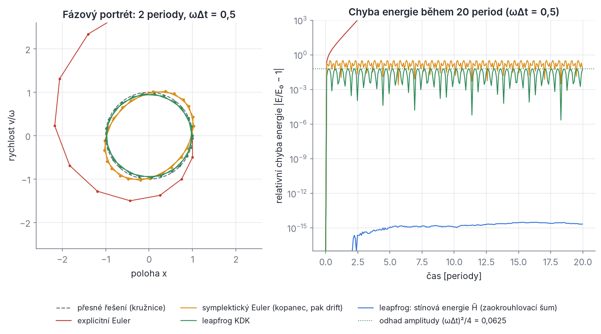
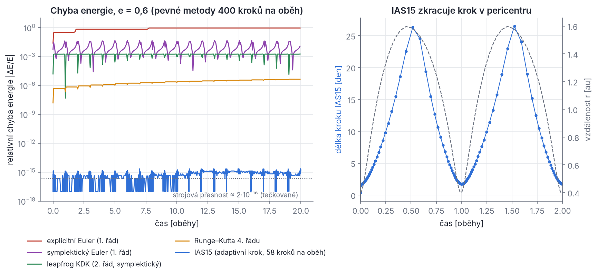
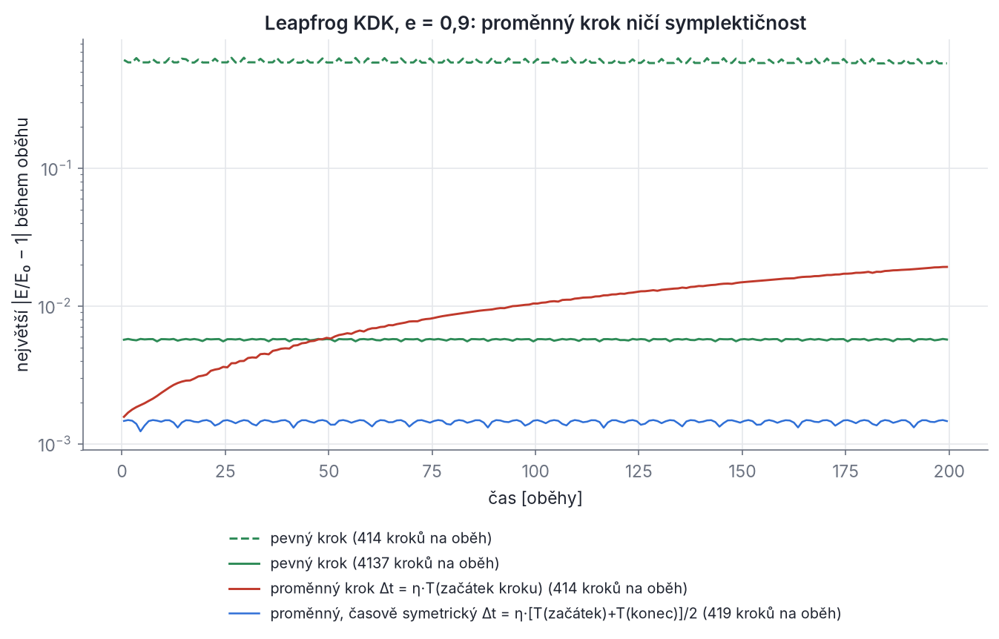
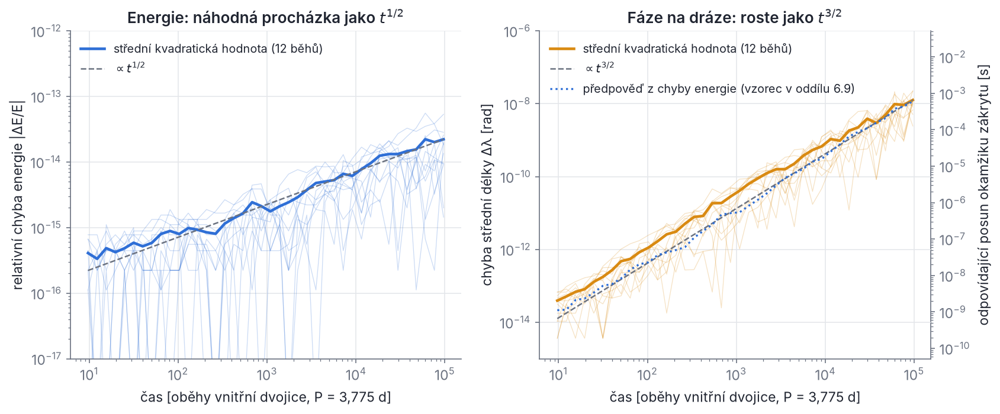

## Kapitola 6 – Numerická integrace N těles

Problém dvou těles umíme vyřešit tužkou na papíře (kapitola 2). Pro tři a více hvězd to nejde: neexistuje obecný vzorec, který by z poloh a rychlostí v čase 0 dal polohy v libovolném čase t. Pohyb proto počítáme krok za krokem: ze stavu v čase t odhadneme stav v čase t + Δt, z něj stav v t + 2Δt a tak dále, třeba miliardkrát. Program, který to dělá, se nazývá **integrátor**.

Zní to jednoduše, ale skrývá se v tom past. Každý krok udělá malou chybu a chyby se sčítají. Špatný integrátor nechá dvojhvězdu během pár set oběhů „odplavat“ na širší dráhu. Dobrý integrátor udrží chybu na úrovni, kterou ani nejlepší pozorování nerozliší. SWINGERsim používá knihovnu REBOUND a v ní integrátor **IAS15**. Jeho chyba v jednom kroku je menší než zaokrouhlovací chyba počítače. Celková chyba pak roste od úrovně strojové přesnosti jen pomalu, jako odmocnina z počtu kroků (Brouwerův zákon, oddíl 6.9).

V této kapitole projdeme celou cestu od nejjednodušší Eulerovy metody k IAS15. Všechno důležité uvidíme na harmonickém oscilátoru, kde se dá spočítat přesně: řád metody, stabilitu, symplektičnost i „stínovou“ energii. Pak se podíváme, co přesně dělá IAS15 uvnitř jednoho kroku a jak volí jeho délku. Nakonec probereme, které síly SWINGERsim přidává (relativita, slapy, rotace), jak kontroluje, že výsledek platí, a kolik výpočet stojí. Na konci kapitoly bys měl rozumět každému řádku výpisu `max |dE/E| = 1.32e-11` po běhu V907 Sco.

### 6.1 Úloha: soustava obyčejných diferenciálních rovnic

**Pohybové rovnice.** Pro N hvězd s hmotnostmi m_i, polohami **r**_i a rychlostmi **v**_i platí Newtonův gravitační zákon:

```latex
\ddot{\mathbf r}_i = -\sum_{j\neq i} \frac{G m_j\,(\mathbf r_i - \mathbf r_j)}{|\mathbf r_i - \mathbf r_j|^3} \;+\; \mathbf f_i^{\,\mathrm{dal}}(\mathbf r, \mathbf v, t), \qquad i = 1,\dots,N
```

Tady **f**_i^dal je zrychlení od dalších sil: obecné relativity a slapů (oddíl 6.11). Tyto síly závisejí i na rychlostech, a to bude pro volbu integrátoru důležité. Změna hmotnosti (vítr, přenos hmoty) není síla. SWINGERsim ji provádí zvlášť, jako **operátor** mezi kroky integrace (oddíl 6.11).

**Převod na soustavu prvního řádu.** Rovnice obsahují druhé derivace. Numerické metody se ale formulují pro rovnice prvního řádu. Trik je jednoduchý: rychlost prohlásíme za samostatnou neznámou. Zavedeme **stavový vektor** y, který obsahuje všechny polohy a rychlosti:

```latex
y = (\mathbf r_1,\dots,\mathbf r_N,\ \mathbf v_1,\dots,\mathbf v_N) \in \mathbb R^{6N},
\qquad
\dot y = F(y,t) = \big(\mathbf v_1,\dots,\mathbf v_N,\ \mathbf a_1(y,t),\dots,\mathbf a_N(y,t)\big)
```

Prvních 3N rovnic říká jen **ṙ**_i = **v**_i, zbylých 3N je Newtonův zákon **v̇**_i = **a**_i. Místo 3N rovnic druhého řádu tak máme 6N rovnic prvního řádu. Pro čtyřhvězdu je to 24 rovnic, se spiny hvězd (oddíl 6.11) dalších 12. Úloha „najdi y(t), když znáš y(0)“ se nazývá **počáteční úloha** (Cauchyova úloha). Matematika zaručuje, že pro hladké F má právě jedno řešení (aspoň na nějakém časovém intervalu: u bodových hmot třeba do srážky). Neříká ale, jak ho spočítat.

**Co dělá integrátor.** Integrátor je předpis Φ_Δt, který ze stavu y_n v čase t_n vyrobí přibližný stav y_{n+1} ≈ y(t_n + Δt). Přesné řešení si označíme φ_Δt (tok rovnice). Rozdíl φ_Δt(y_n) − Φ_Δt(y_n) je chyba jednoho kroku.

> **Pozor.** V této kapitole značíme délku kroku Δt. Písmeno h necháváme pro specifický moment hybnosti **h** = **r** × **v**, jak je v celé knize zvykem. Literatura o integrátorech píše pro krok obvykle h, tak se nenech zmást.

### 6.2 Jaké chyby integrátor dělá

#### Chyba metody: lokální a globální, řád

Představ si, že přesné řešení rozvineme do Taylorovy řady v okolí t_n:

```latex
y(t_n+\Delta t) = y(t_n) + \Delta t\,\dot y(t_n) + \frac{\Delta t^2}{2}\,\ddot y(t_n) + \frac{\Delta t^3}{6}\,\dddot y(t_n) + \dots
```

Integrátor tuto řadu nějak napodobí. Pokud jeho výsledek souhlasí s řadou až po člen Δt^p včetně a liší se až členem Δt^{p+1}, říkáme, že metoda má **řád p**. **Lokální chyba** (chyba jednoho kroku, počítaná z přesného stavu) je pak úměrná Δt^{p+1}:

```latex
\delta_{\mathrm{lok}} = \varphi_{\Delta t}(y_n) - \Phi_{\Delta t}(y_n) = C\,\Delta t^{\,p+1} + O(\Delta t^{\,p+2})
```

kde C závisí na vyšších derivacích řešení.

Proč se řád jmenuje p, a ne p + 1? Kvůli **globální chybě**, tedy chybě po pevné době T. K tomu potřebujeme T/Δt kroků. Pokud se lokální chyby jen sčítají (a nezesilují se), je celková chyba přibližně

```latex
\delta_{\mathrm{glob}} \approx \frac{T}{\Delta t}\; C\,\Delta t^{\,p+1} = C\,T\,\Delta t^{\,p}
```

Poloviční krok tedy zmenší globální chybu 2^p krát: u metody 2. řádu čtyřikrát, u metody 4. řádu šestnáctkrát. To je praktický test řádu: zmenši krok na polovinu a podívej se, kolikrát klesne chyba. Uvedená úvaha je zjednodušená, protože chyby se mohou během integrace zesilovat (v chaotické soustavě exponenciálně). Pro řád metody ale stačí.

Tato chyba se nazývá **chyba metody** nebo **diskretizační chyba** (chyba z useknutí), anglicky *truncation error*: vzniká useknutím Taylorovy řady.

#### Zaokrouhlovací chyba: počítač neumí reálná čísla

Druhý zdroj chyby je počítač sám. Čísla s **dvojitou přesností** (standard IEEE 754, typ `double`) mají 53 platných binárních číslic, tedy asi 16 desetinných. Vzdálenost mezi 1 a nejbližším větším zobrazitelným číslem je **strojové epsilon**

```latex
\epsilon_{\mathrm{m}} = 2^{-52} \approx 2{,}22\cdot 10^{-16}
```

Každá operace (+, −, ×, ÷) zaokrouhlí výsledek na nejbližší zobrazitelné číslo a udělá relativní chybu nejvýše ε_m/2 ≈ 1,1·10⁻¹⁶. Tyto chyby se nedají odstranit zmenšením kroku. Naopak: menší krok znamená víc kroků a víc zaokrouhlování.

**Řešený příklad (sčítání malých čísel).** Přičti k jedničce milionkrát číslo 10⁻¹⁶. Přesný výsledek je 1 + 10⁻¹⁰. Počítač ale vrátí přesně 1,0! Každé jednotlivé 10⁻¹⁶ je menší než polovina vzdálenosti mezi 1 a nejbližším větším číslem (1,1·10⁻¹⁶), takže se pokaždé zaokrouhlí pryč. Přesně tohle se děje v integrátoru: k velké souřadnici x (třeba 1 au) se v každém kroku přičítá malá změna Δx. Nízké bity změny se ztrácejí.

**Kompenzované (Kahanovo) sčítání.** Kahan (1965) navrhl ztracené bity schovat do zvláštní proměnné c a přičíst je při dalším sčítání. IAS15 to dělá u každé aktualizace polohy a rychlosti (funkce `add_cs` v souboru `integrator_ias15.c`):

```python
def add_cs(s, c, x):      # s = průběžný součet, c = kompenzace, x = přičítané číslo
    y = x - c             # oprava o to, co se minule ztratilo
    t = s + y             # nový součet (nízké bity y se tu ztratí)
    c = (t - s) - y       # (t - s) je to, co se opravdu přičetlo; c = minus ztracený zbytek
    return t, c
```

V přesné aritmetice je vždy c = 0. V počítači c přesně zachytí to, co se při sčítání ztratilo. Stejný experiment (milionkrát 10⁻¹⁶) dá s Kahanovým sčítáním 1,0000000001, tedy správný výsledek. Rein & Spiegel (2015) uvádějí, že kompenzované sčítání zmenší náhodnou zaokrouhlovací chybu IAS15 o jeden až dva řády, a to téměř zadarmo.

#### Čtyři složky chyby

Rein & Spiegel (2015) rozdělili celkovou chybu na čtyři části. To se hodí, protože každá roste s časem jinak:

| složka | původ | růst chyby energie | růst chyby fáze na dráze |
| --- | --- | --- | --- |
| E_floor | přesnost čísel: ani počáteční podmínky nejsou zapsány přesně | konstanta ≈ 10⁻¹⁶ | konstanta |
| E_rand | náhodné (nesystematické) zaokrouhlování v každém kroku | ∝ t^{1/2} | ∝ t^{3/2} |
| E_bias | systematické zaokrouhlování (špatně napsaný kód, některé matematické funkce) | ∝ t | ∝ t² |
| E_scheme | chyba metody (useknutí řady) | ∝ t u nesymplektických metod, omezená u symplektických při pevném kroku | ∝ t² nebo ∝ t |

Integrátor je **optimální**, když jeho chyba metody E_scheme zůstává po celou dobu běhu menší než nevyhnutelné E_floor + E_rand. Lepší výsledek se s čísly dvojité přesnosti získat nedá. IAS15 je navržen přesně takto (oddíly 6.8 a 6.9).

> **Z historie.** Šíření zaokrouhlovacích chyb v nebeské mechanice soustavně studoval Dirk Brouwer (1937). Tehdy se dráhy počítaly ručně nebo na mechanických kalkulačkách a astronomové potřebovali vědět, kolik desetinných míst si mají nést, aby se jim chyby nenahromadily. Jeho závěr, že náhodné chyby rostou jako odmocnina z počtu kroků, platí i pro dnešní počítače.

### 6.3 Eulerova metoda: explicitní a symplektická

#### Explicitní Euler

Nejjednodušší nápad: na krátkém intervalu Δt předpokládáme, že se derivace nemění. Z Taylorovy řady si necháme jen první dva členy, y_{n+1} = y_n + Δt F(y_n). Pro polohu a rychlost to znamená

```latex
\mathbf r_{n+1} = \mathbf r_n + \Delta t\,\mathbf v_n, \qquad \mathbf v_{n+1} = \mathbf v_n + \Delta t\,\mathbf a(\mathbf r_n)
```

Podstatné je, že **obě pravé strany používají staré hodnoty** (index n). Nová poloha se počítá ze staré rychlosti a nová rychlost ze zrychlení ve staré poloze. Lokální chyba je člen (Δt²/2)ÿ, který jsme vynechali, tedy ∝ Δt². Metoda je proto **1. řádu**.

#### Symplektický Euler: stačí prohodit pořadí

Stačí nepatrná změna. Nejdřív spočítáme novou rychlost, a teprve **s ní** posuneme polohu:

```latex
\mathbf v_{n+1} = \mathbf v_n + \Delta t\,\mathbf a(\mathbf r_n), \qquad \mathbf r_{n+1} = \mathbf r_n + \Delta t\,\mathbf v_{n+1}
```

Této metodě se říká **symplektický Euler**. Má stejný řád (1) a stejnou cenu (jedno vyhodnocení síly na krok) jako explicitní Euler. Chová se ale úplně jinak. Rozdíl je jen v tom, jestli druhý řádek používá v_n, nebo v_{n+1}. Při programování se to přitom snadno splete: když v kódu napíšeš `r = r + dt*v` a na dalším řádku `v = v + dt*a(r)`, druhý řádek už používá **novou** polohu. Vznikne tím druhá varianta symplektického Eulera (nejdřív drift, pak kopanec v nové poloze), ne explicitní Euler. Explicitní Euler dostaneš, jen když obě nové hodnoty spočítáš ze starých, například `r, v = r + dt*v, v + dt*a(r)`.

Názvy „kopanec“ (kick, změna rychlosti při stojící poloze) a „drift“ (posun polohy při stálé rychlosti) budeme potřebovat v celé kapitole. Symplektický Euler je tedy „kopanec, pak drift“ (nebo opačně), explicitní Euler je obojí najednou ze starých hodnot.

#### Harmonický oscilátor: všechno spočítáme přesně

Abychom viděli, v čem je rozdíl, vezmeme nejjednodušší kmitavý pohyb, **harmonický oscilátor** ẍ = −ω²x. Tady ω označuje úhlovou frekvenci oscilátoru (ne argument pericentra). Přesné řešení je x = cos ωt, v = −ω sin ωt. Zachovává se energie

```latex
E = \tfrac12 v^2 + \tfrac12\omega^2 x^2
```

Ve fázovém prostoru (x, v/ω) obíhá bod po kružnici. Oscilátor je dobrý model keplerovské dráhy: i tam jde o periodický pohyb a malé odchylky od kruhové dráhy kmitají právě harmonicky.

**Explicitní Euler** dává x_{n+1} = x_n + Δt v_n, v_{n+1} = v_n − Δt ω² x_n. Dosadíme do energie:

```latex
\begin{aligned}
2E_{n+1} &= (v_n - \Delta t\,\omega^2 x_n)^2 + \omega^2 (x_n + \Delta t\, v_n)^2 \\
&= v_n^2 - 2\Delta t\,\omega^2 x_n v_n + \Delta t^2\omega^4 x_n^2 + \omega^2 x_n^2 + 2\Delta t\,\omega^2 x_n v_n + \omega^2\Delta t^2 v_n^2 \\
&= (1+\omega^2\Delta t^2)\,(v_n^2 + \omega^2 x_n^2) = (1+\omega^2\Delta t^2)\,2E_n
\end{aligned}
```

Smíšené členy se přesně odečetly. Energie se v **každém** kroku vynásobí číslem 1 + ω²Δt² > 1, nezávisle na tom, kde na dráze bod je. Po jedné periodě s N kroky (Δt = 2π/(ωN)) je

```latex
\frac{E_N}{E_0} = \Big(1+\frac{4\pi^2}{N^2}\Big)^{N} \approx e^{4\pi^2/N}
```

Pro N = 400 kroků na periodu to je 1,104: energie stoupne o 10 % za každý kmit. Pro N = 100 stoupne o 48 %. Bod se ve fázovém prostoru odvíjí po spirále ven (obr. 6.1, červeně). Zmenšení kroku pomůže jen kvantitativně, ne kvalitativně: energie roste vždy.

**Symplektický Euler** (kopanec, pak drift) dává v_{n+1} = v_n − Δt ω² x_n, x_{n+1} = x_n + Δt v_{n+1}. Zapišme jeden krok jako násobení maticí:

```latex
\begin{pmatrix} x_{n+1}\\ v_{n+1}\end{pmatrix} = M_{\mathrm{SE}} \begin{pmatrix} x_{n}\\ v_{n}\end{pmatrix},
\qquad
M_{\mathrm{SE}} = \begin{pmatrix} 1-\omega^2\Delta t^2 & \Delta t\\ -\omega^2\Delta t & 1\end{pmatrix},
\qquad
\det M_{\mathrm{SE}} = 1-\omega^2\Delta t^2 + \omega^2\Delta t^2 = 1
```

Pro srovnání, explicitní Euler má matici s jedničkami na diagonále, Δt vpravo nahoře a −ω²Δt vlevo dole. Její determinant je 1 + ω²Δt² > 1. Co determinant znamená? Matice zobrazuje každou malou plošku ve fázové rovině (x, v) na plošku s plochou vynásobenou determinantem. Explicitní Euler plochu fázového prostoru v každém kroku zvětšuje, symplektický Euler ji **přesně zachovává**. To je v jednom rozměru přesně význam slova **symplektický** (obecnou definici uvidíme v oddílu 6.6).

Zachování plochy má překvapivý důsledek: symplektický Euler přesně zachovává jinou, trochu pozměněnou energii. Ověř dosazením, že

```latex
\tilde E_{\mathrm{SE}} = \tfrac12 v^2 + \tfrac12 \omega^2 x^2 - \tfrac12\,\omega^2\Delta t\; x v
```

má po kroku přesně stejnou hodnotu jako před ním. Je to rovnice elipsy, mírně skloněné vůči kružnici přesného řešení. Bod po ní obíhá stále dokola. Skutečná energie E proto nikam neutíká, jen kolísá, a to s relativní amplitudou řádu ωΔt (obr. 6.1, oranžově). Pro variantu „drift, pak kopanec“ má poslední člen opačné znaménko.



*Obr. 6.1 – Harmonický oscilátor ẍ = −x s krokem ωΔt = 0,5 (12,6 kroku na periodu). Vlevo: fázový portrét během dvou period, osy jsou poloha x a rychlost v/ω, tečky jsou jednotlivé kroky. Přesné řešení je čárkovaná kružnice. Explicitní Euler (červeně) se odvíjí po spirále ven, protože energie v každém kroku vzroste (1 + ω²Δt²)krát. Symplektický Euler (oranžově) obíhá po skloněné elipse a leapfrog (zeleně) po elipse, která kružnici téměř kopíruje. Vpravo: relativní chyba energie během 20 period, logaritmicky. Explicitní Euler roste exponenciálně a opouští graf. Obě symplektické metody jen kolísají kolem stálé úrovně; u leapfrogu je amplituda ≈ (ωΔt)²/4 (zelená tečkovaná čára). Modrá křivka je „stínová“ energie leapfrogu H̃: zůstává stálá až na zaokrouhlovací šum 10⁻¹⁵.*

#### Kepler a Euler

Na keplerovské dráze se obě Eulerovy metody chovají stejně jako na oscilátoru. Spočítali jsme to pro dráhu s a = 1 au, e = 0,6 kolem hvězdy 1 M☉ (perioda 1 rok) se 400 kroky na oběh a 20 oběhy (krátký skript v Pythonu s oběma metodami). Energie dráhy je záporná, E₀ = −GM/(2a):

- **Explicitní Euler**: energie vzroste o (E − E₀)/|E₀| = +0,93, takže dráha je skoro nevázaná. Hvězda se odvinula na vzdálenost 22 au (obr. 6.2, červeně).
- **Symplektický Euler** (drift, pak kopanec): chyba energie jen kolísá, s maximem |ΔE/E| = 0,048 v pericentru, a nikam neutíká. Dráha se ale stáčí: přímka apsid se otáčí, i když skutečná keplerovská dráha je pevná. Takovému čistě numerickému jevu se říká **fiktivní stáčení pericentra** (termín z Brožových učebních textů o efemeridách a numerické integraci). Ve vícenásobné hvězdě by se takové numerické stáčení dalo splést se skutečným apsidálním pohybem (kapitola 7).

> **Pozor.** Často se píše, že „Eulerova metoda soustavně přidává energii“, a vedle toho stojí dvě postupná přiřazení **r** ← **r** + Δt **v**, **v** ← **v** + Δt **a**(**r**). Čteno doslova, druhé přiřazení už používá novou polohu. To je symplektický Euler a jeho energie neutíká. Energii soustavně přidává jen explicitní Euler, (**r**, **v**) ← (**r** + Δt **v**, **v** + Δt **a**(**r**)), kde se obě pravé strany počítají ze starých hodnot.

### 6.4 Leapfrog: druhý řád a stínová energie

#### Kopanec–drift–kopanec

Symplektický Euler je nesymetrický: kopanec stojí na začátku kroku, drift na konci. Když kopanec rozdělíme na dvě poloviny a drift dáme doprostřed, dostaneme **leapfrog** (metodu „přeskokem“; poloha a rychlost se střídají jako skákající žáby). V podobě **kopanec–drift–kopanec** (KDK) vypadá jeden krok takto:

```latex
\mathbf v_{n+1/2} = \mathbf v_n + \tfrac{\Delta t}{2}\,\mathbf a(\mathbf r_n), \qquad
\mathbf r_{n+1} = \mathbf r_n + \Delta t\,\mathbf v_{n+1/2}, \qquad
\mathbf v_{n+1} = \mathbf v_{n+1/2} + \tfrac{\Delta t}{2}\,\mathbf a(\mathbf r_{n+1})
```

Zrychlení **a**(**r**_{n+1}) na konci kroku je zároveň zrychlení na začátku kroku příštího. Stačí ho tedy spočítat jednou, takže leapfrog stojí jedno vyhodnocení síly na krok, stejně jako Euler.

**Proč je to 2. řád.** Dosaďme první rovnici do druhé:

```latex
\mathbf r_{n+1} = \mathbf r_n + \Delta t\,\mathbf v_n + \tfrac12\Delta t^2\,\mathbf a_n
```

To je přesně Taylorova řada polohy až po člen Δt². Chybí až člen (Δt³/6) **ȧ**, kde **ȧ** = d**a**/dt je časová změna zrychlení (*jerk*). Pro rychlost sečteme oba půlkroky: **v**_{n+1} = **v**_n + (Δt/2)(**a**_n + **a**_{n+1}). Rozvineme **a**_{n+1} = **a**_n + Δt **ȧ**_n + (Δt²/2) **ä**_n + …, takže

```latex
\mathbf v_{n+1} = \mathbf v_n + \Delta t\,\mathbf a_n + \tfrac12\Delta t^2\,\dot{\mathbf a}_n + \tfrac14\Delta t^3\,\ddot{\mathbf a}_n + \dots
```

Přesná řada má u členu Δt³ koeficient 1/6 místo 1/4. Lokální chyba rychlosti je tedy (1/4 − 1/6) Δt³ **ä** = Δt³ **ä**/12, lokální chyba polohy Δt³ **ȧ**/6. Obě jsou ∝ Δt³, takže metoda má **řád 2**. Poloviční krok zmenší globální chybu čtyřikrát.

#### Harmonický oscilátor: matice, stabilita a přesně zachovávaná energie

Na oscilátoru dá jeden krok KDK (rozepiš si to: v_{1/2} = v − ½Δt ω² x, x₁ = x + Δt v_{1/2}, v₁ = v_{1/2} − ½Δt ω² x₁ a posbírej členy) matici

```latex
M_{\mathrm{LF}} = \begin{pmatrix} 1-\tfrac12\omega^2\Delta t^2 & \Delta t\\[2pt] -\omega^2\Delta t\left(1-\tfrac14\omega^2\Delta t^2\right) & 1-\tfrac12\omega^2\Delta t^2\end{pmatrix},
\qquad \det M_{\mathrm{LF}} = 1, \qquad \operatorname{tr} M_{\mathrm{LF}} = 2 - \omega^2\Delta t^2
```

Determinant je 1, takže i leapfrog zachovává plochu ve fázovém prostoru: je symplektický. Z matice vyčteme tři věci.

**1. Stabilita.** Vlastní čísla λ matice 2×2 s determinantem 1 splňují λ² − (tr M)λ + 1 = 0. Je-li |tr M| < 2, jsou komplexně sdružená a leží na jednotkové kružnici, λ = e^{±iω̃Δt}. Řešení pak jen rotuje a neroste. Je-li |tr M| > 2, jsou reálná, jedno z nich má absolutní hodnotu větší než 1 a řešení roste exponenciálně. Podmínka |2 − ω²Δt²| < 2 dává

```latex
\omega\,\Delta t < 2 \qquad\Longleftrightarrow\qquad \Delta t < \frac{P}{\pi}
```

kde P = 2π/ω je perioda. S krokem delším než asi třetina periody leapfrog „vybuchne“. Na výstředné dráze hraje roli ω místní frekvence v pericentru, která je mnohem vyšší než střední pohyb n.

**2. Fázová chyba.** Úhel ω̃Δt, o který se bod pootočí za jeden krok, splňuje cos(ω̃Δt) = ½ tr M = 1 − ½ω²Δt². Rozvojem kosinu do čtvrtého řádu dostaneme

```latex
\tilde\omega \approx \omega\Big(1+\frac{\omega^2\Delta t^2}{24}\Big)
```

Numerický oscilátor kmitá trochu rychleji než skutečný. Rozdíl fáze roste **lineárně s časem**. Pro 400 kroků na periodu je relativní chyba frekvence (2π/400)²/24 ≈ 1,0·10⁻⁵, po tisíci periodách tedy 0,065 rad. U symplektických metod je to typické: energie se drží, ale poloha na dráze (fáze) se rozchází. Pro časy zákrytů je přitom podstatná právě fáze.

**3. Stínová energie.** Pro každou matici tvaru (a b; c a) s a² − bc = 1 platí jednoduché tvrzení. Pokud x′ = ax + bv a v′ = cx + av, pak

```latex
\begin{aligned}
-c\,x'^2 + b\,v'^2 &= -c\,(a^2x^2 + 2ab\,xv + b^2v^2) + b\,(c^2x^2 + 2ac\,xv + a^2v^2)\\
&= -c\,(a^2 - bc)\,x^2 + b\,(a^2 - bc)\,v^2 + (2abc - 2abc)\,xv \;=\; -c\,x^2 + b\,v^2
\end{aligned}
```

Veličina −c x² + b v² se tedy zachovává **přesně**. Pro leapfrog je a = 1 − ½ω²Δt², b = Δt, c = −ω²Δt(1 − ¼ω²Δt²). Ověř, že a² − bc = 1. Po vydělení 2Δt dostaneme

```latex
\tilde H = \tfrac12 v^2 + \tfrac12\,\omega^2\Big(1-\tfrac14\omega^2\Delta t^2\Big)\,x^2 = \text{konst. (přesně, v každém kroku)}
```

Této veličině se říká **stínová energie** (stínový hamiltonián, *shadow Hamiltonian*). Leapfrog tedy přesně řeší jiný, nepatrně pozměněný oscilátor: bod obíhá po elipse H̃ = konst. s úhlovou frekvencí ω̃. (Hamiltonián tohoto oscilátoru je násobek (ω̃/ω′)·H̃, kde ω′ = ω√(1 − ¼ω²Δt²). Samotné H̃ by jako hamiltonián s jednotkovou hmotností dalo frekvenci ω′ < ω, ne ω̃ > ω. Na tvaru elipsy to nic nemění, viz též oddíl 6.6.) Skutečná energie se od stínové liší o člen E − H̃ = ⅛ω⁴Δt² x². Protože H̃ je stálá, E jen kolísá: v x = 0 je E = H̃, v bodě obratu (v = 0) je E = H̃/(1 − ¼ω²Δt²). Relativní amplituda kolísání je

```latex
\frac{\Delta E}{E} \approx \frac{(\omega\Delta t)^2}{4}
```

Pro 400 kroků na periodu je to (2π/400)²/4 = 6,2·10⁻⁵. Krok poloviční dá amplitudu čtyřikrát menší, jak se na 2. řád sluší. Na obr. 6.1 je stínová energie modře: drží se na úrovni zaokrouhlovacího šumu, kdežto skutečná energie (zeleně) kolísá s amplitudou (ωΔt)²/4.

Tento jediný příklad obsahuje skoro všechno, co budeme v kapitole potřebovat: řád metody, mez stability, zachování plochy, stínovou energii, omezenou chybu energie a lineárně rostoucí chybu fáze. A to všechno jen se středoškolskou algebrou.

**Řešený příklad (leapfrog na keplerovské dráze).** Pro dráhu z oddílu 6.3 (a = 1 au, e = 0,6, M = 1 M☉, 400 kroků na oběh, 20 oběhů) je největší chyba energie leapfrogu |ΔE/E| = 1,83·10⁻³. S 800 kroky na oběh klesne na 4,57·10⁻⁴, tedy přesně 4,00krát, jak má být u metody 2. řádu. Chyba nikam neutíká (obr. 6.2, zeleně). Fáze se ale rozchází: po 20 oběhech by hvězda měla být zpět v pericentru ve vzdálenosti 0,40 au, leapfrog ji však ukazuje ve vzdálenosti 0,55 au.

### 6.5 Vyšší řád a adaptivní krok

#### Runge–Kutta 4. řádu

Klasická **metoda Rungeho–Kutty 4. řádu** (RK4) vyhodnotí pravou stranu F čtyřikrát v jednom kroku a výsledky zprůměruje s vahami:

```latex
\begin{aligned}
k_1 &= F(y_n,\,t_n), & k_2 &= F\big(y_n + \tfrac{\Delta t}{2}k_1,\; t_n + \tfrac{\Delta t}{2}\big),\\
k_3 &= F\big(y_n + \tfrac{\Delta t}{2}k_2,\; t_n + \tfrac{\Delta t}{2}\big), & k_4 &= F\big(y_n + \Delta t\,k_3,\; t_n + \Delta t\big),\\
y_{n+1} &= y_n + \tfrac{\Delta t}{6}\,(k_1 + 2k_2 + 2k_3 + k_4)
\end{aligned}
```

Váhy 1/6, 2/6, 2/6, 1/6 jsou zvoleny tak, aby výsledek souhlasil s Taylorovou řadou až po člen Δt⁴. Lokální chyba je ∝ Δt⁵, globální ∝ Δt⁴. Pro jednoduchou rovnici ẏ = F(t), kde F nezávisí na y, se RK4 změní na Simpsonovo pravidlo pro integrál.

RK4 je v jednom kroku mnohem přesnější než leapfrog, ale **není symplektická**. Na keplerovské dráze (stejná dráha, 400 kroků na oběh) energie soustavně a lineárně s časem **klesá**: po 20 obězích je (E − E₀)/|E₀| = −4,2·10⁻⁶. Dráha se pomalu zmenšuje, jako by na hvězdu působilo slabé tření (obr. 6.2, oranžově). Chyba je v absolutní hodnotě sice asi čtyřistakrát menší než u leapfrogu, ale roste bez omezení. Po milionu oběhů by dosáhla 0,2.

#### Proč měnit délku kroku

Na výstředné dráze se hvězda v pericentru pohybuje rychle a blízko průvodce, v apocentru pomalu a daleko. Pevný krok musí být dost krátký pro pericentrum, a v apocentru se tím zbytečně plýtvá. **Adaptivní krok** se mění podle toho, jak rychle se stav právě mění.

Jaká časová škála je „přirozená“? Pomůže poměr zrychlení a jeho časové změny, |**a**|/|**ȧ**|. Na keplerovské dráze je **a** = −GM**r**/r³, a derivací podle času

```latex
\dot{\mathbf a} = -GM\left(\frac{\mathbf v}{r^3} - \frac{3\,(\mathbf r\cdot\mathbf v)\,\mathbf r}{r^5}\right)
```

V pericentru a apocentru je **v** kolmé na **r**, takže **r**·**v** = 0 a |**ȧ**| = GMv/r³. Poměr je tam přesně

```latex
\frac{|\mathbf a|}{|\dot{\mathbf a}|} = \frac{GM/r^2}{GMv/r^3} = \frac{r}{v}
```

Krok úměrný r/v je v apocentru delší než v pericentru o faktor (r_a/r_p)(v_p/v_a). Pro e = 0,6 je r_a/r_p = (1 + e)/(1 − e) = 4 a podle zákona zachování momentu hybnosti také v_p/v_a = 4. Krok se tedy mezi pericentrem a apocentrem změní asi šestnáctkrát. Tuto časovou škálu (zpřesněnou o druhou derivaci zrychlení) používá i IAS15 (oddíl 6.8). Na obr. 6.2 vpravo má jeho krok v pericentru 1,73 dne a v apocentru 26,6 dne, poměr 15,3.

**Jak se krok volí u metod typu RK4.** Chybu kroku odhadneme tak, že stejný úsek spočítáme dvakrát: jedním krokem Δt a dvěma kroky Δt/2. Rozdíl obou výsledků je úměrný lokální chybě, tedy Δt⁵. Pokud je větší než zadaná tolerance, krok se zopakuje s kratším Δt. Pokud je menší, další krok se prodlouží. Nový krok je Δt_nový = Δt (tolerance/chyba)^{1/5}, obvykle vynásobený bezpečnostním faktorem kolem 0,9. Stejná myšlenka (chyba ∝ Δt^{p+1}, tedy nový krok jako odmocnina řádu p + 1) se vrátí u IAS15 se sedmou odmocninou.



*Obr. 6.2 – Vlevo: relativní chyba energie |ΔE/E| při integraci dráhy s a = 1 au, e = 0,6 kolem hvězdy 1 M☉ (perioda 1 rok) během 20 oběhů. Explicitní Euler, symplektický Euler (drift, pak kopanec), leapfrog KDK a RK4 mají pevný krok, 400 kroků na oběh. IAS15 volí krok sám a potřebuje v průměru 58 kroků na oběh. Explicitní Euler skočí v každém pericentru o kus nahoru a skončí na |ΔE/E| ≈ 0,93. Obě symplektické metody kolísají kolem stálé úrovně. RK4 pomalu, ale soustavně roste. IAS15 zůstává na úrovni strojové přesnosti (tečkovaně). Vpravo: délka kroku IAS15 (modře, levá osa) během prvních dvou oběhů a vzdálenost hvězd r (šedě čárkovaně, pravá osa). Krok sleduje poměr r/v: v pericentru je 1,73 dne, v apocentru 26,6 dne.*

S rostoucí výstředností potřebuje IAS15 na jeden oběh víc kroků. Pro dvě stejně hmotné hvězdy jsme naměřili (20 oběhů, výchozí nastavení REBOUND 5.2.2):

| e | 0 | 0,3 | 0,6 | 0,9 | 0,99 |
| --- | --- | --- | --- | --- | --- |
| kroků IAS15 na oběh | 35,9 | 41,4 | 58,0 | 97,1 | 159 |

Hodnota 35,9 pro kruhovou dráhu není náhoda. Odvodíme ji v oddílu 6.8.

### 6.6 Symplektické integrátory obecně

Na oscilátoru jsme viděli, že symplektické metody drží energii, kdežto ostatní ji nechají utéct. Proč? A platí to i pro N těles? Odpověď dává hamiltonovská mechanika.

#### Hamiltonovy rovnice a tok ve fázovém prostoru

Označme zobecněné souřadnice q = (q₁, …, q_f) a hybnosti p = (p₁, …, p_f), kde f je počet stupňů volnosti (pro N hvězd f = 3N, q jsou kartézské složky poloh a p = m**v**). **Hamiltonova funkce** (hamiltonián) H(q, p) je celková energie zapsaná pomocí q a p. Pro gravitující hvězdy

```latex
H = T(p) + V(q) = \sum_{i=1}^{N}\frac{|\mathbf p_i|^2}{2m_i} \;-\; \sum_{i<j}\frac{G m_i m_j}{|\mathbf r_i - \mathbf r_j|}
```

Pohybové rovnice mají tvar **Hamiltonových rovnic**

```latex
\dot q_k = \frac{\partial H}{\partial p_k}, \qquad \dot p_k = -\frac{\partial H}{\partial q_k}, \qquad k = 1,\dots,f
```

Ověř, že pro náš H dávají ṙ_i = **p**_i/m_i a ṗ_i = −∇_i V, tedy Newtonův zákon. Přesné řešení zobrazí počáteční bod z₀ = (q₀, p₀) na bod z(t). Tomuto zobrazení říkáme **tok** φ_t.

**Symplektičnost.** Uvažujme Jacobiho matici toku M = ∂z(t)/∂z₀ (rozměr 2f × 2f) a matici

```latex
J = \begin{pmatrix} 0 & I_f \\ -I_f & 0 \end{pmatrix}
```

kde I_f je jednotková matice f × f. Zobrazení se nazývá **symplektické**, když

```latex
M^{\mathsf T} J\, M = J
```

Tok každé hamiltonovské soustavy tuto podmínku splňuje (to je věta z analytické mechaniky). Geometricky to znamená, že se zachovává součet orientovaných ploch, které každá malá ploška ve fázovém prostoru vytíná v rovinách (q_k, p_k). Pro jeden stupeň volnosti (f = 1) je podmínka totožná s det M = 1, tedy se zachováním plochy, jak jsme viděli u oscilátoru. Pro více stupňů volnosti ze symplektičnosti plyne det M = 1, tedy zachování objemu ve fázovém prostoru (**Liouvilleova věta**). Opačně to ale neplatí: zachování objemu je slabší vlastnost než symplektičnost.

**Symplektický integrátor** je metoda, jejíž jeden krok Φ_Δt je symplektické zobrazení. Zachovává symplektickou formu, a tím i objem ve fázovém prostoru.

#### Rozdělení hamiltoniánu a leapfrog jako složení toků

Celou soustavu najednou přesně řešit neumíme. Hamiltonián ale můžeme **rozdělit** (*splitting*) na části, z nichž každou zvlášť přesně vyřešit umíme:

- **H = T(p)** samotná: q̇ = ∂T/∂p = p/m, ṗ = 0. Hybnosti stojí a polohy se posouvají rovnoměrně: **drift**. Přesné řešení po čase Δt je q → q + Δt p/m.
- **H = V(q)** samotná: q̇ = 0, ṗ = −∂V/∂q. Polohy stojí a hybnosti se mění konstantní silou: **kopanec**. Přesné řešení je p → p − Δt ∂V/∂q.

Každé z těchto dvou zobrazení je **přesný tok hamiltonovské soustavy**, a je proto symplektické. Složení symplektických zobrazení je opět symplektické (ověř: (M₁M₂)ᵀJ(M₁M₂) = M₂ᵀ(M₁ᵀJM₁)M₂ = M₂ᵀJM₂ = J). Leapfrog KDK je složení tří přesných toků

```latex
\Phi^{\mathrm{KDK}}_{\Delta t} = \varphi^{V}_{\Delta t/2}\circ\varphi^{T}_{\Delta t}\circ\varphi^{V}_{\Delta t/2}
```

(čte se zprava doleva: půl kopance, celý drift, půl kopance). Je proto symplektický pro **jakýkoli** potenciál V, nejen pro oscilátor. Symplektický Euler je složení dvou toků, φ^T_Δt ∘ φ^V_Δt.

#### Proč se energie neztrácí: Poissonovy závorky a vzorec BCH

Kdyby toky obou částí byly zaměnitelné (nezáleželo by na pořadí), složení by dalo přesný tok celého H. Nezáleží na pořadí? Míru nezáměnnosti udává **Poissonova závorka**

```latex
\{f,g\} = \sum_{k=1}^{f}\left(\frac{\partial f}{\partial q_k}\frac{\partial g}{\partial p_k} - \frac{\partial f}{\partial p_k}\frac{\partial g}{\partial q_k}\right)
```

Časová změna libovolné veličiny g podél toku H je ġ = {g, H}. Pro rozdělení H = T + V platí matematický výsledek zvaný **vzorec Bakerův–Campbellův–Hausdorffův** (BCH). Říká, že složení toků T a V je samo přesným tokem nějakého jiného hamiltoniánu H̃, který lze zapsat jako řadu v mocninách Δt s vnořenými Poissonovými závorkami. Pro symplektického Eulera (nejdřív kopanec, pak drift) je

```latex
\tilde H_{\mathrm{SE}} = H + \frac{\Delta t}{2}\,\{T,V\} + O(\Delta t^2)
```

a pro leapfrog KDK

```latex
\tilde H_{\mathrm{KDK}} = H + \frac{\Delta t^2}{12}\,\{\{V,T\},T\} - \frac{\Delta t^2}{24}\,\{\{T,V\},V\} + O(\Delta t^4)
```

Těmto H̃ říkáme **stínové** (modifikované) hamiltoniány. Všimni si dvou věcí:

1. Symetrická metoda (leapfrog je stejná při čtení zleva i zprava) má v řadě jen **sudé** mocniny Δt. Proto je 2. řádu, ačkoli je stejně levná jako Euler 1. řádu.
2. Opravné členy zmizí, když {T, V} = 0, tedy když jsou obě části zaměnitelné. To dává smysl: pak je rozdělení přesné.

**Ověření na oscilátoru.** Pro T = p²/2 a V = ω²q²/2 vychází {T, V} = −ω²qp. Pak {{V, T}, T} = ω²p² a {{T, V}, V} = ω⁴q², takže

```latex
\tilde H_{\mathrm{KDK}} = \frac{p^2}{2}\Big(1+\frac{\omega^2\Delta t^2}{6}\Big) + \frac{\omega^2 q^2}{2}\Big(1-\frac{\omega^2\Delta t^2}{12}\Big) + O(\Delta t^4)
```

Poměr koeficientů u q² a p² je ω²(1 − ω²Δt²/12)/(1 + ω²Δt²/6) ≈ ω²(1 − ω²Δt²/4). Přesně ten vyšel v oddílu 6.4 pro přesně zachovávanou veličinu. U symplektického Eulera dá −½ω²Δt qp z prvního členu řady přesně skloněnou elipsu z oddílu 6.3. Pro gravitaci je {{T, V}, V} = Σ m_i |**a**_i|², takže oprava je největší tam, kde je zrychlení největší: v pericentru.

> **Pozor.** U oscilátoru se řada BCH dá sečíst a stínová energie se zachovává přesně. Obecně se ale řada **nesčítá** (je jen asymptotická). Platí slabší, ale stále velmi silné tvrzení (Benettin & Giorgilli 1994; Hairer, Lubich & Wanner 2006): když řadu usekneš na vhodném místě, numerické řešení zůstává k toku useknutého H̃ exponenciálně blízko, s chybou řádu e^{−c/Δt}, a to po exponenciálně dlouhou dobu. Proto chyba energie symplektického integrátoru s pevným krokem „neroste, jen kolísá“ po prakticky libovolně dlouhou dobu, pokud je krok výrazně kratší než nejrychlejší časová škála soustavy (v praxi pod asi desetinou). Neplatí to, když se krok blíží mezi stability, a v chaotických soustavách se samozřejmě dál rozcházejí blízké trajektorie.

**Vyšší řády.** Složením několika kroků leapfrogu s vhodně zvolenými délkami lze dostat symplektické metody 4., 6. i vyššího řádu (Yoshida 1990). Dá se ale dokázat, že nad 2. řádem musí mít aspoň jeden dílčí krok **zápornou** délku. Metoda pak chvíli integruje pozpátku, a to je u disipativních sil nepříjemné.

#### Proměnný krok ničí symplektičnost

Vraťme se k výstředné dráze. Mohli bychom leapfrogu dovolit měnit krok podle stavu, třeba Δt = η √(r³/GM) s malým číslem η? Bohužel to nejde zadarmo, ze dvou důvodů:

1. Když krok závisí na stavu, Δt = Δt(z), je jeden krok zobrazení z → Φ_{Δt(z)}(z). Jeho Jacobiho matice obsahuje navíc člen (∂Φ/∂Δt)·(∂Δt/∂z) a podmínka MᵀJM = J už obecně neplatí.
2. I kdyby platila, stínový hamiltonián H̃ závisí na Δt. Každý krok s jinou délkou má jiné H̃. Nic tedy nezůstává stálé a chyba energie může kolísat i ujíždět.

Obr. 6.3 to ukazuje na dráze s e = 0,9. Leapfrog, jehož krok se volí podle stavu na začátku kroku, má zpočátku chybu energie 1,6·10⁻³, ale ta soustavně roste, po 200 obězích na 1,9·10⁻². Pomůže **časová symetrie** (Dehnen & Read 2011): krok volíme tak, aby byl stejný při běhu dopředu i dozadu, například Δt = ½η[T(z_n) + T(z_{n+1})], kde T je místní časová škála. Rovnici je třeba řešit iterací, protože z_{n+1} závisí na Δt. Taková metoda už není přesně symplektická, ale je **časově vratná**, a to u periodických drah stačí, aby energie neujížděla (modře: stálých 1,5·10⁻³ při stejném počtu kroků). Pevný krok se stejným počtem kroků (414 na oběh) pericentrum nerozliší a chyba energie je 0,58. Teprve desetkrát víc kroků ji stáhne na 5,7·10⁻³, a to je stále čtyřikrát víc než u symetrického proměnného kroku.



*Obr. 6.3 – Největší relativní chyba energie během každého oběhu (logaritmicky) pro leapfrog KDK na dráze s e = 0,9, a = 1 au, M = 1 M☉, během 200 oběhů. Zelené čárkovaně: pevný krok, 414 kroků na oběh; pericentrum není rozlišené a chyba je 0,58. Zelená plná: pevný krok, 4137 kroků na oběh, chyba stálá 5,7·10⁻³. Červeně: krok úměrný místní časové škále √(r³/GM) na začátku kroku (414 kroků na oběh); chyba soustavně roste. Modře: časově symetrický proměnný krok (419 kroků na oběh); chyba zůstává stálá a nejmenší ze všech.*

### 6.7 Wisdomův–Holmanův integrátor a WHFast

Pro planetární soustavy existuje chytřejší rozdělení než T + V. Planeta obíhá hlavně kolem hvězdy a ostatní planety ji jen slabě ruší. Wisdom & Holman (1991) proto rozdělili hamiltonián na **keplerovskou část** a malou **interakci**. Nejlépe se to dělá v **Jacobiho souřadnicích** (oddíl 3.3). Těla seřadíme 0, 1, 2, … a polohu tělesa i měříme od těžiště všech těles s menším indexem:

```latex
\mathbf r'_i = \mathbf r_i - \mathbf R_{i-1}, \qquad \mathbf R_{i} = \frac{1}{M_i}\sum_{j=0}^{i} m_j\mathbf r_j, \qquad M_i = \sum_{j=0}^{i} m_j
```

Každému Jacobiho vektoru přísluší hmotnost m′_i = m_i M_{i−1}/M_i (redukovaná hmotnost tělesa i a všech vnitřních těles dohromady). Kinetická energie se v těchto souřadnicích rozpadne na nezávislé členy bez smíšených součinů. Hamiltonián se zapíše jako

```latex
H = \underbrace{\sum_{i\ge 1}\left(\frac{|\mathbf p'_i|^2}{2m'_i} - \frac{G m'_i M_i}{r'_i}\right)}_{H_{\mathrm{Kepler}}}
\;+\; \underbrace{\sum_{i\ge 1}\frac{G m'_i M_i}{r'_i} - \sum_{i<j}\frac{G m_i m_j}{|\mathbf r_i - \mathbf r_j|}}_{H_{\mathrm{int}}}
```

(bez kinetické energie těžiště, která je stálá). H_Kepler je součet nezávislých problémů dvou těles, a ty umíme vyřešit přesně (Keplerova rovnice z oddílů 2.7 a 2.8). H_int je jen to, o co se skutečná gravitace liší od těchto keplerovských členů. Pro planety je malé, relativně ε ~ m_planeta/M_hvězda ≈ 10⁻³. Krok Wisdomova–Holmanova integrátoru je opět „drift–kopanec–drift“, jen drift je teď přesný keplerovský pohyb po elipse po dobu Δt/2. Podle vzorce BCH je chyba úměrná součinu ε(Δt/T)², tedy o tři řády menší než u leapfrogu se stejným krokem. V REBOUND je moderní implementace pod jménem **WHFast** (Rein & Tamayo 2015). Keplerovský krok řeší v univerzálních proměnných (oddíl 2.11; jeden vzorec pro elipsu, parabolu i hyperbolu) a přidává **symplektické korektory**, které odstraní hlavní chybové členy.

Proč tedy SWINGERsim WHFast nepoužívá? Pro hvězdné soustavy selhávají všechny předpoklady:

1. **Interakce není malá.** Ve vícenásobné hvězdě mají hvězdy srovnatelné hmotnosti. Rein & Spiegel (2015, odd. 4.3) to otestovali na trojhvězdě se třemi tělesy po 1 M☉ (vnitřní pár 1 au, třetí těleso 10 au, sklon 89,9°, při cyklu ZLK e_max ≈ 0,992). Integrátory typu WH tam drží moment hybnosti, ale chyba energie je velká. Autoři to vysvětlují tím, že na vnitřní dvojhvězdu se stejnými hmotnostmi tyto integrátory nebyly stavěny.
2. **Soustava 2+2 není jeden Jacobiho řetězec.** V řetězci obíhá každé těleso těžiště všech předchozích. Ve čtyřhvězdě 2+2 ale hvězda 4 obíhá hvězdu 3, ne těžiště hvězd 1, 2 a 3. Keplerovský člen by popisoval špatný pohyb a „malá“ interakce by byla obrovská.
3. **Pevný krok musí stačit na nejhlubší pericentrum.** Délka kroku symplektického integrátoru musí být pevná (oddíl 6.6). V cyklech ZLK (kapitola 5) vnitřní dráha občas dosáhne výstřednosti 0,99 a víc. Celá integrace by pak musela běžet s krokem, který rozliší toto nejhlubší pericentrum, i když trvá jen nepatrnou část běhu. Doba průchodu pericentrem je řádu (1 − e)^{3/2}/n, pro e = 0,99 tedy asi šestitisíckrát kratší než oběžná doba 2π/n.
4. **Síly závislé na rychlosti.** Relativistické a slapové síly (oddíl 6.11) závisejí na rychlosti. V rozdělených schématech se pak symplektičnost buď ztrácí, nebo je potřeba implicitních kroků. Tamayo et al. (2020) ukázali, že nevhodně zařazený relativistický člen v integrátoru WH vede k soustavnému růstu energie.

Proto SWINGERsim sahá po obecném integrátoru s adaptivním krokem. Tamayo et al. (2020) ostatně doporučují IAS15 jako nejbezpečnější (a v REBOUND výchozí) volbu pro všechny případy, kdy síly nejsou vždy malé vůči centrálnímu tělesu.

> **Z historie.** Wisdom & Holman (1991) svou metodou spočítali vývoj vnějších planet Sluneční soustavy na miliardu let a porovnali ho s dřívějším během na 845 milionů let, který proběhl na speciálním počítači Digital Orrery. Symplektické mapy se od té doby staly základem téměř všech studií dlouhodobé stability planetárních soustav.

### 6.8 IAS15 zevnitř

**IAS15** (Rein & Spiegel 2015) je zkratka *Integrator with Adaptive Step-size control, 15th order*. Navazuje na integrátor RADAU, který popsal Everhart (1985). Je to integrátor **15. řádu s adaptivním krokem**, **implicitní** (síly uvnitř kroku závisejí na neznámých polohách, takže se počítají iterací) a **nesymplektický**. Řeší obecnou rovnici

```latex
\ddot y = F(\dot y,\, y,\, t)
```

kde y jsou všechny polohy a F smí záviset i na rychlostech. To je pro SWINGERsim důležité, protože relativistické i slapové síly na rychlostech závisejí. Projdeme jeden krok IAS15 od začátku do konce.

#### Krok 1: polynom pro zrychlení

Uvnitř kroku z t_n do t_n + Δt zavedeme bezrozměrný čas u = (t − t_n)/Δt, který běží od 0 do 1. IAS15 **nerozvíjí do polynomu polohy ani rychlosti, ale zrychlení**. Přibližuje ho polynomem 7. stupně v u:

```latex
\ddot y(u) \approx \ddot y_0 + b_0\,u + b_1\,u^2 + b_2\,u^3 + \dots + b_6\,u^7
```

Tady ÿ₀ je zrychlení na začátku kroku (známe ho) a b₀, …, b₆ jsou neznámé vektorové koeficienty se stejným rozměrem jako zrychlení. Rychlost a polohu dostaneme **přesnou integrací polynomu** (integrál z u^k je u^{k+1}/(k+1)):

```latex
\begin{aligned}
\dot y(u) &= \dot y_0 + \Delta t\left(\ddot y_0\,u + \frac{b_0}{2}u^2 + \frac{b_1}{3}u^3 + \dots + \frac{b_6}{8}u^8\right)\\
y(u) &= y_0 + \dot y_0\,\Delta t\,u + \Delta t^2\left(\frac{\ddot y_0}{2}u^2 + \frac{b_0}{6}u^3 + \frac{b_1}{12}u^4 + \dots + \frac{b_k\,u^{k+3}}{(k+2)(k+3)} + \dots + \frac{b_6}{72}u^9\right)
\end{aligned}
```

Rychlost je tedy polynom 8. a poloha 9. stupně. Na konci kroku (u = 1) dostaneme

```latex
\begin{aligned}
\dot y_1 &= \dot y_0 + \Delta t\left(\ddot y_0 + \frac{b_0}{2} + \frac{b_1}{3} + \frac{b_2}{4} + \frac{b_3}{5} + \frac{b_4}{6} + \frac{b_5}{7} + \frac{b_6}{8}\right)\\
y_1 &= y_0 + \dot y_0\,\Delta t + \Delta t^2\left(\frac{\ddot y_0}{2} + \frac{b_0}{6} + \frac{b_1}{12} + \frac{b_2}{20} + \frac{b_3}{30} + \frac{b_4}{42} + \frac{b_5}{56} + \frac{b_6}{72}\right)
\end{aligned}
```

Přesně tyto zlomky (1/72, 1/56, …, 1/2 a 1/8, 1/7, …, 1/2) najdeš v kódu REBOUND v posledních řádcích kroku IAS15, každý přičtený kompenzovaným sčítáním.

#### Krok 2: kde vyhodnotit síly – Gaussovy–Radauovy body

Abychom určili sedm neznámých koeficientů b₀, …, b₆, potřebujeme znát zrychlení v sedmi dalších okamžicích uvnitř kroku. Kam je dát? Pomůže teorie **gaussovských kvadratur**. Integrál ∫₀¹ g(u) du nahradíme váženým součtem Σ w_k g(u_k). Při vhodné volbě m uzlů u_k a vah w_k je takový vzorec přesný pro polynomy vysokého stupně:

- Gaussova kvadratura s m volně zvolenými uzly je přesná pro polynomy až do stupně 2m − 1.
- **Gaussova–Radauova** kvadratura má jeden uzel pevně na začátku intervalu (u = 0) a ostatní volí optimálně. Je přesná do stupně 2m − 2.

Začátek kroku se nám hodí, protože tam polohu, rychlost i zrychlení už známe. IAS15 používá m = 8 uzlů, tedy u₀ = 0 a sedm dalších:

| k | 0 | 1 | 2 | 3 | 4 | 5 | 6 | 7 |
| --- | --- | --- | --- | --- | --- | --- | --- | --- |
| u_k | 0 | 0,0563 | 0,1802 | 0,3526 | 0,5472 | 0,7342 | 0,8853 | 0,9775 |

Jsou to kořeny polynomu (P₇(x) + P₈(x))/(1 + x), kde P_k jsou Legendreovy polynomy, převedené z intervalu [−1, 1] na [0, 1] vztahem u = (x + 1)/2. Uzly se zhušťují ke koncům intervalu. Ověřili jsme numericky, že s těmito uzly a odpovídajícími vahami (první váha je 1/64) integruje vzorec polynomy do stupně 14 přesně (chyba 10⁻¹⁵), ale u stupně 15 už ne (chyba 1,5·10⁻⁹).

Chyba jednoho kroku je pak úměrná Δt¹⁶. Rein & Spiegel (2015) z chybového členu Gaussovy–Radauovy kvadratury (Hildebrand) odvodili

```latex
\delta y \approx C_8\, y^{(16)}(\xi)\,\Delta t^{16}, \qquad C_8 = \frac{8\,(7!)^4}{2\,(15!)^3} \approx 1{,}15\cdot 10^{-21}
```

kde y^{(16)} je šestnáctá derivace polohy někde uvnitř kroku. Lokální chyba ∝ Δt¹⁶ znamená **metodu 15. řádu**, odtud „15“ ve jméně.

**Newtonův tvar polynomu.** V praxi se polynom pro zrychlení zapisuje v **Newtonově (interpolačním) tvaru**

```latex
\ddot y(u) = \ddot y_0 + g_1\,u + g_2\,u(u-u_1) + g_3\,u(u-u_1)(u-u_2) + \dots + g_7\,u(u-u_1)\cdots(u-u_6)
```

s koeficienty g₁ = (ÿ₁ − ÿ₀)/u₁, g₂ = (ÿ₂ − ÿ₀ − g₁u₂)/[u₂(u₂ − u₁)] atd., kde ÿ_k je zrychlení v uzlu u_k. Výhoda: koeficient g_k potřebuje jen zrychlení v uzlech u₀, …, u_k. Při průchodu uzly jeden po druhém můžeme g aktualizovat průběžně. Koeficienty b se pak z g spočítají pevnými lineárními kombinacemi (pole `c` a `d` v kódu), všechny předem spočítané ve zvýšené přesnosti.

#### Krok 3: prediktor a korektor

Je tu háček: abychom spočítali zrychlení v uzlu u_k, potřebujeme polohy (a u sil závislých na rychlosti i rychlosti) v čase u_k. Ty ale dává polynom, jehož koeficienty b teprve hledáme. Úloha je **implicitní**. IAS15 ji řeší iterací (metodou prediktor–korektor):

1. **Prediktor.** Na začátku kroku vezme polynom zrychlení z předchozího kroku, prodlouží ho za konec tohoto kroku a přepíše na nový interval (funkce `predict_next_step`). Nový koeficient b_k je q^{k+1}-násobek kombinace starých b_k, …, b₆ s binomickými koeficienty: kombinace vzniká posunutím počátku o celý starý krok, faktor q^{k+1} (q = Δt_nový/Δt_starý) tím, že b_k nese faktor Δt^{k+1}. K tomu přidá opravu podle toho, jak se minulá předpověď lišila od výsledku. V úplně prvním kroku (a když se krok prodlouží víc než dvacetkrát) jsou všechna b nulová, tedy konstantní zrychlení.
2. **Průchod uzly.** Pro k = 1, …, 7: z aktuálních b spočítá polohy (a s rychlostně závislými silami i rychlosti) v čase u_k, vyhodnotí v nich síly, aktualizuje g_k a z něj všechna b.
3. **Test konvergence.** Spočítá, o kolik se v tomto průchodu změnil nejvyšší koeficient b₆, relativně k zrychlení: max|δb₆|/max|ÿ|. Iterace končí, když
   - (a) tato změna klesne pod 10⁻¹⁶ (konvergence na úroveň strojové přesnosti), nebo
   - (b) se po více než dvou iteracích přestane zmenšovat (osciluje na úrovni zaokrouhlovacích chyb), nebo
   - (c) proběhlo 12 iterací. To je známka příliš dlouhého kroku a po desátém takovém případu REBOUND vypíše varování.

Každý průchod stojí 7 vyhodnocení sil. Pro V907 Sco (newtonovsky, 2 roky) jsme napočítali 22,1 vyhodnocení síly na krok, tedy 1 + 3 × 7: jedno na začátku kroku a v průměru tři průchody uzly (počítadlo volání silové funkce v REBOUND). Krok IAS15 je tedy asi dvacetkrát dražší než krok leapfrogu. Vrací to ovšem tím, že je mnohem delší a nesrovnatelně přesnější.

#### Krok 4: jak dlouhý má být příští krok

Po konvergenci zná IAS15 celý polynom, a tedy i to, jak rychle se zrychlení mění. Z toho odhadne délku příštího kroku.

**Původní kritérium (Rein & Spiegel 2015).** Nejvyšší člen b₆u⁷ je v rozvoji nejmenší. Když řada rychle konverguje, je useknutá chyba ještě menší než on. Jeho relativní velikost

```latex
\tilde b_6 = \frac{\max_i |b_{6,i}|}{\max_i |\ddot y_i|}
```

je proto míra „hladkosti“ síly v kroku. Protože b₆ nese faktor Δt⁷, změna kroku f-krát změní b̃₆ f⁷-krát. Chceme-li b̃₆ rovné zadanému číslu ε_b, má být nový krok

```latex
\Delta t_{\mathrm{nový}} = \Delta t\left(\frac{\varepsilon_b}{\tilde b_6}\right)^{1/7}
```

Parametr ε_b (v REBOUND `epsilon`, výchozí 10⁻⁹) **není** požadovaná přesnost výsledku. Určuje jen, jak hladká má být síla v rámci kroku.

**Proč zrovna ε_b = 10⁻⁹.** Rein & Spiegel to zdůvodnili jednoduchým modelem. Předpokládejme, že se poloha mění jako jedna harmonická funkce s frekvencí ω, takže každá derivace přidá faktor ω. Koeficient b₆ je člen u⁷ Taylorovy řady zrychlení, b₆ = ÿ^{(7)} Δt⁷/7!, a jeho poměr k zrychlení je

```latex
\tilde b_6 \approx \frac{(\omega\Delta t)^7}{7!} \quad\Longrightarrow\quad \omega\Delta t = (7!\,\varepsilon_b)^{1/7}
```

Pro ε_b = 10⁻⁹ je (5040·10⁻⁹)^{1/7} = 0,1751, tedy Δt = 0,1751/ω = 0,0279 P, kde P = 2π/ω. To je **35,9 kroku na periodu**. Chyba kroku je pak podle vzorce s C₈ asi C₈(ωΔt)¹⁶ ≈ 1,15·10⁻²¹ × 7,8·10⁻¹³ ≈ 9·10⁻³⁴, o 17 řádů pod strojovou přesností. Tolik rezervy je potřeba proto, že za 10¹⁰ oběhů se udělá asi 4·10¹¹ kroků a chyby metody, které jsou systematické, se sčítají lineárně. Díky 16. mocnině ale stačí krok jen o málo kratší: chyba kroku 10⁻¹⁶ by dovolila Δt ≈ 0,32 P, chyba 10⁻²⁸ vyžaduje Δt ≈ 0,058 P (úloha 6.7). Rein & Spiegel k tomu přidali ještě dvojnásobnou rezervu a dostali ε_b = 10⁻⁹.

**Kritérium, které SWINGERsim skutečně používá: PRS23.** Od ledna 2024 má REBOUND jako výchozí jiné kritérium, které navrhli **Pham, Rein & Spiegel (2024)** (v kódu `adaptive_mode = PRS23`). SWINGERsim běží na REBOUND 5.2.2 a délku kroku nijak nenastavuje. Ověřili jsme, že tam platí výchozí hodnoty `epsilon = 1e-9`, `adaptive_mode = PRS23` a `min_dt = 0`. Kritérium PRS23 nepoužívá nejvyšší koeficient b₆, ale nižší derivace: **zrychlení a**_i, jeho první derivaci **ȧ**_i (*jerk*) a druhou derivaci **ä**_i (*snap*) každého tělesa i na konci kroku, spočítané z polynomu. Pro každé těleso určí časovou škálu

```latex
\tau_i^2 = \frac{2\,|\mathbf a_i|^2}{|\dot{\mathbf a}_i|^2 + |\mathbf a_i|\,|\ddot{\mathbf a}_i|}
```

a nový krok je

```latex
\Delta t_{\mathrm{nový}} = (7!\,\varepsilon_b)^{1/7}\,\min_i \tau_i = 0{,}1751\,\min_i\tau_i \qquad (\varepsilon_b = 10^{-9})
```

Pro kruhovou dráhu s úhlovou rychlostí ω je |**a**| = ω²r, |**ȧ**| = ω³r a |**ä**| = ω⁴r. Pak τ² = 2ω⁴r²/(ω⁶r² + ω⁶r²) = 1/ω², tedy τ = 1/ω a Δt = 0,1751/ω, **stejných 35,9 kroku na oběh** jako u původního kritéria. Numerický faktor (7! ε_b)^{1/7} byl zvolen právě tak, aby se pro výchozí ε_b obě kritéria shodovala (stojí to v komentáři kódu). Na výstředné dráze je τ v pericentru a apocentru zhruba r/v, jak jsme odvodili v oddílu 6.5.

Proč změna? Pham, Rein & Spiegel (2024) ukázali, že kritérium s nízkými derivacemi je méně citlivé na zaokrouhlovací chyby. Koeficient b₆ je malé číslo vzniklé odečítáním velkých čísel, a když jsou relativní polohy zatížené zaokrouhlením (malé těleso daleko od počátku souřadnic), přestane b₆ s krokem klesat a krok se „zhroutí“. Nové kritérium navíc pro libovolný problém dvou těles správně zachytí oběžnou dobu i časovou škálu průchodu pericentrem, nezávisle na výstřednosti.

**Přijetí, zamítnutí a růst kroku.** Kód IAS15 (`integrator_ias15.c`) zachází s novým krokem takto (bezpečnostní faktor `safety_factor = 0,25`):

- Je-li navržený krok **menší než čtvrtina** právě provedeného, krok se **zamítne**: polohy, rychlosti a zrychlení se vrátí na začátek a krok se zopakuje s kratší délkou.
- Jinak se krok přijme. Je-li navržený krok delší, smí být nejvýše **čtyřikrát** delší než ten předchozí.
- Je-li navržený krok kratší než `min_dt` (výchozí 0, tedy žádné omezení), použije se `min_dt`.

V článku z roku 2015 je pravidlo popsáno jednodušeji („zamítni krok, když je delší, než je třeba“). Skutečný kód je tolerantnější a krok zamítne jen při velkém přestřelení.

**Řešený příklad (krok IAS15 pro V907 Sco a CzeV343).** Vnitřní dvojhvězda V907 Sco má P = 3,7749 d a je téměř kruhová (e = 0,008). Podle odvození čekáme Δt ≈ 0,0279 P = 0,105 d ≈ 2,5 h a 35,9 kroku na oběh. Spustili jsme skutečnou konfiguraci (`configs/squadra_test3/v907_sco_published.yaml`, s relativitou, slapy a rotací) na 100 let a spočítali kroky (`sim.steps_done`): 347 660 kroků na 9 676 vnitřních oběhů, tedy **35,93 kroku na oběh**. Pro čtyřhvězdu CzeV343 (prvky z `configs/special/czev343.yaml`, N-částicově, stejná fyzika) řídí krok nejtěsnější dvojice B s P = 0,8069 d. Za 10 let to bylo 162 506 kroků, tedy **35,90 kroku na oběh** páru B, Δt ≈ 32 min. Vnější dráhy a druhá dvojice krok neovlivní, protože o něm rozhoduje nejmenší τ_i.

#### Proč IAS15 nevadí, že není symplektický

IAS15 není symplektický a jeho chyba metody E_scheme roste lineárně s časem. Na tom ale nezáleží, protože chyba metody v jednom kroku (≈ 10⁻³³) je o mnoho řádů menší než zaokrouhlovací chyba (≈ 10⁻¹⁶). Za celou dobu běhu tak zůstane schovaná pod náhodnou zaokrouhlovací chybou E_rand, která roste jen jako √t. Rein & Spiegel (2015) to ověřili integrací vnějších planet Sluneční soustavy na 10⁹ oběhů Jupitera: střední kvadratická chyba energie IAS15 (20 realizací) sledovala od zhruba stého oběhu √t a žádný lineární růst nebyl vidět. Ostatní testované integrátory (symplektický MVS typu Wisdom–Holman, RADAU a Bulirsch–Stoer) byly méně přesné a u některých se lineární růst projevil. Ze stejného důvodu IAS15 nevadí ani proměnný krok, který symplektickým metodám škodí (oddíl 6.6).

Dvě praktické poznámky:

- **Síly závislé na rychlosti.** Když se zapne REBOUNDx efekt `gr_full` nebo `tides_spin`, nastaví REBOUNDx v simulaci příznak `force_is_velocity_dependent`. IAS15 pak v každém uzlu předpovídá i rychlosti (z polynomu 8. stupně), takže síly závislé na rychlosti integruje se stejným řádem jako gravitaci.
- **Polohy relativně k počátku.** Síla je jen tak přesná jako rozdíly poloh **r**_i − **r**_j. Kdyby těžiště soustavy leželo daleko od počátku souřadnic, ztratila by se velká část platných číslic už při odečítání. SWINGERsim proto po sestavení soustavy volá `sim.move_to_com()` a integruje v soustavě těžiště.

> **Pozor.** Je lákavé zvětšit `epsilon`, aby výpočet běžel rychleji. Dokumentace REBOUND před tím výslovně varuje: kvůli 15. řádu desetkrát delší krok zvětší chybu přibližně 10¹⁵krát a simulace, která byla přesná na strojovou přesnost, má pak chybu řádu jedné. SWINGERsim `epsilon` nemění.

### 6.9 Brouwerův zákon: jak rostou zaokrouhlovací chyby

IAS15 dělá v jednom kroku chybu metody kolem 10⁻³³, tedy prakticky nulovou. Co zbývá, je zaokrouhlování. Jak roste s časem?

#### Energie: náhodná procházka

Předpokládejme, že každý krok přidá k relativní energii malou náhodnou chybu ε_k se střední hodnotou ⟨ε_k⟩ = 0 a rozptylem ⟨ε_k²⟩ = σ². Chyby různých kroků jsou nezávislé. Po N krocích je chyba energie součtem

```latex
\frac{\delta E_N}{E} = \sum_{k=1}^{N}\varepsilon_k, \qquad
\Big\langle\Big(\frac{\delta E_N}{E}\Big)^2\Big\rangle = \sum_{k=1}^{N}\langle\varepsilon_k^2\rangle = N\sigma^2
```

(smíšené členy ⟨ε_kε_l⟩ s k ≠ l jsou nulové). Typická (střední kvadratická) chyba je tedy

```latex
\Big(\frac{\delta E}{E}\Big)_{\mathrm{rms}} = \sigma\sqrt N \;\propto\; t^{1/2}
```

To je chování **náhodné procházky**, stejné jako u opilce, který dělá kroky náhodně dopředu a dozadu a za N kroků se vzdálí v průměru na √N kroků. Tomu se říká **Brouwerův zákon**. Pro veličiny, které se v přesném řešení zachovávají (energie, moment hybnosti), je to nejlepší možný výsledek. Systematická chyba by rostla jako N, tedy mnohem rychleji.

#### Fáze: integrál náhodné procházky

Pro časy zákrytů je ale důležitější, **kde** na dráze hvězda je, tedy její **střední délka** λ (úhel, který rovnoměrně roste se středním pohybem n). Chyba energie znamená chybu velké poloosy a ta chybu středního pohybu. Z E = −Gm₁m₂/(2a) plyne δa/a = −δE/E. Ze třetího Keplerova zákona n² a³ = G(m₁ + m₂) plyne δn/n = −(3/2)δa/a. Dohromady

```latex
\frac{\delta n}{n} = \frac32\,\frac{\delta E}{E}
```

Za každý krok postoupí λ o nΔt. Chyba fáze po N krocích je součet chyb středního pohybu přes všechny kroky:

```latex
\delta\lambda_N = \sum_{k=1}^{N}\delta n_k\,\Delta t = \frac32\,n\,\Delta t\sum_{k=1}^{N}\frac{\delta E_k}{E} = \frac32\,n\,\Delta t\sum_{k=1}^{N}\sum_{j=1}^{k}\varepsilon_j = \frac32\,n\,\Delta t\sum_{j=1}^{N}(N-j+1)\,\varepsilon_j
```

V posledním kroku jsme prohodili pořadí sčítání: chyba ε_j z j-tého kroku se započítá do všech následujících N − j + 1 kroků. Rozptyl je

```latex
\langle\delta\lambda_N^2\rangle = \frac94\,n^2\Delta t^2\,\sigma^2\sum_{m=1}^{N} m^2 \approx \frac94\,n^2\Delta t^2\,\sigma^2\,\frac{N^3}{3} = \frac34\,n^2\Delta t^2\,\sigma^2 N^3
```

(použili jsme Σ m² ≈ N³/3 pro velká N). Střední kvadratická chyba fáze tedy je

```latex
\delta\lambda_{\mathrm{rms}} = \frac{\sqrt3}{2}\,n\,\Delta t\,\sigma\,N^{3/2} = \frac{\sqrt3}{2}\;n\,t\;\Big(\frac{\delta E}{E}\Big)_{\mathrm{rms}} \;\propto\; t^{3/2}
```

kde jsme v druhém tvaru dosadili NΔt = t a σ√N = (δE/E)_rms. Fáze roste jako **t^{3/2}**, rychleji než energie: je to integrál náhodné procházky. Vzorec je pohodlný, protože chybu fáze předpoví z chyby energie, kterou SWINGERsim měří.

#### Řešený příklad: kolik zaokrouhlování udělá s časy zákrytů V907 Sco

Ověřili jsme obojí numericky. Vnitřní pár V907 Sco (2,56 + 2,74 M☉, P = 3,7748 d podle starší verze konfigurace) jsme jako izolovanou newtonovskou dvojhvězdu integrovali IAS15 na 1000 let, tedy 96 760 oběhů a 3,47·10⁶ kroků. Abychom zjistili rozptyl, pustili jsme 12 běhů, které se liší jen změnou počáteční polohy o relativních 10⁻¹⁵. Tím se změní posloupnost zaokrouhlení, ne fyzika. Fázi jsme porovnávali s přesným keplerovským řešením λ₀ + n₀t každého běhu.

- Chyba energie roste jako t^{0,52} až t^{0,57} (obr. 6.4 vlevo) a po 1000 letech je (δE/E)_rms = 2,2·10⁻¹⁴. Odtud σ = 2,2·10⁻¹⁴/√(3,47·10⁶) ≈ 1,2·10⁻¹⁷ na krok. To je asi dvacetkrát méně než ε_m (desetkrát méně než největší chyba jednoho zaokrouhlení ε_m/2), a to díky kompenzovanému sčítání.
- Předpověď chyby fáze: δλ_rms = (√3/2) · nt · (δE/E)_rms = 0,866 × (2π × 96 760) × 2,2·10⁻¹⁴ = 1,17·10⁻⁸ rad. Naměřeno 1,27·10⁻⁸ rad (obr. 6.4 vpravo). Shoda na 10 % je pro statistiku z 12 běhů výborná. Fitovaný exponent je asi 1,3, se šumem okolo teoretických 3/2.
- Převod na čas: δt = δλ/n = δλ · P/(2π) = 1,27·10⁻⁸ × 326 143 s/(2π) = **0,66 ms**.
- **Opakování s jinou periodou.** Tentýž pokus s P = 3,774 8707 d (perioda v dnešní konfiguraci) dal (δE/E)_rms = 2,5·10⁻¹⁴ a předpověď 1,3·10⁻⁸ rad, naměřená chyba fáze ale byla 4,8·10⁻⁸ rad, tedy 3,7krát víc (δt ≈ 2,5 ms). Shoda na 10 % v prvním pokusu byla tedy zčásti náhoda. Část rozdílu má jednoduchou příčinu: fázi porovnáváme v čase `sim.t` a ten si integrátor sám sčítá po krocích (v REBOUND 5.2.2 bez kompenzovaného sčítání, `t += Δt`). Po 3,5·10⁶ krocích je `sim.t` zatížen zaokrouhlením asi 2·10⁻¹¹ roku, což samo odpovídá chybě fáze asi 1,5·10⁻⁸ rad. Pro okamžiky zákrytů je rozhodující právě tato celková chyba, protože model zákryt hledá v čase `sim.t`. Vzorec z chyby energie je proto dolní odhad; skutečná chyba po 1000 letech je řádu milisekund.

Po tisíci letech tedy zaokrouhlování posune vypočtené okamžiky zákrytů nejvýše o několik milisekund. Nejlepší okamžiky minim z TESS mají chyby kolem sekund, fotografické desky minuty. Numerická chyba IAS15 je proto zanedbatelná. Dvě poznámky k tomu:

1. V chaotické soustavě se každá malá odchylka zesiluje exponenciálně. Tam nerozhoduje přesnost integrátoru, ale citlivost na počáteční podmínky, a smysl dávají jen ensembly (kapitola 11).
2. Při fitování (kapitola 11) se derivace modelu podle parametrů počítají konečnými diferencemi. Změna parametru musí posunout modelové časy zákrytů o mnohem víc než o tento šum, tedy o víc než asi 10⁻³ s.



*Obr. 6.4 – Brouwerův zákon změřený na vnitřní dvojici V907 Sco (izolovaná newtonovská dvojhvězda, IAS15, 1000 let = 96 760 oběhů). Tenké čáry jsou jednotlivé běhy, které se liší jen v 15. platné číslici počáteční polohy; tlusté čáry jsou jejich střední kvadratické hodnoty. Vlevo: relativní chyba energie roste jako t^{1/2} (čárkovaně). Vpravo: chyba střední délky Δλ roste jako t^{3/2}. Modrá tečkovaná čára je předpověď (√3/2)·n·t·(δE/E)_rms z chyby energie vlevo. Pravá osa převádí chybu fáze na posun okamžiku zákrytu v sekundách: po 1000 letech je to 0,7 ms (pro P = 3,774 784 d; opakování s P = 3,774 871 d dalo 2,5 ms, viz text).*

### 6.10 Těsná přiblížení, regularizace a srážky

Při těsném přiblížení dvou hvězd roste síla jako 1/r² a časová škála se zkracuje jako r^{3/2}. Integrátor s adaptivním krokem to zvládne, ale cena roste: v pericentru dráhy s e = 0,99 je místní časová škála r/v asi devítitisíckrát kratší než oběžná doba (r_p/v_p = (1 − e)^{3/2}/(n√(1 + e)), tedy P/8900).

**Regularizace** je trik, který tuto singularitu odstraní změnou proměnných. Dva nejznámější postupy:

- **Sundmanova transformace času** dt = r dτ. Integruje se v novém „čase“ τ, který v pericentru plyne pomaleji. Krok v τ může být stálý, i když krok v t se v pericentru zkracuje. Singularitu 1/r² to zmírní, ale neodstraní úplně (objeví se v jiném členu rovnic).
- **Kustaanheimova–Stiefelova (KS) transformace** převede trojrozměrný keplerovský problém (spolu se Sundmanovou transformací času) na čtyřrozměrný harmonický oscilátor. Rovnice jsou lineární a nemají singularitu ani při srážce. Dehnen & Read (2011) ukazují, že KS je na dráze s e = 0,9 při stejné ceně asi stokrát přesnější než Hermitův integrátor s proměnným krokem.

Na KS stavějí tzv. **řetězcové regularizace**, používané v kódech pro hvězdokupy (NBODY Aarsetha, kódy Mikkoly), kde se těsná přiblížení dějí neustále.

**Co dělá SWINGERsim.** SWINGERsim neregularizuje. Těsná přiblížení řeší adaptivní krok IAS15, který se v pericentru automaticky zkrátí. Rein & Spiegel (2015) ukázali, že IAS15 s výchozím nastavením integruje i dráhy s 1 − e ≈ 10⁻¹⁰ a relativní chyba energie je pak zhruba 10⁻¹⁶/(1 − e_max). Pro cykly ZLK s e_max = 0,99 to dává asi 10⁻¹⁴. Ve vícenásobných hvězdách navíc hvězdy dlouho předtím, než by regularizace byla potřeba, narazí jedna do druhé.

**Srážky.** Každá hvězda má v REBOUND poloměr (z modelu hvězdy nebo z konfigurace). S `run.collisions: true` (výchozí) zapne SWINGERsim detekci srážek REBOUND:

- Při integraci **dopředu** je to metoda `direct`: po každém kroku se zkontroluje, zda se nepřekrývají povrchy dvou hvězd, a to jen u dvojic, které se k sobě přibližují. Při překryvu REBOUND běh zastaví a SWINGERsim zapíše událost `collision` s časem a jmény hvězd. S `physics.mergers` hvězdy spojí a pokračuje se splynulou hvězdou (kapitola 9).
- Při integraci **dozadu** přepne SWINGERsim na metodu `line`. Ta předpokládá přímočarý pohyb během kroku a zkontroluje, zda se úsečky obou hvězd nepřiblíží na součet poloměrů. Důvod je v komentáři kódu (`backends/nbody.py`): metoda `direct` počítá jen dvojice, které se přibližují v čase dopředu. Při zpětném běhu by dvě do sebe padající hvězdy přehlédla, krok by se u singularity bodových hmot zhroutil a běh by se zasekl.

Metoda `direct` kontroluje jen konce kroků, takže teoreticky může přehlédnout hvězdy, které se během jednoho kroku proletí skrz sebe. Při kroku asi 1/36 místní oběžné doby (0,175 místní časové škály τ) a poloměrech hvězd, které jsou zlomkem velké poloosy, se to prakticky nestane.

### 6.11 Síly navíc: relativita, slapy a změna hmotnosti

Newtonova gravitace bodových hmot nestačí. SWINGERsim přidává další síly přes knihovnu **REBOUNDx** (Tamayo et al. 2020). Pro IAS15 je to jednoduché: síla se přičte ke gravitaci v každém uzlu každé iterace, takže se integruje se stejnou přesností.

#### Obecná relativita: `gr_full`

S `physics.gr: true` (výchozí) přidá SWINGERsim efekt **`gr_full`**: pohybové rovnice obecné relativity v prvním **postnewtonovském** řádu (1PN), tedy s opravami řádu (v/c)². Pro soustavu N těles to jsou rovnice **Einsteina, Infelda a Hoffmanna** (EIH, 1938), ve tvaru, který pro efemeridy Sluneční soustavy použili Newhall, Standish & Williams (1983). Relativistická oprava zrychlení tělesa i je (souřadnice i rychlosti vůči těžišti, **r**_ij = **r**_i − **r**_j, r_ij = |**r**_ij|):

```latex
\begin{aligned}
\mathbf a_i^{\mathrm{1PN}} = {}&\sum_{j\neq i}\frac{G m_j\,(\mathbf r_j - \mathbf r_i)}{r_{ij}^3}\,\frac{1}{c^2}\Bigg[-4\sum_{k\neq i}\frac{G m_k}{r_{ik}} - \sum_{l\neq j}\frac{G m_l}{r_{jl}} + v_i^2 + 2v_j^2 - 4\,\mathbf v_i\cdot\mathbf v_j - \frac32\Big(\frac{\mathbf r_{ij}\cdot\mathbf v_j}{r_{ij}}\Big)^2 + \frac12\,(\mathbf r_j - \mathbf r_i)\cdot\mathbf a_j\Bigg]\\
&+ \frac{1}{c^2}\sum_{j\neq i}\frac{G m_j}{r_{ij}^3}\,\big[\mathbf r_{ij}\cdot(4\mathbf v_i - 3\mathbf v_j)\big]\,(\mathbf v_i - \mathbf v_j) + \frac{7}{2c^2}\sum_{j\neq i}\frac{G m_j\,\mathbf a_j}{r_{ij}}
\end{aligned}
```

Celkové zrychlení je newtonovské plus tato oprava. Všimni si tří věcí:

- Oprava závisí na **rychlostech** všech těles. Proto REBOUNDx nastaví příznak sil závislých na rychlosti a IAS15 v každém uzlu předpovídá i rychlosti (oddíl 6.8).
- Na pravé straně stojí **zrychlení ostatních těles a**_j. Rovnice je tedy **implicitní**. REBOUNDx začne s newtonovskými zrychleními a dosazuje opakovaně (nejvýše 10krát), dokud se relativní změna nezmenší pod strojové epsilon. Jinak vypíše varování „10 loops in rebx_gr_full did not converge“. Proto je `gr_full` dražší než newtonovská gravitace (viz cena v oddílu 6.13).
- Rovnice platí pro **libovolné hmotnosti** všech těles.

Poslední bod rozhoduje. REBOUNDx má ještě dva jednodušší relativistické efekty. `gr` předpokládá jedno dominantní centrální těleso a zanedbává členy řádu poměru hmotností. `gr_potential` je jen potenciál závislý na poloze, který dává správné stáčení pericentra středované přes oběh, ale chyby řádu (v/c)² ve fázích. Tamayo et al. (2020) výslovně píšou, že obě jednodušší varianty se hodí jen pro soustavy s jednou hvězdou a pro vícenásobné soustavy je nutné `gr_full`. Ve vícenásobné hvězdě žádné dominantní těleso není, proto SWINGERsim používá jen `gr_full`. Hlavním pozorovatelným důsledkem je relativistické stáčení přímky apsid (kapitola 7).

**Jak velká je oprava.** Pro vnitřní pár V907 Sco (M = 5,3 M☉, a = 0,0826 au) je relativní rychlost v = √(GM/a) ≈ 50 au/rok ≈ 240 km/s a c = 63 241 au/rok, takže (v/c)² ≈ 6,3·10⁻⁷. To je malé číslo, ale za tisíce oběhů se stáčení nasčítá.

#### Slapy a rotace: `tides_spin`

S `physics.tides: true` použije SWINGERsim efekt **`tides_spin`** (Lu et al. 2023). Je to model rovnovážného slapu s **konstantním časovým zpožděním** podle Eggletona, Kiseleva & Huta (1998). Hvězda je deformovatelné těleso. Její vlastní rotace ji zploští a průvodce na ní vyzdvihne slapové výdutě. Každá taková deformace má kvadrupólové gravitační pole, které působí zpět na dráhu. SWINGERsim předá REBOUNDx pro každou hvězdu tyto parametry (`backends/nbody.py`):

| parametr REBOUNDx | co SWINGERsim dosadí |
| --- | --- |
| `r` | poloměr hvězdy z modelu nebo z konfigurace |
| `k2` | **Loveovo číslo k_L = 2k₂**, kde k₂ je apsidální konstanta modelu hvězdy (s `physics.k2_rotation` opravená na rotaci podle Clareta 1999) |
| `I` | moment setrvačnosti I = r_g² m R² |
| `tau` | **polovina** zadaného časového zpoždění slapu |
| `Omega` | vektor úhlové rychlosti rotace (podle `stars.*.P_rot`, sklonu a azimutu osy) |

> **Pozor.** Dvě převodní konstanty se snadno přehlédnou. (1) REBOUNDx čeká **Loveovo číslo** k_L, které je dvojnásobkem **apsidální konstanty** k₂ (Lu et al. 2023, pozn. 1). V této knize k₂ vždy znamená apsidální konstantu; SWINGERsim proto předává `k2 = 2·k₂`. (2) Konstantní zpoždění τ v REBOUNDx dává slapové rychlosti dvakrát větší než model konstantního zpoždění Mignarda (1979) a Huta (1981) se stejným τ. Zjistili to autoři SWINGERsim z kódu a ověřili testem `tides-leconte`. Zpoždění z konfigurace (v konvenci Huta) se proto před předáním vynásobí 0,5 (konstanta `REBX_TAU_PER_LAG`).

**Síly.** Pro dvojici hvězd i (deformovaná) a j (průvodce) s relativní polohou **d** = **r**_i − **r**_j, d = |**d**|, přispívá deformace hvězdy i k relativnímu zrychlení dvěma členy. Konzervativní kvadrupól (rotační zploštění a statický slap) je

```latex
\mathbf f^{\,\mathrm{QD}}_{ij} = k_{L,i}R_i^5\Big(1+\frac{m_j}{m_i}\Big)\left[\Big(\frac{5(\boldsymbol\Omega_i\cdot\mathbf d)^2}{2d^7} - \frac{\Omega_i^2}{2d^5} - \frac{3Gm_j}{d^8}\Big)\mathbf d - \frac{(\boldsymbol\Omega_i\cdot\mathbf d)}{d^5}\,\boldsymbol\Omega_i\right]
```

a disipativní slapové tření (nenulové jen pro τ > 0) je

```latex
\mathbf f^{\,\mathrm{TF}}_{ij} = -\frac{9\,\sigma_i\,k_{L,i}^2R_i^{10}}{2\,d^{10}}\Big(m_j + \frac{m_j^2}{m_i}\Big)\Big[3\,(\mathbf d\cdot\dot{\mathbf d})\,\mathbf d + \big(\mathbf d\times\dot{\mathbf d} - d^2\,\boldsymbol\Omega_i\big)\times\mathbf d\Big],
\qquad \sigma_i = \frac{4\,\tau_i\,G}{3\,R_i^5\,k_{L,i}}
```

Takto je to přímo v kódu REBOUNDx (`tides_spin.c`). V článku Lu et al. (2023, rov. 7) stojí u členu Gm_j**d**/d⁸ koeficient 6. REBOUNDx ho od verze 4.5.0 opravil na 3 (překlep převzatý z Eggletona et al. 1998; REBOUNDx o tom při načtení efektu vypisuje upozornění). Hodnota 3 reprodukuje klasický Sterneho slapový člen apsidálního pohybu (kapitola 7). Na kruhové dráze je **d**·**ḋ** = 0 a **d** × **ḋ** = d² n **ĥ**, kde **ĥ** je jednotkový vektor kolmý k rovině dráhy. Celá hranatá závorka třecího členu pak zmizí, když **Ω**_i = n **ĥ**, tedy když hvězda rotuje synchronně a její osa je kolmá k rovině dráhy. Pak slap nebrzdí ani neurychluje. Zrychlení se rozdělí mezi obě hvězdy v poměru hmotností (hvězda i dostane podíl m_j/(m_i + m_j), hvězda j podíl −m_i/(m_i + m_j)), takže celková hybnost se zachovává a těžiště se nepohne.

**Rovnice pro spin.** Moment síly, kterým průvodce působí na deformovanou hvězdu, mění její rotaci. Pro hvězdu i s momentem setrvačnosti I_i platí

```latex
I_i\,\dot{\boldsymbol\Omega}_i = -\sum_{j\neq i} m_{r,ij}\;\mathbf d_{ij}\times\big(\mathbf f^{\,\mathrm{QD}}_{ij} + \mathbf f^{\,\mathrm{TF}}_{ij}\big), \qquad m_{r,ij} = \frac{m_im_j}{m_i+m_j}
```

Tento moment síly má na dráhu přesně opačný účinek, takže celkový moment hybnosti (dráhy plus rotace) se zachovává. Spin se díky tomu může stáčet (precesovat), naklánět a synchronizovat (Cassiniho stavy, kapitola 7). Každá hvězda reaguje jen na slapy, které sama nese. V trojhvězdě, kde mají strukturu všechny hvězdy, chybí smíšený člen „slap vyzdvižený na hvězdě 1 hvězdou 3 působí na hvězdu 2“. Lu et al. (2023) ho pro většinu soustav očekávají malý.

**Jak se spin integruje.** Tady je důležitý technický detail. Vektory **Ω**_i nejsou souřadnice částic, ale přidaná obyčejná diferenciální rovnice. Není-li hlavním integrátorem sám BS (u IAS15 tedy vždy), integruje je REBOUND zvlášť metodou **Bulirsch–Stoer** (BS), s relativní i absolutní tolerancí 10⁻⁸ (v současném kódu REBOUND). Při kombinaci s IAS15 se postupuje takto (`simulation.c`):

1. IAS15 udělá jeden krok N těles. Během něj je **Ω** každé hvězdy stálé (vstupuje do **f**^QD jako parametr).
2. Potom BS posune spinové rovnice přes stejný časový úsek, a to s polohami a rychlostmi hvězd **zmrazenými** na konci kroku.

Je to tedy rozdělení (splitting) na dráhu a spin. Chyba je malá, dokud se spin během kroku mění pomalu, a precese spinu trvá roky až desetiletí, kdežto krok trvá hodiny. Přesnost už ale není strojová. Uvidíme to v oddílu 6.12 na zachování momentu hybnosti.

#### Změna hmotnosti

Hvězdný vítr a přenos hmoty mění hmotnosti. To není síla, ale **operátor**: SWINGERsim mění hmotnosti hvězd během integrace pomocí operátoru REBOUNDx **`modify_mass`** (dm/dt = m/τ_m, přičemž τ_m se pro každý výstupní krok nastaví tak, aby hmotnost na jeho konci dosáhla hodnoty z modelu). Přenos hmoty uvnitř dvojhvězdy se navíc provádí jako okamžitá změna velké poloosy páru při zachování jeho těžiště (kapitola 9). Při změně hmotnosti se energie ani moment hybnosti nezachovávají, a SWINGERsim je proto v takových bězích nekontroluje (oddíl 6.12).

### 6.12 Kontroly: jak poznáme, že výsledek platí

Integrátor neví, jestli počítá dobře. Musíme to poznat z veličin, které se ve skutečnosti zachovávají. SWINGERsim v každém výstupu (výchozí `run.n_output = 1000`) spočítá relativní změnu energie a celkového momentu hybnosti vůči jejich referenčním hodnotám a ukládá je do souboru HDF5 jako `energy_error` a `angmom_error`.

#### Která energie a který moment hybnosti

Přesně podle kódu (`backends/nbody.py`, funkce `energy` a `angmom`):

- **Energie** je newtonovská energie `sim.energy()` (kinetická plus potenciální). Je-li zapnutá relativita, nahradí ji **celý 1PN hamiltonián** všech těles, `rebx.gr_full_hamiltonian` (obsahuje už newtonovskou kinetickou i potenciální energii, není to jen oprava). Se slapy se přičte energie rotace a kvadrupólových deformací, `rebx.tides_spin_energy()`. S galaktickým slapem se přičte i jeho potenciální energie.
- **Moment hybnosti** je newtonovský moment hybnosti všech hvězd, `sim.angular_momentum()`, se slapy plus momenty hybnosti rotací Σ I_i**Ω**_i.
- Relativní chyby jsou |E/E_ref − 1| a |**L** − **L**_ref|/|**L**_ref|. Referenční hodnoty se berou na začátku běhu a znovu po každé operaci, která energii mění fyzikálně (krok vývoje hvězd, emise gravitačních vln, konec společné obálky, průchod cizí hvězdy).

Proč 1PN hamiltonián? S relativitou se newtonovská energie **nezachovává**. Kolísá s oběžnou periodou o veličinu řádu (v/c)². Nemělo by smysl ji kontrolovat. Zachovává se až 1PN hamiltonián.

Přehled, co se zachovává při jaké fyzice, jsme změřili pro V907 Sco během 10 let (2000 výstupů):

| fyzika | 1PN hamiltonián + energie slapů (to, co kontroluje SWINGERsim) | newtonovská energie samotná | moment hybnosti (se spiny) |
| --- | --- | --- | --- |
| jen Newton | 2,4·10⁻¹⁵ | 2,4·10⁻¹⁵ | 2,8·10⁻¹⁵ |
| + relativita | 2,3·10⁻¹³ | 2,1·10⁻⁷ | 2,0·10⁻⁷ |
| + slapy a rotace (τ = 0) | 8,5·10⁻¹⁵ | 1,3·10⁻⁷ | 2,1·10⁻⁸ |
| relativita + slapy a rotace | 1,2·10⁻¹² | 2,1·10⁻⁷ | 2,2·10⁻⁷ |

Z tabulky vyčteš tři věci:

1. Bez dalších sil drží IAS15 energii i moment hybnosti na 10⁻¹⁵.
2. S relativitou kolísá newtonovská energie na úrovni 2·10⁻⁷, v souladu s odhadem (v/c)² ≈ 6·10⁻⁷. Zachovává se 1PN hamiltonián. Stejně kolísá newtonovský moment hybnosti, protože ani ten rovnice 1PN přesně nezachovávají.
3. Se slapy a rotací se moment hybnosti zachovává jen na 2,1·10⁻⁸. Je to chyba rozdělení na dráhu a spin (oddíl 6.11), ne chyba IAS15.

Pro celý běh V907 Sco na 100 let vypíše `swingersim run` `max |dE/E| = 1.32e-11` a `max |dL/L| = 4.78e-07`.

#### Kdy se běh zastaví

Podle kódu platí:

- **Bez disipace** (bez slapů, nebo se slapy s nulovým zpožděním) se kontroluje **energie** (s relativitou tedy 1PN hamiltonián).
- **S disipací** (slapy a aspoň jedna hvězda s nenulovým zpožděním) energie fyzikálně ubývá, a kontroluje se proto **moment hybnosti** drah a rotací, který slapy nemění.
- **Se ztrátou hmoty** (`physics.mass_loss`) nebo se zadanou změnou periody (`orbits.<pár>.Pdot`) se mění fyzikálně obojí, a **nekontroluje se nic**. Chyby se jen vypisují.
- Překročí-li kontrolovaná chyba `run.max_energy_error`, běh skončí událostí `energy_error`. **Výchozí mez je 10⁻⁵.** Je zvolená tak, aby ležela vysoko nad oběma přirozenými úrovněmi (asi 10⁻¹¹ pro 1PN hamiltonián a 10⁻⁷ pro moment hybnosti), takže zastaví jen běh, který se skutečně pokazil.
- Kontrola probíhá ve výstupech, ne v každém kroku.

> **Pozor.** Malá chyba energie je nutná, ne postačující podmínka správnosti. Zachovávají ji i výsledky, které jsou fyzikálně špatně zadané (chybné hmotnosti, chybějící síla). A v chaotické soustavě může být chyba energie 10⁻¹² a konkrétní trajektorie po několika stech obězích přesto nemá s tou skutečnou nic společného. Doplňující kontroly jsou: zopakovat běh s jinými (ale stejně dobrými) počátečními podmínkami, porovnat s nezávislým modelem (sekulární backend, analytické vzorce) a u chaotických soustav vždy počítat ensembly.

#### Rozpoznání hierarchie

V každém výstupu SWINGERsim znovu určí, kdo s kým obíhá (`diagnostics/hierarchy.py`). Algoritmus:

1. Každá hvězda je samostatný objekt.
2. Pro každou dvojici objektů spočítá energii jejich relativního pohybu ε = ½v² − G(m_a + m_b)/r. Pokud je ε < 0 (dvojice je vázaná), spočítá velkou poloosu a = −G(m_a + m_b)/(2ε).
3. Ze všech vázaných dvojic vybere tu s **nejmenší velkou poloosou** a nahradí ji jedním objektem v jejím těžišti (s celkovou hmotností a rychlostí těžiště).
4. Opakuje, dokud nezbývá žádná vázaná dvojice.

Pozor, kritériem není nejvyšší vazbová energie, ale nejmenší velká poloosa. Stabilní čtyřhvězda 2+2 dá jeden strom `[[1,2],[3,4]]`. Hierarchie, která se od dosud potvrzené liší, se musí udržet `run.hierarchy_persistence` po sobě jdoucích výstupů (výchozí 3), než ji SWINGERsim potvrdí; jako čas změny se pak zapíše okamžik jejího prvního výskytu. Jeden neobvyklý snímek při těsném průchodu se tak nezapočítá. Potvrzená změna se klasifikuje jako vymrštění (`ejection`), rozpad (`breakup`), zachycení (`capture`), výměna partnerů (`exchange`) nebo přestavba (`reconfiguration`). S `run.stop_on_hierarchy_change: true` se běh při první potvrzené změně zastaví.

#### Integrace do minulosti

Pro archivní pozorování (u V907 Sco fotografické desky od roku 1890) potřebujeme integrovat dozadu. Stačí zadat záporné `run.t_max_yr`, nebo na příkazové řádce `--t-max-yr` se záporným číslem:

```bash
swingersim run v907_sco_published.yaml -o v907_minulost.h5 --t-max-yr -130
```

Co přesně kód udělá (`backends/nbody.py`)?

- Nastaví záporný počáteční krok, `sim.dt = −|sim.dt|`. IAS15 pak integruje stejné rovnice pozpátku a délku kroku volí stejně jako dopředu.
- Detekci srážek přepne z `direct` na `line` (oddíl 6.10).
- **Nic jiného.** Fyzikální rovnice zůstávají stejné.

Newtonovy rovnice i rovnice 1PN jsou **časově vratné**: když v libovolném okamžiku obrátíš všechny rychlosti, soustava projde svou minulostí pozpátku. Integrace do minulosti je pro konzervativní soustavu stejně přesná jako do budoucnosti. Pro V907 Sco s relativitou a slapy (bez disipace) dal běh na −100 let `max |dE/E| = 1.37e-11`, tedy totéž co dopředu (1,32·10⁻¹¹). Zkusili jsme také integraci na +20 let a zpět na 0. Bez slapů se hvězdy vrátily na místo s odchylkou nejvýše 2 m (newtonovsky pod 1 m). Se slapy a rotací s odchylkou asi 9 km, což odpovídá posunu okamžiku zákrytu o 0,04 s. Rozdíl způsobuje integrace spinu metodou BS s tolerancí 10⁻⁸, která není přesně vratná.

S **disipací** je to jinak. Slapové tření je nevratné: dopředu v čase tlumí odchylky od synchronní rotace a zakulacuje dráhy. Integrujeme-li stejné rovnice dozadu, odchylky se naopak **zesilují**. Odchylka rotace od synchronismu roste jako exp(|t|/t_sync), kde t_sync je synchronizační doba. Na časech |t| ≫ t_sync je spinová rovnice při zpětné integraci nestabilní a výsledek je nesmysl. Jak to SWINGERsim řeší:

- **N-částicový backend nedělá nic zvláštního.** Disipativní zpětné běhy delší než synchronizační doba je proto třeba brát s rezervou.
- **Sekulární backendy** drží spin hvězdy, jejíž synchronizační doba je kratší než třetina délky zpětného běhu, na pseudosynchronní hodnotě (`tides.py`, `slaved_spin`). Takový spin by v dopředném čase k pseudosynchronismu stejně rychle dospěl.

A ještě jedno omezení: chaotická soustava je stejně citlivá na počáteční podmínky do minulosti jako do budoucnosti. Zpětná integrace pak dává smysl jen jako ensemble (`ensemble.directions: [backward]`, kapitola 11).

### 6.13 Cena výpočtu: proč jsou těsné dvojice drahé

Krok IAS15 se řídí nejkratší časovou škálou v soustavě, tedy nejtěsnější dvojicí. Pro téměř kruhovou dráhu je to 35,9 kroku na oběh (oddíl 6.8), pro výstředné dráhy víc (tabulka v oddílu 6.5). Vnější dráhy na počet kroků téměř nemají vliv. Počet kroků je proto úměrný počtu oběhů nejtěsnější dvojice, t_max/P_in.

Cenu jednoho kroku jsme změřili (čistý čas procesoru, bez výstupů a diagnostik):

| soustava | nejtěsnější P | kroků na její oběh | čas na krok, jen Newton | čas na krok, relativita + slapy |
| --- | --- | --- | --- | --- |
| V907 Sco (3 hvězdy) | 3,775 d | 35,93 | 5,6 µs | 27 µs |
| CzeV343 (4 hvězdy) | 0,807 d | 35,90 | 6,7 µs | 45 µs |

Relativita a slapy zdražují krok čtyř- až sedmkrát (implicitní iterace `gr_full`, síly každé dvojice, integrace spinů). Odtud orientační doby výpočtu na jednom jádře:

| soustava | kroků za 100 let | 100 let N-body | 10⁶ let N-body |
| --- | --- | --- | --- |
| trojhvězda s P_in = 20 d, jen Newton | 6,6·10⁴ | 0,4 s | asi 1 hodina |
| V907 Sco, relativita + slapy | 3,5·10⁵ | 9 s | asi 26 hodin |
| CzeV343, relativita + slapy | 1,6·10⁶ | 74 s | asi 8,5 dne |

Celý příkaz `swingersim run` pro V907 Sco na 100 let s 4001 výstupy a všemi diagnostikami spotřeboval 14 s času procesoru. Výstupy a diagnostiky tedy přidají asi polovinu. Časy jsou z jednoho jádra počítače, na kterém vznikala tato skripta, a na jiném stroji se mohou lišit klidně dvakrát.

Odtud praktické pravidlo SWINGERsim:

- **N-body** pro všechno, co pozorovatel měří (časy minim, radiální rychlosti, světelné křivky), pro stabilitu a pro desítky až tisíce let.
- **Sekulární backend** (kapitola 5) pro miliony a miliardy let, například spolu s vývojem hvězd. Pro V907 Sco proběhlo 10⁶ let sekulárně za 2,5 až 6,5 minuty (podle vytížení počítače), místo zhruba jednoho dne N-částicově.
- **Ensembly** (kapitola 11) pouštět na všech jádrech. Každý člen je nezávislý výpočet.

### Pojmy kapitoly

| pojem | anglicky | význam |
| --- | --- | --- |
| integrátor | integrator | předpis, který ze stavu v čase t spočítá stav v čase t + Δt |
| stavový vektor | state vector | všechny polohy a rychlosti, 6N čísel |
| lokální / globální chyba | local / global truncation error | chyba jednoho kroku (∝ Δt^{p+1}) / chyba po pevné době (∝ Δt^p) |
| řád metody p | order | globální chyba ∝ Δt^p; poloviční krok ji zmenší 2^p krát |
| strojové epsilon | machine epsilon | 2⁻⁵² ≈ 2,2·10⁻¹⁶, relativní přesnost čísla s dvojitou přesností |
| kompenzované (Kahanovo) sčítání | compensated summation | sčítání, které si pamatuje ztracené nízké bity |
| explicitní Euler | explicit Euler | nová poloha i rychlost ze starých hodnot; energie roste |
| symplektický Euler | symplectic Euler | kopanec, pak drift (nebo opačně) s novou hodnotou; energie kolísá |
| kopanec / drift | kick / drift | změna rychlosti při stálé poloze / posun polohy při stálé rychlosti |
| leapfrog (KDK) | leapfrog | půl kopance, drift, půl kopance; 2. řád, symplektický |
| symplektický integrátor | symplectic integrator | jeho krok zachovává symplektickou formu (a tím i objem ve fázovém prostoru) |
| stínový hamiltonián | shadow (modified) Hamiltonian | H̃, jehož přesný tok numerická metoda sleduje; asymptotická řada v Δt |
| Poissonova závorka | Poisson bracket | {f, g}, míra nezáměnnosti dvou toků |
| rozdělení hamiltoniánu | Hamiltonian splitting | H = T + V nebo Kepler + interakce, každá část řešená přesně |
| adaptivní krok | adaptive time step | délka kroku se řídí stavem soustavy |
| časově symetrický krok | time-symmetric step | proměnný krok stejný při běhu dopředu i dozadu |
| Gaussova–Radauova kvadratura | Gauss–Radau quadrature | kvadratura s jedním pevným uzlem na začátku intervalu, přesná do stupně 2m − 2 |
| prediktor–korektor | predictor–corrector | iterace implicitní metody: odhad, výpočet sil, oprava |
| kritérium PRS23 | PRS23 criterion | volba kroku IAS15 ze zrychlení, jeho první a druhé derivace (Pham, Rein & Spiegel 2024) |
| Brouwerův zákon | Brouwer's law | náhodné zaokrouhlovací chyby: energie ∝ t^{1/2}, fáze ∝ t^{3/2} |
| regularizace | regularisation | změna proměnných, která odstraní singularitu při srážce |
| postnewtonovská aproximace (1PN) | post-Newtonian | relativistické opravy řádu (v/c)²; rovnice EIH |
| Loveovo číslo k_L | Love number | k_L = 2k₂, kde k₂ je apsidální konstanta |
| časová vratnost | time reversibility | obrácením rychlostí projde soustava svou minulostí |

### Vyzkoušej si

1. **Krok IAS15 bez počítače.** Podle kritéria PRS23 s ε_b = 10⁻⁹ spočítej délku kroku IAS15 v hodinách pro vnitřní pár V907 Sco (P = 3,7749 d) a v minutách pro pár B čtyřhvězdy CzeV343 (P = 0,8069 d). Kolik kroků udělá IAS15 za 100 let u V907 Sco?
2. **Explicitní Euler na oscilátoru.** Kolik kroků na periodu potřebuje explicitní Euler, aby energie harmonického oscilátoru vzrostla za jednu periodu nejvýše o 1 %? A o kolik vzroste za 100 period při 400 krocích na periodu?
3. **Stínová energie symplektického Eulera.** Ukaž dosazením, že varianta „kopanec, pak drift“ přesně zachovává Ẽ = ½v² + ½ω²x² − ½ω²Δt xv. Jaká je její mez stability?
4. **Kahan v Pythonu.** Přičti k číslu 1,0 milionkrát 10⁻¹⁶ obyčejně a pak funkcí `add_cs` z oddílu 6.2. Co vyjde?
5. **Vlastní leapfrog.** Napiš leapfrog KDK pro keplerovskou dráhu (a = 1 au, e = 0,6, G M = 4π² au³/rok²) a ověř, že při polovičním kroku klesne amplituda chyby energie čtyřikrát. Výchozí krok 1/400 roku, 20 oběhů.
6. **Koeficienty IAS15.** Odvoď obecný koeficient 1/((k + 2)(k + 3)), s nímž b_k vstupuje do polohy na konci kroku, a ověř zlomky 1/6, 1/12, …, 1/72.
7. **Proč 15. řád.** Z odhadu chyby kroku δy ≈ C₈(2πΔt/P)¹⁶ s C₈ = 1,15·10⁻²¹ spočítej, jakou část periody Δt/P smí mít krok, má-li být chyba kroku 10⁻¹⁶, a jakou pro 10⁻²⁸. Kolikrát kratší krok je potřeba?
8. **PRS23 na výstředné dráze.** Pro dráhu s a = 1 au, e = 0,6, M = 1 M☉ spočítej časovou škálu τ kritéria PRS23 v pericentru a v apocentru (zrychlení, jeho derivaci a druhou derivaci spočítej analyticky nebo numericky) a z ní délku kroku ve dnech. Porovnej s obr. 6.2 (1,73 a 26,6 dne) a s jednoduchým odhadem r/v.
9. **Brouwer a časy zákrytů.** V příkladu v oddílu 6.9 byla po 1000 letech chyba fáze 1,27·10⁻⁸ rad. Jaká bude chyba okamžiku zákrytu po 10 000 letech? A po 1000 letech pro dvojhvězdu s P = 1 d, pokud je počet kroků na oběh stejný a σ na krok také?
10. **Relativita a energie.** Odhadni (v/c)² pro pár B soustavy CzeV343 (celková hmotnost 2,56 M☉, P = 0,8069 d). Na jaké úrovni bude kolísat newtonovská energie, když zapneš `gr_full`? Proč SWINGERsim kontroluje 1PN hamiltonián?
11. **SWINGERsim dopředu a dozadu.** Zkopíruj si `configs/squadra_test3/v907_sco_published.yaml` a spusť

    ```bash
    swingersim run v907_sco_published.yaml -o v907_vpred.h5 --t-max-yr 100 --no-viewer --no-plots
    swingersim run v907_sco_published.yaml -o v907_vzad.h5 --t-max-yr -100 --no-viewer --no-plots
    ```

    Porovnej vypsané `max |dE/E|` a `max |dL/L|`. Která z nich se kontroluje proti `run.max_energy_error`, a proč? Kolik je v souboru HDF5 bodů v datové sadě `energy_error`?
12. **Cena výpočtu.** Odhadni čas procesoru pro N-částicový běh CzeV343 na 10⁶ let s relativitou a slapy. Pak spusť sekulární běh V907 Sco na 10⁶ let (`swingersim run v907_sco_published.yaml -o v907_sek.h5 --backend secular --t-max-yr 1e6 --no-viewer --no-plots`, trvá několik minut) a porovnej.

### Řešení

1. Δt = 0,1751 P/(2π) = 0,02786 P. V907 Sco: 0,02786 × 3,7749 d = 0,1052 d = **2,52 h**. CzeV343 B: 0,02786 × 0,8069 d = 0,02248 d = **32,4 min**. Za 100 let má V907 Sco 36 525/3,7749 = 9676 oběhů, tedy asi 35,9 × 9676 ≈ **3,47·10⁵ kroků** (simulace dala 347 660).
2. Energie po periodě vzroste e^{4π²/N}krát. Podmínka e^{4π²/N} ≤ 1,01 dává N ≥ 4π²/ln 1,01 = 39,48/0,00995 ≈ **3970 kroků**. Při N = 400 vzroste energie za periodu 1,104krát, za 100 period (1 + 4π²/400²)^{40 000} = e^{9,87} ≈ **1,9·10⁴krát**.
3. Po dosazení v′ = v − ω²Δt x, x′ = x + Δt v′ se všechny členy s Δt a Δt² v Ẽ(x′, v′) − Ẽ(x, v) odečtou (ověřili jsme to i numericky, rozdíl je 0 na úrovni zaokrouhlení). Matice má stopu 2 − ω²Δt² stejně jako leapfrog, takže mez stability je **ωΔt < 2**.
4. Obyčejně vyjde přesně **1,0**, s Kahanovým sčítáním **1,0000000001**.
5. Největší |ΔE/E| je 1,83·10⁻³ pro 400 kroků na oběh a 4,57·10⁻⁴ pro 800 kroků, poměr **4,00**.
6. Poloha je dvojitý integrál zrychlení: y(1) = y₀ + ẏ₀Δt + Δt² ∫₀¹ ∫₀^u ÿ(u′) du′ du. Pro člen b_k u′^{k+1} je vnitřní integrál b_k u^{k+2}/(k + 2), vnější b_k/((k + 2)(k + 3)). Pro k = 0, …, 6 to dává 1/6, 1/12, 1/20, 1/30, 1/42, 1/56, 1/72; pro ÿ₀ (jako by k = −1) dostaneme 1/2.
7. (2πΔt/P)¹⁶ = 10⁻¹⁶/1,15·10⁻²¹ = 8,7·10⁴, tedy 2πΔt/P = 2,04 a **Δt/P = 0,32**. Pro 10⁻²⁸: (2πΔt/P)¹⁶ = 8,7·10⁻⁸, 2πΔt/P = 0,36, **Δt/P = 0,058**. Krok stačí zkrátit jen asi **5,6krát**, i když chyba klesne o 12 řádů.
8. V pericentru τ = 0,02715 roku, Δt = 0,1751τ = **1,736 d**. V apocentru τ = 0,4158 roku, Δt = **26,59 d**. To je přesně to, co IAS15 dělá (1,73 a 26,6 d). Odhad r/v dává 0,0318 a 0,509 roku, tedy τ ≈ 0,85 r/v v pericentru a 0,82 r/v v apocentru. Poměr kroků je 15,3, poměr r/v je 16.
9. Chyba roste jako t^{3/2}: po 10 000 letech 10^{1,5} = 31,6krát víc, 4,0·10⁻⁷ rad, tedy **21 ms**. Pro P = 1 d za 1000 let je oběhů 3,775krát víc, tedy i kroků N. Chyba fáze roste jako N^{3/2}: 3,775^{1,5} = 7,33krát, 9,3·10⁻⁸ rad. Převedeno na čas (δt = δλ P/2π s P = 1 d) to je **1,3 ms**.
10. Ze třetího Keplerova zákona a = (GMP²/4π²)^{1/3} = (39,4769 × 2,56 × (0,8069/365,25)²/39,478)^{1/3} au = 0,0232 au. Pak v = √(GM/a) = √(39,4769 × 2,56/0,0232) = 66,0 au/rok a (v/c)² = (66,0/63 241)² ≈ **1,1·10⁻⁶**. Newtonovská energie bude kolísat zhruba na úrovni několika 10⁻⁷ (pro V907 Sco s (v/c)² = 6·10⁻⁷ to bylo 2·10⁻⁷). Protože s `gr_full` se zachovává až 1PN hamiltonián; newtonovská energie by ukázala „chybu“, která je ve skutečnosti fyzika.
11. Dopředu: `max |dE/E| = 1.32e-11`, `max |dL/L| = 4.78e-07`; dozadu: 1,37·10⁻¹¹ a 4,42·10⁻⁷. V konfiguraci mají všechny hvězdy nulové zpoždění slapu (`lag = 0 s` ve výpisu), takže běh není disipativní a kontroluje se **energie** (1PN hamiltonián plus energie slapů). Moment hybnosti se jen vypisuje. Datová sada `energy_error` má **4001** bodů (`run.n_output = 4001` v konfiguraci).
12. 1,6·10¹⁰ kroků × 45 µs ≈ 7·10⁵ s, tedy asi **8–9 dní** na jednom jádře. Sekulární běh V907 Sco na 10⁶ let trval na stejném počítači 150 až 380 s (podle jeho vytížení) a vypsal `max |dE/E| = 4.06e-09`, tedy asi 250krát až 600krát rychleji než N-částicově (asi 26 h).
