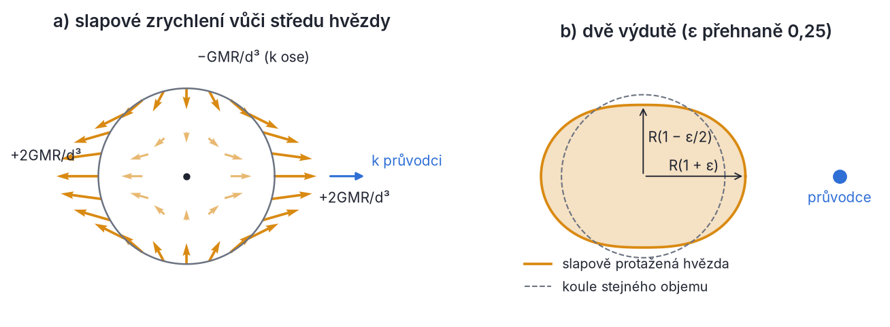
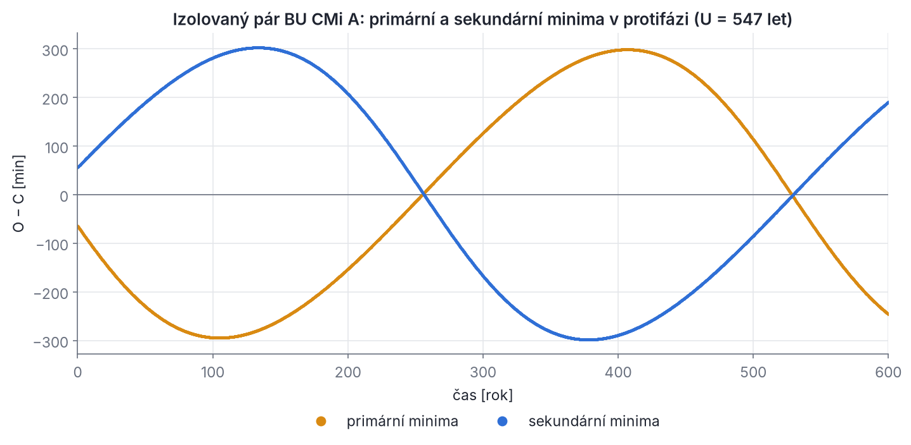
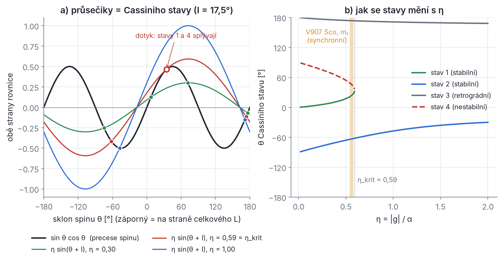
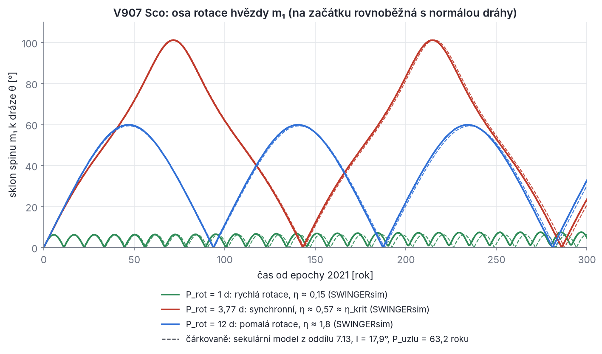

## Kapitola 7 – Hvězdy nejsou body: slapy, rotace, relativita a spin

Až dosud jsme hvězdy brali jako hmotné body. Pro vnější dráhy hierarchických soustav je to výborné přiblížení, ale v těsných dvojhvězdách už ne. V páru A soustavy BU CMi jsou středy hvězd od sebe jen asi 14,7 R☉ a každá hvězda má poloměr kolem 2,1 R☉. Vzdálenost je tedy jen sedmkrát větší než poloměr. Průvodce hvězdu protáhne slapy, vlastní rotace ji zploští a gravitační pole hvězdy přestane klesat přesně jako 1/r². K tomu se přidá obecná relativita: i dvě dokonale kulové hvězdy se v Einsteinově teorii nepohybují po uzavřené elipse.

Z toho plynou tři skupiny jevů, kterým je věnována tato kapitola:

1. **Stáčení přímky apsid.** Elipsa dráhy se pomalu otáčí ve své rovině. V diagramu O−C zákrytové dvojhvězdy se to projeví tak, že se primární a sekundární minima posouvají proti sobě (oddíly 7.4–7.7). Rychlost stáčení je jeden z mála způsobů, jak „nahlédnout“ do nitra hvězdy.
2. **Slapové tření.** Hvězda nereaguje na slapy okamžitě. Výduť se proto opožďuje, gravitace na ni působí momentem síly a dráha a rotace si vyměňují moment hybnosti, zatímco energie se mění v teplo. Rotace se synchronizuje, osa rotace se narovná a dráha se zakulacuje (oddíly 7.8–7.10).
3. **Precese osy rotace.** Zploštělá hvězda je setrvačník, na který průvodce působí momentem síly. Osa rotace proto precesuje, stejně jako osa Země. Když současně precesuje i rovina dráhy (kapitola 5), mohou nastat rovnovážné **Cassiniho stavy** a rezonance. Ve V907 Sco se tak osa rotace jedné hvězdy může podle modelu SWINGERsim vychýlit až o 100° (oddíly 7.12–7.14).

SWINGERsim všechny tyto jevy počítá v N-částicovém backendu přímo ze sil: relativitu přes REBOUNDx `gr_full`, slapy, rotační deformaci a vývoj spinů přes REBOUNDx `tides_spin` (oddíl 7.11). Kapitola proto vysvětluje, co přesně se v kódu počítá a odkud se berou vzorce, kterými výsledky kontrolujeme.

### 7.1 Slapové zrychlení a dvě výdutě

**Intuice.** Průvodce o hmotnosti M ve vzdálenosti d přitahuje každý kousek hvězdy trochu jinak: bližší stranu silněji, vzdálenější slaběji. Celá hvězda padá k průvodci se zrychlením svého středu. Co zbude, když toto společné zrychlení odečteme, je **slapové (diferenciální) zrychlení**. To hvězdu natahuje podél spojnice a stlačuje napříč.

**Odvození.** Bod na povrchu hvězdy na straně k průvodci je od průvodce vzdálen d − R. Jeho zrychlení vůči středu hvězdy je

```latex
\delta a = \frac{GM}{(d-R)^2} - \frac{GM}{d^2} = \frac{GM}{d^2}\left[\left(1-\frac{R}{d}\right)^{-2} - 1\right] \approx \frac{GM}{d^2}\cdot\frac{2R}{d} = \frac{2GMR}{d^3}
```

kde jsme použili Taylorův rozvoj (1 − x)⁻² ≈ 1 + 2x pro x = R/d ≪ 1. Na odvrácené straně je bod ve vzdálenosti d + R a průvodce ho přitahuje *slaběji* než střed. Vůči středu proto „zaostává“, tedy míří *od* průvodce, se stejně velkým zrychlením 2GMR/d³. Odtud **dvě výdutě**: jedna míří k průvodci, druhá od něj.

Bod ve vzdálenosti R kolmo ke spojnici je od průvodce vzdálen √(d² + R²) ≈ d. Velikost přitažlivosti je stejná jako u středu, ale směr se liší o malý úhel R/d. Vzniká tak složka zrychlení k ose o velikosti (GM/d²)(R/d) = GMR/d³, která hvězdu stlačuje. Obecně: zvolme osu x od středu hvězdy k průvodci. Pak má slapové zrychlení v bodě (x, y, z) uvnitř hvězdy složky

```latex
\mathbf a_{\rm sl} = \frac{GM}{d^3}\,\bigl(2x,\; -y,\; -z\bigr) = -\nabla W, \qquad W = -\frac{GM}{d^3}\left(x^2 - \frac{y^2+z^2}{2}\right) = -\frac{GM\,r^2}{d^3}\,P_2(\cos\theta')
```

kde r je vzdálenost od středu hvězdy, θ′ úhel mezi polohovým vektorem bodu a směrem k průvodci a P₂(x) = (3x² − 1)/2 Legendreův polynom druhého stupně. Funkci W nazýváme **slapový potenciál**. Že −∇W dává právě složky (2x, −y, −z)·GM/d³, si snadno ověříš derivováním. Důležité jsou dvě vlastnosti: slapové zrychlení roste lineárně se vzdáleností od středu (∝ r) a klesá se třetí mocninou vzdálenosti průvodce (∝ d⁻³), ne s druhou jako samotná gravitace.



*Obr. 7.1 – a) Slapové zrychlení (oranžové šipky) vůči středu hvězdy, když průvodce leží vpravo. Podél spojnice míří šipky ven na obě strany (+2GMR/d³), napříč míří k ose (−GMR/d³). Uvnitř hvězdy je zrychlení úměrné vzdálenosti od středu (kratší šipky). b) Hvězda na tento rozdíl odpoví protažením do tvaru vejce se dvěma výdutěmi. Deformace ε je pro přehlednost přehnaná na 0,25; ve skutečných dvojhvězdách je to 10⁻³ až 10⁻².*

> **Pozor.** Častá chyba je vysvětlovat vzdálenější výduť „odstředivou silou“. V inerciální soustavě žádná odstředivá síla není. Vzdálenější výduť vzniká jen proto, že průvodce přitahuje odvrácenou stranu slaběji než střed. Kdybychom chtěli pracovat v soustavě spojené se středem hvězdy, která obíhá kolem těžiště (bez rotace kolem vlastní osy), všechny body hvězdy opisují stejně velké kružnice a „odstředivé“ zrychlení je všude stejné. Odečte se tedy jako celek a zbude opět jen rozdíl gravitací.

**Jak velký je tvar.** Povrch hvězdy v hydrostatické rovnováze leží na ploše konstantního celkového potenciálu. Začněme nejjednodušším modelem, kdy je skoro všechna hmota v jádru a deformace obálky sama gravitaci nemění (Rocheův model). Hledáme povrch ve tvaru r = R[1 + ε P₂(cos θ′)]. Na povrchu musí být −Gm₁/r + W konstantní, kde m₁ je hmotnost deformované hvězdy. Pro malé ε je −Gm₁/r ≈ −(Gm₁/R)(1 − ε P₂). Koeficient u P₂ musí vymizet:

```latex
\frac{Gm_1}{R}\,\varepsilon - \frac{GM R^2}{d^3} = 0 \quad\Rightarrow\quad \varepsilon = \frac{M}{m_1}\left(\frac{R}{d}\right)^3
```

Hvězda se tedy podél spojnice prodlouží o εR (P₂(1) = 1) a v kolmém směru zkrátí o εR/2 (P₂(0) = −½). Rozdíl poloos je (3/2)εR.

**Řešený příklad.** *Země a Měsíc.* GM☾ = 4,903·10¹² m³ s⁻², d = 3,844·10⁸ m, R⊕ = 6,371·10⁶ m. Slapové zrychlení je 2GM☾R⊕/d³ = 1,10·10⁻⁶ m s⁻², tedy asi 1,1·10⁻⁷ g. Slunce dává 2GM☉R⊕/(1 au)³ = 5,05·10⁻⁷ m s⁻², poměr Slunce/Měsíc je 0,46 (proto skočné a hluché dmutí). Pro oceán na tuhé Zemi dává vzorec ε = (M☾/M⊕)(R⊕/d)³ = 5,6·10⁻⁸ a rozdíl hladin (3/2)εR⊕ = 0,54 m. To je známá „rovnovážná“ výška slapu.

*Hvězda m₁ ve V907 Sco.* m₁ = 2,56 M☉, průvodce M = m₂ = 2,74 M☉, R = 2,53 R☉, d = a = 17,79 R☉ (z P = 3,775 d a Keplerova zákona). Poměr slapového zrychlení k povrchové gravitaci je 2(m₂/m₁)(R/a)³ = 6,2·10⁻³, tedy 55 000krát víc než u Země. Deformace ε = (m₂/m₁)(R/a)³ = 3,1·10⁻³ a rozdíl poloos (3/2)εR ≈ 8 100 km, asi půl procenta poloměru. Těsné dvojhvězdy jsou měřitelně protažené. Proto mají jejich světelné křivky „elipsoidální“ změny jasnosti mimo zákryty (kapitola 10).

### 7.2 Jak moc se hvězda deformuje: Loveovo číslo a apsidální konstanta

Výpočet v předchozím oddílu přehlížel jednu věc. Deformovaná hvězda má sama nesférické rozložení hmoty, a tedy i vlastní nesférický gravitační potenciál. Ten se přičte k vnějšímu slapovému potenciálu a deformaci zesílí. A co je pro dynamiku podstatné: tento dodatečný potenciál cítí i průvodce. Právě on stáčí dráhu.

**Definice Loveova čísla.** Vnější potenciál druhého stupně, W ∝ r²P₂, vyvolá ve hvězdě deformaci, jejíž vlastní gravitační potenciál je také druhého stupně. Vně hvězdy musí splňovat Laplaceovu rovnici ∇²Φ = 0, a proto klesá jako r⁻³P₂ (to je obecná vlastnost řešení Laplaceovy rovnice: člen r^l P_l uvnitř odpovídá členu r^(−l−1) P_l venku). Jeho velikost na povrchu měříme v jednotkách vnějšího potenciálu:

```latex
\delta\Phi(r,\theta') = k_{\rm L}\; W(R,\theta')\left(\frac{R}{r}\right)^{3} \qquad (r \ge R)
```

Bezrozměrné číslo k\_L je **Loveovo číslo** druhého stupně (A. E. H. Love, 1909). Říká, kolikrát je potenciál vyvolané deformace na povrchu menší než potenciál, který deformaci vyvolal. Dvě mezní hodnoty jsou snadno pochopitelné:

- **Hmotný bod obalený nehmotnou atmosférou** (Rocheův model): obálka se deformuje, ale nic neváží. Vnější potenciál se nezmění, k\_L = 0.
- **Homogenní nestlačitelná kapalná koule**: celá hmota se podílí na deformaci. Výpočet (Kelvin) dává k\_L = 3/2.

Skutečné hvězdy jsou silně koncentrované ke středu. Hustota v jádru je desítkykrát až stokrát větší než průměrná, a deformuje se hlavně řídká obálka. Proto mají hvězdy hlavní posloupnosti od hmotnosti Slunce výše k\_L ≈ 0,004–0,03, tedy mnohem blíž Rocheovu modelu než homogenní kouli. Výjimkou jsou plně konvektivní červení trpaslíci, blízcí polytropě n = 1,5, s k\_L ≈ 0,29.

**Apsidální konstanta.** V literatuře o dvojhvězdách se tradičně používá **apsidální konstanta**

```latex
k_2 = \frac{k_{\rm L}}{2}
```

Zavedli ji Russell (1928), Cowling (1938) a Sterne (1939) při výpočtu stáčení přímky apsid, odtud název. Je to tatáž fyzikální veličina jako Loveovo číslo, jen s jinou normalizací. Homogenní koule má k₂ = 3/4, bod k₂ = 0. Jak se k₂ počítá z průběhu hustoty (Clairautova a Radauova rovnice), ukáže kapitola 8. Zde stačí výsledek pro polytropy: k₂ = 0,75 (n = 0), 0,260 (n = 1), 0,143 (n = 1,5), 0,0144 (n = 3). Pro modely MIST, které SWINGERsim používá, vychází u hvězd o hmotnosti 2,4–2,6 M☉ ve věku 260–400 milionů let k₂ ≈ 0,003–0,0045. (Z modelu MIST bere SWINGERsim poloměr a log g hvězdy; k₂ a r\_g² k nim dohledá v tabulkách Clareta (2023).)

**Fyzikální smysl.** Loveovo číslo k\_L (a stejně apsidální konstanta k₂ = k\_L/2) měří, jak velký podíl hmoty hvězdy je v „poddajných“ vnějších vrstvách. Číslo klesá se stářím hvězdy na hlavní posloupnosti, protože jádro se zahušťuje a obálka nafukuje. Pro m₁ ve V907 Sco dávají modely MIST k₂ = 0,0059 na začátku hlavní posloupnosti a 0,0033 ve věku 400 milionů let. Protože stáčení přímky apsid je úměrné k₂, je pozorovaná rychlost stáčení test modelů vnitřní stavby hvězd (Claret & Giménez 1993).

Se samogravitací deformace se mění i vzorec pro tvar. Na povrchu se k vnějšímu potenciálu W přičte vlastní potenciál deformace k\_L W, takže efektivní „síla“ deformace je (1 + k\_L)W. Opakováním výpočtu z oddílu 7.1 dostaneme

```latex
\varepsilon_{\rm sl} = (1 + k_{\rm L})\,\frac{M}{m_1}\left(\frac{R}{d}\right)^3 = (1+2k_2)\,\frac{M}{m_1}\left(\frac{R}{d}\right)^3
```

U hvězd s k₂ ≈ 0,003 je to oprava o necelé procento. U Země je ale téměř dvojnásobná, jak ukáže příklad v oddílu 7.3.

> **Pozor na konvence.** Symbol k₂ znamená v různých oborech různé věci. V literatuře o dvojhvězdách (a ve SWINGERsim, klíč `stars.<jméno>.apsidal_k2`) je to apsidální konstanta. V planetologii a v knihovně REBOUNDx je k₂ (nebo k\_L) Loveovo číslo, dvakrát větší. Údaj „Země má k₂ ≈ 0,30“ je Loveovo číslo pružné Země pro slapy s periodou půl dne až dnů. Kapalné (hydrostatické) Loveovo číslo Země je ≈ 0,94 (oddíl 7.3). Kdo konvence zamění, dostane stáčení dvakrát rychlejší nebo pomalejší. SWINGERsim proto předává REBOUNDx hodnotu 2k₂ (oddíl 7.11).

### 7.3 Rotační zploštění a J₂

Rotující hvězda je ve vlastní (rotující) soustavě v rovnováze gravitace, tlaku a odstředivé síly. Odstředivé zrychlení Ω²s, kde s je vzdálenost od osy rotace a Ω úhlová rychlost rotace, odpovídá potenciálu −½Ω²s². Je to stejná úloha jako slapy, jen s jiným vnějším potenciálem. Rozepišme ho pomocí s = r sin θ, kde θ je úhel od osy rotace, a identity sin²θ = (2/3)[1 − P₂(cos θ)]:

```latex
-\tfrac12\,\Omega^2 s^2 = -\tfrac12\,\Omega^2 r^2 \sin^2\theta = -\tfrac13\,\Omega^2 r^2 + \tfrac13\,\Omega^2 r^2\,P_2(\cos\theta)
```

První člen je kulově souměrný. Hvězdu jen nepatrně „nadlehčí“, ale nedeformuje. Druhý člen má stejný tvar r²P₂ jako slapový potenciál, jen s osou podél osy rotace a s opačným znaménkem. Slap hvězdu protahuje podél spojnice, rotace ji podél osy zkracuje.

**Vnější potenciál zploštělé hvězdy.** Osově souměrné těleso má vně potenciál

```latex
\Phi(r,\theta) = -\frac{Gm_1}{r}\left[1 - J_2\left(\frac{R}{r}\right)^{2} P_2(\cos\theta)\right] = -\frac{Gm_1}{r} + \frac{G m_1 J_2 R^2}{r^3}\,P_2(\cos\theta)
```

kde J₂ je bezrozměrný kvadrupólový moment. Pro zploštělé těleso je J₂ > 0. Druhý člen klesá jako 1/r³ (rozměrově Gm₁J₂R²/r³). Podle definice Loveova čísla je na povrchu roven k\_L-násobku deformujícího potenciálu ⅓Ω²R²P₂. Porovnáním koeficientů dostaneme

```latex
\frac{Gm_1J_2}{R} = k_{\rm L}\,\frac{\Omega^2R^2}{3} \quad\Rightarrow\quad J_2 = \frac{k_{\rm L}}{3}\,q_\Omega = \frac{2k_2}{3}\,q_\Omega, \qquad q_\Omega \equiv \frac{\Omega^2R^3}{Gm_1}
```

Parametr q\_Ω je poměr odstředivého zrychlení na rovníku Ω²R ke gravitačnímu Gm₁/R². V geodézii se značí m.

**Tvar povrchu a zploštění.** Hledejme povrch jako r = R[1 + ε P₂(cos θ)]. Na povrchu musí být konstantní součet tří potenciálů: −Gm₁/r ≈ −(Gm₁/R)(1 − εP₂), kvadrupólu Gm₁J₂P₂/R a odstředivého členu ⅓Ω²R²P₂. Koeficient u P₂ musí vymizet:

```latex
\frac{Gm_1}{R}\,\varepsilon + \frac{Gm_1}{R}\,J_2 + \frac{\Omega^2R^2}{3} = 0 \quad\Rightarrow\quad \varepsilon = -J_2 - \frac{q_\Omega}{3} = -\frac{q_\Omega}{3}\,(1+k_{\rm L})
```

Protože ε < 0 a P₂(1) = 1, je polární poloměr r\_p = R(1 + ε) *menší* než R. Na rovníku je P₂(0) = −½, takže rovníkový poloměr r\_e = R(1 − ε/2) je *větší* než R. **Rotace hvězdu zploští na pólech a na rovníku se vyduje.** Zploštění f = (r\_e − r\_p)/r\_e ≈ −(3/2)ε je

```latex
f = \frac{q_\Omega}{2}\,(1 + k_{\rm L}) = \frac{q_\Omega}{2}\,(1 + 2k_2)
```

Kontroly: pro hmotný bod (k₂ = 0) vychází f = q\_Ω/2, což je výsledek Rocheova modelu rotující hvězdy. Pro homogenní kapalnou kouli (k₂ = 3/4) vychází f = 5q\_Ω/4, což je Maclaurinův sféroid malého zploštění. Skutečné hvězdy s k₂ ≈ 0,004 mají f ≈ 0,504 q\_Ω, jsou to tedy skoro Rocheova tělesa. Zploštění samo o k₂ u hvězd mnoho neprozradí. Hodnotu k₂ ale prozradí dráha průvodce, jak uvidíme v oddílu 7.4.

**Řešený příklad: Loveovo číslo Země ze zploštění.** Pro Zemi je Ω = 7,292·10⁻⁵ s⁻¹, rovníkový poloměr 6,378·10⁶ m a GM⊕ = 3,986·10¹⁴ m³ s⁻². Vychází q\_Ω = 0,00346. Naměřené zploštění je f = 1/298,26 = 0,003353. Odtud 1 + k\_L = 2f/q\_Ω = 1,937, tedy k\_L ≈ 0,94 a k₂ ≈ 0,47. Kontrola: J₂ = k\_L q\_Ω/3 = 1,081·10⁻³, naměřeno je 1,0826·10⁻³. Země se na dlouhých časových škálách chová jako kapalina s Loveovým číslem 0,94. Je mnohem méně koncentrovaná ke středu než hvězda: k₂ Země je zhruba stokrát větší než k₂ hvězdy typu A.

**Řešený příklad: zploštění hvězdy m₁ v BU CMi.** Hvězda m₁ = 2,536 M☉ s poloměrem 2,204 R☉ v páru A (a = 14,68 R☉) rotuje synchronně, Ω = n. Pak q\_Ω = (Ω²a³/Gm₁)(R/a)³ = (M/m₁)(R/a)³, protože n²a³ = GM, kde M = m₁ + m₂ = 4,920 M☉. Vychází q\_Ω = 1,940 × 0,1501³ = 0,00656 a f ≈ 0,0033: hvězda je zploštělá skoro přesně jako Země.

> **Pozor.** Rotační kvadrupól má potenciál úměrný J₂R²/r³, kde J₂ nezávisí na poloze průvodce. Slapová výduť je jiná: její velikost je úměrná (R/d)³ a její potenciál ve vzdálenosti r je úměrný R⁵/(d³r³). V místě průvodce (r = d) je tedy úměrný R⁵/d⁶. Tato strmá závislost je důvod, proč je slapové stáčení přímky apsid tak citlivé na poměr R/a.

### 7.4 Stáčení přímky apsid: odvození Sterneho vzorce

**Intuice.** V čistém newtonovském poli bodu (síla ∝ 1/r²) je dráha uzavřená elipsa. To je vzácná vlastnost: v každém jiném centrálním poli se dráha neuzavře a pericentrum se při každém oběhu posune. Deformovaná hvězda přitahuje průvodce o něco silněji, než kdyby byla bodem, a dodatečná síla roste k menším vzdálenostem rychleji než 1/r². Průvodce proto v okolí pericentra dostane „navíc“ a obloukem se dostane o kousek dál, než by se v čistém keplerovském poli dostal. Pericentrum postupuje ve směru oběhu, **přímka apsid se stáčí prográdně**.

**Nástroj: Laplaceův–Rungeův–Lenzův vektor.** V kapitole 2 jsme zavedli vektor výstřednosti

```latex
\mathbf e = \frac{\mathbf v\times\mathbf h}{\mu} - \hat{\mathbf r}, \qquad \mathbf h = \mathbf r\times\mathbf v, \qquad \mu = G(m_1+m_2)
```

který míří do pericentra a má velikost e. V keplerovském poli se nemění. Přidejme k relativnímu pohybu malé **radiální** poruchové zrychlení F(r), tedy

```latex
\ddot{\mathbf r} = -\frac{\mu\,\mathbf r}{r^3} + F(r)\,\hat{\mathbf r}
```

Radiální síla nemá moment, takže **h** se nemění ani teď a dráha zůstává v jedné rovině (osa z ve směru **h**). Derivujme **e** podle času:

```latex
\dot{\mathbf e} = \frac{\dot{\mathbf v}\times\mathbf h}{\mu} - \frac{{\rm d}\hat{\mathbf r}}{{\rm d}t} = \underbrace{\left(-\frac{\hat{\mathbf r}}{r^2}\times\mathbf h - \frac{h}{r^2}\,\hat{\boldsymbol\theta}\right)}_{=\,0} + \frac{F}{\mu}\,\hat{\mathbf r}\times\mathbf h = -\frac{F\,h}{\mu}\,\hat{\boldsymbol\theta}
```

Použili jsme d**r̂**/dt = θ̇ **θ̂** = (h/r²) **θ̂** a **r̂** × **ẑ** = −**θ̂**, kde **θ̂** je jednotkový vektor ve směru rostoucího úhlu. Keplerovská část se přesně vyruší, jak má. Zbývá změna kolmá k průvodiči. Směr pericentra se otáčí, když má **ė** složku kolmou k **e**. Ta je ve směru **ẑ** × **ê**, kde **ê** = **e**/e. Průvodič svírá s **ê** pravou anomálii ν, takže **θ̂** svírá s **ê** úhel ν + 90° a s **ẑ** × **ê** úhel ν. Dostáváme

```latex
\dot\omega = \frac{\dot{\mathbf e}\cdot(\hat{\mathbf z}\times\hat{\mathbf e})}{e} = -\frac{F\,h}{\mu\,e}\,\cos\nu, \qquad \dot e = \dot{\mathbf e}\cdot\hat{\mathbf e} = \frac{F\,h}{\mu}\,\sin\nu
```

Druhá rovnice ukazuje, že se e mění jen během oběhu. Pro F závislé jen na r je integrand lichý v ν, takže se za celý oběh vynuluje: **centrální síla nemění výstřednost, jen stáčí elipsu**. (Ani velká poloosa se nemění, protože síla F(r) je konzervativní.)

**Středování přes oběh.** Nás zajímá průměrná rychlost stáčení za oběh. Čas převedeme na pravou anomálii pomocí dt = r² dν/h (druhý Keplerův zákon):

```latex
\langle\dot\omega\rangle = \frac{1}{P}\oint \dot\omega\,{\rm d}t = -\frac{1}{\mu\,e\,P}\oint F(r)\,r^2\cos\nu\;{\rm d}\nu
```

Pro mocninnou přitažlivou sílu F = −C/r^k a dráhu r = p/(1 + e cos ν), kde p = a(1 − e²) je parametr dráhy, vychází

```latex
\langle\dot\omega\rangle = \frac{C}{\mu\,e\,P\,p^{k-2}}\oint (1+e\cos\nu)^{k-2}\cos\nu\;{\rm d}\nu
```

Integrály spočteme binomickým rozvojem a vztahy ∮cos²ν dν = π, ∮cos⁴ν dν = 3π/4, ∮cos⁶ν dν = 5π/8 (liché mocniny dávají nulu):

```latex
k=4:\;\; \oint (1+e\cos\nu)^2\cos\nu\,{\rm d}\nu = 2\pi e, \qquad
k=7:\;\; \oint (1+e\cos\nu)^5\cos\nu\,{\rm d}\nu = 5\pi e\left(1+\tfrac32e^2+\tfrac18e^4\right)
```

Pro k = 7 přispívají členy 5e cos²ν, 10e³cos⁴ν a e⁵cos⁶ν: 5πe + 10e³·3π/4 + e⁵·5π/8 = 5πe(1 + 3e²/2 + e⁴/8). S 2π/P = n dostáváme dva výsledky, které použijeme třikrát:

```latex
\langle\dot\omega\rangle_{k=4} = \frac{C\,n}{\mu\,p^2}, \qquad \langle\dot\omega\rangle_{k=7} = \frac{5}{2}\,\frac{C\,n}{\mu\,p^5}\left(1+\tfrac32e^2+\tfrac18e^4\right)
```

**Rotační člen.** Hvězda 1 se zploštěním J₂ a osou rotace kolmou k rovině dráhy vytváří v rovině svého rovníku (P₂(0) = −½) potenciál Φ₁ = −Gm₁/r − Gm₁J₂R²/(2r³). Dodatečná síla na jednotku hmotnosti průvodce je −d/dr[−Gm₁J₂R²/(2r³)] = −(3/2)Gm₁J₂R²/r⁴, tedy přitažlivá. Hvězda 1 cítí podle zákona akce a reakce opačnou sílu. Relativní zrychlení **r̈** = **r̈**₂ − **r̈**₁ je proto (1 + m₂/m₁) = M/m₁ krát větší než zrychlení průvodce samotného:

```latex
F_{\rm rot}(r) = -\frac{3}{2}\,\frac{G M J_2 R^2}{r^4}, \qquad k = 4,\quad C = \tfrac32\,GMJ_2R^2
```

Dosazením (μ = GM) dostaneme ⟨ω̇⟩ = (3/2) n J₂ (R/a)² (1 − e²)⁻². Nakonec dosadíme J₂ = (2k₂/3)Ω²R³/(Gm₁) z oddílu 7.3 a za G zapíšeme n²a³/M (třetí Keplerův zákon):

```latex
\frac{\dot\omega_{\rm rot}}{n} = k_2\left(1+\frac{m_2}{m_1}\right)\left(\frac{\Omega}{n}\right)^{2}\left(\frac{R}{a}\right)^{5} f(e), \qquad f(e) = \frac{1}{(1-e^2)^2}
```

**Slapový člen.** Průvodce ve vzdálenosti r vyvolá výduť s potenciálem δΦ₁(r′) = −k\_L Gm₂R⁵P₂(cos θ′)/(r³r′³) v libovolném bodě r′ (oddíl 7.2 s W(R) = −Gm₂R²P₂/r³). Síla na průvodce je gradient tohoto pole *v místě průvodce* (r′ = r, θ′ = 0) při pevném tvaru výdutě. Derivace podle r′ dává 3k\_L Gm₂R⁵/(r³r′⁴), tedy přitažlivou sílu 3k\_L Gm₂R⁵/r⁷ na jednotku hmotnosti průvodce. Opět ji násobíme M/m₁:

```latex
F_{\rm sl}(r) = -\frac{3\,k_{\rm L}\,G\,m_2\,M\,R^5}{m_1\,r^7}, \qquad k = 7,\quad C = \frac{3\,k_{\rm L}\,G\,m_2\,M\,R^5}{m_1}
```

Předpokládáme **rovnovážný slap**: výduť má v každém okamžiku velikost odpovídající okamžité vzdálenosti r a míří přesně k průvodci. Dosazením do výsledku pro k = 7 a k\_L = 2k₂:

```latex
\frac{\dot\omega_{\rm sl}}{n} = \frac{5}{2}\cdot 3\,k_{\rm L}\,\frac{m_2}{m_1}\left(\frac{R}{a}\right)^{5}\frac{1+\tfrac32e^2+\tfrac18e^4}{(1-e^2)^5} = 15\,k_2\,\frac{m_2}{m_1}\left(\frac{R}{a}\right)^{5} g(e), \qquad g(e) = \frac{1+\tfrac32e^2+\tfrac18e^4}{(1-e^2)^5}
```

**Odkud je faktor 15.** Faktor 3 pochází z derivace r′⁻³ podle polohy průvodce (potenciál výdutě ∝ r′⁻³ dává sílu ∝ 3r′⁻⁴), faktor 5/2 ze středování přes oběh (pro k = 7 vychází integrál 5πe místo 2πe) a faktor 2 z převodu k\_L = 2k₂. Tedy 3 · (5/2) · 2 = 15. Funkce g(e) roste s výstředností rychle (g = 1,37 pro e = 0,22, g = 5,8 pro e = 0,5), protože slapová síla ∝ r⁻⁷ je v pericentru obrovská.

**Sterneho vzorec.** Obě hvězdy přispívají, každá svou deformací. Součtem dostáváme klasický vzorec Sterneho (1939) v zápisu Clareta a Giméneze (1993):

```latex
\frac{\dot\omega_{\rm kl}}{n} = \frac{P}{U} = c_{21}\,k_{2,1} + c_{22}\,k_{2,2}, \qquad c_{2i} = \left(\frac{R_i}{a}\right)^{5}\left[\left(\frac{\Omega_i}{n}\right)^{2}\left(1+\frac{m_j}{m_i}\right) f(e) + 15\,\frac{m_j}{m_i}\,g(e)\right]
```

kde j označuje druhou hvězdu, Ω\_i úhlovou rychlost rotace hvězdy i a U periodu stáčení (doba, za kterou se pericentrum otočí o 360°). Poměr **P/U** se nazývá **apsidální parametr**. Z pozorovaného P/U a známých c₂ᵢ (hmotnosti, poloměry a rotace ze světelné křivky a spekter) se určuje **pozorovaná střední apsidální konstanta** k̄₂ = (P/U)/(c₂₁ + c₂₂) a srovnává se s modely hvězd.

Dvě praktické poznámky:

- Rozhodující je faktor (R/a)⁵. Hvězda dvakrát větší dává 2⁵ = 32krát rychlejší stáčení. Proto je třeba znát poloměry s přesností na procenta: chyba 2 % v R znamená chybu 10 % v ω̇.
- Vzorec platí pro osy rotace **rovnoběžné s normálou dráhy**. Při skloněné ose se rotační člen mění a může i změnit znaménko (Shakura 1985). Tomu se věnuje oddíl 7.15.

> **Pozor.** Rovnice (76) v práci Eggletona, Kiselevy a Huta (1998) (a s ní i rov. 7 v práci Lu et al. 2023) vede při k\_L = 2k₂ na slapový koeficient 30 místo 15. Příčinou je chybějící faktor ½ v jejich konzervativní slapové síle. Knihovna REBOUNDx tuto chybu opravila ve verzi 4.5.0 (poznámka v jejím seznamu změn) a SWINGERsim běží s REBOUNDx 5.1.0. Benchmarky `apsidal-sterne-static` a `apsidal-sterne-rotating` (`swingersim validate`) ověřují, že N-částicový výpočet reprodukuje Sterneho vzorec na 0,01 %. Ve zdrojovém kódu (`tides.py`) jsou mimochodem názvy funkcí f a g prohozené oproti Giménezovi; vzorec je ale správný.

### 7.5 Relativistické stáčení

I dvě kulové hvězdy bez rotace stáčí pericentrum, a to kvůli obecné relativitě. Nejjednodušší cesta k výsledku vede přes rovnici dráhy. V newtonovské mechanice splňuje u = 1/r jako funkce polárního úhlu φ Binetovu rovnici. Pro radiální zrychlení −μ/r² + F je

```latex
\frac{{\rm d}^2u}{{\rm d}\varphi^2} + u = \frac{\mu}{h^2} - \frac{F}{h^2u^2}
```

Pro testovací částici ve Schwarzschildově metrice má rovnice dráhy navíc člen 3μu²/c² (je to první postnewtonovská oprava, 1PN):

```latex
\frac{{\rm d}^2u}{{\rm d}\varphi^2} + u = \frac{\mu}{h^2} + \frac{3\mu}{c^2}\,u^2
```

Porovnáním vidíme, že relativita působí přesně jako přitažlivá radiální síla F = −3μh²/(c²r⁴), tedy k = 4 a C = 3μh²/c². Dosadíme do výsledku z oddílu 7.4 a použijeme h² = μp:

```latex
\dot\omega_{\rm GR} = \frac{C\,n}{\mu\,p^2} = \frac{3\,h^2\,n}{c^2\,p^2} = \frac{3\,G M\,n}{c^2\,a\,(1-e^2)} = \frac{3\,(GM)^{3/2}}{c^2\,a^{5/2}\,(1-e^2)}
```

Za jeden oběh se pericentrum posune o Δω = 6πGM/[c²a(1 − e²)]. Pro Merkur to dává 43″ za století, slavný Einsteinův výsledek z roku 1915. Pro dvě tělesa srovnatelných hmotností platí v 1PN přiblížení stejný vzorec, jen M = m₁ + m₂ je celková hmotnost. Pro zákrytové dvojhvězdy ho rozpracoval a jejich pozorování jako test relativity použil Giménez (1985). V praktických jednotkách (hmotnosti v M☉, anomalistická perioda P\_a ve dnech) je

```latex
\dot\omega_{\rm GR} = 5{,}447\cdot10^{-4}\;\frac{(m_1+m_2)^{2/3}}{(1-e^2)\,P_{\rm a}^{2/3}}\quad\text{stupňů za oběh}
```

Konstantu si ověříš sám: 6π(2πGM☉/1 d)^(2/3)/c² = 9,507·10⁻⁶ rad = 5,447·10⁻⁴°.

Ve srovnání s klasickým stáčením závisí relativistické na a jen jako a⁻⁵ᐟ², zatímco klasické jako a⁻¹³ᐟ² (n ∝ a⁻³ᐟ² krát (R/a)⁵). V těsných dvojhvězdách velkých hvězd proto vítězí klasické stáčení, v širších dvojhvězdách malých hvězd relativistické. Pro BU CMi A je relativistický příspěvek 2,91″ za oběh (0,100° za rok), pro DI Her (oddíl 7.15) 2,43″ za oběh, pro V907 Sco 0,066° za rok (U\_GR ≈ 5 450 let).

**Jak to dělá SWINGERsim.** S `physics.gr: true` (výchozí hodnota) přidá N-částicový backend sílu REBOUNDx `gr_full`, tedy úplné 1PN pohybové rovnice všech těles (Einsteinovy–Infeldovy–Hoffmannovy). Relativistické stáčení tak vzniká samo a zahrnuje i vliv třetích těles. Vzorec výše používá jen souhrn běhu a příkaz `swingersim apsidal` (oddíl 7.7). Pozor na jednu vedlejší věc: s 1PN silami se zachovává 1PN energie a moment hybnosti, ne newtonovské. Proto má běh s `gr: true` relativní změnu newtonovského momentu hybnosti řádu 10⁻⁷, i když je integrace přesná (kapitola 6).

### 7.6 Jak se stáčení pozoruje: posun sekundárního minima

**Odvození pro i = 90°.** Ve SWINGERsim popisuje dráhu relativní vektor **r** = **r**₂ − **r**₁ (od hvězdy 1 ke hvězdě 2) a osa z míří od pozorovatele. Hvězda 2 je před hvězdou 1 (blíž k nám, z < 0), když z = r sin(ν + ω) sin i je nejmenší, tedy pro ν + ω = 270°. Pak hvězda 2 zakrývá hvězdu 1 a nastává **primární minimum** (předpokládáme, že hvězda 1 je ta s větší plošnou jasností). Sekundární minimum nastává pro ν + ω = 90°. Pravé anomálie obou zákrytů jsou ν₁ = 270° − ω a ν₂ = 90° − ω, takže sin ν₁ = −cos ω a sin ν₂ = cos ω.

Čas převedeme na střední anomálii. Pro malé e platí M ≈ ν − 2e sin ν (rozvoj Keplerovy rovnice z kapitoly 2 do prvního řádu v e). Rozdíl středních anomálií sekundárního a předchozího primárního minima je

```latex
M_2 - M_1 \approx (\nu_2 - \nu_1) - 2e\,(\sin\nu_2 - \sin\nu_1) = \pi - 4e\cos\omega \pmod{2\pi}
```

Sekundární minimum proto nastává v čase

```latex
t_{\rm II} - t_{\rm I} = \frac{P}{2\pi}\,(M_2 - M_1) = \frac{P}{2} - \frac{2P}{\pi}\,e\cos\omega
```

Při obecném sklonu i k tomu přibude geometrický člen (zákryt nastává v okamžiku nejmenší vzdálenosti kotoučů na obloze, ne přesně v konjunkci) a první řád v e dává (Sterne 1939; Giménez & García-Pelayo 1983 rozvíjejí až do e⁵)

```latex
D \equiv t_{\rm II} - t_{\rm I} - \frac{P}{2} \approx -\frac{P}{\pi}\,e\cos\omega\left(1 + \frac{1}{\sin^2 i}\right) = \frac{P}{\pi}\,e\cos\omega_1\left(1 + \frac{1}{\sin^2 i}\right)
```

kde ω je argument pericentra relativní dráhy (konvence SWINGERsim) a ω₁ = ω + 180° argument pericentra barycentrické dráhy hvězdy 1. Druhý tvar se znaménkem plus je ten, který najdeš ve většině literatury o apsidálním pohybu, protože tam se ω vztahuje k primární složce. Pro i = 90° je 1 + 1/sin²i = 2 a vzorec přechází v náš výsledek.

> **Pozor na znaménko ω.** Kdo dosadí do vzorce z literatury ω ze SWINGERsim, dostane opačné znaménko D. Rozhodující je, ke které hvězdě se ω vztahuje a kam míří osa z. Číselnou kontrolu najdeš v oddílu 7.7: podle vzorce má mít model BU CMi A při ω = 101,41° posun D ≈ +118 min a SWINGERsim (příkaz `swingersim timings`) naměří +120,5 min. Shoduje se i znaménko; rozdíl 2 % je vliv členů vyšších řádů v e.

**Stáčení v diagramu O−C.** Když se ω otáčí rovnoměrně, ω = ω₀ + ω̇t, mění se D jako cos ω. Předpovězme časy minim lineární efemeridou se **siderickou periodou** P\_s (střední interval mezi primárními minimy za celou periodu stáčení). Pak se primární a sekundární minima odchylují od efemeridy v protifázi, primární asi o −D/2 a sekundární o +D/2. Každá řada tedy opisuje kosinusovku s poloviční amplitudou

```latex
A \approx \frac{P\,e}{2\pi}\left(1 + \frac{1}{\sin^2 i}\right)
```

a obě se protnou vždy, když cos ω = 0, tedy když přímka apsid leží v zorném paprsku. Siderická perioda se liší od **anomalistické** P\_a (od pericentra k pericentru): poloha zákrytu je dána úhlem ν + ω, který za oběh vzroste o 360° + Δω, takže

```latex
\frac{1}{P_{\rm s}} = \frac{1}{P_{\rm a}} + \frac{1}{U} \quad\Rightarrow\quad P_{\rm s} \approx P_{\rm a}\left(1 - \frac{P_{\rm a}}{U}\right)
```

Ve vícenásobné soustavě je ještě třetí perioda, **zákrytová**. Jestliže precesuje rovina dráhy, mění se i poloha uzlu na obloze, od kterého se ω měří (oddíly 2.16 a 12.3.1). Kromě časů minim se mění i jejich trvání: na výstředné dráze trvá déle ten zákryt, který nastává blíž apocentru, kde se hvězdy pohybují pomaleji.

**Jak to dělá SWINGERsim.** Příkaz `swingersim timings` nepoužívá žádný z výše uvedených vzorců. Integruje N-částicový model, z poloh hvězd na obloze najde okamžiky minim (s opravou na světelný čas) a uloží je do CSV spolu s O−C vůči lineární efemeridě. Vzorce slouží jen ke kontrole. Příkaz `swingersim apsidal` naopak spočte Sterneho a relativistické příspěvky analyticky pro hvězdy, které by použil N-částicový běh, a s volbou `--nbody-years` změří celkové stáčení z integrace.

### 7.7 Řešený příklad: BU CMi

BU CMi je nejtěsnější známá čtyřhvězda typu 2+2 se dvěma zákrytovými páry (Pribulla et al. 2023, MNRAS 524, 4220). Dvě výstředné zákrytové dvojhvězdy s periodami 2,94 a 3,26 dne obíhají kolem sebe za 121,8 dne. Obě mají rychlé stáčení přímky apsid, U = 28,7 roku (pár A) a 25,1 roku (pár B). Vezmeme hodnoty z `configs/catalog/bu_cmi.yaml` a nejdřív spočteme, jak rychle by se stáčel pár A **sám, bez páru B**.

**Vstupy.** m₁ = 2,536 M☉, m₂ = 2,384 M☉ (M = 4,920 M☉), P = 2,937533 d, e = 0,2191, i = 83,35°. Poloměry dává model MIST ve věku 263 milionů let (`stellar_model: {kind: mist, age_myr: 263}`), apsidální konstanty k nim tabulky Clareta (2023) (oddíl 7.2): R₁ = 2,204 R☉, R₂ = 2,036 R☉, k₂,₁ = 0,00429, k₂,₂ = 0,00441. Z třetího Keplerova zákona (s G = 39,4769 au³ M☉⁻¹ rok⁻²) vychází a = 0,06827 au = 14,68 R☉, takže R₁/a = 0,1501 a R₂/a = 0,1387.

**Funkce výstřednosti.** f(e) = (1 − e²)⁻² = 1,1034, g(e) = (1 + 1,5e² + e⁴/8)/(1 − e²)⁵ = 1,3713.

**Slapové členy.** Pro hvězdu 1 je k₂,₁(R₁/a)⁵ · 15 (m₂/m₁) g(e) = 0,00429 × 7,62·10⁻⁵ × 15 × 0,9401 × 1,3713 = 6,32·10⁻⁶. Pro hvězdu 2 obdobně 4,95·10⁻⁶.

**Rotační členy.** Při synchronní rotaci (Ω = n, výchozí `P_rot: sync`) je k₂,₁(R₁/a)⁵(1 + m₂/m₁) f(e) = 0,70·10⁻⁶ a pro hvězdu 2 0,51·10⁻⁶. Rotace přispívá jen desetinou, protože rotační člen nemá faktor 15. Při pseudosynchronní rotaci (oddíl 7.8, Ω/n = 1,291) se rotační členy zvětší 1,291² = 1,667krát na 1,17·10⁻⁶ a 0,86·10⁻⁶.

**Součet.** Klasicky P/U = 1,249·10⁻⁵ (synchronně), tedy U\_kl = P/(1,249·10⁻⁵) = 2,9375 d/1,249·10⁻⁵ = 644 let. Relativita dává podle oddílu 7.5 Δω = 2,91″ za oběh = 0,1003° za rok, tedy U\_GR = 3 590 let. Rychlosti se sčítají:

```latex
\frac{1}{U} = \frac{1}{U_{\rm kl}} + \frac{1}{U_{\rm GR}} = \frac{1}{644\ \text{let}} + \frac{1}{3\,590\ \text{let}} \quad\Rightarrow\quad U = 546\ \text{let}
```

Pro pseudosynchronní rotaci vychází U = 518 let. Relativita přispívá asi 15 % celkové rychlosti stáčení. Pribulla et al. (2023) mají o něco větší poloměry z fitu světelné křivky (R₁/a = 0,1528, R₂/a = 0,1409) a uvádějí slapový příspěvek 18,73″ a relativistický 2,907″ za oběh. To dává U ≈ 480 let. **Izolovaný pár A by se tedy stáčel s periodou zhruba 480–550 let**, podle toho, jaké poloměry a rotaci přijmeme. Rozdíl ukazuje citlivost na (R/a)⁵: poloměry větší o 2 % zrychlí slapové stáčení o 10 %.

Stejné číslo dá SWINGERsim přímo (běh trvá několik sekund):

```bash
swingersim apsidal bu_cmi_A_isolated.yaml
```

kde `bu_cmi_A_isolated.yaml` obsahuje jen pár A s hodnotami z `bu_cmi.yaml`:

```yaml
topology: custom
hierarchy: {A: [m1, m2]}
masses: {m1: 2.536, m2: 2.384}
orbits:
  A: {P: 2.937533, e: 0.2191, i: 83.35, omega: 101.41}
stellar_model: {kind: mist, age_myr: 263.0, feh: 0.0, vvcrit: 0.0}
physics: {gr: true, tides: true, rotation: true}
run: {t_max_yr: 20, n_output: 201}
```

Tabulka ukáže 0,504° za rok ze slapů, 0,054° za rok z rotace, 0,100° za rok z relativity, celkem 0,659° za rok a U = 546,3 roku.

**Amplituda v O−C.** Podle oddílu 7.6 je největší posun sekundárního minima (P/π)e(1 + 1/sin²i) = 0,9350 d × 0,2191 × 2,0136 = 0,4125 d = 594 minut. Každá řada minim proto kmitá asi o ±297 minut kolem lineární efemeridy. Při dnešním ω = 101,41° je cos ω = −0,198 a D ≈ +118 minut.



*Obr. 7.2 – Diagram O−C izolovaného páru A soustavy BU CMi (bez páru B), spočítaný příkazem `swingersim timings` přes 600 let se slapy, synchronní rotací a relativitou. Primární (oranžově) a sekundární minima (modře) opisují kosinusovky v protifázi s amplitudou asi ±295 minut a periodou U = 546,6 roku. Lineární efemerida (zde proložená současně s oběma kosinusovkami, proto se liší od efemeridy ve sloupci `o_c_d`, kterou příkaz určí jen z primárních minim) má siderickou periodu P\_s = 2,937504 d. Křivky se protínají, když přímka apsid leží v zorném paprsku. Za život pozorovatele (desetiletí) je vidět jen krátký úsek, ze kterého se U určuje fitem. Skutečný pár A se stáčí s U = 28,7 roku (viz text).*

Simulace (600 let, 149 208 minim, výpočet trval na sdíleném počítači 25 minut) dává posun D mezi −589 a +589 minutami, takže každá řada kmitá asi o ±295 minut, o něco méně než ±297 minut z prvního řádu v e. Při e = 0,22 už přispívají členy vyšších řádů a křivky nejsou přesně zrcadlové. Perioda stáčení změřená proložením je U = 546,6 roku, ve shodě se Sterneho vzorcem a relativitou pro synchronní rotaci (546,3 roku) na 0,05 %. Kdo chce běh zopakovat:

```bash
swingersim timings bu_cmi_A_isolated.yaml --years 600 -o bu_A_600.csv
```

**Skutečná BU CMi A.** Pozorovaná perioda stáčení páru A je **28,7 ± 0,1 roku**, dvacetkrát kratší (Pribulla et al. 2023). Rozdíl nezpůsobují hvězdy samy, ale **pár B**: jeho gravitace ve vzdálenosti jen asi 1,03 au (vnější perioda 121,8 dne, a = 221 R☉) stáčí dráhu páru A podle analytického odhadu Pribully et al. (2023) rychlostí 718″ za oběh, zatímco slapy a relativita dohromady jen 21,6″ za oběh. (Samotných 718″ za oběh by odpovídalo periodě asi 14 let, kterou autoři uvádějí jako „dynamickou“ apsidální periodu; tento odhad je tedy jen řádový, pozorovaná perioda 28,7 roku plyne z jejich úplného fotodynamického modelu. Podstatný je poměr: dynamický člen je o víc než řád silnější.) Dynamické stáčení od třetího tělesa jsme poznali v kapitole 5. SWINGERsim to potvrdí během úplného modelu. Nejdřív bez integrace:

```bash
swingersim apsidal configs/catalog/bu_cmi.yaml --target A=28.7 B=25.1
```

Volba `--target` ukáže, kolikrát by se musela zvětšit apsidální konstanta obou hvězd, aby *izolovaný* pár dosáhl pozorované periody: 22krát pro A a 42krát pro B. Takové hvězdy neexistují. Pak s integrací úplné čtyřhvězdy:

```bash
swingersim apsidal configs/catalog/bu_cmi.yaml --target A=28.7 B=25.1 --nbody-years 60
```

Za dvě až tři minuty změří z integrace U = 27,8 roku pro pár A a 24,8 roku pro pár B. Dynamický příspěvek páru B k rychlosti stáčení páru A je 12,30° za rok, slapy, rotace a relativita dohromady jen 0,66° za rok. Model se stáčí o 3 % rychleji, než se pozoruje. Kdybychom tento rozdíl chtěli vysvětlit apsidální konstantou, musela by být čtyřikrát *menší* (výpis `needs k2 x 0.25`). Mnohem pravděpodobněji ho způsobují malé nepřesnosti vnější dráhy, na které je dynamické stáčení citlivé. U BU CMi tedy stáčení o vnitřní stavbě hvězd skoro nic neprozradí. **Číslo 480–550 let je vlastnost hypotetického izolovaného páru, ne soustavy BU CMi.** Obecné poučení: dříve, než z apsidálního pohybu usoudíš na k₂, musíš vědět, že v soustavě není další těleso.

### 7.8 Slapové tření: model konstantního časového zpoždění

**Intuice: Země a Měsíc.** Země se otočí jednou za den, Měsíc oběhne jednou za 27,3 dne. Slapové výdutě by chtěly mířit k Měsíci, ale tření v oceánech a v plášti je o kousek strhává ve směru rotace Země. Výduť proto předbíhá spojnici Země–Měsíc. Měsíc přitahuje bližší výduť silněji než vzdálenější, a protože bližší výduť je před ním, táhne ho dopředu po dráze. Měsíc tím získává moment hybnosti a vzdaluje se (laserová měření dávají 3,8 cm za rok). Současně výdutě brzdí rotaci Země: den se prodlužuje zhruba o 2 ms za století. Celkový moment hybnosti se zachovává, mechanická energie ne. Rozdíl se mění v teplo v oceánech.

Konec takového vývoje je stav, kdy se už nic nemění: rotace Země je synchronní s oběhem Měsíce a dráha je kruhová. Pro dnešní moment hybnosti soustavy dává zákon zachování (oddíl 7.9) konečnou vzdálenost asi 554 000 km a délku dne i měsíce 47,2 dne. Ve dvojhvězdách probíhá totéž, jen mnohem rychleji, protože slapy jsou o čtyři až pět řádů silnější.

**Zpoždění výdutě.** Kdyby hvězda byla dokonale pružná (bez tření), výduť by mířila přesně k průvodci a slapy by jen stáčely dráhu (oddíl 7.4). S třením se výduť ustaví podle polohy průvodce o chvíli dřív. V **modelu konstantního časového zpoždění** (Darwin 1880; Alexander 1973; Mignard 1979; Hut 1981) předpokládáme, že výduť odpovídá poloze průvodce v čase t − Δt, jak ji vidí rotující hvězda, a že Δt je konstanta hvězdy. Na kruhové dráze se průvodce vůči rotující hvězdě posouvá úhlovou rychlostí n − Ω, takže výduť se odchýlí od spojnice o úhel

```latex
\delta = (\Omega - n)\,\Delta t
```

Pro Ω > n výduť předbíhá, pro Ω < n zaostává. Moment síly spočteme z potenciálu výdutě v místě průvodce. Výduť, jejíž osa je od směru k průvodci pootočená o δ (ve směru oběhu), má v místě průvodce potenciál δΦ = −k\_L G m₂ R⁵ P₂(cos δ)/d⁶. Potenciální energie průvodce m₂δΦ závisí na jeho poloze na dráze jen přes δ, a pootočení průvodce o úhel dφ zmenší δ o dφ. Moment síly na dráhu průvodce (tečná síla krát rameno d) je proto

```latex
N = -\frac{\partial\,(m_2\,\delta\Phi)}{\partial\varphi} = m_2\,\frac{\partial\,\delta\Phi}{\partial\delta} = \frac{3}{2}\,k_{\rm L}\,\frac{G m_2^2 R^5}{d^6}\,\sin 2\delta \approx 3\,k_{\rm L}\,\frac{G m_2^2 R^5}{d^6}\,(\Omega-n)\,\Delta t
```

(použili jsme dP₂(cos δ)/dδ = −3 cos δ sin δ). Pro δ > 0 (výduť předbíhá) je moment kladný a dráha průvodce získává moment hybnosti. Moment je úměrný d⁻⁶. To je důvod, proč slapové tření prudce zesílí, když se hvězdy přiblíží. Na výstředné dráze proto rozhoduje hlavně okolí pericentra.

> **Z historie.** Model konstantního zpoždění zavedl pro soustavu Země–Měsíc už G. H. Darwin (syn Charlese Darwina) v letech 1879–1880. Odvodil z něj, že se Měsíc vzdaluje a den prodlužuje, a odhadl, že Měsíc kdysi obíhal velmi blízko Země. Jiná tradice (Goldreich 1963) předpokládá místo konstantního Δt konstantní **disipační faktor Q**, kde Q⁻¹ = tan 2δ ≈ 2δ. Pro jednu slapovou frekvenci jsou oba modely ekvivalentní při Q⁻¹ ≈ 2|Ω − n|Δt. Liší se ale tím, jak zpoždění závisí na frekvenci. Konstantní Δt dává hladké rovnice platné pro libovolnou výstřednost, a proto ho používají Hut (1981), Eggleton, Kiseleva & Hut (1998) i REBOUNDx (Lu et al. 2023).

**Hutovy rovnice.** Hut (1981) odvodil pro konstantní zpoždění a rotaci rovnoběžnou s normálou dráhy středované rovnice vývoje dráhy a rotace, platné pro libovolné e. Pro slap vyvolaný na hvězdě 1 (hmotnost m₁, poloměr R, apsidální konstanta k = k₂, normovaný moment setrvačnosti r\_g² = I/(m₁R²)) průvodcem m₂ (q = m₂/m₁) jsou

```latex
\frac{{\rm d}a}{{\rm d}t} = -6\,\frac{k}{T}\,q(1+q)\left(\frac{R}{a}\right)^{8}\frac{a}{(1-e^2)^{15/2}}\left[f_1(e^2) - (1-e^2)^{3/2} f_2(e^2)\,\frac{\Omega}{n}\right]
```

```latex
\frac{{\rm d}e}{{\rm d}t} = -27\,\frac{k}{T}\,q(1+q)\left(\frac{R}{a}\right)^{8}\frac{e}{(1-e^2)^{13/2}}\left[f_3(e^2) - \frac{11}{18}(1-e^2)^{3/2} f_4(e^2)\,\frac{\Omega}{n}\right]
```

```latex
\frac{{\rm d}\Omega}{{\rm d}t} = 3\,\frac{k}{T}\,\frac{q^2}{r_g^2}\left(\frac{R}{a}\right)^{6}\frac{n}{(1-e^2)^{6}}\left[f_2(e^2) - (1-e^2)^{3/2} f_5(e^2)\,\frac{\Omega}{n}\right]
```

kde T = R³/(G m₁ τ) je slapová časová škála a polynomy jsou

```latex
\begin{aligned}
f_1 &= 1 + \tfrac{31}{2}e^2 + \tfrac{255}{8}e^4 + \tfrac{185}{16}e^6 + \tfrac{25}{64}e^8, &
f_2 &= 1 + \tfrac{15}{2}e^2 + \tfrac{45}{8}e^4 + \tfrac{5}{16}e^6, \\
f_3 &= 1 + \tfrac{15}{4}e^2 + \tfrac{15}{8}e^4 + \tfrac{5}{64}e^6, &
f_4 &= 1 + \tfrac{3}{2}e^2 + \tfrac{1}{8}e^4, \qquad
f_5 = 1 + 3e^2 + \tfrac{3}{8}e^4 .
\end{aligned}
```

Slap na hvězdě 2 přidá do da/dt a de/dt stejné členy s prohozenými indexy. Polynomy nejsou nic tajemného: vznikají středováním mocnin (a/r)ᵏ přes keplerovskou dráhu stejně jako integrály v oddílu 7.4. Například f₄ je přesně závorka funkce g(e) ze Sterneho vzorce a f₅/(1 − e²)⁹ᐟ² = ⟨(a/r)⁶⟩.

> **Pozor na Δt a τ.** Hut píše vzorce s apsidální konstantou k a zpožděním τ. Mignard (1979) a Leconte et al. (2010) píšou tytéž síly s Loveovým číslem k\_L = 2k a zpožděním Δt. Fyzikálně se shodují, když kτ = k\_L Δt, tedy **τ = 2Δt**. Klíč `stars.<jméno>.lag_s` ve SWINGERsim je Δt v Mignardově konvenci (v sekundách). Funkce `tides.leconte_rates` (Leconteho tvar s Δt) a Hutovy rovnice s τ = 2Δt dávají totéž na 15 platných číslic (ověřeno pro e = 0,3 a Ω = 1,7n).

**Jak rovnice číst.** Každá závorka má tvar „(člen, který brzdí) − (člen úměrný Ω/n)“. První člen popisuje slap na nerotující hvězdě: výduť zaostává za průvodcem, brzdí ho, a dráha se zmenšuje i zakulacuje. Druhý člen popisuje rotaci: rychle rotující hvězda výduť strhává dopředu a moment hybnosti předává dráze.

- **Rotace.** Je-li Ω > n, je dΩ/dt < 0 a da/dt > 0: rotace se zpomaluje a dráha roste (Země a Měsíc). Je-li Ω < n, hvězda se roztáčí a dráha se zmenšuje.
- **Stabilita kruhové dráhy.** Pro e → 0 jsou f₃ = f₄ = 1 a závorka v de/dt je 1 − (11/18)Ω/n. Výstřednost klesá jen tehdy, když Ω/n < 18/11 ≈ 1,64. Hvězda rotující rychleji než 1,64n výstřednost naopak budí (zvětšuje) (Hut 1981; Zahn 1977 dostal totéž).

**Pseudosynchronní rotace.** Rotace se ustálí, když dΩ/dt = 0. Na kruhové dráze to je Ω = n. Na výstředné dráze z třetí rovnice plyne

```latex
\frac{\Omega_{\rm ps}}{n} = \frac{f_2(e^2)}{(1-e^2)^{3/2}\,f_5(e^2)} = \frac{1 + \tfrac{15}{2}e^2 + \tfrac{45}{8}e^4 + \tfrac{5}{16}e^6}{\left(1 + 3e^2 + \tfrac{3}{8}e^4\right)(1-e^2)^{3/2}}
```

(Hut 1981, rov. 42). Hodnoty: 1,060 pro e = 0,1; 1,242 pro e = 0,2; 1,291 pro e = 0,2191 (BU CMi A); 1,557 pro e = 0,3; 2,805 pro e = 0,5; 6,50 pro e = 0,7. Pseudosynchronní rotace je rychlejší než střední pohyb, protože moment síly ∝ d⁻⁶ působí hlavně v pericentru, kde je úhlová rychlost průvodce největší, ν̇\_p = n(1 + e)²/(1 − e²)³ᐟ². Pro e = 0,5 je ν̇\_p = 3,46n. Pseudosynchronní hodnota 2,805n leží mezi n a ν̇\_p. Hvězda „se snaží“ rotovat s průvodcem tam, kde ho nejvíc cítí. Lu et al. (2023) ověřili vzorec 80 N-částicovými běhy REBOUNDx pro e = 0,01–0,8.

**Řešený příklad: jak rychle slapy působí.** Hvězda 1 M☉, R = 1 R☉, k₂ = 0,014, r\_g² = 0,07, průvodce 0,8 M☉ na dráze a = 0,05 au (P ≈ 3,0 d), e = 0,3, Ω = 1,7n, Δt = 100 s. Funkce `tides.leconte_rates` dává da/dt = −2,09·10⁻⁸ au/rok, de/dt = −1,38·10⁻⁶ za rok a dΩ/dt = −0,130 rad/rok². Tedy a/|ȧ| ≈ 2,4 milionu let a e/|ė| ≈ 0,22 milionu let, zatímco rotace (Ω = 1,7n ≈ 1 280 rad/rok, od pseudosynchronní hodnoty 1,557n se liší o 0,14n) se k pseudosynchronní hodnotě přiblíží s e-násobným časem 830 let (`TidalRates.timescales`). Rotace se synchronizuje mnohem rychleji, než se dráha zakulatí. Proč, ukáže další oddíl.

### 7.9 Časové škály, zachování a(1 − e²) a Darwinova nestabilita

**Synchronizace a zakulacení.** Pro malé e a Ω blízko n dávají Hutovy rovnice e-násobné časy (Hurley et al. 2002, rov. 27–28)

```latex
\frac{1}{\tau_{\rm sync}} = 3\,\frac{k}{T}\,\frac{q^2}{r_g^2}\left(\frac{R}{a}\right)^{6}, \qquad \frac{1}{\tau_{\rm circ}} = \frac{21}{2}\,\frac{k}{T}\,q(1+q)\left(\frac{R}{a}\right)^{8}
```

(Faktor 21/2 vznikne z −27 × (1 − 11/18) = −27 × 7/18 = −21/2 pro Ω = n.) Jejich poměr je

```latex
\frac{\tau_{\rm sync}}{\tau_{\rm circ}} = \frac{7}{2}\,\frac{1+q}{q}\,r_g^2\left(\frac{R}{a}\right)^{2} = \frac{7}{2\Lambda}, \qquad \Lambda = \frac{J_{\rm orb}}{J_{\rm spin}} = \frac{q}{1+q}\,\frac{1}{r_g^2}\left(\frac{a}{R}\right)^2
```

kde J\_orb = m\_r a²n je orbitální moment hybnosti (m\_r = m₁m₂/M redukovaná hmotnost) a J\_spin = r\_g² m₁R²n moment hybnosti synchronně rotující hvězdy. **Synchronizace je rychlejší než zakulacení zhruba o poměr orbitálního a rotačního momentu hybnosti.** Je to logické: aby se změnila rotace, stačí přenést malý moment hybnosti J\_spin. Aby se změnila výstřednost, musí se změnit moment hybnosti dráhy, který je stokrát až tisíckrát větší.

**Zarovnání osy rotace.** Je-li osa rotace skloněná k normále dráhy, slapový moment má i složku, která ji narovnává. V modelu konstantního zpoždění je časová škála zarovnání **stejného řádu jako synchronizace** (Hut 1981; Eggleton, Kiseleva & Hut 1998), protože i zde stačí změnit malý moment hybnosti rotace. Správné pořadí tedy je:

1. **synchronizace a zarovnání osy rotace** (podobné časové škály, nejrychlejší),
2. **zakulacení dráhy** (zhruba o poměr J\_orb/J\_spin pomalejší).

Mazeh (2008) z toho odhaduje, že synchronizace i zarovnání mají být o dva až tři řády rychlejší než zakulacení.

**Řešený příklad.** Pro BU CMi A (q = 0,940, r\_g² = 0,042, a/R₁ = 6,66) je Λ ≈ 510 a τ\_sync/τ\_circ ≈ 0,007. Pro dvě hvězdy podobné Slunci (r\_g² ≈ 0,07) na dráze s P = 5 d (a/R = 15,5) je Λ ≈ 1 700 a poměr 0,002.

**Zachování a(1 − e²) při zakulacení.** Celkový moment hybnosti J\_orb + J\_spin se slapy nemění. Je-li rotační rezervoár malý (Λ ≫ 1) a rotace rychle synchronizovaná, prakticky se zachovává sám orbitální moment hybnosti

```latex
J_{\rm orb} = m_r\sqrt{G M\,a\,(1-e^2)} = {\rm konst.} \quad\Rightarrow\quad a\,(1-e^2) = a_{\rm f}
```

Dráha se zakulacuje při stálém parametru p = a(1 − e²). Konečná kruhová dráha má poloměr a\_f = a(1 − e²) ≈ 2a(1 − e) pro e → 1, tedy asi dvojnásobek původní vzdálenosti v pericentru. To je klíčový vztah mechanismu „cykly ZLK se slapovým třením“ (kapitola 5): třetí těleso vyžene výstřednost vnitřní dráhy vysoko, v pericentru zapracují slapy a dráha se zakulatí na mnohem menší poloměr. Energie se přitom mění v teplo; dráha se zmenšuje, protože konečná kruhová dráha se stejným J má nižší energii.

**Darwinova nestabilita.** Musí tedy slapy vždy skončit synchronní kruhovou dráhou? Ne. Uvažujme kruhovou dráhu a rotaci jedné hvězdy rovnoběžnou s normálou dráhy. Orbitální moment hybnosti zapíšeme pomocí n: z n² = GM/a³ plyne a = (GM)^(1/3) n^(−2/3), takže L(n) = m\_r a² n = m\_r (GM)^(2/3) n^(−1/3) a dL/dn = −L/(3n). Celkový moment hybnosti J = IΩ + L(n) je pevný, takže Ω = (J − L)/I. Mechanická energie je

```latex
E(n) = \frac{(J-L)^2}{2I} - \frac{G m_1 m_2}{2a} = \frac{(J-L)^2}{2I} - \tfrac12\,m_r\,(GM)^{2/3}\,n^{2/3}
```

Derivací podle n (s dL/dn = −L/(3n) a d/dn[½m\_r(GM)^(2/3)n^(2/3)] = L/3) dostaneme

```latex
\frac{{\rm d}E}{{\rm d}n} = \frac{L}{3}\left(\frac{\Omega}{n} - 1\right), \qquad \left.\frac{{\rm d}^2E}{{\rm d}n^2}\right|_{\Omega=n} = \frac{L}{3n}\left(\frac{L}{3\,I\,n} - 1\right)
```

Rovnovážný stav (dE/dn = 0) je tedy právě synchronní rotace Ω = n. Slapy energii jen ubírají, takže soustava směřuje k *minimu* energie. Synchronní stav je minimem (stabilní koncový stav) jen tehdy, když je druhá derivace kladná:

```latex
L_{\rm orb} > 3\,I\,n = 3\,J_{\rm spin} \qquad\Leftrightarrow\qquad m_r\,a^2 > 3\,I
```

Jinak je synchronní stav maximem energie a dráha se slapy nezastaví: hvězda si bere moment hybnosti z dráhy, dráha se zmenšuje, oběh zrychluje a hvězda nestačí synchronizaci udržet. Výsledkem je splynutí nebo vznik společné obálky (kapitola 9). To je **Darwinova (slapová) nestabilita** (Darwin 1879; Hut 1980). Týká se dotykových (kontaktních) dvojhvězd s velmi malým poměrem hmot a obrů s malým průvodcem.

**Řešený příklad: Země a Měsíc podruhé.** Dnes je L\_orb/(IΩ) ≈ 4,9. Rovnice J = IΩ + C√a se zachováním J a podmínkou Ω = n (C = √G M⊕M☾/√(M⊕ + M☾), I⊕ = 8,03·10³⁷ kg m²) má dva kořeny: a ≈ 554 000 km (P = 47,2 d), kde L\_orb/(In) = 277 > 3, a a = 14 600 km (P = 0,20 d), kde L\_orb/(In) = 0,19 < 3. První je stabilní konečný stav, ke kterému soustava směřuje. Druhý je nestabilní a odpovídá Darwinově nestabilitě.

### 7.10 Co slapy tlumí ve skutečných hvězdách

Model konstantního zpoždění říká, *jak* tření mění dráhu, ale ne, *jak velké* je zpoždění Δt. To určuje vnitřní stavba hvězdy, a fyzika se liší podle toho, zda má hvězda konvektivní, nebo zářivou obálku (Zahn 1975, 1977).

**Konvektivní obálka: rovnovážný slap a turbulentní viskozita.** Hvězdy hlavní posloupnosti s hmotností pod asi 1,25 M☉ mají konvektivní obálku. Výduť je tam (téměř) rovnovážná a slapové proudění tlumí turbulentní viskozita konvekce. Velké konvektivní buňky přenášejí hybnost jako molekuly v plynu: viskozita ν ~ v\_c l\_c, kde v\_c je rychlost a l\_c velikost buněk. Hurley et al. (2002, rov. 30–32), podle Rasia et al. (1996), píší pro veličinu k/T Hutových rovnic

```latex
\left(\frac{k}{T}\right)_{\rm c} = \frac{2}{21}\,\frac{f_{\rm conv}}{\tau_{\rm conv}}\,\frac{M_{\rm env}}{M}\ \ {\rm rok}^{-1}, \qquad f_{\rm conv} = \min\left[1,\left(\frac{P_{\rm tid}}{2\,\tau_{\rm conv}}\right)^{2}\right], \qquad \frac{1}{P_{\rm tid}} = \left|\frac{1}{P_{\rm orb}} - \frac{1}{P_{\rm spin}}\right|
```

kde M\_env je hmotnost konvektivní obálky a τ\_conv doba převrácení největších konvektivních buněk. Faktor f\_conv vyjadřuje, že mění-li slap směr rychleji, než se buňka stačí převrátit, velké buňky se na tlumení nepodílejí. Faktor 2 je tam proto, že slap „oběhne“ hvězdu dvakrát za relativní otočku (dvě výdutě). Kvadratickou redukci navrhli Goldreich & Nicholson (1977), Zahn (1966, 1989) navrhl lineární. Dosazením do 1/τ\_circ z oddílu 7.9 dostaneme

```latex
\frac{1}{\tau_{\rm circ}} = \frac{f_{\rm conv}}{\tau_{\rm conv}}\,\frac{M_{\rm env}}{M}\,q(1+q)\left(\frac{R}{a}\right)^{8}
```

Strmá závislost (a/R)⁸ (Zahn 1977) znamená, že zakulacení „zapne“ skoro skokově pod určitou periodou.

**Zářivá obálka: dynamický slap a vnitřní gravitační vlny.** Hvězdy nad asi 1,25 M☉ (jako hvězdy těsných párů BU CMi a V907 Sco) mají konvektivní jádro a zářivou obálku. V zářivé obálce je viskozita zanedbatelná a rovnovážný slap se skoro netlumí. Slapová síla ale na hranici konvektivního jádra budí **vnitřní gravitační vlny** (g-módy). Jsou to vlny, ve kterých vratnou sílu dává vztlak ve stabilně zvrstvené látce, nikoli vlny časoprostoru. Vlny se šíří ven a blízko povrchu je tlumí **zářivá difuze**: teplo uniká z teplejších míst vlny do chladnějších a mechanická energie vlny se mění v teplo. Tento **dynamický slap** popsal Zahn (1975, 1977). Hurley et al. (2002, rov. 41, 43 a 44) jeho výsledek zapisují

```latex
\frac{1}{\tau_{\rm circ}} = \frac{21}{2}\left(\frac{GM}{R^3}\right)^{1/2} q(1+q)^{11/6}\,E_2\left(\frac{R}{a}\right)^{21/2}, \qquad
\frac{1}{\tau_{\rm sync}} = 5\cdot 2^{5/3}\left(\frac{GM}{R^3}\right)^{1/2}\frac{MR^2}{I}\,q^2(1+q)^{5/6}\,E_2\left(\frac{R}{a}\right)^{17/2}
```

s „koeficientem slapového buzení“ E₂ = 1,592·10⁻⁹ (M/M☉)^2,84 (fit k Zahnovým výpočtům). Závislost na a/R je ještě strmější, (a/R)^(21/2). Hurley et al. (2002) uvádějí pro srovnání dvojhvězdu 1 M☉ + 2 M☉ na hlavní posloupnosti s a = 10 R☉: konvektivní tlumení ve hvězdě 1 M☉ dává τ\_circ ≈ 2,5·10⁸ let, zářivé tlumení ve hvězdě 2 M☉ τ\_circ ≈ 1,8·10¹⁰ let. **Slapový vývoj řídí hvězda s konvektivní obálkou.** Pro dvojhvězdy hvězd typu B a A podle jejich tabulky 1 zakulacení za čtvrtinu doby života na hlavní posloupnosti proběhne jen pro a/R ≲ 4. Proto mohou mít páry jako BU CMi A (a/R ≈ 6,7, e = 0,22) výstředné dráhy a měřitelné stáčení přímky apsid.

**Konvektivní obálka podruhé: inerciální vlny.** V rotující konvektivní obálce existuje ještě jeden typ vln, **inerciální vlny**, kterým vratnou sílu dává Coriolisova síla. Slap je budí jen tehdy, je-li slapová frekvence menší než 2Ω, kde Ω je úhlová rychlost rotace hvězdy. Ogilvie (2013) odvodil, kolik energie takové vlny v průměru přes frekvence pohltí. Disipace roste s rotací jako ε\_Ω² = Ω²R³/(GM) a závisí na velikosti zářivého jádra. Barker (2020) ukázal, že u hvězd podobných Slunci inerciální vlny dominují synchronizaci a zakulacení na hlavní posloupnosti a že klasický rovnovážný slap tlumení spíš přeceňuje. Odhady disipace se mezi teoriemi liší i o řády, takže nejistota je velká.

**Co ukazuje pozorování.** Ve hvězdokupách stejného stáří jsou dvojhvězdy s periodou pod jistou hranicí kruhové, delší výstředné. Meibom & Mathieu (2005) zavedli **periodu zakulacení** (tidal circularization period) jako periodu, při které proložená funkce e(P) dosáhne e = 0,01. Měřili ji pro osm souborů dvojhvězd podobných Slunci:

| soubor | stáří | perioda zakulacení |
| --- | --- | --- |
| dvojhvězdy před hlavní posloupností | ~3 mil. let | 7,1 ± 1,2 d |
| Plejády | 100 mil. let | 7,2 (+1,8/−1,9) d |
| M35 | 150 mil. let | 10,2 (+1,0/−1,5) d |
| Hyády a Praesepe | 630 mil. let | 3,2 ± 1,2 d |
| M67 | 4 mld. let | 12,1 (+1,0/−1,5) d |
| NGC 188 | 6,3 mld. let | 14,5 (+1,4/−2,2) d |
| pole galaxie | ~9 mld. let | 10,3 (+1,5/−3,1) d |
| hvězdy halo | ~10 mld. let | 15,6 (+2,3/−3,2) d |

(U Hyád a Praesepe dávají dvě výstředné výjimky malou hodnotu, bez nich 5,9 d.) Perioda zakulacení s věkem roste, takže se dráhy zakulacují i na hlavní posloupnosti. Část zakulacení proběhla už v době před hlavní posloupností, kdy byly hvězdy větší. Pouhý rovnovážný slap na hlavní posloupnosti ale růst periody zakulacení nevysvětlí bez umělého zesílení disipace (Meibom & Mathieu 2005). I to je argument pro inerciální vlny.

### 7.11 Jak to počítá SWINGERsim

**Síly v REBOUNDx `tides_spin`.** S `physics.tides: true` načte N-částicový backend (`backends/nbody.py`) efekt `tides_spin` knihovny REBOUNDx (Lu et al. 2023, ApJ 948, 41). Ten integruje pohybové rovnice Eggletona, Kiselevy a Huta (1998) pro každou dvojici hvězd, nejen pro těsné páry. Relativní zrychlení dvojice (vektor **d** od hvězdy 2 ke hvězdě 1) má kromě newtonovského členu dva přídavky za každou deformovanou hvězdu:

- **konzervativní kvadrupól** f\_QD: rotační zploštění podle okamžitého vektoru rotace **Ω**₁ (v libovolném směru) a rovnovážná slapová výduť; zahrnuje rotační i slapové stáčení z oddílu 7.4;
- **disipativní člen** f\_TF ∝ σ k\_L² R¹⁰/d¹⁰ [3**d**(**d**·**ḋ**) + (**d** × **ḋ** − **Ω**₁d²) × **d**]: slapové tření. Druhý člen vymizí, když hvězda rotuje synchronně s okamžitým orbitálním pohybem (**d** × **ḋ** = **Ω**₁d²), první když se vzdálenost nemění.

Vektor rotace se vyvíjí podle rovnice I₁ **Ω̇**₁ = −m\_r **d** × (f\_QD + f\_TF), takže moment hybnosti, který ztratí dráha, získá rotace a naopak. Integrátor IAS15 tuto soustavu řeší spolu s polohami. Precese osy rotace (oddíl 7.12), synchronizace i zarovnání tak vznikají samy z rovnic, nikdo je „nepředepisuje“.

**Co SWINGERsim předává knihovně.** Pro každou hvězdu nastaví (`build_simulation` v `backends/nbody.py`):

| parametr REBOUNDx | hodnota ve SWINGERsim | poznámka |
| --- | --- | --- |
| `r` | R (z `stars.<jméno>.R` nebo modelu hvězdy) | poloměr v au |
| `k2` | **2 k₂** | REBOUNDx chce Loveovo číslo, SWINGERsim pracuje s apsidální konstantou `apsidal_k2` |
| `I` | r\_g² m R² | `rg2` z konfigurace nebo z modelu hvězdy |
| `tau` | **½ Δt** (`lag_s` převedené na roky) | viz níže |
| `Omega` | vektor rotace | `P_rot`: `sync` (výchozí, střední pohyb vlastního páru), `pseudosync` (Hut 1981), nebo perioda ve dnech; směr podle `obliquity` a `spin_azimuth` |

**Proč poloviční zpoždění.** REBOUNDx převádí τ na disipační konstantu EKH vztahem σ = 4τG/(3R⁵k\_L). Dosazením do f\_TF vychází radiální disipativní síla dvakrát větší, než jakou dává Mignardův (a Hutův) model se stejným zpožděním. V kódu je proto konstanta `REBX_TAU_PER_LAG = 0.5`. Správnost ověřují benchmarky `tides-leconte-a`, `tides-leconte-e`, `tides-leconte-spin` a `tides-leconte-e-eccentric`: poměr N-částicové a analytické rychlosti (Leconte et al. 2010) vychází 0,9993, 0,9994, 1,0011 a 0,9969.

**Odkud se bere zpoždění.** Klíč `physics.tidal_lag` má dvě hodnoty:

- `fixed` (výchozí): Δt = `stars.<jméno>.lag_s` v sekundách, výchozí 0. **Bez zadání zpoždění tedy SWINGERsim počítá jen konzervativní slapy a rotaci** (stáčení, precesi), ne tření. Tak byly počítány všechny příklady této kapitoly kromě oddílu 7.8.
- `hurley2002`: k/T ze stavby hvězdy podle oddílu 7.10 (konvektivní, nebo zářivé tlumení podle obálky). Z něj se spočte Hutovo zpoždění τ = (k/T) R³/(G m k₂) a Δt = τ/2 (`tides.lag_from_k_over_t`). Zpoždění zadané ve `stars.<jméno>.lag_s` má přednost. Volby: `tidal_efficiency` (násobek disipace, kalibrace), `tidal_convective_reduction: quadratic | linear` a `inertial_waves: true`. Poslední přidá disipaci inerciálních vln: ⟨Q′\_IW⟩⁻¹ = C ε\_Ω² ze dvouvrstvého modelu Ogilvieho (2013) s jádrem a obálkou modelu hvězdy (pro plně konvektivní hvězdu polytropa n = 1,5, C = 1/130,9). Převádí se na ekvivalentní k/T tak, aby dávala stejné de/dt jako vzorec Barkera (2022), a uplatní se jen pro n ≤ 2Ω (n je zde střední pohyb). Zpoždění se počítá na začátku běhu a s `physics.evolution` znovu v každém výstupním kroku.

Další volba je `physics.k2_rotation: true`: apsidální konstanta modelu se opraví na rotaci podle Clareta (1999), log k₂ = log k₂,stat − 0,87λ s λ = (2/3)Ω²R³/(Gm), protože rotující hvězda je víc koncentrovaná ke středu. Klíč `physics.rotation` vyžaduje `physics.tides: true` (obojí používá stejný model deformace).

**Výstupy.** Soubor HDF5 obsahuje pro každou hvězdu `stars/<jméno>/obliquity_deg` (úhel mezi osou rotace a normálou dráhy vlastního páru) a `stars/<jméno>/P_rot_d`. Souhrn běhu vypíše k₂, r\_g², zpoždění, počáteční a konečnou rotaci a sklon spinu, a pro každý pár odhad apsidálních period (ze slapů a rotace, z relativity a změřenou z běhu).

**Integrace do minulosti.** Integrujeme-li se slapovým třením dozadu, disipace „běží pozpátku“: rotace se od synchronní hodnoty exponenciálně vzdaluje a rovnice je nestabilní. Sekulární backend SWINGERsim proto při zpětném běhu drží pseudosynchronní rotaci hvězd, jejichž synchronizační čas je kratší než třetina délky běhu (`tides.slaved_spin`). To je řešení, které by dopředný běh na takové hvězdě sám vytvořil. N-částicový backend tuto úpravu nemá, takže zpětný N-částicový běh se slapovým třením (`lag_s` > 0) může být nestabilní z právě popsaného důvodu.

> **Pozor.** Model EKH předpokládá **rovnovážný slap** s jediným konstantním zpožděním. Dynamický slap (vnitřní gravitační a inerciální vlny) má zpoždění silně závislé na frekvenci a může vést k rezonančnímu zachycení, které model konstantního Δt neumí. Pro slapové *stáčení* je to jedno (to je konzervativní a model ho dává správně), pro slapové *tření* je výsledek tak dobrý, jak dobrá je zvolená hodnota Δt. Proto je rozumné zkoušet `tidal_efficiency` v rozmezí aspoň řádu.

### 7.12 Precese osy rotace

**Intuice: roztočená káča.** Roztočená káča na stole se nepřevrátí, i když na ni gravitace působí momentem síly. Moment síly mění moment hybnosti kolmo k ose rotace, a osa proto opisuje kužel. Zploštělá hvězda v dvojhvězdě je taková káča. Průvodce přitahuje bližší část rovníkové výdutě silněji než vzdálenější a snaží se rovník „sklopit“ do roviny dráhy. Je-li osa rotace skloněná k normále dráhy, vzniká moment síly a osa rotace **precesuje** kolem normály dráhy. Přesně tak precesuje osa Země vlivem Slunce a Měsíce.

**Potenciální energie zploštělého tělesa.** Těleso s hlavními momenty setrvačnosti A = B < C (osa rotace podél C, jednotkový vektor **ŝ**) má ve vzdálenosti r od bodové hmoty m₂ potenciální energii (MacCullaghův vzorec)

```latex
U = -\frac{G m_2 m_1}{r} + \frac{G m_2\,(C-A)}{2r^3}\left[3\,(\hat{\mathbf s}\cdot\hat{\mathbf r})^2 - 1\right]
```

kde **r̂** je směr k průvodci. Průvodce oběhne mnohokrát dřív, než se osa znatelně pohne, takže energii středujeme přes oběh. Pro kruhovou dráhu leží **r̂** v rovině dráhy a průměr (**ŝ**·**r̂**)² přes oběh je ½ sin²θ, kde θ je úhel mezi **ŝ** a normálou dráhy **n̂** (sklon spinu, obliquity). Pro výstřednou dráhu nahradí 1/a³ průměr ⟨r⁻³⟩ = a⁻³(1 − e²)⁻³ᐟ² (středováním přes oběh jako v oddílu 7.4). Dostaneme

```latex
\langle U\rangle = {\rm konst.} - \frac{3\,G m_2\,(C-A)}{4\,a^3\,(1-e^2)^{3/2}}\,(\hat{\mathbf s}\cdot\hat{\mathbf n})^2
```

Energie je nejnižší pro **ŝ** ∥ **n̂**: průvodce by chtěl rovník sklopit do roviny dráhy. Moment síly na těleso je **N** = −**ŝ** × ∂⟨U⟩/∂**ŝ** a moment hybnosti rotace je **S** = CΩ\_s**ŝ**. Z d**S**/dt = **N** plyne

```latex
\frac{{\rm d}\hat{\mathbf s}}{{\rm d}t} = \alpha\,(\hat{\mathbf s}\cdot\hat{\mathbf n})\,(\hat{\mathbf s}\times\hat{\mathbf n}), \qquad \alpha = \frac{3}{2}\,\frac{G m_2}{a^3\,(1-e^2)^{3/2}}\,\frac{C-A}{C\,\Omega_s}
```

Vektor **ŝ** se tedy otáčí kolem **n̂** úhlovou rychlostí **α cos θ**, a to retrográdně (proti směru rotace i oběhu). Veličině α říkáme **konstanta precese spinu**. Perioda precese je T = 2π/(α cos θ).

**Hvězda místo tuhého tělesa.** Pro kapalnou hvězdu je C − A = J₂m₁R² s J₂ z oddílu 7.3 a C = r\_g² m₁R². Pak (C − A)/C = (k\_L/3r\_g²)Ω\_s²R³/(Gm₁) a dosazením

```latex
\alpha = \frac{k_{\rm L}}{2\,r_g^2}\,\frac{m_2}{m_1}\left(\frac{R}{a}\right)^{3}\frac{\Omega_s}{(1-e^2)^{3/2}} = \frac{k_2}{r_g^2}\,\frac{m_2}{m_1}\left(\frac{R}{a}\right)^{3}\frac{\Omega_s}{(1-e^2)^{3/2}}
```

Pro kruhovou dráhu je to vzorec, který používají Felce & Fuller (2023, MNRAS 526, 6168) a Lu et al. (2023). Všimni si zajímavého rozdílu: u tuhé Země je (C − A)/C pevné a precese je *pomalejší*, když Země rotuje rychleji (α ∝ 1/Ω\_s). U kapalné hvězdy roste zploštění jako Ω\_s², takže precese je naopak *rychlejší* (α ∝ Ω\_s).

**Řešený příklad: precese zemské osy.** Dynamické zploštění Země je H = (C − A)/C = 0,003274, Ω = 7,292·10⁻⁵ s⁻¹ a sklon osy k ekliptice ε = 23,44°. Pro Slunce (m₂ ≫ M⊕, takže Gm₂/a³ = n☉², n☉ = 2π/rok, e = 0,0167) dává vzorec α cos ε = (3/2)(n☉²/Ω)H cos ε/(1 − e²)³ᐟ² = 15,9″ za rok. Pro Měsíc je Gm₂/a³ = n☾² M☾/(M⊕ + M☾), n☾ = 2π/27,32 d, e = 0,055, a dráha Měsíce je k ekliptice skloněná o 5,15°. Středování přes regresi uzlů (18,6 roku) přidá faktor 1 − (3/2)sin²5,15° = 0,988. Vychází 34,4″ za rok. Součet 50,3″ za rok souhlasí s pozorovanou lunisolární precesí, perioda 360°/50,3″ = 25 760 let je **platónský rok**. Měsíc přispívá asi dvěma třetinami.

> **Z historie.** Precesi objevil Hipparchos kolem roku 130 př. n. l., když srovnal své polohy hvězd se staršími pozorováními. Newton ji v *Principiích* vysvětlil jako moment síly Slunce a Měsíce na rovníkovou výduť zploštělé Země. Náš vzorec pro α je moderní podoba téhož výpočtu.

### 7.13 Cassiniho stavy

**Dvě precese najednou.** V trojhvězdě nebo čtyřhvězdě precesuje i sama rovina dráhy těsného páru. Normála **n̂** opisuje kužel kolem směru celkového momentu hybnosti soustavy **k̂** (normála invariantní roviny, kapitola 3) s úhlovou rychlostí g a se sklonem I k invariantní rovině (kapitola 5). Pro precesi uzlů je g < 0 (uzly ustupují). Osa rotace tak precesuje kolem **n̂**, která sama precesuje kolem **k̂**. Co se stane, záleží na poměru (Felce & Fuller 2023 píší η = −g/α, což je při g < 0 totéž)

```latex
\eta = \frac{|g|}{\alpha}
```

**Rovnice v soustavě precesující s dráhou.** Přejděme do soustavy, která se otáčí kolem **k̂** úhlovou rychlostí g. V ní je **n̂** pevné a k pohybu **ŝ** přibude člen −g **k̂** × **ŝ**:

```latex
\frac{{\rm d}\hat{\mathbf s}}{{\rm d}t} = \alpha\,(\hat{\mathbf s}\cdot\hat{\mathbf n})\,(\hat{\mathbf s}\times\hat{\mathbf n}) - g\,\hat{\mathbf k}\times\hat{\mathbf s} = -\hat{\mathbf s}\times\frac{\partial\mathcal H}{\partial\hat{\mathbf s}}, \qquad \mathcal H = -\frac{\alpha}{2}\,(\hat{\mathbf s}\cdot\hat{\mathbf n})^2 - g\,(\hat{\mathbf s}\cdot\hat{\mathbf k})
```

Funkce 𝓗 se podél pohybu zachovává (d𝓗/dt = (∂𝓗/∂**ŝ**)·d**ŝ**/dt = 0, protože d**ŝ**/dt je kolmé na ∂𝓗/∂**ŝ**). Trajektorie osy rotace jsou tedy vrstevnice 𝓗 na jednotkové kouli. V tomto obrazu se mluví o **Colombově káče** (Colombo 1966).

**Rovnovážné body.** Osa rotace v rotující soustavě stojí, když d**ŝ**/dt = 0. To nastane, jen když **ŝ**, **n̂** a **k̂** leží v jedné rovině. Položme do ní osy: **k̂** svislou, **n̂** skloněnou o I. Úhel θ mezi **ŝ** a **n̂** budeme počítat kladně, když **ŝ** leží od **n̂** na opačné straně než **k̂**, a záporně, když leží na straně **k̂**. Úhel mezi **ŝ** a **k̂** je pak θ + I. Oba vektorové součiny v rovnici míří kolmo k této rovině, a dosazením dostaneme (s g = −|g|)

```latex
\sin\theta\,\cos\theta = \eta\,\sin(\theta + I)
```

Řešení této rovnice jsou **Cassiniho stavy** (Colombo 1966; Peale 1969). Rovnice se nedá řešit vzorcem, ale graficky je to snadné: hledáme průsečíky křivky sin θ cos θ = ½ sin 2θ (amplituda ½, perioda 180°) se sinusovkou η sin(θ + I) (amplituda η, perioda 360°), obr. 7.3a.



*Obr. 7.3 – a) Grafické řešení rovnice Cassiniho stavů pro sklon dráhy k invariantní rovině I = 17,5° (přibližně jako V907 Sco). Černá křivka je levá strana sin θ cos θ, barevné křivky pravá strana pro tři hodnoty η. Průsečíky (body) jsou Cassiniho stavy. Pro η = 0,30 jsou čtyři, pro η = 1,00 jen dva. Při kritické hodnotě η\_krit = 0,59 se červená křivka černé dotkne (kroužek) a dva stavy splynou. b) Polohy stavů v závislosti na η. Stavy 1 a 4 existují jen pro η < η\_krit. Oranžový pruh je odhad η pro hvězdu m₁ ve V907 Sco při synchronní rotaci (0,54–0,58).*

**Kolik je stavů.** Pro malé η (rychlá precese spinu) je pravá strana malá a průsečíky leží blízko nulových bodů sin θ cos θ, tedy u θ ≈ 0°, ±90° a 180°. Jsou čtyři. Stav 1 leží blízko θ = 0 (osa skoro rovnoběžná s normálou dráhy), stav 2 u θ ≈ −90°, stav 3 u θ ≈ 180° (retrográdní rotace) a stav 4 u θ ≈ +90°. Stavy 1, 2 a 3 jsou stabilní (minima nebo maxima 𝓗), stav 4 je nestabilní (sedlo) a leží na **separatrise**, křivce, která odděluje oblasti různých typů pohybu. S rostoucím η se stavy 1 a 4 přibližují, při η = η\_krit splynou a pro η > η\_krit zbudou jen stavy 2 a 3. Pro velká η se stav 2 blíží θ = −I, tedy **ŝ** ∥ **k̂**: osa rotace stojí v prostoru a dráha precesuje kolem ní.

**Odvození η\_krit.** Pišme u = cos θ a w = sin θ, bod (u, w) leží na jednotkové kružnici. Rovnici rozepíšeme: uw = η(w cos I + u sin I), tedy

```latex
(u - u_0)(w - w_0) = u_0 w_0, \qquad u_0 = \eta\cos I,\quad w_0 = \eta\sin I
```

To je rovnoosá hyperbola se středem v bodě (u₀, w₀), která prochází počátkem. Cassiniho stavy jsou její průsečíky s jednotkovou kružnicí. Kritický případ nastane, když se hyperbola kružnice dotkne. Dosaďme bod kružnice (cos ψ, sin ψ) do rovnice ve tvaru h(ψ) = cos ψ sin ψ − w₀ cos ψ − u₀ sin ψ = 0 a požadujme i h′(ψ) = 0 (dotyk). Dvě lineární rovnice pro u₀, w₀

```latex
u_0\sin\psi + w_0\cos\psi = \sin\psi\cos\psi, \qquad u_0\cos\psi - w_0\sin\psi = \cos 2\psi
```

mají řešení u₀ = cos³ψ, w₀ = sin³ψ. Středy hyperbol, které se kružnice dotýkají, tedy leží na **astroidě** u₀^(2/3) + w₀^(2/3) = 1. Dosazením u₀ = η cos I, w₀ = η sin I:

```latex
\eta_{\rm krit} = \left(\sin^{2/3} I + \cos^{2/3} I\right)^{-3/2}
```

Pro I → 0 je η\_krit → 1, pro I = 17,5° je η\_krit = 0,592, pro I = 45° je η\_krit = 0,5. **Pro η < η\_krit existují čtyři Cassiniho stavy, pro η > η\_krit dva.** Bod dotyku je ψ = arctg(tg^(1/3) I), pro I = 17,5° tedy θ = 34°.

**Tři režimy.** Představme si, že osa rotace začíná rovnoběžně s normálou dráhy (θ₀ = 0).

- **η ≪ 1 (adiabatický režim):** osa rotace precesuje kolem **n̂** mnohem rychleji, než se **n̂** pohne. Úhel θ je **adiabatický invariant**: zachovává se, i když se dráha pomalu naklání. Osa rotace „poslušně“ sleduje normálu dráhy a sklon spinu zůstává takový, jaký byl na začátku. Malý zůstane jen tehdy, když byl malý na začátku.
- **η ≫ 1 (neadiabatický režim):** osa rotace se skoro nepohne a v prostoru stojí, zatímco normála dráhy kolem **k̂** opisuje kužel. Svírá-li osa rotace s **k̂** úhel β, mění se sklon spinu mezi |β − I| a β + I. Pro osu na začátku rovnoběžnou s **n̂** je β = I, sklon se tedy mění mezi 0 a 2I.
- **η ≈ η\_krit (rezonance):** trajektorie začínající u θ = 0 prochází blízko separatrisy a může se dostat daleko, i za 90°. V tomto režimu je výsledek citlivý na drobné změny parametrů. Anderson, Lai & Storch (2017) popisují tytéž režimy při cyklech ZLK pomocí „parametru adiabatičnosti“, který je zhruba 1/η.

Mění-li se η pomalu (například když se hvězda vyvíjí a mění se k₂, R nebo Ω\_s), zachovává se plocha, kterou trajektorie na kouli uzavírá. Při pomalém průchodu η přes η\_krit pak může být osa rotace zachycena ve stavu 2 a „unášena“ k velkým sklonům. Ward & Hamilton (2004) tak vysvětlují sklon osy Saturnu 27°.

**Řešený příklad: Cassiniho zákony Měsíce.** G. D. Cassini v roce 1693 popsal rotaci Měsíce třemi pravidly: (1) Měsíc rotuje synchronně; (2) rovník Měsíce svírá s ekliptikou stálý úhel 1,54°; (3) pól ekliptiky, pól dráhy Měsíce a pól rotace leží v jedné rovině, pól ekliptiky mezi nimi. Pól ekliptiky zde hraje roli **k̂**, dráha Měsíce je k ekliptice skloněná o I = 5,15° a její uzly ustupují s periodou 18,6 roku. Precesní konstanta Měsíce (C − A)/C ≈ 6,3·10⁻⁴, Ω\_s = n☾ a moment síly Země dávají α ≈ (3/2)n☾ (C − A)/C, tedy 2π/α ≈ 80 let. Odtud η = 80/18,6 ≈ 4,3 > η\_krit(5,15°) = 0,76, takže existují jen dva stavy. Řešení rovnice pro stav 2 je θ = −6,69°. Osa rotace Měsíce svírá s normálou jeho dráhy 6,7° a leží na straně pólu ekliptiky, od kterého je vzdálená 6,69° − 5,15° = 1,54°. To jsou přesně všechny tři Cassiniho zákony. **Měsíc je v Cassiniho stavu 2.**

### 7.14 V907 Sco: spin blízko rezonance

V907 Sco je trojhvězda, ve které těsný pár (P = 3,775 d) přestává a zase začíná zakrývat, protože jeho dráha precesuje vlivem třetí hvězdy (P\_out = 142 d) s nodální periodou 63,5 roku (Zasche et al. 2023a, AJ 165, 81). Zákryty pozorované na začátku 20. století ustaly kolem roku 1918, vrátily se kolem 1963, znovu ustaly kolem 1986 a od roku 2019 je opět vidíme (historii shrnují Zasche et al. 2023a; model SWINGERsim dává přechody 1923, 1956, 1986 a 2019). Model SWINGERsim této soustavy je v `configs/squadra_test3/v907_sco_published.yaml` a celé kapitole 12 poslouží jako vzor postupu. Zde se ptáme: co dělá osa rotace hvězdy m₁, když se dráha takto rychle naklání?

**Krok 1: konstanta precese spinu.** Hvězda m₁ = 2,56 M☉, průvodce m₂ = 2,74 M☉, R = 2,53 R☉, a = 17,79 R☉, e = 0,008. Model MIST ve věku 400 milionů let dává k₂ = 0,00328 a r\_g² = 0,0356. Při synchronní rotaci je Ω\_s = n = 2π/3,775 d. Podle oddílu 7.12

```latex
\frac{\alpha}{\Omega_s} = \frac{k_2}{r_g^2}\,\frac{m_2}{m_1}\left(\frac{R}{a}\right)^{3} = \frac{0{,}00328}{0{,}0356}\times\frac{2{,}74}{2{,}56}\times\left(\frac{2{,}53}{17{,}79}\right)^{3} = 0{,}0921\times1{,}070\times2{,}88\cdot10^{-3} = 2{,}84\cdot10^{-4}
```

Perioda precese spinu (pro cos θ ≈ 1) je 2π/α = P\_rot/(2,84·10⁻⁴) = 3,775 d/2,84·10⁻⁴ = 13 300 d = **36,4 roku**.

**Krok 2: precese dráhy.** Nodální perioda je 63,5 roku (Zasche et al. 2023a), v modelu SWINGERsim vychází 63,2 roku. Sklon dráhy k invariantní rovině z řešení Zascheho et al. (vzájemný sklon 26,2°, poměr momentů hybnosti ℓ = L\_in/L\_out = 0,448) vychází 18,2°, v modelu 17,9° (mezi 17,7° a 18,2°).

**Krok 3: parametr η.** η = |g|/α = (2π/63,5 r)/(2π/36,4 r) = 36,4/63,5 = **0,57** (s modelovými 63,2 roku 0,58). Kritická hodnota je η\_krit(18,2°) = 0,587, η\_krit(17,9°) = 0,589. **Synchronně rotující hvězda m₁ leží těsně pod kritickou hodnotou**, v oblasti, kde se stavy 1 a 4 skoro dotýkají (obr. 7.3b).

**Jak jistý ten závěr je.** Apsidální konstanta a moment setrvačnosti z MIST patří hvězdě, která má ve věku 400 milionů let poloměr 2,79 R☉. Konfigurace ale používá naměřený poloměr 2,53 R☉, a ten má model MIST asi ve věku 350 milionů let, kdy k₂ ≈ 0,0036 a r\_g² ≈ 0,038. S těmito hodnotami vychází 2π/α = 35,1 roku a η ≈ 0,55. Nejistota η je tedy aspoň 5–10 %, srovnatelná se vzdáleností od η\_krit. Spolehlivé je jen to, že je soustava blízko rezonance. Na kterou stranu od η\_krit leží, nevíme.

**Krok 4: simulace.** SWINGERsim integruje vektor rotace každé hvězdy přes REBOUNDx `tides_spin` (oddíl 7.11). Běh přes 400 let trvá jednu až tři minuty (podle zatížení počítače):

```bash
swingersim run configs/squadra_test3/v907_sco_published.yaml -o v907.h5 --t-max-yr 400
```

Sklon spinu je v souboru v `stars/m1/obliquity_deg`. Na začátku (2021) je osa rotace v konfiguraci rovnoběžná s normálou dráhy (`obliquity: 0`, výchozí hodnota). To je **předpoklad**, ne měření.



*Obr. 7.4 – Sklon osy rotace hvězdy m₁ k normále její dráhy v modelu V907 Sco pro tři rychlosti rotace (plné čáry: SWINGERsim, N-částicový výpočet se slapy a rotací; čárkovaně: sekulární model spinu z oddílu 7.13 s pevnými α, g a I). Při rychlé rotaci (zeleně, η ≈ 0,15) osa sleduje dráhu a sklon nepřekročí 7,5°. Při pomalé rotaci (modře, η ≈ 1,8) osa nestačí sledovat dráhu a sklon osciluje do 60°. Při synchronní rotaci (červeně, η ≈ 0,57, blízko η\_krit) se osa vychýlí až na 101° s periodou asi 143 let. Obě metody se shodují na 1–3°.*

Výsledek je pozoruhodný ve třech ohledech:

1. **Shoda dvou nezávislých výpočtů.** Sekulární model (čárkovaně) je deset řádků Pythonu: rovnice d**ŝ**/dt = α(**ŝ**·**n̂**)(**ŝ** × **n̂**) s **n̂** precesující kolem **k̂** s periodou 63,2 roku a sklonem 17,9°. N-částicový výpočet (plně) řeší síly mezi třemi hvězdami s rotacemi a slapy. Pro synchronní rotaci dávají obě maximum 101,2°, v čase 72,0 a 71,7 roku. To potvrzuje, že SWINGERsim počítá precesi spinu správně, a současně ukazuje, že fyziku jevu plně popisuje oddíl 7.13.
2. **Velké sklony bez tření.** Žádné slapové tření tu nehraje roli (`lag_s` = 0). Sklon se mění jen proto, že se dvě precese „přetahují“ blízko rezonance.
3. **Citlivost.** Pomalejší rotace hvězdy m₁ (P\_rot = 6 d místo 3,775 d, hvězda m₂ zůstává synchronní, η ≈ 0,91) dává maximum 84°, ale až po 279 letech (úloha 11). Ensemble s náhodnou periodou rotace (0,5–30 d), počátečním sklonem (0–90°) a azimutem osy (`configs/campaign_oq/s1b_v907_spin_ensemble.yaml`, 600 členů po 600 letech, `swingersim ensemble configs/campaign_oq/s1b_v907_spin_ensemble.yaml -o s1b`) ukazuje, jak velký je rozkmit sklonu osy za 600 let:

| P\_rot | η | medián rozkmitu | 84 % |
| --- | --- | --- | --- |
| 0,5–1 d | 0,11 | 13° | 35° |
| 1–2 d | 0,23 | 28° | 53° |
| 3,5–4 d | 0,57 | 82° | 94° |
| 4–4,5 d | 0,64 | 81° | 93° |
| 10–20 d | 2,2 | 44° | 51° |
| 20–30 d | 3,9 | 42° | 45° |

Rozkmit je největší přesně u η\_krit, tedy u synchronní rotace. Rychle rotující hvězda (adiabatický režim) s počátečním sklonem pod 20° se vychýlí jen o 3,5–8,6°. Pomalu rotující (η > 1) osciluje o zhruba 2I plus počáteční sklon.
4. **Co z toho plyne pro pozorování.** Měřitelný je promítnutý úhel λ mezi osou rotace a normálou dráhy (Rossiterův–McLaughlinův jev během zákrytů, které potrvají do roku asi 2052). Kdyby slapy osu utlumily do Cassiniho stavu, byl by sklon asi 6,7° a stálý. Řádový odhad doby synchronizace pro hvězdu m₁ podle Zahna (1977) s E₂ = 1,592·10⁻⁹ M^2,84 (Hurley et al. 2002) dává 94 milionů let, při E₂ desetkrát menším či větším 9–940 milionů let, proti stáří 400 milionů let. Utlumení je tedy pravděpodobné, ale ne jisté. Osa zarovnaná v roce 2021 bez tlumení by dala λ ≈ −20° v roce 2035. Měření λ je proto test, který obě možnosti rozliší.

**Dá se to pozorovat?** Sklon osy rotace hvězdy k dráze ψ (skutečný úhel v prostoru) se přímo neměří. **Rossiterův–McLaughlinův jev** (deformace spektrálních čar během zákrytu, když zakrývající hvězda postupně zakrývá přibližující se a vzdalující se část rotujícího disku) měří jen **průmět** tohoto úhlu do roviny oblohy, úhel λ. Skutečný ψ se z něj dopočte, když známe i sklon osy rotace k zornému paprsku i⋆ (například z v sin i⋆ a periody rotace):

```latex
\cos\psi = \cos i_\star\cos i + \sin i_\star\sin i\cos\lambda
```

Pro synchronní rotaci hvězdy m₁ je rovníková rychlost v = 2πR/P\_rot = 33,9 km/s, takže spektra s rozlišením několika km/s jev zachytí. Zákryty V907 Sco podle modelu skončí kolem roku 2050, takže okno pro měření je otevřené ještě asi 25 let. Publikované řešení (Zasche et al. 2023a) vývoj spinů nepočítá. Výsledek výše je tedy předpověď modelu s předpokládaným počátečním stavem spinu, ne ověřený fakt. Užitečná je hlavně jako otázka pro pozorovatele: měření λ by ukázalo, zda je osa rotace m₁ dnes skloněná, a tím i, zda je soustava opravdu blízko rezonance.

### 7.15 Šikmé spiny a apsidální pohyb: Shakura (1985) a DI Her

Sterneho vzorec (oddíl 7.4) předpokládá, že osy rotace jsou kolmé k rovině dráhy. Co když nejsou?

**Odvození nejjednodušší části.** Rotační kvadrupól hvězdy s osou **ŝ** vytváří v bodě **r** potenciál Gm₁J₂R²P₂(**ŝ**·**r̂**)/r³ (oddíl 7.3; argument P₂ je kosinus úhlu mezi osou rotace a směrem k průvodci). Je-li osa skloněná o θ k normále dráhy a průvodce v rovině dráhy, je **ŝ**·**r̂** = sin θ cos(φ − φ\_s), kde φ je polární úhel průvodce v rovině dráhy a φ\_s úhel průmětu osy do roviny dráhy (měřené od téhož směru). Pak

```latex
P_2(\hat{\mathbf s}\cdot\hat{\mathbf r}) = \frac{3\sin^2\theta\cos^2(\varphi-\varphi_s) - 1}{2} = -\frac12\left(1 - \frac32\sin^2\theta\right) + \frac34\sin^2\theta\cos 2(\varphi-\varphi_s)
```

První člen nezávisí na poloze průvodce v dráze a působí jako centrální síla: dává stáčení přímky apsid stejně jako v oddílu 7.4, jen místo −½ (osa kolmá k dráze, sin θ = 0) má −½(1 − (3/2)sin²θ). Druhý člen závisí na φ; po středování přes oběh ke stáčení pericentra v rovině dráhy nic nepřidá (to potvrzuje úplná sekulární teorie, například známé vzorce pro družici zploštělé planety). Rovinu dráhy kolem osy rotace hvězdy stáčí složka síly kolmá k rovině dráhy, kterou tento rozpis v rovině dráhy nezachycuje. Rotační příspěvek ke stáčení pericentra v rovině dráhy je tedy

```latex
\dot\omega_{\rm rot}(\theta) = \dot\omega_{\rm rot}(0)\left(1 - \frac32\sin^2\theta\right) = \dot\omega_{\rm rot}(0)\;P_2(\cos\theta)
```

Pro θ > 54,7° (kde P₂ = 0) se rotační příspěvek obrací: stáčení *zpomaluje*. Úplný výsledek odvodil Shakura (1985, Sov. Astron. Lett. 11, 224). Obsahuje navíc členy, které popisují, jak se precese roviny dráhy promítá do ω měřeného od uzlu na obloze, a závisí tedy i na orientaci soustavy vůči pozorovateli. Ve SWINGERsim se nic z toho nemusí zadávat zvlášť: síla f\_QD v `tides_spin` počítá s okamžitým vektorem rotace v libovolném směru.

**DI Her: záhada, která nebyla selháním relativity.** DI Her (HD 175227) je výstředná zákrytová dvojhvězda hvězd typu B: m = 5,15 + 4,52 M☉, P = 10,55 d, e = 0,489. Pozorované stáčení je jen 1,08 ± 0,16″ za oběh. Relativita sama by dala 2,43″ za oběh (oddíl 7.5) a se slapy a rotací při kolmých osách se očekávalo 4,44 ± 0,31″ za oběh. Rozpor trval přes třicet let a vedl i ke spekulacím o alternativních teoriích gravitace. Albrecht et al. (2009, Nature 461, 373) změřili Rossiterovým–McLaughlinovým jevem průměty sklonů obou os: λ₁ = 72 ± 4° a λ₂ = −84 ± 8°. Osy rotace obou hvězd leží skoro v rovině dráhy. Rotační příspěvek je pak záporný a podle jejich výpočtu se předpověď sníží (nejpravděpodobnější hodnota 1,5″ za oběh) na hodnoty slučitelné s pozorováním. Jak se osy takto vychýlily, zůstává otevřenou otázkou. Anderson, Lai & Storch (2017) ukázali, že třetí těleso, které by sklony vybudilo, by muselo obíhat velmi blízko, jen asi 1–3 au od páru, skoro na mezi stability.

**Poučení pro vícenásobné soustavy.** U DI Her by „špatné“ stáčení svádělo k závěru o nové fyzice, u BU CMi o podivné vnitřní stavbě hvězd. V obou případech byla příčina v geometrii nebo v další hvězdě. A V907 Sco ukazuje, že ve vícenásobné soustavě může být osa rotace skloněná i bez jakéhokoli tření, čistě dynamicky. Kdo modeluje apsidální pohyb v trojhvězdě, by měl počítat se spiny jako s vektory, což SWINGERsim dělá.

### Pojmy kapitoly

| pojem | anglicky | význam |
| --- | --- | --- |
| slapové (diferenciální) zrychlení | tidal acceleration | rozdíl přitažlivosti průvodce v daném bodě a ve středu hvězdy, 2GMR/d³ podél spojnice |
| slapový potenciál | tidal potential | W = −(GM r²/d³)P₂(cos θ′), deformující potenciál druhého stupně |
| rovnovážný slap | equilibrium tide | výduť, která okamžitě sleduje průvodce (hydrostatická rovnováha) |
| dynamický slap | dynamical tide | odezva hvězdy vlnami (vnitřní gravitační, inerciální), závislá na frekvenci |
| Loveovo číslo k\_L | Love number | poměr potenciálu deformace a deformujícího potenciálu na povrchu |
| apsidální konstanta k₂ | apsidal motion constant | k₂ = k\_L/2; míra koncentrace hmoty ke středu |
| normovaný moment setrvačnosti r\_g² | normalised moment of inertia | I/(MR²), čtverec bezrozměrného gyračního poloměru |
| kvadrupólový moment J₂ | J₂, quadrupole moment | zploštění gravitačního pole, J₂ = (2k₂/3)Ω²R³/(GM) |
| zploštění f | flattening | (r\_e − r\_p)/r\_e = (q\_Ω/2)(1 + 2k₂) |
| stáčení přímky apsid | apsidal motion | otáčení elipsy dráhy v její rovině |
| apsidální perioda U | apsidal period | doba otočení pericentra o 360° |
| apsidální parametr P/U | apsidal parameter | ω̇/n, levá strana Sterneho vzorce |
| siderická, anomalistická perioda | sidereal, anomalistic period | interval mezi primárními minimy; mezi průchody pericentrem |
| relativistické stáčení | relativistic periastron advance | 1PN stáčení 3(GM)^(3/2)/[c²a^(5/2)(1 − e²)] |
| konstantní časové zpoždění | constant time lag | model slapového tření se zpožděním výdutě Δt |
| disipační faktor Q | tidal quality factor | Q⁻¹ ≈ 2δ, alternativní popis tření |
| pseudosynchronní rotace | pseudo-synchronous rotation | rovnovážná rotace na výstředné dráze, rychlejší než n |
| synchronizace, zarovnání, zakulacení | synchronisation, alignment, circularisation | přizpůsobení rotace; narovnání osy; pokles e |
| perioda zakulacení | circularisation period | perioda, pod kterou jsou dráhy v souboru dvojhvězd kruhové |
| Darwinova (slapová) nestabilita | Darwin (tidal) instability | ztráta synchronní rovnováhy pro L\_orb < 3J\_spin |
| vnitřní gravitační vlny (g-módy) | internal gravity waves | vlny s vratnou silou vztlaku ve zvrstvené látce |
| inerciální vlny | inertial waves | vlny s vratnou Coriolisovou silou v rotující konvektivní obálce |
| sklon spinu θ | obliquity | úhel mezi osou rotace a normálou dráhy |
| konstanta precese spinu α | spin-precession constant | úhlová rychlost precese spinu je α cos θ |
| Cassiniho stavy | Cassini states | rovnováhy osy rotace v soustavě precesující s dráhou |
| parametr η | Cassini parameter | η = \|g\|/α; pro η < η\_krit čtyři stavy, jinak dva |
| separatrisa | separatrix | trajektorie oddělující oblasti různého typu pohybu |
| adiabatický invariant | adiabatic invariant | veličina zachovaná při pomalé změně parametrů |
| Rossiterův–McLaughlinův jev | Rossiter–McLaughlin effect | deformace čar při zákrytu; měří průmět λ sklonu spinu |

### Vyzkoušej si

1. *(snadné)* Spočítej slapové zrychlení Měsíce a Slunce na povrchu Země a jejich poměr. Kolik je to v násobcích g?
2. *(snadné)* Ze zploštění Země f = 1/298,26 a q\_Ω = 0,00346 urči Loveovo číslo k\_L a z něj J₂. Porovnej s naměřeným J₂ = 1,0826·10⁻³.
3. *(snadné)* Ukaž, že ∮(1 + e cos ν)⁵ cos ν dν = 5πe(1 + 3e²/2 + e⁴/8). Proč všechny liché mocniny cos ν vypadnou?
4. *(střední)* Spočítej relativistické stáčení BU CMi A (M = 4,920 M☉, P = 2,937533 d, e = 0,2191) ve stupních za rok a v obloukových vteřinách za oběh. Jaký je to podíl z rychlosti izolovaného páru (0,659° za rok) a z pozorované rychlosti 360°/28,7 roku?
5. *(střední)* Ověř konstantu 5,447·10⁻⁴ v Giménezově vzorci a spočítej relativistické stáčení Merkuru (P = 87,969 d, e = 0,2056) v obloukových vteřinách za století.
6. *(střední)* Pro BU CMi A (ω = 101,41°, i = 83,35°) spočítej posun sekundárního minima D podle vzorce z oddílu 7.6 a jeho největší možnou hodnotu. Ověř první řádky výstupu `swingersim timings bu_cmi_A_isolated.yaml --years 1 -o a.csv`.
7. *(střední)* Spočítej pseudosynchronní rotaci pro e = 0,2 a 0,5 a porovnej ji s úhlovou rychlostí průvodce v pericentru ν̇\_p = n(1 + e)²/(1 − e²)³ᐟ².
8. *(střední)* Odhadni τ\_sync/τ\_circ pro BU CMi A (q = 0,940, r\_g² = 0,042, R/a = 0,150). Co z toho plyne pro pořadí slapových procesů?
9. *(střední)* Cykly ZLK vyženou výstřednost vnitřní dvojice s P = 10 d na e = 0,95 a slapy ji pak zakulatí. Jaká bude konečná perioda, zachovává-li se orbitální moment hybnosti?
10. *(těžší)* Spočítej precesi zemské osy od Slunce a od Měsíce (H = 0,003274, ε = 23,44°, sklon dráhy Měsíce 5,15°) a platónský rok.
11. *(těžší, SWINGERsim)* Zkopíruj `configs/squadra_test3/v907_sco_published.yaml`, nastav hvězdě m1 `P_rot: 6.0` a spusť `swingersim run moje_v907.yaml -o v907_p6.h5 --t-max-yr 300`. Spočítej předem η a rozhodni, kolik Cassiniho stavů existuje. Pak najdi v `stars/m1/obliquity_deg` největší sklon spinu.
12. *(těžší, SWINGERsim)* Spusť `swingersim apsidal configs/catalog/bu_cmi.yaml --target A=28.7 B=25.1` bez integrace a s volbou `--nbody-years 60`. Vysvětli, proč první výpis žádá 22krát větší k₂ a druhý čtyřikrát menší.

### Řešení

1. Měsíc: 2GM☾R⊕/d³ = 1,10·10⁻⁶ m s⁻² = 1,1·10⁻⁷ g. Slunce: 5,05·10⁻⁷ m s⁻². Poměr Slunce/Měsíc 0,46.
2. 1 + k\_L = 2f/q\_Ω = 1,937, k\_L = 0,94 (k₂ = 0,47); J₂ = k\_L q\_Ω/3 = 1,081·10⁻³, o 0,1 % méně než naměřená hodnota.
3. Rozvoj (1 + x)⁵ = 1 + 5x + 10x² + 10x³ + 5x⁴ + x⁵ s x = e cos ν, vynásobený cos ν, obsahuje sudé mocniny cos²ν, cos⁴ν, cos⁶ν s koeficienty 5e, 10e³, e⁵. Integrály jsou π, 3π/4, 5π/8, celkem 5πe + 7,5πe³ + 0,625πe⁵. Liché mocniny cos ν dávají přes celou periodu nulu, protože cos(ν + π) = −cos ν.
4. a = 14,68 R☉ = 1,021·10¹⁰ m, GM/(ac²) = 7,11·10⁻⁷, Δω = 6π × 7,11·10⁻⁷/(1 − 0,048) = 1,41·10⁻⁵ rad = 2,91″ za oběh. 124,3 oběhu za rok dává 0,100° za rok. To je 15 % z 0,659° za rok, ale jen 0,8 % z pozorovaných 12,5° za rok.
5. 6π(2πGM☉/86 400 s)^(2/3)/c² = 9,507·10⁻⁶ rad = 5,447·10⁻⁴°. Merkur: 5,447·10⁻⁴ × 87,969^(−2/3)/(1 − 0,0423) = 2,88·10⁻⁵° za oběh, krát 415,2 oběhu za století = 0,01194° = 43,0″ za století.
6. (P/π)e(1 + 1/sin²i) = 0,4125 d = 594 min (největší |D|). Pro ω = 101,41° je D = −594 × cos 101,41° = +117,5 min. V souboru `a.csv` je první primární minimum s epochou 0 a první sekundární s epochou 0,5. Rozdíl jejich časů `t_obs_yr` minus P/2 dává D = +120,5 min (rozdíl 3 minuty proti vzorci je vliv členů vyšších řádů v e). Sloupec `o_c_d` sekundárního minima (0,0837 d = 120,5 min) ukazuje totéž, protože efemeridu z jednoho roku určují primární minima.
7. e = 0,2: Ω\_ps/n = 1,242, ν̇\_p/n = 1,44/0,941 = 1,53. e = 0,5: Ω\_ps/n = 2,805, ν̇\_p/n = 3,46. Pseudosynchronní rotace leží mezi n a ν̇\_p.
8. Λ = (q/(1 + q))(a/R)²/r\_g² = 0,485 × 44,4/0,042 ≈ 510, τ\_sync/τ\_circ = 7/(2Λ) ≈ 0,007. Rotace se synchronizuje (a osa se zarovná) asi 150krát rychleji, než se dráha zakulatí.
9. a\_f = a(1 − e²) = 0,0975a, P\_f = P(a\_f/a)^(3/2) = 10 d × 0,0304 = 0,30 d, tedy perioda dotykové dvojhvězdy. (Pro dvě hvězdy podobné Slunci je ale a = 24,6 R☉ a pericentrum 0,05a = 1,2 R☉ je menší než součet poloměrů 2 R☉: hvězdy by se srazily dřív, než by je slapy zakulatily. Ve skutečnosti slapové a relativistické stáčení růst e zastaví dřív, kapitola 5.)
10. Slunce 15,9″ za rok, Měsíc 34,4″ za rok, celkem 50,3″ za rok, platónský rok 360 × 3600/50,3 ≈ 25 760 let.
11. α ∝ Ω\_s, takže pro P\_rot = 6 d je 2π/α = 36,4 roku × 6/3,775 = 57,8 roku a η = 57,8/63,5 = 0,91 > η\_krit = 0,59: existují jen dva Cassiniho stavy. Běh (asi 3 minuty) dává největší sklon spinu 84° v čase 279 let.
12. Bez integrace srovnává `--target` pozorovanou periodu s izolovaným párem: aby slapy samy daly U = 28,7 roku místo 546 let, musel by být k₂ 22krát větší (B: 42krát). S integrací zahrne dynamické stáčení od páru B (12,30° za rok), model pak dává U = 27,8 roku, rychleji než pozorování. Zbývající rozdíl 0,42° za rok by „vyžadoval“ klasický příspěvek 0,14° za rok místo 0,56° za rok, tedy k₂ × 0,25. Obojí ukazuje, že stáčení BU CMi určuje pár B, ne vnitřní stavba hvězd.
