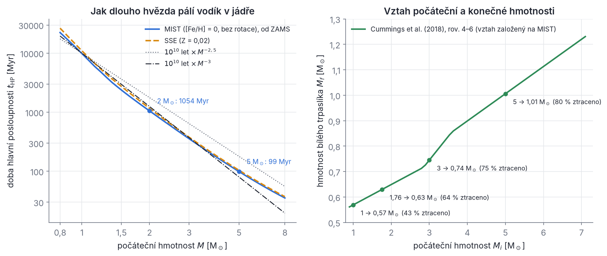
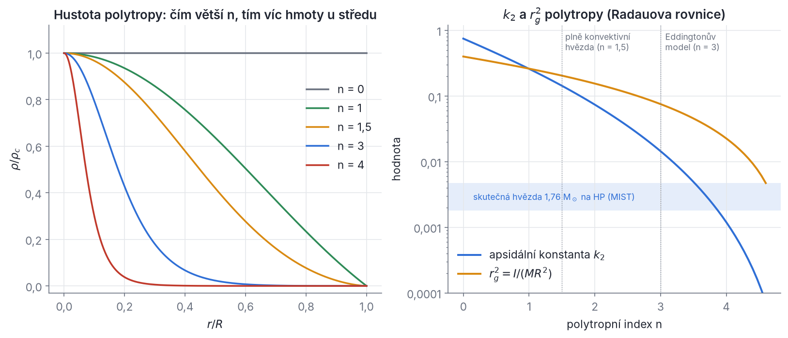
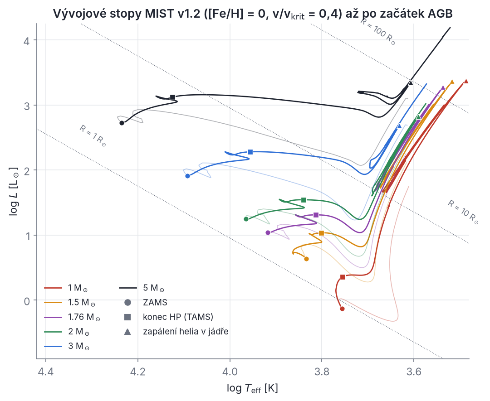
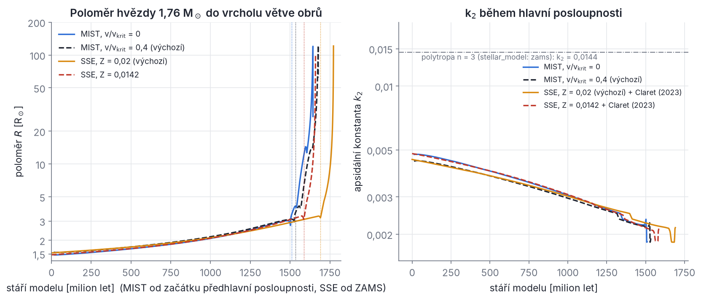

## Kapitola 8 – Vývoj hvězd

Až dosud jsme hvězdy brali jako body nebo jako koule se stálým poloměrem a stálou apsidální konstantou. Skutečné hvězdy se ale během života mění: pomalu rostou, ztrácejí hmotu, mění vnitřní stavbu a nakonec se z nich stanou bílí trpaslíci, neutronové hvězdy nebo černé díry. Pro vícenásobnou hvězdu má každá z těchto změn dynamické následky:

- **poloměr R** rozhoduje o síle slapů (slapové síly rostou jako R⁵, kapitola 7), o tom, kdy hvězda vyplní Rocheův lalok (kapitola 9), a o srážkách při velkých excentricitách (kapitoly 4 a 5);
- **apsidální konstanta k₂** a **normovaný moment setrvačnosti r_g²** určují rychlost stáčení apsid a vazbu rotace s drahou; během hlavní posloupnosti klesne k₂ asi na 40 % a r_g² asi na polovinu;
- **hmotnost** se mění větrem a dráhy se přitom rozšiřují, takže se mění i poměry period, na nichž závisí stabilita (kapitola 4).

Typický příklad je čtyřhvězda **CzeV343**: hmotnější hvězda dvojhvězdy A má podle základního řešení Pejchy et al. (2022) hmotnost 1,76 M☉ a stáří asi 630 milionů let. Během dalších zhruba 600–750 milionů let naroste její poloměr z 1,75 na 2,5–2,8 R☉ a hvězda vyplní Rocheův lalok, ještě než jí v jádře dojde vodík (oddíl 8.11). Kdy přesně se to stane, závisí na tom, jaký model vývoje použijeme. Proto se k této hvězdě v kapitole několikrát vrátíme. Vývoj hvězd potřebujeme i u ostatních soustav, které nás provázejí: horké hvězdy typu B ve V907 Sco a QX Cas, mladé hmotné hvězdy v AH Cep i hvězdy typu A ve V994 Her a BU CMi mají apsidální konstanty, které se s věkem znatelně mění.

SWINGERsim hvězdy sám nepočítá. Bere je z předpočítaných modelů (ZAMS, SSE, MIST, vlastní mřížky MESA). Abys těmto modelům rozuměl a věděl, kdy jim věřit, projdeme nejdřív fyziku: rovnice stavby hvězdy (8.1), viriálovou větu a časové škály (8.2), škálovací zákony (8.3), polytropy (8.4) a Clairautovu teorii, ze které vychází apsidální konstanta (8.5). Pak popíšeme život hvězdy (8.6), modely v SWINGERsim (8.7), ztrátu hmoty (8.8), magnetické brzdění (8.9), pozůstatky hvězd (8.10) a nakonec to, jak program spojuje vývoj hvězd s dynamikou drah (8.11).

Dobrý český úvod do celé látky najdeš v knihách Mikulášek & Krtička (2005), *Základy fyziky hvězd*, a Harmanec & Brož (2011), *Stavba a vývoj hvězd* (Matfyzpress). Standardní učebnicí je Kippenhahn, Weigert & Weiss (2012), *Stellar Structure and Evolution* (2. vyd., Springer).

### 8.1 Rovnice stavby hvězdy

**Intuice.** Hvězda je koule horkého plynu, kterou drží pohromadě vlastní gravitace. Gravitace se ji snaží stlačit, tlak plynu (a záření) se brání. Ve hvězdě, která se nemění rychle, jsou obě síly v každém místě přesně vyrovnané. Teplo vzniká uprostřed (jaderné reakce) a teče ven, buď zářením, nebo konvekcí, tedy prouděním plynu. Celý model hvězdy tvoří čtyři diferenciální rovnice, které vyjadřují čtyři zákony zachování: hmoty, hybnosti, energie a toku energie.

Budeme předpokládat **sféricky souměrnou** hvězdu bez rotace a magnetického pole. Všechny veličiny pak závisí jen na vzdálenosti r od středu (a na čase t). Místo r je výhodnější používat jako nezávislou proměnnou **hmotnost m uvnitř koule o poloměru r**. Tato *lagrangeovská souřadnice* jde od m = 0 ve středu po m = M na povrchu. Její výhoda: daná vrstva plynu má stálé m, i když se hvězda rozpíná nebo smršťuje. Hvězdné modely proto popisují vrstvy hmotností, ne poloměrem.

#### 8.1.1 Zachování hmoty

Kulová slupka mezi poloměry r a r + dr má objem 4πr² dr a hmotnost dm = 4πr²ρ dr, kde ρ(r) je hustota. Odtud

```latex
\frac{\mathrm dm}{\mathrm dr} = 4\pi r^2\rho
\qquad\Longleftrightarrow\qquad
\frac{\mathrm dr}{\mathrm dm} = \frac{1}{4\pi r^2\rho}.
```

Pro pozdější použití si definuj **střední hustotu uvnitř poloměru r**, ρ̄(r) = 3m(r)/(4πr³). Pro celou hvězdu je ρ̄ = 3M/(4πR³); u Slunce (M☉ = 1,988·10³⁰ kg, R☉ = 6,957·10⁸ m) vychází ρ̄☉ = 1410 kg m⁻³, tedy jen o málo víc než hustota vody.

#### 8.1.2 Hydrostatická rovnováha – odvození

Vyber si uvnitř hvězdy malý váleček plynu s podstavou S kolmou na směr k středu, výškou Δr a středem ve vzdálenosti r. Jeho hmotnost je ρSΔr.

- **Gravitace.** Podle Gaussovy věty pro gravitační pole působí na hmotu ve vzdálenosti r jen hmota m(r) uvnitř, jako by byla soustředěna ve středu. Tíhové zrychlení míří ke středu a má velikost g(r) = Gm(r)/r². Na váleček působí síla ρgSΔr ke středu.
- **Tlak.** Síly tlaku na boční stěny se navzájem ruší. Na spodní podstavu (blíž ke středu) tlačí okolní plyn ven silou S·P(r − Δr/2), na horní podstavu dovnitř silou S·P(r + Δr/2). Výslednice ve směru ven je S[P(r − Δr/2) − P(r + Δr/2)] ≈ −S (dP/dr) Δr (Taylorův rozvoj do prvního řádu).

Všimni si důležité věci: váhu válečku nevyrovnává tlak samotný (ten je skalár a působí na všechny strany), ale **rozdíl tlaků** mezi spodní a horní stranou, tedy gradient tlaku. Rovnováha sil (zrychlení nulové) dává −S (dP/dr) Δr − ρgSΔr = 0, neboli

```latex
\frac{\mathrm dP}{\mathrm dr} = -\rho\,g = -\frac{G\,m(r)\,\rho}{r^2}.
```

Vynásob ji výrazem dr/dm = 1/(4πr²ρ) ze zachování hmoty a dostaneš lagrangeovský tvar, se kterým pracují hvězdné kódy:

```latex
\frac{\mathrm dP}{\mathrm dm} = -\frac{G\,m}{4\pi r^4}.
```

Kdyby rovnováha neplatila, váleček by se pohyboval se zrychlením r̈ a místo nuly by na pravé straně stálo r̈/(4πr²), tedy

```latex
\frac{1}{4\pi r^2}\frac{\partial^2 r}{\partial t^2} = -\frac{G m}{4\pi r^4} - \frac{\partial P}{\partial m}.
```

Kdyby tlak náhle zmizel, vrstvy by padaly volným pádem. Odhad doby tohoto pádu (dynamické časové škály) uvidíme v oddílu 8.2: u Slunce je to asi půl hodiny. Hvězdy se během miliard let mění nepatrně, proto hydrostatická rovnováha platí s obrovskou přesností.

**Řešený příklad (odhad tlaku ve středu Slunce).** Nahraď derivaci podílem, dP/dr ≈ −P_c/R, kde P_c je tlak ve středu a na povrchu je tlak nulový. Za hustotu dosaď střední hustotu ρ̄ a za tíhové zrychlení jeho hodnotu v polovině poloměru, g ≈ GM/(R/2)² (uvnitř je hmoty méně, ale vzdálenost je menší). Pak

```latex
P_c \approx R\,\bar\rho\,\frac{4GM}{R^2} = \frac{3}{\pi}\,\frac{GM^2}{R^4} \approx 1{,}1\cdot10^{15}\ \mathrm{Pa}.
```

Standardní model Slunce dává P_c ≈ 2,3·10¹⁶ Pa (Mikulášek & Krtička 2005, s. 174), tedy asi dvacetkrát víc. Odhad je hrubý, protože hustota ve středu Slunce (asi 1,5·10⁵ kg m⁻³) je stokrát větší než střední hustota. Řád velikosti a hlavně škálování P_c ∝ M²/R⁴ jsou ale správné a budeme je potřebovat v oddílu 8.3.

#### 8.1.3 Stavová rovnice a střední molekulová hmotnost

Aby rovnice hydrostatické rovnováhy k něčemu byla, musíme vědět, jak tlak závisí na hustotě a teplotě. Uvnitř hvězd je plyn téměř úplně ionizovaný a chová se jako ideální plyn. K tlaku plynu se přidává tlak záření:

```latex
P = P_{\mathrm{plyn}} + P_{\mathrm{rad}} = \frac{\rho\,k_B T}{\mu\,m_{\mathrm H}} + \frac{a}{3}\,T^4,
\qquad a = \frac{4\sigma}{c} = 7{,}566\cdot10^{-16}\ \mathrm{J\,m^{-3}\,K^{-4}},
```

kde k_B je Boltzmannova konstanta, m_H hmotnost atomu vodíku, σ Stefanova–Boltzmannova konstanta, c rychlost světla a a konstanta zářivé hustoty. **Střední molekulová hmotnost μ** je průměrná hmotnost jedné volné částice (jádra nebo elektronu) v jednotkách m_H. Označ X, Y, Z hmotnostní zastoupení vodíku, helia a těžších prvků (X + Y + Z = 1). Plně ionizovaný vodík dává na každou hmotnost m_H dvě částice (proton a elektron), helium tři částice na 4m_H a těžký prvek s hmotnostním číslem A asi A/2 částic na Am_H. Proto

```latex
\frac{1}{\mu} \approx 2X + \frac34 Y + \frac12 Z .
```

Pro sluneční složení X = 0,70, Y = 0,28, Z = 0,02 vyjde μ = 0,617.

**Proč se hvězda vyvíjí.** Jaderné reakce mění čtyři protony a čtyři elektrony (8 částic) na jedno jádro helia a dva elektrony (3 částice). Počet částic v jádře klesá, μ roste z 0,62 k 1,3. Při stejné hustotě a teplotě by tlak plynu klesl. Jádro tedy nemůže dál nést váhu obalu, smrští se a zahřeje, dokud tlak opět nestačí. Odtud pochází celý vývoj na hlavní posloupnosti: jádro hvězdy houstne a zahřívá se, reakce se zrychlují, zářivý výkon roste a obal se rozpíná. Slunce od svého vzniku zjasnilo asi o 40 % (Mikulášek & Krtička 2005, s. 173).

Ve velmi hustém prostředí (jádra červených obrů, bílí trpaslíci) přestává platit rovnice ideálního plynu a tlak určují **degenerované elektrony** (Pauliho vylučovací princip): P ∝ ρ^{5/3} pro nerelativistické a P ∝ ρ^{4/3} pro ultrarelativistické elektrony, téměř nezávisle na teplotě. To bude důležité v oddílech 8.6 a 8.10.

#### 8.1.4 Energetická bilance: ε_nuc, ε_ν a ε_grav

Označ **L(m)** zářivý výkon, který protéká kulovou plochou ohraničující hmotnost m (ve středu L = 0, na povrchu L = L celé hvězdy). Ve slupce o hmotnosti dm se může energie uvolňovat, nebo ztrácet. Bilance je

```latex
\frac{\mathrm dL}{\mathrm dm} = \varepsilon_{\mathrm{nuc}} - \varepsilon_\nu + \varepsilon_{\mathrm{grav}},
\qquad
\varepsilon_{\mathrm{grav}} = -T\,\frac{\mathrm ds}{\mathrm dt}.
```

Jednotlivé členy (všechny ve wattech na kilogram):

- **ε_nuc** – výkon jaderných reakcí na jednotku hmotnosti. Silně závisí na teplotě: pro řetězec proton–proton zhruba ε ∝ ρT⁴, pro cyklus CNO ε ∝ ρT¹⁶ až ρT¹⁸, pro hoření helia (reakce 3α) ε ∝ ρ²T⁴⁰. Exponent teploty budeme značit ν_T (index T odlišuje exponent od neutrin).
- **ε_ν** – výkon, který odnášejí **neutrina**. Neutrina s látkou téměř nereagují a z hvězdy hned uniknou, takže jejich energie se nepřičítá k toku L. Část neutrin vzniká přímo v jaderných reakcích (to se obvykle odečte už v ε_nuc). Člen ε_ν zahrnuje neutrina vznikající bez jaderných reakcí v horkém a hustém plynu (plazmová, fotoneutrina, párová). Na hlavní posloupnosti je zanedbatelný, v degenerovaných jádrech obrů a v bílých trpaslících je důležitý.
- **ε_grav** – výkon uvolněný (nebo spotřebovaný) tím, že se slupka smršťuje nebo rozpíná. Zde **s** je **měrná entropie** (entropie na jednotku hmotnosti, J K⁻¹ kg⁻¹). Podle prvního zákona termodynamiky pro jednotku hmotnosti platí T ds = du + P d(1/ρ), kde u je měrná vnitřní energie. Proto

```latex
\varepsilon_{\mathrm{grav}} = -T\frac{\mathrm ds}{\mathrm dt} = -\frac{\mathrm du}{\mathrm dt} + \frac{P}{\rho^2}\,\frac{\mathrm d\rho}{\mathrm dt}.
```

Znaménko si pamatuj takto: když slupka přijímá teplo (ds/dt > 0), část protékajícího výkonu „spotřebuje“ a ven odchází méně, ε_grav < 0. Když se slupka smršťuje a ztrácí teplo, ε_grav > 0 a přispívá k zářivému výkonu. Hvězdy před hlavní posloupností svítí právě díky ε_grav (smršťování). Na hlavní posloupnosti je hvězda v **tepelné rovnováze**, ε_grav ≈ 0 a dL/dm ≈ ε_nuc.

> **Pozor.** Ve starších českých textech se energetická rovnice objevuje s jinými znaménky členů dU/dt (např. Mikulášek & Krtička 2005, s. 94). Správný tvar je ten výše: gravitačně-tepelný člen vstupuje se znaménkem minus u T ds/dt.

#### 8.1.5 Přenos energie zářením

Ve většině nitra hvězdy přenášejí energii fotony. Fotony se pohybují rychlostí světla, ale jsou neustále pohlcovány a znovu vyzařovány, takže energie difunduje ven jako náhodná procházka. Míru neprůhlednosti popisuje **opacita κ** (m² kg⁻¹): fotony urazí mezi dvěma pohlceními průměrně dráhu ℓ_f = 1/(κρ).

Odvození je krátké, když si uvědomíš, že záření nese hybnost. Tok energie L/(4πr²) (W m⁻²) nese tok hybnosti L/(4πr²c). Plyn ve vrstvě tloušťky dr pohltí jeho část κρ dr. Pohlcená hybnost za jednotku času na jednotku plochy je síla na jednotku plochy, tedy úbytek tlaku záření:

```latex
\frac{\mathrm dP_{\mathrm{rad}}}{\mathrm dr} = -\frac{\kappa\rho}{c}\,\frac{L}{4\pi r^2}.
```

Protože P_rad = aT⁴/3, je dP_rad/dr = (4a/3) T³ dT/dr. Dosazením dostaneš rovnici zářivého přenosu (zářivé difuze):

```latex
\frac{\mathrm dT}{\mathrm dr} = -\frac{3\,\kappa\,\rho\,L}{16\pi\,a\,c\,r^2\,T^3}
\qquad\Longleftrightarrow\qquad
\frac{\mathrm dT}{\mathrm dm} = -\frac{3\,\kappa\,L}{64\pi^2 a\,c\,r^4\,T^3}.
```

Je užitečné zapsat ji pomocí bezrozměrného **teplotního gradientu** ∇ = d ln T/d ln P (o kolik procent klesne teplota, když tlak klesne o jedno procento). Vydělením rovnice zářivého přenosu rovnicí hydrostatické rovnováhy dostaneš **zářivý gradient**

```latex
\nabla_{\mathrm{rad}} \equiv \left(\frac{\mathrm d\ln T}{\mathrm d\ln P}\right)_{\mathrm{rad}} = \frac{3}{16\pi a c G}\,\frac{\kappa\,L\,P}{m\,T^4},
```

tj. gradient, který by ve vrstvě musel být, aby zářením protekl výkon L. Obecně se pak teplota v hvězdě řídí rovnicí

```latex
\frac{\mathrm dT}{\mathrm dm} = -\frac{G\,m\,T}{4\pi r^4 P}\,\nabla ,
```

kde ∇ = ∇_rad v zářivých vrstvách a ∇ ≈ ∇_ad v konvektivních (viz dále).

Opacita má několik zdrojů: rozptyl na volných elektronech (Thomsonův, κ_e = 0,020(1 + X) m² kg⁻¹ ≈ 0,034 m² kg⁻¹, nezávisí na teplotě), přechody volný–volný a vázaný–volný (Kramersův zákon κ ∝ ρT^{−7/2}) a v chladných vnějších vrstvách absorpce záporným iontem vodíku H⁻. Hvězdné kódy berou opacitu z tabulek (OPAL, Ferguson et al.).

#### 8.1.6 Konvekce: Schwarzschildova a Ledouxova podmínka, délka promíchávání

Když je zářivý gradient příliš velký (velký tok L, velká opacita κ), vrstva se stane nestabilní a začne v ní proudit plyn. Kdy přesně?

**Schwarzschildova podmínka – odvození.** Představ si malou bublinu plynu, kterou náhodně posuneme o kousek dr nahoru. Bublina se pohybuje tak rychle, že si nestačí vyměnit teplo s okolím (děj je **adiabatický**), ale tak pomalu, že se její tlak hned vyrovná s tlakem okolí. Pokud bude bublina po posunutí hustší než okolí, klesne zpět – vrstva je stabilní. Pokud bude řidší, bude stoupat dál – vrstva je nestabilní a vzniká konvekce.

Hustota okolí (index h) se s výškou mění podle skutečného rozvrstvení hvězdy. Pro ideální plyn se stálým μ je ρ ∝ P/T, takže

```latex
\frac{1}{\rho}\left(\frac{\mathrm d\rho}{\mathrm dr}\right)_{h} = \frac{1}{P}\frac{\mathrm dP}{\mathrm dr} - \frac{1}{T}\left(\frac{\mathrm dT}{\mathrm dr}\right)_{h}.
```

Bublina se mění adiabaticky, P ∝ ρ^γ, kde γ je adiabatický exponent (pro jednoatomový ideální plyn γ = 5/3). Její tlak sleduje tlak okolí, takže

```latex
\frac{1}{\rho}\left(\frac{\mathrm d\rho}{\mathrm dr}\right)_{b} = \frac{1}{\gamma}\,\frac{1}{P}\frac{\mathrm dP}{\mathrm dr}.
```

Vrstva je stabilní, když je bublina po posunutí hustší než okolí, tj. když její hustota klesá s výškou pomaleji než hustota okolí: (dρ/dr)_b > (dρ/dr)_h (obě derivace jsou záporné). Dosazením a vydělením záporným (1/P)(dP/dr) (tím se otočí nerovnost) dostaneš

```latex
\nabla = \frac{\mathrm d\ln T}{\mathrm d\ln P} < \nabla_{\mathrm{ad}} \equiv 1 - \frac{1}{\gamma} = \frac{\gamma-1}{\gamma} = 0{,}4\ \ (\gamma = 5/3).
```

V rovnovážné hvězdě by bez konvekce platilo ∇ = ∇_rad, takže **Schwarzschildova podmínka** zní: vrstva je konvektivní, když ∇_rad > ∇_ad. Kde k tomu dochází:

1. v **jádrech hvězd hmotnějších než asi 1,1–1,2 M☉**, kde cyklus CNO s ε ∝ T¹⁶⁻¹⁸ soustřeďuje uvolňování energie do malé oblasti u středu: L/m je tam obrovské;
2. v **obalech chladných hvězd**, kde je kvůli částečné ionizaci vodíku opacita velká a γ i ∇_ad klesají;
3. v celých **hvězdách s hmotností pod asi 0,35 M☉** (plně konvektivní hvězdy) a v hvězdách před hlavní posloupností na Hayashiho linii.

**Ledouxova podmínka.** Když se ve vrstvě mění chemické složení (v jádře, kde hoří vodík, přibývá helium, nad ním zůstává vodík), je těžší plyn dole a stabilizuje vrstvu. Pro ideální plyn se gradient složení ∇_μ = d ln μ/d ln P přičte k ∇_ad a vrstva je konvektivní, až když

```latex
\nabla_{\mathrm{rad}} > \nabla_{\mathrm{ad}} + \nabla_\mu .
```

V chemicky homogenních vrstvách (∇_μ = 0) jsou obě podmínky stejné. Oblasti, kde ∇_ad < ∇_rad < ∇_ad + ∇_μ, se pomalu promíchávají (**semikonvekce**). Modely MIST, které SWINGERsim používá, pracují s Ledouxovou podmínkou (Choi et al. 2016, tab. 1).

**Teorie délky promíchávání.** Kolik energie konvekce přenese a jak velký je skutečný gradient ∇? Nejjednodušší a dodnes používaná odpověď je **teorie délky promíchávání** (mixing-length theory, Böhm-Vitense 1958). Bubliny vystoupají o charakteristickou vzdálenost ℓ_m a pak se rozpustí v okolí a předají mu přebytek tepla. Délka ℓ_m se bere úměrná **tlakové škálové výšce** H_P = P/(ρg) (výška, na které tlak klesne e-krát):

```latex
\ell_m = \alpha_{\mathrm{MLT}}\,H_P, \qquad H_P = \frac{P}{\rho\,g}.
```

Parametr α_MLT se kalibruje tak, aby model Slunce měl v dnešním stáří správný poloměr; v MIST je α_MLT = 1,82. Bublina, která vystoupá o ℓ_m, je teplejší než okolí o ΔT/T ≈ (∇ − ∇_ad) ℓ_m/H_P. Vztlak ji urychluje zrychlením ≈ g ΔT/T, takže získá rychlost v² ~ g (∇ − ∇_ad) ℓ_m²/H_P a nese tok tepla F ~ ρ c_P v ΔT (c_P je měrná tepelná kapacita při stálém tlaku). V obvyklé verzi teorie (Kippenhahn, Weigert & Weiss 2012, kap. 7) je

```latex
F_{\mathrm{konv}} = \rho\,c_P\,T\,\sqrt{g}\;\frac{\ell_m^2}{4\sqrt2\,H_P^{3/2}}\,(\nabla-\nabla_{\mathrm{ad}})^{3/2},
\qquad
v^2 = \frac{g\,\ell_m^2}{8H_P}\,(\nabla-\nabla_{\mathrm{ad}}).
```

**Řešený příklad (konvekce pod povrchem Slunce).** Na spodní hranici sluneční konvektivní zóny (r ≈ 0,713 R☉) je T ≈ 2,18·10⁶ K a ρ ≈ 190 kg m⁻³. Tok je F = L☉/(4πr²) = 1,24·10⁸ W m⁻², tíhové zrychlení g = GM☉/r² = 539 m s⁻², tlak P = ρk_BT/(μm_H) = 5,5·10¹² Pa (μ = 0,62), škálová výška H_P = P/(ρg) = 54 000 km a c_P = 5k_B/(2μm_H) = 3,3·10⁴ J kg⁻¹ K⁻¹. S ℓ_m = 1,82 H_P vyřešíš první rovnici pro nadadiabatický gradient a dostaneš ∇ − ∇_ad ≈ 2·10⁻⁷ a rychlost v ≈ 50 m s⁻¹. Bublina urazí ℓ_m asi za 23 dní. Závěr je obecný: **konvekce v nitru je tak účinná, že skutečný gradient se od adiabatického liší jen o miliontiny**, a v konvektivních vrstvách stačí položit ∇ = ∇_ad. Teprve těsně pod povrchem, kde je plyn řídký, je nadadiabatický gradient velký a záleží na α_MLT. Doba obratu konvektivních vírů (desítky dní) je přitom klíčová pro slapové tření (kapitola 7) a pro magnetické brzdění (oddíl 8.9).

Konvekce v reálných hvězdách navíc **přestřeluje** (overshooting) za hranici danou Schwarzschildovou nebo Ledouxovou podmínkou, protože bubliny mají setrvačnost. Přestřelování zvětšuje konvektivní jádro a prodlužuje hlavní posloupnost. MIST ho popisuje exponenciálním difuzním promícháváním s parametrem f_ov = 0,016 (zhruba odpovídá přestřelení o 0,2 H_P), SSE je kalibrováno na modely Polse et al. (1998) s parametrem přestřelování δ_ov = 0,12 (pozor: δ_ov není vzdálenost v jednotkách H_P, ale parametr upravené Schwarzschildovy podmínky). I proto se oba modely liší v délce hlavní posloupnosti (oddíl 8.7).

#### 8.1.7 Celá soustava rovnic

Shrňme to. Hvězdný model je řešení čtyř rovnic pro r(m), P(m), L(m) a T(m):

```latex
\frac{\mathrm dr}{\mathrm dm} = \frac{1}{4\pi r^2\rho},\qquad
\frac{\mathrm dP}{\mathrm dm} = -\frac{Gm}{4\pi r^4},\qquad
\frac{\mathrm dL}{\mathrm dm} = \varepsilon_{\mathrm{nuc}} - \varepsilon_\nu - T\frac{\mathrm ds}{\mathrm dt},\qquad
\frac{\mathrm dT}{\mathrm dm} = -\frac{GmT}{4\pi r^4 P}\,\nabla ,
```

doplněných o stavovou rovnici ρ(P, T, složení), opacitu κ(ρ, T, složení), výkon reakcí ε_nuc(ρ, T, složení) a pravidlo pro ∇ (zářivý, nebo konvektivní). Okrajové podmínky jsou ve středu r = 0, L = 0 při m = 0 a na povrchu tlak a teplota odpovídající atmosféře; nejhrubší verze je P = 0 a L = 4πR²σT_eff⁴ při m = M, kde T_eff je efektivní teplota.

**Vývoj** je posloupnost takových modelů: v každém časovém kroku se podle rychlostí reakcí změní složení (X ubývá, Y přibývá) a v konvektivních oblastech se složení promíchá. Program **MESA** (Modules for Experiments in Stellar Astrophysics; Paxton et al. 2011, ApJS 192, 3, a navazující články) tyto rovnice řeší metodou Henyeyho (Newtonova iterace na síti několika tisíc vrstev). Stejným programem jsou spočítány modely MIST i tabulky apsidálních konstant Clareta (2023), které SWINGERsim používá.

> **Z historie.** Rovnováhu plynných koulí zkoumali v 19. století J. H. Lane (1870) a A. Ritter, souhrnně R. Emden v knize *Gaskugeln* (1907). Arthur Eddington ve 20. letech 20. století ukázal, že ve hvězdách přenáší energii hlavně záření, a odvodil vztah hmotnosti a zářivého výkonu dřív, než se vědělo, odkud hvězdy energii berou. Jaderné zdroje energie vysvětlil H. Bethe roku 1939. Jeden ze zakladatelů moderních výpočtů vývoje hvězd, Rudolf Kippenhahn, se narodil roku 1926 v Perninku v Krušných horách.

### 8.2 Viriálová věta a tři časové škály

**Intuice.** Proč se hvězda, která ztrácí energii vyzařováním, *zahřívá*? A proč žije Slunce miliardy let, když by se bez tlaku zhroutilo za půl hodiny? Obě otázky zodpovídá viriálová věta – jedna z nejužitečnějších vět celé astrofyziky. Odvodíme ji dvakrát: jednou pro soustavu hmotných bodů (platí i pro hvězdokupy a vícenásobné hvězdy) a jednou pro plynnou kouli.

#### 8.2.1 Lagrangeova–Jacobiho identita

Uvažuj soustavu N hmotných bodů s hmotnostmi m_i, polohami **r**_i a hybnostmi **p**_i = m_i **ṙ**_i, které na sebe působí jen gravitací. Definuj **polární moment setrvačnosti** vzhledem k počátku I_p = Σ m_i r_i² (index p odlišuje tuto veličinu od momentu setrvačnosti hvězdy kolem osy rotace) a veličinu Q = Σ **p**_i · **r**_i. Spočítej časovou derivaci Q dvěma způsoby.

1. Protože **p**_i · **r**_i = m_i **ṙ**_i · **r**_i = ½ m_i d(r_i²)/dt, je Q = ½ dI_p/dt a dQ/dt = ½ Ï_p.
2. Derivací součinu: dQ/dt = Σ **p**_i · **ṙ**_i + Σ **ṗ**_i · **r**_i = 2K + Σ **F**_i · **r**_i, kde K = Σ ½ m_i ṙ_i² je celková kinetická energie a **F**_i = **ṗ**_i síla působící na bod i.

Součet Σ **F**_i · **r**_i se nazývá **Clausiův viriál**. Síla na bod i je součet sil od ostatních bodů, **F**_i = Σ_{j≠i} **F**_ij, a podle zákona akce a reakce **F**_ji = −**F**_ij. Zapiš dvojnásobnou sumu dvakrát, jednou tak, jak je, a jednou s přejmenovanými indexy i ↔ j:

```latex
\sum_i \mathbf F_i\cdot\mathbf r_i = \sum_i\sum_{j\ne i}\mathbf F_{ij}\cdot\mathbf r_i
= \sum_j\sum_{i\ne j}\mathbf F_{ji}\cdot\mathbf r_j
= -\sum_i\sum_{j\ne i}\mathbf F_{ij}\cdot\mathbf r_j .
```

Sečti první a poslední výraz a vyděl dvěma: Σ **F**_i · **r**_i = ½ Σ_i Σ_{j≠i} **F**_ij · (**r**_i − **r**_j). Pro gravitaci je **F**_ij = −Gm_im_j(**r**_i − **r**_j)/r_ij³, kde r_ij = |**r**_i − **r**_j|, takže **F**_ij · (**r**_i − **r**_j) = −Gm_im_j/r_ij a

```latex
\sum_i \mathbf F_i\cdot\mathbf r_i = -\frac12\sum_i\sum_{j\ne i}\frac{G m_i m_j}{r_{ij}} = W ,
```

kde W je celková gravitační potenciální energie soustavy (každá dvojice započtena jednou). Porovnáním obou výsledků dostaneš **Lagrangeovu–Jacobiho identitu**

```latex
\frac12\,\frac{\mathrm d^2 I_p}{\mathrm dt^2} = 2K + W .
```

Pro soustavu, která se nerozpíná ani nehroutí (I_p kmitá kolem stálé hodnoty), je časová střední hodnota levé strany nulová. Plyne z toho **viriálová věta** 2⟨K⟩ + ⟨W⟩ = 0, a protože celková energie E = K + W je stálá,

```latex
E = \frac{\langle W\rangle}{2} = -\langle K\rangle .
```

Pro dvojhvězdu na kruhové dráze to znáš z kapitoly 2: kinetická energie je polovinou absolutní hodnoty potenciální a celková energie je −Gm₁m₂/(2a).

#### 8.2.2 Viriálová věta pro hvězdu

Pro plynnou kouli odvodíme totéž přímo z hydrostatické rovnováhy. Vynásob rovnici dP/dm = −Gm/(4πr⁴) výrazem 4πr³ a integruj přes celou hvězdu:

```latex
\int_0^M 4\pi r^3\,\frac{\mathrm dP}{\mathrm dm}\,\mathrm dm = -\int_0^M \frac{G m}{r}\,\mathrm dm = W .
```

Pravá strana je gravitační potenciální energie hvězdy (práce potřebná k rozebrání hvězdy po slupkách do nekonečna, se záporným znaménkem). Levou stranu integruj per partes: hraniční člen [4πr³P] je nulový ve středu (r = 0) i na povrchu (P = 0) a zbude

```latex
-\int_0^M P\,\frac{\mathrm d(4\pi r^3)}{\mathrm dm}\,\mathrm dm = -\int_0^M 12\pi r^2 P\,\frac{\mathrm dr}{\mathrm dm}\,\mathrm dm = -3\int_0^M \frac{P}{\rho}\,\mathrm dm .
```

Tedy 3∫(P/ρ) dm + W = 0. Pro ideální plyn s adiabatickým exponentem γ je měrná vnitřní energie u = P/[(γ − 1)ρ] (pro γ = 5/3 je to známé u = (3/2)P/ρ). Celková vnitřní (tepelná) energie U = ∫u dm proto splňuje 3(γ − 1)U + W = 0 a celková energie hvězdy je

```latex
E = U + W = \frac{3\gamma-4}{3(\gamma-1)}\,W .
```

Pro γ = 5/3 je 2U + W = 0 a E = W/2 < 0: hvězda je vázaná. Pro γ → 4/3 (plyn, v němž převažuje tlak záření, nebo relativistické elektrony) jde E k nule a hvězda je na hranici stability. To je jeden z důvodů, proč hvězdy nemohou být libovolně hmotné a proč se hroutí jádra hmotných hvězd.

**Záporná tepelná kapacita.** Když hvězda vyzáří energii ΔE (E klesne o ΔE), klesne W o 2ΔE a U vzroste o ΔE. **Polovina uvolněné gravitační energie se vyzáří a polovina hvězdu zahřeje.** Hvězda, která se smršťuje a ztrácí energii, se tedy zahřívá. Tak se zapalují jaderné reakce na konci smršťování před hlavní posloupností a tak se po vyhoření vodíku zahřívá heliové jádro až k zapálení helia.

**Střední teplota.** Gravitační energii zapiš jako W = −α_W GM²/R. Bezrozměrné číslo α_W závisí na rozložení hustoty: homogenní koule má α_W = 3/5 a polytropa indexu n (oddíl 8.4) má α_W = 3/(5 − n), tedy 0,86 pro n = 1,5 a 1,5 pro n = 3. Tepelná energie ideálního plynu je U = (3/2)(M/(μm_H)) k_B T̄, kde T̄ je hmotnostně střední teplota. Z 2U + W = 0 plyne

```latex
\bar T = \frac{\alpha_W}{3}\,\frac{G\mu m_{\mathrm H}}{k_B}\,\frac{M}{R}
\approx 7\cdot10^{6}\ \mathrm K\;\frac{M/M_\odot}{R/R_\odot}\qquad(\alpha_W = 1{,}5,\ \mu = 0{,}62).
```

Uvnitř Slunce je tedy střední teplota miliony kelvinů – dost na to, aby se protony díky tunelovému jevu slučovaly. Teplota ve středu Slunce je 1,57·10⁷ K.

#### 8.2.3 Tři časové škály

**Dynamická časová škála** je doba, za kterou se hvězda zhroutí, když náhle zmizí tlak, nebo za kterou se vrátí do rovnováhy po porušení. Vrstva na povrchu padá volným pádem k hmotnosti M. Volný pád z klidu ze vzdálenosti R je degenerovaná keplerovská elipsa s velkou poloosou a = R/2 (excentricita e → 1), a pád trvá polovinu její oběžné doby (kapitola 2):

```latex
t_{\mathrm{ff}} = \frac{P_{\mathrm{orb}}(a=R/2)}{2} = \pi\sqrt{\frac{(R/2)^3}{GM}} = \sqrt{\frac{3\pi}{32\,G\bar\rho}} .
```

Pro Slunce vychází t_ff = 29,5 min. Často se používá jednodušší tvar bez číselného faktoru, t_dyn = √(R³/(GM)) = 26,5 min pro Slunce; Hurley et al. (2002) v programu BSE a SWINGERsim v modulu přenosu hmoty používají τ_dyn = 5,05·10⁻⁵ √(R³/M) let (R a M ve slunečních jednotkách), což je totéž číslo. Dynamická škála je velmi blízko periodám pulzací (kapitola 10): pulzující hvězdy mají P ∝ (Gρ̄)^{−1/2}.

**Tepelná (Kelvinova–Helmholtzova) časová škála** je doba, po kterou by hvězda mohla svítit svým současným zářivým výkonem L jen z gravitační energie, tedy smršťováním. Podle viriálové věty se při smrštění z nekonečna na poloměr R vyzáří polovina |W|, tj. (α_W/2)GM²/R. Odtud

```latex
\tau_{\mathrm{KH}} = \frac{\alpha_W}{2}\,\frac{GM^2}{RL}.
```

V literatuře se definice liší o číselný faktor řádu jedné a setkáš se se všemi třemi:

| definice | Slunce | kde se používá |
| --- | --- | --- |
| GM²/(RL) | 31,4 milionu let | většina učebnic a článků o dvojhvězdách (např. Tauris & van den Heuvel 2006) |
| (α_W/2) GM²/(RL), polytropa n = 3 (α_W = 1,5) | 23,5 milionu let | energie skutečně vyzářená smršťováním (viriálová věta) |
| 10⁷ M²/(RL) let (M, R, L ve slunečních jednotkách) | 10,0 milionu let | BSE (Hurley et al. 2002, rov. 61) a SWINGERsim |

Poslední definice je asi 0,32krát první. Pro obry BSE i SWINGERsim nahrazují M² výrazem M(M − M_c), kde M_c je hmotnost jádra, protože tepelnou zásobu nese jen obal. Když v literatuře čteš „přenos hmoty na tepelné časové škále“, vždy si zkontroluj, kterou definici autor používá: rozdíl je až trojnásobný.

**Jaderná časová škála** je doba, po kterou hvězda vydrží svítit jadernými reakcemi. Při přeměně vodíku na helium se uvolní 0,71 % klidové energie spáleného vodíku. Na hlavní posloupnosti hvězda spálí jen zlomek q celkového vodíku (vodík jen v jádře; q ≈ 0,1–0,15 pro Slunce, víc u hmotnějších hvězd s velkými konvektivními jádry):

```latex
\tau_{\mathrm{nuc}} = \frac{0{,}0071\;q\,X\,Mc^2}{L}
\approx 7{,}4\cdot10^{9}\ \mathrm{let}\times\frac{q}{0{,}1}\,\frac{M/M_\odot}{L/L_\odot}\qquad (X = 0{,}70).
```

Kdyby Slunce spálilo všechen vodík, svítilo by 74 miliard let; s q ≈ 0,15 vyjde 11 miliard let, v souladu s modely.

**Řešený příklad (žebříček časových škál).** Spočítej všechny tři škály pro Slunce a pro hvězdu 1,76 M☉ z CzeV343 na začátku hlavní posloupnosti (podle MIST R = 1,48 R☉, L = 10,5 L☉) a na jejím konci (R = 3,41 R☉, L = 20,8 L☉).

| hvězda | t_dyn = √(R³/GM) | GM²/(RL) | 10⁷ M²/(RL) let | t_HP (MIST) |
| --- | --- | --- | --- | --- |
| Slunce | 26,5 min | 31 milionů let | 10 milionů let | 9,9 miliardy let |
| 1,76 M☉, ZAMS | 36 min | 6,3 milionu let | 2,0 milionu let | 1,5 miliardy let |
| 1,76 M☉, konec HP | 2,1 h | 1,4 milionu let | 0,44 milionu let | — |

Hierarchie je obrovská: hodiny ≪ miliony let ≪ miliardy let. Má tři důležité důsledky. (1) Na dynamické škále je hvězda vždy v hydrostatické rovnováze, proto ji SWINGERsim může popsat poloměrem a několika čísly. (2) Na tepelné škále se hvězda přizpůsobuje změnám, například ztrátě hmoty při přenosu na průvodce; poměr rychlostí rozhoduje o stabilitě přenosu hmoty (kapitola 9). (3) Vývoj na jaderné škále je pomalý ve srovnání s oběhem i se sekulární dynamikou, což umožňuje operátorové štěpení v oddílu 8.11.

### 8.3 Homologie: proč L ∝ M⁴ a t_HP ∝ M⁻³

**Intuice.** Modely hvězd hlavní posloupnosti různých hmotností si jsou podobné: hmotnější hvězda je jakoby „zvětšená kopie“ méně hmotné. Pokud je tato podobnost přesná (říká se jí **homologie**), lze z rovnic stavby bez řešení odvodit, jak zářivý výkon a poloměr závisí na hmotnosti. Výsledné mocninné zákony nejsou přesné, ale vysvětlují, *proč* hmotné hvězdy žijí krátce.

**Odvození.** Ve všech rovnicích nahraď derivace podíly typických hodnot: d/dm → 1/M, r → R, P → P_c, T → T_c, ρ → ρ̄ ∝ M/R³. Pak:

- hydrostatická rovnováha: P_c/M ∝ M/R⁴, tedy P_c ∝ M²/R⁴ (to jsme už viděli v oddílu 8.1);
- stavová rovnice ideálního plynu: T_c ∝ μP_c/ρ̄ ∝ μ(M²/R⁴)(R³/M) = μM/R (stejný výsledek dává viriálová věta);
- zářivý přenos: T/M ∝ κL/(R⁴T³), tedy L ∝ R⁴T⁴/(κM).

Dosazením T ∝ μM/R do posledního vztahu dostaneš

```latex
L \propto \frac{R^4}{\kappa M}\left(\frac{\mu M}{R}\right)^4 = \frac{\mu^4}{\kappa}\,M^3 .
```

Pozoruhodné je, že **poloměr vypadl**: zářivý výkon hvězdy v zářivé rovnováze s opacitou nezávislou na hustotě a teplotě (rozptyl na elektronech) určuje jen hmotnost a složení, nikoli jaderné reakce. Ty se jen nastaví tak, aby výkon dodávaly: hvězda je termostat. Když se jádro ochladí, reakce se zpomalí, jádro se smrští a zahřeje, a naopak. S Kramersovou opacitou κ ∝ ρT^{−7/2} vyjde L ∝ μ^{7,5} M^{5,5} R^{−0,5}, tedy strmější závislost. Faktor μ⁴ vysvětluje, proč hvězdy na hlavní posloupnosti zjasňují: μ v jádře roste.

**Poloměr** určují jaderné reakce. S ε_nuc ∝ ρT^{ν_T} je L ∝ Mε ∝ M (M/R³)(M/R)^{ν_T}. Porovnáním s L ∝ M³ (μ = konst.) dostaneš R^{3+ν_T} ∝ M^{ν_T − 1}:

```latex
R \propto M^{(\nu_T-1)/(\nu_T+3)} \approx
\begin{cases} M^{0{,}43} & \text{řetězec pp},\ \nu_T \approx 4,\\ M^{0{,}8} & \text{cyklus CNO},\ \nu_T \approx 17.\end{cases}
```

**Doba hlavní posloupnosti** je úměrná zásobě paliva (∝ M) dělené výkonem: t_HP ∝ M/L. S L ∝ M^{3–4} vychází t_HP ∝ M^{−2} až M^{−3}.

**Srovnání s modely.** Z modelů MIST (bez rotace, [Fe/H] = 0) jsme spočítali zářivý výkon na ZAMS a dobu hlavní posloupnosti (od ZAMS do vyčerpání vodíku v jádře, tab. 8.1). Proložením přímky v logaritmech v rozsahu 1–5 M☉ dostaneš L_ZAMS ∝ M^{4,1} a t_HP ∝ M^{−2,8}. Lokální exponent d log t_HP/d log M klesá od −3,8 kolem 1 M☉ k −2,1 u 7 M☉. Užitečné pravidlo je tedy

```latex
t_{\mathrm{HP}} \approx 10^{10}\ \mathrm{let}\times\left(\frac{M}{M_\odot}\right)^{-3}\qquad(1\text{–}5\ M_\odot,\ \text{přesnost asi 25 \%}).
```

Podle modelů žije hvězda 2 M☉ na hlavní posloupnosti asi 1,1 miliardy let a hvězda 5 M☉ asi 100 milionů let; pravidlo dává 1,25 miliardy a 80 milionů let. Často citovaný exponent −2,5 (Tauris & van den Heuvel 2006) dává 1,8 miliardy a 180 milionů let, tedy hodnoty asi 1,7× a 1,8× příliš velké. Exponent −2,5 odpovídá L ∝ M^{3,5}, ale skutečný vztah je mezi 1 a 5 M☉ strmější.

**Tab. 8.1 – Doba hlavní posloupnosti** (milionů let). MIST: [Fe/H] = 0, rozdíl stáří na EEP 454 (konec HP) a EEP 202 (ZAMS); SSE: Hurley, Pols & Tout (2000), t_HP od ZAMS. Všechny hodnoty jsme spočítali funkcemi SWINGERsim (`swingersim.mist.mist_track`, `swingersim.evolution.track`).

| M [M☉] | MIST, v/v_krit = 0 | MIST, v/v_krit = 0,4 | SSE, Z = 0,02 | SSE, Z = 0,0142 | 10¹⁰ let · M⁻³ | 10¹⁰ let · M⁻²·⁵ |
| --- | --- | --- | --- | --- | --- | --- |
| 1,0 | 9878 | 9878 | 11 004 | 9995 | 10 000 | 10 000 |
| 1,5 | 2378 | 2390 | 2729 | 2540 | 2963 | 3629 |
| 1,76 | 1498 | 1521 | 1691 | 1586 | 1834 | 2433 |
| 2,0 | 1054 | 1073 | 1164 | 1098 | 1250 | 1768 |
| 3,0 | 356 | 364 | 378 | 363 | 370 | 642 |
| 5,0 | 99 | 101 | 104 | 103 | 80 | 179 |
| 7,0 | 46,5 | 48,0 | 48,9 | 49,3 | 29 | 77 |

U 1 M☉ jsou oba sloupce MIST stejné, protože MIST hvězdy pod 1,2 M☉ neroztáčí (oddíl 8.7). Rotující modely žijí o 0,5–3 % déle, protože rotační promíchávání přivádí do jádra čerstvý vodík.



*Obr. 8.1 – Vlevo: doba hlavní posloupnosti podle MIST (modře) a SSE (oranžově, čárkovaně) v logaritmických osách. Tečkovaná přímka je pravidlo 10¹⁰ let × M^{−2,5}, čerchovaná 10¹⁰ let × M^{−3}. Modely leží blíž ke strmější přímce: pravidlo M^{−3} s nimi v rozsahu 1–5 M☉ souhlasí asi na 25 %, pravidlo M^{−2,5} jen kolem 1 M☉. Vpravo: hmotnost bílého trpaslíka, kterého hvězda zanechá, podle poloempirického vztahu Cummingse et al. (2018), s vyznačeným podílem hmotnosti, který hvězda během života ztratí (oddíl 8.10).*

### 8.4 Polytropy a Laneova–Emdenova rovnice

**Intuice.** Plný model hvězdy potřebuje stavovou rovnici, opacitu i jaderné reakce. Pro mnoho účelů ale stačí jednodušší model, ve kterém tlak závisí jen na hustotě. Pak se z rovnic stavby vypustí teplota a energie a zbude jediná rovnice, kterou vyřešíš na pár řádcích Pythonu. Takové modely se nazývají **polytropy**. SWINGERsim je používá pro hvězdy nultého stáří (`stellar_model: {kind: zams}`) a jako náhradní řešení tam, kam tabulky nedosahují.

**Polytropní vztah.** Předpokládej, že v celé hvězdě platí

```latex
P = K\,\rho^{1+1/n},
```

kde K je konstanta a n **polytropní index**. Kdy je to rozumné?

- **Plně konvektivní hvězda** má všude adiabatický gradient, takže P ∝ ρ^γ s γ = 5/3, tj. n = 1,5. Tak se chovají hvězdy pod asi 0,35 M☉, hvězdy před hlavní posloupností a (přibližně) konvektivní obaly obrů.
- **Eddingtonův standardní model**: když je poměr tlaku plynu a celkového tlaku β v celé hvězdě stálý, vychází z P_plyn ∝ ρT a P_rad ∝ T⁴ vztah P ∝ ρ^{4/3}, tj. n = 3. Je to první přiblížení hvězd hlavní posloupnosti se zářivým obalem.
- **Degenerovaný plyn**: n = 1,5 (nerelativistický) a n = 3 (ultrarelativistický), viz bílí trpaslíci.
- Limitní případ n = 0 je **homogenní koule** (nestlačitelná kapalina, ρ = konst.).

**Odvození Laneovy–Emdenovy rovnice.** Hydrostatickou rovnováhu dP/dr = −Gmρ/r² vynásob r²/ρ a derivuj podle r; s dm/dr = 4πr²ρ dostaneš

```latex
\frac{1}{r^2}\,\frac{\mathrm d}{\mathrm dr}\!\left(\frac{r^2}{\rho}\,\frac{\mathrm dP}{\mathrm dr}\right) = -4\pi G\rho .
```

Zaveď bezrozměrnou hustotu θ vztahem ρ = ρ_c θⁿ (ρ_c je hustota ve středu, takže θ = 1 ve středu a θ = 0 na povrchu). Z polytropního vztahu je pak P = Kρ_c^{1+1/n} θ^{n+1} a dP/dr = Kρ_c^{1+1/n}(n + 1)θⁿ dθ/dr. Dosaď a zaveď bezrozměrný poloměr ξ = r/r_n s délkovou škálou

```latex
r_n^2 = \frac{(n+1)\,K\,\rho_c^{1/n-1}}{4\pi G}.
```

Všechny konstanty se zkrátí a zbude **Laneova–Emdenova rovnice**

```latex
\frac{1}{\xi^2}\,\frac{\mathrm d}{\mathrm d\xi}\!\left(\xi^2\frac{\mathrm d\theta}{\mathrm d\xi}\right) = -\theta^n
\qquad\Longleftrightarrow\qquad
\theta'' + \frac{2}{\xi}\,\theta' + \theta^n = 0,
```

s počátečními podmínkami θ(0) = 1 a θ′(0) = 0 (ve středu nemá hustota hrot). Povrch hvězdy je první nulový bod ξ₁, ve kterém θ(ξ₁) = 0; poloměr hvězdy je R = r_n ξ₁.

**Co z řešení plyne.** Hmotnost uvnitř ξ je m = 4πr_n³ρ_c(−ξ²θ′), protože z rovnice platí ξ²θ′ = −∫₀^ξ θⁿξ² dξ. Celková hmotnost je M = 4πr_n³ρ_c(−ξ₁²θ′₁) a poměr centrální a střední hustoty

```latex
\frac{\rho_c}{\bar\rho} = \frac{\xi_1}{3\,|\theta'(\xi_1)|}.
```

Gravitační energie polytropy je W = −[3/(5 − n)] GM²/R (Kippenhahn, Weigert & Weiss 2012, kap. 19); pro n → 5 se poloměr stane nekonečným.

**Analytická řešení** existují jen pro n = 0, 1 a 5. Pro n = 0 je θ = 1 − ξ²/6, ξ₁ = √6. Pro n = 1 je θ = sin ξ/ξ (dosaď a ověř!), ξ₁ = π a ρ_c/ρ̄ = π²/3 = 3,29.

**Numerické řešení.** Rovnice má ve středu singularitu (člen 2θ′/ξ), proto začni integraci v malém ξ₀ s hodnotami z Taylorova rozvoje

```latex
\theta(\xi) = 1 - \frac{\xi^2}{6} + \frac{n\,\xi^4}{120} - \dots,\qquad
\theta'(\xi) = -\frac{\xi}{3} + \frac{n\,\xi^3}{30} - \dots
```

(rozvoj dostaneš dosazením θ = 1 + aξ² + bξ⁴ do rovnice). Pak integruj Rungeovou–Kuttovou metodou (kapitola 6), dokud θ neklesne na nulu. Následující kód počítá současně Radauovu rovnici z oddílu 8.5, takže dává rovnou apsidální konstantu k₂ a normovaný moment setrvačnosti r_g²; dělá totéž co funkce `swingersim.stellar.polytrope_constants`:

```python
import numpy as np
from scipy.integrate import solve_ivp

def polytrope(n):
    """xi_1, k2 a r_g^2 polytropy indexu n (Laneova-Emdenova + Radauova rovnice)."""
    def rhs(x, y):
        th, dth, eta, J = y
        thn = max(th, 0.0) ** n
        rr = x * thn / (-3.0 * dth)            # rho / rho_stredni uvnitr x
        return [dth,                           # d theta / d xi
                -thn - 2.0 * dth / x,          # Laneova-Emdenova rovnice
                (6.0 - 6.0 * rr * (eta + 1.0) - eta * (eta - 1.0)) / x,  # Radau
                thn * x**4]                    # integral pro moment setrvacnosti
    x0 = 1e-4                                  # start mimo singularitu v xi = 0
    y0 = [1 - x0**2/6 + n*x0**4/120, -x0/3 + n*x0**3/30, 0.0, 0.0]
    povrch = lambda x, y: y[0]
    povrch.terminal = True
    s = solve_ivp(rhs, (x0, 1e3), y0, rtol=1e-11, atol=1e-13, events=povrch)
    x1 = s.t_events[0][0]
    th, dth, eta, J = s.y_events[0][0]
    k2 = (3 - eta) / (2 * (2 + eta))
    rg2 = (2 / 3) * J / (x1**4 * (-dth))
    return x1, k2, rg2

for n in (1.0, 1.5, 3.0):
    print(n, *("%.4f" % v for v in polytrope(n)))
```

Výstup je `1.0 3.1416 0.2599 0.2614`, `1.5 3.6538 0.1433 0.2046` a `3.0 6.8968 0.0144 0.0754`. Normovaný moment setrvačnosti počítáme z I = (8π/3)∫₀^R ρr⁴ dr (moment setrvačnosti kulově souměrné hvězdy kolem osy procházející středem), v bezrozměrných proměnných r_g² = I/(MR²) = (2/3)∫θⁿξ⁴ dξ/(ξ₁⁴|θ′₁|).

**Tab. 8.2 – Vlastnosti polytrop** (spočteno uvedeným kódem; η₂(R) je hodnota z Radauovy rovnice na povrchu, viz oddíl 8.5).

| n | ξ₁ | ρ_c/ρ̄ | η₂(R) | k₂ | r_g² = I/(MR²) |
| --- | --- | --- | --- | --- | --- |
| 0 | 2,449 | 1,000 | 0,000 | 0,7500 | 0,4000 |
| 0,5 | 2,753 | 1,835 | 0,634 | 0,4492 | 0,3259 |
| 1 | 3,142 | 3,290 | 1,290 | 0,2599 | 0,2614 |
| 1,5 | 3,654 | 5,991 | 1,886 | 0,1433 | 0,2046 |
| 2 | 4,353 | 11,40 | 2,356 | 0,0739 | 0,1548 |
| 2,5 | 5,355 | 23,41 | 2,674 | 0,0349 | 0,1118 |
| 3 | 6,897 | 54,18 | 2,860 | 0,01444 | 0,0754 |
| 3,5 | 9,536 | 152,9 | 2,951 | 0,00492 | 0,0455 |
| 4 | 14,97 | 622,4 | 2,988 | 0,00119 | 0,0226 |
| 4,5 | 31,84 | 6190 | 2,999 | 0,000136 | 0,0069 |

S rostoucím n se hmota soustřeďuje ke středu (ρ_c/ρ̄ roste z 1 na tisíce) a k₂ klesá o tři řády. Pro n = 1 je přesná hodnota k₂ = (15/π² − 1)/2 = 0,2599, což numerika reprodukuje na čtyři platná místa.



*Obr. 8.2 – Vlevo: hustota polytrop ρ/ρ_c v závislosti na r/R pro n = 0 až 4. Polytropa n = 4 má prakticky všechnu hmotu v malém jádře. Vpravo: apsidální konstanta k₂ (modře) a normovaný moment setrvačnosti r_g² (oranžově) v závislosti na n v logaritmické ose. Modrý pás ukazuje rozsah k₂ skutečné hvězdy 1,76 M☉ během hlavní posloupnosti podle MIST (0,0047 až 0,0018): odpovídá polytropám s n ≈ 3,5 až 3,9, tedy podstatně koncentrovanějším než Eddingtonův model n = 3.*

### 8.5 Clairautova teorie: od tvaru hvězdy k apsidální konstantě

**Intuice.** V kapitole 7 jsme viděli, že slapy a rotace hvězdu deformují a deformovaná hvězda má kolem sebe navíc gravitační potenciál ∝ 1/r³. Ten způsobuje stáčení apsid a vazbu spinu s drahou. Velikost tohoto potenciálu určuje apsidální konstanta k₂ – ale jak ji spočítat z vnitřní stavby hvězdy? Odpověď dává teorie, kterou pro rotující Zemi vytvořil A. C. Clairaut (1743) a kterou R. Radau (1885) převedl na tvar vhodný pro výpočet. Klíčová myšlenka je jednoduchá: když je hustota soustředěna u středu, deformuje se jen řídký obal a deformovaná hmota je malá. Takové hvězdy proto mají malé k₂.

#### 8.5.1 Rušivý potenciál a ekvipotenciální plochy

Ve vztažné soustavě spojené se středem hvězdy na její látku působí kromě vlastní gravitace (potenciál Φ_*) ještě **rušivý potenciál** Φ_rus. Pro slapy od průvodce o hmotnosti m₂ ve vzdálenosti d a pro rotaci úhlovou rychlostí Ω má v nejnižším (kvadrupólovém) řádu tvar (kapitola 7; Eggleton, Kiseleva & Hut 1998)

```latex
\Phi_{\mathrm{rus}} = c\,r^2 P_2(\cos\vartheta),\qquad
c = -\frac{G m_2}{d^3}\ \ \text{(slap; } \vartheta \text{ od spojnice hvězd)},\qquad
c = \frac{\Omega^2}{3}\ \ \text{(rotace; } \vartheta \text{ od osy rotace)},
```

kde P₂(x) = (3x² − 1)/2 je Legendreův polynom a člen rotace bez úhlové závislosti (−Ω²r²/3) jsme vynechali, protože tvar nemění. Obě deformace jsou matematicky stejné, liší se jen osou a znaménkem.

V hydrostatické rovnováze jsou tlak i hustota stálé na plochách stálého celkového potenciálu (vrstva s nestejným tlakem by se dala do pohybu). Popiš proto plochy stálé hustoty (**hladinové plochy**) tvarem

```latex
r(r_0,\vartheta) = r_0\,\bigl[1 + s(r_0)\,P_2(\cos\vartheta)\bigr],\qquad |s|\ll 1 ,
```

kde r₀ je „střední“ poloměr plochy (štítek plochy) a s(r₀) její bezrozměrná deformace. (Eggleton et al. 1998 píší α₂ = −s; pro nás je důležité jen to, že s je malé a mění se s r₀.) V prvním řádu v s má těleso ohraničené plochou r₀ stále objem 4πr₀³/3 (střední hodnota P₂ přes kouli je nulová), takže m(r₀) je stejná funkce jako u nedeformované hvězdy.

#### 8.5.2 Potenciál deformované hvězdy

Rozlož hvězdu na tenké slupky mezi hladinovými plochami a a a + da. Slupka je rozdílem dvou homogenních těles o hustotě ρ(a) ohraničených plochami a + da a a. Potřebujeme potenciál homogenního tělesa o hustotě ρ ohraničeného plochou r = a(1 + sP₂). Takové těleso je homogenní koule poloměru a a k ní tenká vrstva s plošnou hustotou σ = ρ a s P₂(cos ϑ′) (kladná tam, kde plocha vystupuje nad kouli, záporná jinde). Potenciál vrstvy spočteš rozvojem 1/|**r** − **r**′| do Legendreových polynomů a teorémem o sčítání, ∮P₂(cos ϑ′)P₂(cos γ) dΩ′ = (4π/5)P₂(cos ϑ), kde γ je úhel mezi **r** a **r**′:

```latex
\Phi_{\mathrm{vrstva}}(r,\vartheta) =
\begin{cases}
-\dfrac{4\pi G}{5}\,\rho\,s\,\dfrac{a^5}{r^3}\,P_2(\cos\vartheta) & r > a \ \text{(vně)},\\[2mm]
-\dfrac{4\pi G}{5}\,\rho\,s\,r^2\,P_2(\cos\vartheta) & r < a \ \text{(uvnitř)}.
\end{cases}
```

Slupka (a, a + da) proto vytváří kvadrupólový potenciál −(4πG/5)ρ d(a⁵s)/da · da · P₂/r³ v bodech vně a −(4πG/5)ρ (ds/da) da · r²P₂ v bodech uvnitř. Sečti příspěvky všech slupek. Bod na hladinové ploše r₀ = r leží vně slupek a < r a uvnitř slupek a > r, takže celkový potenciál v tomto bodě je

```latex
\Phi = -\frac{G\,m(r)}{r}\bigl[1 - s(r)P_2\bigr] - 4\pi G\!\int_r^R\!\rho\,a\,\mathrm da
- \frac{4\pi G}{5}P_2\!\left[\frac{1}{r^3}\int_0^r\!\rho\,\frac{\mathrm d(a^5 s)}{\mathrm da}\,\mathrm da + r^2\!\int_r^R\!\rho\,\frac{\mathrm ds}{\mathrm da}\,\mathrm da\right] + c\,r^2P_2 .
```

První člen je monopól vnitřní hmoty ve vzdálenosti r(1 + sP₂) od středu, rozvinutý do prvního řádu v s; druhý je (konstantní) potenciál vnějších slupek uvnitř dutiny; třetí je kvadrupól deformace; čtvrtý rušivý potenciál.

#### 8.5.3 Clairautova rovnice

Plocha r₀ = r je ekvipotenciální, takže koeficient u P₂ musí být nulový: Gms/r − (4πG/5)[…] + cr² = 0. Vyděl tuto podmínku výrazem Gr²:

```latex
\frac{m\,s}{r^3} - \frac{4\pi}{5}\left[\frac{1}{r^5}\int_0^r\!\rho\,\frac{\mathrm d(a^5 s)}{\mathrm da}\,\mathrm da + \int_r^R\!\rho\,\frac{\mathrm ds}{\mathrm da}\,\mathrm da\right] + \frac{c}{G} = 0 .
```

Integrální rovnici převedeme na diferenciální dvojím derivováním podle r. První derivace (c je konstanta): derivace hranatých závorek dá −5r⁻⁶∫₀^r(…) + r⁻⁵ρ d(r⁵s)/dr − ρ ds/dr = −5r⁻⁶∫₀^r(…) + 5ρs/r. S dm/dr = 4πr²ρ je d(ms/r³)/dr = 4πρs/r + ms′/r³ − 3ms/r⁴ (čárka značí d/dr) a členy 4πρs/r se odečtou. Po vynásobení r⁶ zbude

```latex
m\,r^3 s' - 3\,m\,r^2 s + 4\pi\int_0^r \rho\,\frac{\mathrm d(a^5 s)}{\mathrm da}\,\mathrm da = 0 .
```

Druhá derivace: 4π ρ d(r⁵s)/dr = m′(5r²s + r³s′), protože 4πρ = m′/r². Po sečtení a zkrácení zbude

```latex
m\,r^3 s'' + 2\,m' r^3 s' + 2\,m' r^2 s - 6\,m\,r\,s = 0
\quad\Longrightarrow\quad
s'' + \frac{2m'}{m}\,s' + \frac{2m'}{m\,r}\,s - \frac{6}{r^2}\,s = 0 .
```

To je **Clairautova rovnice**. Neobsahuje c: tvar deformace uvnitř hvězdy (až na konstantní faktor) závisí jen na rozložení hmoty, ne na tom, co deformaci způsobuje.

#### 8.5.4 Radauova rovnice

Clairautova rovnice je lineární druhého řádu. Radau si všiml, že pro **logaritmickou derivaci deformace**

```latex
\eta_2 \equiv \frac{\mathrm d\ln s}{\mathrm d\ln r} = \frac{r\,s'}{s}
```

dostaneme rovnici prvního řádu, která navíc nezávisí na amplitudě. (Symbol η₂ píšeme s indexem, abychom ho nezaměnili s Cassiniho parametrem η z kapitoly 7.) Platí s′ = η₂s/r a s″ = (s/r²)(rη₂′ + η₂² − η₂). Dále rm′/m = 4πr³ρ/m = 3ρ/ρ̄, kde ρ̄(r) je střední hustota uvnitř r. Dosazením do Clairautovy rovnice a vynásobením r²/s:

```latex
r\,\frac{\mathrm d\eta_2}{\mathrm dr} + \eta_2(\eta_2 - 1) + 6\,\frac{\rho}{\bar\rho}\,(\eta_2 + 1) - 6 = 0,
\qquad \eta_2(0) = 0 .
```

To je **Radauova rovnice**. Počáteční podmínka: u středu je ρ ≈ ρ̄, rovnice přejde na rη₂′ + η₂² + 5η₂ = 0, jejíž řešení jsou η₂ = 0 (deformace s ≈ konst., hladká) a η₂ = −5 (s ∝ r⁻⁵, nekonečná ve středu). Fyzikální je jen η₂(0) = 0. Rovnici integruješ od středu k povrchu, jak jsme to udělali v kódu oddílu 8.4; pro skutečnou hvězdu potřebuješ jen profil ρ(r)/ρ̄(r).

Vlastnosti η₂: v homogenní hvězdě je ρ = ρ̄ všude a η₂ = 0 (všechny hladinové plochy jsou stejně deformované). V hvězdě s hmotou u středu je v obalu ρ ≪ ρ̄, rovnice dá η₂ → 3 a s ∝ r³: deformace prudce roste směrem k povrchu.

#### 8.5.5 Apsidální konstanta a Loveovo číslo

Vně hvězdy (r > R, kde ρ = 0) je potenciál

```latex
\Phi = -\frac{GM}{r} - \frac{4\pi G}{5}\,\frac{\mathcal I}{r^3}\,P_2 + c\,r^2 P_2,
\qquad \mathcal I \equiv \int_0^R \rho\,\frac{\mathrm d(a^5 s)}{\mathrm da}\,\mathrm da .
```

Prostřední člen je **odezva hvězdy** na rušivý potenciál. **Loveovo číslo** k_L je poměr odezvy a rušivého potenciálu na povrchu:

```latex
-\frac{4\pi G}{5}\,\frac{\mathcal I}{R^3} = k_L\,c\,R^2 .
```

Obě neznámé, 𝓘 i c, vyjádříme deformací na povrchu s_R = s(R) a hodnotou η₂(R). Z jednou integrované rovnice v 8.5.3 při r = R plyne 4π𝓘 = MR²s_R(3 − η₂(R)). Z podmínky ekvipotenciality na povrchu (integrál od R do R je nulový) plyne c/G = (4π/5)𝓘/R⁵ − Ms_R/R³ = −(Ms_R/R³)(2 + η₂(R))/5. Dosazením:

```latex
k_L = \frac{3 - \eta_2(R)}{2 + \eta_2(R)},\qquad
k_2 = \frac{k_L}{2} = \frac{3 - \eta_2(R)}{2\,[2 + \eta_2(R)]}.
```

**Kontrola.** Homogenní hvězda: η₂ = 0, k₂ = 3/4 (a k_L = 3/2, klasický výsledek pro nestlačitelnou kapalinu). Hmotný bod obalený řídkým plynem: η₂(R) → 3, k₂ → 0 – bod se nedeformuje. Skutečné hvězdy leží mezi: η₂(R) ≈ 2,9 a k₂ ≈ 0,002–0,01.

> **Pozor.** **Apsidální konstanta k₂** (Claret, Kopal, astronomie dvojhvězd) a **Loveovo číslo k_L = 2k₂** (geofyzika, planetární věda, REBOUNDx) jsou různá čísla lišící se faktorem 2. V literatuře se obě často značí k₂. SWINGERsim všude pracuje s apsidální konstantou (`stars.<jméno>.apsidal_k2`) a do REBOUNDx předává 2k₂. Při převzetí hodnoty z článku si vždy ověř, kterou z obou veličin autor uvádí.

#### 8.5.6 Proč k₂ během hlavní posloupnosti klesá

Hvězda na hlavní posloupnosti mění vodík na helium. Jak víš z oddílu 8.1.3, rostoucí μ nutí jádro houstnout, zatímco obal se rozpíná. Poměr ρ_c/ρ̄ proto roste, hmota se víc soustřeďuje ke středu a k₂ klesá. Podle MIST (bez rotace) má hvězda 1,76 M☉ při stáří 13 milionů let (těsně po ZAMS) k₂ = 0,0047 a r_g² = 0,045, při 1000 milionech let k₂ = 0,0031 a těsně před koncem hlavní posloupnosti (1509 milionů let) k₂ = 0,0018 a r_g² = 0,023. **Apsidální konstanta tedy klesne asi na 40 % počáteční hodnoty**, moment setrvačnosti na polovinu. Zároveň poloměr vzroste z 1,48 na 3,41 R☉.

Na stáčení apsid mají obě změny opačný účinek. Klasická část rychlosti stáčení je úměrná k₂R⁵ (kapitola 7). Mezi stářím 13 a 1450 milionů let vzroste R⁵ krát (2,97/1,48)⁵ = 32 a k₂ klesne na 0,00223/0,0047 = 0,47; stáčení se tedy zrychlí asi patnáctkrát. Růst poloměru vyhrává.

Skutečné hvězdy typu A mají k₂ asi třikrát menší než polytropa n = 3 (0,0144): jejich konvektivní jádro je hustší a zářivý obal řidší, než předpokládá Eddingtonův model. Na ZAMS dává MIST (bez rotace) k₂ = 0,0040 pro 1,5 M☉, 0,0051 pro 2 M☉, 0,0065 pro 3 M☉, 0,0088 pro 5 M☉ a 0,0118 pro 10 M☉; s rostoucí hmotností se tedy hvězdy na ZAMS polytropě n = 3 přibližují. Proto SWINGERsim pro všechny vyvinuté modely bere k₂ z tabulek počítaných z realistických modelů, nikoli z polytrop.

**Jak to dělá SWINGERsim.** Klíč `stellar_model.structure` určuje, odkud se berou k₂ a r_g² (kód `stellar.py`, funkce `star_properties` a `structure_kind`):

| `stellar_model.kind` | výchozí `structure: auto` | zdroj k₂ a r_g² |
| --- | --- | --- |
| `zams` | `polytrope` | polytropa n = 3 (k₂ = 0,0144, r_g² = 0,0754), pod 0,35 M☉ n = 1,5 (k₂ = 0,143, r_g² = 0,205) |
| `sse` | `claret2023` | tabulky Clareta (2023) podle počáteční hmotnosti, log g a [Fe/H] = log(Z/0,02); mimo rozsah 0,2–8 M☉ polytropa |
| `mist` | vždy Claret | Claret (2023) pro 0,2–8 M☉ (zvlášť úseky před hlavní posloupností, hlavní posloupnost až vrchol větve obrů, hoření helia), Claret (2004) nad 8 M☉, polytropa pod 0,2 M☉ |
| `zams`, `sse`, `mist` | `mesa:<mřížka>` | vlastní mřížka profilů MESA, Radauova rovnice integrovaná příkazem `swingersim mesa-reduce` |

Tabulky Clareta (2023, A&A 674, A67) obsahují k₂ a r_g² modelů MESA pro 0,2–8 M☉ a [Fe/H] = −0,5, 0 a +0,5 od předhlavní posloupnosti po bílé trpaslíky; SWINGERsim mezi nimi interpoluje v log g (jak doporučuje Claret), pak v log M a [Fe/H]. Pro hvězdu 1,76 M☉ podle SSE (Z = 0,02) tak vychází k₂ = 0,0045 na ZAMS a 0,0021 na konci hlavní posloupnosti, ve shodě s MIST.

> **Pozor.** Model `zams` s výchozí strukturou dává polytropu n = 3 s k₂ = 0,0144, což je **asi třikrát víc** než u skutečných hvězd typu A na ZAMS (k₂ ≈ 0,004–0,005) a o 30–60 % víc než u hvězd B kolem 5–8 M☉. Pro výpočty stáčení apsid nebo slapů nastav `structure: claret2023`, nebo zadej k₂ přímo v `stars.<jméno>.apsidal_k2`. Také funkce `swingersim.stellar.sse_properties` volaná přímo z Pythonu vrací polytropní k₂; tabulky Clareta se přidávají až ve funkci `star_properties`, kterou používají simulace.

Hodnoty zadané v `stars.<jméno>` (`R`, `Teff`, `apsidal_k2`, `rg2`, `lag_s`) mají vždy přednost před modelem. Klíč `physics.k2_rotation: true` navíc opravuje k₂ na rotaci hvězdy vztahem log k₂ = log k₂,stat − 0,87λ s λ = 2V²/(3gR) = 2Ω²R³/(3GM), kde V je rovníková rychlost a g tíhové zrychlení na povrchu (Claret 1999; Claret & Giménez 2010): rotující hvězda je víc koncentrovaná ke středu.

### 8.6 Život hvězdy: fáze a jejich trvání

**Intuice.** Hvězda prochází řadou fází, v nichž postupně spaluje různá paliva v různých místech. Každá fáze trvá tím kratší dobu, čím vydatnější palivo je už spotřebováno a čím vyšší je zářivý výkon. Hvězda proto stráví asi 90 % života na hlavní posloupnosti a vše ostatní proběhne rychle. Pro vícenásobné hvězdy je zásadní, že v pozdních fázích poloměr naroste mnohonásobně, a to rychle.

**Předhlavní posloupnost.** Hvězda vzniká smršťováním zárodečného oblaku. Zpočátku je plně konvektivní a sestupuje téměř svisle v HR diagramu po **Hayashiho linii** (stálá T_eff ≈ 3000–4500 K, klesající L). Hvězdy hmotnější než asi 0,5 M☉ pak vyvinou zářivé jádro a přejdou téměř vodorovně doleva (**Henyeyho stopa**). Svítí díky ε_grav a smršťují se na Kelvinově–Helmholtzově škále: hvězda 1 M☉ dosáhne hlavní posloupnosti asi za 40 milionů let, hvězda 1,76 M☉ za 12 milionů a hvězda 5 M☉ asi za 1 milion let (MIST). V těsných dvojhvězdách v této fázi probíhá rychlá slapová cirkularizace (kapitola 7), protože hvězdy jsou velké.

**Hlavní posloupnost (HP).** Bod, kde se zapálí vodík v jádře a hvězda je poprvé v tepelné rovnováze, se nazývá **ZAMS** (zero-age main sequence, hlavní posloupnost nultého stáří). Hvězdy do asi 1,1 M☉ pálí vodík řetězcem pp a mají zářivé jádro a konvektivní obal; hmotnější hvězdy pálí hlavně cyklem CNO a mají konvektivní jádro a zářivý obal (s tenkou konvektivní vrstvou pod povrchem u hvězd typu F a A). Během hlavní posloupnosti zářivý výkon i poloměr pomalu rostou. Když v jádře zbývá asi 5 % vodíku, hvězdy s konvektivním jádrem se celé krátce smrští (v HR diagramu vznikne charakteristický „hák“, anglicky hook), a pak se vodík v jádře vyčerpá. Tomuto bodu se říká **TAMS** (terminal-age main sequence, konec hlavní posloupnosti).

**Hertzsprungova mezera a podobři.** Po vyčerpání vodíku v jádře se zapálí vodík ve slupce kolem heliového jádra. Jádro se smršťuje, obal se rozpíná a hvězda rychle přejde napříč HR diagramem k nízkým teplotám. U hvězd hmotnějších než asi 1,5 M☉ to trvá méně než 3 % doby HP (proto je v HR diagramu hvězdokup na tomto místě mezera); u hvězd kolem 1 M☉ je přechod pomalý a hvězdy na něm vidíme jako **podobry**. Poloměr přitom vzroste **několikrát**.

**Větev červených obrů (RGB).** Hvězda dosáhne Hayashiho linie, obal se stane konvektivním a hvězda stoupá po větvi obrů. Zářivý výkon obra určuje téměř jen hmotnost heliového jádra M_c, nikoli celková hmotnost: obal je „hračkou“ jádra (Mikulášek & Krtička 2005). Hoření ve slupce mění vodík obalu na helium jádra, takže M_c roste rychlostí úměrnou L. S přibližným vztahem L ∝ M_c⁶ (Hurley, Pols & Tout 2000) to dává rovnici dM_c/dt ∝ M_c⁶, jejíž řešení se zrychluje: **obr se vyvíjí čím dál rychleji**. Proto v simulacích přetečení Rocheova laloku obrem začíná náhle. Poloměr naroste **desetkrát až stokrát** (u Slunce na vrcholu větve asi 165 R☉ a 2350 L☉). U hvězd do asi 2 M☉ je heliové jádro degenerované a helium se v něm zapálí výbušně (**heliový záblesk**) při M_c ≈ 0,45–0,48 M☉; hmotnější hvězdy zapálí helium klidně.

**Hoření helia v jádře a AGB.** Hvězda pálí helium na uhlík a kyslík v jádře asi 10 % doby HP (hvězda 1,76 M☉ podle MIST 9 %), u hvězd do asi 2 M☉ na horizontální větvi nebo v tzv. červeném shluku (red clump), u hmotnějších s modrou smyčkou v HR diagramu. Pak se jádro z C a O stane degenerovaným, helium i vodík hoří ve dvou slupkách a hvězda stoupá po **asymptotické větvi obrů (AGB)**. Na jejím konci prodělává tepelné pulzy, poloměr dosahuje **stovek** R☉ a silný vítr (až 10⁻⁵–10⁻⁴ M☉ za rok) odnese celý obal. Obal se rozplyne jako planetární mlhovina a zbude bílý trpaslík.

**Hmotné hvězdy** (nad asi 8 M☉) zapálí postupně uhlík, neon, kyslík a křemík a skončí kolapsem jádra (supernova, neutronová hvězda nebo černá díra). Tyto fáze SWINGERsim nesleduje.



*Obr. 8.3 – Vývojové stopy MIST v1.2 ([Fe/H] = 0, výchozí rotace v/v_krit = 0,4) pro hvězdy 1 až 5 M☉ od předhlavní posloupnosti (slabě) přes hlavní posloupnost až po začátek AGB. Kroužek značí ZAMS (EEP 202), čtvereček konec hlavní posloupnosti (EEP 454) a trojúhelník zapálení helia v jádře (EEP 605). Klikatá čára kousek před čtverečkem je „hák“ hvězd s konvektivním jádrem. Tečkované přímky jsou místa stálého poloměru 1, 10 a 100 R☉ (L ∝ R²T_eff⁴): obr 1 M☉ dosáhne na vrcholu větve více než 100 R☉. Hvězda 1,76 M☉ (fialově) je dárce v CzeV343.*

**Tab. 8.3 – Fáze vývoje hvězdy 1,76 M☉** (MIST: [Fe/H] = 0, stáří od začátku modelů předhlavní posloupnosti; SSE: Z = 0,02, stáří od ZAMS). Spočteno funkcí `mist_properties` a `swingersim.evolution.track`.

| fáze (MIST) | MIST, v/v_krit = 0 [Myr] | MIST, v/v_krit = 0,4 [Myr] | SSE [Myr] | poloměr na konci fáze [R☉] |
| --- | --- | --- | --- | --- |
| předhlavní posloupnost | 0–12 | 0–12 | — | 1,5 |
| hlavní posloupnost | 12–1510 | 12–1534 | 0–1691 | 3,4–3,6 (MIST), 3,2 (SSE) |
| Hertzsprungova mezera | 1510–1545 | 1534–1572 | 1691–1712 | 4,5 |
| větev obrů | 1545–1644 | 1572–1677 | 1712–1773 | 121 (MIST v = 0), 123 (v = 0,4), 122 (SSE) |
| hoření helia v jádře | 1644–1773 | 1677–1797 | (SWINGERsim SSE zde končí) | 18 (během fáze 11–14) |
| AGB až do odchodu z ní (konec stopy) | 1773–1787 | 1797–1812 | — | až 450–470 (při tepelných pulzech) |

Fáze po hlavní posloupnosti zde trvají dohromady asi 18 % doby HP. Hvězda 1,76 M☉ leží těsně pod hranicí degenerovaného heliového jádra (asi 2 M☉ při Z = 0,02), takže větev obrů trvá dlouho (asi 100 milionů let) a končí heliovým zábleskem.

**Typy hvězd v SSE a BSE.** Programy SSE a BSE (a s nimi SWINGERsim při `stellar_model.kind: sse`) označují fázi celým číslem k: 0 hluboce konvektivní HP (M ≲ 0,7 M☉), 1 HP, 2 Hertzsprungova mezera, 3 větev obrů, 4 hoření helia v jádře, 5 raná AGB, 6 AGB s tepelnými pulzy, 7–9 obnažené heliové hvězdy (hlavní posloupnost, mezera, větev obrů), 10 heliový, 11 uhlíkovo-kyslíkový a 12 kyslíkovo-neonový bílý trpaslík, 13 neutronová hvězda, 14 černá díra a 15 bezhmotný zbytek (Hurley, Pols & Tout 2000). Implementace SSE ve SWINGERsim pokrývá jen typy 0–3.

### 8.7 Vývojové modely v SWINGERsim: MIST, SSE a MESA

SWINGERsim hvězdy nepočítá, ale bere jejich vlastnosti z modelů. Model se volí klíčem `stellar_model.kind`:

| `kind` | co to je | rozsah | kdy použít |
| --- | --- | --- | --- |
| `zams` (výchozí) | hvězdy nultého stáří: poloměr podle vzorce Touta et al. (1996, MNRAS 281, 257) pro Z = 0,02, k₂ a r_g² z polytropy | 0,1–8 M☉ pro L a T_eff | rychlé testy, velmi mladé soustavy (s `structure: claret2023` nebo zadaným k₂) |
| `sse` | analytické fity vývoje Hurleyho, Polse & Touta (2000, MNRAS 315, 543), předpočítané na mřížce | 0,1–8 M☉, Z = 0,004–0,03; HP, Hertzsprungova mezera, větev obrů | rychlý vývoj, velké soubory simulací, srovnání s BSE a COMPAS |
| `mist` | vývojové stopy MIST v1.2 (Choi et al. 2016, ApJ 823, 102; Dotter 2016, ApJS 222, 8) spočítané programem MESA | 0,1–300 M☉, [Fe/H] = −1,5 až +0,5 v krocích 0,25; od předhlavní posloupnosti po odchod z AGB (hmotné hvězdy po konec hoření uhlíku) | doporučená volba pro vývoj, hvězdy po hlavní posloupnosti |
| `table`, `python` | vlastní tabulka (CSV) nebo funkce | podle uživatele | zvláštní případy |
| `structure: mesa:<mřížka>` | k₂ a r_g² z vlastní mřížky profilů MESA (`swingersim mesa-grid`, `mesa-reduce`) | podle mřížky | obnažené hvězdy, neobvyklé složení |

Vývoj během simulace (`physics.evolution: true`) je možný jen s `sse` nebo `mist` a vyžaduje stáří `stellar_model.age_myr` v čase t = 0 simulace. Všechny hvězdy jsou stejně staré (vznikly spolu); jednotlivé hvězdě lze stáří posunout klíčem `stars.<jméno>.age_offset_myr`. Pevně zadaný poloměr `R` nebo teplotu `Teff` s vývojem kombinovat nelze (program takovou konfiguraci odmítne), protože obě veličiny pak plynou z hmotnosti a stáří.

#### 8.7.1 MIST

**MIST** (MESA Isochrones and Stellar Tracks) je knihovna vývojových stop spočítaných programem MESA se sjednocenou fyzikou: protosolární metalicita Z☉ = 0,0142 (Asplund et al. 2009; [Fe/H] = 0 tedy znamená Z = 0,0142; protosolární X = 0,7154), Ledouxova podmínka, α_MLT = 1,82, exponenciální přestřelování f_ov = 0,016 a vítr podle Reimerse s η_R = 0,1 na větvi obrů a podle Blöckera s η_B = 0,2 na AGB (Choi et al. 2016, tab. 1). Magnetické pole a magnetické brzdění MIST neobsahuje.

**Ekvivalentní evoluční body (EEP).** Stopy různých hmotností probíhají fázemi různě rychle, takže mezi nimi nelze interpolovat při stejném stáří: hvězda 1,75 M☉ by se „průměrovala“ z hvězdy 1,7 M☉ na hlavní posloupnosti a hvězdy 1,8 M☉ už za ní. Proto je každá stopa zapsána v **EEP** – bodech, které mají u všech hmotností stejný fyzikální význam (Dotter 2016). Primární EEP jsou začátek předhlavní posloupnosti (EEP 1), ZAMS (202), střed HP s X_c = 0,3 (353), konec HP (454), vrchol větve obrů a zapálení helia (605), začátek a konec hoření helia v jádře (631, 707), první tepelný pulz (808) a odchod z AGB (1409); mezi nimi je vždy stálý počet sekundárních bodů. SWINGERsim interpoluje hvězdu libovolné hmotnosti při pevném EEP mezi sousedními hmotnostmi (lineárně v log M) a metalicitami (lineárně v [Fe/H]), a teprve potom ve stáří mezi EEP – stejně jako izochrony MIST (`mist.py`).

**Stáří.** MIST počítá stáří **od začátku modelů předhlavní posloupnosti**, ne od ZAMS. Hvězda 1,76 M☉ dosáhne ZAMS při stáří 12 milionů let, hvězda 1 M☉ při 42 milionech let a hvězda 0,8 M☉ při 67 milionech let. Zadáš-li `age_myr: 630` pro MIST, je hvězda 1,76 M☉ na hlavní posloupnosti teprve 618 milionů let.

**Rotace.** SWINGERsim má mřížky MIST s počáteční rotací v/v_krit = 0 a 0,4; **výchozí hodnota je `stellar_model.vvcrit: 0.4`** (`config.py`). V MIST ale rotace 0,4 platí jen pro hvězdy od 1,8 M☉ výš. Mezi 1,2 a 1,8 M☉ se počáteční rotace lineárně zvyšuje od 0 do 0,4 a hvězdy pod 1,2 M☉ nerotují vůbec, protože MESA nemá magnetické brzdění, které by je zpomalilo jako Slunce (Choi et al. 2016, odd. 3.5). Hvězda 1,76 M☉ v „rotující“ mřížce tedy začíná s v/v_krit ≈ 0,4 × (1,76 − 1,2)/0,6 = 0,37 a hvězda 1,27 M☉ s 0,05. MESA navíc definuje kritickou rotaci jako Ω_krit² = (1 − L/L_Edd)GM/R³ bez faktoru 1,5 pro rovníkový poloměr rotující hvězdy, takže v/v_krit = 0,4 v MIST není totéž jako stejné číslo v ženevských modelech. Rotace prodlužuje hlavní posloupnost (promíchávání přivádí vodík do jádra) a u hvězd nad asi 50 M☉ silně zesiluje vítr.

#### 8.7.2 SSE

**SSE** (Single Star Evolution) jsou analytické vzorce, které Hurley, Pols & Tout (2000) proložili detailními modely Polse et al. (1998) s parametrem přestřelování δ_ov = 0,12 (oddíl 8.1.6). Vzorce jsou rychlé a hladké a jsou základem programů populační syntézy (BSE, COMPAS, MSE). Je třeba znát jejich konvence:

- **„sluneční“ metalicita je Z = 0,02** (kalibrace Polse et al. 1998), výchozí `stellar_model.z: 0.02`, rozsah 0,004–0,03;
- **stáří se počítá od ZAMS**, nikoli od předhlavní posloupnosti;
- SWINGERsim má vzorce předpočítané na mřížce 320 hmotností × 5 metalicit v rozsahu 0,1–8 M☉ a interpoluje v ní stejně jako v EEP MIST (`evolution.py`);
- pokrývá **jen hlavní posloupnost, Hertzsprungovu mezeru a větev obrů**. Po zapálení helia simulace končí událostí `stellar_evolution_end`;
- stopy jsou **bez větru**. Ztrátu hmoty přidává až `physics.mass_loss` (oddíl 8.8).

#### 8.7.3 MESA a vlastní mřížky

Když potřebuješ hvězdu, kterou žádná knihovna nemá (obnažený dárce po přenosu hmoty, neobvyklé složení, jiné přestřelování), můžeš si spočítat vlastní mřížku programem MESA: `swingersim mesa-grid <mřížka>.yaml` spustí výpočty (příklady jsou v `configs/mesa/`) a `swingersim mesa-reduce <mřížka>.yaml` z profilů MESA integruje Radauovu rovnici a uloží k₂ a r_g² v závislosti na hmotnosti, stáří a metalicitě. V konfiguraci ji pak použiješ jako `stellar_model: {structure: "mesa:<mřížka>"}`. Výpočet mřížky trvá podle počtu hvězd hodiny až dny, proto ho zde nespouštíme.

#### 8.7.4 Řešený příklad: hvězda 1,76 M☉ podle MIST a SSE

Porovnejme čtyři varianty dárce z CzeV343. Všechna čísla jsme spočítali funkcemi SWINGERsim; poloměr na konci HP je hodnota v EEP 454 (MIST), resp. v čase t_HP (SSE).

| veličina | MIST, v/v_krit = 0 | MIST, v/v_krit = 0,4 (výchozí) | SSE, Z = 0,02 (výchozí) | SSE, Z = 0,0142 |
| --- | --- | --- | --- | --- |
| stáří na ZAMS [Myr] | 12,1 | 12,1 | 0 | 0 |
| nejmenší poloměr na HP [R☉] | 1,47 (při 23 Myr) | 1,55 (při 31 Myr) | 1,53 | 1,47 |
| konec HP – stáří modelu [Myr] | 1510 | 1534 | 1691 | 1586 |
| doba HP [Myr] | 1498 | 1521 | 1691 | 1586 |
| poloměr na konci HP [R☉] | 3,44 | 3,57 | 3,20 | 3,07 |
| k₂ na začátku → na konci HP | 0,0047 → 0,0018 | 0,0044 → 0,0018 | 0,0045 → 0,0021 | 0,0048 → 0,0021 |
| zapálení helia – stáří modelu [Myr] | 1644 | 1677 | 1773 | 1660 |

Co z tabulky plyne:

1. **MIST bez rotace** (tak ho používá studie CzeV343, `configs/special/czev343.yaml`) **vs. SSE s výchozím Z = 0,02**: hlavní posloupnost končí podle MIST v modelovém stáří 1510 milionů let, podle SSE v 1691 milionech let, tedy **o 10,7 % dříve**. Doba HP samotná (od ZAMS) je podle MIST o 11,4 % kratší a poloměr na konci HP asi o 7 % větší. S výchozí rotací MIST (v/v_krit = 0,4) končí HP v 1534 milionech let, o 9,3 % dříve než podle SSE.
2. **Část rozdílu je jen konvence metalicity.** SSE se Z = 0,0142 (stejné Z jako MIST [Fe/H] = 0) dává dobu HP 1586 milionů let, jen o 5,9 % delší než MIST. Při nižším Z je hvězda svítivější a žije kratší dobu. Zbytek rozdílu má fyzikální původ, hlavně v různém přestřelování a opacitách.
3. **Rotace** (výchozí MIST) prodlouží HP o 24 milionů let (1,6 %) a zvětší poloměr o několik procent.
4. **Stáří se počítá různě.** Zadáš-li `age_myr: 630`, je hvězda MIST 618 milionů let po ZAMS a hvězda SSE 630 milionů let po ZAMS. Pro 1,76 M☉ je rozdíl malý, pro hvězdy pod 1 M☉ to jsou desítky milionů let.

Záleží-li na načasování (kdy začne přenos hmoty, kdy se soustava stane nestabilní), je správné spočítat soustavu s oběma modely a rozdíl brát jako systematickou nejistotu modelu hvězdy. V kampani „otevřené otázky“ (studie S1a, S1b, S2, S3, S4 = MCMC fit QX Cas, S5 a S6) takové srovnání dvou modelů hvězd zatím zařazeno není; všechny její konfigurace, které model hvězd potřebují, používají MIST. Udělat ho můžeš sám: stačí spustit tutéž konfiguraci jednou s `stellar_model: {kind: mist, …}` a jednou s `kind: sse` a porovnat okamžiky událostí.



*Obr. 8.4 – Hvězda 1,76 M☉ (dárce v CzeV343) podle čtyř modelů. Vlevo: poloměr do zapálení helia v logaritmické ose, svislé tečkované čáry značí konec hlavní posloupnosti (zleva MIST bez rotace, MIST s rotací, SSE se Z = 0,0142, SSE se Z = 0,02). Na konci HP se poloměr krátce zmenší (hák), pak během desítek milionů let vzroste přes Hertzsprungovu mezeru na 4,5 R☉ a na větvi obrů na 120 R☉. Vpravo: apsidální konstanta na hlavní posloupnosti (u SSE z tabulek Clareta 2023 podle log g). Klesá z asi 0,0047 na 0,0018–0,0021; čerchovaná vodorovná čára je polytropa n = 3, kterou používá model `zams`, a leží třikrát výš.*

### 8.8 Ztráta hmoty a odezva drah

**Intuice.** Hvězdy ztrácejí hmotu hvězdným větrem: Slunce dnes asi 2·10⁻¹⁴ M☉ za rok, červený obr 10⁻⁸–10⁻⁷ M☉ za rok, hvězda na konci AGB až 10⁻⁵–10⁻⁴ M☉ za rok, horké hvězdy typu O 10⁻⁷–10⁻⁵ M☉ za rok. Hvězda 1,76 M☉ za celý život ztratí asi 1,1 M☉ (zbude z ní bílý trpaslík 0,63 M☉, oddíl 8.10), většinu na AGB. Když soustava ztrácí hmotu, slábne gravitační vazba a dráhy se rozšiřují.

#### 8.8.1 Větry chladných obrů a Reimersův vzorec

Odhad zná každý astrofyzik. Vítr musí materiál vyzvednout z gravitační jámy hvězdy, což stojí výkon ≈ ṀGM/R. Předpokládej, že na to hvězda spotřebuje stálý malý zlomek svého zářivého výkonu L. Pak Ṁ ∝ LR/M. Empirická kalibrace (Reimers 1975) zní

```latex
\dot M_{\mathrm R} = 4\cdot10^{-13}\,\eta_{\mathrm R}\,\frac{(L/L_\odot)(R/R_\odot)}{M/M_\odot}\ \ M_\odot\,\mathrm{rok}^{-1},
```

kde η_R je bezrozměrný parametr řádu 0,1–1. Protože L☉R☉/(GM☉) = 3,2·10⁻⁸ M☉ za rok, odpovídá koeficient tomu, že vítr spotřebuje jen asi 10⁻⁵ η_R zářivého výkonu. Volba η_R se mezi modely liší: SSE používá η_R = 0,5, MIST η_R = 0,1 na větvi obrů (a Blöckerův vzorec, silně rostoucí s L, na AGB).

**Řešený příklad.** Slunce na vrcholu větve obrů (L ≈ 2350 L☉, R ≈ 165 R☉, M ≈ 0,8 M☉) s η_R = 0,5 ztrácí Ṁ ≈ 4·10⁻¹³ · 0,5 · 2350 · 165/0,8 ≈ 9,7·10⁻⁸ M☉ za rok. Kdyby tento vítr trval stále, ztratilo by 0,2 M☉ za 2 miliony let. Vítr ale silně roste s L a R, takže většinu hmoty hvězda ztratí v posledních několika milionech let na větvi.

Horké hmotné hvězdy mají vítr hnaný zářením: fotony předávají hybnost iontům v milionech spektrálních čar. MIST pro ně používá předpis Vinka et al. (2001) a pro Wolfovy–Rayetovy hvězdy Nugise & Lamerse (2000).

#### 8.8.2 Jeansův mód: proč se dráha rozšiřuje

Uvažuj dvojhvězdu, v níž hvězda 1 ztrácí hmotu **izotropním větrem v soustavě hvězdy** (vítr odchází do všech směrů stejně, takže hvězdu neodtlačuje) a vítr opouští soustavu, aniž by ho průvodce zachytil. Relativní poloha **r** = **r**₂ − **r**₁ se pak řídí stejnou rovnicí jako v kapitole 2, jen s proměnnou celkovou hmotností M(t) = m₁(t) + m₂:

```latex
\ddot{\mathbf r} = -\frac{G\,M(t)}{r^3}\,\mathbf r .
```

Síla je stále centrální, takže **specifický moment hybnosti h = r × ṙ se zachovává přesně**, ať se hmotnost mění jakkoli rychle. Pro kruhovou dráhu je h = √(GMa), takže

```latex
\sqrt{G M a} = \text{konst.}\quad\Longrightarrow\quad a\,M = \text{konst.},\qquad
\frac{a_f}{a_i} = \frac{M_i}{M_f},\qquad
\frac{P_f}{P_i} = \left(\frac{a_f}{a_i}\right)^{3/2}\left(\frac{M_i}{M_f}\right)^{1/2} = \left(\frac{M_i}{M_f}\right)^{2}.
```

Pro excentrickou dráhu je h = √(GMa(1 − e²)) a samotné zachování h nestačí. Je-li ztráta hmoty **pomalá vůči oběžné době**, zachovává se navíc tzv. adiabatický invariant (radiální akce dráhy, úměrná √(GMa) − h). Z obou zákonů plyne opět aM = konst. a navíc e = konst. (Hadjidemetriou 1963). Rychlost ztráty měří **index ztráty hmoty**

```latex
\Psi = \frac{|\dot M|}{n\,M} ,
```

kde n = 2π/P je střední pohyb; Ψ je poměr oběžné periody a časové škály ztráty hmoty dělený 2π (Veras et al. 2011). Adiabatický režim platí pro Ψ ≪ 1, přechod do neadiabatického nastává kolem Ψ ~ 0,01–0,1.

**Předpoklady Jeansova módu shrnuté:** (1) vítr je izotropní v soustavě hvězdy a odnáší jen její vlastní hybnost; (2) průvodce vítr nezachytí a vítr neinteraguje s drahou (je rychlý vůči oběžné rychlosti); (3) pro výsledek „e = konst.“ je ztráta pomalá, Ψ ≪ 1. Při zachytávání větru průvodcem (Bondiho–Hoyleova akrece) se e mírně zmenšuje (Hurley et al. 2002), to je však obvykle zanedbatelné proti slapům.

**Okamžitá ztráta hmoty.** Opačný limit nastane při výbuchu supernovy: hmota zmizí naráz (Ψ ≫ 1), poloha a rychlost se zachovají. Pro původně kruhovou dráhu je rychlost v² = GM_i/a a energie po výbuchu ½v² − GM_f/a = G(M_i/2 − M_f)/a. **Ztratí-li soustava naráz víc než polovinu hmotnosti, rozváže se** (Blaauw 1961); jinak je nová dráha excentrická s e′ = (M_i − M_f)/M_f a a′ = aM_f/(2M_f − M_i).

**Řešené příklady.**

1. Dvojice ztratí větrem 10 % hmotnosti: dráha se rozšíří o faktor 1/0,9 = 1,111, tedy o 11 %, a perioda se prodlouží o faktor 1,235.
2. Země a Slunce: až Slunce ztratí 28 % hmotnosti (na vrcholu větve obrů), bude Země obíhat ve vzdálenosti 1/0,72 = 1,39 au s periodou (1/0,72)² = 1,93 roku (Mikulášek & Krtička 2005 uvádějí totéž).
3. Trojhvězda s vnitřní dvojhvězdou 2 M☉ (dvě hvězdy po 1 M☉) a vzdálenou třetí hvězdou 3 M☉. Třetí hvězda se vyvine dřív a skončí jako bílý trpaslík 0,75 M☉. Vnější dráha se rozšíří o faktor M_i/M_f = 5/2,75 = 1,82 a její perioda vzroste 3,31krát, vnitřní dráha se nezmění. Hierarchie zesílí a trojhvězda se stane stabilnější.
4. Opačný případ: hmotnější hvězda **vnitřní** dvojhvězdy ztrácí hmotu. Vnitřní dráha se rozšíří o faktor M_in,i/M_in,f, vnější jen o menší faktor M_tot,i/M_tot,f, takže poměr a_out/a_in klesá a stabilní trojhvězda může překročit mez stability z kapitoly 4. To je **dynamická nestabilita trojhvězd vyvolaná ztrátou hmoty** (Perets & Kratter 2012; Toonen et al. 2022). Pro vícenásobné hvězdy je to jeden z hlavních kanálů, jak se po miliardách let klidu rozpadnou.

**Jak to dělá SWINGERsim.** Ztrátu hmoty zapíná klíč `physics.mass_loss` (modul `massloss.py`):

- `source: track` – hmotnosti sledují vývojové stopy. U MIST jsou to hmotnosti modelů (`current_mass`) s větry MESA. Stopy SSE jsou spočteny bez větru, a SWINGERsim proto přidává vítr kódu SSE: Reimersův vzorec s η_R = `reimers_eta` (výchozí 0,5) od Hertzsprungovy mezery dál a vzorec Nieuwenhuijzena & de Jagera (1990) nad 4000 L☉, vždy větší z obou hodnot. Volba `masses: current` znamená, že zadané hmotnosti jsou dnešní a SWINGERsim k nim na stopách najde hmotnosti počáteční.
- `source: rates` – stálé rychlosti Ṁ pro jednotlivé hvězdy, pro parametrické studie.
- **N-částicový backend** mění hmotnosti během integrace operátorem REBOUNDx `modify_mass` (ṁ = m/τ při nezměněných rychlostech). To je přesné pro libovolné Ψ, od adiabatického po okamžitý limit.
- **Sekulární backend** potřebuje adiabatickou odezvu: každá dráha zachovává vektor excentricity i orientaci a a_X M_X = konst., kde M_X je celková hmotnost hvězd na obou stranách dráhy X. Běh se odmítne, když Ψ některé dráhy překročí `max_psi` (výchozí 0,05).
- Vítr odnáší i rotační moment hybnosti rychlostí J̇ = (2/3)ṀR²Ω (tenká kulová slupka; Hurley et al. 2002), takže rotace hvězdy se větrem zpomaluje.

Příklad `configs/examples/example_mass_loss.yaml` počítá trojhvězdu s hmotnostmi z práce Peretse & Kratterové (2012): vnitřní dvojhvězda 5 + 2 M☉ na dráze a = 1 au, třetí hvězda 2,25 M☉ na a = 4,244 au; hvězda 5 M☉ ztratí 3 M☉ za 8000 let.
Spusť ho příkazem

```bash
swingersim run configs/examples/example_mass_loss.yaml -o mass_loss.h5 --no-viewer --no-html
```

(N-částicový backend, na běžném počítači asi 10 s). Podle adiabatických vzorců aM = konst., použitých zvlášť na vnitřní dráhu (M = m₁ + m₂) a na vnější dráhu (M = m₁ + m₂ + m₃), překročí trojhvězda mez Mardlinga & Aarsetha (2001) asi v čase 5650 let (pro počáteční e_out = 0,1). V simulaci se vnitřní dráha rozšíří z 1,00 au až na 1,76 au (adiabaticky 7/4 = 1,75 au; na konci běhu má velká poloosa osculační hodnotu 1,69 au), vnitřní excentricita, původně nulová, začne růst kolem 4700 let (e_A > 0,05) a do konce běhu dosáhne 0,29. Soustava se tedy stala dynamicky aktivní, jak předpovídají Perets & Kratterová, i když se do 8000 let ještě nerozpadla.

### 8.9 Magnetické brzdění

**Intuice.** Hvězdy s konvektivním obalem (pod asi 1,3 M☉, T_eff ≲ 6500 K) mají magnetické pole buzené dynamem. Pole nutí plyn větru rotovat spolu s hvězdou až do velké vzdálenosti (Alfvénův poloměr) a vítr tak odnáší mnohem víc momentu hybnosti, než by odnesl volně odcházející plyn. Rotace hvězdy se proto během miliard let zpomaluje: mladé hvězdy typu Slunce rotují za den nebo dva, Slunce dnes za 25–28 dní. Hvězdy bez konvektivního obalu (typu A a B) se takto nebrzdí a rotují rychle celý život. Hranici v teplotě kolem 6200 K se říká Kraftův zlom.

**Moment síly podle Matta et al. (2015).** Brzdicí moment síly závisí na úhlové rychlosti rotace Ω a na **Rossbyho čísle** Ro = 1/(Ωτ_cz), kde τ_cz je doba obratu konvektivních vírů (oddíl 8.1.6). Rychle rotující hvězdy mají Ro malé a jejich dynamo je „nasycené“:

```latex
\mathcal T = -\mathcal T_0\left(\frac{\tau_{\mathrm{cz}}}{\tau_{\mathrm{cz},\odot}}\right)^{p}\left(\frac{\Omega}{\Omega_\odot}\right)^{p+1}\ \ (\text{nenasycený režim}),
\qquad
\mathcal T = -\mathcal T_0\,\chi^{p}\,\frac{\Omega}{\Omega_\odot}\ \ (\text{nasycený režim, } Ro \le Ro_\odot/\chi),
```

s 𝒯₀ = 9,5·10²³ J (R/R☉)^{3,1}(M/M☉)^{0,5}, p = 2, χ = 10, Ω☉ = 2,6·10⁻⁶ s⁻¹ a τ_cz,☉ = 12,9 dne. Dobu obratu SWINGERsim počítá vzorcem Cranmera & Saara (2011)

```latex
\tau_{\mathrm{cz}} = 314{,}24\,\exp\!\left[-\frac{T_{\mathrm{eff}}}{1952{,}5\ \mathrm K} - \left(\frac{T_{\mathrm{eff}}}{6250\ \mathrm K}\right)^{18}\right] + 0{,}002\ \ \mathrm{dne},
```

který pro horké hvězdy prakticky klesne na nulu (pro T_eff = 8000 K je druhý člen v exponentu 85). Hvězda 1,76 M☉ z CzeV343 se tedy magneticky nebrzdí, její průvodce 1,27 M☉ (T_eff ≈ 6570 K, τ_cz ≈ 0,7 dne) jen slabě.

**Skumanichův zákon – odvození.** Při stálém momentu setrvačnosti I = r_g²MR² je I dΩ/dt = 𝒯. V nenasyceném režimu s p = 2 je 𝒯 = −KΩ³, kde K = 𝒯₀(τ_cz/τ_cz,☉)²/Ω☉³. Rovnici I dΩ/dt = −KΩ³ separuj:

```latex
\frac{\mathrm d\Omega}{\Omega^3} = -\frac{K}{I}\,\mathrm dt
\quad\Longrightarrow\quad
\frac{1}{\Omega^2} = \frac{1}{\Omega_i^2} + \frac{2K}{I}\,t
\quad\Longrightarrow\quad
\Omega \approx \sqrt{\frac{I}{2Kt}} \propto t^{-1/2}\quad (\text{pro } \Omega \ll \Omega_i).
```

Hvězda „zapomene“ počáteční rotaci Ω_i a rotace klesá jako t^{−1/2}, což empiricky zjistil Skumanich (1972). Na tom stojí gyrochronologie, určování stáří hvězd z rotace. V nasyceném režimu je 𝒯 ∝ −Ω a rotace klesá exponenciálně.

**Řešený příklad (kalibrace na Slunce).** Pro Slunce je τ_cz = τ_cz,☉, takže K = 𝒯₀/Ω☉³. Doba, za kterou hvězda zpomalí z velmi rychlé rotace na Ω☉, je t = I/(2KΩ☉²) = IΩ☉/(2𝒯₀). S momentem setrvačnosti Slunce I☉ = 1,05·10⁴⁷ kg m² (Matt et al. 2015) vychází t = 1,05·10⁴⁷ · 2,6·10⁻⁶/(2 · 9,5·10²³) s = 1,44·10¹⁷ s = **4,55 miliardy let** – stáří Slunce. Konstanta 𝒯₀ je kalibrovaná přesně tak, aby to platilo. Ze zákona Ω ∝ t^{−1/2} pak plyne, že Slunce mělo ve stáří 1 miliardy let periodu rotace 28,0 d · √(1/4,55) ≈ 13 dní.

**Brzdění v těsné dvojhvězdě.** Když slapy drží rotaci hvězdy synchronní s oběhem (kapitola 7), brzdění odebírá moment hybnosti dráze: dráha se zmenšuje, perioda zkracuje a hvězdy se přibližují. Tak vznikají dotykové (kontaktní) dvojhvězdy typu W UMa a kataklyzmické proměnné. V trojhvězdách může tento proces dál zmenšovat dráhu, kterou už předtím zmenšily cykly ZLK se slapovým třením (kapitola 5).

**Jak to dělá SWINGERsim.** Klíč `physics.magnetic_braking` (modul `magnetic.py`) vyžaduje `physics.evolution` a `physics.rotation` (a tím i `physics.tides`, protože rotace a slapy používají stejný model deformace hvězdy). Parametry `chi` (10), `p` (2) a `t0_erg` (9,5·10³⁰ erg = 9,5·10²³ J) odpovídají Mattovi et al. (2015); `stars` omezí brzdění na vybrané hvězdy. V každém úseku operátorového štěpení (oddíl 8.11) je moment setrvačnosti stálý a rovnice I dΩ/dt = 𝒯 se integruje přesně (mocninný zákon, resp. exponenciála). V sekulárních backendech je úsek při brzdění nejvýš `max_step_yr` (výchozí 10⁶ let) dlouhý, v N-částicovém backendu se brzdí v každém výstupním kroku. Se slapy pak brzděná rotace odebírá moment hybnosti dráze, takže magnetické brzdění samo zmenšuje těsné dvojhvězdy.

> **Pozor.** Modely MIST magnetické brzdění neobsahují. Proto v nich hvězdy pod 1,2 M☉ vůbec nerotují (jinak by rotovaly příliš rychle, oddíl 8.7). Rotace hvězd v SWINGERsim je samostatná proměnná (`stars.<jméno>.P_rot` a `stars.<jméno>.obliquity`, kapitola 7), nikoli rotace z modelu MIST.

### 8.10 Pozůstatky hvězd a vztah počáteční a konečné hmotnosti

Co z hvězdy zbude, závisí hlavně na počáteční hmotnosti (a v těsných soustavách na tom, kolik hmoty hvězda ztratí přenosem):

| počáteční hmotnost (osamocená hvězda) | pozůstatek | poznámka |
| --- | --- | --- |
| < 0,8 M☉ | — | hlavní posloupnost trvá déle než stáří vesmíru |
| asi 0,8–8 M☉ | **bílý trpaslík** z uhlíku a kyslíku (od asi 6–8 M☉ z kyslíku a neonu), 0,55–1,3 M☉ | obal odejde na AGB jako planetární mlhovina |
| asi 8–25 M☉ | **neutronová hvězda**, asi 1,2–2 M☉ | supernova s kolapsem jádra |
| ≳ 25 M☉ | **černá díra** | hranice závisí na metalicitě a větru |

Bílý trpaslík je udržován tlakem degenerovaných elektronů. Pro P ∝ ρ^{5/3} plyne z P_c ∝ M²/R⁴ (oddíl 8.3) a P ∝ ρ^{5/3} ∝ M^{5/3}R⁻⁵ vztah **R ∝ M^{−1/3}**: hmotnější bílý trpaslík je menší. Pro ultrarelativistické elektrony (P ∝ ρ^{4/3}) poloměr ze vztahu vypadne a existuje jediná hmotnost, kterou tlak udrží – **Chandrasekharova mez**, asi 1,44 M☉ (hodnota používaná v SSE a BSE).

**Heliový bílý trpaslík** vznikne jen tehdy, když hvězda ztratí obal ještě na větvi obrů, dřív než zapálí helium. Osamocená hvězda by na to potřebovala déle, než je stáří vesmíru, takže heliové bílé trpaslíky vytvářejí jen dvojhvězdy přenosem hmoty (kapitola 9). Podobně hvězda 8–12 M☉, která ve dvojhvězdě přijde o obal, může skončit jako bílý trpaslík místo neutronové hvězdy (Tauris & van den Heuvel 2006, tab. 16.4).

**Vztah počáteční a konečné hmotnosti (IFMR).** Hmotnosti bílých trpaslíků ve hvězdokupách známého stáří dávají poloempirickou závislost hmotnosti trpaslíka M_f na počáteční hmotnosti M_i. Cummings et al. (2018, ApJ 866, 21) ji pro počáteční hmotnosti stanovené z modelů MIST proložili třemi přímkami (jejich rov. 4–6; rozptyl asi 0,06 M☉):

```latex
M_f = \begin{cases}
0{,}080\,M_i + 0{,}489\ M_\odot & 0{,}83 < M_i < 2{,}85\ M_\odot,\\
0{,}187\,M_i + 0{,}184\ M_\odot & 2{,}85 < M_i < 3{,}60\ M_\odot,\\
0{,}107\,M_i + 0{,}471\ M_\odot & 3{,}60 < M_i < 7{,}20\ M_\odot .
\end{cases}
```

Hvězda 1 M☉ zanechá trpaslíka 0,57 M☉ (ztratí 43 % hmotnosti), hvězda 1,76 M☉ trpaslíka 0,63 M☉ (64 %), hvězda 3 M☉ 0,74 M☉ (75 %) a hvězda 5 M☉ 1,01 M☉ (80 %); viz obr. 8.1 vpravo. **Většina hmoty hvězd středních hmotností tedy na konci života odejde větrem.** Pro vícenásobné soustavy to znamená, že v pozdních fázích se dráhy rozšíří až několikrát (oddíl 8.8).

**Jak to dělá SWINGERsim.** Pozůstatky SWINGERsim nevyvíjí. Simulace s `physics.evolution` skončí událostí `stellar_evolution_end`, jakmile kterákoli hvězda dojde na konec své stopy: u SSE při zapálení helia, u MIST při odchodu z AGB (u hmotných hvězd na konci hoření uhlíku). Výjimkou jsou jádra po společné obálce (kapitola 9), která program dál vede jako hmotné body se stálou hmotností. Funkce `swingersim.validation.cummings2018_ifmr` vrací hmotnost trpaslíka podle uvedeného vztahu, takže si můžeš osud vzdálené složky odhadnout ručně.

### 8.11 Jak SWINGERsim spojuje vývoj hvězd s dynamikou

**Intuice.** Hvězdy se mění na jaderné škále (miliony až miliardy let), dráhy oběhnou za dny až roky a sekulární dynamika (stáčení apsid, cykly ZLK) běží na škálách stovek až milionů let. Protože vývoj je mnohem pomalejší, nemusíme obojí počítat současně v jedné soustavě rovnic. Stačí rozdělit simulaci na **úseky**: v každém úseku držet stavbu hvězd stálou, integrovat dráhy, a mezi úseky stavbu aktualizovat. Tomuto postupu se říká **operátorové štěpení** (operator splitting) a používá ho například i kód MSE pro populační syntézu vícenásobných hvězd (Hamers et al. 2021, MNRAS 502, 4479).

**Oba backendy běží po úsecích**, liší se ale tím, jak úseky volí:

- **Sekulární backendy** (`run.backend: secular`) si úseky volí podle vývoje hvězd (`backends/evolving.py`). Program nejprve spočítá poloměr, k₂, r_g² (a při ztrátě hmoty i hmotnost) všech hvězd na jemné časové mřížce. Do mřížky přidá uzly vývojových stop (u MIST všechny EEP, takže mu neunikne žádný tepelný pulz na AGB) a půlí intervaly, dokud se žádná z veličin mezi dvěma body nemění o víc než `run.evolution_max_dr`. Pak mřížku rozdělí na úseky, v nichž se **žádná z těchto veličin nezmění relativně o víc než `run.evolution_max_dr` (výchozí 0,01, tedy 1 %)**. Uvnitř úseku je stavba hvězdy (poloměr, k₂, r_g², slapové zpoždění) držena na hodnotě ve **středu** úseku, stav drah se přenáší z úseku do úseku.
- **N-částicový backend** (`run.backend: nbody`) aktualizuje stavbu hvězd v každém **výstupním kroku** délky t_max/(n_output − 1), opět s hodnotami ze středu kroku: poloměr (pro srážky a Rocheovy laloky), Loveovo číslo k_L = 2k₂, moment setrvačnosti a slapové zpoždění pro REBOUNDx. Hmotnosti se mezi výstupy mění spojitě operátorem `modify_mass`. Klíč `evolution_max_dr` zde délku kroku neurčuje; musíš sám zvolit `run.n_output` tak velké, aby se poloměr během jednoho kroku změnil jen málo.

V obou případech se při změně momentu setrvačnosti zachovává **rotační moment hybnosti** J = r_g²MR²Ω: když hvězda roste, rotuje pomaleji (pokud ji slapy nedrží v synchronní rotaci). Hvězda 1,76 M☉ má na ZAMS r_g²R² = 0,045 · 1,48² = 0,099 R☉² a na konci HP 0,023 · 3,41² = 0,27 R☉², takže bez slapů by se její rotace zpomalila 2,7krát. Hvězda, která ztrácí hmotu, ztrácí i moment hybnosti (oddíl 8.8); hvězda, která hmotu přijímá, získává moment hybnosti keplerovské dráhy u svého povrchu a nemůže rotovat rychleji než kritickou úhlovou rychlostí √(GM/R³).

**Konec simulace.** Stáří hvězdy v čase t simulace je `stellar_model.age_myr` + t (+ `age_offset_myr`). Simulace skončí událostí `stellar_evolution_end`, když kterákoli hvězda dosáhne konce své stopy (SSE: zapálení helia; MIST: odchod z AGB, resp. konec hoření uhlíku), při integraci zpět v čase událostí `stellar_birth` na začátku stop, a pokud nesleduješ přenos hmoty (`physics.mass_transfer`, kapitola 9), také při prvním přetečení Rocheova laloku (událost `roche_overflow`; v sekulárním backendu s vývojem hvězd vždy, v N-částicovém jen s `run.stop_on_roche_overflow: true`). Poloměr hvězdy se přitom porovnává s Rocheovým lalokem pro vzdálenost v periastru a(1 − e).

**Proč 1 %?** Chyba operátorového štěpení je úměrná tomu, jak moc se stavba hvězdy v úseku změní. Slapové síly závisí na R⁵, takže změna poloměru o 1 % změní slapovou sílu o 5 % na okrajích úseku, ale díky hodnotě ze středu úseku jen o zhruba ±2,5 % a v průměru přes úsek ještě méně. Pro hvězdu 1,76 M☉ na hlavní posloupnosti (d ln R/dt ≈ ln 2,3/1,5·10⁹ let ≈ 5,6·10⁻¹⁰ za rok, d ln k₂/dt ≈ ln 2,6/1,5·10⁹ let ≈ 6,4·10⁻¹⁰ za rok) je jeden úsek asi 15 milionů let dlouhý (rozhoduje k₂, které se mění o něco rychleji než R); na větvi obrů, kde poloměr vzroste z 4,5 na 120 R☉ asi za 100 milionů let, v průměru jen asi 0,3 milionu let a těsně pod vrcholem větve ještě méně. Program proto sám dělá krátké úseky tam, kde je to potřeba. Zmenšením `evolution_max_dr` na 0,005 si můžeš ověřit, že výsledek na volbě nezávisí; úseků je pak dvakrát víc a běh se úměrně prodlouží.

**Řešený příklad (dvojhvězda A z CzeV343).** Vezmi samotnou dvojhvězdu A (bez páru B): hmotnosti 1,76 a 1,27 M☉, P = 1,2093 d, e = 0,114, stáří 630 milionů let, MIST bez rotace jako ve studii SWINGERsim (`configs/special/czev343.yaml`):

```yaml
# Dvojhvězda A z CzeV343 sama (bez páru B): vývoj hvězd MIST, sekulární backend.
topology: custom
hierarchy: {A: [m1, m2]}
masses: {m1: 1.76, m2: 1.27}
orbits:
  A: {P: 1.209340820, e: 0.1144, i: 87.45, omega: 89.0}
stellar_model: {kind: mist, age_myr: 630.0, feh: 0.0, vvcrit: 0.0}
physics: {gr: true, evolution: true}
run: {backend: secular, t_max_yr: 1.5e9, n_output: 301}
```

Ruční odhad: velká poloosa je a = [GM P²/(4π²)]^{1/3} = 6,91 R☉, Rocheův lalok hmotnější hvězdy podle Eggletonova vzorce (kapitola 9) pro q = 1,76/1,27 = 1,386 je r_L = 0,4075a = 2,82 R☉ a v periastru (1 − e)r_L = 2,49 R☉. Dnešní poloměr hvězdy je podle MIST 1,75 R☉; hodnoty 2,49 R☉ dosáhne ve stáří 1255 milionů let, tedy **asi 625 milionů let od současnosti**, a hodnoty 2,82 R☉ ve stáří 1386 milionů let. Obojí je před koncem hlavní posloupnosti (1510 milionů let): jde o přenos hmoty typu A. S rotujícími modely MIST (v/v_krit = 0,4) je hvězda dnes větší (1,82 R☉) a hodnoty 2,49 R☉ dosáhne ve stáří 1223 milionů let, tedy asi o 30 milionů let dříve.

Simulace s touto konfigurací (`swingersim run czev343A.yaml -o czev343A.h5 --no-viewer --no-html`) by měla skončit událostí `roche_overflow` přibližně v čase t ≈ 6,2·10⁸ let. Na sdíleném počítači ji však nebylo možné dokončit: běh trval přes 15 minut procesorového času a byl zastaven, výsledek simulace proto zde neuvádíme a spoléháme na ruční odhad. Počítej s tím, že sekulární běh s vývojem přes stovky milionů let u dvojhvězdy s periodou jednoho dne trvá desítky minut.

### Pojmy kapitoly

| pojem | anglicky | význam |
| --- | --- | --- |
| hydrostatická rovnováha | hydrostatic equilibrium | gradient tlaku vyrovnává tíhu: dP/dm = −Gm/(4πr⁴) |
| lagrangeovská souřadnice | Lagrangian (mass) coordinate | hmotnost m uvnitř poloměru r jako nezávislá proměnná |
| střední molekulová hmotnost | mean molecular weight | μ, průměrná hmotnost volné částice v jednotkách m_H |
| měrná entropie | specific entropy | s, entropie na jednotku hmotnosti; ε_grav = −T ds/dt |
| výkon jaderných reakcí | nuclear energy generation rate | ε_nuc, W kg⁻¹ |
| neutrinové ztráty | neutrino losses | ε_ν, energie unikající s neutriny mimo jaderné reakce |
| opacita | opacity | κ, neprůhlednost látky (m² kg⁻¹) |
| zářivý gradient | radiative gradient | ∇_rad, teplotní gradient d ln T/d ln P potřebný k přenosu L zářením |
| adiabatický gradient | adiabatic gradient | ∇_ad = (γ − 1)/γ = 0,4 pro ideální jednoatomový plyn |
| Schwarzschildova / Ledouxova podmínka | Schwarzschild / Ledoux criterion | vrstva je konvektivní, když ∇_rad > ∇_ad, resp. ∇_rad > ∇_ad + ∇_μ |
| délka promíchávání | mixing length | ℓ_m = α_MLT H_P, vzdálenost, kterou urazí konvektivní bublina |
| tlaková škálová výška | pressure scale height | H_P = P/(ρg) |
| přestřelování | overshooting | konvekce za hranicí danou podmínkou stability |
| viriálová věta | virial theorem | 2⟨K⟩ + ⟨W⟩ = 0 pro vázanou soustavu |
| Lagrangeova–Jacobiho identita | Lagrange–Jacobi identity | ½Ï_p = 2K + W |
| dynamická časová škála | dynamical (free-fall) timescale | t_dyn = √(R³/GM), u Slunce půl hodiny |
| Kelvinova–Helmholtzova škála | Kelvin–Helmholtz (thermal) timescale | τ_KH ∝ GM²/(RL); pozor na různé číselné faktory |
| jaderná časová škála | nuclear timescale | τ_nuc = 0,0071 qXMc²/L |
| homologie | homology | podobnost modelů různých hmotností; dává L ∝ μ⁴M³/κ |
| polytropa | polytrope | model s P = Kρ^{1+1/n} |
| Laneova–Emdenova rovnice | Lane–Emden equation | θ″ + 2θ′/ξ + θⁿ = 0 |
| Clairautova rovnice | Clairaut's equation | rovnice pro deformaci s(r) hladinových ploch hvězdy |
| Radauova rovnice | Radau's equation | rovnice prvního řádu pro η₂ = d ln s/d ln r |
| apsidální konstanta | apsidal-motion constant | k₂ = (3 − η₂(R))/(2(2 + η₂(R))) |
| Loveovo číslo | Love number | k_L = 2k₂, poměr odezvy a rušivého potenciálu na povrchu |
| normovaný moment setrvačnosti | normalised moment of inertia | r_g² = I/(MR²) (gyrační poloměr r_g) |
| hlavní posloupnost (HP) | main sequence | fáze hoření vodíku v jádře |
| ZAMS / TAMS | zero-age / terminal-age main sequence | začátek / konec hlavní posloupnosti |
| Hertzsprungova mezera, podobr | Hertzsprung gap, subgiant | rychlý přechod po vyčerpání vodíku v jádře |
| větev červených obrů (RGB) | red giant branch | hoření vodíku ve slupce kolem heliového jádra (u hvězd do asi 2 M☉ degenerovaného) |
| heliový záblesk | helium flash | výbušné zapálení helia v degenerovaném jádře (M ≲ 2 M☉) |
| asymptotická větev obrů (AGB) | asymptotic giant branch | dvojí slupkové hoření, tepelné pulzy, silný vítr |
| vývojová stopa | evolutionary track | dráha hvězdy v HR diagramu s časem |
| ekvivalentní evoluční bod (EEP) | equivalent evolutionary point | bod stopy se stejným fyzikálním významem pro všechny hmotnosti |
| Reimersův vzorec | Reimers law | Ṁ = 4·10⁻¹³ η_R LR/M M☉ rok⁻¹ |
| Jeansův mód | Jeans mode | pomalá izotropní ztráta hmoty: aM = konst., e = konst. |
| index ztráty hmoty | mass-loss index | Ψ = \|Ṁ\|/(nM) |
| magnetické brzdění | magnetic braking | zpomalování rotace magnetizovaným větrem |
| Rossbyho číslo | Rossby number | Ro = 1/(Ωτ_cz) |
| Skumanichův zákon | Skumanich law | Ω ∝ t^{−1/2} |
| Chandrasekharova mez | Chandrasekhar limit | největší hmotnost bílého trpaslíka, asi 1,44 M☉ |
| vztah počáteční a konečné hmotnosti | initial–final mass relation (IFMR) | hmotnost bílého trpaslíka v závislosti na počáteční hmotnosti hvězdy |
| obnažená hvězda | stripped star | hvězda, která přenosem hmoty ztratila obal |
| operátorové štěpení | operator splitting | střídání kroků vývoje hvězd a kroků dynamiky |

### Vyzkoušej si

1. *(snadné)* Spočítej střední molekulovou hmotnost plně ionizovaného plynu se složením X = 0,70, Y = 0,28, Z = 0,02 a jádra, kde se všechen vodík změnil na helium (X = 0, Y = 0,98, Z = 0,02). Kolikrát klesne tlak plynu při stejné hustotě a teplotě?
2. *(snadné)* Spočítej pro Slunce dobu volného pádu t_ff, dynamickou škálu t_dyn, Kelvinovu–Helmholtzovu škálu ve všech třech konvencích z oddílu 8.2.3 a jadernou škálu pro q = 0,1.
3. *(snadné)* Odhadni dobu hlavní posloupnosti hvězdy 5 M☉ pravidlem 10¹⁰ let × M⁻³ a pravidlem 10¹⁰ let × M^{−2,5}. O kolik procent se oba odhady liší od hodnoty MIST (99 milionů let)?
4. *(střední)* Předpokládej L ∝ M⁴ a R ∝ M^{0,8}. Jak závisí na hmotnosti efektivní teplota T_eff, střední hustota ρ̄, dynamická škála t_dyn a doba hlavní posloupnosti?
5. *(střední)* Ukaž z viriálové věty, že hvězda s γ = 4/3 má nulovou celkovou energii. Spočítej celkovou, tepelnou a gravitační energii Slunce, jestliže je to polytropa n = 3 s γ = 5/3.
6. *(střední)* (a) Ověř dosazením, že θ = sin ξ/ξ řeší Laneovu–Emdenovu rovnici pro n = 1, a urči ξ₁ a ρ_c/ρ̄. (b) Spusť kód z oddílu 8.4 a ověř, že k₂(n = 1) = (15/π² − 1)/2. (c) Ukaž z Radauovy rovnice, že homogenní hvězda má k₂ = 3/4. (d) Jakou hodnotu η₂(R) musí mít hvězda s k₂ = 0,0047 (hvězda 1,76 M☉ na ZAMS)?
7. *(střední)* Klasická rychlost stáčení apsid dvojhvězdy je úměrná k₂R⁵ (při stálé dráze). Hvězda 1,76 M☉ má podle MIST při 13 milionech let R = 1,48 R☉ a k₂ = 0,0047, při 1450 milionech let R = 2,97 R☉ a k₂ = 0,00223. Kolikrát se stáčení zrychlí?
8. *(střední)* Slunce ztratí větrem na větvi obrů a AGB hmotu, až z něj zbude bílý trpaslík 0,55 M☉. Jaká bude velká poloosa a perioda dráhy Země, jestliže platí Jeansův mód a Země nebude pohlcena?
9. *(těžší)* Trojhvězda: vnitřní dvojhvězda 3 + 1 M☉ na kruhové dráze s a_in = 1 au, třetí hvězda 1 M☉ na kruhové dráze s a_out = 4 au v téže rovině. Hvězda 3 M☉ se vyvine v bílého trpaslíka 0,75 M☉ (pomalým větrem). Spočítej nové velké poloosy a porovnej poměr a_out/a_in s mezí Mardlinga & Aarsetha (kapitola 4) pro e_out = 0, i_mut = 0, a_out/a_in > 2,8(1 + q_out)^{2/5}, kde q_out = m₃/(m₁ + m₂), před ztrátou hmoty a po ní.
10. *(těžší)* Ze Skumanichova zákona Ω ∝ t^{−1/2} a dnešní rotace Slunce (Ω☉ = 2,6·10⁻⁶ s⁻¹ ve stáří 4,55 miliardy let) urči periodu rotace Slunce ve stáří 1 miliardy let. Proč tento zákon neplatí pro hvězdu 1,76 M☉?
11. *(SWINGERsim)* Spusť

    ```python
    from swingersim.stellar import mist_properties
    for vv in (0.0, 0.4):
        for age in (100, 500, 1000, 1400, 1500):
            p = mist_properties(1.76, age, 0.0, vv)
            print(vv, age, round(p.radius_rsun, 2), round(p.teff_k), round(p.apsidal_k2, 4), round(p.rg2, 4), p.phase)
    ```

    a vysvětli: (a) proč má nerotující hvězda při 1400 a 1500 milionech let stejný poloměr, (b) proč je rotující hvězda větší a chladnější, (c) proč se k₂ a r_g² mění „spolu“.
12. *(SWINGERsim, těžší)* Ulož konfiguraci dvojhvězdy A z CzeV343 z oddílu 8.11 do souboru `czev343A.yaml` a spusť `swingersim run czev343A.yaml -o czev343A.h5 --no-viewer --no-html`. Kdy a čím simulace skončí? Porovnej s ručním odhadem z oddílu 8.11. Pak změň `vvcrit` na 0.4 a `run.evolution_max_dr` na 0.005 a posuď, který z obou zásahů změní výsledek víc. (Každý běh trvá desítky minut.)

### Řešení

1. 1/μ = 2 · 0,70 + 0,75 · 0,28 + 0,5 · 0,02 = 1,62, μ = 0,617. Pro jádro bez vodíku 1/μ = 0,75 · 0,98 + 0,01 = 0,745, μ = 1,34. Tlak plynu P ∝ ρT/μ klesne 1,34/0,617 = 2,2krát; jádro se proto musí smrštit a zahřát.
2. ρ̄☉ = 1410 kg m⁻³; t_ff = √(3π/(32Gρ̄)) = 29,5 min; t_dyn = √(R³/(GM)) = 26,5 min. GM²/(RL) = 3,79·10⁴¹ J/3,828·10²⁶ W = 9,9·10¹⁴ s = 31,4 milionu let; viriálová verze s α_W = 1,5 dává 0,75násobek, tedy 23,5 milionu let; BSE 10⁷ let. τ_nuc = 0,0071 · 0,1 · 0,7 · M☉c²/L☉ = 7,4 miliardy let.
3. 10¹⁰ · 5⁻³ let = 80 milionů let (o 19 % méně než MIST); 10¹⁰ · 5^{−2,5} let = 179 milionů let (o 81 % víc).
4. T_eff ∝ (L/R²)^{1/4} = M^{(4 − 1,6)/4} = M^{0,6}; ρ̄ ∝ M/R³ = M^{1 − 2,4} = M^{−1,4}; t_dyn ∝ ρ̄^{−1/2} ∝ M^{0,7}; t_HP ∝ M/L = M⁻³.
5. Z 3(γ − 1)U + W = 0 a E = U + W plyne E = W(3γ − 4)/(3(γ − 1)), což je nula pro γ = 4/3. Pro n = 3 je W = −1,5GM☉²/R☉ = −1,5 · 3,79·10⁴¹ J = −5,69·10⁴¹ J; s γ = 5/3 je U = −W/2 = 2,84·10⁴¹ J a E = W/2 = −2,84·10⁴¹ J.
6. (a) Pro θ = sin ξ/ξ je ξ²θ′ = ξ cos ξ − sin ξ a (ξ²θ′)′ = −ξ sin ξ = −ξ²θ, tedy rovnice platí. První nula je ξ₁ = π, θ′(π) = −1/π, ρ_c/ρ̄ = ξ₁/(3|θ′₁|) = π²/3 = 3,29. (b) Kód dává k₂ = 0,2599 a (15/π² − 1)/2 = 0,25991. (c) Pro ρ = ρ̄ je η₂ ≡ 0 řešením (rη₂′ = 0, 6(η₂ + 1) − 6 = 0), takže k₂ = 3/(2 · 2) = 3/4. (d) Z k₂ = (3 − η₂)/(2(2 + η₂)) plyne η₂ = (3 − 4k₂)/(1 + 2k₂) = 2,953 pro k₂ = 0,0047.
7. (2,974/1,482)⁵ · 0,00223/0,00472 ≈ 32,6 · 0,472 ≈ 15,5. Stáčení se zrychlí asi patnáctkrát (do konce HP, kdy R = 3,41 R☉ a k₂ = 0,0018, dokonce asi 25krát).
8. a = 1 au · 1/0,55 = 1,82 au, P = (1/0,55)² roku = 3,31 roku.
9. Vnitřní dráha: 1 au · 4/1,75 = 2,29 au; vnější: 4 au · 5/2,75 = 7,27 au. Poměr a_out/a_in klesne ze 4,00 na 3,18. Mez před ztrátou hmoty: q_out = 1/4, 2,8 · 1,25^{0,4} = 3,06 < 4,00 (stabilní); po ní q_out = 1/1,75 = 0,571, mez 2,8 · 1,571^{0,4} = 3,35 > 3,18 (nestabilní). Trojhvězda se ztrátou hmoty vnitřní hvězdy stane dynamicky nestabilní.
10. P☉ = 2π/Ω☉ = 28,0 dne; P(1 miliarda let) = 28,0 · √(1/4,55) = 13 dní. Hvězda 1,76 M☉ (T_eff ≈ 8500 K na ZAMS, 8150 K ve stáří 630 milionů let) nemá konvektivní obal, τ_cz ≈ 0, a magneticky se nebrzdí.
11. Výstup: pro v/v_krit = 0 poloměry 1,49; 1,67; 2,08; 2,85; 2,85 R☉ a k₂ = 0,0047; 0,0040; 0,0031; 0,0023; 0,0023; pro 0,4 poloměry 1,56; 1,74; 2,16; 2,90; 3,11 R☉ a k₂ = 0,0044; 0,0038; 0,0030; 0,0023; 0,0022. (a) Nerotující hvězda je při 1500 milionech let v háku: celá se krátce smršťuje (poloměr klesl z maxima 2,97 R☉ při 1450 milionech let zpět na 2,85 R☉) a teplota vzrostla z 6625 K (1450 milionů let) na 7095 K. Stejný poloměr při 1400 a 1500 milionech let je náhoda: jednou na vzestupu, podruhé po smrštění v háku. (b) Rotace hvězdu „nafukuje“ (odstředivá síla, rotační promíchávání), takže je při stejném stáří větší a chladnější; její hlavní posloupnost navíc trvá o 24 milionů let déle, proto v 1500 milionech let ještě do háku nedošla. (c) Obě veličiny měří koncentraci hmoty ke středu: když hustota v jádře roste vůči střední hustotě, klesají obě.
12. Ruční odhad (oddíl 8.11): přetečení laloku v periastru (R = 2,49 R☉) ve stáří 1255 milionů let, tedy v čase t ≈ 625 milionů let, událost `roche_overflow` (přenos hmoty není zapnutý). S `vvcrit: 0.4` nastane asi o 30 milionů let dříve (1223 milionů let), protože rotující hvězda je větší. Zmenšení `evolution_max_dr` na 0,005 by mělo čas změnit nanejvýš o zlomek délky jednoho úseku (řádově jednotky milionů let). Vliv modelu hvězdy je tedy mnohem větší než vliv numerického parametru. Simulace samotné jsme pro jejich délku (přes 15 minut procesorového času) nedokončili.
