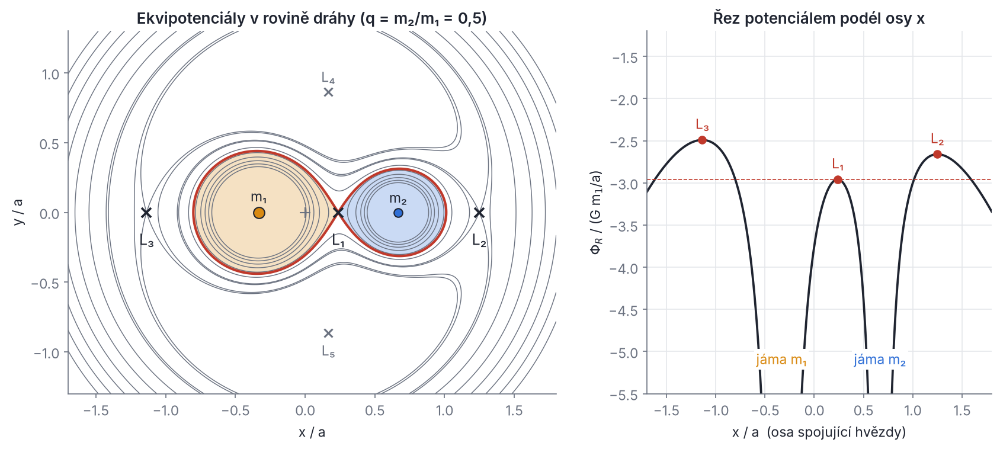
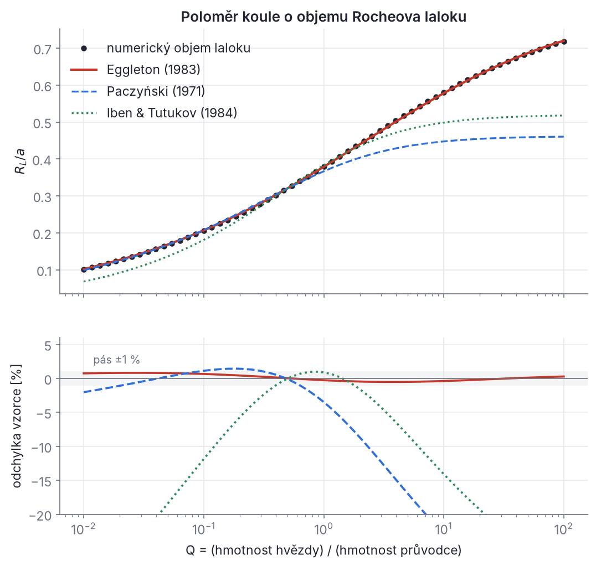
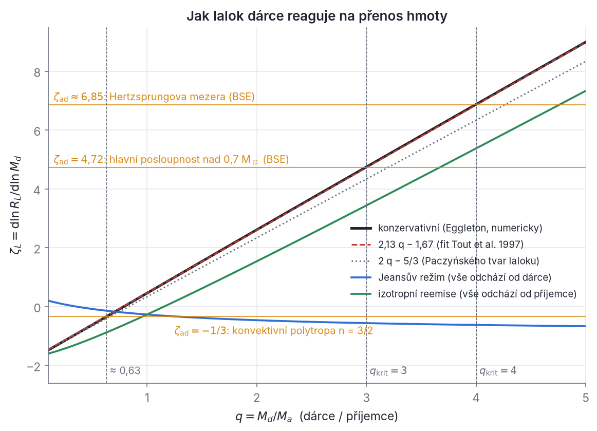
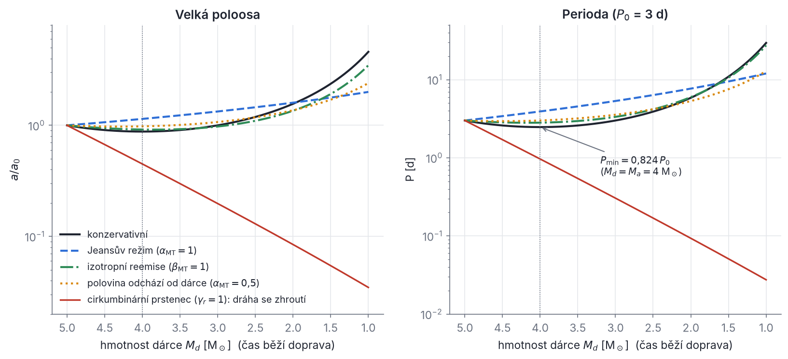
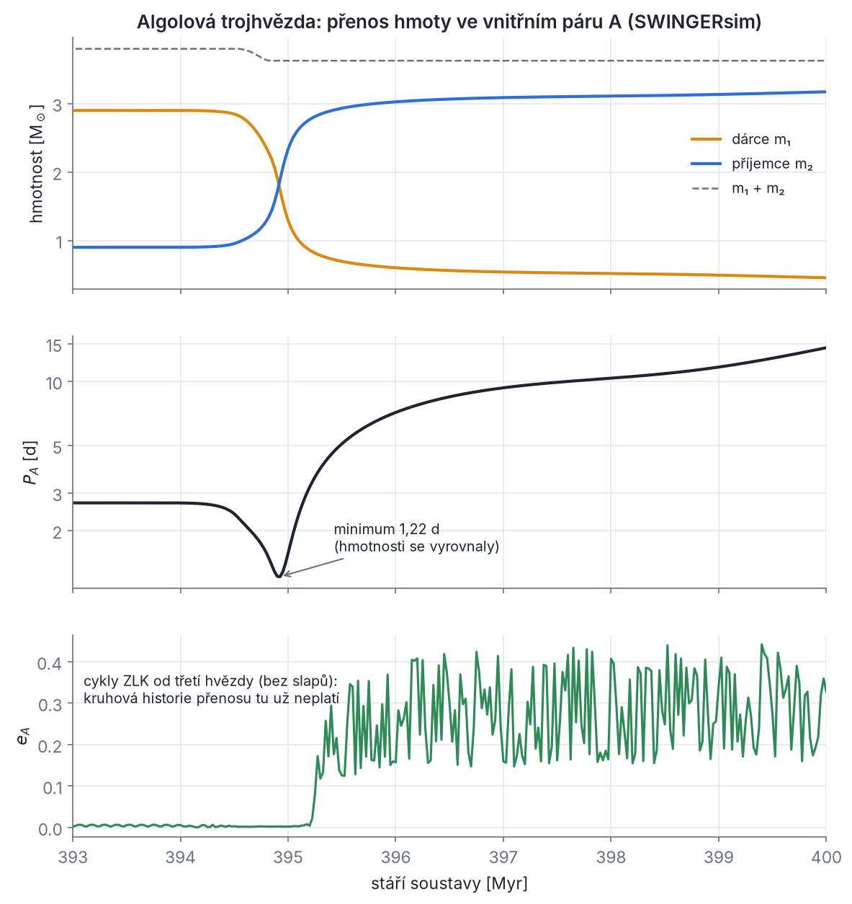

## Kapitola 9 – Přenos hmoty a společná obálka

Hvězda se během života nafukuje: na hlavní posloupnosti pomalu, po vyčerpání vodíku v jádře rychle a o dva až tři řády (kapitola 8). Osamělé hvězdě to nevadí. Hvězda v těsné dvojici však narazí na hranici, za kterou už plyn nepatří jí, ale průvodci. Tou hranicí je **Rocheův lalok**. Jakmile ho hvězda vyplní, začne přes vnitřní Lagrangeův bod L₁ přelévat hmotu na průvodce. Přenos hmoty mění hmotnosti obou hvězd, jejich dráhu, rotaci i vnitřní stavbu. Může trvat miliony let a skončit klidně, jako u algolů. Může se ale také „utrhnout“, přejít ve **společnou obálku** a skončit těsnou dvojicí obnaženého jádra s průvodcem, nebo splynutím obou hvězd.

Ve vícenásobné soustavě má přenos hmoty ještě jeden rozměr. Vnitřní dvojice, která přenosem změní hmotnost nebo velikost dráhy, mění i poměr velikostí drah a_in/a_out, na němž stojí stabilita celé hierarchie (kapitola 4) i síla sekulárních poruch (kapitola 5). Hmota, která soustavu opustí, roztáhne vnější dráhy. Pokud odejde náhle (odvržená společná obálka), může vnější dráhu silně zvýstřednit, nebo dokonce rozvázat. Tuto souhru SWINGERsim počítá, a proto ji tu probereme od základů. Kapitolu uzavírá výpočet budoucnosti čtyřhvězdy CzeV343, kde se vývoj hvězd, přenos hmoty, stabilita, cykly von Zeipela–Lidova–Kozaie (ZLK) i slapy potkávají v jednom příběhu.

Co budeš potřebovat: Keplerovy zákony a moment hybnosti dvou těles (kapitola 2), rotující soustavu souřadnic a Jacobiho integrál (kapitola 3), kritérium stability Mardlinga a Aarsetha (kapitola 4), cykly ZLK (kapitola 5), apsidální konstantu k₂ (kapitola 7) a časové škály a stavbu hvězd (kapitola 8).

> **Pozor – značení v této kapitole.** Některá písmena se v literatuře o přenosu hmoty používají jinak než ve zbytku skript. Abychom nic nepopletli, držíme se tohoto: α_MT a β_MT jsou podíly přenášené hmoty, které unikají od dárce a od příjemce (v konfiguraci SWINGERsim klíče `alpha` a `beta`), α_CE a λ jsou parametry společné obálky, γ_N je parametr momentového formalismu Nelemanse et al. (2000) a γ_r udává poloměr cirkumbinárního prstence. Žádné z nich nesouvisí s konstantou precese spinu α ani se systémovou rychlostí γ z jiných kapitol. Podíl hmotnosti náhle ztracené z dráhy značíme f_m. Faktor vyplnění dotykové dvojhvězdy značíme F. Poměr hmotností q má v oddíle 9.1 význam m₂/m₁ (jako v kódu `roche.py`), od oddílu 9.5 dál q = M_d/M_a (dárce ku příjemci). Q je poměr „hvězda ku průvodci“ v Eggletonově vzorci.

### 9.1 Rocheův model

**Intuice.** Představ si zrnko plynu na povrchu hvězdy v těsné dvojici. Přitahuje ho jeho hvězda i průvodce. Navíc se celá dvojice otáčí, a kdo s ní obíhá, cítí odstředivou sílu. Blízko středu hvězdy vlastní gravitace jasně vítězí. Na spojnici obou hvězd ale existuje místo, kde se přitažlivost obou hvězd a odstředivá síla vyruší: vnitřní Lagrangeův bod L₁. Plyn, který se tam dostane, může přepadnout k průvodci. Rocheův model z této představy dělá přesnou geometrii.

**Rotující soustava a úhlová rychlost.** Uvažuj dvě bodové hmotnosti m₁ a m₂ na kruhové dráze o poloměru a (vzdálenost hvězd). Z kapitoly 2 víme, že se obě hvězdy otáčejí kolem těžiště stálou úhlovou rychlostí Ω, a ze třetího Keplerova zákona platí

```latex
\Omega^2 = \frac{G\,(m_1 + m_2)}{a^3} ,
```

tedy Ω = n = 2π/P. (Rychlé odvození: relativní pohyb je kruhový pohyb s gravitačním parametrem μ = G(m₁ + m₂), takže dostředivé zrychlení Ω²a se rovná μ/a².) Přejdeme do soustavy souřadnic, která se otáčí s dvojhvězdou úhlovou rychlostí Ω kolem osy z kolmé k rovině dráhy, s počátkem v těžišti. V ní obě hvězdy stojí: m₁ v bodě x₁ = −a m₂/(m₁ + m₂), m₂ v bodě x₂ = a m₁/(m₁ + m₂).

**Efektivní potenciál.** V rotující soustavě působí na částici navíc dvě setrvačné síly (rotující soustavu a Jacobiho integrál zavádí kapitola 3): odstředivá síla Ω²(x, y, 0) na jednotku hmotnosti a Coriolisova síla −2 **Ω** × **v**. Odstředivá síla je gradientem: Ω²(x, y, 0) = −∇[−½Ω²(x² + y²)]. Coriolisova síla je kolmá k rychlosti, a proto nekoná práci. Pohybová rovnice částice je tedy

```latex
\ddot{\mathbf r} = -\nabla \Phi_\mathrm{R} - 2\,\boldsymbol\Omega \times \dot{\mathbf r},
\qquad
\Phi_\mathrm{R}(\mathbf r) = -\frac{G m_1}{|\mathbf r - \mathbf r_1|} - \frac{G m_2}{|\mathbf r - \mathbf r_2|} - \frac{1}{2}\,\Omega^2\left(x^2 + y^2\right) .
```

Vynásob ji skalárně rychlostí ṙ. Coriolisův člen vypadne, protože (**Ω** × ṙ)·ṙ = 0, a zbyde d/dt (½|ṙ|² + Φ_R) = 0. To je **Jacobiho integrál** z kapitoly 3: veličina ½v² + Φ_R se zachovává (v zápisu kapitoly 3 je to Jacobiho konstanta C_J = −2Φ_R − v²). Protože v² ≥ 0, částice se smí pohybovat jen tam, kde −2Φ_R ≥ C_J, tedy kde Φ_R nepřesáhne svou hodnotu v bodě, v němž by se částice zastavila. Plochy Φ_R = konst. jsou tedy plochy nulové rychlosti a Rocheovy laloky nejsou nic jiného než jedna zvláštní z nich.

**Proč je povrch hvězdy ekvipotenciálou.** Hvězda v hydrostatické rovnováze, která v rotující soustavě stojí (rotuje synchronně s oběhem), splňuje

```latex
\nabla P = -\rho\,\nabla \Phi_\mathrm{R} .
```

Gradient tlaku je tedy všude rovnoběžný s gradientem potenciálu a plochy stálého tlaku splývají s ekvipotenciálami. Pro látku, jejíž hustota závisí jen na tlaku (barotropní, což je pro hvězdu dobré přiblížení), jsou ekvipotenciálami i plochy stálé hustoty, a tedy i povrch (P ≈ 0). Rocheův model tak stojí na čtyřech předpokladech a je dobré je znát nazpaměť:

1. **bodové hmotnosti** – gravitační pole každé hvězdy je pole hmotného bodu (hvězdy jsou silně centrálně zhuštěné, takže to platí dobře);
2. **kruhová dráha** – jinak se vzdálenost hvězd i úhlová rychlost mění a žádná soustava, v níž by vše stálo, neexistuje;
3. **synchronní rotace** – hvězda se otáčí s periodou oběhu, takže v rotující soustavě stojí;
4. **hydrostatická rovnováha** – hvězda se nerozpíná ani nesmršťuje rychleji, než stačí zvuk vyrovnat tlak (dynamická časová škála, kapitola 8).

Těsné dvojhvězdy slapy rychle synchronizují a zakulacují (kapitola 7), proto předpoklady 2 a 3 většinou platí. Kdy neplatí, probereme v oddíle 9.2.

**Bezrozměrný tvar.** Měř délky v jednotkách a, umísti m₁ do počátku a m₂ do bodu (1, 0, 0) a označ q = m₂/m₁. Vynásob potenciál −a/(G m₁) a použij Ω²a³ = G m₁(1 + q). Odstředivý člen kolem těžiště v bodě x_T = q/(1 + q) rozepiš jako (x − x_T)² + y² = x² + y² − 2x x_T + x_T². Dostaneš

```latex
W(x,y,z) \equiv -\frac{a}{G m_1}\,\Phi_\mathrm{R}
= \frac{1}{r_1} + q\left(\frac{1}{r_2} - x\right) + \frac{1+q}{2}\left(x^2 + y^2\right) + \frac{q^2}{2(1+q)} ,
```

kde r₁ = √(x² + y² + z²) a r₂ = √((x − 1)² + y² + z²). Poslední člen je konstanta, kterou lze vynechat. Přesně tento „Kopalův“ potenciál (bez konstanty) počítá modul `roche.py` SWINGERsim. Pozor na znaménko: bezrozměrný potenciál W je uvnitř hvězd velký a ven klesá, kdežto Φ_R uvnitř hvězd klesá k −∞. (V literatuře o dvojhvězdách a v kódu se bezrozměrný potenciál obvykle značí Ω. My píšeme W, aby se nepletl s úhlovou rychlostí ani s délkou výstupného uzlu.)



*Obr. 9.1 – Rocheův potenciál dvojhvězdy s q = m₂/m₁ = 0,5. Vlevo: ekvipotenciály v rovině dráhy (osy v jednotkách a, křížek + je těžiště). Červená osmička je kritická ekvipotenciála procházející bodem L₁; vybarvené jsou oba Rocheovy laloky. Body L₂ a L₃ leží na ose za hvězdami, L₄ a L₅ tvoří s hvězdami rovnostranné trojúhelníky. Vpravo: průběh Φ_R podél osy x. Hvězdy sedí v hlubokých jámách, L₁, L₂ a L₃ jsou lokální maxima podél osy (ve směru kolmém k ose jde o sedla). Čárkovaná čára je úroveň L₁: hmota, která ji přesáhne, smí přejít z jedné jámy do druhé. L₂ (za lehčí hvězdou) leží níž než L₃, a proto je dalším „přepadem“, kudy hmota opouští celou dvojhvězdu.*

**Lagrangeovy body L₁–L₃.** Na ose x (y = z = 0) se bod rovnováhy pozná podle nulové derivace dW/dx = 0. S r₁ = |x| a r₂ = |x − 1| je

```latex
\frac{\partial W}{\partial x}\bigg|_{y=z=0} = -\frac{\operatorname{sgn} x}{x^2} - q\,\frac{\operatorname{sgn}(x-1)}{(x-1)^2} - q + (1+q)\,x = 0 .
```

Pro L₁ (0 < x < 1) je sgn x = 1 a sgn(x − 1) = −1. Rovnici vynásob x²(1 − x)², roznásob (1 − x)² = 1 − 2x + x² a sečti členy u stejných mocnin:

```latex
-(1-x)^2 + q x^2 - q x^2 (1-x)^2 + (1+q)\,x^3 (1-x)^2 = 0
\;\Longrightarrow\;
(1+q)\,x^5 - (2+3q)\,x^4 + (1+3q)\,x^3 - x^2 + 2x - 1 = 0 .
```

Stejným postupem (jen s jinými znaménky absolutních hodnot) dostaneš pro L₂ (x > 1) a L₃ (x < 0)

```latex
\begin{aligned}
\mathrm{L_2:}\quad & (1+q)\,x^5 - (2+3q)\,x^4 + (1+3q)\,x^3 - (1+2q)\,x^2 + 2x - 1 = 0,\\
\mathrm{L_3:}\quad & (1+q)\,x^5 - (2+3q)\,x^4 + (1+3q)\,x^3 + x^2 - 2x + 1 = 0 .
\end{aligned}
```

Každá kvintická rovnice má v příslušném intervalu právě jeden reálný kořen. Obecně ji nelze vyřešit vzorcem (Abel–Ruffini), numericky je to ale hračka: funkce dW/dx mezi singularitami monotónně roste, takže stačí bisekce. Tak to dělá i SWINGERsim (`roche.lagrange_points`). Pro malé q dostaneš z rozvoje rovnice v okolí x = 1 známý **Hillův poloměr**: vzdálenost L₁ od lehčí hvězdy je přibližně a(q/3)^{1/3}. Pro q = 0,1 to dává 0,322 a, přesná hodnota je 0,283 a. Přiblížení je tedy jen hrubé (zde o 14 % vedle). Tabulka 9.1 uvádí přesné kořeny (spočítané bisekcí i jako kořeny polynomů, oba výpočty se shodují na 10⁻⁵) a pro srovnání přibližný vzorec Plavce a Kratochvíla, x_L₁ ≈ 0,5 + 0,227 log₁₀(m₁/m₂).

*Tabulka 9.1 – Polohy Lagrangeových bodů na ose dvojhvězdy (m₁ v počátku, m₂ v x = 1, q = m₂/m₁). Ve sloupci L₂ je vzdálenost za m₂, ve sloupci L₃ vzdálenost za m₁.*

| q = m₂/m₁ | x(L₁) přesně | x(L₁) Plavec–Kratochvíl | x(L₂) − 1 | −x(L₃) |
| --- | --- | --- | --- | --- |
| 0,1 | 0,7175 | 0,7270 | 0,3470 | 0,9469 |
| 0,2 | 0,6586 | 0,6587 | 0,4381 | 0,9025 |
| 0,5 | 0,5708 | 0,5683 | 0,5824 | 0,8030 |
| 1 | 0,5000 | 0,5000 | 0,6984 | 0,6984 |
| 2 | 0,4292 | 0,4317 | 0,8030 | 0,5824 |
| 5 | 0,3414 | 0,3413 | 0,9025 | 0,4381 |
| 10 | 0,2825 | 0,2730 | 0,9469 | 0,3470 |

Všimni si symetrie: záměna q → 1/q odpovídá prohození hvězd. Body L₄ a L₅ mimo osu tvoří s hvězdami rovnostranné trojúhelníky pro libovolné q. Pro hvězdné dvojice jsou nestabilní (stabilní jsou jen pro m₂/(m₁ + m₂) < 0,0385). Pro přenos hmoty nehrají roli.

**Rocheův lalok a jeho objem.** Kritická ekvipotenciála W = W(L₁) obepíná každou hvězdu uzavřenou plochou ve tvaru kapky se špičkou v L₁: to je **Rocheův lalok**. Hvězdy nejsou koule, ale modely hvězd znají jen jeden poloměr. Proto se zavádí **objemově ekvivalentní poloměr laloku** R_L, poloměr koule se stejným objemem jako lalok. Pozor na častou záměnu: R_L je znatelně menší než vzdálenost hvězdy od L₁. Pro q = 1 je x(L₁) = 0,5 a, ale R_L = 0,380 a.

Objem laloku spočítáš numericky takto. Ze středu hvězdy vedeš paprsky ve směrech **n̂** (síť ve sférických souřadnicích). Podél každého paprsku najdeš první vzdálenost r(**n̂**), v níž potenciál W klesne na W(L₁), například bisekcí. Objem je pak integrál

```latex
V = \int_{4\pi} \frac{r(\hat{\mathbf n})^3}{3}\,\mathrm{d}\omega ,
\qquad R_L = \left(\frac{3V}{4\pi}\right)^{1/3} ,
```

protože objem kužele o prostorovém úhlu dω a výšce r je r³dω/3. Integrál přes cos θ je výhodné počítat Gaussovou–Legendrovou kvadraturou, přes φ stačí lichoběžníkové pravidlo (integrand je periodický). Paprsky mířící za rovinu x = x(L₁) se v ní uříznou. Takto jsme spočítali hodnoty v tabulce 9.2 (96 × 96 paprsků) a výsledky souhlasí s modulem `roche.py` SWINGERsim na pět platných číslic.

Pro praxi existují tři známé přibližné vzorce. V nich Q = (hmotnost hvězdy)/(hmotnost průvodce), takže pro m₁ je Q = 1/q:

```latex
\begin{aligned}
\text{Eggleton (1983):}\quad & \frac{R_L}{a} = \frac{0{,}49\,Q^{2/3}}{0{,}6\,Q^{2/3} + \ln\!\left(1 + Q^{1/3}\right)},\\
\text{Paczyński (1971):}\quad & \frac{R_L}{a} \approx 0{,}462\left(\frac{Q}{1+Q}\right)^{1/3},\\
\text{Iben \& Tutukov (1984):}\quad & \frac{R_L}{a} \approx 0{,}52\left(\frac{Q}{1+Q}\right)^{0{,}44} .
\end{aligned}
```

Paczyńského tvar je vlastně Hillův poloměr s upraveným koeficientem (Q/(1 + Q) je podíl hmotnosti hvězdy na celkové hmotnosti). Je jednoduchý, a proto se hodí k odvozování (oddíl 9.5).

*Tabulka 9.2 – Objemově ekvivalentní poloměr laloku R_L/a: numerická integrace a tři vzorce (v závorce odchylka od numerické hodnoty).*

| Q | numericky | Eggleton | Paczyński | Iben–Tutukov |
| --- | --- | --- | --- | --- |
| 0,01 | 0,1012 | 0,1020 (+0,8 %) | 0,0992 (−2,0 %) | 0,0682 (−33 %) |
| 0,1 | 0,2054 | 0,2068 (+0,7 %) | 0,2077 (+1,1 %) | 0,1810 (−12 %) |
| 0,3 | 0,2803 | 0,2810 (+0,3 %) | 0,2834 (+1,1 %) | 0,2728 (−2,7 %) |
| 0,5 | 0,3207 | 0,3208 (+0,04 %) | 0,3203 (−0,1 %) | 0,3207 (0,0 %) |
| 1 | 0,3799 | 0,3789 (−0,25 %) | 0,3667 (−3,5 %) | 0,3833 (+0,9 %) |
| 2 | 0,4420 | 0,4400 (−0,45 %) | 0,4036 (−8,7 %) | 0,4350 (−1,6 %) |
| 5 | 0,5233 | 0,5208 (−0,5 %) | 0,4348 (−17 %) | 0,4799 (−8,3 %) |
| 10 | 0,5803 | 0,5782 (−0,4 %) | 0,4476 (−23 %) | 0,4986 (−14 %) |
| 100 | 0,7182 | 0,7203 (+0,3 %) | 0,4605 (−36 %) | 0,5177 (−28 %) |



*Obr. 9.2 – Nahoře: objemově ekvivalentní poloměr laloku R_L/a v závislosti na poměru Q = (hmotnost hvězdy)/(hmotnost průvodce). Body jsou numerická integrace objemu, čáry tři přibližné vzorce. Dole: relativní odchylka vzorců od numerické hodnoty; šedý pás je ±1 %. Eggletonův vzorec leží v pásu pro všechna Q od 0,01 do 100. Paczyńského vzorec je dobrý jen pro Q ≲ 0,8 (lehčí hvězda), vzorec Ibena a Tutukova jen zhruba pro 0,3 ≲ Q ≲ 3.*

Eggletonův vzorec je tedy přesný na 1 % v celém rozsahu poměrů hmotností. (Hurley et al. 2002 uvádějí opatrněji 2 %.) Proto ho používají BSE i SWINGERsim. Pro dvě stejné hvězdy dává R_L = 0,379 a ≈ 0,38 a.

**Jak to dělá SWINGERsim.**

- `stellar.roche_lobe_eggleton(q)` vrací R_L/a podle Eggletona, s q = hmotnost hvězdy ku hmotnosti průvodce. Používají ho historie přenosu hmoty, společná obálka i diagnostika všech běhů.
- Dynamické backendy (N-částicový i sekulární) sledují u každé hvězdy **faktor vyplnění** R/R_L. Lalok vyhodnocují v **periastru** oskulační dráhy, tedy se vzdáleností a(1 − e). Hvězda, která obíhá kolem celé podsoustavy (třetí hvězda kolem vnitřní dvojice), má lalok vůči celkové hmotnosti této podsoustavy, vyhodnocený v periastru vnější dráhy. Do souhrnu běhu se zapisuje největší dosažený faktor vyplnění (řádek „Roche lobe filled up to …“).
- Pro tvary deformovaných hvězd ve světelných křivkách (kapitola 10) řeší `roche.py` úplný potenciál výše, včetně společné kontaktní obálky (oddíl 9.3).

**Řešený příklad – Algol vyfotografovaný interferometrem.** Baron et al. (2012) zobrazili Algol interferometrem CHARA a určili M_A = 3,17 M☉, M_B = 0,70 M☉, P = 2,867 d a poloměry R_A = 2,73 R☉, R_B = 3,48 ± 0,28 R☉. Vzdálenost hvězd plyne ze třetího Keplerova zákona. Šikovný tvar pro hvězdné jednotky je

```latex
a = 4{,}2083\;R_\odot \left(\frac{m_1+m_2}{M_\odot}\right)^{1/3}\left(\frac{P}{1\ \mathrm d}\right)^{2/3} ,
```

kde koeficient 4,2083 R☉ je vzdálenost hvězd soustavy o celkové hmotnosti 1 M☉ s periodou 1 den (s G = (k · 365,25)² au³ M☉⁻¹ rok⁻² ze SWINGERsim). Pro Algol: a = 4,2083 · 3,87^{1/3} · 2,867^{2/3} R☉ = 13,33 R☉. Pro složku B je Q = 0,70/3,17 = 0,221 a Eggletonův vzorec dává R_L/a = 0,2587, tedy R_L,B = 3,45 R☉. Naměřený poloměr 3,48 ± 0,28 R☉ se s ním shoduje: Algol B svůj lalok právě vyplňuje. Lalok složky A (Q = 4,53) je 6,83 R☉, mnohem větší než R_A = 2,73 R☉. Algol je tedy učebnicová polodotyková dvojhvězda, a navíc hmotnější hvězda je ta méně vyvinutá. K tomuto „paradoxu“ se vrátíme v oddíle 9.8.

### 9.2 Výstředné a asynchronní dráhy

Na výstředné dráze se vzdálenost hvězd mění od a(1 − e) do a(1 + e) a úhlová rychlost oběhu podle druhého Keplerova zákona. Neexistuje tedy soustava, v níž by obě hvězdy i plyn stály, a potenciál závisí na čase. Totéž platí, když hvězda nerotuje synchronně. Rocheův lalok pak není pevně daná plocha.

**Kvazistatické přiblížení (Sepinsky et al. 2007).** Užitečné přiblížení dostaneš, když se v daném okamžiku postavíš do soustavy, jejíž počátek je ve středu hvězdy 1, osa x míří k hvězdě 2 a která se otáčí úhlovou rychlostí rotace hvězdy 1, Ω_rot. Pak předpokládáš, že se plyn stačí přizpůsobit okamžité geometrii (ve srovnání s oběhem rychle). Na částici působí: gravitace obou hvězd, odstředivá síla od rotace Ω_rot kolem osy hvězdy 1 a setrvačná síla −Gm₂/D² **x̂**, protože počátek (hvězda 1) je zrychlován přitažlivostí hvězdy 2 (D je okamžitá vzdálenost hvězd). Když vzdálenosti měříš v jednotkách D a potenciál v jednotkách Gm₂/D, dostaneš (s q′ = m₁/m₂)

```latex
\Psi(x,y,z) = -\frac{q'}{r_1} - \frac{1}{r_2} - \frac{1}{2}\,(1+q')\,\mathcal{A}\left(x^2+y^2\right) + x,
\qquad
\mathcal{A} = \frac{\Omega_\mathrm{rot}^2 D^3}{G(m_1+m_2)} .
```

Pro kruhovou synchronní dráhu je 𝒜 = 1 a Ψ se liší od Rocheova potenciálu jen konstantou. Zaveď f_s = Ω_rot/ω_p, poměr rotace k úhlové rychlosti oběhu v periastru. Z momentu hybnosti dráhy plyne ω_p² = G(m₁ + m₂)(1 + e)/[a³(1 − e)³], a když dosadíš D = a(1 − e²)/(1 + e cos ν), vyjde

```latex
\mathcal{A} = \frac{f_s^2\,(1+e)^4}{(1+e\cos\nu)^3} ,
```

kde ν je pravá anomálie. To je tvar, který zavedli Sepinsky, Willems & Kalogera (2007). Lalok tedy závisí na poměru hmotností q′, na výstřednosti e, na poloze na dráze (ν) a na rotaci hvězdy (f_s). Pro 𝒜 > 1 (hvězda rotuje rychleji, než by odpovídalo synchronismu v daném místě) odstředivá síla lalok zmenšuje, pro 𝒜 < 1 ho zvětšuje. Při rychlé (nadsynchronní) rotaci dárce se může dokonce otevřít oblast kolem příjemce: pro q′ = 1 leží už od 𝒜 ≈ 1,22 (náš výpočet) sedlo potenciálu Ψ za příjemcem níž než L₁, takže hmota přetékající přes L₁ nemusí být příjemcem zachycena a může soustavu opustit (Toonen et al. 2016). Přiblížení zanedbává Coriolisovu sílu a síly od nerovnoměrného otáčení spojnice hvězd; to je cena za kvazistatičnost.

*Tabulka 9.3 – Objemově ekvivalentní poloměr laloku v kvazistatickém přiblížení pro q′ = 1, v jednotkách okamžité vzdálenosti D (náš numerický výpočet stejnou metodou paprsků jako v tabulce 9.2).*

| 𝒜 | 0,25 | 0,5 | 1 | 1,5 | 2 | 4 |
| --- | --- | --- | --- | --- | --- | --- |
| R_L/D | 0,398 | 0,392 | 0,380 | 0,369 | 0,359 | 0,327 |
| poměr k Eggletonovi | 1,05 | 1,03 | 1,00 | 0,97 | 0,95 | 0,86 |

Pro mírnou asynchronii jsou opravy jen několik procent, pro rychle rotující hvězdy však mohou být velké (pro hvězdu rotující stokrát rychleji, než odpovídá synchronismu, uvádějí Toonen et al. 2016 lalok jen 5–10 % klasického).

**Řešený příklad – pár A v CzeV343.** Pár A čtyřhvězdy CzeV343 má m₁ = 1,76 M☉, m₂ = 1,27 M☉, P = 1,2093 d a e = 0,114. Vzdálenost hvězd je a = 4,2083 · 3,03^{1/3} · 1,2093^{2/3} R☉ = 6,91 R☉ a Eggletonův lalok hmotnější hvězdy (Q = 1,386, R_L/a = 0,4075) je R_L = 2,82 R☉, pokud bys dráhu bral jako kruhovou se stejným a. V periastru je D = a(1 − e) = 6,12 R☉ a Eggleton s touto vzdáleností dává 2,50 R☉. Kvazistatický lalok v periastru pro hvězdu rotující synchronně s oběhem v periastru (f_s = 1, 𝒜 = 1 + e = 1,114) vyjde R_L/D = 0,406, tedy 2,49 R☉, jen o 0,4 % méně než Eggleton při D = a(1 − e). Pro hvězdu v pseudosynchronní rotaci (Hutova rovnovážná rotace z kapitoly 7, f_s = 0,852, 𝒜 = 0,808) je R_L/D = 0,414, o 1,6 % více. Rozdíl mezi „kruhovým“ lalokem 2,82 R☉ a lalokem v periastru 2,5 R☉ (12 %) je tedy mnohem větší než oprava za asynchronii. Proto je důležité vědět, kterou vzdálenost model používá.

**Jak to dělá SWINGERsim.** Přenos hmoty v SWINGERsim, stejně jako v BSE (Hurley et al. 2002), počítá s **kruhovou** dráhou. Odůvodnění: slapy těsné dvojhvězdy zakulatí dříve, než hvězda lalok vyplní. Hurley et al. (2002) výstředné dráhy při začátku přenosu „pro nedostatek podrobnějšího popisu“ okamžitě synchronizují. Konkrétně:

- **Historie přenosu** každé dvojhvězdy ze dvou hvězd se spočítá předem, pro kruhovou dráhu se **stejnou velkou poloosou a**, jakou má dráha v konfiguraci (nikoli a(1 − e)). Má-li dvojhvězda e > 0,1, SWINGERsim vypíše varování, že přenos počítá pro kruhovou dráhu stejného a.
- **Dynamika** během běhu hlídá lalok v periastru oskulační dráhy, tedy a(1 − e) (oddíl 9.1). Hvězda tak může v dynamice „přetéct“ dřív, než to kruhová historie očekává. Krátce před začátkem přenosu, který historie předpovídá, SWINGERsim takové přetečení toleruje, pokud kruhová historie vyplňuje lalok aspoň do (1 − e)(1 − 0,02) (funkce `roche_excluded`; e je omezeno na 0,5).
- Když dynamika (například cykly ZLK nebo průlet další hvězdy) dožene hvězdu za lalok, který žádná historie nečeká, rozhodne klíč `physics.mass_transfer.dynamic_onset`:
  - `null` (výchozí): v sekulárních backendech se běh tím přetečením ukončí; N-částicový backend běh ukončí jen s `run.stop_on_roche_overflow: true`, jinak přetečení jen zaznamená do souhrnu (největší faktor vyplnění) a pokračuje;
  - `angular_momentum`: dvojhvězda se zakulatí se zachováním momentu hybnosti dráhy, a → a(1 − e²), jako při slapovém zakulacení (Hut 1981), hvězdy se synchronizují a běh pokračuje s historií přenosu spočítanou od toho okamžiku;
  - `periastron`: dvojhvězda se zakulatí na vzdálenost periastra, a → a(1 − e), takže dárce lalok dál vyplňuje a přenos začne hned.
- Pokud dynamika během přenosu dvojhvězdu zvýstřední nad e = 0,1 (typicky cykly ZLK bez slapů), SWINGERsim vypíše varování, že kruhová historie už tuto dráhu nepopisuje, a uloží největší výstřednost během přenosu do výstupu (`mass_transfer_<dráha>_e_max_transferring`). Příklad uvidíš na obr. 9.5.

> **Pozor.** U páru A v CzeV343 (e = 0,114) počítá historie přenosu s kruhovou dráhou o a = 6,91 R☉, tedy s lalokem 2,82 R☉. Kdyby se dráha slapy zakulatila se zachováním momentu hybnosti, byla by a(1 − e²) = 6,82 R☉ a lalok 2,78 R☉, rozdíl jen 1,3 %. Lalok v periastru (2,5 R☉) naopak říká, kdy se hvězda laloku poprvé dotkne, zatím jen na chvíli při průchodu periastrem. Výsledky o přenosu hmoty u výstředných párů proto ber jako přibližné.

### 9.3 Oddělené, polodotykové a dotykové dvojhvězdy

Podle toho, jak hvězdy vyplňují své Rocheovy laloky, rozdělil těsné dvojhvězdy Zdeněk Kopal (rodák z Litomyšle) v roce 1955 do tří skupin (Kopal 1955; podrobně v jeho monografii Kopal 1959). České názvy jsou **oddělená**, **polodotyková** a **dotyková** soustava; místo „dotyková“ se často říká i „kontaktní“.

| typ | anglicky | co platí | příklad |
| --- | --- | --- | --- |
| oddělená | detached | obě hvězdy uvnitř svých laloků, hmota se nepřenáší | V907 Sco, BU CMi, dnešní CzeV343 |
| polodotyková | semidetached | jedna hvězda vyplňuje lalok a přelévá hmotu přes L₁ | Algol, oddíl 9.8 |
| dotyková (kontaktní) | contact | obě hvězdy přesahují laloky a sdílejí **společnou kontaktní obálku** | hvězdy typu W UMa, oddíl 9.9 |

U dotykové dvojhvězdy leží povrch mezi kritickou ekvipotenciálou L₁ (vnitřní kritická plocha, W_in = W(L₁)) a ekvipotenciálou bodu L₂ (vnější kritická plocha, W_out; pro q ≠ 1 je L₂ za lehčí hvězdou níž než L₃, obr. 9.1). Jak hluboko je obálka mezi nimi, měří **faktor vyplnění**

```latex
F = \frac{W_\mathrm{in} - W}{W_\mathrm{in} - W_\mathrm{out}} ,
```

kde W je hodnota bezrozměrného potenciálu na povrchu (Lucy & Wilson 1979). F < 0 znamená oddělenou soustavu, 0 ≤ F ≤ 1 dotykovou a F > 1 by znamenalo, že hmota uniká přes L₂ a soustava se rozpadá. SWINGERsim tento faktor používá ve světelných křivkách (klíč `orbits.<dráha>.contact_fillout`, kapitola 10).

> **Pozor – dvě různé „společné obálky“.** Obálka dotykové dvojhvězdy je klidná, v hydrostatické rovnováze, a může vydržet miliony až miliardy let. Budeme jí říkat **společná kontaktní obálka**. Fáze **společné obálky** (common envelope, CE) z oddílu 9.11 je naopak krátká a bouřlivá: obálka obra pohltí průvodce, jádra v ní spirálovitě padají k sobě a obálka je odvržena nebo hvězdy splynou. Nepleť si je.

### 9.4 Kdy hvězda lalok vyplní: případy A, B a C

Hvězda může vyplnit lalok ze dvou důvodů: buď se sama nafoukne (vývoj, kapitola 8), nebo se lalok zmenší, protože dvojhvězda ztrácí moment hybnosti (magnetické brzdění, gravitační vlny). U většiny dvojhvězd rozhoduje první důvod. Podle toho, v jaké fázi vývoje dárce lalok poprvé vyplní, rozlišili Kippenhahn & Weigert (1967) a jejich následovníci tři případy:

- **Případ A** – během hoření vodíku v jádře, tedy na hlavní posloupnosti. Hvězda se tu rozpíná pomalu (o faktor 2–3 za celou hlavní posloupnost), proto případ A nastává jen v nejtěsnějších dvojicích s periodami kolem jednoho až několika dní.
- **Případ B** – po vyčerpání vodíku v jádře, ale před zapálením helia v jádře: v Hertzsprungově mezeře nebo na větvi obrů. Hvězda se tu rychle rozpíná o jeden až dva řády, takže případ B pokrývá široký rozsah period.
- **Případ C** – **po vyčerpání helia v jádře**, při slupkovém hoření helia na asymptotické větvi obrů (AGB). Hvězda je tehdy největší. (Tak případ C definují například Postnov & Yungelson 2014. Přenos během hoření helia v jádře se obvykle počítá ještě k pozdnímu případu B.)

**Řešený příklad – které dvojhvězdy vůbec interagují?** Vezmi dvojhvězdu 5 + 3 M☉ a předpokládej, že hmotnější hvězda dosáhne největšího poloměru 5 R☉ na hlavní posloupnosti, 500 R☉ na větvi obrů a 1000 R☉ na AGB (řádové hodnoty). Její lalok je pro Q = 5/3 roven R_L = 0,4238 a, a s a = 4,2083 · 8^{1/3} · P^{2/3} R☉ = 8,417 P^{2/3} R☉ (P ve dnech) vyjde R_L = 3,567 P^{2/3} R☉. Hvězda lalok vyplní, je-li R_max ≥ R_L, tedy pro

```latex
P \le \left(\frac{R_\mathrm{max}}{3{,}567\ R_\odot}\right)^{3/2}\ \mathrm{d}
= 1{,}66\ \mathrm d\ (\text{případ A}),\quad 1660\ \mathrm d = 4{,}5\ \text{roku}\ (\text{B}),\quad 4690\ \mathrm d = 12{,}9\ \text{roku}\ (\text{C}).
```

Dvojhvězdy s periodami delšími než zhruba deset let se tedy během života přenosem hmoty nikdy neovlivní. Podobnou úlohu najdeš u Mikuláška a Krtičky (2005), kteří používají vzorec Ibena a Tutukova; ten dává pro Q = 5/3 poměr R_L/a = 0,4229, prakticky totéž co Eggleton (0,4238).

**Řešený příklad – CzeV343, pár A.** Lalok hmotnější hvězdy je 2,82 R☉ (oddíl 9.2). Vývojová stopa MIST pro hvězdu 1,76 M☉ (stejná, jakou používá SWINGERsim) dosáhne poloměru 2,82 R☉ ve stáří asi 1,39 Gyr, zatímco hlavní posloupnost končí asi v 1,51 Gyr. Hvězda tedy vyplní lalok ještě během hoření vodíku v jádře: jde o **případ A**. Můžeš si to ověřit sám:

```python
from swingersim.stellar import mist_properties
for age in (1300, 1380, 1400, 1500, 1510):
    s = mist_properties(1.76, age, 0.0, 0.0)  # hmotnost, stáří [Myr], [Fe/H], v/v_krit
    print(age, round(s.radius_rsun, 2), s.phase)
```

Výstup: 2,60 R☉ (hlavní posloupnost) v 1300 Myr, 2,80 R☉ v 1380 Myr, 2,85 R☉ v 1400 i v 1500 Myr (těsně před koncem hlavní posloupnosti se hvězda krátce smrští) a 3,45 R☉ (Hertzsprungova mezera) v 1510 Myr. (Dnes je soustava stará asi 630 Myr, takže do začátku přenosu zbývá asi 0,75 Gyr.)

### 9.5 Stabilita přenosu: exponenty ζ

**Intuice.** Hvězda vyplní lalok a začne přelévat hmotu. Co se stane dál, závisí na dvou otázkách: zmenší se hvězda, když ztratí trochu hmoty? A zmenší se lalok? Pokud se hvězda po ztrátě hmoty smrští pod lalok, přenos se sám přibrzdí. Pokračuje jen tak rychle, jak se hvězda vývojem znovu rozpíná, a je **stabilní**. Pokud se hvězda smrští méně než lalok (nebo se dokonce rozepne), přeteče ještě víc, ztratí ještě víc hmoty a přenos se rozjede až na dynamickou časovou škálu: je **nestabilní** a končí obvykle společnou obálkou.

**Definice.** Odezvu poloměru na hmotnost popisují logaritmické derivace (exponenty) ζ. Pro dárce (index d) a jeho lalok:

```latex
\zeta_\mathrm{ad} = \left(\frac{\partial \ln R_d}{\partial \ln M_d}\right)_{\!s},
\qquad
\zeta_\mathrm{eq} = \left(\frac{\partial \ln R_d}{\partial \ln M_d}\right)_{\!\mathrm{t.r.}},
\qquad
\zeta_L = \frac{\mathrm d \ln R_L}{\mathrm d \ln M_d} .
```

ζ_ad je **adiabatická** odezva: hvězda ztratí hmotu tak rychle, že si každá vrstva zachová entropii s, ale dost pomalu, aby se udržela hydrostatická rovnováha (to trvá dynamickou dobu). ζ_eq je **rovnovážná** odezva: hvězda po ztrátě hmoty znovu dosáhne tepelné rovnováhy (t.r.), na což potřebuje Kelvinovu–Helmholtzovu dobu. ζ_L popisuje lalok; závisí na tom, jak se mění poměr hmotností a vzdálenost hvězd, tedy na tom, kolik hmoty a momentu hybnosti soustava ztrácí.

Protože dárce hmotu ztrácí (d ln M_d < 0), kladný exponent znamená, že se poloměr zmenšuje. Porovnáním exponentů dostaneš tři režimy (Hurley et al. 2002, odd. 2.6; Postnov & Yungelson 2014):

- **ζ_ad < ζ_L: dynamicky nestabilní přenos.** Už okamžitá (adiabatická) odezva hvězdy nestačí lalok „dohnat“ a přenos se rozjede na dynamickou škálu. Výsledkem je obvykle společná obálka (oddíl 9.11), u málo hmotných hvězd hlavní posloupnosti a bílých trpaslíků splynutí.
- **ζ_eq < ζ_L < ζ_ad: přenos na tepelné škále.** Hvězda se okamžitě smrští pod lalok, ale v tepelné rovnováze by byla větší než lalok. Přenos proto běží tak rychle, jak se hvězda tepelně přizpůsobuje, zhruba Ṁ ≈ M/t_KH. Hvězda přitom není v tepelné rovnováze.
- **ζ_L < ζ_eq (a zároveň ζ_L < ζ_ad): stabilní přenos na jaderné škále.** Hvězda v rovnováze zůstává pod lalokem a přenos pohání jen její pomalé jaderné rozpínání (nebo zmenšování laloku ztrátou momentu hybnosti gravitačními vlnami či magnetickým brzděním).

**Exponent laloku pro konzervativní přenos – obecné odvození.** Při konzervativním přenosu se zachovává celková hmotnost M = M_d + M_a i moment hybnosti dráhy J (oddíl 9.7 ukáže, že pak platí a ∝ (M_d M_a)⁻²). Postupně:

1. Z dM_a = −dM_d plyne d ln M_a = −(M_d/M_a) d ln M_d = −q d ln M_d, kde q = M_d/M_a.
2. Z a ∝ (M_d M_a)⁻² plyne d ln a = −2(d ln M_d + d ln M_a) = −2(1 − q) d ln M_d, tedy d ln a/d ln M_d = 2q − 2.
3. Poměr hmotností: d ln q = d ln M_d − d ln M_a = (1 + q) d ln M_d.
4. Lalok R_L = a · r_L(q). Pro Paczyńského tvar r_L ∝ [q/(1 + q)]^{1/3} je d ln r_L/d ln q = (1/3)[1 − q/(1 + q)] = 1/[3(1 + q)].

Dohromady:

```latex
\zeta_L = \frac{\mathrm d\ln a}{\mathrm d\ln M_d} + \frac{\mathrm d\ln r_L}{\mathrm d\ln q}\,\frac{\mathrm d\ln q}{\mathrm d\ln M_d}
= (2q - 2) + \frac{1}{3(1+q)}\,(1+q) = 2q - \frac{5}{3} .
```

S přesnějším Eggletonovým vzorcem se derivace d ln r_L/d ln q musí spočítat numericky. Výsledek velmi dobře popisuje lineární fit Touta et al. (1997), který používá BSE i SWINGERsim:

```latex
\zeta_L \approx 2{,}13\,q - 1{,}67 \qquad (\text{konzervativní přenos, Eggletonův lalok}).
```

Pro q = 1 vychází numericky 0,457, z fitu 0,460, z tvaru 2q − 5/3 jen 0,333. Rozdíl roste s q, protože Paczyńského tvar je přesný jen pro q ≲ 0,8 (obr. 9.2). Důležitý závěr: dokud je dárce lehčí než asi 0,8 příjemce, lalok se při konzervativním přenosu **zvětšuje** (ζ_L < 0); u hmotnějšího dárce se rychle zmenšuje.

**Adiabatická odezva polytropy.** Kolik je ζ_ad? Pro hvězdu s izentropickou stavbou (konvektivní obálka) poslouží polytropa P = Kρ^{1+1/n} se stálým K (stálá entropie). Řádový odhad hydrostatické rovnováhy dává centrální tlak P ~ GM²/R⁴ a hustota je ρ ~ M/R³. Dosazením:

```latex
\frac{G M^2}{R^4} \propto K \left(\frac{M}{R^3}\right)^{1+1/n}
\;\Longrightarrow\;
R^{\,3(1+1/n)-4} \propto M^{\,1+1/n-2}
\;\Longrightarrow\;
R \propto M^{\frac{1-n}{3-n}},
\qquad
\zeta_\mathrm{ad} = \frac{n-1}{n-3} .
```

(Exponenty: 3(1 + 1/n) − 4 = (3 − n)/n a 1 + 1/n − 2 = (1 − n)/n.) Pro plně konvektivní hvězdu (n = 3/2) je ζ_ad = −1/3: hvězda se při ztrátě hmoty **rozpíná**. Pro n = 1 je ζ_ad = 0 (poloměr nezávisí na hmotnosti) a pro n → 3 exponent diverguje. Konvektivní dárce s konzervativním přenosem je tedy nestabilní, když 2q − 5/3 > −1/3, tedy pro **q > 2/3** (s fitem 2,13q − 1,67 vyjde 0,63).

Obr s hustým heliovým jádrem se chová jinak. Model **kondenzované polytropy** (polytropa n = 3/2 kolem bodového jádra; Hjellming & Webbink 1987) dává pro podíl jádra m_c = M_c/M přibližně (Soberman, Phinney & van den Heuvel 1997)

```latex
\zeta_\mathrm{ad} \approx \frac{2}{3}\,\frac{m_c}{1-m_c} - \frac{1}{3}\,\frac{1-m_c}{1+2m_c} .
```

Z rovnice ζ_ad = 0 plyne 3m_c² + 4m_c − 1 = 0, tedy m_c = 0,215: obři s jádrem těžším než asi pětina hmotnosti se při ztrátě hmoty už nerozpínají, ale smršťují. Tvrzení „obři se při ztrátě hmoty rozpínají“ tedy platí jen pro obry s malým jádrem.

**Kritické poměry hmotností v BSE.** Rovnost ζ_ad = ζ_L = 2,13q − 1,67 dává kritický poměr q_krit = (1,67 + ζ_ad)/2,13. Nad ním je přenos dynamický. Hurley et al. (2002) a SWINGERsim (`masstransfer.q_crit`) používají:

| dárce | ζ_ad | q_krit |
| --- | --- | --- |
| hlavní posloupnost nad 0,7 M☉, hoření helia v jádře | ≈ 4,72 | 3,0 (konfigurační klíč `q_crit_ms`) |
| hlavní posloupnost pod 0,7 M☉ (hluboce konvektivní) | – | 0,695 |
| Hertzsprungova mezera | ≈ 6,85 | 4,0 |
| obři (větev obrů, AGB) | −x + 2(M_c/M)⁵, x = 0,3 | [1,67 − x + 2(M_c/M)⁵]/2,13 ≈ 0,64 pro malé jádro |

Hodnoty 0,695 a 4 i vzorec pro obry (jejich rov. 57) uvádějí Hurley et al. (2002, odd. 2.6). Hodnotu 3 pro hlavní posloupnost nad 0,7 M☉ článek výslovně neuvádí; je to výchozí hodnota v kódu BSE, kterou převzal SWINGERsim. Odpovídá ζ_ad ≈ 4,72. Detailní adiabatické modely hvězd dávají q_krit hlavní posloupnosti 2,6–4,6 (Ge et al. 2015, 2020), jiné programy volí méně (binary_c 1,6). Proto je q_krit nastavitelný.



*Obr. 9.3 – Exponent laloku ζ_L jako funkce poměru hmotností q = M_d/M_a. Černě: konzervativní přenos s Eggletonovým lalokem (numerická derivace, funkce `masstransfer.zeta_lobe`); červeně čárkovaně fit 2,13q − 1,67; šedě tečkovaně 2q − 5/3 z Paczyńského laloku. Modře Jeansův režim (všechna hmota odchází od dárce), zeleně izotropní reemise (všechna odchází od příjemce). Oranžové vodorovné čáry jsou adiabatické exponenty dárců. Přenos je dynamicky nestabilní tam, kde křivka ζ_L leží nad čarou ζ_ad příslušného dárce. Průsečíky s černou křivkou dávají kritické poměry: ≈ 0,63 pro konvektivní polytropu, 3 pro hlavní posloupnost a 4 pro Hertzsprungovu mezeru. Pro q ≳ 1 posouvá nekonzervativní přenos ζ_L dolů, takže je stabilnější. Pro malá q je to naopak: modrá křivka Jeansova režimu leží nad čarou ζ_ad = −1/3 pro všechna q ≲ 1,24, takže plně konvektivní dárce by byl v Jeansově režimu nestabilní právě při malých q (cvičení 5); dárcům s velkým ζ_ad to nevadí.*

**Rychlost stabilního přenosu.** Ve stabilním režimu zůstává dárce těsně u laloku: R ≈ R_L po celou dobu, takže i změny obou poloměrů musí být stejné, Ṙ/R = Ṙ_L/R_L. Poloměr dárce se mění vývojem a odezvou na ztrátu hmoty, lalok ztrátou momentu hybnosti a přenosem:

```latex
\frac{\dot R}{R} = \left(\frac{\partial \ln R}{\partial t}\right)_{\text{vývoj}} + \zeta_\mathrm{eq}\,\frac{\dot M_d}{M_d},
\qquad
\frac{\dot R_L}{R_L} = \left(\frac{\partial \ln R_L}{\partial t}\right)_{\text{ztráta }J} + \zeta_L\,\frac{\dot M_d}{M_d} .
```

Odečtením:

```latex
\frac{\dot M_d}{M_d} = \frac{(\partial\ln R/\partial t)_{\text{vývoj}} - (\partial\ln R_L/\partial t)_{\text{ztráta }J}}{\zeta_L - \zeta_\mathrm{eq}} .
```

Protože Ṁ_d < 0 a čitatel je při rozpínání dárce kladný, musí být ζ_L < ζ_eq, což je přesně podmínka stability. Rychlost přenosu tedy neurčuje „jak moc hvězda přetéká“, ale jak rychle se rozpíná a jak se lalok mění. Příklad: dárce s M_d = 0,7 M☉ po obrácení poměru hmotností (q = 0,22, ζ_L = 2,13 · 0,22 − 1,67 = −1,20), který se jako podobr rozpíná rychlostí (∂ ln R/∂t) = 10⁻⁸ za rok, s ζ_eq ≈ 0, přenáší |Ṁ_d| = 0,7 · 10⁻⁸/1,20 ≈ 6 · 10⁻⁹ M☉/rok. To je typická rychlost algolů v „pomalé“ fázi.

**Tři časové škály** (kapitola 8) udávají, jak rychlý může přenos být:

```latex
t_\mathrm{dyn} = \sqrt{\frac{R^3}{G M}},
\qquad
t_\mathrm{KH} = \frac{G M^2}{R L},
\qquad
t_\mathrm{nuc} \approx 10^{10}\ \mathrm{let}\,\left(\frac{M}{M_\odot}\right)^{-2{,}5} \ (\text{řádově, hlavní posloupnost}) .
```

Pro Slunce je t_dyn ≈ 27 min a GM☉²/(R☉L☉) = 3,14 · 10⁷ let. **BSE (a tedy SWINGERsim) používá jinou konvenci**: t_KH = 10⁷ M²/(RL) let (hvězdy hlavní posloupnosti) a 10⁷ M(M − M_c)/(RL) let (Hertzsprungova mezera a obři, kde se počítá jen tepelný obsah obálky), vše ve slunečních jednotkách (Hurley et al. 2002, rov. 61). BSE-ovská t_KH je tedy asi třetinou GM²/(RL). Dynamickou škálu BSE bere jako t_dyn = 5,05 · 10⁻⁵ √(R³/M) let (rov. 63), pro Slunce 0,44 h ≈ 27 min.

**Jak to dělá SWINGERsim.** V konfiguraci `physics.mass_transfer` (potřebuje `physics.evolution` a hvězdy `stellar_model.kind: sse` nebo `mist`):

- `stability: bse` (výchozí) porovnává q = M_d/M_a s q_krit z tabulky výše; `q_crit_ms` (výchozí 3,0) mění hodnotu pro hlavní posloupnost a hoření helia v jádře.
- `stability: zeta` použije pro obří dárce (fáze od větve obrů dál) přímo podmínku ζ_ad < ζ_L, s ζ_ad kondenzované polytropy (fit Sobermana et al. 1997, funkce `zeta_ad_giant`) a ζ_L spočítaným numericky z Eggletonova laloku pro skutečné podíly unikající hmoty (`zeta_lobe`). Pro ostatní dárce zůstává q_krit.
- Rovnovážnou odezvu obrů bere SWINGERsim podle BSE jako ζ_eq ≈ −x + 2(M_c/M)⁵ (rov. 56); hvězdy hlavní posloupnosti a Hertzsprungovy mezery se po ztrátě nebo zisku hmoty „přemodelují“ na stopu své nové hmotnosti ve stejném vývojovém stavu (Hurley et al. 2000, odd. 7.1).
- Když je přenos dynamicky nestabilní, historie skončí událostí `common_envelope`. **Ve výchozím nastavení se společná obálka nesleduje a běh tam skončí.** Pokračovat lze jen s `physics.mass_transfer.common_envelope` (oddíl 9.11).

### 9.6 Rychlost přenosu v praxi: předpis BSE

Přesný výpočet rychlosti by vyžadoval model hvězdy. Populační programy jako BSE používají místo toho jednoduchý numerický „regulátor“. Dárce, jehož poloměr R přesahuje lalok R_L, přenáší (Hurley et al. 2002, rov. 58–59)

```latex
\dot M = 3\cdot 10^{-6}\,\left[\min(M, 5)\right]^2 \left[\ln\frac{R}{R_L}\right]^3\ M_\odot\ \mathrm{rok}^{-1}
\qquad (M\ \text{v}\ M_\odot;\ \dot M = 0\ \text{pro}\ R \le R_L).
```

Funkce velmi strmě roste s přeplněním. Hvězda, která se rozpíná, proto přeteče jen nepatrně, přesně tolik, aby přenos odebíral hmotu tempem jejího rozpínání. Autoři výslovně píšou, že tvar byl zvolen „pokusně“ tak, aby přenos byl ustálený. Není to fyzikální zákon, ale numerický nástroj, který drží R ≈ R_L. Pro dárce 2,9 M☉ odpovídá rychlosti 10⁻⁸ M☉/rok přeplnění R/R_L = 1,076 a rychlosti 10⁻⁶ M☉/rok už R/R_L = 1,41.

Rychlost je navíc shora omezena:

- u dárců „obřího typu“ (Hertzsprungova mezera a pozdější fáze) **tepelnou rychlostí** Ṁ_KH = M/t_KH (rov. 60–61), protože obálka se nemůže přizpůsobit rychleji;
- u ostatních (hlavní posloupnost) **dynamickou rychlostí** Ṁ_dyn = M/t_dyn (rov. 62–63).

V tepelném režimu může hvězda lalok přeplnit dost výrazně (SWINGERsim v souhrnu běhu ukazuje největší dosažené R/R_L). Historie SWINGERsim zaznamenává režimy přenosu: `nuclear` (rychlost z rov. 58 bez omezení; tak SWINGERsim označuje každý neomezený přenos), `thermal` a `dynamical` (omezení na M/t_KH, resp. M/t_dyn) a u dotykových dvojhvězd `contact`.

**Kolik hmoty příjemce přijme.** Příjemce na hlavní posloupnosti, v Hertzsprungově mezeře nebo s hořícím heliem v jádře nedokáže přijmout hmotu rychleji, než se sám tepelně přizpůsobí (jinak by se nafoukl a dvojhvězda by se dostala do kontaktu). BSE (rov. 64–65) a SWINGERsim (výchozí `accretion: bse`) proto berou podíl přijaté hmoty

```latex
f_\mathrm{acc} = \min\!\left(10\,\frac{\tau_{\dot M}}{t_{\mathrm{KH},2}},\ 1\right),
\qquad
\tau_{\dot M} = \frac{M_2}{\dot M} ,
```

kde t_KH,2 je BSE-ovská Kelvinova–Helmholtzova doba příjemce. Obři (větev obrů a AGB) přijmou všechno, protože jejich rozsáhlá obálka hmotu snadno pohltí. Zbytek, 1 − f_acc, **opouští soustavu se specifickým momentem hybnosti dárce** (to odpovídá α_MT = 1 − f_acc, β_MT = 0 v řeči oddílu 9.7). S volbou `accretion: fractions` místo toho zadáš pevné podíly α_MT a β_MT klíči `alpha` a `beta` (výchozí 0 a 0, tedy konzervativní přenos).

**Řešený příklad – omezení akrece.** Příjemce 3 M☉ na počátku hlavní posloupnosti má podle SSE R = 1,98 R☉ a L = 80 L☉, takže t_KH,2 = 10⁷ · 3²/(1,98 · 80) let = 5,7 · 10⁵ let. Při rychlosti přenosu 10⁻⁵ M☉/rok je τ_Ṁ = 3 · 10⁵ let a 10 τ_Ṁ/t_KH,2 = 5,3 > 1: příjemce přijme vše. Při 10⁻⁴ M☉/rok je τ_Ṁ = 3 · 10⁴ let a f_acc = 0,53: zhruba polovina hmoty soustavu opustí. Pro srovnání: dárce 5 M☉ na počátku hlavní posloupnosti (podle SSE R = 2,64 R☉, L = 530 L☉) má t_KH = 1,8 · 10⁵ let a tepelnou rychlost M/t_KH = 2,8 · 10⁻⁵ M☉/rok.

### 9.7 Co přenos dělá s dráhou

**Intuice.** Moment hybnosti dvojhvězdy je uložen hlavně v té hvězdě, která je dál od těžiště, tedy v lehčí. Když hmota přetéká z těžší hvězdy na lehčí, přesouvá se blíž k těžišti a dvojhvězda by se se stejným momentem hybnosti točila „moc pomalu“. Musí se proto zmenšit. Když už je dárce lehčí, je to naopak a dráha se rozšiřuje. Tento obrázek teď převedeme do rovnic.

**Moment hybnosti kruhové dráhy.** Z kapitoly 2: J = m_r √(μ a) s m_r = M_d M_a/M a μ = GM, kde M = M_d + M_a. Tedy

```latex
J = M_d\,M_a\,\sqrt{\frac{G\,a}{M}}
\quad\Longrightarrow\quad
\frac{\mathrm d a}{a} = 2\,\frac{\mathrm d J}{J} - 2\,\frac{\mathrm d M_d}{M_d} - 2\,\frac{\mathrm d M_a}{M_a} + \frac{\mathrm d M}{M} .
```

(Logaritmuj J a derivuj: d ln J = d ln M_d + d ln M_a + ½ d ln a − ½ d ln M; pak vyjádři d ln a.) Tato rovnice platí vždy. Fyzika je ve volbě, kolik hmoty a momentu hybnosti soustava ztrácí.

**Obecný model ztráty hmoty.** Z hmoty |dM_d|, kterou dárce ztratí, ať podíl α_MT unikne z okolí dárce (rychlý vítr, „Jeansův režim“), podíl β_MT z okolí příjemce („izotropní reemise“, například výtrysky nebo vítr z akrečního disku) a podíl δ_r do cirkumbinárního prstence o poloměru γ_r² a. Zbytek, 1 − α_MT − β_MT − δ_r, příjemce přijme. Unikající hmota si odnese specifický moment hybnosti místa, odkud odchází:

- od dárce: dárce obíhá těžiště ve vzdálenosti a M_a/M úhlovou rychlostí Ω, jeho specifický moment hybnosti je j_d = (a M_a/M)² Ω, a protože J = m_r a² Ω, je j_d/J = M_a/(M M_d);
- od příjemce: obdobně j_a/J = M_d/(M M_a);
- z prstence o poloměru a_r = γ_r² a, který obíhá keplerovsky kolem celé dvojhvězdy: j_r = √(G M a_r) = γ_r √(G M a) a j_r/J = γ_r M/(M_d M_a).

Protože dM_d < 0, je změna momentu hybnosti dJ = (α_MT j_d + β_MT j_a + δ_r j_r) dM_d. Dosazením do rovnice pro da/a a s dM_a = −(1 − α_MT − β_MT − δ_r) dM_d, dM = (α_MT + β_MT + δ_r) dM_d dostaneš

```latex
\frac{\mathrm d\ln a}{\mathrm d M_d}
= \frac{2\left(\alpha_\mathrm{MT} M_a^2 + \beta_\mathrm{MT} M_d^2 + \delta_r\gamma_r M^2\right)}{M M_d M_a}
- \frac{2}{M_d}
+ \frac{2\,(1-\alpha_\mathrm{MT}-\beta_\mathrm{MT}-\delta_r)}{M_a}
+ \frac{\alpha_\mathrm{MT}+\beta_\mathrm{MT}+\delta_r}{M} .
```

Pro δ_r = 0 je to přesně vzorec, který integruje SWINGERsim (funkce `masstransfer.dln_a_dmd`; Soberman, Phinney & van den Heuvel 1997; Hurley et al. 2002, odd. 2.6.1). Pro stálé podíly lze rovnici integrovat analyticky (Soberman et al. 1997; Tauris & van den Heuvel 2006); my si projdeme čtyři mezní případy.

**1. Konzervativní přenos** (α_MT = β_MT = δ_r = 0). Zbudou členy −2/M_d + 2/M_a. Protože dM_a = −dM_d, je to d ln a = −2 d ln M_d − 2 d ln M_a, a tedy

```latex
a\,M_d^2\,M_a^2 = \text{konst.},
\qquad
P \propto \frac{a^{3/2}}{M^{1/2}} \propto \left(M_d M_a\right)^{-3},
\qquad
\frac{\dot P}{P} = -3\,\dot M\,\frac{M_d - M_a}{M_d\,M_a},
```

kde Ṁ = −Ṁ_d > 0 je rychlost přenosu. (Poslední vztah: Ṗ/P = −3(Ṁ_d/M_d + Ṁ_a/M_a) = −3Ṁ_d(1/M_d − 1/M_a).) Součin M_d M_a při stálém součtu M je největší pro M_d = M_a. Dokud je dárce hmotnější, dráha se zužuje a perioda krátí; minimum nastane při vyrovnání hmotností, pak se dráha rozšiřuje.

**Řešený příklad – 5 + 3 M☉ → 1 + 7 M☉.** Dvojhvězda začne s M_d = 5 M☉, M_a = 3 M☉ a P₀ = 3 d (a₀ = 4,2083 · 8^{1/3} · 3^{2/3} R☉ = 17,5 R☉) a dárce konzervativně předá 4 M☉. Součin hmotností je zpočátku 15, při vyrovnání 4 · 4 = 16 a na konci 1 · 7 = 7. Tedy

```latex
\frac{a_\mathrm{min}}{a_0} = \left(\frac{15}{16}\right)^2 = 0{,}879,
\quad
\frac{P_\mathrm{min}}{P_0} = \left(\frac{15}{16}\right)^3 = 0{,}824,
\quad
\frac{a_f}{a_0} = \left(\frac{15}{7}\right)^2 = 4{,}59,
\quad
\frac{P_f}{P_0} = \left(\frac{15}{7}\right)^3 = 9{,}84 .
```

Perioda nejprve klesne na 2,47 d a pak vzroste na 29,5 d, vzdálenost hvězd vzroste na 80,4 R☉. Numerická integrace rovnice výše (`masstransfer.orbit_path`) dává tytéž hodnoty na devět platných číslic.

**2. Jeansův režim** (α_MT = 1: všechna hmota odchází od dárce). Dosazením α_MT = 1 a M_a = konst.: d ln a/dM_d = 2M_a/(M M_d) − 2/M_d + 1/M = (2M_a − 2M + M_d)/(M M_d) = −1/M. Tedy d ln a = −d ln M a

```latex
a\,M = \text{konst.}
```

To je adiabatický invariant ztráty hmoty větrem z kapitoly 8: dráha se vždy rozšiřuje. V příkladu 5 + 3 → 1 + 3 je a_f/a₀ = 8/4 = 2 a P_f/P₀ = 2^{3/2} · 2^{1/2} = 4.

**3. Izotropní reemise** (β_MT = 1: všechno, co dárce předá, příjemce zase odfoukne). Pak M_a = konst. a d ln a/dM_d = 2M_d/(M M_a) − 2/M_d + 1/M. Integrál prvního členu je (2/M_a)∫M_d/(M_d + M_a) dM_d = (2/M_a)[M_d − M_a ln M], takže

```latex
\frac{a}{a_0} = \frac{M_0}{M}\left(\frac{M_{d,0}}{M_d}\right)^{2}\exp\!\left[-\,\frac{2\,(M_{d,0}-M_d)}{M_a}\right] .
```

Pro 5 + 3 → 1 + 3: a/a₀ = 2 · 25 · e^{−8/3} = 3,47 a P/P₀ = 9,16. Dráha se při reemisi zužuje jen dokud je q = M_d/M_a > (1 + √17)/4 ≈ 1,28, pak se rozšiřuje; minimum a nastává při M_d = 3,84 M☉ (q = 1,28).

**4. Cirkumbinární prstenec** (δ_r = 1). Hmota v prstenci za dvojhvězdou odnáší obrovský moment hybnosti. Integrací (M_a = konst.) vyjde a/a₀ = (M/M₀)(M_d/M_d,0)^{2γ_r−2} exp[2γ_r(M_d − M_d,0)/M_a]. Pro γ_r = 1 a 5 + 3 → 1 + 3 je a/a₀ = 0,5 · e^{−8/3} = 0,035: dráha se zhroutí a hvězdy dávno předtím splynou. Proto i malý podíl hmoty, který skončí v prstenci, může rozhodnout o osudu dvojhvězdy.



*Obr. 9.4 – Velká poloosa (vlevo) a perioda (vpravo) dvojhvězdy 5 + 3 M☉ s počáteční periodou 3 d, když dárce ztratí 4 M☉. Na vodorovné ose je hmotnost dárce, klesající zleva doprava, takže čas běží doprava. Konzervativní přenos (černě) má minimum periody 0,824 P₀ při vyrovnání hmotností. Jeansův režim (modře) dráhu jen rozšiřuje, izotropní reemise (zeleně) ji krátce zúží a pak rozšíří. Oranžově: polovina přenesené hmoty odchází s momentem hybnosti dárce, což je typický výsledek omezení akrece v BSE. Prstenec (červeně) dráhu zhroutí. Svislá tečkovaná čára je M_d = M_a.*

**Omezení akrece v BSE a SWINGERsim.** Při `accretion: bse` je přijatý podíl f_acc z oddílu 9.6 a nepřijatá hmota odchází s momentem hybnosti dárce, tedy α_MT = 1 − f_acc a β_MT = 0, přičemž α_MT se během přenosu mění. (Hurley et al. 2002 to popisují slovy „a(M₁ + M₂) = konst.“, což přesně platí jen pro případ, kdy odchází všechno.) Pro pevné α_MT = 0,5 (oranžová křivka na obr. 9.4) skončí příklad 5 + 3 jako 1 + 5 M☉ s P = 12,9 d; minimum periody 2,94 d nastane při M_d = 4,51 M☉.

**Vnější dráhy.** Hmota, která opustí vnitřní dvojhvězdu, opouští i těžiště, kolem něhož obíhají vnější hvězdy. Odchází-li pomalu (proti vnější periodě), vnější dráha na ni reaguje adiabaticky, tedy a_out M_out = konst. (Jeansův invariant). Přesně to SWINGERsim dělá: každá vnější dráha se během přenosu roztahuje v poměru celkových hmotností, kterou obepíná. Stejně se zachází s větry (Jeansův režim, kapitola 8).

**Změna periody v O−C.** Perioda, která se mění stálou rychlostí, dává v diagramu O−C parabolu (kapitola 10). Pro okamžiky minim T(E) = T₀ + P E + ½(dP/dE) E² s dP/dE = P Ṗ je O−C = ½ P Ṗ E². V čase: O−C ≈ ½ (Ṗ/P) t².

**Řešený příklad – co uvidíš v O−C.** Konzervativní přenos 10⁻⁷ M☉/rok z hvězdy 1,5 M☉ na 1,0 M☉ při P = 3 d dává

```latex
\frac{\dot P}{P} = -3\cdot 10^{-7}\,\frac{1{,}5 - 1{,}0}{1{,}5\cdot 1{,}0}\ \mathrm{rok}^{-1} = -1{,}0\cdot 10^{-7}\ \mathrm{rok}^{-1} .
```

Za 100 let se perioda změní o ΔP = −10⁻⁵ · 3 d = −3 · 10⁻⁵ d = −2,6 s. To je změna, kterou přímo nezměříš. Nahromaděný posun minim za tutéž dobu je ale O−C = ½ · 10⁻⁷ · 100² roku = 5 · 10⁻⁴ roku = 0,18 d, tedy asi 4,4 hodiny (E = 12 175 oběhů). Změny periody o sekundy za století se proto měří přes hodiny nahromaděného posunu.

**Jak to dělá SWINGERsim (shrnutí).** Historie přenosu (`masstransfer.binary_history`) integruje pro každou dvojici hmotnosti, ln a, stáří hvězd na stopách, hmotnosti jader a opravy poloměrů obrů. Dráha se v dynamice škáluje podle historie (zachová se vektor výstřednosti i orientace), vnější dráhy se roztahují adiabaticky. Pro fit časů minim bez modelu hvězd existuje jednodušší cesta: klíč `orbits.<dráha>.Pdot` zadá stálé Ṗ a s `Pdot_mode: conservative` se z něj podle vztahu výše dopočítá rychlost konzervativního přenosu, dM₁/dt = (Ṗ/P) M₁M₂/[3(M₁ − M₂)].

### 9.8 Algoly a Algolův paradox

Algol (β Persei) je nejznámější zákrytová dvojhvězda; jeho periodu změřil už John Goodricke v roce 1783. Ve 20. století se ukázalo, že méně hmotná složka (podobr typu K, 0,7 M☉) je vývojově **pokročilejší** než hmotnější hvězda hlavní posloupnosti typu B (3,2 M☉). To odporuje teorii vývoje hvězd, podle níž hmotnější hvězda stárne rychleji, a obě hvězdy přitom vznikly současně. To je **Algolův paradox**.

**Vysvětlení.** Dnes méně hmotná hvězda byla původně hmotnější. Jako první opustila hlavní posloupnost, vyplnila lalok a většinu své obálky předala průvodci. Poměr hmotností se obrátil (oddíl 9.7) a dráha se po minimu periody rozšiřuje. Dnešní algoly jsme zastihli v dlouhé „pomalé“ fázi, kdy už lehčí dárce přenáší hmotu na jaderné škále. Typický scénář (Hurley et al. 2002, odd. 3.1): 2,9 + 0,9 M☉ na výstředné dráze s periodou 8 d a e = 0,7, kterou slapy ještě na hlavní posloupnosti zakulatí; dárce v Hertzsprungově mezeře přenese většinu obálky na tepelné škále, pak na větvi obrů pomalu dál, až zbude 0,42 + 2,85 M☉ s periodou 30 d.

> **Z historie.** Myšlenka, že paradox řeší výměna hmoty mezi složkami, se podle Mikuláška a Krtičky (2005) objevila v polovině 50. let 20. století (J. A. Crawford, F. Hoyle), s příměrem „pes požírá psa“. První podrobné výpočty vývoje dvojhvězd s přenosem hmoty pocházejí z 60. let (mezi nimi Kippenhahn & Weigert 1967).

**Řešený příklad – algolová trojhvězda v SWINGERsim.** Konfigurace `configs/examples/example_algol_triple.yaml` začíná s BSE-ovským předchůdcem algolu: 2,9 + 0,9 M☉ na kruhové dráze s P = 2,7 d, s třetí hvězdou 1,6 M☉ na dráze s periodou 680 d (jako u skutečného Algolu). Stáří na začátku je 390 Myr (stopy MIST), sekulární backend, 10⁷ let:

```bash
swingersim run configs/examples/example_algol_triple.yaml -o output/algol_triple.h5
```

(Běh trvá asi 5 minut.) SWINGERsim vypíše a do HTML reportu uloží:

- přenos začne v čase 3,71 Myr od začátku běhu (stáří 393,7 Myr), dárce už má heliové jádro 0,20 M☉ (Hertzsprungova mezera, **případ B**);
- poměr hmotností se obrátí v 4,91 Myr; perioda v té době projde minimem kolem 1,2 d;
- na konci (10 Myr) jsou hmotnosti 0,454 + 3,172 M☉, vzdálenost hvězd vzrostla z 0,0592 au na 0,178 au a perioda na 14,4 d;
- soustavu opustilo 0,174 M☉ (příjemce nestihl všechno přijmout), a vnější dráha se proto roztáhla z 2,655 au na 2,743 au, o faktor 1,033, přesně podle a_out M = konst. (5,40/5,226 = 1,033);
- největší rychlost přenosu byla 7 · 10⁻⁶ M☉/rok.

Kdyby byl přenos konzervativní, vedly by tytéž konečné hmotnosti k P_f = 2,7 · [2,9 · 0,9/(0,454 · 3,346)]³ d = 13,7 d. Rozdíl ukazuje vliv hmoty, která odešla s momentem hybnosti dárce.



*Obr. 9.5 – Běh `example_algol_triple.yaml`. Nahoře: hmotnosti dárce (oranžově) a příjemce (modře) a jejich součet (šedě čárkovaně), který klesne o 0,17 M☉. Uprostřed: perioda vnitřního páru A (logaritmická osa) s minimem při vyrovnání hmotností a následným rozšiřováním dráhy. Dole: výstřednost páru A. Jakmile se pár rozšíří, třetí hvězda v něm vybudí cykly ZLK (kapitola 5) a výstřednost kmitá až do 0,44, protože konfigurace nemá zapnuté slapy, které by dráhu zakulacovaly. Historie přenosu je přitom spočítaná pro kruhovou dráhu; SWINGERsim proto vypíše varování „binary A reaches e = 0.44 while it transfers mass“. Křivka výstřednosti je vzorkovaná 401 výstupy a jednotlivé cykly (asi 10⁵ let) proto nejsou rozlišeny.*

Poslední panel obr. 9.5 je cenné poučení: sekulární dynamika a přenos hmoty se navzájem ovlivňují. Dokud je pár těsný, rychlé relativistické stáčení apsid cykly ZLK potlačuje (kapitola 5). Když se pár přenosem rozšíří, stáčení zeslábne a cykly ZLK se rozběhnou. Ve skutečné soustavě by proti nim působily slapy, které dráhu zakulacují. Zda cykly utlumí, můžeš vyzkoušet na téže soustavě se zapnutými slapy a rotací (`configs/examples/example_algol_triple_tides.yaml`).

### 9.9 Dotykové dvojhvězdy

Hvězdy typu W UMa jsou dotykové dvojhvězdy hlavní posloupnosti s periodami 0,2–1 d. Obě složky leží ve **společné kontaktní obálce** (Lucy 1968), mají téměř stejnou povrchovou teplotu, i když se jejich hmotnosti liší třeba třikrát, a jejich světelné křivky se mění plynule, bez zřetelného začátku a konce zákrytu. Energie se mezi složkami přelévá obálkou.

Jak dotykové dvojhvězdy vznikají a jak končí, je jedna z otevřených otázek. Jedna z cest: polodotyková dvojhvězda, v níž dárce na hlavní posloupnosti (případ A) přetéká na příjemce, ten se přenosem nafoukne a vyplní i svůj lalok. Pak dvojhvězda ztrácí moment hybnosti magnetizovaným větrem obálky, dráha se zmenšuje a hmota přetéká z lehčí složky na těžší. Poměr hmotností klesá, až soustava dosáhne **Darwinovy nestability**: rotace hvězd obsahuje tolik momentu hybnosti, že slapy už nedokáží udržet synchronní rotaci, a hvězdy rychle splynou. Pro dotykové dvojhvězdy to nastává pro q ≲ 0,07–0,09 (Rasio 1995).

**Jak to dělá SWINGERsim.** Bez dalšího nastavení skončí historie přenosu, jakmile příjemce vyplní svůj lalok (událost `contact`). S `physics.mass_transfer.contact` místo toho sleduje dotykovou dvojhvězdu:

- lehčí složka zůstává u svého laloku a předává hmotu těžší složce přes společnou kontaktní obálku, konzervativně (režim `contact`);
- `braking: true` (výchozí) přidá ztrátu momentu hybnosti magnetizovaným větrem obálky, dJ/dt = −4,9 · 10⁴¹ (R₁² M₁ + R₂² M₂)/P g cm² s⁻¹ za rok (R, M ve slunečních jednotkách, P ve dnech; Gazeas & Stępień 2008, rov. 19);
- dvojhvězda splyne, když poměr hmotností klesne pod `q_min` (výchozí 0,09; událost `contact_merger_darwin`), nebo když hvězdy přeplní vnější kritickou plochu bodu L₂ (událost `contact_merger_l2`; objemy částí vnější kritické plochy počítá `roche.py`).

**Řešený příklad – vývoj do kontaktu.** Konfigurace `configs/examples/example_contact_evolution.yaml` je dvojhvězda 1,0 + 0,5 M☉ s P = 0,30 d ve stáří 1 Gyr:

```bash
swingersim run configs/examples/example_contact_evolution.yaml -o output/contact_evolution.h5
```

Běh (asi 3 minuty) ukáže: přenos z hmotnější hvězdy začne 1,307 Gyr po začátku běhu, kontakt nastane v 2,142 Gyr a v 2,230 Gyr hvězdy přeplní vnější kritickou plochu a splynou (událost `contact_merger_l2`) s hmotnostmi 0,844 + 0,656 M☉. Vzdálenost hvězd klesla z 0,0100 au na 0,0074 au a perioda z 0,300 d na 0,192 d. Poměr hmotností se tu neobrátil (m₂/m₁: 0,5 → 0,78): dvojice se do kontaktu dostala dříve.

### 9.10 Přenos hmoty z třetí hvězdy

V trojhvězdě může lalok vyplnit i vzdálená třetí hvězda, když se jako obr rozepne. Její lalok se počítá vůči celé vnitřní dvojici jako hmotnému bodu, s poměrem Q = M₃/(M₁ + M₂) a vzdáleností v periastru vnější dráhy a_out(1 − e_out). Proud hmoty pak nedopadá na jednu hvězdu, ale na pohybující se dvojici. Buď kolem ní vytvoří cirkumbinární disk, nebo je velká část hmoty vymrštěna. To je dnes aktivně zkoumaný problém (de Vries et al. 2014; Leigh et al. 2020; Hamers et al. 2022).

**Jak to dělá SWINGERsim.** Klíč `physics.mass_transfer.tertiary` (ve výchozím nastavení zapnutý) **funguje jen v sekulárním backendu**. N-částicový backend přenos z třetí hvězdy nesleduje. Pokud přenáší hmotu i vnitřní dvojice sama, přetečení třetí hvězdy běh ukončí. Model (`masstransfer.tertiary_history`):

- rychlost přenosu podle BSE (rov. 58–63) s lalokem v periastru vnější dráhy;
- proud vytvoří cirkumbinární disk, když je vnitřní vzdálenost menší než a_c = a_p(1 − r_L)², kde a_p je vzdálenost periastra vnější dráhy a r_L = R_L/a pro dárce (Leigh et al. 2020, rov. 5). S diskem vnitřní pár přijme 90 % hmoty (dvě třetiny z ní hmotnější složka), bez disku 20 % rovným dílem (Hamers et al. 2022; klíče `accretion`, `split`);
- zbytek opustí vnitřní dvojici izotropně. Pro vnější dráhu je to izotropní reemise od příjemce. Vymrštění stojí vnitřní dráhovou energii s účinností `alpha_lambda` (výchozí 5; de Vries et al. 2014 našli z hydrodynamických simulací 3–7), takže se vnitřní dráha zmenšuje. Alternativa `inner_orbit: angular_momentum` místo toho předepíše specifický moment hybnosti přijaté hmoty;
- přenos je dynamicky nestabilní pro Q nad q_krit z rov. 57 BSE (pro obry tedy už nad asi 0,64; s `stability: zeta` podle kondenzované polytropy). Pak by nastala společná obálka trojhvězdy a běh skončí. Skončí také, když některá vnitřní hvězda vyplní vlastní lalok, nebo když trojhvězda podle kritéria Mardlinga a Aarsetha (2001) přestane být stabilní.

**Řešený příklad – obr na vnější dráze.** Konfigurace `configs/examples/example_tertiary_transfer.yaml` obsahuje dvojici 1,3 + 1,1 M☉ (P = 5 d) a obra 2,0 M☉ na vnější dráze s periodou 1200 d (e = 0,1); stabilita je nastavena na `stability: zeta`, protože s výchozím `bse` (q_krit ≈ 0,64 < Q = 0,83) by přenos skončil hned při prvním přetečení společnou obálkou trojhvězdy:

```bash
swingersim run configs/examples/example_tertiary_transfer.yaml -o output/examples/tertiary_transfer.h5
```

(Běh trvá asi 25 minut.) Obr vyplní lalok poprvé 140,6 Myr po začátku běhu, na asymptotické větvi obrů, a přenos pak přichází v krátkých epizodách při tepelných pulzech (v historii se střídají režimy `nuclear` a `detached`), s největší rychlostí 7 · 10⁻⁷ M☉/rok. Proud tvoří cirkumbinární disk (podíl přijaté hmoty 0,9). Běh skončí v 141,9 Myr koncem vývojové stopy dárce (`track_end`). Hmotnost obra klesla na 0,70 M☉, hlavně větrem; vnitřní pár přijal jen asi 0,002 M☉ a jeho dráha se téměř nezměnila (0,0766 → 0,0767 au), kdežto vnější dráha se ztrátou hmoty roztáhla z 3,62 au na 5,15 au.

**Kandidát: HD 181068.** Tato trojitě zákrytová soustava (Derekas et al. 2011; Borkovits et al. 2013) má červeného obra o hmotnosti 3,0 M☉ a poloměru 12,5 R☉, který obíhá dvojici červených trpaslíků (0,915 + 0,870 M☉, P_in = 0,906 d) po **kruhové** vnější dráze s periodou 45,47 d. Vnější vzdálenost je a_out = 4,2083 · 4,785^{1/3} · 45,47^{2/3} R☉ = 90,3 R☉. S Q = 3,0/1,785 = 1,68 je R_L/a = 0,425 a lalok obra 38,4 R☉. Obr dnes vyplňuje jen asi třetinu svého laloku (R/R_L = 0,32) a hmotu **nepřenáší**. Až se v budoucnu rozepne asi trojnásobně, stane se kandidátem na přenos z třetí hvězdy, a protože Q = 1,68 je daleko nad q_krit ≈ 0,64 pro obry, nejspíš nestabilní.

### 9.11 Společná obálka a splynutí

**Intuice.** Když je přenos dynamicky nestabilní, dárce chrlí hmotu rychleji, než ji příjemce stačí přijmout. Hmota se hromadí kolem obou hvězd, příjemce se ocitne uvnitř obálky obra a obě jádra (jádro obra a průvodce) v ní obíhají jako lžička v hustém medu. Tření je brzdí, dráha se zmenšuje a uvolněná dráhová energie ohřívá a nadouvá obálku. Buď se obálka odvrhne dřív, než se jádra srazí, a zbude těsná dvojice jádro + průvodce, nebo se jádra spojí a vznikne jediná hvězda. Společná obálka je jediný známý mechanismus, jak z dvojhvězdy s periodou stovek dní udělat dvojhvězdu s periodou hodin: tak vznikají kataklyzmické proměnné, těsné dvojice bílých trpaslíků i předchůdci zdrojů gravitačních vln.

Podle hydrodynamických simulací probíhá společná obálka ve fázích (Ivanova et al. 2013): ztráta synchronní rotace, rychlé ponoření průvodce do obálky (dynamická škála, dny až roky), pomalejší samoregulující se spirálování, ukončení odvržením obálky nebo splynutím. Výsledek nelze z prvních principů levně spočítat. Populační programy proto používají energetickou bilanci.

**Energetický formalismus α–λ – odvození.**

1. Dráhová energie kruhové dráhy je E_orb = −G M₁ M₂/(2a). Na začátku obíhá dárce (hmotnost M_d, jádro M_c, obálka M_env = M_d − M_c) s průvodcem m₂ ve vzdálenosti a_i, na konci obíhá jádro M_c s průvodcem ve vzdálenosti a_f.
2. Vazebná energie obálky je energie potřebná k tomu, aby obálka unikla do nekonečna. Pro obálku v poli celé hvězdy ji parametrizujeme jako

```latex
E_\mathrm{bind} = \frac{G\,M_d\,M_\mathrm{env}}{\lambda\,R_d} ,
```

kde λ (řádově 1) shrnuje stavbu obálky: čím víc je obálka zředěná ve vnějších vrstvách, tím je vazba slabší a λ větší.
3. Odvržení obálky zaplatí uvolněná dráhová energie s účinností α_CE:

```latex
\frac{G\,M_d\,M_\mathrm{env}}{\lambda\,R_d} = \alpha_\mathrm{CE}\left(\frac{G\,M_c\,m_2}{2\,a_f} - \frac{G\,M_d\,m_2}{2\,a_i}\right) .
```

4. Dárce na začátku vyplňuje lalok, R_d = r_L a_i, kde r_L je Eggletonův poměr R_L/a. Rovnici vyděl G m₂/(2a_i) a vyjádři a_f:

```latex
\frac{a_f}{a_i} = \frac{M_c}{M_d}\;\frac{m_2}{m_2 + 2M_\mathrm{env}/(\alpha_\mathrm{CE}\,\lambda\,r_L)} .
```

Výsledek závisí jen na součinu α_CE λ. Energetickou bilanci s účinností α_CE pro populační výpočty zavedl Webbink (1984), parametr λ stavby obálky doplnil de Kool (1990). (Přehled Ivanovy et al. 2013 připisuje pojmenování účinnosti α_CE Liviovi & Sokerovi 1988; myšlenka energetické bilance je ještě starší, van den Heuvel 1976.)

**Tvar BSE, který počítá SWINGERsim.** Hurley et al. (2002, rov. 69–72) a modul `commonenv.py` se od klasického tvaru liší ve dvou bodech: v počáteční dráhové energii berou místo celé hmotnosti dárce **hmotnost jádra** a do vazebné energie započítají i obálku průvodce, pokud nějakou má (průvodce na hlavní posloupnosti se počítá jako celé „jádro“, M_env,2 = 0, m₂′ = m₂). Rovnice je

```latex
\frac{G}{\lambda}\left(\frac{M_d\,M_{\mathrm{env},d}}{R_d} + \frac{m_2\,M_{\mathrm{env},2}}{R_2}\right)
= \alpha_\mathrm{CE}\left(\frac{G\,M_c\,m_2'}{2\,a_f} - \frac{G\,M_c\,m_2'}{2\,a_i}\right),
```

kde m₂′ je hmotnost jádra průvodce. Použití M_c místo M_d ve druhém členu dělá odvržení o něco snazší a a_f větší, v příkladu níže o 3–16 %. Výchozí hodnoty SWINGERsim jsou α_CE = 1 a λ = 0,5 (klíče `physics.mass_transfer.common_envelope.alpha` a `lam`). Pozor: BSE má ve své tabulce výchozích parametrů α_CE = 3. Hodnoty α_CE > 1 nejsou nutně nefyzikální, zastupují jiné zdroje energie (například rekombinaci vodíku a helia v obálce).

**Podmínka splynutí.** Po spirálování SWINGERsim zkontroluje, zda se jádro dárce i průvodce (s poloměry R_c a R₂′) vejdou do svých Eggletonových laloků při a_f. Poloměr jádra se bere jako poloměr bílého trpaslíka (degenerované heliové jádro hvězd pod asi 2 M☉, uhlíkokyslíkové jádro na AGB), jinak jako poloměr heliové hvězdy nulového stáří (Hurley et al. 2000). Pokud se jádro do laloku nevejde, hvězdy **splynou** ve vzdálenosti a_L, kde lalok poprvé vyplní. Část obálky, kterou uvolněná energie nestačila odvrhnout, zůstane kolem splynuté hvězdy; její hmotnost SWINGERsim hledá bisekcí z rovnic 73–77 BSE (s R ∝ M^{−x}, x = 0,3). Událost se jmenuje `common_envelope_merger`; přežití je `post_common_envelope`.

**Jaké je λ?** Hodnota 0,5 je pohodlná, ale není univerzální (Dewi & Tauris 2000; Tauris & van den Heuvel 2006, kteří výslovně varují před konstantou 0,5). Pro obry 3–10 M☉ na větvi obrů je λ asi 0,2–0,8; započítá-li se i vnitřní energie plynu, je λ zhruba dvakrát větší a na AGB hvězd lehčích než asi 6 M☉ může být λ > 5 (obálka je téměř nevázaná). Pro hmotné hvězdy nad 10 M☉ je λ ≲ 0,1. Největší nejistota je v tom, kde vlastně končí jádro: různé definice hranice jádra mění vazebnou energii až o řád (Ivanova et al. 2013).

**Řešený příklad – obr 1,2 M☉ a průvodce 0,6 M☉.** Obr má heliové jádro 0,35 M☉ (obálka 0,85 M☉) a poloměr 60 R☉ v okamžiku, kdy vyplní lalok. S Q = 2 je r_L = 0,4400, takže a_i = 60/0,4400 = 136,4 R☉ a P_i = 137 d. Poměr q = 2 je daleko nad q_krit ≈ 0,64 pro obry, přenos je dynamický. Vazebná energie obálky pro λ = 0,5 je G · 1,2 · 0,85 M☉²/(0,5 · 60 R☉) = 1,3 · 10⁴⁷ erg, zatímco počáteční dráhová energie jader je jen G · 0,35 · 0,6 M☉²/(2 · 136,4 R☉) = 2,9 · 10⁴⁵ erg, 44krát méně. Dráha jader se tedy musí zmenšit zhruba 45krát (aby nová dráhová energie byla součtem obou). Výsledky (oba tvary, poloměr jádra 0,017 R☉ jako bílý trpaslík, průvodce 0,55 R☉):

| α_CE | λ | a_f klasicky [R☉] | P_f [d] | a_f BSE [R☉] | P_f [d] | výsledek |
| --- | --- | --- | --- | --- | --- | --- |
| 1 | 1,0 | 5,35 | 1,47 | 5,91 | 1,71 | přežije |
| 1 | 0,5 | 2,87 | 0,58 | 3,02 | 0,62 | přežije |
| 1 | 0,25 | 1,49 | 0,22 | 1,53 | 0,22 | přežije |
| 0,5 | 0,5 | 1,49 | 0,22 | 1,53 | 0,22 | přežije |
| 1 | 0,1 | 0,61 | – | 1,29 (a_L) | – | splynutí |
| 3 | 0,5 | 7,51 | 2,45 | 8,68 | 3,04 | přežije |

Řádky α_CE λ = 0,25 jsou totožné: rozhoduje jen součin. Při α_CE = 1, λ = 0,5 má průvodce při a_f lalok 1,29 R☉ a s poloměrem 0,55 R☉ se do něj pohodlně vejde. Pro α_CE λ = 0,1 by se po spirálování do laloku nevešel: průvodce o poloměru 0,55 R☉ vyplní svůj lalok už při a_L = 1,29 R☉, a hvězdy proto splynou. Nejistota α_CE λ o řád tedy mění výsledek od široké dvojice s periodou dní po splynutí.

**Momentový formalismus γ.** Nelemans et al. (2000) zkusili místo energie bilancovat moment hybnosti: soustava ztratí podíl momentu hybnosti úměrný podílu ztracené hmoty,

```latex
\frac{J_i - J_f}{J_i} = \gamma_N\,\frac{M_\mathrm{env}}{M_i},
\qquad M_i = M_d + m_2,\quad M_f = M_c + m_2 .
```

S J = M₁M₂√(Ga/M) před a po (M_d, m₂, a_i, M_i → M_c, m₂, a_f, M_f) je J_f/J_i = (M_c/M_d)√(a_f M_i/(a_i M_f)), a tedy

```latex
\frac{a_f}{a_i} = \frac{M_f}{M_i}\left(\frac{M_d}{M_c}\right)^2\left(1 - \gamma_N\,\frac{M_\mathrm{env}}{M_i}\right)^2 .
```

Pro náš obr (M_env/M_i = 0,472) dává γ_N = 1,5 poměr a_f/a_i = 0,53 a γ_N = 1,75 poměr 0,19. Změna γ_N o 17 % mění a_f skoro třikrát. Formalismus vznikl, aby vysvětlil dvojice bílých trpaslíků, u nichž se dráha při první epizodě přenosu zřejmě nezmenšila; dnes se tyto případy spíše vykládají stabilním nekonzervativním přenosem (Ivanova et al. 2013). SWINGERsim formalismus γ neimplementuje, počítá jen α–λ.

**Řešený příklad – společná obálka v trojhvězdě (SWINGERsim).** Konfigurace `configs/examples/example_ce_triple.yaml` obsahuje dvojici 1,8 + 0,5 M☉ (P = 200 d) a třetí hvězdu 1,0 M☉ na kruhové vnější dráze s periodou 10 let (a_out = 6,91 au). Běh začíná 3700 let před společnou obálkou (stáří 1652,75 Myr, stopy SSE) a používá N-částicový backend:

```bash
swingersim run configs/examples/example_ce_triple.yaml -o output/example_ce_triple.h5
```

(Běh trvá asi 8 minut.) Obr o poloměru 93,2 R☉ vyplní lalok (a_i = 0,8835 au = 190 R☉) v čase 3737 let, s q = 3,6 je přenos dynamický a nastane společná obálka. Jádro 0,427 M☉ (poloměr bílého trpaslíka 0,015 R☉) a průvodce spirálují na a_f = 0,00928 au = 1,99 R☉ (P = 0,34 d); klasický tvar by dal 1,93 R☉. Obálka 1,373 M☉ opustí soustavu během `duration_yr` = 1 rok. Co to udělá s vnější dráhou, ukáže následující oddíl.

### 9.12 Náhlá ztráta hmoty a trojhvězda

Obálka odvržená při společné obálce (nebo při výbuchu supernovy) často odchází za dobu kratší, než je perioda vnější dráhy. Pro vnější dráhu je to **okamžitá** ztráta hmoty: poloha i rychlost vnějšího tělesa se nestihnou změnit, změní se jen gravitační parametr dráhy. To je opačný limit než pomalá ztráta větrem (a_out M = konst., oddíl 9.7). Obecný přechod mezi oběma limity popsal Hadjidemetriou (1963).

**Kruhová dráha – Blaauwovo odvození.** Dráha s celkovou hmotností M a poloměrem a má rychlost v² = GM/a. Náhle se ztratí podíl f_m hmotnosti, kterou dráha obepíná (u vnější dráhy trojhvězdy je to podíl ze všech tří hvězd): M′ = (1 − f_m)M. Poloha a rychlost se nemění. Nová specifická energie je

```latex
\varepsilon' = \frac{v^2}{2} - \frac{G M'}{a} = \frac{G M}{2a} - \frac{G M (1-f_m)}{a} = -\frac{G M\,(1 - 2f_m)}{2a} .
```

Z ε′ = −GM′/(2a′) plyne

```latex
\frac{a'}{a} = \frac{1 - f_m}{1 - 2f_m} .
```

Moment hybnosti h = √(GMa) se nemění, takže a′(1 − e′²) = h²/(GM′) = a/(1 − f_m). Dosazením za a′:

```latex
1 - e'^2 = \frac{1 - 2f_m}{(1 - f_m)^2}
\quad\Longrightarrow\quad
e'^2 = \frac{(1-f_m)^2 - (1-2f_m)}{(1-f_m)^2} = \frac{f_m^2}{(1-f_m)^2},
\qquad e' = \frac{f_m}{1 - f_m} .
```

Místo, kde se hmota ztratila, se stane periastrem nové dráhy. Pro f_m ≥ 1/2 je ε′ ≥ 0 a dráha je **nevázaná** (Blaauw 1961). Tyto vztahy ale platí **jen pro původně kruhovou dráhu**.

**Výstředná dráha.** Na výstředné dráze závisí výsledek na tom, kde těleso v okamžiku ztráty je. Ve vzdálenosti r je v² = GM(2/r − 1/a), a stejným postupem jako výše vyjde

```latex
\frac{a'}{a} = \frac{1 - f_m}{1 - 2 f_m\,a/r},
\qquad
1 - e'^2 = \frac{(1 - e^2)\,(1 - 2 f_m\,a/r)}{(1 - f_m)^2} .
```

Dráha zůstane vázaná, jen když f_m < r/(2a). V periastru (r = a(1 − e)) to je f_m < (1 − e)/2, v apoastru f_m < (1 + e)/2. Pro vnější dráhu CzeV343 (e_out = 0,70) by v periastru stačilo k rozvázání ztratit 15 % hmotnosti, v apoastru by soustava přežila i ztrátu 85 %. Pro f_m = 0,1 v periastru se vnější dráha roztáhne 2,7krát a dostane e′ = 0,89, v apoastru jen o 2 % (e′ = 0,67). Tyto vztahy jsme ověřili funkcí `commonenv.impulsive_orbit`, která počítá novou dráhu přímo ze zachované polohy a rychlosti.

**Jak to dělá SWINGERsim.** Obálka odchází izotropně během `duration_yr` (výchozí 1 rok). Okamžitá ztráta je dobrým přiblížením, jen když duration_yr ≪ P_out. N-částicový backend sleduje ztrátu hmoty v čase přesně, takže na tomto předpokladu nezávisí. Sekulární backendy běh v okamžiku společné obálky ukončí (s hlášením, že pro pokračování je třeba N-částicový backend). Po společné obálce zůstává jádro hmotným bodem stálé hmotnosti (SWINGERsim pozůstatky dál nevyvíjí), průvodce pokračuje po stopě své současné hmotnosti.

**Řešený příklad – pokračování trojhvězdy z oddílu 9.11.** Soustava 1,8 + 0,5 + 1,0 M☉ ztratí 1,373 M☉, tedy f_m = 1,373/3,3 = 0,416 hmotnosti obepínané vnější dráhou. Blaauwovy vztahy dávají a′ = 6,91 au · 0,584/0,168 = 24,0 au a e′ = 0,416/0,584 = 0,713. N-částicový běh dal a′ = 24,4 au a e′ = 0,717. Rozdíl asi 1,5 % v a′ pochází z toho, že obálka odcházela 1 rok, tedy desetinu vnější periody, a ne okamžitě. Vnější dráha zůstala vázaná, protože f_m < 1/2, ale je teď velmi výstředná, a vnější perioda se prodloužila z 10 let na asi 87 let.

### 9.13 Příklad: budoucnost CzeV343

Čtyřhvězda CzeV343 (V849 Aur) je dvojitě zákrytová soustava 2+2 (Pejcha et al. 2022): pár A má periodu 1,2093 d a výstřednost 0,114, pár B periodu 0,8069 d a kruhovou dráhu, oba páry obíhají kolem sebe s periodou 1454 d a výstředností 0,70. Pejcha et al. uvádějí dvě řešení z izochron: **základní** (stáří asi 630 Myr; A: 1,76 + 1,27 M☉, B: 1,36 + 1,20 M☉) a **alternativní** (stáří asi 140 Myr; A: 2,48 + 1,42 M☉). Pro obě dvojhvězdy spočítali vývoj programem COMPAS a ukázali, že čtyřhvězda zůstane dynamicky stabilní, jen dokud jsou obě dvojhvězdy užší než asi 50 R☉. Dál ji nesledovali. SWINGERsim tuto otázku zkoumal v části IV své dokumentace (`docs/cs/part4`) ve dvou fázích.

**Fáze 1 – vývoj a přenos hmoty (miliardy let).** Pro každé řešení se vzalo 300 tahů s rozptýlenými hmotnostmi, poměry hmotností, stářím a orientacemi drah. Pro každý tah SWINGERsim spočítal historii přenosu hmoty obou dvojhvězd na 4 Gyr dopředu (stopy MIST) a podél ní vyhodnocoval kritéria stability Mardlinga a Aarsetha (2001, MA01) a Vynatheyi et al. (2022, V22) pro obě vnořené trojhvězdy (vždy jedna dvojhvězda s druhou jako hmotným bodem). Výsledky:

1. Hmotnější hvězda páru A (1,76 M☉ v základním řešení) vyplní lalok při poloměru asi 2,8 R☉, ještě před vyčerpáním vodíku v jádře: **případ A** (oddíl 9.4).
2. V základním řešení přenos většinou přivede obě hvězdy do kontaktu: v 59 % dokončených tahů pár splyne, v 30 % zůstane do konce výpočtu dotykovou dvojhvězdou. Jen v **10 %** tahů ztratí dárce celou obálku dříve, než nastane kontakt (nejhmotnější dárci, ≳ 1,8 M☉); poměr hmotností se obrátí a dráha se rozšíří na 53–66 R☉. Spolu s několika tahy, které dospějí ke kontaktu až po rozšíření, se pár A rozšíří nad 50 R☉ ve 29 % tahů. V alternativním řešení se pár A v 99 % tahů stane dotykovou dvojhvězdou.
3. Rozšířený pár A (57–62 R☉) překročí mez stability MA01 ve **14 %** budoucností základního řešení a v **1 %** budoucností alternativního řešení, a to 1,3–1,6 Gyr **od současnosti** (16. a 84. percentil základního řešení). Druhá polovina tahů nad 50 R☉ mez nepřekročí, protože kritická vzdálenost závisí na okamžitém vzájemném sklonu a vnější výstřednosti. Kritérium V22 přitom v okamžiku, kdy MA01 právě klesne na 1, stále ukazuje 1,19–1,24, tedy stabilitu. Kritéria se blízko hranice liší asi o 20 %, a proto musí rozhodnout přímá integrace.

**Fáze 2 – dynamika po počátku nestability (tisíce let).** V okamžiku počátku nestability je dárce páru A **obnažený obr** o hmotnosti 0,26–0,30 M☉ a poloměru 13,4–14,5 R☉, jehož průvodce má teď 2,6–3,0 M☉. Pro šest takových okamžiků se spočítala přímá N-částicová integrace (IAS15 s relativitou a samosouhlasnými slapy a rotacemi z REBOUNDx) po dobu 10⁴ let, vždy jako ansámbl 100 členů a pro tři hodnoty apsidální konstanty obra. Výsledek závisí na k₂ dramaticky:

- Pro **k₂ = 0,001**, které odpovídá stavbě obnaženého obra (jednoduchý dvouzónový model dává k₂ ≈ 6 · 10⁻⁴ pro obálku 0,004 M☉), vybudí pár B v širokém páru A cykly ZLK: vzájemný sklon je v tu chvíli 76–97°, blízko 90°, a časová škála ZLK se z dnešních asi 650 let zkrátí na asi 27 let, protože pár A je teď 24krát pomalejší (perioda asi 30 d). Výstřednost A vzroste na 0,7, periastrum klesne na a(1 − e) ≈ 0,3 · 57,6 ≈ 17 R☉ = 14,0 + 3,7 R☉, a obr se srazí se svým průvodcem. Stalo se to **ve všech 600 integracích, během 50–550 let** po počátku nestability.
- Teprve pro **k₂ ≳ 0,01** je slapové a rotační stáčení apsid páru A srovnatelné s cykly ZLK nebo rychlejší (perioda stáčení 59 let pro k₂ = 0,01 a 12 let pro 0,05, proti 589 letům pro 0,001) a cykly ZLK utlumí (kapitoly 5 a 7): výstřednost A vystoupí jen na 0,25, resp. 0,05. S k₂ = 0,01 se srazilo 0 z 600 členů, s k₂ = 0,05 jen 2 z 600 (po 7200 a 8900 letech). Takovou hodnotu by ale obr měl jen se čtvrtinou hmotnosti v obálce, a tu obnažený obr nemá.
- V žádné z 1800 integrací nebyla žádná hvězda vymrštěna ani si dvojhvězdy nevyměnily partnery. Nestabilita podle MA01 tedy neznamená okamžitý rozpad, ale pomalejší sekulární cestu ke srážce. Ve skutečnosti by srážka znamenala společnou obálku nebo splynutí obra s průvodcem uvnitř čtyřhvězdy.

**Odpověď a otevřená otázka.** Ve většině budoucností se CzeV343 dynamicky vůbec nerozpadne: pár A splyne (základní řešení, medián 1,4 Gyr od současnosti) nebo se stane dotykovou dvojhvězdou. Jen když se pár A rozšíří (v modelech SWINGERsim zřídka), nastane nestabilita při 57–62 R☉ a skončí během staletí srážkou vyvolanou cykly ZLK, ne vymrštěním. Pejcha et al. (2022) dostávají s programem COMPAS rozšíření páru A ve většině (≳ 85 %) realizací. Oba programy popisují přenos parametrizovanými předpisy, liší se vývojovými stopami (MIST proti vzorcům SSE) a tím, jak zacházejí s kontaktem. Podrobné modely přenosu typu A (Nelson & Eggleton 2001) pro podobné poměry hmotností a nejkratší periody většinou končí kontaktem ještě na hlavní posloupnosti, což odpovídá spíše výsledkům SWINGERsim se stopami MIST.

Kterou volbu rozdíl způsobuje, rozhodl pokus: stejných 300 tahů základního řešení SWINGERsim spočítal znovu se stopami SSE (vzorce Hurleyho et al. 2000, na kterých stojí i COMPAS) a vše ostatní ponechal.

| výsledek pro pár A | MIST | SSE |
| --- | --- | --- |
| splynutí přes společnou obálku | 59 % | 11 % |
| kontakt | 30 % | 6 % |
| obnažený dárce na široké dráze | 10 % | 82 % |
| největší vzdálenost složek (medián) | 7,3 R☉ | 65,6 R☉ |
| čtyřhvězda dynamicky nestabilní (MA01) | 14 % | 75 % |

Se stopami SSE se pár A rozšíří nad 50 R☉ v 83 % tahů, stejně často jako v COMPAS. Oba druhy stop dají stejný výsledek jen ve 27 % tahů (77 z 288, které doběhly s oběma). Rozdíl tedy způsobují vývojové stopy, přesněji to, jak dárce reaguje na ztrátu hmoty a jak stabilní je proto přenos. Dynamika ani program to nejsou. Který druh stop je blíž skutečnosti, rozhodnou až podrobné modely dvojhvězd (např. MESA). Nezávisle na tom platí závěr: rozšíří-li se pár A, překročí čtyřhvězda mez MA01 při vzdálenosti složek asi 57–62 R☉.

Tento příklad spojuje skoro všechny kapitoly skript: vývoj hvězd (kapitola 8), přenos hmoty (tato kapitola), stabilitu (kapitola 4), sekulární dynamiku (kapitola 5), slapy a apsidální konstantu (kapitola 7) a přímou numerickou integraci (kapitola 6).

### Pojmy kapitoly

| pojem | anglicky | význam |
| --- | --- | --- |
| Rocheův potenciál | Roche potential | efektivní potenciál v soustavě rotující s kruhovou dvojhvězdou: gravitace obou hvězd + odstředivý člen |
| Rocheův lalok | Roche lobe | oblast kolem hvězdy ohraničená kritickou ekvipotenciálou přes L₁ (v rotující soustavě, s odstředivým potenciálem); nezaměňuj s Rocheovou mezí slapového roztržení |
| objemově ekvivalentní poloměr laloku | volume-equivalent Roche-lobe radius | poloměr koule se stejným objemem jako lalok, R_L; Eggletonův vzorec |
| Lagrangeovy body L₁–L₅ | Lagrangian points | rovnovážné body efektivního potenciálu; L₁ mezi hvězdami, L₂ za lehčí, L₃ za těžší |
| Jacobiho integrál | Jacobi integral | zachovávající se ½v² + Φ_R v rotující soustavě; ekvipotenciály jsou plochy nulové rychlosti |
| synchronní rotace | synchronous rotation | perioda rotace hvězdy rovná periodě oběhu |
| oddělená / polodotyková / dotyková (kontaktní) dvojhvězda | detached / semidetached / contact binary | žádná / jedna / obě hvězdy vyplňují lalok |
| společná kontaktní obálka | common contact envelope | klidná obálka dotykové dvojhvězdy mezi kritickými plochami L₁ a L₂ |
| faktor vyplnění | fill-out factor | F = (W_in − W)/(W_in − W_out), hloubka kontaktní obálky |
| případ A, B, C | case A, B, C | přenos během hoření H v jádře / po něm před zapálením He v jádře / po vyčerpání He v jádře |
| dárce, příjemce | donor, accretor | hvězda, která hmotu ztrácí, a hvězda, která ji přijímá |
| exponenty ζ_ad, ζ_eq, ζ_L | mass–radius exponents | d ln R/d ln M dárce (adiabaticky, v tepelné rovnováze) a jeho laloku |
| kritický poměr hmotností | critical mass ratio | q_krit; nad ním je přenos dynamicky nestabilní |
| kondenzovaná polytropa | condensed polytrope | polytropní obálka kolem bodového jádra, model obra |
| konzervativní přenos | conservative mass transfer | hmota ani moment hybnosti soustavu neopouštějí; a M_d²M_a² = konst. |
| Jeansův režim | Jeans mode | hmota odchází od dárce rychlým větrem; aM = konst. |
| izotropní reemise | isotropic re-emission | hmota odchází z okolí příjemce |
| Algolův paradox | Algol paradox | méně hmotná složka algolu je vývojově pokročilejší |
| Darwinova nestabilita | Darwin instability | slapy nedokážou udržet synchronní rotaci, dvojice splyne |
| přenos z třetí hvězdy | tertiary mass transfer | třetí hvězda přetéká na celou vnitřní dvojici |
| společná obálka | common envelope (CE) | krátká fáze, kdy obálka obra pohltí průvodce a jádra spirálují k sobě |
| formalismus α–λ | alpha–lambda (energy) formalism | energetická bilance společné obálky, α_CE účinnost, λ stavba obálky |
| formalismus γ | gamma formalism | bilance momentu hybnosti společné obálky (Nelemans et al. 2000) |
| obnažená hvězda | stripped star | dárce zbavený vodíkové obálky |
| okamžitá (impulzní) ztráta hmoty | instantaneous mass loss | ztráta mnohem rychlejší než oběh; Blaauwovy vztahy |

### Vyzkoušej si

1. **(lehká)** Ověř, že pár A v CzeV343 (1,76 + 1,27 M☉, P = 1,2093 d) má a = 6,91 R☉ a lalok hmotnější hvězdy 2,82 R☉. Kolik je lalok, když místo a použiješ vzdálenost periastra a(1 − e) s e = 0,114? V jakém stáří ho hvězda 1,76 M☉ podle MIST vyplní (kód v oddíle 9.4)?
2. **(lehká)** Z hmotností a periody Algolu (3,17 + 0,70 M☉, P = 2,867 d) spočítej laloky obou složek a porovnej s poloměry 2,73 R☉ a 3,48 R☉. Které složky se týká přenos hmoty?
3. **(lehká)** Napiš program, který bisekcí nebo funkcí `numpy.roots` vyřeší kvintickou rovnici pro L₁ a ověř tabulku 9.1 pro q = 0,5. Porovnej pro q = 0,1 vzdálenost L₁ od lehčí hvězdy s Hillovým odhadem a(q/3)^{1/3}.
4. **(lehká)** Konzervativní přenos 10⁻⁷ M☉/rok z hvězdy 1,5 M☉ na 1,0 M☉ při P = 3 d: spočítej Ṗ/P, změnu periody za 100 let a nahromaděné O−C za tutéž dobu.
5. **(střední)** Odvoď s Paczyńského lalokem ζ_L = 2q − 5/3 pro konzervativní přenos a ζ_L = (1/3 − q)/(1 + q) pro Jeansův režim. Pro jaké q je přenos z plně konvektivního dárce (ζ_ad = −1/3) dynamicky nestabilní v obou případech?
6. **(střední)** Z odhadu P ~ GM²/R⁴, ρ ~ M/R³ a P = Kρ^{1+1/n} odvoď ζ_ad = (n − 1)/(n − 3) a spočítej ji pro n = 1; 1,5; 2,5. Pak z ζ_ad kondenzované polytropy najdi podíl jádra, nad nímž se obr při ztrátě hmoty smršťuje.
7. **(střední)** Dvojhvězda 5 + 3 M☉, P₀ = 3 d, dárce ztratí 4 M☉. Spočítej konečnou periodu pro (a) konzervativní přenos, (b) Jeansův režim, (c) izotropní reemisi, a nejkratší periodu v případě (a).
8. **(střední)** Obr 1,2 M☉ s jádrem 0,35 M☉ a poloměrem 60 R☉ vyplní lalok s průvodcem 0,6 M☉. Spočítej a_i, a pak a_f a P_f klasickým tvarem α–λ pro α_CE λ = 0,5. Vejde se průvodce (0,55 R☉) do svého laloku? Ověř výsledek BSE funkcí `swingersim.commonenv.outcome`.
9. **(střední)** Pro tutéž soustavu spočítej a_f/a_i ve formalismu γ pro γ_N = 1,5 a 1,75. Proč se formalismus γ nehodí k předpovědi?
10. **(střední)** Odvoď z energie a momentu hybnosti Blaauwovy vztahy a′/a = (1 − f_m)/(1 − 2f_m) a e′ = f_m/(1 − f_m). Pak pro výstřednou dráhu s e = 0,7 najdi největší podíl f_m, který se smí ztratit v periastru a v apoastru, a spočítej a′/a a e′ pro f_m = 0,1 v periastru.
11. **(SWINGERsim)** Spusť algolovou trojhvězdu (asi 5 min) a z výstupního souboru `output/algol_triple_timeseries.csv` ověř, že vnější dráha splňuje a_out M_celk = konst.

```bash
swingersim run configs/examples/example_algol_triple.yaml -o output/algol_triple.h5
```

12. **(SWINGERsim, těžší)** Spusť příklad společné obálky v trojhvězdě (oddíl 9.11, asi 8 min). Porovnej konečnou vnější dráhu s Blaauwovými vztahy. Zdůvodni rozdíl a odhadni, jak by se změnil, kdybys v kopii konfigurace nastavil `duration_yr: 0.1` (nebo naopak 10).

### Řešení

1. a = 4,2083 · 3,03^{1/3} · 1,2093^{2/3} R☉ = 6,91 R☉; Q = 1,386, R_L/a = 0,4075, R_L = 2,82 R☉ (lalok lehčí hvězdy 2,43 R☉). S a(1 − e) = 6,12 R☉ vyjde 2,50 R☉. Poloměru 2,82 R☉ dosáhne hvězda asi v 1,39 Gyr, před koncem hlavní posloupnosti (asi 1,51 Gyr): případ A. Lalok 2,50 R☉ (periastrum) by vyplnila asi v 1,25 Gyr (R = 2,38 R☉ v 1200 Myr, 2,60 R☉ v 1300 Myr).
2. a = 13,33 R☉; R_L,A = 6,83 R☉ (Q = 4,53), R_L,B = 3,45 R☉ (Q = 0,221). Složka B svůj lalok vyplňuje (3,48 ± 0,28 R☉), složka A je hluboko uvnitř. Přenos jde z B na A.
3. x(L₁) = 0,5708 pro q = 0,5. Pro q = 0,1 je přesná vzdálenost L₁ od lehčí hvězdy 1 − 0,7175 = 0,2825 a, Hillův odhad 0,322 a (o 14 % víc).
4. Ṗ/P = −1,0 · 10⁻⁷ rok⁻¹, ΔP = −3 · 10⁻⁵ d = −2,6 s za 100 let, O−C = ½ · 10⁻⁷ · 100² roku = 0,18 d ≈ 4,4 h.
5. Konzervativně: viz oddíl 9.5. Jeansův režim: M_a = konst., d ln a/d ln M_d = −M_d/M = −q/(1 + q), d ln q/d ln M_d = 1, d ln r_L/d ln q = 1/[3(1 + q)], součet (1/3 − q)/(1 + q). Nestabilita pro ζ_L > −1/3: konzervativně q > 2/3 (s Eggletonovým lalokem 0,63); v Jeansově režimu ζ_L s q klesá, takže nestabilní je naopak oblast q < 1 (s Eggletonovým lalokem q < 1,24). Ztráta hmoty od dárce tedy přenos stabilizuje jen u hmotnějších dárců (q ≳ 1); u lehkého dárce se lalok v Jeansově režimu zmenšuje (r_L ∝ M_d^{1/3} pro malé q) rychleji, než se dráha rozšiřuje. V obou případech je tedy přenos nestabilní pro 2/3 < q < 1 (s Eggletonovým lalokem 0,63 < q < 1,24).
6. R^{(3−n)/n} ∝ M^{(1−n)/n}, R ∝ M^{(1−n)/(3−n)}. n = 1: ζ_ad = 0; n = 1,5: −1/3; n = 2,5: −3. Z ζ_ad = 0 kondenzované polytropy: 3m_c² + 4m_c − 1 = 0, m_c = (−2 + √7)/3 = 0,215.
7. (a) P_f = 3 d · (15/7)³ = 29,5 d, P_min = 3 d · (15/16)³ = 2,47 d při 4 + 4 M☉; (b) a_f/a₀ = 2, P_f = 3 d · 2^{3/2} · 2^{1/2} = 12 d; (c) a_f/a₀ = 2 · 25 · e^{−8/3} = 3,47, P_f = 3 d · 3,47^{3/2} · 2^{1/2} = 27,5 d.
8. Q = 2, r_L = 0,4400, a_i = 136,4 R☉ (P_i = 137 d). Klasicky a_f = 2,87 R☉, P_f = 0,58 d; BSE 3,02 R☉, P_f = 0,62 d. Lalok průvodce při a_f (BSE) je 1,29 R☉ > 0,55 R☉, dvojice přežije. Volání `outcome(1.2, 0.35, 60, 0.017, 0.6, 0.6, 0.55, 0.55, 136.4/215.03, 1.0, 0.5)` vrátí `survive` a a_f = 0,01404 au = 3,02 R☉.
9. M_i = 1,8, M_f = 0,95, M_env/M_i = 0,472: γ_N = 1,5 dává 0,53, γ_N = 1,75 dává 0,19 (a_f = 72 R☉, resp. 25 R☉). Výsledek je extrémně citlivý na γ_N a za γ_N nestojí žádný známý fyzikální proces.
10. Odvození v oddíle 9.12. Pro e = 0,7: v periastru f_m < 0,15, v apoastru f_m < 0,85. Pro f_m = 0,1 v periastru: a′/a = 0,9/(1 − 0,2/0,3) = 2,70, 1 − e′² = 0,51 · (1/3)/0,81 = 0,210, e′ = 0,889.
11. Vnější dráha: 2,655 au → 2,743 au, celková hmotnost 5,400 → 5,226 M☉; součiny 14,337 a 14,337 au M☉, shoda lepší než 10⁻⁸. Současně uvidíš varování o výstřednosti páru A (e = 0,44).
12. Výstup: a = 6,91 → 24,4 au, e = 0 → 0,717. Blaauw (f_m = 0,416): 24,0 au a 0,713. Rozdíl dělá konečná doba ztráty (1 rok = 0,1 vnější periody): obálka částečně odchází, když už se vnější těleso posunulo. S kratší `duration_yr` se výsledek blíží Blaauwovým hodnotám, s delší (10 let, srovnatelné s periodou) se blíží adiabatickému limitu a_out M = konst. (a′ = 6,91 · 3,3/1,927 = 11,8 au, e′ ≈ 0). (Tyto dvě varianty jsme nespouštěli; odhad plyne z limit v oddíle 9.12.)
