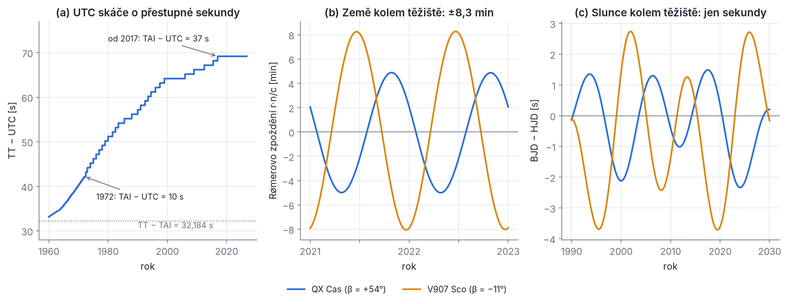
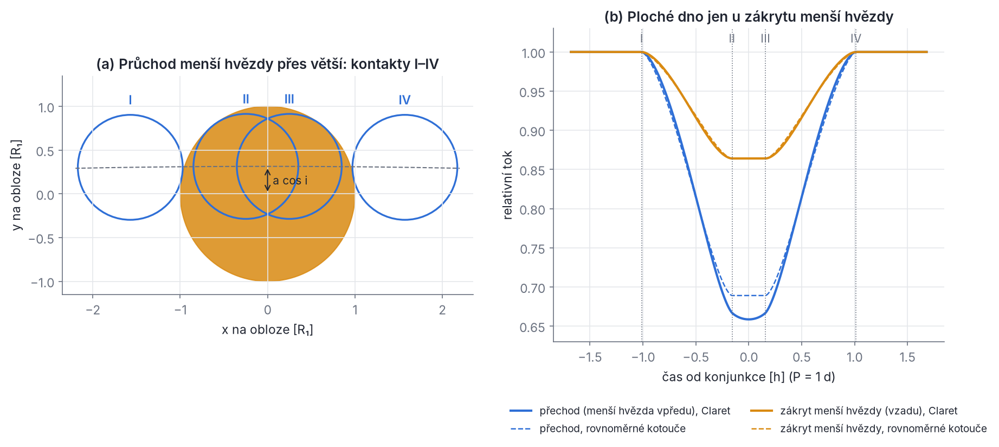
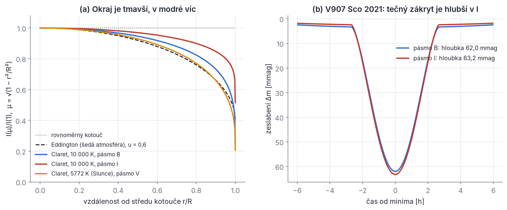
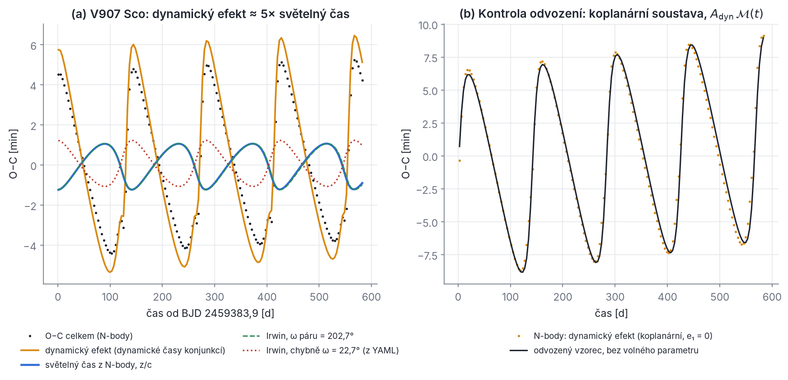
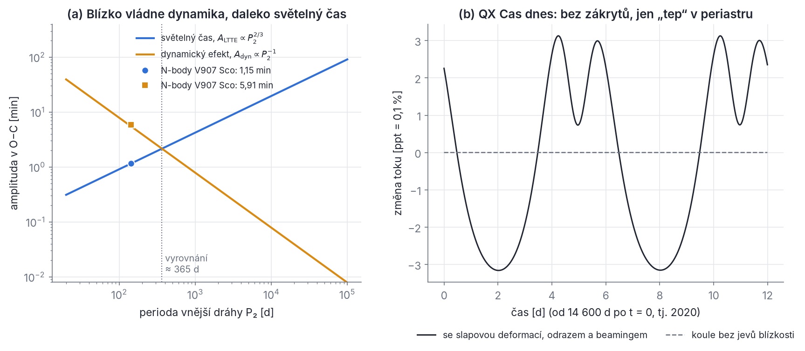

## Kapitola 10 – Od modelu k pozorování

Simulace dává polohy a rychlosti hvězd v čase t. Pozorovatel nic takového nemá. Má okamžiky minim zapsané v nějakém časovém systému, tok světla v nějakém filtru a posuvy spektrálních čar. Mezi modelem a daty proto stojí **dopředný model** (forward model): soubor pravidel, která z poloh a rychlostí vyrobí přesně to, co by změřil dalekohled. V této kapitole ho postavíme krok za krokem:

1. **čas** – jak je zapsán okamžik pozorování (JD, UTC, TT, TDB, BJD) a proč na sekundách záleží (10.1);
2. **geometrie zákrytu** – kdy a jak dlouho se hvězdy zakrývají a co z toho plyne pro poloměry a výstřednost (10.2–10.3);
3. **světelná křivka** – kolik světla chybí při zákrytu, okrajové a gravitační ztemnění, jevy blízkosti a tři úrovně modelu ve SWINGERsimu (10.4–10.6);
4. **diagram O−C** – efemerida, změny periody, efekt světelného času, dynamický efekt a magnetická aktivita (10.7–10.10);
5. **radiální rychlosti a pulzace** jako další hodiny (10.11–10.12).

> **Značení.** V této a dvou následujících kapitolách používáme u elementů drah číselné indexy tak, jak je zvykem v literatuře o O−C a světelném čase (Irwin 1952; Zasche et al. 2023a): **index 1 označuje vnitřní (zákrytovou) dráhu, index 2 vnější dráhu**. Tedy P₁ = P_in, e₁ = e_in, i₁ = i_in a P₂ = P_out, e₂ = e_out, i₂ = i_out, a₂ = a_out, ν₂ pravá anomálie vnější dráhy. U elementů dráhy index neoznačuje hvězdu; hmotnosti m₁, m₂, m₃ a poloměry R₁, R₂ zůstávají indexy hvězd. Legendreův polynom P₂ z kapitol 3, 7 a 8 se v kapitolách 10–12 nevyskytuje, takže P₂ zde vždy znamená periodu vnější dráhy (příloha C).

Všechno budeme počítat na skutečných soustavách. U V907 Sco (pár 2,56 + 2,74 M☉ s periodou 3,78 d a třetí hvězda 1,06 M☉ na dráze 142 d) uvidíme, že dynamický efekt třetí hvězdy je v O−C asi pětkrát větší než světelný čas. U QX Cas (výstředný pár, e₁ = 0,21, dnes bez zákrytů) uvidíme „tep“ v periastru. Kdo zná jen derivace, integrály a Newtonovy zákony, nemusí se bát: každý vzorec odvodíme.

### 10.1 Čas pozorování: JD, UTC, TT, TDB a BJD

Okamžik pozorování má dvě složky: **kterými hodinami** ho měříme (časová škála) a **kde** stojí pozorovatel (vztažné místo). Signál ze vzdálené hvězdy přijde k Zemi v jiném okamžiku než k Slunci nebo k těžišti sluneční soustavy; rozdíl je až 8,3 minuty. Hodiny se navíc liší o desítky sekund. Pro O−C, které chceme měřit na sekundy, musí být obojí jednoznačné.

#### Juliánské datum

Kalendářní datum (rok, měsíc, den) se špatně odčítá: měsíce mají různou délku a jsou přestupné roky. Astronomové proto počítají dny souvisle. **Juliánské datum** JD je počet dní (se zlomkem) od poledne 1. ledna 4713 př. n. l. v juliánském kalendáři. Počátek navrhl J. J. Scaliger (1583) jako začátek společného cyklu tří kalendářních period (7980 let); do astronomie zavedl souvislé počítání dní John Herschel (1849). Juliánský den začíná v **poledne** (pro pozorovatele v Evropě se v noci nemění datum).

Pro výpočet z gregoriánského data (rok Y, měsíc M, den D) se používá algoritmus Fliegela a van Flanderna (1968):

```latex
\mathrm{JDN} = \left[\frac{1461\,(Y + 4800 + a)}{4}\right] + \left[\frac{367\,(M - 2 - 12a)}{12}\right] - \left[\frac{3}{4}\left[\frac{Y + 4900 + a}{100}\right]\right] + D - 32075, \qquad a = \left[\frac{M-14}{12}\right]
```

kde hranatá závorka [x] znamená **celočíselné dělení useknutím k nule** (např. [−8/12] = 0, [207/4] = 51). JDN je juliánské datum v poledne daného dne; čas t v hodinách UT přidáme jako (t − 12)/24.

> **Pozor.** Se skutečným (necelým) dělením dává vzorec nesmysl. V programech používej celočíselné dělení, které useká k nule (v Pythonu `int(a/b)`, ne `a // b`, které pro záporná čísla zaokrouhluje dolů).

**Řešený příklad.** Jaké JD má 18. června 2021, 9:36 UT? Y = 2021, M = 6, D = 18. Nejdřív a = [(6 − 14)/12] = [−0,67] = 0. Pak

- [1461 · 6821 / 4] = [2 491 370,25] = 2 491 370,
- [367 · 4 / 12] = [122,33] = 122,
- [3/4 · [6921/100]] = [3 · 69 / 4] = [51,75] = 51,

takže JDN = 2 491 370 + 122 − 51 + 18 − 32 075 = 2 459 384 (poledne 18. 6. 2021). V 9:36 je to o 2,4 h = 0,1 d dříve: **JD = 2 459 383,9**. Stejné číslo má okamžik t = 0 konfigurace `v907_sco_published.yaml` (referenční epocha T₀ dynamického modelu článku Zasche et al. 2023a, střed úseku 39b sektoru 39 družice TESS; není to okamžik minima). Tam je to ale BJD_TDB, tedy čas převedený k těžišti sluneční soustavy a do jiných hodin; od našeho JD v UTC se liší o 69 s plus Rømerovo zpoždění (viz dále).

Pro pohodlí se používají zkrácené tvary: **MJD** = JD − 2 400 000,5 (začíná o půlnoci; 2 459 383,9 → MJD 59 383,4) a u TESS **BTJD** = BJD − 2 457 000 (zde 2383,9).

#### Hodiny: UT1, TAI, UTC, TT a TDB

**Rotační čas UT1.** Původně se čas odvozoval z otáčení Země. UT1 je úhel natočení Země vůči vzdáleným kvasarům převedený na čas. Země se ale otáčí nepravidelně a slapy Měsíce ji dlouhodobě brzdí, takže „sekunda UT1“ není stálá.

**Atomový čas TAI.** Od roku 1967 je sekunda SI definována jako 9 192 631 770 period záření přechodu mezi dvěma hladinami hyperjemné struktury základního stavu atomu cesia 133. Mezinárodní atomový čas TAI je průměr stovek atomových hodin; běží rovnoměrně od roku 1958.

**Koordinovaný světový čas UTC.** Občanský čas musí sledovat Slunce, tedy UT1. UTC proto tiká atomovými sekundami, ale od roku 1972 se od TAI liší o celý počet sekund. Když se UT1 vzdálí o víc než 0,9 s, vloží se na konci června nebo prosince **přestupná sekunda**. Mezi lety 1972 a 2016 jich bylo vloženo 27. Od 1. 1. 2017 platí TAI − UTC = 37 s. (V letech 1960–1971 se UTC přizpůsobovalo zlomkovými skoky a změnou délky sekundy, obr. 10.1a.) Generální konference pro váhy a míry v roce 2022 rozhodla, že se do roku 2035 povolená odchylka UT1 − UTC zvětší, takže nové přestupné sekundy prakticky skončí. Podstatné pro nás: **UTC není spojitá škála.** Kdo by počítal rozdíl dvou okamžiků v UTC přes přestupnou sekundu, zmýlí se o sekundu.

**Terestrický čas TT.** Pro výpočty pohybů potřebujeme rovnoměrný čas. TT je TAI posunutý o konstantu,

```latex
\mathrm{TT} = \mathrm{TAI} + 32{,}184\ \mathrm{s},
```

aby navazoval na starší efemeridový čas ET (definovaný oběhem Země kolem Slunce). Dnes tedy TT − UTC = 37 + 32,184 = **69,184 s**; v roce 1972 to bylo 42,184 s, v roce 1980 51,184 s.

**Barycentrický dynamický čas TDB.** Hodiny na Zemi se v gravitačním poli Slunce a při oběhu Země zpožďují a zrychlují (obecná relativita). TDB je čas, který by ukazovaly hodiny v těžišti sluneční soustavy, přeškálovaný tak, aby v průměru běžel stejně jako TT. Rozdíl TDB − TT je periodický s amplitudou asi 1,7 ms (hlavně s roční periodou). Pro zákryty hvězd je zanedbatelný, ale je to „správná“ škála pro pohyby ve vesmíru, a proto ji používají efemeridy i SWINGERsim.

**Historická data a ΔT.** Před rokem 1960 žádné UTC neexistovalo; minima se zapisovala ve světovém čase UT (prakticky UT1, do roku 1925 navíc s astronomickým dnem od poledne). Rozdíl ΔT = TT − UT1 byl asi −3 s v roce 1900, +24 s ve 30. letech, +29 s v roce 1950 a +64 s v roce 2000 (dnes asi 69 s). U minim z fotografických desek (chyba desítky minut) je to jedno. U přesných minim ze 30.–60. let to může dělat desítky sekund.

#### Kde: heliocentrické a barycentrické juliánské datum

Země obíhá kolem těžiště sluneční soustavy (SSB, solar system barycentre) ve vzdálenosti asi 1 au. Světlo od hvězdy přichází jako rovinná vlna ze směru jednotkového vektoru n̂ (od nás ke hvězdě). Pozorovatel v místě r (vůči SSB) leží na vlnoploše o r·n̂ blíže ke hvězdě než těžiště, takže světlo k němu dorazí o r·n̂/c **dříve**. Abychom okamžik vztáhli k těžišti, musíme to zpoždění přičíst. Úplný převod podle Eastmana, Siverda a Gaudiho (2010) je

```latex
\mathrm{BJD_{TDB}} = \mathrm{JD_{UTC}} + \Delta_C + \Delta_R + \Delta_E + \Delta_S ,
```

kde jednotlivé členy jsou:

- **Δ_C = (TAI − UTC) + 32,184 s + (TDB − TT)**, převod hodin (dnes 69,184 s + ≤ 1,7 ms);
- **Δ_R = r·n̂/c**, Rømerovo zpoždění. Protože 1 au/c = 499,005 s, je až ±499 s · cos β · (1 ± e_⊕) ≈ **±8,3 min**, kde β je ekliptikální šířka hvězdy a e_⊕ = 0,0167 výstřednost dráhy Země. Poloha pozorovatele na zemském povrchu přidává nejvýš ±21 ms;
- **Δ_E**, Einsteinovo zpoždění (chod hodin pozorovatele v gravitačním poli a při pohybu), je zahrnuto v TDB − TT;
- **Δ_S = (2GM☉/c³) ln(1 − cos θ)**, oprava o Shapirovo zpoždění světla v gravitačním poli Slunce (θ je úhel mezi hvězdou a Sluncem při pohledu od pozorovatele; logaritmus je záporný, protože zpožděný signál vracíme dopředu); 2GM☉/c³ = 9,85 µs, takže u okraje Slunce je to asi 0,1 ms a dál než 30° od Slunce méně než 20 µs.

**Heliocentrické juliánské datum HJD** vztahuje okamžik ke středu Slunce místo k těžišti. Slunce se kolem těžiště pohybuje (hlavně kvůli Jupiteru a Saturnu) až do vzdálenosti asi 0,01 au (v letech 2000–2030 nejvýš 0,0092 au), takže HJD a BJD se liší nejvýš o **asi ±5 s** (v tomto období nejvýš 4,6 s, obr. 10.1c). Mezinárodní astronomická unie doporučila BJD už v roce 1991 (rezoluce A4). Hlavní past ale není v místě: v literatuře se HJD skoro vždy počítalo v UTC, kdežto moderní BJD je v TDB. **Rozdíl HJD_UTC a BJD_TDB je tedy hlavně TT − UTC, tj. 42–69 s, a jen do ±5 s rozdíl Slunce–těžiště.**



*Obr. 10.1 – (a) Rozdíl TT − UTC podle tabulky přestupných sekund. Před rokem 1972 se UTC upravovalo zlomky sekund, od roku 1972 jen celými přestupnými sekundami. Svislý skok o 1 s je jedna přestupná sekunda. (b) Rømerovo zpoždění r·n̂/c během dvou let pro QX Cas (ekliptikální šířka +54°, amplituda jen ±5 min) a V907 Sco (−11°, ±8,2 min). (c) Rozdíl BJD − HJD v sekundách pro tytéž hvězdy v letech 1990–2030. Slunce opisuje kolem těžiště smyčky s periodami Jupiteru (11,9 roku) a Saturnu (29,5 roku); rozdíl nepřekročí několik sekund.*

#### Proč na tom záleží u století dlouhých O−C

Představ si O−C diagram, v němž jsou minima z let 1930–1990 v HJD_UTC a minima z TESS v BJD_TDB. Pokud je nikdo nepřevede, posunou se staré body vůči moderním o rozdíl hodin v době svého pozorování: asi o 24 s ve 30. letech (ΔT, viz výše) až o 57 s v roce 1990 (TT − UTC). Na řadě s chybami minut to nevadí. U V907 Sco jsou ale chyby minim z TESS asi 5 s a amplituda celého signálu asi 5 min. Chybný časový systém by vyrobil skok až o 11σ přesně v roce, kdy se změnil zdroj dat. Takový skok lze snadno mylně vyložit jako fyziku, třeba jako náhlou změnu periody. Druhý zdroj potíží jsou přestupné sekundy uvnitř řady v UTC: každá posune všechna pozdější minima o 1 s.

Pravidla jsou proto jednoduchá:

1. všechna minima převeď do BJD_TDB a u každého si zapiš původní systém;
2. u dat před rokem 1960 počítej s tím, že „UTC“ je ve skutečnosti UT, a že rozdíl TT − UT je ΔT;
3. stejně zacházej s radiálními rychlostmi a světelnými křivkami.

> **Z historie.** Ole Rømer v roce 1676 zjistil, že zatmění Jupiterova měsíce Io přicházejí dříve, když je Země Jupiteru blíže, a později, když je dál. Z rozdílu asi 22 minut (dnešní hodnota je 16,6 minuty pro průměr dráhy Země) poprvé odhadl konečnou rychlost světla. Barycentrická korekce i efekt světelného času v trojhvězdě (oddíl 10.8) jsou tentýž jev, jen s jinou dráhou.

#### Jak to dělá SWINGERsim

- Interně běží čas t v juliánských letech (365,25 d) od t = 0 konfigurace. Okamžik t = 0 se k BJD_TDB přiváže volbou `--bjd-t0` (příkazy `timings`, `minima`, `rv`, `fit --anchor`) nebo klíčem `fit.stage2.bjd_t0`. U `swingersim minima` je bez nich výchozí J2000,0 = BJD_TDB 2 451 545,0.
- Tabulky minim pro fit mají klíč `fit.time_system: BJD_TDB | HJD_UTC | JD_UTC`. Pro HJD_UTC a JD_UTC je povinné `fit.coordinates: {ra_deg, dec_deg}`. Převod dělá funkce `ocfit.to_bjd_tdb` s knihovnou astropy: od HJD odečte heliocentrickou korekci a přičte barycentrickou a převod hodin UTC → TDB (před rokem 1960 UT → TDB, viz poznámku níže).
- Tabulky radiálních rychlostí (`fit.rv`) a světelných křivek (`fit.lc`) musí být už v BJD_TDB. Hlavička datových souborů to zaznamenává, např. u rychlostí V907 Sco z roku 2022: „HJD (UTC) + 69,184 s ≈ BJD_TDB (HJD − BJD < 4 s)“.

> **Pozor (data před rokem 1960).** Astropy (knihovna ERFA) pro tato data žádné UTC nezná a s varováním „dubious year“ by použila TAI − UTC = 0, tedy TT − „UTC“ = 32,184 s. Skutečný rozdíl TT − UT byl ΔT: asi 24 s ve 30. letech a −3 s v roce 1900. Takto převedená minima by byla posunuta o 8 s (30. léta) až 35 s (1900). SWINGERsim proto bere časy před 1. 1. 1960 (JD 2 436 934,5) jako světový čas UT a převádí je vztahem TT = UT + ΔT, kde ΔT počítá funkce `ocfit.delta_t_s` z polynomů Espenaka a Meeuse (2006, platných pro roky 1600–1961). Knihovně ERFA zůstane jen převod TT → TDB a barycentrická korekce; stejně postupuje obrácený převod `ocfit.from_bjd_tdb`. Takto jsou převedena i minima z VarAstro před rokem 1960 v adresářích `data/observed/qx_cas` a `data/observed/ah_cep`. Proti převodu bez ΔT se posunula o −8,7 až +0,5 s (QX Cas, 1933–1959) a o −33,1 až −1,1 s (AH Cep, 1901–1959). Fotografickým minimům s chybou 0,05 d (72 min) by to nevadilo, přesným fotoelektrickým minimům z 50. let ano. Kdo převádí stará data jiným programem (například přímo knihovnou astropy), musí ΔT započítat sám.

### 10.2 Geometrie zákrytu krok za krokem

#### Poloha páru na obloze

Vezmeme relativní dráhu druhé hvězdy kolem první (kapitola 2). V rovině dráhy má hvězda polohu r′ = (r cos ν, r sin ν, 0), kde r je vzdálenost hvězd a ν pravá anomálie. Do souřadnic oblohy ji převedeme aktivními rotacemi r = R_z(Ω) R_x(i) R_z(ω) r′. Označme **u = ν + ω** (argument šířky, úhel od výstupného uzlu). První rotace dá (r cos u, r sin u, 0), druhá (r cos u, r sin u cos i, r sin u sin i) a třetí otočí jen kolem osy z:

```latex
x = r\,(\cos\Omega\cos u - \sin\Omega\sin u\cos i), \qquad
y = r\,(\sin\Omega\cos u + \cos\Omega\sin u\cos i), \qquad
z = r\,\sin u\,\sin i .
```

Osy x, y leží v rovině oblohy a osa z míří **od pozorovatele**. Promítnutá vzdálenost středů δ nezávisí na Ω (rotace v rovině oblohy vzdálenost nemění):

```latex
\delta^2 = x^2 + y^2 = r^2\left(\cos^2 u + \sin^2 u\,\cos^2 i\right) = r^2\left(1 - \sin^2 u\,\sin^2 i\right).
```

#### Konjunkce a vzdálenost v konjunkci

Pro kruhovou dráhu (r = a) je δ nejmenší, když sin²u = 1, tedy v **konjunkcích** u = 90° a u = 270°. Tehdy δ_min = a |cos i|. Ze znaménka z poznáme, která hvězda je vpředu. Pro u = 90° je z > 0, takže druhá hvězda je dál od nás a je zakryta; pro u = 270° je zakryta první hvězda. SWINGERsim nazývá **primárním** zákrytem zákryt první hvězdy páru (m1 v páru A, m3 v páru B), ne nutně ten hlubší. Je to konvence podle hvězd; hloubka závisí na teplotách.

Na výstředné dráze leží konjunkce stále u u = 90° a 270° (přesné minimum δ je k nim velmi blízko). Vzdálenost hvězd tam ale není a. Z rovnice elipsy r = a(1 − e²)/(1 + e cos ν) s ν = u − ω a cos(90° − ω) = sin ω, cos(270° − ω) = −sin ω plyne

```latex
r_{\rm II} = \frac{a\,(1-e^2)}{1 + e\sin\omega}\quad (u = 90^\circ,\ \text{zakryta hvězda 2}), \qquad
r_{\rm I} = \frac{a\,(1-e^2)}{1 - e\sin\omega}\quad (u = 270^\circ,\ \text{zakryta hvězda 1}).
```

Zde ω je argument periastra **relativní** dráhy hvězdy 2 kolem hvězdy 1, tak jak ho zadáváš do SWINGERsimu. V literatuře o zákrytových dvojhvězdách se často používá ω₁ dráhy primární složky kolem těžiště, ω₁ = ω + 180°; pak se znaménka členů e sin ω a e cos ω obrátí.

#### Mez zákrytu

Kotouče se v konjunkci překrývají, když δ_min = r |cos i| < R₁ + R₂, tedy

```latex
|\cos i| < \frac{R_1 + R_2}{r_{\rm konj}} .
```

Absolutní hodnota je důležitá. SWINGERsim i mnoho prací používá sklon v rozsahu 0–180°, kde i > 90° znamená oběh po směru hodinových ručiček na obloze. Zákryty jsou pak možné v pásu kolem 90° na **obě** strany.

**Řešený příklad (V907 Sco).** Pro m₁ + m₂ = 5,30 M☉ a P = 3,77487 d dává 3. Keplerův zákon a = 0,08272 au = 17,79 R☉. S R₁ + R₂ = 2,53 + 2,68 = 5,21 R☉ je (R₁ + R₂)/a = 0,293 a mez pro kruhovou dráhu i > arccos 0,293 = 72,97°. Dráha je mírně výstředná (e = 0,008, ω = 302,6°, tedy ω₁ = 122,6° v konvenci Zascheho et al. 2023a): r_II/a = 1,0067 a r_I/a = 0,9932, takže primární zákryty jsou možné od 72,85° a sekundární od 73,09°. Okno je tedy 73° < i < 107° (dokumentace uvádí 72,8° pro snazší primární zákryt). Pro náhodně orientovanou dráhu je cos i rovnoměrně rozdělené, takže pravděpodobnost zákrytů je (R₁ + R₂)/a ≈ 29 %.

#### Čtyři kontakty a délka zákrytu

Na kruhové dráze měříme čas od konjunkce úhlem θ = 2π(t − t_k)/P (u = 90° + θ). Pak sin u = cos θ a cos u = −sin θ a ze vzorce pro δ² dostaneme

```latex
\delta^2(\theta) = a^2\left(\sin^2\theta + \cos^2\theta\,\cos^2 i\right) .
```

Zákryt má čtyři **kontakty**: I a IV, když se kotouče dotýkají zvenku (δ = R₁ + R₂), a II a III, když menší kotouč leží celý uvnitř většího a dotýká se ho zevnitř (δ = R₁ − R₂, pro R₁ > R₂). Mezi II a III je zákryt úplný (menší hvězda je schovaná) nebo prstencový (menší hvězda přechází přes větší). Dosadíme δ = s, upravíme cos²θ = 1 − sin²θ a vyjádříme sin²θ:

```latex
\sin^2\theta_s\,\sin^2 i = \frac{s^2}{a^2} - \cos^2 i
\quad\Longrightarrow\quad
T_{14} = \frac{P}{\pi}\arcsin\frac{\sqrt{(R_1+R_2)^2 - a^2\cos^2 i}}{a\sin i}, \qquad
T_{23} = \frac{P}{\pi}\arcsin\frac{\sqrt{(R_1-R_2)^2 - a^2\cos^2 i}}{a\sin i}.
```

T₁₄ je celá délka zákrytu (kontakt I až IV), T₂₃ délka úplné fáze. Pokud a|cos i| > R₁ − R₂, kontakty II a III neexistují a zákryt je částečný. Pro středový zákryt (i = 90°) a malé úhly je sin θ ≈ θ, takže

```latex
\frac{T_{14}}{P} \approx \frac{R_1+R_2}{\pi a}, \qquad \frac{T_{23}}{P} \approx \frac{R_1-R_2}{\pi a}
\quad\Longrightarrow\quad
\frac{R_1}{a} \approx \frac{\pi}{2}\,\frac{T_{14}+T_{23}}{P}, \qquad \frac{R_2}{a} \approx \frac{\pi}{2}\,\frac{T_{14}-T_{23}}{P} .
```

**Poměrné poloměry plynou jen z hodin**, bez znalosti vzdálenosti. Radiální rychlosti pak dají a sin i a tím poloměry v kilometrech. Pro i ≠ 90° má soustava tři neznámé (R₁/a, R₂/a, i) a délky dávají jen dvě rovnice. Třetí rovnici dá hloubka nebo tvar zákrytu, a proto se poloměry v praxi fitují z celé světelné křivky.

**Řešený příklad (délky zákrytu).** V442 Cyg (Mikulášek a Krtička 2005): P = 2,386 d = 57,26 h, středové zákryty, T₁₄ = 6,3 h, T₂₃ = 0,7 h. Pak R₁/a = (π/2)(7,0/57,26) = 0,192 a R₂/a = (π/2)(5,6/57,26) = 0,154. Pozor ale na sklon. Pro soustavu na obr. 10.2 (R₁/a = 0,1667, R₂/a = 0,1, i = 87°) vyjde T₁₄/P = 0,0843 a T₂₃/P = 0,0132. Přibližný vzorec z nich dá R₁/a = 0,153 a R₂/a = 0,112, tedy chyby 8 % a 12 %. Obecný vzorec se správným i dá přesně (R₁ + R₂)/a = 0,2667 a (R₁ − R₂)/a = 0,0667. U V907 Sco (i = 76,61°, a cos i = 4,12 R☉ = 0,79 (R₁ + R₂)) trvá tečný zákryt T₁₄ = 5,35 h, zatímco středový by trval 8,57 h.



*Obr. 10.2 – (a) Pohled na oblohu: větší hvězda (R₁ = 1, oranžově) a menší hvězda (R₂ = 0,6) ve čtyřech kontaktech na kruhové dráze s a = 6 R₁ a i = 87°. Čárkovaně je dráha středu menší hvězdy, posunutá o a cos i = 0,31 R₁. (b) Světelné křivky obou zákrytů (P = 1 d, menší hvězda má ve středu kotouče 0,45 povrchové jasnosti větší). Když je menší hvězda vpředu (modře), dno není ploché: s okrajovým ztemněním podle Clareta (plně) je zakrytá část ve středu kotouče jasnější než u okraje, takže dno je zakřivené a hlubší než pro rovnoměrné kotouče (čárkovaně). Když je menší hvězda vzadu (oranžově), mezi kontakty II a III je celá schovaná a dno je ploché bez ohledu na ztemnění. Tečkované čáry označují kontakty I–IV.*

#### Výstředná dráha: e cos ω a e sin ω z minim

Na výstředné dráze neleží sekundární minimum v polovině periody a obě minima trvají různě dlouho. Obojí plyne z Keplerovy rovnice. Střední anomálie M = E − e sin E se do prvního řádu v e dá zapsat přes pravou anomálii jako M ≈ ν − 2e sin ν (rozvoj rovnice středu, kapitola 2). Primární konjunkce je v ν_I = 270° − ω, sekundární v ν_II = 90° − ω (+ 360°). Rozdíl středních anomálií je

```latex
M_{\rm II} - M_{\rm I} \approx \pi - 2e\left[\sin(90^\circ-\omega) - \sin(270^\circ-\omega)\right] = \pi - 4e\cos\omega ,
```

a protože M roste s časem rovnoměrně,

```latex
\frac{t_{\rm II} - t_{\rm I}}{P} \approx \frac12 - \frac{2}{\pi}\,e\cos\omega \qquad (\text{pro } i = 90^\circ).
```

Přesný vzorec pro i = 90°, který při rozboru stáčení apsid použil Sterne (1939), je

```latex
\frac{t_{\rm II} - t_{\rm I}}{P} = \frac12 - \frac1\pi\left[\arctan\frac{e\cos\omega}{\sqrt{1-e^2}} + \frac{e\cos\omega\,\sqrt{1-e^2}}{1 - e^2\sin^2\omega}\right].
```

V konvenci s ω₁ = ω + 180° má obvyklý tvar t_II − t_I = P/2 + (2P/π) e cos ω₁. Pro sklon různý od 90° se v prvním řádu objeví faktor (1 + 1/sin² i)/2, který je u zákrytových dvojhvězd blízko 1.

**Délky zákrytů** závisí na rychlosti, jakou se hvězdy v konjunkci míjejí. V konjunkci leží spojnice hvězd podél zorného paprsku, takže na obloze vidíme jen příčnou složku rychlosti v_t = h/r, kde h = r²ν̇ je konstantní moment hybnosti (na jednotku redukované hmotnosti). Délka je tedy T ≈ 2(R₁ + R₂)/v_t = 2(R₁ + R₂) r/h ∝ r, a proto

```latex
\frac{T_{\rm II}}{T_{\rm I}} = \frac{r_{\rm II}}{r_{\rm I}} = \frac{1 - e\sin\omega}{1 + e\sin\omega}
\qquad\Longrightarrow\qquad
e\sin\omega = -\,\frac{T_{\rm II} - T_{\rm I}}{T_{\rm II} + T_{\rm I}}
```

(v konvenci ω₁: e sin ω₁ = (T_II − T_I)/(T_II + T_I)). Posun sekundárního minima měří **e cos ω**, poměr délek **e sin ω**. Posun se měří mnohem přesněji, protože jde o okamžiky; e sin ω je z délek obvykle nejistější. Proto SWINGERsim umožňuje fitovat výstřednost málo výstředného vnitřního páru dvojicí `ecosw`, `esinw` místo e a ω (volné parametry `orbits.<pár>.ecosw`, `orbits.<pár>.esinw`). Když se periastrum stáčí (kapitola 7), e cos ω kmitá a primární a sekundární minima se v O−C rozcházejí v protifázi.

**Řešený příklad (kontrola N-částicovým během).** Pár 2,0 + 1,2 M☉, P = 4 d, e = 0,3, ω = 60°, i = 88° (soubor `ecc.yaml` v řešení cvičení 12). Vzorec prvního řádu dává (t_II − t_I)/P = 0,5 − (2/π)·0,15 = 0,4045, Sterneův přesný vzorec 0,4015. Příkaz `swingersim timings` změří 0,4015. Poměr délek má být (1 − 0,260)/(1 + 0,260) = 0,588; fenomenologické šířky z příkazu `swingersim minima` mají poměr 0,954 h / 1,585 h = 0,602 (šířka profilu není přesně T₁₄ a sklon 88° délky mírně mění).

### 10.3 Konjunkce, fotometrické minimum a Rømerovo zpoždění uvnitř páru

#### Dvě různé věci: geometrický střed a minimum světla

SWINGERsim má pro okamžiky zákrytů dva příkazy a je důležité rozumět jejich rozdílu.

**`swingersim timings`** počítá **geometrické** okamžiky. Integruje soustavu N-částicově (s fyzikou podle konfigurace, např. relativita, slapy, rotace), 40krát za periodu nejkratšího sledovaného páru (`--samples`) zkontroluje, zda funkce g = x·v_x + y·v_y (polovina derivace δ²) změnila znaménko ze záporného na kladné, a kořen g = 0 dopočítá metodou `brentq` (přesnost 10⁻¹² roku, tj. 3·10⁻⁵ s) s keplerovským pohybem páru mezi vzorky. Konjunkce je zákrytem, když je v ní δ < R₁ + R₂; poměr δ/(R₁ + R₂) se ukládá jako `impact`. K dynamickému okamžiku pak přičte dvě zpoždění: světelný čas těžiště páru z_com/c (oddíl 10.8) a Rømerovo zpoždění uvnitř páru (níže). Stejně definované okamžiky (modul `obsmodel`) používá fit (kapitola 11), protože jsou rychlé a numericky přesné na zlomky sekundy.

**`swingersim minima`** dělá to, co pozorovatel: spočte syntetickou světelnou křivku a každé minimum proloží fenomenologickým profilem Mikuláška (2015),

```latex
\Delta m(t) = A\,(1 + C x^2)\left\{1 - \left[1 - e^{\,1-\cosh x}\right]^{\Gamma}\right\}, \qquad x = \frac{t - t_{\min}}{D},
```

s hloubkou A, šířkou D, „špičatostí“ Γ a korekcí tvaru C; profil se přičítá ke kvadratické základní úrovni (světlo ostatních hvězd a pomalé změny mimo zákryt). Nejdřív se pro každý pár a druh zákrytu proloží společný tvar (A, D, Γ, C) všemi zákryty najednou, pak se s tímto tvarem a volnou hloubkou, šířkou a základní úrovní fituje okamžik t_min každého zákrytu. Okno kolem minima je 2,5násobek délky zákrytu (`--window`). Výsledkem je **fotometrické minimum**, které obsahuje vše, co v reálných datech minimum posouvá: nesouměrnost zákrytu na výstředné dráze, světlo ostatních hvězd, jevy blízkosti, vzorkování a šum.

Geometrický a fotometrický okamžik se mohou lišit. U souměrného zákrytu dvou koulí na kruhové dráze je minimum světla přesně v minimu δ. Na výstředné dráze se ale hvězdy před minimem a po něm nepohybují stejně rychle a vzdálenost r se mění, takže zákryt je mírně nesouměrný. Ukázka (oba příkazy jsme spustili):

```bash
swingersim timings configs/squadra_test3/v907_sco_published.yaml --years 4 --bjd-t0 2459383.9 -o v907_tim.csv --plot v907_tim.png
swingersim minima  configs/squadra_test3/v907_sco_published.yaml --years 0.3 --cadence-min 2 --bjd-t0 2459383.9 -o v907_min.csv
```

U V907 Sco (e = 0,008) vyjde medián rozdílu minimum − konjunkce +0,8 s u primárních a +0,4 s u sekundárních minim (rozptyl 1,4 s), při formální chybě minima asi 5 s. U výstředného páru z cvičení 12 (e = 0,3) je to +0,7 s a −4,0 s. Pro data TESS je to na hranici měřitelnosti, pro pozemská minima zanedbatelné.

#### Rømerovo zpoždění uvnitř páru

Světlo od vzdálenější hvězdy páru cestuje déle než od bližší. Zákryt pozorujeme, když se na obloze překryjí **retardované** polohy obou hvězd, tedy polohy v okamžicích t − z₁/c a t − z₂/c, ne okamžité polohy. Odvoďme posun. Vůči těžišti páru jsou polohy hvězd r₁ = −(m₂/m₁₂) r a r₂ = (m₁/m₁₂) r, kde r = r₂ − r₁ a m₁₂ = m₁ + m₂. Hloubky z_k teď měříme od těžiště páru; zpoždění samotného těžiště je světelný čas z oddílu 10.8 a je pro obě hvězdy stejné. Pro malé zpoždění je retardovaná souřadnice x_k(t − z_k/c) ≈ x_k(t) − v_{x,k} z_k/c. Podmínka překrytí x₂ − x₁ = 0 pro retardované polohy zní

```latex
x(t) - \frac{v_{x,2}\,z_2 - v_{x,1}\,z_1}{c} = 0, \qquad
v_{x,2} z_2 - v_{x,1} z_1 = v_x z\left[\left(\frac{m_1}{m_{12}}\right)^2 - \left(\frac{m_2}{m_{12}}\right)^2\right] = v_x z\,\frac{m_1 - m_2}{m_{12}} ,
```

kde v_x a z jsou složky relativní rychlosti a polohy. V blízkosti konjunkce je x(t) ≈ v_x (t − t_k), takže konjunkce retardovaných poloh nastane o

```latex
\tau = \frac{z_{\rm rel}}{c}\,\frac{m_1 - m_2}{m_1 + m_2}
```

později než geometrická (Kaplan 2010). Pro kruhovou dráhu je v primární konjunkci z_rel = −a sin i a v sekundární +a sin i. Sekundární minimum je proto vůči polovině periody posunuto o

```latex
\Delta t = \frac{2a\sin i}{c}\,\frac{m_1 - m_2}{m_1 + m_2} = \frac{P}{\pi c}\,(K_2 - K_1),
```

kde K₁, K₂ jsou poloamplitudy radiálních rychlostí (použili jsme K_{1,2} = 2π a sin i · m_{2,1}/(m₁₂ P)). Zákryty lehčí hvězdy, která obíhá dál od těžiště, přicházejí později, zákryty těžší dříve. SWINGERsim tento člen přičítá funkcí `timing.roemer_in_binary` a ve světelných křivkách se vyhodnocuje každá hvězda ve svém vlastním okamžiku vyslání, takže je obsažen automaticky.

**Řešený příklad.** V907 Sco: a = 17,79 R☉, i = 76,61°, m₁ − m₂ = −0,18 M☉. Pak Δt = 2 · 0,08272 au · 0,973 · (−0,18/5,30)/c = −2,7 s: sekundární minima (zákryt těžší hvězdy m2) přicházejí o 2,7 s dříve než v polovině periody. Kontrolně K₁ = 119,9 km/s, K₂ = 112,0 km/s a (P/πc)(K₂ − K₁) = −2,7 s. U páru 2,0 + 1,2 M☉ s P = 4 d je to už 18 s, což TESS snadno změří.

#### Geometrický a zjistitelný zákryt

Geometrická podmínka |cos i| < (R₁ + R₂)/r říká jen, že se kotouče dotknou. Těsně nad mezí je zákryt **tečný** a jeho hloubka může být tisíciny magnitudy. Zda ho někdo zaznamenal, závisí na přesnosti tehdejší fotometrie. V analýzách SWINGERsimu (dokumentace, část III) se proto rozlišuje geometrická mez a mez zjistitelnosti: zhruba 0,1 mag u fotografických desek, několik setin magnitudy (asi 0,02–0,05 mag) u fotoelektrické fotometrie a několik desetin procenta u TESS. Samotný program žádné prahy nepoužívá: počítá hloubku ze světelné křivky a rozhodnutí je na tobě.

U V907 Sco to vysvětluje historii zákrytů. Geometrické přechody publikované soustavy v SWINGERsimu vycházejí na roky 1923,5 (konec), 1956,5 (návrat), 1986,5 (konec) a 2019,5 (návrat), zatímco pozorovatelé zaznamenali konec kolem roku 1918, návrat až kolem roku 1963, konec kolem roku 1986 a návrat v roce 2019 (TESS, sektor 13). Rozdíly několika let nejsou chybou modelu: v letech 1918–1923 a 1956–1963 byly zákryty geometricky možné, ale mělčí, než jaké tehdejší desky a fotometry zachytily. V roce 2019 je zachytil až TESS s přesností desetin procenta.

### 10.4 Světelná křivka kulových hvězd

#### Tok hvězdy ve filtru

Vzdálená hvězda je pro nás kotouč. Každý jeho bod září **intenzitou** I (výkon na jednotku plochy, prostorového úhlu a vlnové délky), která závisí na úhlu θ mezi zorným paprskem a normálou povrchu, μ = cos θ. Tok od kulové hvězdy o poloměru R ve vzdálenosti d dostaneme sečtením přes promítnutou plochu kotouče: bod ve vzdálenosti ρ od středu kotouče má μ = √(1 − ρ²/R²) a mezikruží má plochu 2πρ dρ = 2πR² μ dμ, takže

```latex
F = \frac{1}{d^2}\int_0^R I(\mu)\,2\pi\rho\,d\rho = \frac{2\pi R^2}{d^2}\int_0^1 I(\mu)\,\mu\,d\mu = \frac{\pi R^2}{d^2}\,\langle I\rangle .
```

⟨I⟩ je střední intenzita kotouče. Ve vícenásobné soustavě jsou všechny hvězdy stejně daleko, takže d se v poměrech toků vykrátí.

Intenzitu ve filtru SWINGERsim (úroveň A) počítá z Planckova zákona pro černé těleso,

```latex
B_\lambda(T) = \frac{2hc^2}{\lambda^5}\,\frac{1}{e^{hc/\lambda k T} - 1}, \qquad
w = \int B_\lambda(T_{\rm eff})\,S(\lambda)\,\lambda\,d\lambda ,
```

kde S(λ) je propustnost filtru (Bessellovy UBVRI, TESS, Gaia G, BP, RP). Činitel λ je tam proto, že CCD počítá **fotony**: energie fotonu je hc/λ, takže počet fotonů je úměrný B_λ λ. Modelové atmosféry by poměr povrchových jasností dvou různě teplých hvězd změnily o několik procent; ty používá až úroveň PHOEBE (oddíl 10.6). Pro dvě skoro stejně teplé hvězdy V907 Sco (10 004 K a 10 000 K) je poměr povrchových jasností 0,999 v každém filtru a na atmosféře nezáleží.

#### Plocha překryvu dvou kotoučů

Pro rovnoměrně jasné kotouče je zakrytý tok úměrný ploše překryvu. Mějme kotouče o poloměrech R₁, R₂ se středy ve vzdálenosti δ, kde |R₁ − R₂| < δ < R₁ + R₂. Kružnice se protínají na tětivě kolmé na spojnici středů. Její vzdálenosti od středů d₁, d₂ splňují d₁ + d₂ = δ a z Pythagorovy věty pro polovinu tětivy h² = R₁² − d₁² = R₂² − d₂². Odečtením dostaneme d₁² − d₂² = R₁² − R₂², a protože d₁² − d₂² = (d₁ − d₂)δ,

```latex
d_1 = \frac{\delta^2 + R_1^2 - R_2^2}{2\delta}, \qquad d_2 = \delta - d_1 .
```

Překryv se skládá ze dvou kruhových úsečí. Úseč kruhu o poloměru R odříznutá tětivou ve vzdálenosti d od středu má plochu výseče s úhlem 2 arccos(d/R) mínus trojúhelník:

```latex
S(R, d) = R^2\arccos\frac{d}{R} - d\,\sqrt{R^2 - d^2}, \qquad A_{\rm překryv} = S(R_1, d_1) + S(R_2, d_2).
```

(Pro δ ≤ |R₁ − R₂| je A = πR₂², pro δ ≥ R₁ + R₂ je A = 0.)

**Řešený příklad.** R₁ = 1, R₂ = 0,6, δ = 1,0: d₁ = (1 + 1 − 0,36)/2 = 0,82, d₂ = 0,18. S(1; 0,82) = arccos 0,82 − 0,82 · √(1 − 0,6724) = 0,6094 − 0,4693 = 0,1400 a S(0,6; 0,18) = 0,36 · arccos 0,3 − 0,18 · √(0,36 − 0,0324) = 0,4558 − 0,1030 = 0,3528. Celkem A = 0,4928, tedy 43,6 % plochy menšího a 15,7 % plochy většího kotouče. (Kontrola metodou Monte Carlo: z 20 milionů náhodných bodů ve čtverci 2 × 2 padne do obou kotoučů podíl odpovídající A = 0,4925 ± 0,0003.)

#### Okrajové ztemnění: proč je okraj tmavší

Na okraji kotouče se díváme do atmosféry šikmo. Světlo uniká zhruba z optické hloubky 1 měřené **podél paprsku**; při šikmém pohledu to odpovídá svislé optické hloubce τ ≈ μ, tedy vyšším a chladnějším vrstvám. Okraj je proto tmavší a „červenější“.

Spočítejme to. Pro intenzitu vycházející z povrchu pod úhlem θ platí řešení rovnice přenosu záření

```latex
I(0, \mu) = \int_0^\infty S(\tau)\,e^{-\tau/\mu}\,\frac{d\tau}{\mu},
```

kde S je zdrojová funkce (v lokální termodynamické rovnováze S = B, Planckova funkce místní teploty). Je-li S lineární, S = a + bτ, integrály ∫e^{−x}dx = 1 a ∫x e^{−x}dx = 1 (substituce x = τ/μ) dají přesně

```latex
I(0,\mu) = a + b\mu = S(\tau = \mu) \qquad \text{(Eddingtonova–Barbierova relace)} .
```

Jak S závisí na τ, určuje **šedá atmosféra** (opacita nezávislá na vlnové délce) v zářivé rovnováze. Zavedeme momenty intenzity J = ½∫I dμ, H = ½∫Iμ dμ a K = ½∫Iμ² dμ (integrály přes μ od −1 do 1). Zářivá rovnováha znamená, že tok je stálý, H = F/(4π) = σT_eff⁴/(4π), a že J = S. Rovnice přenosu po vynásobení μ a integraci dá dK/dτ = H. Eddingtonova aproximace K = J/3 (téměř izotropní záření v hloubce) pak dává J = 3Hτ + J(0) a z okrajové podmínky na povrchu J(0) = 2H dostaneme J = 3H(τ + 2/3). Protože J = S = σT⁴/π, plyne známý průběh teploty

```latex
T^4(\tau) = \frac34\,T_{\rm eff}^4\left(\tau + \frac23\right), \qquad S(\tau) = \frac{3\sigma T_{\rm eff}^4}{4\pi}\left(\tau + \frac23\right).
```

Zdrojová funkce je lineární, takže podle Eddingtonovy–Barbierovy relace

```latex
\frac{I(\mu)}{I(1)} = \frac{\mu + 2/3}{1 + 2/3} = \frac{2 + 3\mu}{5} = 1 - \frac35\,(1 - \mu) .
```

To je **lineární zákon okrajového ztemnění** s koeficientem u = 0,6; na okraji (μ = 0) září šedá atmosféra 40 % středové intenzity. Kontrola: tok F = 2π∫I μ dμ = 2π · (3σT_eff⁴/4π)(1/3 + 1/3) = σT_eff⁴, jak má být. Slunce má ve viditelném světle u ≈ 0,6, takže už tento jednoduchý model funguje překvapivě dobře.

Skutečné atmosféry nejsou šedé a ztemnění závisí na vlnové délce: v modré je silnější, protože Planckova funkce je tam na teplotě citlivější. Používají se proto zákony s více koeficienty:

```latex
\text{lineární: } 1 - u(1-\mu), \qquad
\text{kvadratický: } 1 - u_1(1-\mu) - u_2(1-\mu)^2, \qquad
\text{Claretův čtyřkoeficientový: } \frac{I(\mu)}{I(1)} = 1 - \sum_{k=1}^{4} a_k\left(1 - \mu^{k/2}\right).
```

Střední intenzita kotouče plyne z integrálu ∫₀¹ 2μ(1 − μ^{k/2}) dμ = k/(k + 4):

```latex
\frac{\langle I\rangle}{I(1)} = 1 - \sum_{k=1}^{4}\frac{k\,a_k}{k+4} \qquad (\text{pro lineární zákon } 1 - u/3).
```

Dvoukoeficientové zákony selhávají u samého okraje (μ → 0), kde intenzita skutečných atmosfér klesá strměji; to ovlivňuje tvar začátku a konce zákrytu.

**Jak to dělá SWINGERsim.** Úroveň A používá čtyřkoeficientový zákon Clareta (2000). Koeficienty a gravitační exponent y (oddíl 10.5) interpoluje v (T_eff, log g, [M/H]) z tabulek Clareta a Bloemena (2011, atmosféry ATLAS a PHOENIX v LTE) pod 15 000 K a z non-LTE atmosfér TLUSTY podle Reevea a Howartha (2016) mezi 15 000 a 55 000 K. Pro TESS a Gaia se berou koeficienty nejbližšího Johnsonova–Cousinsova pásma (TESS a RP → I, G → R, BP → V). Hodnoty mimo tabulky se oříznou na okraj s varováním. Koeficienty lze zadat ručně souborem `--ld` (YAML: hvězda → a₁…a₄). Pro hvězdu V907 Sco m1 (10 004 K, log g = 4,04) dostaneme v B koeficienty (0,484; 0,730; −0,673; 0,211), tedy I(0)/I(1) = 0,25 a ⟨I⟩/I(1) = 0,843; v I koeficienty (0,649; −0,425; 0,411; −0,150), I(0)/I(1) = 0,52 a ⟨I⟩/I(1) = 0,911. Pro Slunce ve V vychází ekvivalentní lineární koeficient 3(1 − ⟨I⟩/I(1)) = 0,60, tedy Eddingtonova hodnota.

**Zákryt s okrajovým ztemněním.** S nerovnoměrným kotoučem už nestačí plocha překryvu. Zakrytý tok hvězdy k je

```latex
F_{\rm zakr} = \int_0^{R} I(\rho)\,\alpha(\rho)\,2\pi\rho\,d\rho ,
```

kde α(ρ) je podíl kružnice o poloměru ρ kolem středu hvězdy, který leží za zakrývajícími kotouči. Pro jeden kotouč o poloměru R_z ve vzdálenosti δ je to úhel 2φ₀/(2π) s cos φ₀ = (ρ² + δ² − R_z²)/(2ρδ) (kosinová věta). SWINGERsim integrál počítá Gaussovou–Legendreovou kvadraturou (24 uzlů) zvlášť na každém intervalu mezi poloměry, kde kružnici protíná okraj některého kotouče (stejně jako program ellc; Maxted 2016). Funguje to pro libovolný počet současně zakrývajících koulí, takže vzájemné zákryty párů ve čtyřhvězdě 2+2 i zákryty třetí hvězdou nepotřebují zvláštní zacházení. Se zákonem přechodu exoplanet podle Mandela a Agola (2002) v programu batman souhlasí na 10⁻⁸.



*Obr. 10.3 – (a) Intenzita napříč kotoučem I(μ)/I(1) v závislosti na vzdálenosti od středu kotouče: rovnoměrný kotouč (tečkovaně), Eddingtonův zákon šedé atmosféry (čárkovaně) a Claretův čtyřkoeficientový zákon pro hvězdu 10 000 K v pásmech B a I a pro Slunce ve V. V modré je okraj tmavší. Strmý pokles těsně u okraje (r/R > 0,98) je vlastnost čtyřkoeficientového zákona. (b) Syntetický zákryt V907 Sco z června 2021 v pásmech B a I (příkaz `swingersim lightcurve`, kadence 2 min). Zákryt je tečný (zakrývá se jen okraj kotouče), a protože je okraj v B tmavší, chybí v B méně světla: hloubka je 62,0 mmag v B a 63,2 mmag v I. Mimo zákryt je vidět elipsoidální proměnnost.*

#### Třetí světlo

Ve vícenásobné soustavě svítí i hvězdy, které se zákrytu neúčastní. Ztratí-li pár v minimu podíl d svého vlastního světla a ostatní hvězdy dávají podíl l₃ celkového toku (**třetí světlo**), klesne celkový tok z F na F − (1 − l₃) d F. V magnitudách (Pogsonova rovnice Δm = −2,5 log(F_min/F_max)) je hloubka

```latex
\Delta m = -2{,}5\,\log_{10}\left[1 - (1 - l_3)\,d\right] \;\approx\; 1{,}086\,(1 - l_3)\,d \quad (\text{pro malé } d).
```

**Řešený příklad.** Zákryt hluboký 0,50 mag u samotného páru znamená d = 1 − 10^{−0,2} = 0,369. S l₃ = 0,2 je hloubka −2,5 log(1 − 0,8 · 0,369) = 0,38 mag, s l₃ = 0,9 jen 0,041 mag. U V907 Sco přispívá třetí hvězda (5900 K, 1 R☉) podílem l₃ = 0,7 % v B, 1,1 % ve V, 1,7 % v TESS a 1,8 % v I; je chladnější, a proto víc svítí v červené. SWINGERsim třetí světlo nepotřebuje jako volný parametr: počítá ho fyzikálně ze všech hvězd konfigurace. Světlo, které v modelu chybí (cizí hvězda v cloně, rozptýlené světlo), zachytí volba `fit.lc[].scale` (měřítko modelu pro každý úsek dat).

#### Konečná expozice

Detektor neměří okamžitý tok, ale jeho průměr přes expozici T_exp. Průměr funkce přes interval délky T rozvineme do Taylorovy řady kolem středu: lineární člen se vyruší a zůstane

```latex
\bar F(t) = \frac1{T}\int_{-T/2}^{T/2} F(t+s)\,ds = F(t) + \frac{T^2}{24}\,F''(t) + \dots
```

Na dně zákrytu je F″ > 0, takže dlouhá expozice zákryt **změlčí** a rozmaže. TESS měřil celé snímky po 30 min (2018–2020), po 10 min (2020–2022) a po 200 s (od roku 2022); fotografické desky měly expozice minuty až hodinu. SWINGERsim model středuje přes dílčí expozice: `swingersim lightcurve … --exposure-min 30 --supersample 15`, ve fitu `fit.lc[].exposure_min` a `n_sub` (nejvýš 15). Pro tentýž zákryt V907 Sco jako na obr. 10.3, ale v pásmu TESS, dává 30minutová expozice hloubku 63,0 mmag místo 63,3 mmag. Rozdíl 0,3 mmag je malý, ale u kratších period a hlubších zákrytů roste s (T_exp/T₁₄)².

### 10.5 Jevy blízkosti: gravitační ztemnění, elipsoidální proměnnost, odraz a beaming

V těsném páru nejsou hvězdy koule, které jen svítí. Deformují se navzájem slapy, září na sebe a jejich pohyb mění tok Dopplerovým jevem. Těmto jevům se říká **jevy blízkosti** (proximity effects). Všechny jsou i mimo zákryty a mění se s fází oběhu.

#### Gravitační ztemnění

Na deformované nebo rotující hvězdě není tíže g všude stejná: na pólech je větší, na rovníku a na straně k průvodci menší. Von Zeipel (1924) ukázal, že v obálce v zářivé rovnováze je tok úměrný tíži. Odvození na jeden řádek: tlak, hustota i teplota jsou ve hvězdě v hydrostatické rovnováze funkcemi jen efektivního potenciálu Φ (gravitace + odstředivá síla), takže ∇T = (dT/dΦ)∇Φ a tíže je g = −∇Φ. Zářivý tok F = −(4acT³/3κρ)∇T je pak úměrný g s koeficientem, který je na celé ploše Φ = konst stejný. Protože F = σT_eff⁴,

```latex
T_{\rm eff}^4 \propto g^{\beta}, \qquad \beta = 1\ \text{(zářivé obálky, von Zeipel 1924)}, \qquad \beta \approx 0{,}32\ \text{(konvektivní obálky, Lucy 1967)} .
```

Pozor na konvence: někteří autoři píší T_eff ∝ g^β′, pak β′ = β/4 = 0,25 nebo 0,08. Ve filtru se pracuje s exponentem pro **intenzitu**, I_λ ∝ g^y. Pro černé těleso plyne y řetízkovým pravidlem: d ln I/d ln g = (d ln B_λ/d ln T)(d ln T/d ln g), kde d ln B_λ/d ln T = x eˣ/(eˣ − 1) s x = hc/(λkT) a d ln T/d ln g = β/4, takže

```latex
y = \frac{\beta}{4}\,\frac{x\,e^x}{e^x - 1}, \qquad x = \frac{hc}{\lambda k T_{\rm eff}} .
```

SWINGERsim bere y z tabulek Clareta a Bloemena (2011); jen pro nejteplejší hvězdy O za okrajem tabulek použije tento vzorec s β = 1. Pro V907 Sco m1 je v TESS y = 0,42.

#### Elipsoidální proměnnost

Slapy protáhnou hvězdu do tvaru vejce mířícího k průvodci (kapitola 7). Když se díváme kolmo na spojnici hvězd (kvadratury), vidíme protáhlý bok s větší promítnutou plochou; v konjunkcích vidíme menší „špičku“. Tok má proto dvě maxima a dvě minima za oběh. Gravitační ztemnění efekt zesiluje (špičky mají menší g, a jsou tedy tmavší) a okrajové ztemnění ho mění. V aproximaci malé deformace (Morris 1985; Morris a Naftilan 1993) je relativní změna toku hvězdy

```latex
\frac{\Delta F}{F} = -\,\alpha_{\rm ell}\,q\left(\frac{R}{d}\right)^3\left(2\cos^2\psi - \sin^2 i\right), \qquad
\alpha_{\rm ell} = 0{,}15\,\frac{(15 + u)(1 + y)}{3 - u},
```

kde q je poměr hmotnosti průvodce ku hmotnosti hvězdy, d okamžitá vzdálenost, ψ úhel mezi spojnicí hvězd a zorným paprskem, u lineární koeficient okrajového ztemnění a y gravitační exponent. Pro kruhovou dráhu je cos ψ = sin i sin u, takže 2cos²ψ − sin²i = −sin²i cos 2u. Poloamplituda je α_ell q (R/a)³ sin²i a vlna má periodu P/2. Člen (R/d)³ je slapový: dvojnásobný poloměr dá osmkrát větší efekt.

**Řešený příklad.** V907 Sco v TESS: u = 0,27, y = 0,42, α_ell = 0,15 · 15,27 · 1,42/2,73 = 1,19. Pro m1: q = 2,74/2,56, R/a = 2,53/17,79 = 0,142, sin²i = 0,946, poloamplituda 3,5 ppt (promile); pro m2 také 3,6 ppt. Každá hvězda dává asi polovinu světla, takže celková poloamplituda je asi 3,5 ppt, tj. 3,8 mmag. Na obr. 10.3b je to mírné prohnutí křivky mimo zákryt. SWINGERsim tento analytický člen podle dokumentace podhodnocuje oproti Rocheovu modelu o 3 % při R/a = 0,10 a o 17 % při R/a = 0,25; těsnější páry potřebují síť (oddíl 10.6).

#### Odraz (ozáření)

Každá hvězda je osvětlena průvodcem a část světla rozptýlí k nám. SWINGERsim bere hvězdu jako lambertovskou kouli s Bondovým albedem A (A = 1 pro zářivé, 0,5 pro konvektivní obálky; Rucinski 1969), tedy s geometrickým albedem p = 2A/3. Odražený tok je

```latex
F_{\rm odr} = p\,F_{\rm průvodce}\left(\frac{R}{d}\right)^2 \Phi(\beta), \qquad \Phi(\beta) = \frac{\sin\beta + (\pi - \beta)\cos\beta}{\pi},
```

kde β je fázový úhel (úhel průvodce–hvězda–pozorovatel); Φ = 1 pro plně osvětlenou polokouli (β = 0) a Φ = 0 pro odvrácenou (β = π). Maximum je v konjunkci, kdy je ozářená hvězda za průvodcem. Velikost je řádově p(R/a)²: u V907 Sco (2/3)(0,142)² ≈ 1,3 % světla průvodce. Skutečné ozáření navíc hvězdu ohřívá; PHOEBE to umí podrobněji.

#### Dopplerovské zesílení (beaming)

Hvězda, která se k nám blíží, se zdá jasnější. Vlny se zkracují (modrý posuv), fotony přicházejí častěji a záření se relativisticky soustřeďuje do směru pohybu. Pro tok ve frekvenci platí v prvním řádu F_ν,pozor(ν) = D³ F_ν,vlast(ν/D) s Dopplerovým faktorem D ≈ 1 − v_z/c (v_z > 0 znamená vzdalování). Rozvinutím dostaneme (Loeb a Gaudi 2003)

```latex
\frac{\Delta F}{F} = -\,(3 - \alpha_\nu)\,\frac{v_z}{c}, \qquad \alpha_\nu = \frac{d\ln F_\nu}{d\ln\nu} .
```

SWINGERsim počítá α_ν pro černé těleso středované přes pásmo. Pro hvězdu 10 000 K v TESS je 3 − α_ν = 2,26 a s K = 120 km/s je efekt 2,26 · 120/299 792 = 0,9 ppt. U dvojčat, jako je V907 Sco, mají obě hvězdy skoro stejné toky a opačné rychlosti, takže se jejich beaming téměř vyruší.

#### Hvězdy s tepem (heartbeat)

Na výstředné dráze se slapová deformace mění s (R/d)³. V periastru je silná, v apoastru slabá; poměr je ((1 + e)/(1 − e))³. Elipsoidální proměnnost, gravitační ztemnění i odraz se proto soustředí do krátkého „tepu“ v periastru, podobného záznamu EKG. Tvar závisí na sklonu i a na ω: může to být zjasnění, zeslabení nebo obojí (Kumar, Ao a Quataert 1995). Takové hvězdy objevil ve velkém Kepler (Thompson et al. 2012; vzorovým případem je KOI-54, Welsh et al. 2011). Periastrum může navíc rozkmitat vlastní pulzace hvězdy (slapově buzené oscilace), které SWINGERsim nemodeluje.

QX Cas je dnes takovou hvězdou. Její pár (5,5 + 6,5 M☉, P = 6,005 d, **e₁ = 0,21**) přestal zakrývat, protože se jeho dráha naklání. V periastru je vzdálenost hvězd 25,1 R☉, v apoastru 38,5 R☉, takže slapy jsou v periastru 3,6krát silnější. Syntetická světelná křivka z roku 2020 (obr. 10.5b) ukazuje tep s rozkmitem 6,3 ppt. Kolem periastra má dva vrcholy +3,1 ppt nad mediánem toku a mezi nimi v samotném periastru pokles: periastrum leží v roce 2020 téměř v konjunkci (ω ≈ 87°), kdy vidíme protáhlé hvězdy „ze špičky“. Nejnižší tok (−3,2 ppt) je v apoastru. Bez jevů blízkosti je tok konstantní. Třetí těleso QX Cas není známo: konfigurace `qx_cas_published.yaml` je **hypotéza** (3 M☉ na dráze 300 d), která vysvětluje změny sklonu. Na tepu to nic nemění, ten dělá jen vnitřní pár.

### 10.6 Tři úrovně modelu světla ve SWINGERsimu

| úroveň | jak zapnout | model hvězd | kdy použít |
| --- | --- | --- | --- |
| A, koule (výchozí) | nic | koule s Claretovým ztemněním; přesné zákryty libovolného počtu koulí; elipsoidální člen, odraz a beaming analyticky | oddělené páry, R/R_L hluboko pod 1; rychlé fity |
| síť | `stars.<m>.shape: rotating` nebo `roche`, `orbits.<X>.contact_fillout`; ve fitu `fit.lc[].shapes` | Rocheovy plochy, zploštělé rotující hvězdy, dotykové (kontaktní) páry; plocha v 64 × 128 směrech, prvek září I = I_ref (g/ḡ)^y L(μ) | těsné, polodotykové a dotykové páry, rychle rotující hvězdy |
| PHOEBE | `--engine phoebe` (volby `--phoebe-atm`, `--phoebe-distortion`, `--phoebe-ntriangles`, `--no-irradiation`) | každý vnitřní pár počítá PHOEBE 2 (Prša et al. 2016; Conroy et al. 2020): trojúhelníková síť, modelové atmosféry, ozáření | nezávislá kontrola vybraných řešení |

Všechny úrovně sdílejí N-částicové polohy, dobu letu světla a normování toku (1 = všechny hvězdy mimo zákryt). Úroveň A je přesná pro koule; chyba koulí proti Rocheovým plochám ale strmě roste s vyplněním Rocheova laloku: asi 0,5 ppt (rms) při R/R_L = 0,3, 2 ppt při 0,5, 9 ppt při 0,85 a 15–45 ppt u dotykových párů. Síť má přesnost asi 3·10⁻⁴ toku. Rocheův model sítě předpokládá kruhovou synchronní dráhu; výstředné deformované páry (jako QX Cas) proto do detailu potřebují PHOEBE, který je ale asi 10⁴krát pomalejší (0,1–0,2 s na bod a pár). PHOEBE zadává argument periastra primární složky, takže SWINGERsim převádí `per0` = ω + 180°. Podrobnou teorii najdeš v knize Prša (2018).

**Ve vícenásobné soustavě je každá hvězda vidět ve svém okamžiku vyslání.** SWINGERsim integruje každý pár do okamžiku vyslání jeho těžiště t_e = t − z_com(t_e)/c (rovnici řeší iteračně) a jen malé odchylky hvězd od těžiště páru opraví v prvním řádu, x − v Δz/c. Oprava celého zpoždění v prvním řádu by nestačila, když je z/c znatelným zlomkem periody páru: u QZ Car (z/c ≈ 0,2 d při P = 6 d) by posunula zákryty asi o 200 s. Světelná křivka tak automaticky obsahuje zákryty třetí hvězdou, měnící se hloubky zákrytů i světelný čas.

**Vyzkoušej (QX Cas, jevy blízkosti zapnuté a vypnuté):**

```bash
cd configs/squadra_test3
swingersim lightcurve qx_cas_published.yaml --days 12 --start-day 14600 --cadence-min 10 --band TESS -o qx.csv
swingersim lightcurve qx_cas_published.yaml --days 12 --start-day 14600 --cadence-min 10 --band TESS --no-proximity -o qx_koule.csv
```

Každý běh trvá asi půl minuty. Den 14 600 po t = 0 (BJD 2 444 500, rok 1980,6) je polovina roku 2020.

### 10.7 Diagram O−C: efemerida, fázová funkce a změny periody

#### Efemerida a tvary O−C

Kdyby byl pár dokonalými hodinami, následovala by jeho primární minima **lineární efemeridu**

```latex
C(E) = T_0 + P\,E ,
```

kde E je celé číslo (epocha), T₀ okamžik zvoleného minima a P perioda. Sekundární minima mají neceločíselné epochy E + ½ (na výstředné dráze posunuté o e cos ω, oddíl 10.2). Pro každé pozorované minimum O spočítáme E = round((O − T₀)/P) a vyneseme O − C(E) proti času. Tvary O−C se čtou takto (Mikulášek a Krtička 2005; Mikulášek a Zejda 2013):

- **vodorovná přímka na nule:** efemerida je správná;
- **vodorovná přímka mimo nulu:** špatné T₀, nebo jiná metoda určování minim u různých pozorovatelů;
- **šikmá přímka:** špatná perioda; sklon d(O−C)/dE = P_skut − P;
- **parabola:** perioda se mění lineárně s časem (přenos hmoty, ztráta momentu hybnosti), nebo jde o úsek dlouhoperiodické vlny, kterou rozliší až delší řada;
- **periodická vlna, stejná u primárních i sekundárních minim:** třetí těleso (světelný čas a dynamický efekt, oddíly 10.8–10.9), případně magnetický cyklus (10.10);
- **dvě vlny v protifázi** (primární a sekundární minima opačně): stáčení přímky apsid (kapitola 7).

SWINGERsim (`timings`) proloží lineární efemeridu metodou nejmenších čtverců primárními minimy každého páru. Epochy počítá od minima k minimu průběžnou střední periodou, takže nezabloudí ani přes dlouhé mezery, kdy zákryty chybí.

#### Fázová funkce

Obecný rámec (Mikulášek a Zejda 2013) zavádí **fázovou funkci** ϑ(t), hladkou a rostoucí, s ϑ(T₀) = 0. Její celá část je epocha a zlomková část fáze. Okamžitá frekvence je dϑ/dt = 1/P(t), takže

```latex
\vartheta(t) = \int_{T_0}^{t}\frac{dt'}{P(t')}, \qquad T(\vartheta) = T_0 + \int_0^{\vartheta} P(E')\,dE' .
```

Minima leží v celočíselných ϑ = E. Druhá rovnice je přesná, protože dT/dE = P. Rozviňme P(E) do Taylorovy řady kolem E = 0: dP/dE = (dP/dt)(dt/dE) = Ṗ P, a

```latex
T(E) = T_0 + P_0E + \frac12\,P_0\dot P_0\,E^2 + \frac16\,\frac{d^2P}{dE^2}\Big|_0 E^3 + \dots
```

Kvadratický člen Q E² s **Q = ½ P Ṗ** je parabola v O−C, takže **Ṗ = 2Q/P** (bezrozměrné, např. dny za den). Co určuje kubický člen? Předpokládejme, že perioda se mění mocninným zákonem Ṗ = K P^{2−q}, kde q charakterizuje mechanismus (q = 2 například pro P lineární v čase, q = 3 pro P Ṗ = konst). Pak dP/dE = Ṗ P = K P^{3−q} a d²P/dE² = (3 − q) K P^{2−q} dP/dE = (3 − q) Ṗ² P, takže

```latex
T(E) = T_0 + P_0 E + \frac{P_0\dot P_0}{2}\,E^2 + \frac{(3-q)\,P_0\dot P_0^2}{6}\,E^3 + \dots
```

**Mechanismus se objeví až v kubickém členu**, který je o faktor Ṗ E menší než kvadratický. Pro typické Ṗ ~ 10⁻¹⁰ a E ~ 10⁴ je to 10⁻⁶ kvadratického členu. Parabola v O−C tedy změnu periody **změří**, ale **neřekne, čím je způsobena**; to musí rozhodnout fyzika (kolik hmoty se může přenášet, zda hvězda vyplňuje Rocheův lalok).

#### Přenos hmoty a Ṗ

Odvoďme, jak konzervativní přenos hmoty mění periodu kruhové dráhy (celková hmotnost M = m₁ + m₂ a orbitální moment hybnosti J stálé). Moment hybnosti dvou hvězd na kruhové dráze je J = m_r √(G M a) s redukovanou hmotností m_r = m₁m₂/M (kapitola 2). Logaritmická derivace:

```latex
\frac{\dot J}{J} = \frac{\dot m_1}{m_1} + \frac{\dot m_2}{m_2} + \frac12\,\frac{\dot a}{a} = 0, \qquad \dot m_2 = -\dot m_1
\quad\Longrightarrow\quad
\frac{\dot a}{a} = 2\dot m_1\,\frac{m_1 - m_2}{m_1 m_2} .
```

Ze 3. Keplerova zákona P² ∝ a³/M plyne Ṗ/P = (3/2) ȧ/a, a tedy

```latex
\frac{\dot P}{P} = 3\,\dot m_1\,\frac{m_1 - m_2}{m_1 m_2} = 3\,\dot M\,\frac{m_a - m_d}{m_d\,m_a},
```

kde v druhém tvaru teče hmota rychlostí Ṁ > 0 z dárce m_d na příjemce m_a (ṁ_d = −Ṁ). Dokud je dárce hmotnější, perioda se zkracuje; po obrácení poměru hmotností se prodlužuje. Minimum periody nastává při m_d = m_a (kapitola 9).

**Řešený příklad.** Algolida: dárce 1,0 M☉ přenáší hmotu na příjemce 3,0 M☉, P = 2 d, pozorujeme Ṗ = +1·10⁻⁷ d/rok (8,6 ms za rok). Pak Ṗ/P = 5·10⁻⁸ rok⁻¹ a Ṁ = (Ṗ/P) m_d m_a/[3(m_a − m_d)] = 5·10⁻⁸ · 3/6 = 2,5·10⁻⁸ M☉/rok. Bezrozměrné Ṗ = 10⁻⁷/365,25 = 2,74·10⁻¹⁰, Q = ½ P Ṗ = 2,74·10⁻¹⁰ d. Po E = 10 000 cyklech (55 let) je QE² = 0,0274 d = 39 min, to se změří snadno. Kubický člen s (3 − q) = 3 je po sto letech jen 0,04 s.

**Jak to dělá SWINGERsim.** Klíč `orbits.<pár>.Pdot` [d/rok] vnutí páru stálé dP/dt přímo v N-částicové integraci (`swingersim.pdot`): relativní dráha se v krátkých intervalech přeškáluje, a → a (P_nové/P_staré)^{2/3}, takže okamžiky minim se od paraboly odchýlí nejvýš o 0,05 s. S `Pdot_mode: conservative` se navíc mění hmotnosti podle vzorce výše, s `angular_momentum` (výchozí) zůstávají. Ověřili jsme to na příkladu výše (soubor `mt.yaml` v řešení cvičení 7): `swingersim timings` dal za 55 let Q = 2,75·10⁻¹⁰ d (zadáno 2,74·10⁻¹⁰ d) a QE² = 39,6 min. Po odečtení nejlepší přímky zbude v O−C parabola s rozkmitem 9,9 min, tedy čtvrtina z 39,6 min: přímka „spolkne“ velkou část paraboly.

### 10.8 Efekt světelného času

#### Odvození

Těžiště zákrytového páru obíhá kolem těžiště celé soustavy. Světlo vyslané v okamžiku t_e z hloubky z_AB(t_e) dorazí v okamžiku t_obs = t_e + (D + z_AB)/c, kde D je vzdálenost těžiště soustavy (konstantu D/c vynecháme). Zákryt, který nastal v dynamickém okamžiku t_k, tedy uvidíme o

```latex
\Delta_{\rm LTTE} = \frac{z_{AB}(t_k)}{c}
```

později. Pár obíhá po elipse s velkou poloosou a_AB = a₂ m₃/M (M = m₁ + m₂ + m₃, a₂ je velká poloosa relativní vnější dráhy) a podle oddílu 10.2 je z_AB = r_AB sin(ν₂ + ω_AB) sin i₂, kde ν₂ je pravá anomálie vnější dráhy a ω_AB argument periastra **dráhy páru kolem těžiště soustavy**. Tedy

```latex
\Delta_{\rm LTTE} = \frac{a_{AB}\sin i_2}{c}\;\frac{1-e_2^2}{1+e_2\cos\nu_2}\,\sin(\nu_2 + \omega_{AB}) .
```

Irwin (1952) k tomu přičetl konstantu (a_AB sin i₂/c) e₂ sin ω_AB, aby byla křivka souměrná kolem nuly. Proč právě tuto? Přes excentrickou anomálii E (r cos ν = a(cos E − e), r sin ν = a√(1 − e²) sin E) dostaneme

```latex
\frac{z_{AB}}{a_{AB}\sin i_2} = \sin\omega_{AB}\,(\cos E - e_2) + \cos\omega_{AB}\sqrt{1-e_2^2}\,\sin E
= \sqrt{1 - e_2^2\cos^2\omega_{AB}}\;\cos(E - \varphi) - e_2\sin\omega_{AB},
```

kde tan φ = √(1 − e₂²) cos ω_AB / sin ω_AB (součet a cos E + b sin E = √(a² + b²) cos(E − φ)). Křivka kmitá mezi −e₂ sin ω_AB ± √(1 − e₂² cos² ω_AB), takže její **poloamplituda** je

```latex
A_{\rm LTTE} = \frac{a_{AB}\sin i_2}{c}\sqrt{1 - e_2^2\cos^2\omega_{AB}}
```

a Irwinova konstanta jen posouvá střed kmitů na nulu. Ve fitu ji pohltí T₀. Mění-li se ale vnější dráha (stáčí se), přestává být konstantou a vyrábí falešný trend, proto ji Borkovits et al. (2016) doporučují vynechat. SWINGERsim ji nemá: počítá přímo z_com/c vůči rovině procházející těžištěm soustavy.

> **Pozor (konvence ω).** Irwinův vzorec s kladným znaménkem a osou z od pozorovatele potřebuje ω dráhy **páru** kolem těžiště. SWINGERsim v `orbits.out.omega` zadává ω relativní dráhy **třetí hvězdy** kolem páru. Obě se liší o 180°: u V907 Sco je `omega: 22.7`, ale ω_AB = 202,7°. Kdo dosadí 22,7°, dostane stejnou amplitudu (cos² se nezmění), ale křivku s opačným znaménkem (obr. 10.4a, tečkovaně).

#### Hmotnostní funkce

Z amplitudy LTTE se dá něco říct o třetí hvězdě. Podle 3. Keplerova zákona a₂³ = GMP₂²/(4π²) a a_AB = a₂ m₃/M je

```latex
f(m_3) = \frac{4\pi^2\,(a_{AB}\sin i_2)^3}{G P_2^2} = \frac{(m_3\sin i_2)^3}{M^2} ,
```

v jednotkách au, rok a M☉ (kde G ≈ 4π²) jednoduše f = (a_AB sin i₂)³/P₂². Odtud také praktický vzorec: a_AB sin i₂ [au] = f^{1/3} P₂^{2/3} [rok], 1 au/c = 499,005 s = 5,776·10⁻³ d a 365,25^{2/3} = 51,1, takže

```latex
A_{\rm LTTE}\,[\mathrm{d}] \approx 1{,}13\cdot10^{-4}\, f(m_3)^{1/3}\,P_2^{2/3}\,\sqrt{1 - e_2^2\cos^2\omega_{AB}} \qquad (f\ \text{v M}_\odot,\ P_2\ \text{ve dnech}).
```

Samotný světelný čas tedy dá jen kombinaci m₃ sin i₂, ne m₃ a sklon zvlášť. Totéž platí pro spektroskopickou dvojhvězdu s jedním spektrem (SB1): LTTE je „radiální rychlost měřená hodinami“.

**Řešený příklad (V907 Sco).** P₂ = 142,01 d = 0,3888 roku, M = 6,36 M☉: a₂ = (G · 6,36 · 0,3888²/4π²)^{1/3} = 0,987 au, a_AB = 0,987 · 1,06/6,36 = 0,1645 au a a_AB/c = 82,1 s = 1,37 min. To je horní mez pro sin i₂ = 1 a e₂ = 0. Se sin 68,8° = 0,932 a √(1 − 0,467² cos² 202,7°) = 0,902 je A_LTTE = 1,37 · 0,932 · 0,902 = **1,15 min**. N-částicový model dává 1,153 min a analytický Irwinův vzorec se od N-částicového z_com/c liší o 2,5 s (rms), protože se vnější dráha během 1,6 roku mírně mění. Hmotnostní funkce je f = 0,1534³/0,3888² = 0,0239 M☉. Kdybychom znali jen f a m₁₂ = 5,30 M☉, dostaneme pro sin i₂ = 1 nejmenší hmotnost třetí hvězdy 0,98 M☉ (řešení rovnice m₃³/(5,30 + m₃)² = 0,0239).

#### Dopplerův pohled a perioda, kterou fitujeme

Derivujme t_obs = t_e + z(t_e)/c podle t_e: dt_obs/dt_e = 1 + v_z/c. Každý interval, i jedna perioda, je pozorován prodloužený: **P_obs = P (1 + v_z/c)**. O−C je součet těchto prodloužení, tedy integrál ∫(v_z/c) dt = z/c. Křivka LTTE v O−C je proto časový integrál křivky radiální rychlosti těžiště páru dělený c a její sklon je v_z/c. U V907 Sco má těžiště páru poloamplitudu K_AB = 2π a_AB sin i₂/(P₂√(1 − e₂²)) = 13,3 km/s; radiální rychlost těžiště je v_z = K_AB[cos(ν₂ + ω_AB) + e₂ cos ω_AB], tedy od −19,0 do +7,6 km/s, a okamžitá perioda páru se během vnějšího oběhu mění od −21 s do +8 s. Je to dobrá kontrola: změna systémové rychlosti páru ze spekter musí odpovídat sklonu O−C.

Stálá systémová rychlost γ prodlouží **všechny** periody stejným faktorem 1 + γ/c. SWINGERsim integruje v klidové soustavě těžiště a do okamžiků minim γ nezapočítává; γ se přičítá jen k radiálním rychlostem. Periody fitované z minim jsou proto **zdánlivé** periody v soustavě pozorovatele a skutečná perioda je P_fit/(1 + γ/c). U V907 Sco (γ = −17,1 km/s, soustava se přibližuje) je zdánlivá vnitřní perioda o 5,7·10⁻⁵ relativně, tj. o 18,6 s, kratší než skutečná a vnější o 0,008 d (chyba P₂ je 0,05 d). Pro hmotnosti je to zanedbatelné (10⁻⁴), ale je dobré vědět, co číslo znamená.

### 10.9 Dynamický efekt

Třetí hvězda minima neposouvá jen tím, že pár vozí po dráze. Svou gravitací mění i **okamžitou periodu páru**: v periastru vnější dráhy je pár „roztahován“ víc, v apoastru méně. Tento **dynamický efekt** (Borkovits et al. 2003, 2015, 2016) odvodíme pro jednoduchý případ: vnitřní dráha kruhová, obě dráhy v jedné rovině.

**Krok 1: slapové zrychlení.** Nechť R je vektor od těžiště páru ke třetí hvězdě a r relativní poloha hvězd páru. Rozdíl gravitačního zrychlení třetí hvězdy na obě hvězdy páru je v nejnižším řádu v r/R (kvadrupólový, slapový člen, kapitola 3)

```latex
\Delta\mathbf{a} = \frac{G m_3}{R^3}\left[3\,(\hat{\mathbf R}\cdot\mathbf r)\,\hat{\mathbf R} - \mathbf r\right].
```

**Krok 2: středování přes vnitřní oběh.** Označme φ úhel mezi r a R̂. Radiální složka (podél r) je Δa_r = (Gm₃ r/R³)(3cos²φ − 1), tečná je úměrná sin 2φ. Vnitřní oběh je mnohem rychlejší než vnější, takže během něj je R téměř stálé a φ proběhne všechny hodnoty. Průměr ⟨3cos²φ − 1⟩ = 3/2 − 1 = 1/2 a průměr tečné složky je nula. Třetí hvězda tedy v průměru působí na pár **odpudivou** radiální silou, jako by zmenšila jeho gravitaci:

```latex
g_{\rm ef} = \frac{G m_{12}}{r^2} - \frac{G m_3\, r}{2R^3} = \frac{G m_{12}}{r^2}\,(1 - \delta), \qquad \delta = \frac{m_3}{2m_{12}}\left(\frac{r}{R}\right)^3 .
```

**Krok 3: perioda při pomalé změně.** R se mění pomalu (P₂ ≫ P₁) a průměrný moment síly je nulový, takže se zachovává moment hybnosti kruhového oběhu h = n r² (adiabatický invariant). Rovnováha na kruhové dráze n² r = g_ef dává h² = n² r⁴ = G m₁₂ (1 − δ) r, tedy r ≈ r₀(1 + δ) a n = h/r² ≈ n₀(1 − 2δ). Relativní změna periody je

```latex
\frac{\Delta P_1}{P_1} = +2\delta = \frac{m_3}{m_{12}}\left(\frac{a_1}{R}\right)^3 = \frac{m_3}{M}\left(\frac{P_1}{P_2}\right)^2\left(\frac{a_2}{R}\right)^3 ,
```

kde jsme použili 3. Keplerův zákon pro obě dráhy, (a₁/a₂)³ = (m₁₂/M)(P₁/P₂)². Blízko periastra vnější dráhy (R malé) je perioda páru delší.

**Krok 4: integrace do O−C.** Střední část ΔP₁ se schová do fitované periody; O−C nasčítá jen odchylky od průměru, d(O−C)/dt = ΔP₁/P₁ − ⟨ΔP₁/P₁⟩. Integrál (a₂/R)³ dt převedeme na integrál přes ν₂ pomocí dt = R² dν₂/h₂ s h₂ = n₂ a₂² √(1 − e₂²) a R = a₂(1 − e₂²)/(1 + e₂ cos ν₂):

```latex
\left(\frac{a_2}{R}\right)^3 dt = \frac{1 + e_2\cos\nu_2}{n_2\,(1-e_2^2)^{3/2}}\,d\nu_2
\quad\Longrightarrow\quad
\int\left(\frac{a_2}{R}\right)^3 dt = \frac{\nu_2 + e_2\sin\nu_2}{n_2\,(1-e_2^2)^{3/2}} .
```

Časový průměr je ⟨(a₂/R)³⟩ = (1 − e₂²)^{−3/2} a jeho integrál je M₂/[n₂(1 − e₂²)^{3/2}], kde M₂ = n₂t je střední anomálie. S n₂ = 2π/P₂ dostaneme

```latex
(O-C)_{\rm dyn} = A_{\rm dyn}\,\mathcal{M}(t), \qquad
A_{\rm dyn} = \frac{1}{2\pi}\,\frac{m_3}{M}\,\frac{P_1^2}{P_2}\,(1 - e_2^2)^{-3/2}, \qquad
\mathcal{M} = \nu_2 - M_2 + e_2\sin\nu_2 .
```

To je přesně dominantní člen vzorce Borkovitse et al. (2016, rov. 9) pro koplanární dráhy a A_dyn je jejich „amplituda“ (rov. 12), kterou porovnávají s A_LTTE. Funkce 𝓜 obsahuje rovnici středu ν₂ − M₂ a pro malé e₂ je přibližně 3e₂ sin M₂; pro V907 Sco (e₂ = 0,467) má poloamplitudu 1,41 rad. **Pro kruhovou koplanární vnější dráhu je 𝓜 = 0**: R se nemění a celý efekt se schová do periody. Velký dynamický efekt tedy vyžaduje výstřednou vnější dráhu (nebo vzájemný sklon).

**Kontrola N-částicovým během.** Soustava s hmotnostmi a periodami V907 Sco, ale koplanární a s e₁ = 0 (`cop.yaml`, čistě newtonovsky): dynamická část O−C (okamžiky konjunkcí bez světelného času) je podle odvozeného vzorce bez jakéhokoli volného parametru s přesností 1 % (proložený faktor 0,992, zbytky 0,7 min, obr. 10.4b). Pro nenulový vzájemný sklon i_mut se dominantní člen podle Borkovitse et al. (2016) násobí (3/2)(2/3 − sin² i_mut) a přibude člen ∝ sin² i_mut sin(2ν₂ + 2g₂), kde g₂ je dynamický argument periastra. U V907 Sco (i_mut ≈ 26°) je první faktor 0,71 a N-částicový běh dává proložený faktor 0,69. Borkovits et al. (2015) používali pro výstředné vnitřní dráhy prefaktor 15/(16π) místo 1/(2π). Skutečná amplituda závisí na e₁, e₂, i_mut a orientacích; **A_dyn je řádový odhad**, přesnou odpověď dá integrace.

**Řešený příklad (V907 Sco).** A_dyn = (1/2π) · (1,06/6,36) · 3,7749²/142,01 · (1 − 0,467²)^{−3/2} d = 0,02653 · 0,1003 · 1,446 · 1440 min = **5,54 min**. Poměr A_dyn/A_LTTE = 5,54/1,15 = 4,8. N-částicový model publikované soustavy dává poloamplitudu dynamické části 5,91 min a světelného času 1,15 min, poměr 5,1; Zasche et al. (2023a) píší o faktoru asi 5. Obě části se v celkovém O−C zčásti ruší, celková poloamplituda je 4,8 min (obr. 10.4a).

**Kdo vládne.** Z A_LTTE ∝ P₂^{2/3} a A_dyn ∝ P₁²/P₂ plyne A_dyn/A_LTTE ∝ P₁²/P₂^{5/3}. Pro pár jako V907 Sco se oba efekty vyrovnají při P₂ ≈ 365 d (obr. 10.5a). Při kratších vnějších periodách vládne dynamika, při delších světelný čas. Proto byl dynamický efekt před družicí Kepler skoro neznámý: pozemská minima měla hlavně krátkoperiodické páry a vzdálené třetí hvězdy.



*Obr. 10.4 – (a) O−C primárních minim V907 Sco během 1,6 roku z N-částicového modelu (`swingersim timings`, publikovaná soustava). Černé body: celkové O−C (vůči nejlepší lineární efemeridě). Oranžově: dynamický efekt, tj. O−C dynamických okamžiků konjunkcí bez světelného času. Modře: světelný čas z_com/c z integrace. Zeleně čárkovaně: Irwinův vzorec s ω páru 202,7° (splývá s modrou). Červeně tečkovaně: týž vzorec s chybně dosazenou hodnotou 22,7° z YAML; amplituda souhlasí, znaménko je opačné. Dynamický efekt je asi pětkrát větší než světelný čas. Ostré skoky jsou průchody periastrem vnější dráhy (e₂ = 0,467). (b) Kontrola odvození: koplanární soustava s hmotnostmi a periodami V907 Sco a e₁ = 0. Body: dynamická část O−C z N-částicového běhu. Čára: odvozený vzorec A_dyn 𝓜(t) bez volného parametru (jen s přímkou). Souhlas je na 1 %.*



*Obr. 10.5 – (a) Poloamplituda světelného času (modře; s sin i₂ = 0,932 a činitelem √(1 − e₂² cos² ω_AB) = 0,902) a řádový odhad dynamického efektu A_dyn (oranžově) pro pár V907 Sco (5,30 M☉, P₁ = 3,775 d) a třetí hvězdu 1,06 M☉ na dráze s e₂ = 0,467, jako funkce vnější periody (obě osy logaritmické). Body jsou poloamplitudy z N-částicového modelu při P₂ = 142 d. Čáry se protínají u P₂ ≈ 365 d. (b) Syntetická světelná křivka QX Cas v TESS v roce 2020, kdy pár už nezakrývá. Kolem periastra výstředné dráhy páru (e₁ = 0,21) se hvězdy slapově protáhnou a září na sebe, což vytvoří „tep“ se dvěma vrcholy +3 ppt. Pokles mezi nimi je přímo v periastru, které v roce 2020 leží téměř v konjunkci (ω ≈ 87°); nejnižší tok (−3 ppt) je v apoastru. Koule bez jevů blízkosti (čárkovaně) dávají konstantní tok. Třetí těleso QX Cas je jen hypotéza a na tepu se nepodílí.*

### 10.10 Magnetická aktivita: Applegateův mechanismus

Periodická vlna v O−C ještě nemusí znamenat třetí těleso. Hall (1989) zjistil, že ze 101 algolid mělo střídavé změny periody 31 a **všechny** obsahovaly hvězdu s konvektivní obálkou. Applegate (1992) navrhl vysvětlení: magnetický cyklus aktivní hvězdy přerozděluje moment hybnosti mezi jádrem a obálkou, tím mění její zploštění a tedy kvadrupólový moment Q. Změna gravitace aktivní hvězdy pak mění periodu, i když se orbitální moment hybnosti nemění.

**Krok 1: perioda a kvadrupól.** Kvadrupólový moment přidá k přitažlivosti v rovině dráhy poměrný člen ε = (9/2) Q/(M a²) (v Applegateově konvenci pro Q; M je hmotnost aktivní hvězdy), tedy g = (Gm₁₂/a²)(1 + ε). To je stejná situace jako v kroku 3 oddílu 10.9, jen s opačným znaménkem (tam −δ, tady +ε): při stálém momentu hybnosti je ΔP/P = −2Δε, a tedy

```latex
\frac{\Delta P}{P} = -9\left(\frac{R}{a}\right)^2\frac{\Delta Q}{M R^2} .
```

Zploštělejší hvězda přitahuje víc, dráha se zúží a perioda zkrátí.

**Krok 2: z O−C k ΔP/P.** Je-li O−C = K sin(2πt/P_mod), je d(O−C)/dt = ΔP/P = (2πK/P_mod) cos(2πt/P_mod). Poloamplituda změny periody je tedy 2πK/P_mod (tak počítal Applegate 1992), celý rozkmit od minima do maxima 4πK/P_mod (tak počítají Völschow et al. 2016 a SWINGERsim). Na této konvenci záleží: energie v prvním odhadu níže roste s (ΔP)².

**Krok 3: energetický test.** Přesun momentu hybnosti ΔJ mezi obálkou a jádrem stojí energii ΔE, kterou musí dodat svítivost hvězdy L během jednoho cyklu, E_sec = L P_mod. Mechanismus je možný jen pro ΔE/E_sec < 1. Odhady se liší podle modelu obálky. V přiblížení tenké slupky (Tian et al. 2009; tak to počítá SWINGERsim)

```latex
\frac{\Delta E}{E_{\rm sec}} = 0{,}233\left(\frac{M}{M_\odot}\right)^3\left(\frac{R}{R_\odot}\right)^{-10}\left(\frac{T}{6000\,\mathrm K}\right)^{-4}\left(\frac{a}{R_\odot}\right)^4\left(\frac{\Delta P}{\mathrm s}\right)^2\left(\frac{P_{\rm mod}}{\mathrm{rok}}\right)^{-1},
```

pro obálku konečné tloušťky se stálou hustotou (Völschow et al. 2016)

```latex
\frac{\Delta E}{E_{\rm sec}} \approx 1{,}1\cdot10^{7}\,\frac{\Delta P}{P}\left(\frac{a}{R_\odot}\right)^2\left(\frac{M}{M_\odot}\right)^2\left(\frac{R}{R_\odot}\right)^{-3}\left(\frac{L}{L_\odot}\right)^{-1}\left(\frac{P_{\rm mod}}{\mathrm{rok}}\right)^{-1}.
```

**Řešený příklad (Algol).** O−C kmitá s poloamplitudou K = 0,03 d a periodou P_mod = 32 let; aktivní hvězda Algol B má M = 0,8 M☉, R = 3,5 R☉, L = 7 L☉ (T ≈ 5000 K), a = 4R = 14 R☉ a P = 2,87 d (Applegate 1992). Poloamplituda ΔP/P = 2π · 0,03/(32 · 365,25) = 1,6·10⁻⁵, tj. ΔP = 4,0 s. Applegate z toho dostal přesun ΔJ = 2,4·10⁴⁸ g cm² s⁻¹ a změnu svítivosti asi 1,4 L☉ (20 % svítivosti Algolu B) a usoudil, že mechanismus funguje. S rozkmitem ΔP/P = 3,2·10⁻⁵ dává funkce SWINGERsimu (Tian et al.) ΔE/E_sec = 0,07, tedy možné, ale vzorec Völschowa et al. 4,6, tedy nemožné. **Odpověď závisí na modelu obálky**, a proto je Applegateův mechanismus spíš hypotéza k testování než hotové vysvětlení. Völschow et al. (2016) prověřili šestnáct těsných dvojhvězd, u nichž se z O−C usuzovalo na planety: mechanismus vysvětlí pozorované změny u čtyř, u nejméně osmi je energeticky vyloučen a čtyři jsou na hranici.

**Jak to dělá SWINGERsim.** Klíč `physics.activity` přiřadí hvězdě cyklus, např. `{m2: {p_mod_yr: 32, amplitude_s: 2592, phase_deg: 0}}`. Příkazy `timings` a `minima` pak posunou zákryty jejího páru o K sin(2πt/P_mod + φ) a vypíšou energetický test: ΔE/E_sec a největší poloamplitudu, kterou hvězda dokáže napájet (pro Algol B 0,114 d).

U V907 Sco i QX Cas Applegateův mechanismus nepřichází v úvahu. Jejich hvězdy jsou horké (10 000–24 000 K) a mají zářivé obálky bez slunečního dynama; konvektivní doba obratu podle Cranmera a Saara (2011) je pro 10 000 K prakticky nulová. Obecně pomáhají rozlišit třetí těleso a aktivitu tato kritéria (shrnují je Borkovits et al. 2016): (1) tvar O−C odpovídá vzorci LTTE (a dynamického efektu); (2) primární i sekundární minima mají stejnou vlnu se stejnou fází; (3) hmotnost třetí hvězdy z f(m₃) je slučitelná s pozorovaným třetím světlem (nebo jeho horní mezí); (4) systémová rychlost páru se mění v souladu se sklonem O−C. Magnetický cyklus je navíc „pravidelný, ale ne přesně periodický“, kdežto oběh třetí hvězdy je periodický přesně.

### 10.11 Radiální rychlosti

**Rychlost těžiště a doba letu světla.** Radiální rychlost hvězdy k je složka její rychlosti podél zorného paprsku vůči těžišti celé soustavy plus systémová rychlost γ:

```latex
\mathrm{RV}_k(t_{\rm obs}) = \gamma + v_{z,k}(t_e), \qquad t_e + \frac{z_k(t_e)}{c} = t_{\rm obs} .
```

Kladná rychlost znamená vzdalování (stejně jako kladné z). N-částicová integrace dává v_z přímo, takže rychlosti obsahují pohyb ve všech drahách najednou: oběh v páru, oběh páru kolem třetí hvězdy i všechny poruchy. Rychlost naměřená v okamžiku t_obs patří k okamžiku vyslání t_e. SWINGERsim (`swingersim.radvel`) hledá t_e Newtonovými kroky se zrychlením hvězdy, dokud nesoulad neklesne pod 0,2 s, a rychlost pak opraví v prvním řádu. Proč je to potřeba: křivka radiální rychlosti s poloamplitudou K a periodou P má největší sklon 2πK/P. Pro K = 100 km/s a P = 3 d je to 0,15 km/s za minutu. U V907 Sco (K₁ = 120 km/s) by zanedbání světelného času na vnější dráze (±1,15 min) dalo chybu až 0,16 km/s.

**Střed světla a Rossiterův–McLaughlinův jev.** Spektrograf neměří rychlost těžiště hvězdy, ale tokem váženou rychlost jejího viditelného povrchu. U kulové, pomalu rotující hvězdy je to totéž. U slapově deformované hvězdy je jedna strana jasnější a větší a její synchronní rotace přidává povrchovou rychlost, takže **střed světla** obíhá jinak než těžiště. U dotykových párů o desítky km/s: pro q = 0,42 a přeplnění 0,3 dává SWINGERsim odchylky ±34 a ±52 km/s, ve shodě s PHOEBE 2 na 2 % jejich amplitudy. Kdo by takové rychlosti fitoval rychlostmi těžiště, dostal by hmotnosti o několik procent větší. Během zákrytu navíc chybí zakrytá část rotující hvězdy, takže se změřená rychlost posune: k nám se otáčející polovina zakrytá znamená posun k vyšším rychlostem a naopak. To je **Rossiterův–McLaughlinův jev** (Rossiter 1924; McLaughlin 1924). Jeho velikost je zhruba (podíl zakrytého světla hvězdy) × (rotační rychlost zakryté části). U V907 Sco je synchronní rovníková rychlost 2πR/P = 34 km/s a zákryt bere asi 12 % světla zakryté hvězdy, takže jev dosahuje několika km/s. Tvar jeho křivky prozrazuje sklon osy rotace k dráze (obliquitu θ, kapitola 7).

SWINGERsim to počítá v modulu `rvlight.py` s klíčem `fit.rv.centre: light` (výchozí je `mass`) a pásmem spekter `fit.rv.band`. Každý viditelný prvek sítě (oddíl 10.6) přispívá svým tokem a rychlostí tuhé rotace: hvězdy Rocheova nebo dotykového páru korotují se svou dráhou, ostatní rotují podle `stars.<m>.P_rot` (výchozí synchronně) kolem osy dané `obliquity` a `spin_azimuth`. Odchylka středu světla od těžiště se přičte k přesné rychlosti těžiště (s dobou letu světla) z `radvel`. Ozáření a beaming ve vahách nejsou. Gravitační rudý posuv (GM/(Rc), pro V907 Sco m1 asi 0,64 km/s) se nemodeluje; je pro každou hvězdu stálý, takže ho pohltí γ nebo posuny nulových bodů.

**Vyzkoušej.** Modelové rychlosti V907 Sco v období spekter CHIRON s naměřenými body (běh trvá asi 2–3 min):

```bash
swingersim rv configs/squadra_test3/v907_sco_published.yaml --bjd-t0 2459383.9 --start 2459600 --end 2459900 --gamma -17.1 --measured data/observed/v907_sco/rv_zasche2023.csv
```

Publikovaná konfigurace nemá sekci `fit`, proto je nutné zadat `--bjd-t0` (jinak příkaz skončí chybou) a `--gamma` (jinak je γ = 0). Výstup je ve složce `output/rv` vedle konfigurace (`rv_model.csv`, `rv_model.png`). Tabulka naměřených rychlostí má sloupce `star, time (BJD_TDB), rv, sigma, source`.

### 10.12 Pulzující hvězdy jako hodiny

Pulzující hvězda (δ Scuti, β Cephei, cefeida, hvězda RR Lyrae) je hodinami stejně jako zákrytový pár, jen tiká častěji. Perioda radiálních pulzací je řádově doba, za kterou zvuk proběhne hvězdou. Rychlost zvuku je c_s² ~ P/ρ ~ GM/R (viriálová věta), takže

```latex
\Pi \sim \frac{2R}{c_s} \sim \sqrt{\frac{R^3}{GM}} \propto \left(G\bar\rho\right)^{-1/2}, \qquad \Pi = \frac{Q}{\sqrt{\bar\rho/\bar\rho_\odot}} .
```

Pulzační konstanta Q je pro základní mód δ Scuti 0,0329 d a pro β Cephei asi 0,033 d.

Obíhá-li pulzující hvězda, přicházejí její pulzy se zpožděním τ(t) = z_k(t)/c, stejně jako zákryty. Fáze pulzací je proto modulována: odchylka fáze v cyklech je τ/Π. Na kruhové dráze je τ = (a_k sin i/c) sin(2πt/P_orb + φ), kde a_k je velká poloosa dráhy hvězdy kolem těžiště (Murphy et al. 2014). Ve vícenásobné soustavě se zpoždění z vnitřní a vnější dráhy sčítají. Pro hvězdu m1 V907 Sco by vnitřní dráha dala a₁ sin i/c = 20,8 s a vnější ±69 s. U pulzace s periodou 1 h je 20,8 s fázový posun 0,0058 cyklu (2,1°), který Kepler nebo TESS změří. Pulzující hvězda v zákrytové dvojhvězdě tedy nese **dvoje hodiny, které se musí shodnout**: zákryty vzorkují křivku zpoždění jednou nebo dvakrát za periodu páru, pulzace spojitě.

**Jak to dělá SWINGERsim.** Klíč `stars.<m>.pulsation` (typ `delta_scuti`, `beta_cep`, `cepheid`, `rr_lyrae`, `lpv`, `spb`, `gamma_dor` nebo `manual`, dále `period_d` nebo `Q`, `amplitude_mag`, `phase`, `extra_modes`) přidá k toku hvězdy sinusové pulzace vyhodnocené v jejím **okamžiku vyslání** t_e. Fázová modulace je tak v syntetické křivce automaticky; podle dokumentace se zpoždění měřená ze syntetické křivky vzorkované jako data Kepleru shodují s modelem na 3·10⁻⁷. Periody plynou z modelu hvězdy, pokud nejsou zadány, a `swingersim pulsation` udává i vývojovou změnu periody dP/dt. Pulzace jsou čisté sinusoidy (bez kombinačních frekvencí) a nemění poloměr použitý pro zákryty.

### Pojmy kapitoly

| pojem | anglicky | význam |
| --- | --- | --- |
| juliánské datum (JD, MJD) | Julian date | souvislý počet dní od poledne 1. 1. 4713 př. n. l.; MJD = JD − 2 400 000,5 |
| UT1, TAI, UTC | universal / atomic / coordinated time | čas podle rotace Země; atomový čas; atomový čas s přestupnými sekundami |
| přestupná sekunda | leap second | sekunda vložená do UTC, aby |UT1 − UTC| < 0,9 s; od 2017 je TAI − UTC = 37 s |
| terestrický čas TT | Terrestrial Time | TAI + 32,184 s; rovnoměrná škála na Zemi |
| barycentrický dynamický čas TDB | Barycentric Dynamical Time | čas těžiště sluneční soustavy; od TT se liší o ≤ 1,7 ms |
| BJD_TDB, HJD | barycentric / heliocentric Julian date | okamžik vztažený k těžišti sluneční soustavy (v TDB), resp. ke středu Slunce |
| Rømerovo zpoždění | Rømer delay | doba letu světla přes polohu pozorovatele, r·n̂/c (až 8,3 min) |
| konjunkce | conjunction | hvězdy páru za sebou ve směru pohledu (u = 90° nebo 270°) |
| mez zákrytu | eclipse limit | |cos i| < (R₁ + R₂)/r_konj |
| kontakty I–IV | first to fourth contact | dotyky kotoučů zvenku (I, IV) a zevnitř (II, III) |
| tečný zákryt | grazing eclipse | zákryt těsně nad mezí, velmi mělký |
| fotometrické minimum | photometric minimum | okamžik minima světla změřený ze světelné křivky (např. Mikuláškovým profilem) |
| okrajové ztemnění | limb darkening | pokles intenzity kotouče k okraji, I(μ)/I(1) |
| šedá atmosféra | grey atmosphere | atmosféra s opacitou nezávislou na vlnové délce; dává I(μ)/I(1) = (2 + 3μ)/5 |
| gravitační ztemnění | gravity darkening | T_eff⁴ ∝ g^β (β = 1 zářivé, ≈ 0,32 konvektivní obálky) |
| elipsoidální proměnnost | ellipsoidal variation | dvě vlny za oběh způsobené slapovým protažením hvězd |
| odraz (ozáření) | reflection (irradiation) | světlo průvodce rozptýlené povrchem hvězdy |
| dopplerovské zesílení | Doppler beaming (boosting) | zjasnění přibližující se hvězdy, ΔF/F = −(3 − α_ν) v_z/c |
| třetí světlo | third light | podíl l₃ světla, které se zákrytu neúčastní |
| hvězda s tepem | heartbeat star | výstředný pár s krátkou změnou jasnosti (často zjasněním) v periastru |
| efemerida, epocha | ephemeris, epoch | předpověď okamžiků minim T₀ + P E; pořadové číslo minima |
| fázová funkce | phase function | ϑ(t) = ∫dt/P; celá část epocha, zlomková část fáze |
| efekt světelného času | light-travel time effect (LTTE, LiTE) | zpoždění minim o z/c při oběhu páru kolem těžiště soustavy |
| hmotnostní funkce | mass function | f(m₃) = (m₃ sin i₂)³/M² |
| dynamický efekt | dynamical effect | změna okamžité periody páru gravitací třetí hvězdy |
| Applegateův mechanismus | Applegate mechanism | změna periody magnetickým cyklem aktivní hvězdy |
| Rossiterův–McLaughlinův jev | Rossiter–McLaughlin effect | posun radiální rychlosti při zakrytí části rotující hvězdy |
| střed světla | centre of light | tokem vážený střed viditelného povrchu hvězdy |
| fázová modulace | phase modulation | posun fáze pulzací o dobu letu světla na dráze |

### Vyzkoušej si

1. Spočítej algoritmem Fliegela a van Flanderna JD a MJD pro 3. listopadu 2026, 18:00 UT.

2. Minimum bylo v roce 1980 zapsáno jako HJD_UTC = 2 444 500,0. O kolik se liší od BJD_TDB? Jakou chybu by v O−C způsobilo, kdyby ho někdo bez převodu dal do jedné řady s minimy z TESS (chyba 5 s)?

3. Spočítej mez zákrytu a pravděpodobnost zákrytů pro náhodnou orientaci u V907 Sco (a = 17,79 R☉, R₁ + R₂ = 5,21 R☉). Jak se obojí změní, když by byly obě hvězdy o 10 % větší?

4. Středové zákryty mají P = 2,386 d, T₁₄ = 6,3 h a T₂₃ = 0,7 h. Urči R₁/a a R₂/a. Pak vezmi soustavu s R₁/a = 0,1667, R₂/a = 0,1, i = 87°, spočítej T₁₄/P a T₂₃/P přesnými vzorci a zkus z nich dostat poloměry přibližným vzorcem. Jak velkou chybu uděláš?

5. U QX Cas leží sekundární minima ve fázi 0,372 za primárními (minima z let 1933–1974 v `data/observed/qx_cas/minima_varastro.csv`). Jaké je e cos ω₁ v prvním řádu? Jaká je nejmenší možná výstřednost? Pro publikovanou e₁ = 0,21 najdi ω₁ přesným Sterneovým vzorcem.

6. Zákryt samotného páru je hluboký 0,50 mag. Jak hluboký bude s třetím světlem l₃ = 0,2 a l₃ = 0,9? Opačně: pozorovaný zákryt má 0,05 mag při l₃ = 0,5. Jakou část vlastního světla ztrácí pár?

7. Konzervativní přenos hmoty: dárce 1,0 M☉, příjemce 3,0 M☉, P = 2 d, Ṗ = +1·10⁻⁷ d/rok. Spočítej Ṁ, kvadratický koeficient Q a odchylku od lineární efemeridy po 10 000 cyklech. Ověř výsledek SWINGERsimem (konfigurace v řešení, běh trvá asi 2 min).

8. Spočítej poloamplitudu LTTE pro V907 Sco: P₂ = 142,01 d, m₁₂ = 5,30 M☉, m₃ = 1,06 M☉, i₂ = 68,8°, e₂ = 0,467, `orbits.out.omega` = 22,7°. Jaká je horní mez pro sin i₂ = 1 a e₂ = 0? Spočítej hmotnostní funkci a nejmenší m₃, kterou by dala samotná LTTE. Co se změní, když omylem dosadíš ω = 22,7°?

9. Spočítej A_dyn a A_LTTE (horní mez) pro (a) V907 Sco a (b) dotykový pár 1 + 1 M☉ s P₁ = 0,5 d a třetí hvězdou 1 M☉ na dráze P₂ = 1 rok, e₂ = 0,3. Který efekt vládne a proč?

10. Proveď energetický test Applegateova mechanismu pro Algol B (M = 0,8 M☉, R = 3,5 R☉, L = 7 L☉, T = 5000 K, a = 14 R☉, P = 2,87 d, K = 0,03 d, P_mod = 32 let) oběma vzorci z oddílu 10.10 s rozkmitem ΔP/P = 4πK/P_mod. Proč nelze stejný mechanismus použít pro V907 Sco?

11. Spočítej světelné křivky V907 Sco v pásmech B a I:

```bash
cd configs/squadra_test3
swingersim lightcurve v907_sco_published.yaml --days 4 --start-day 0 --cadence-min 2 --band B -o v907_B.csv
swingersim lightcurve v907_sco_published.yaml --days 4 --start-day 0 --cadence-min 2 --band I -o v907_I.csv
```

Proč se hloubky v B a I liší jen málo? Co způsobí zbývající rozdíl? (Nápověda: okrajové ztemnění závislé na vlnové délce a třetí světlo chladné hvězdy m3 s 5900 K, které je v I větší.)

12. Vytvoř soubor `ecc.yaml` z řešení a spusť

```bash
swingersim timings ecc.yaml --years 0.1 -o ecc_tim.csv
swingersim minima ecc.yaml --years 0.1 --cadence-min 1 -o ecc_min.csv
```

Porovnej fázi sekundárních minim se Sterneovým vzorcem, poměr šířek primárních a sekundárních minim s (1 − e sin ω)/(1 + e sin ω) a spočítej Rømerovo zpoždění uvnitř páru.

### Řešení

1. Y = 2026, M = 11, D = 3, a = [−3/12] = 0. [1461 · 6826/4] = [2 493 196,5] = 2 493 196; [367 · 9/12] = [275,25] = 275; [3 · [6926/100]/4] = [3 · 69/4] = 51. JDN = 2 493 196 + 275 − 51 + 3 − 32 075 = 2 461 348. V 18:00 je JD = 2 461 348 + 6/24 = **2 461 348,25**, MJD = **61 347,75**.

2. V roce 1980 bylo TAI − UTC = 19 s, tedy TT − UTC = 51,184 s; k tomu rozdíl Slunce–těžiště do ±5 s. Pro souřadnice QX Cas dá převod funkcí `ocfit.to_bjd_tdb` přesně +53,4 s (51,2 s hodiny a +2,2 s rozdíl Slunce–těžiště). Neopravené minimum by bylo posunuto o asi 0,9 min, tj. asi 11σ chyby minim z TESS.

3. (R₁ + R₂)/a = 0,293, mez i > 72,97° (73° < i < 107°), pravděpodobnost 29 %. S poloměry o 10 % většími: 0,322, i > 71,2°, pravděpodobnost 32 %.

4. P = 57,26 h: R₁/a = (π/2)(7,0/57,26) = 0,192, R₂/a = (π/2)(5,6/57,26) = 0,154. Druhá soustava: T₁₄/P = 0,0843, T₂₃/P = 0,0132. Přibližný vzorec dá R₁/a = 0,153 (−8 %) a R₂/a = 0,112 (+12 %). Přesné vztahy sin²(πT/P) sin² i + cos² i = (R₁ ± R₂)²/a² vrátí 0,2667 a 0,0667.

5. (t_II − t_I)/P − ½ = −0,128, takže e cos ω₁ ≈ (π/2)(−0,128) = −0,201. Protože |cos ω₁| ≤ 1, je e ≥ 0,20 (přesný vzorec dá e ≥ 0,202). Pro e = 0,21 vyjde přesně ω₁ = 164,3° nebo 195,7° (ve SWINGERsimu ω = ω₁ − 180° = 344,3° nebo 15,7°). Obě řešení se liší znaménkem e sin ω, které rozliší až poměr délek obou minim. *Jak to řeší konfigurace:* `qx_cas_published.yaml` má ω = 30°. Vzorec výše platí pro pevné ω, kdežto hypotetické třetí těleso konfigurace stáčí apsidy páru asi o 1,5° za rok. Hodnota v t = 0 (rok 1980,6) se proto liší od hodnoty v době pozorovaných minim a je zvolena tak, aby modelová fáze sekundárních minim v epochách pozorování souhlasila s daty. 33 sekundárních minim z let 1939–1974 leží ve fázi 0,372 ± 0,002. Model s ω = 30° dává průměr 0,380 (rms vůči datům 0,013 při rozptylu samotných dat 0,011) a změnu fáze o −0,008 mezi lety 1939 a 1974 (data −0,008 ± 0,008). Model s ω = 340° dává 0,421 a je vyloučen. Znaménko e sin ω data přímo neurčují, protože délky minim nejsou změřeny. *Past:* starší verze konfigurace měla ω = 117°, odvozené z e cos ω ≈ −0,095, tedy zřejmě vzorcem s 1/π místo 2/π. S ní ležela sekundární minima ve fázi asi 0,56 za primárními, na opačné straně poloviny periody než pozorovaná. Při každé úpravě konfigurace se proto vyplatí porovnat modelovou fázi sekundárních minim s pozorovanou.

6. d = 1 − 10^{−0,2} = 0,369. S l₃ = 0,2 je Δm = 0,38 mag, s l₃ = 0,9 jen 0,041 mag. Opačně: 1 − 10^{−0,02} = 0,0450 = (1 − l₃) d, takže d = 0,090.

7. Ṁ = (Ṗ/P) m_d m_a/[3(m_a − m_d)] = 5·10⁻⁸ · 3/6 = 2,5·10⁻⁸ M☉/rok; Ṗ = 2,74·10⁻¹⁰, Q = ½PṖ = 2,74·10⁻¹⁰ d; po 10 000 cyklech QE² = 0,0274 d = 39 min. Konfigurace (vzdálená lehká třetí hvězda je jen formální):

```yaml
topology: custom
hierarchy: {out: [inner, m3], inner: [m1, m2]}
masses: {m1: 3.0, m2: 1.0, m3: 0.01}
orbits:
  inner: {P: 2.0, e: 0.0, i: 88.0, Omega: 0.0, omega: 0.0, M0: 0.0, Pdot: 1.0e-7, Pdot_mode: conservative}
  out:   {P: 200000.0, e: 0.0, i: 88.0, Omega: 0.0, omega: 0.0, M0: 0.0}
stars:
  m1: {R: 2.0, Teff: 12000}
  m2: {R: 2.0, Teff: 5000}
  m3: {R: 0.1, Teff: 3000}
physics: {gr: false, tides: false, rotation: false}
run: {t_max_yr: 60, n_output: 101}
```

`swingersim timings mt.yaml --years 54.757 --samples 20 -o mt_tim.csv` dá 10 000 primárních minim; kvadratický fit sloupce `t_obs_yr` dá Q = 2,75·10⁻¹⁰ d a QE² = 39,6 min. Program sám odečte jen přímku, a proto vypíše O−C v rozsahu −3,3 až +6,6 min (rozkmit 9,9 min, čtvrtina QE²).

8. a₂ = 0,987 au, a_AB = 0,1645 au, a_AB/c = 82,1 s = 1,37 min (horní mez). ω_AB = 22,7° + 180° = 202,7°, √(1 − 0,218 · cos² 202,7°) = 0,902, A = 1,37 · 0,932 · 0,902 = **1,15 min**. f(m₃) = 0,0239 M☉; pro sin i₂ = 1 vyjde m₃ ≥ 0,98 M☉. S ω = 22,7° vyjde stejná amplituda (cos² se nezmění), ale křivka má opačné znaménko: předpověděná maxima O−C by byla minimy.

9. (a) A_dyn = 5,54 min, A_LTTE = 1,15 min, vládne dynamický efekt (poměr 4,8). (b) a₂ = 1,44 au, a_AB = 0,481 au, A_LTTE ≤ 4,0 min; A_dyn = (1/2π)(1/3)(0,25/365,25)(0,91)^{−3/2} d = 3,6 s. Vládne světelný čas, protože A_dyn/A_LTTE ∝ P₁²/P₂^{5/3}: krátká vnitřní perioda dynamický efekt potlačí.

10. ΔP/P = 4π · 2592 s/(32 · 3,156·10⁷ s) = 3,2·10⁻⁵, ΔP = 8,0 s. Tenká slupka: ΔE/E_sec = 0,233 · 0,8³ · 3,5⁻¹⁰ · (5000/6000)⁻⁴ · 14⁴ · 8,0²/32 = 0,07 (možné). Obálka se stálou hustotou: 1,1·10⁷ · 3,2·10⁻⁵ · 14² · 0,8² · 3,5⁻³/(7 · 32) = 4,6 (nemožné). V907 Sco má horké hvězdy se zářivými obálkami bez dynama; navíc je vlna v O−C přesně periodická a souhlasí se spektroskopickou dráhou třetí hvězdy.

11. Hloubky jsou 62,0 mmag v B a 63,2 mmag v I. Hvězdy mají téměř stejnou teplotu, takže poměr povrchových jasností je v obou pásmech 0,999 a hloubka se mění jen málo. Zbylý rozdíl (+2,0 % v I) dělá okrajové ztemnění: zákryt je tečný a zakrývá jen okraj kotouče, který je v B tmavší (I(0)/I(1) = 0,25 v B, 0,52 v I), takže v B chybí méně světla. Třetí světlo působí opačně (l₃ = 0,7 % v B, 1,8 % v I změlčí zákryt v I relativně o 1,1 %), ale slaběji.

12. Konfigurace:

```yaml
topology: custom
hierarchy: {out: [inner, m3], inner: [m1, m2]}
masses: {m1: 2.0, m2: 1.2, m3: 0.05}
orbits:
  inner: {P: 4.0, e: 0.3, i: 88.0, Omega: 0.0, omega: 60.0, M0: 0.0}
  out:   {P: 40000.0, e: 0.0, i: 88.0, Omega: 0.0, omega: 0.0, M0: 0.0}
stars:
  m1: {R: 1.8, Teff: 9000}
  m2: {R: 1.2, Teff: 6500}
  m3: {R: 0.1, Teff: 3000}
physics: {gr: false, tides: false, rotation: false}
run: {t_max_yr: 1, n_output: 101}
```

Sekundární minima leží ve fázi 0,4015 za primárními (Sterne 0,4015, první řád 0,4045). Šířky Mikuláškova profilu jsou 1,585 h (primární) a 0,954 h (sekundární), poměr 0,602 proti předpovědi 0,588 pro středové zákryty. Rozdíl minimum − konjunkce je +0,7 s a −4,0 s. Rømerovo zpoždění uvnitř páru: a = 15,63 R☉, 2a sin i (m₁ − m₂)/(Mc) = 18 s (pro kruhovou dráhu; na výstředné dráze se z_rel v obou konjunkcích liší).
