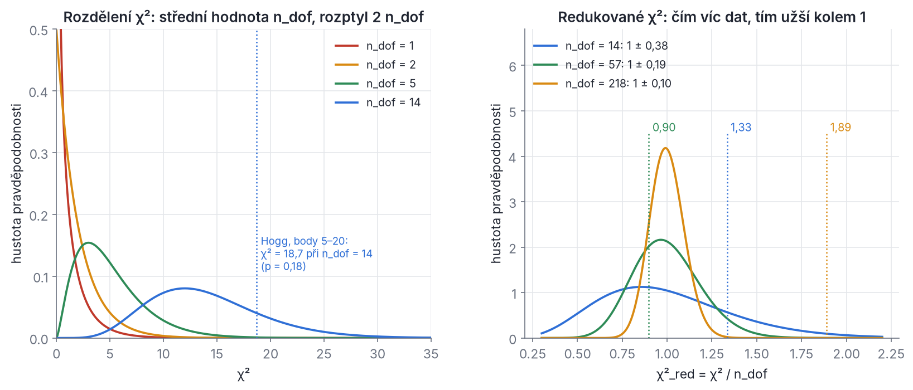
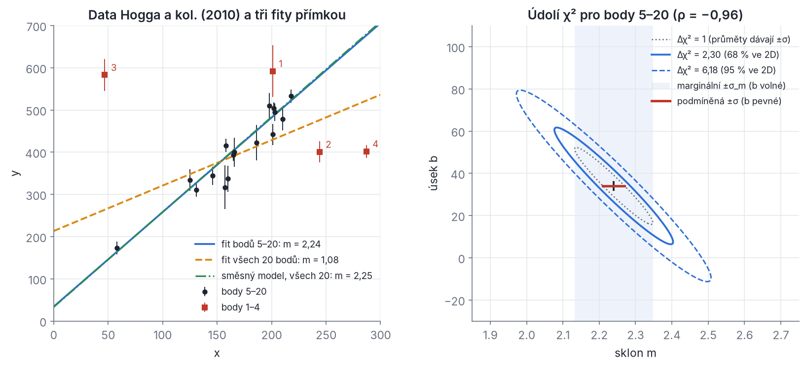
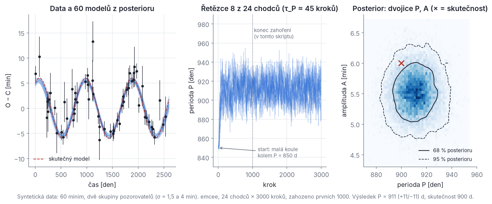
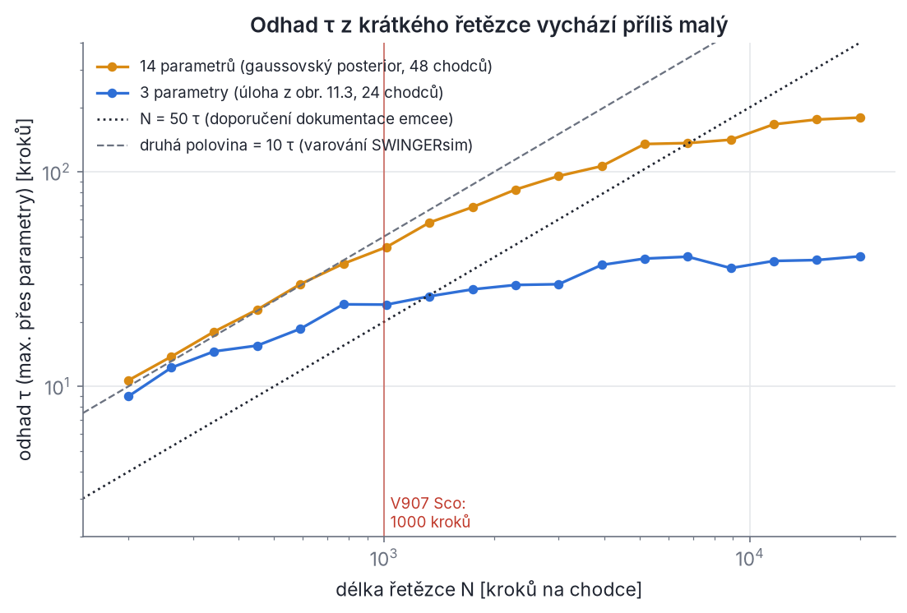

## Kapitola 11 – Od pozorování k modelu

Kapitola 10 šla od modelu k datům: z hmotností a drah jsme spočítali okamžiky minim, radiální rychlosti a světelné křivky. Teď půjdeme obráceně. Máme stovky okamžiků minim V907 Sco z fotografických desek, vizuálních odhadů, fotoelektrické fotometrie a z družice TESS, k tomu radiální rychlosti a několik sklonů ze světelných křivek. Hledáme parametry soustavy (periody, výstřednosti, hmotnosti, sklony), které tato data nejlépe vysvětlují. Tomu se říká **inverzní úloha**.

Odpovědí nesmí být jen číslo. Astronom potřebuje číslo s nejistotou, třeba „P₂ = 142,0 ± 0,3 d“ (P₂ je perioda vnější dráhy; indexy 1 a 2 u elementů drah znamenají vnitřní a vnější dráhu jako v kapitole 10), a k tomu poctivou odpověď na otázky: Sedí model vůbec? Které parametry data určují a které ne? Jsou chyby pozorovatelů uvedeny správně? Který ze dvou modelů je lepší? Jaká je pravděpodobnost, že se soustava rozpadne? K tomu všemu potřebujeme statistiku. Tato kapitola ji vykládá od nuly, jen s derivacemi, integrály a trochou maticového počtu (Příloha A).

SWINGERsim používá tři nástroje:
- **fit metodou nejmenších čtverců** s kovarianční maticí (oddíly 11.3–11.6),
- **Markovovy řetězce Monte Carlo** (MCMC) programem emcee (oddíly 11.7–11.9),
- **vážené ensembly** a srovnání modelů (oddíly 11.10–11.12).

Každý z nich je ukázán na řešeném příkladu, který si můžeš přepočítat. Všechna čísla v kapitole jsou spočtena v Pythonu (numpy, scipy, emcee) nebo přímo SWINGERsimem.

### 11.1 Náhodné veličiny, Gaussovo rozdělení a šíření chyb

**Náhodná veličina.** Urči okamžik téhož minima desetkrát (různými přístroji, z různých sad bodů nebo různými metodami) a dostaneš deset různých čísel. Výsledek měření je **náhodná veličina** X: před měřením nevíme, jakou hodnotu bude mít, ale víme, které hodnoty jsou pravděpodobnější. U spojité veličiny to popisuje **hustota pravděpodobnosti** p(x). Pravděpodobnost, že X padne do intervalu (a, b), je plocha pod křivkou:

```latex
P(a < X < b) = \int_a^b p(x)\,\mathrm{d}x, \qquad \int_{-\infty}^{\infty} p(x)\,\mathrm{d}x = 1 .
```

Pozor: p(x) samo o sobě pravděpodobnost není. Má rozměr 1/[x] (např. den⁻¹) a může být větší než 1. Pravděpodobnost dostaneš až vynásobením malou šířkou intervalu: P(x < X < x + dx) = p(x) dx.

**Střední hodnota, rozptyl, směrodatná odchylka.** Rozdělení charakterizujeme dvěma čísly. **Střední hodnota** (očekávaná hodnota) je „těžiště“ rozdělení, **rozptyl** (variance) je střední kvadratická odchylka od něj:

```latex
\mu = E[X] = \int x\,p(x)\,\mathrm{d}x, \qquad
\mathrm{Var}[X] = E\big[(X-\mu)^2\big] = \int (x-\mu)^2\,p(x)\,\mathrm{d}x = E[X^2] - \mu^2 .
```

Poslední rovnost dostaneš roznásobením: E[(X−μ)²] = E[X²] − 2μE[X] + μ² = E[X²] − μ². **Směrodatná odchylka** σ = √Var[X] má stejný rozměr jako X a je to to, čemu říkáme „chyba“ nebo „nejistota“ měření.

> **Pozor.** V češtině je **rozptyl = variance = σ²**, nikoli σ. Směrodatná odchylka je odmocnina z rozptylu. Zápis „0,3521 ± 0,0051 d“ udává směrodatnou odchylku. Slovo „chyba“ budeme v souladu s praxí používat pro σ, i když přesnější je „nejistota“ (Mikulášek & Zejda 2013); skutečný omyl (záměna minim, špatný časový systém) nazýváme **odlehlý bod**.

**Gaussovo (normální) rozdělení.** Nejdůležitější rozdělení statistiky má hustotu

```latex
p(x) = \frac{1}{\sqrt{2\pi}\,\sigma}\,\exp\!\left[-\frac{(x-\mu)^2}{2\sigma^2}\right], \qquad X \sim \mathcal{N}(\mu, \sigma^2) .
```

Normalizační konstantu 1/(√(2π) σ) dostaneš z Gaussova integrálu ∫exp(−u²/2) du = √(2π) po substituci u = (x − μ)/σ, dx = σ du. Tou samou substitucí ověříš, že střední hodnota je μ a rozptyl σ². Do intervalu μ ± σ padne 68,27 % hodnot, do μ ± 2σ 95,45 % a do μ ± 3σ 99,73 %. Dál než 5σ padne jen 5,7·10⁻⁷ hodnot, tedy jedna z 1,7 milionu. Z toho plyne praktické pravidlo: bod 5σ od modelu není „smůla“, ale téměř jistě omyl nebo špatný model.

Proč je Gaussovo rozdělení tak časté? **Centrální limitní věta** říká, že součet mnoha nezávislých malých příspěvků s konečným rozptylem má přibližně gaussovské rozdělení, ať už jednotlivé příspěvky vypadají jakkoli. Okamžik minima určený z desítek fotometrických bodů je takovým součtem (šum každého bodu přispívá málo), proto bývá jeho chyba gaussovská. Neplatí to pro omyly: záměna primárního a sekundárního minima posune čas o půl periody a s Gaussovým šumem nemá nic společného (oddíl 11.6).

**Dvě veličiny: kovariance a korelace.** Máme-li dvě náhodné veličiny X a Y, zajímá nás i to, zda se mění spolu. **Kovariance** a **korelační koeficient** jsou

```latex
\mathrm{Cov}[X,Y] = E\big[(X-\mu_X)(Y-\mu_Y)\big], \qquad \rho_{XY} = \frac{\mathrm{Cov}[X,Y]}{\sigma_X\,\sigma_Y}, \qquad -1 \le \rho \le 1 .
```

Pro nezávislé veličiny je ρ = 0. Hodnota ρ = −0,96 znamená, že když je X náhodou větší, je Y skoro jistě menší. U fitů je to běžné: úsek a sklon přímky, okamžik T₀ a perioda P lineární efemeridy, amplituda světelného času a sklon vnější dráhy. Všechny rozptyly a kovariance n veličin tvoří symetrickou **kovarianční matici** C s prvky C_ij = Cov[X_i, X_j]; na diagonále jsou rozptyly σ_i².

**Šíření chyb.** Často neměříme přímo veličinu, která nás zajímá, ale počítáme ji z jiných: hmotnostní funkci z amplitudy světelného času a periody, okamžik minima z koeficientů paraboly. Nechť Q = f(X₁, …, X_n) a chyby X_i jsou malé. Taylorův rozvoj prvního řádu kolem středních hodnot dává Q − Q₀ ≈ Σ_i (∂f/∂X_i)(X_i − μ_i). Rozptyl lineární kombinace spočítáš přímo z definice: umocni na druhou a vezmi střední hodnotu,

```latex
\sigma_Q^2 = \sum_{i}\sum_{j} \frac{\partial f}{\partial X_i}\frac{\partial f}{\partial X_j}\,C_{ij} = \nabla f^{\mathsf T}\, C\, \nabla f .
```

Pro nezávislé veličiny zůstanou jen diagonální členy, σ_Q² = Σ (∂f/∂X_i)² σ_i². Pro součin mocnin Q = A^α B^β to dává užitečné pravidlo pro **relativní chyby**: (σ_Q/Q)² = α²(σ_A/A)² + β²(σ_B/B)².

> **Pozor.** Vynechat mimodiagonální členy není „bezpečný horní odhad“, jak se někdy tvrdí. Pro Q = X₁ + X₂ se σ₁ = σ₂ = 1 je skutečný rozptyl 1 + 1 + 2ρ. Při ρ = +0,9 je to 3,8, tedy 1,9krát víc než „diagonální“ odhad 2; při ρ = −0,9 je to 0,2, tedy desetkrát méně. Vždy používej celou kovarianční matici.

**Řešený příklad (šíření chyb).** Z O−C zákrytové dvojhvězdy známe průmět velké poloosy její dráhy kolem těžiště trojhvězdy a sin i = (1,10 ± 0,03) au a periodu vnější dráhy P = (6,02 ± 0,01) roku. **Hmotnostní funkce** třetího tělesa je f(m₃) = (m₃ sin i)³/(m₁₂ + m₃)² ≈ (a sin i)³/P² (v jednotkách M☉, au a rok, protože G ≈ 4π²; kapitola 10). Vychází f = 1,10³/6,02² = 0,03673 M☉. Relativní chyba je √[(3 · 0,03/1,10)² + (2 · 0,01/6,02)²] = √[0,0818² + 0,0033²] = 0,0819, tedy σ_f = 0,0030 M☉. Chyba je skoro celá z a sin i, protože vstupuje třetí mocninou. Kontrola metodou Monte Carlo (milion náhodných dvojic) dává směrodatnou odchylku 0,0030 M☉, tedy totéž. Kdyby ale a sin i mělo chybu 0,30 au (27 %), lineární vzorec by dal 0,030 M☉, zatímco skutečné rozdělení f je silně nesouměrné: medián 0,037, 16. a 84. percentil 0,014 a 0,075 M☉. Lineární šíření chyb platí jen pro malé relativní chyby.

**Vážený průměr.** Máme N měření téže veličiny x_k s různými chybami σ_k. Jak je spojit? Každé měření dostane **váhu** w_k = 1/σ_k² a

```latex
\bar x = \frac{\sum_k w_k x_k}{\sum_k w_k}, \qquad \sigma_{\bar x} = \Big(\sum_k w_k\Big)^{-1/2} .
```

Chybu průměru dostaneš šířením chyb: ∂x̄/∂x_k = w_k/Σw, takže σ²_x̄ = Σ_k w_k² σ_k²/(Σw)² = Σ_k w_k/(Σw)² = 1/Σw. Proč právě tyto váhy, ukáže oddíl 11.2: vážený průměr je odhad maximální věrohodnosti. Pro tři měření 12,3 ± 0,2, 12,9 ± 0,4 a 12,5 ± 0,3 vychází x̄ = 12,44 ± 0,15. Nejpřesnější měření má váhu 25, nejhorší jen 6,25.

### 11.2 Věrohodnost a χ²

**Generativní model.** Nejpoctivější cesta k fitu vede přes otázku: jak mohla data vzniknout? Hogg, Bovy & Lang (2010) to nazývají **generativní model**: parametrizovaný popis procesu, který mohl data vyrobit. Pro okamžiky minim je jednoduchý. Skutečný okamžik je f(t_k; θ), tedy model (N-body integrace soustavy s parametry θ), a pozorovatel k němu přičte gaussovský šum s nulovou střední hodnotou a směrodatnou odchylkou σ_k:

```latex
y_k = f(t_k;\theta) + \varepsilon_k, \qquad \varepsilon_k \sim \mathcal{N}(0,\sigma_k^2), \qquad \text{nezávislé pro různá } k .
```

**Věrohodnost.** Hustota pravděpodobnosti jednoho měření při daných parametrech je gaussovská křivka kolem modelu. Měření jsou nezávislá, takže hustota všech N měření je součin:

```latex
\mathcal{L}(\theta) = p(y_1,\dots,y_N\,|\,\theta) = \prod_{k=1}^{N} \frac{1}{\sqrt{2\pi\sigma_k^2}}\exp\!\left[-\frac{\big(y_k - f(t_k;\theta)\big)^2}{2\sigma_k^2}\right] .
```

Této funkci θ říkáme **věrohodnost** (likelihood). Je to hustota pravděpodobnosti dat pro dané θ, do které dosadíme naměřené hodnoty. Jako funkce θ to *není* rozdělení pravděpodobnosti parametrů: integrál přes θ nemusí být 1 a ani nemá smysl. Co víme o parametrech, řekne až Bayesův teorém (oddíl 11.7).

Logaritmus mění součin na součet:

```latex
-2\ln\mathcal{L}(\theta) = \underbrace{\sum_{k=1}^{N}\left(\frac{y_k - f(t_k;\theta)}{\sigma_k}\right)^2}_{\chi^2(\theta)} \;+\; \sum_{k=1}^{N}\ln\!\big(2\pi\sigma_k^2\big) .
```

Druhý člen na θ nezávisí, *pokud jsou chyby σ_k pevné*. Pak je maximum věrohodnosti totéž co minimum χ², a to je celé zdůvodnění **metody nejmenších čtverců**. Veličina r_k = (y_k − f_k)/σ_k je **normované reziduum**; χ² je součet jejich čtverců. Až budeme chyby σ_k odhadovat z dat (jitter, oddíl 11.6), druhý člen konstantní nebude a vynechat ho bude chyba.

**Řešený příklad: vážený průměr jako maximum věrohodnosti.** Model je konstanta, f = β. Pak χ²(β) = Σ w_k (y_k − β)². Derivace podle β položená nule: −2Σ w_k (y_k − β) = 0, tedy β = Σw_k y_k/Σw_k. To je vážený průměr z oddílu 11.1. Rozepiš χ² kolem minima b: χ²(β) = χ²(b) + (β − b)² Σw_k (lineární člen vypadne, protože b je minimum). χ² je tedy parabola a vzroste o 1, když se β vzdálí od b o (Σw)^{−1/2} = σ_b. To je první setkání s pravidlem Δχ² = 1, ke kterému se vrátíme v oddílu 11.5.

**Intuice: krajina χ².** Představ si, že každá sada parametrů θ je bod na mapě a χ²(θ) je nad ním „nadmořská výška“, tedy jak špatně model sedí na data. Fit hledá nejhlubší místo údolí. Nejistota parametru odpovídá šířce údolí: v úzkém údolí je parametr dobře určen, v ploché pláni skoro vůbec. Když je údolí protáhlé a šikmé, dva parametry spolu korelují a data určují dobře jen jejich kombinaci. Typické dvojice v O−C jsou T₀ a P lineární efemeridy, nebo a₁₂ a sin i₂ (případně m₃ a sin i₂): amplituda světelného času obsahuje jen součin a₁₂ sin i₂, takže každou z obou veličin zvlášť samo O−C neurčí. Údolí může být i zakřivené (banán) nebo mít několik den – tehdy přestávají fungovat jednoduché metody a nastupuje MCMC.

**Rozdělení χ².** Jak velké χ² čekat, když model je správný a chyby σ_k jsou správné? Pak je každé normované reziduum r_k ~ 𝒩(0, 1). Pro jednotkovou gaussovku je E[r²] = 1 (to je její rozptyl) a E[r⁴] = 3 (dvakrát per partes v integrálu ∫u⁴ e^{−u²/2} du), takže Var[r²] = E[r⁴] − (E[r²])² = 3 − 1 = 2. Součet N nezávislých čtverců má střední hodnotu N a rozptyl 2N. Jeho hustota je **rozdělení χ²** s n stupni volnosti:

```latex
p(\chi^2\,|\,n) = \frac{(\chi^2)^{n/2-1}\,e^{-\chi^2/2}}{2^{n/2}\,\Gamma(n/2)}, \qquad E[\chi^2] = n, \qquad \mathrm{Var}[\chi^2] = 2n .
```

**Stupně volnosti.** Po fitu je ale χ² menší, protože model se datům přizpůsobil. Každý volný parametr „spotřebuje“ jeden stupeň volnosti. Pro lineární model se to dá dokázat přesně: rezidua leží v (N − p)-rozměrném podprostoru kolmém na sloupce jakobiánu, takže χ²_min má rozdělení χ² s

```latex
n_{\mathrm{dof}} = N - p
```

stupni volnosti (N je počet měření, p počet volných parametrů). Pro nelineární model to platí přibližně. Proto se uvádí **redukované χ²** (Obr. 11.1):

```latex
\chi^2_{\mathrm{red}} = \frac{\chi^2_{\min}}{n_{\mathrm{dof}}}, \qquad E[\chi^2_{\mathrm{red}}] = 1, \qquad \sigma\big(\chi^2_{\mathrm{red}}\big) = \sqrt{2/n_{\mathrm{dof}}} .
```

> **Pozor.** Symbol ν v této knize znamená pravou anomálii (kapitola 2). Počet stupňů volnosti proto značíme n_dof.

Jak χ²_red číst:
- **χ²_red ≈ 1** (v rozmezí několika √(2/n_dof)): model i chyby jsou konzistentní s daty. Neznamená to, že model je pravdivý, jen že data neumí ukázat opak.
- **χ²_red ≫ 1**: model nesedí, nebo pozorovatelé chyby podcenili. U okamžiků minim je druhá možnost velmi častá: publikované chyby minim bývají podceněny, často několikanásobně (Mikulášek & Zejda 2013, kap. 5).
- **χ²_red ≪ 1**: chyby jsou přeceněné, nebo jsou rezidua korelovaná, nebo má model příliš mnoho parametrů.

Pravděpodobnost, že náhoda dá χ² aspoň tak velké jako naměřené (tzv. **p-hodnota**), je plocha pravého konce rozdělení χ². Pro malé n_dof je rozdělení nesouměrné, pro velké se blíží gaussovce se středem n_dof a šířkou √(2 n_dof).


*Obr. 11.1 – Vlevo: hustota rozdělení χ² pro n_dof = 1, 2, 5 a 14. Střední hodnota je n_dof, šířka √(2 n_dof); svislá tečkovaná čára je fit přímky z oddílu 11.3 (χ² = 18,7 při n_dof = 14), jehož p-hodnota 0,18 nic podezřelého neukazuje. Vpravo: rozdělení redukovaného χ² pro 14, 57 a 218 stupňů volnosti. Čím víc dat, tím užší je kolem 1: χ²_red = 1,33 je při 14 stupních volnosti běžné, ale χ²_red = 1,89 při 218 stupních volnosti (cvičení 1) je 9σ od očekávání a znamená podceněné chyby nebo špatný model.*

**Řešený příklad.** Fit dá χ² = 412 pro N = 230 minim a p = 12 parametrů. Pak n_dof = 218, χ²_red = 412/218 = 1,890. Očekávaná šířka je √(2/218) = 0,096, takže χ²_red je (1,890 − 1)/0,096 ≈ 9,3σ nad jedničkou; p-hodnota je 4·10⁻¹⁴. Chyby jsou podceněné, nebo model nesedí. Které z toho, χ² samo neřekne. Pomůže pohled na rezidua: systematická vlna znamená chybějící fyziku, náhodný rozptyl větší než σ znamená podceněné chyby.

### 11.3 Lineární fit ručně: přímka a normální rovnice

Než se pustíme do N-body modelů, vyřešíme úlohu, kterou zvládneš na papíře: fit přímky. Na ní uvidíš všechno podstatné – normální rovnice, jakobián, kovarianční matici, korelaci – a nelineární fit pak bude jen opakované řešení této úlohy.

**Úloha.** Máme N bodů (x_k, y_k ± σ_k) a model y = b + m x. Hledáme b a m, které minimalizují

```latex
\chi^2(b,m) = \sum_{k} w_k\,(y_k - b - m x_k)^2, \qquad w_k = 1/\sigma_k^2 .
```

**Normální rovnice.** V minimu jsou obě parciální derivace nulové:

```latex
\frac{\partial\chi^2}{\partial b} = -2\sum_k w_k (y_k - b - m x_k) = 0, \qquad
\frac{\partial\chi^2}{\partial m} = -2\sum_k w_k x_k (y_k - b - m x_k) = 0 .
```

Zavedeme vážené součty S = Σw_k, S_x = Σw_k x_k, S_xx = Σw_k x_k², S_y = Σw_k y_k, S_xy = Σw_k x_k y_k. Rovnice se změní na soustavu dvou lineárních rovnic

```latex
\begin{pmatrix} S & S_x \\ S_x & S_{xx} \end{pmatrix}\begin{pmatrix} b \\ m \end{pmatrix} = \begin{pmatrix} S_y \\ S_{xy} \end{pmatrix}, \qquad
b = \frac{S_{xx}S_y - S_x S_{xy}}{D}, \quad m = \frac{S\,S_{xy} - S_x S_y}{D}, \quad D = S\,S_{xx} - S_x^2 .
```

**Maticový zápis.** Totéž platí pro libovolný model lineární v parametrech, f = Jθ. **Jakobián** J je matice N × p s prvky J_kj = ∂f_k/∂θ_j (pro přímku má sloupce 1 a x_k), W = diag(1/σ_k²) je matice vah a y vektor dat. Pak χ² = (y − Jθ)ᵀ W (y − Jθ) a podmínka nulového gradientu ∂χ²/∂θ = −2JᵀW(y − Jθ) = 0 dává

```latex
\big(J^{\mathsf T} W J\big)\,\hat\theta = J^{\mathsf T} W\,y, \qquad \hat\theta = \big(J^{\mathsf T} W J\big)^{-1} J^{\mathsf T} W\,y .
```

Pro přímku je JᵀWJ přesně matice ze soustavy výše. Rovnice se nazývají **normální**, protože říkají, že vektor reziduí je (ve vážené metrice) kolmý, „normálový“, na všechny sloupce J.

**Kovarianční matice parametrů.** Odhad θ̂ je lineární funkcí dat, θ̂ = Ay s A = (JᵀWJ)⁻¹JᵀW. Data mají kovarianční matici W⁻¹ = diag(σ_k²). Šíření chyb z oddílu 11.1 v maticovém tvaru dává Cov[θ̂] = A W⁻¹ Aᵀ. Dosaď a zkrať:

```latex
C = \mathrm{Cov}[\hat\theta] = (J^{\mathsf T}WJ)^{-1}J^{\mathsf T}W\,W^{-1}\,WJ\,(J^{\mathsf T}WJ)^{-1} = \big(J^{\mathsf T} W J\big)^{-1} .
```

Diagonála dává rozptyly parametrů, σ_θj = √C_jj, mimodiagonální prvky korelace ρ_ij = C_ij/√(C_ii C_jj). Pro přímku je inverze 2 × 2 matice snadná: σ_b² = S_xx/D, σ_m² = S/D, Cov[b, m] = −S_x/D. Korelace je záporná, kdykoli je vážený střed bodů x̄ = S_x/S kladný: když přímku natočíš strměji, musíš ji posunout dolů, aby dál procházela těžištěm bodů.

**Hessova matice a faktor 2.** Druhé derivace χ² tvoří **Hessovu matici** H. Pro lineární model je přesně H_ij = ∂²χ²/∂θ_i∂θ_j = 2(JᵀWJ)_ij, takže

```latex
\chi^2(\theta) = \chi^2_{\min} + (\theta-\hat\theta)^{\mathsf T}\big(J^{\mathsf T}WJ\big)(\theta-\hat\theta) = \chi^2_{\min} + \tfrac12(\theta-\hat\theta)^{\mathsf T} H\,(\theta-\hat\theta), \qquad C = \big(J^{\mathsf T}WJ\big)^{-1} = 2H^{-1} .
```

Kovarianční matice tedy *není* inverze Hessovy matice χ², ale její dvojnásobek. Jinak řečeno: C je inverze **Fisherovy informační matice** F = −∂² ln 𝓛/∂θ∂θ = ½H = JᵀWJ. Faktor 2 pochází z toho, že ln 𝓛 = −χ²/2. Kdo ho zapomene, má chyby √2krát menší.

**Řešený příklad: lineární efemerida ze sedmi minim (ručně).** Zákrytová dvojhvězda má zkušební efemeridu T₀ = 2 455 000,12345 BJD_TDB, P = 3,7762000 d. Sedm minim v epochách E má O−C a chyby (v 10⁻³ d):

| E | −2000 | −1500 | −800 | 0 | 400 | 1000 | 1300 |
| --- | --- | --- | --- | --- | --- | --- | --- |
| O−C | −5,25 | −5,50 | −1,85 | +0,25 | +2,85 | +3,45 | +5,30 |
| σ | 2 | 2 | 1 | 0,5 | 0,5 | 0,3 | 0,3 |

Fitujeme opravy efemeridy, O−C = ΔT₀ + ΔP · E. Je to přímka s x = E, b = ΔT₀, m = ΔP. Váhy w = 1/σ² jsou 0,25; 0,25; 1; 4; 4; 11,11; 11,11. Součty:

- S = 31,722, S_x = 25 480,6, S_xx = 3,27314·10⁷,
- S_y = 105,085, S_xy = 125 616,4,
- D = S S_xx − S_x² = 3,8905·10⁸.

Odtud ΔT₀ = (S_xx S_y − S_x S_xy)/D = 0,614·10⁻³ d a ΔP = (S S_xy − S_x S_y)/D = 3,360·10⁻⁶ d. Chyby: σ_ΔT₀ = √(S_xx/D) = 0,290·10⁻³ d, σ_ΔP = √(S/D) = 0,286·10⁻⁶ d, korelace ρ = −S_x/√(S S_xx) = −0,79. Normovaná rezidua jsou 0,43; −0,54; 0,22; −0,73; 1,78; −1,75; 1,06, takže χ² = 8,41 pro n_dof = 5 a χ²_red = 1,68. To je v mezích náhody (p-hodnota 0,14). Kdybychom přesto chyby přeškálovali (oddíl 11.5), zvětšily by se √1,68 = 1,30krát.

Matice JᵀWJ má řádky (31,72; 25 481) a (25 481; 3,273·10⁷). Numericky spočtená Hessova matice χ² je přesně dvojnásobná, a 2H⁻¹ dává tutéž kovarianční matici. To je kontrola faktoru 2 výše.

Opravená efemerida je T₀ = 2 455 000,12406(29), P = 3,7762034(3) d. **Posun počátku.** Velká korelace −0,79 vzniká proto, že vážený střed epoch je E̅ = S_x/S = 803, daleko od nuly. Když za počátek vezmeš E̅, jsou T₀ a P nekorelované a chyba T₀ klesne na 1/√S = 0,178·10⁻³ d; chyba P se nezmění. Proto se T₀ efemeridy volí blízko váženého středu dat. **Předpověď.** Pro E = 2000 dá model O−C = 7,33·10⁻³ d s chybou √(gᵀCg) = 0,39·10⁻³ d, kde g = (1, 2000). Kdybys korelaci vynechal, dostal bys 0,64·10⁻³ d, tedy o 66 % víc.

**Řešený příklad: přímka podle Hogga, Bovyho a Langa (2010).** Tato práce je výborný praktický úvod do fitování a doporučujeme ji přečíst celou. Její tabulka 1 obsahuje 20 bodů (x, y, σ_y), z nichž body 1–4 jsou záměrně odlehlé. Přepočítali jsme její cvičení:

| úloha (číslo cvičení v HBL10) | výsledek |
| --- | --- |
| přímka přes body 5–20 (cv. 1) | m = 2,24 ± 0,11, b = 34 ± 18, ρ = −0,96, χ² = 18,7 při n_dof = 14 |
| přímka přes všech 20 bodů (cv. 2) | m = 1,08 ± 0,08, b = 213 ± 14, χ² = 290 při n_dof = 18 |
| parabola přes body 5–20 (cv. 3) | q = 0,0023 ± 0,0020, m = 1,60 ± 0,58, b = 73 ± 39, χ² = 17,4 |
| χ² fitu cv. 1 (cv. 10) | 18,7 je v rozmezí 14 ± 5,3, p = 0,18: v pořádku |
| jackknife a bootstrap pro sklon cv. 2 (cv. 8) | σ_m = 0,87 (jackknife), 0,61 (bootstrap) proti formální 0,077 |
| společný rozptyl S = σ² všech bodů 5–20, aby χ² = N − 2 (cv. 11) | S = 939, tj. σ = 30,6 (průměr σ_k² je 739, medián σ_k je 23,5) |
| směsný model pro odlehlé body, všech 20 bodů (cv. 6–7) | m = 2,25 ± 0,12, b = 33 ± 19, P_b = 0,28 (+0,14/−0,11) |

Co z toho plyne:
- Čtyři odlehlé body stočí přímku ze sklonu 2,24 na 1,08, tedy o více než deset chyb. Formální chyba 0,077 o tom nic neví: kovarianční matice nezávisí na tom, jak dobře model sedí. Varuje jen χ² = 290 při 18 stupních volnosti.
- Jackknife (fit 20krát, pokaždé bez jednoho bodu) a bootstrap (fit na náhodných výběrech s opakováním) dají σ_m desetkrát větší než formální chyba. Rozdíl prozrazuje odlehlé body. Na O−C SWINGERsimu je ale nepoužívej naivně: obě metody zacházejí se všemi body stejně, a u dat, kde se chyby liší stokrát (fotografické desky proti TESS), dávají nesmysly (HBL10, pozn. 28).
- Parabola má χ² o 1,3 menší než přímka, ale za cenu dalšího parametru. Je lepší? Na to odpoví oddíl 11.12.
- Směsný model (oddíl 11.6) najde správný sklon i se všemi body, aniž by kterýkoli bod ručně vyřadil.


*Obr. 11.2 – Vlevo: data tabulky 1 Hogga a kol. (2010); body 1–4 (červené čtverečky) jsou odlehlé. Modrá přímka je fit bodů 5–20, oranžová čárkovaná fit všech 20 bodů (odlehlé body ji stočily), zelená čerchovaná medián posterioru směsného modelu ze všech 20 bodů. Vpravo: údolí χ² fitu bodů 5–20 v rovině (sklon m, úsek b). Elipsy jsou vrstevnice Δχ² = 1 (tečkovaná), 2,30 (plná, obsahuje 68 % pravděpodobnosti pro dvojici parametrů) a 6,18 (čárkovaná, 95 %). Silná korelace ρ = −0,96 dělá elipsu úzkou a šikmou. Modrý pruh je marginální chyba sklonu ±0,11 (úsek se přizpůsobí); červená úsečka je podmíněná chyba ±0,03 při pevném úseku, která chybu silně podceňuje.*

### 11.4 Nelineární nejmenší čtverce: Gauss–Newton, Levenberg–Marquardt, trust-region

Okamžik minima z N-body integrace není lineární funkcí parametrů. Perioda vnější dráhy, výstřednost nebo hmotnost třetí hvězdy vstupují do modelu přes integraci pohybových rovnic. Normální rovnice proto nelze vyřešit jednou. Postup je ale stejný jako u přímky, jen ho opakujeme.

**Gaussova–Newtonova metoda.** Jsme v bodě θ a model kolem něj **linearizujeme**: f(θ + Δθ) ≈ f(θ) + J Δθ, kde J_kj = ∂f(t_k; θ)/∂θ_j je jakobián v bodě θ. Označme r = y − f(θ) vektor reziduí (v časových jednotkách). χ² linearizovaného modelu je

```latex
\chi^2(\theta+\Delta\theta) \approx (r - J\Delta\theta)^{\mathsf T}\,W\,(r - J\Delta\theta) .
```

To je přesně úloha z oddílu 11.3, jen místo y stojí r a místo θ krok Δθ. Krok, který ji minimalizuje, řeší normální rovnice

```latex
\big(J^{\mathsf T} W J\big)\,\Delta\theta = J^{\mathsf T} W\,r .
```

Uděláme krok θ → θ + Δθ, spočteme nový jakobián a opakujeme, dokud se χ² přestane měnit. Blízko minima, kde je linearizace dobrá, konverguje metoda velmi rychle (počet platných cifer se zhruba zdvojuje v každém kroku, pokud jsou rezidua v minimu malá). Kde je to jen přiblížení: skutečná Hessova matice χ² je 2JᵀWJ − 2Σ_k w_k r_k ∂²f_k/∂θ∂θ. Gauss–Newton druhý člen zanedbá; v minimu jsou rezidua malá a náhodného znaménka, takže je to oprávněné.

**Kde Gauss–Newton selhává.** Daleko od minima může linearizovaný krok přestřelit a χ² vzroste. Mikulášek & Zejda (2013, kap. 5) radí jednoduchou pomůcku: přidávat jen polovinu opravy. Iterací je víc, ale výpočet je stabilnější. To je primitivní forma tlumení, kterou Levenberg (1944) a Marquardt (1963) udělali adaptivní:

```latex
\Big(J^{\mathsf T} W J + \lambda\,\mathrm{diag}\big(J^{\mathsf T} W J\big)\Big)\,\Delta\theta = J^{\mathsf T} W\, r .
```

Pro λ → 0 je to Gaussův–Newtonův krok. Pro velké λ převáží diagonála a krok je Δθ_j ≈ (JᵀWr)_j/(λ (JᵀWJ)_jj), tedy malý krok po spádu χ² (vektor JᵀWr je až na faktor −2 gradient χ²), přeškálovaný v každém parametru zvlášť. Algoritmus λ řídí podle úspěchu: když krok χ² sníží, přijme ho a λ zmenší (typicky 10×); když χ² vzroste, krok odmítne a λ zvětší. Daleko od minima tak jde opatrně, blízko něj rychle.

**Trust-region reflective (TRF).** SWINGERsim používá `scipy.optimize.least_squares(method="trf")`, metodu důvěryhodné oblasti (trust region) s odrazem od mezí (Branch, Coleman & Li 1999). Myšlenka je příbuzná Levenbergově–Marquardtově: místo tlumení λ se volí poloměr Δ oblasti, ve které linearizaci věříme, a krok se hledá jako minimum linearizovaného χ² uvnitř této oblasti. Když skutečný pokles χ² odpovídá předpovězenému, oblast se zvětší, jinak zmenší. Dvě vlastnosti jsou pro nás podstatné:
- **meze parametrů**: výstřednost musí zůstat v intervalu 0–0,95, hmotnosti kladné, perioda v rozumném rozsahu. TRF kroky u meze „odráží“ zpět do povolené oblasti a zmenšuje je, takže parametr mez nikdy nepřekročí;
- **škálování**: volba `x_scale="jac"` měří velikost kroku v každém parametru v jednotkách, ve kterých má jakobián podobnou velikost. Bez ní by krok „1“ znamenal stejně 1 den v periodě jako 1° v úhlu.

**Řešený příklad: Gauss–Newton na syntetickém O−C.** Vyrobili jsme 60 minim se sinusovým O−C (světelný čas na kruhové vnější dráze): A sin(2πt/P + φ) s A = 6 min, P = 900 d, φ = 1 rad, a přičetli gaussovský šum. 42 minim má chybu 1,5 min, 18 minim 4 min (dvě skupiny pozorovatelů). Jakobián je zde analytický: ∂f/∂A = sin u, ∂f/∂P = −A cos u · 2πt/P², ∂f/∂φ = A cos u, kde u = 2πt/P + φ. Gaussova–Newtonova iterace ze startu (A, P, φ) = (5 min, 850 d, 0,8):

| krok | χ² | A [min] | P [d] | φ [rad] |
| --- | --- | --- | --- | --- |
| 0 | 114,69 | 4,790 | 906,40 | 1,079 |
| 1 | 57,17 | 5,562 | 910,88 | 1,090 |
| 2 | 51,20 | 5,567 | 910,35 | 1,089 |
| 3 | 51,19 | 5,567 | 910,34 | 1,089 |

(χ² je hodnota v bodě, *ze kterého* se krok dělá; parametry jsou výsledkem kroku.) Po třech krocích je hotovo: χ²_min = 51,19 pro n_dof = 57, χ²_red = 0,90. TRF z `scipy` dá totéž po šesti vyhodnoceních modelu. Kovarianční matice dává A = 5,57 ± 0,32 min, P = 910,3 ± 11,3 d, φ = 1,09 ± 0,13; P a φ korelují s ρ = 0,90. Skutečné hodnoty jsou od fitu vzdáleny Δχ² = 2,9, což je při třech parametrech zcela běžné (59. percentil rozdělení χ² se třemi stupni volnosti).

**Lokální minima.** Stejná úloha ukazuje, proč žádná z těchto metod nenajde *nejlepší* řešení, když začne daleko:
- Ze startu P = 1100 d skončí Gauss–Newton i Levenberg–Marquardt v lokálním minimu P ≈ 178 d s χ² = 337; TRF s mezemi tentokrát najde správné minimum.
- Ze startu P = 700 d najdou Gauss–Newton i Levenberg–Marquardt „řešení“ A = −5,57 min, φ = 4,23 rad. To je stejný model (sin(u + π) = −sin u), jen jinak zapsaný: **degenerace parametrizace**. Mez A > 0 ji odstraní, ale TRF s mezemi pak z téhož startu skončí v lokálním minimu P = 679 d (χ² = 300) s fází na mezi.

Periodický model má v periodě mnoho údolí. Proto potřebuje každý lokální fit dobrý start: z periodogramu, z analytického stupně 1 (níže) nebo z publikovaného řešení. A proto je χ²_red po fitu první věc, na kterou se díváš: χ²_red = 337/57 = 5,9 by lokální minimum prozradilo.

> **Pozor.** Past aliasu ukazovala starší verze přiloženého příkladu `configs/examples/example_fit.yaml` (syntetická minima dvojice 2+2). Minima páru A v ní byla pravidelně po 40 cyklech a analytický fit stupně 1 našel apsidální pohyb dω = 0,1586 rad/cyklus místo skutečných 0,0015 rad/cyklus. Rozdíl je přesně 2π/40 = 0,1571: při vzorkování po 40 cyklech jsou obě hodnoty pro primární minima nerozlišitelné. Prozradilo to jen χ²_red = 14,25. Dnešní data příkladu mají cykly vybrané náhodně a fit vrátí správné dω = 0,0015010 ± 0,0000028 rad/cyklus s χ²_red = 0,99 (cvičení 11).

**Jak to dělá SWINGERsim.** Stupeň 2 fitu (`swingersim fit` s konfigurací obsahující `fit.stage2`) volá `least_squares` s `method="trf"`, `x_scale="jac"` a mezemi z `fit.stage2.bounds`. Výchozí meze jsou: perioda 0,5–2násobek startu, e 0–0,95, sklon 0–180°, hmotnosti 0,05–20násobek startu. Rezidua jsou už normovaná, r_k = (y_k − f_k)/σ_k, a k nim jsou připojeny řádky priorů (oddíl 11.7). Fit skončí, když se χ² v kroku změní relativně o méně než max(10⁻⁵; 0,05/χ²_start), tedy zhruba o méně než 10⁻⁵ relativně nebo 0,05 absolutně (bere se větší z obou mezí; změna o 1 by posunula parametr o celou σ), nebo po `max_iterations` = 30 vyhodnoceních modelu (v `least_squares` je to `max_nfev`; jakobián se počítá v každém přijatém bodě).

**Odkud se bere jakobián?** Okamžik minima z N-body integrace nemá vzorec, takže derivace se počítají numericky **centrálními diferencemi**:

```latex
\frac{\partial f_k}{\partial \theta_j} \approx \frac{f_k(\theta + h_j e_j) - f_k(\theta - h_j e_j)}{2h_j} .
```

Centrální diference má chybu úměrnou h², jednostranná jen h; jednostranná by navíc byla systematicky zkreslena zakřivením reziduí (například kumulativním efektem změny periody). Na mezi parametru použije SWINGERsim jednostrannou diferenci (bez varování). Když model na jedné straně selže (hvězda za koncem vývojové stopy, nestabilní dráha), použije jednostrannou diferenci z druhé strany a navíc vypíše varování, že chyba takového parametru neplatí. Výchozí kroky h (`fit.stage2.fd_steps`) jsou: perioda 10⁻⁶ relativně, úhly 0,01°, výstřednost 10⁻⁴, hmotnosti 10⁻⁴ relativně. Krok nesmí být příliš velký (nelinearita), ani příliš malý: změna modelových časů musí být mnohem větší než numerický šum integrátoru (kapitola 6). Na každý volný parametr připadají dvě celé N-body integrace přes celé období dat. Proto SWINGERsim počítá sloupce jakobiánu paralelně (`--processes 0` = všechna jádra).

**Dva stupně fitu.** Stupeň 1 popisuje O−C každého páru analyticky: světelný čas (kapitola 10), stáčení přímky apsid (kapitola 7) a kvadratický člen (změna periody); klíč `fit.stage1.pairs` volí členy pro každý pár. Je rychlý a dá dobré startovní hodnoty. Stupeň 2 počítá minima všech párů z jednoho N-body modelu celé soustavy a fituje oskulační elementy a hmotnosti v čase t = 0. Výsledkem je konfigurace, kterou lze rovnou spustit (stabilita, vývoj, předpovědi).

### 11.5 Chyby parametrů: kovariance, oblasti spolehlivosti, degenerace

**Kovariance nelineárního fitu.** V minimu nelineárního χ² použijeme jakobián z posledního kroku a stejný vzorec jako pro přímku:

```latex
C = \big(J^{\mathsf T} W J\big)^{-1} = 2H^{-1}, \qquad H = \frac{\partial^2\chi^2}{\partial\theta\,\partial\theta} \approx 2J^{\mathsf T}WJ, \qquad \sigma_{\theta_j} = \sqrt{C_{jj}}, \qquad \rho_{ij} = \frac{C_{ij}}{\sqrt{C_{ii}C_{jj}}} .
```

Je to **lineární přiblížení**: předpokládá, že χ² je v okolí minima parabolou (eliptické údolí). Pro lineární model platí přesně.

**Pravidlo Δχ².** Z parabolického tvaru χ² plyne užitečná geometrie. Oblast spolehlivosti, která s danou pravděpodobností obsahuje skutečné parametry, je ohraničena vrstevnicí χ² = χ²_min + Δχ². Pro gaussovské chyby má Δχ² (rozdíl χ² ve skutečných parametrech a v minimu) rozdělení χ² s tolika stupni volnosti, kolik parametrů *současně* zkoumáš. Hodnoty Δχ² jsou proto:

| počet parametrů současně | 68,27 % | 95,45 % | 99,73 % |
| --- | --- | --- | --- |
| 1 | 1,00 | 4,00 | 9,00 |
| 2 | 2,30 | 6,18 | 11,83 |
| 3 | 3,53 | 8,02 | 14,16 |

Hodnoty jsou kvantily rozdělení χ² (scipy `stats.chi2.ppf`). Pro jeden parametr Δχ² = 1 dává známé ±σ. Pro dvojici parametrů ale vrstevnice Δχ² = 1 obsahuje jen 39 % pravděpodobnosti; 68% elipsa je Δχ² = 2,30 (Obr. 11.2 vpravo).

**Marginální, profilová a podmíněná chyba.** Jednu chybu parametru lze definovat třemi způsoby a je důležité je nezaměňovat:
- **podmíněná** (ostatní parametry pevné): 1/√(JᵀWJ)_jj. Je vždy nejmenší a skoro vždy špatná. V Obr. 11.2 je to červená úsečka, ±0,030 místo ±0,108.
- **profilová** (ostatní parametry se pro každou hodnotu θ_j znovu optimalizují): interval, kde profil χ²_min(θ_j) vzroste o 1. Pro lineární model je přesně √C_jj. V příkladu lineární efemeridy profil χ² vzroste při ΔP ± σ přesně o 1,000.
- **marginální** (ostatní parametry se vyintegrují přes posterior, oddíl 11.7): šířka jednorozměrného marginálního rozdělení. Pro gaussovský posterior je také √C_jj; pro zakřivené údolí se od profilové liší a počítá ji MCMC.

Vztah mezi podmíněnou a marginální chybou je pro dvojici parametrů jednoduchý: σ_podm = σ_marg √(1 − ρ²). Při ρ = −0,96 je podmíněná chyba 3,6krát menší.

**Kdy kovarianční matici věřit.** Hogg, Bovy & Lang (2010, oddíl 4) vyjmenovávají podmínky: (a) rozptyly σ_k² dat jsou správné; (b) žádná data nebyla vyřazena a χ² se nijak neupravuje; (c) generativní model je správný. V praxi platí málokdy. Formální kovarianční matice navíc vůbec nezávisí na tom, jak dobře model sedí (to jsme viděli u přímky přes všech 20 bodů). Pro zakřivené údolí, které u vnějších drah pokrytých jedním či dvěma oběhy bývá pravidlem, podceňuje chyby. Proto SWINGERsim nabízí MCMC (oddíl 11.9).

**Číslo podmíněnosti a SVD.** Prakticky spočítat (JᵀWJ)⁻¹ je těžší, než vypadá. **Číslo podmíněnosti** matice (poměr největšího a nejmenšího singulárního čísla) říká, kolik platných cifer ztratíš při inverzi. Vytvořením JᵀWJ se číslo podmíněnosti umocní na druhou. Příklad lineární efemeridy: jakobián se sloupci 1/σ a E/σ má číslo podmíněnosti 1,7·10³, matice JᵀWJ už 2,8·10⁶. Kdybys místo epochy E použil přímo BJD (≈ 2,46·10⁶), dostal bys 2,6·10⁹ a 6,6·10¹⁸ – víc, než unese dvojitá přesnost (16 cifer). Pomůže **škálování sloupců**: vyděl každý sloupec J jeho normou. Škálovaný jakobián příkladu má číslo podmíněnosti 2,9, s BJD 2,1·10³.

**Jak to dělá SWINGERsim.** Funkce `covariance` v `dynfit.py` netvoří JᵀWJ vůbec. Vydělí každý sloupec J (už váženého, tj. obsahujícího 1/σ_k) jeho normou d_j a spočte **singulární rozklad** (SVD) J/d = U S Vᵀ, kde S = diag(s₁ ≥ s₂ ≥ … ≥ s_p) jsou singulární čísla a sloupce V ortonormální směry v prostoru parametrů. Pak

```latex
C = D^{-1}\Big(\sum_{i:\,s_i > 10^{-12}s_1} \frac{v_i v_i^{\mathsf T}}{s_i^2}\Big) D^{-1}, \qquad D = \mathrm{diag}(d_1,\dots,d_p) .
```

Bez vynechání by to byla přesně (JᵀWJ)⁻¹. Směry v_i se singulárním číslem pod 10⁻¹² největšího data neurčují vůbec: je to degenerace (například dva parametry, které posouvají model stejně). SWINGERsim je *vypustí* a vypíše varování, které jmenuje parametry, jež ve vypuštěném směru převažují.

> **Pozor.** Chyby parametrů tvořících vypuštěný směr pak vycházejí **příliš malé**, ne nekonečné. Vynechaný člen v_i v_iᵀ/s_i² by k nim přispěl obrovským rozptylem. Ukázka: přidej k lineární efemeridě třetí parametr „posun nulového bodu“, který působí stejně jako ΔT₀. Data určují jen součet obou. SVD najde směr (0,707; 0; −0,707) se singulárním číslem 4·10⁻¹⁷, SWINGERsim vypíše „1 direction(s) of the parameters not constrained by the data (singular Jacobian; mostly offset) were dropped - their errors are too small“ a oběma parametrům přisoudí chybu 0,145·10⁻³ d. Správná chyba každého z nich je nekonečná. Varování tedy neznamená „chyby jsou velké“, ale „chybám těchto parametrů nevěř“. Řešením je parametr zafixovat (například sklon páru ze světelné křivky), přidat prior nebo jiná data (radiální rychlosti).

**Co O−C samo dá a nedá.** Z okamžiků minim jsou dobře určeny periody a fáze, apsidální pohyb a u výstředných párů hlavně kombinace e cos ω (posun sekundárního minima vůči polovině periody). Amplituda světelného času dá a₁₂ sin i₂, a tím **hmotnostní funkci** f(m₃) = (m₃ sin i₂)³/(m₁₂ + m₃)²; hmotnost a sklon zvlášť neurčí. Teprve **dynamický efekt** (přímé gravitační poruchy vnitřní dráhy třetím tělesem, kapitola 10) dává poměr m₃/M bez sin i₂ a k tomu informaci o vzájemném sklonu. Sklony zákrytových párů a absolutní hmotnosti potřebují světelné křivky a radiální rychlosti. Vzájemné sklony a uzly omezí jen kompaktní soustavy s měřitelným dynamickým efektem a precesí.

**Škálování chyb √χ²_red.** Když je χ²_red > 1, chyby měření byly zřejmě podceněny. SWINGERsim pak (funkce `_errors`) vydělí *datové* řádky jakobiánu faktorem √χ²_red, což je totéž, jako by vynásobil chyby dat √χ²_red. Řádky priorů se neškálují: prior z jiné studie má svou vlastní, nezávislou chybu. Pro χ²_red ≤ 1 se neškáluje nic. To je volba: Mikulášek & Zejda (2013, kap. 4) násobí kovarianci χ²_red vždy, tedy i pro χ²_red < 1, a chyby tím zmenšují. Volba SWINGERsimu je konzervativní; χ²_red < 1 bývá znakem přeceněných nebo korelovaných chyb a skutečné zmenšení chyb by bylo riskantní. V χ²_red se počítají jen datové řádky a n_dof = (zachovaná data) − p − (kalibrační koeficienty světelných křivek) − (splněné jednostranné podmínky na sklon); řádky priorů nejsou data.

Škálování jedním faktorem předpokládá, že všechny chyby jsou podceněny stejně. To u dat od různých pozorovatelů neplatí – proto existuje škálování po zdrojích.

### 11.6 Reálná data: chyby po zdrojích, jitter a odlehlé body

Minima z fotografických desek, vizuálních odhadů, fotoelektrické fotometrie a TESS mají úplně jinou přesnost a uvedené chyby často neodpovídají skutečnosti. Mikulášek & Zejda (2013, kap. 5) varují, že zavedené pevné váhy typu „CCD = 10, fotografie = 3, vizuál = 1“ jsou zlozvyk, který dělá chyby výsledku nesrozumitelnými. Lepší je chyby každé skupiny dat odhadnout z jejího vlastního rozptylu kolem modelu.

**Dva modely chyb.** Pro každou skupinu g (zdroj, sloupec `source` v tabulce minim) zavedeme jeden parametr:

```latex
\text{scale:}\ \ \sigma_k \to s_g\,\sigma_k, \qquad\qquad \text{jitter:}\ \ \sigma_k^2 \to \sigma_k^2 + j_g^2 .
```

Model **scale** předpokládá, že pozorovatel podcenil všechny své chyby stejným faktorem s_g. Model **jitter** přidává ke každé chybě v kvadrátu „podlahu“ j_g: hodí se pro zdroje, které uvádějí nerealisticky malé chyby (například ±2 s u minima, jehož skutečná přesnost je omezena systematikou fotometrie nebo skvrnami). Jitter malé chyby výrazně zvětší, velké skoro nezmění; faktor s_g zvětší všechny stejně.

**Proč samotné χ² jitter neurčí.** Zkus jitter fitovat minimalizací χ²: χ²(j) = Σ r_k²/(σ_k² + j²) s rostoucím j monotónně klesá k nule (derivace −2j Σ r_k²/(σ_k² + j²)² je záporná). Minimum χ² je v j → ∞: model, který prohlásí všechna data za nekonečně nepřesná, „sedí“ dokonale. Chybí člen, který jsme v oddílu 11.2 zahodili jako konstantu. Plná věrohodnost je

```latex
-2\ln\mathcal{L}(\theta, j) = \sum_k \frac{\big(y_k - f_k(\theta)\big)^2}{\sigma_k^2 + j^2} + \sum_k \ln\!\big[2\pi(\sigma_k^2 + j^2)\big] .
```

Druhý člen s j roste a trestá příliš široké chyby (stejný tvar má věrohodnost s vnitřním rozptylem V kolem přímky u Hogga, Bovyho & Langa 2010, rov. 35). Minimum −2 ln 𝓛 leží tam, kde se oba vlivy vyrovnají. Derivace podle v = j² položená nule dává podmínku

```latex
\sum_k \frac{r_k^2}{(\sigma_k^2 + j^2)^2} = \sum_k \frac{1}{\sigma_k^2 + j^2}, \qquad r_k = y_k - f_k ,
```

tedy „průměrné normované reziduum na druhou je 1“, vážené váhami 1/(σ_k² + j²). Pro stejné σ_k = σ vychází σ² + j² = Σr_k²/N.

**Řešený příklad (jitter).** 30 měření konstanty s uvedenými chybami 0,5–1,5 a skutečným jitterem 2:

| j | 0 | 1 | 2 | 3 | 5 | 10 | 100 |
| --- | --- | --- | --- | --- | --- | --- | --- |
| χ² | 120,0 | 57,1 | 23,9 | 12,3 | 4,8 | 1,25 | 0,01 |
| −2 ln 𝓛 | 173,7 | 133,7 | 127,8 | 136,8 | 157,8 | 194,9 | 331,5 |

χ² klesá bez konce, −2 ln 𝓛 má minimum u j = 1,66 (odhad maximální věrohodnosti). Podmínka „χ²_red = 1“, tedy χ²(j) = N − p = 29, dává j = 1,75. Oba odhady jsou blízko skutečné hodnoty 2 a liší se hlavně tím, že maximální věrohodnost nezapočítává stupně volnosti spotřebované fitem (proto vychází systematicky o něco menší, obdoba dělení N místo N − 1 u výběrového rozptylu).

**Jak to dělá SWINGERsim.** Volbou `fit.stage2.error_scale: per_source` (nebo `fit.error_scale`) a `error_model: scale` či `jitter` provede SWINGERsim po prvním fitu pro každý zdroj odhad typu „χ²_red skupiny = 1“ (funkce `error_factors`) a fit zopakuje; celkem proběhnou nejvýše `refits` = 4 fity za sebou, dokud se nic nemění (vynechaná minima stejná, faktory se nezmění o více než 2 %). Podrobnosti:
- Stupně volnosti fitu se dělí mezi skupiny úměrně počtu bodů: skupina s k body z celkem N má n_dof,g = k − p·k/N.
- Pro `scale` je s_g = √(Σ_g r_k²/σ_k² / n_dof,g); pro `jitter` se j_g najde kořenovou metodou (Brentova metoda) z rovnice Σ_g r_k²/(σ_k² + j_g²) = n_dof,g. V příkladu výše dává `error_factors` přesně j = 1,7528.
- S `per_source` se chyby nikdy nezmenší pod uvedené: s_g ≥ 1, j_g ≥ 0. S `global` se počítá jeden faktor pro všechna data a ten může být i menší než 1.
- Zdroje s méně než `min_source_minima` = 5 minimy sdílejí jeden faktor (skupina „other sources“); faktor ze dvou tří minim by nebyl určen. Stejné pravidlo („skupiny aspoň s pěti minimy“) doporučují Mikulášek & Zejda (2013, kap. 5).

Je to odhad „vlož a použij“ (plug-in): faktory s_g a j_g se spočítají a pak se s nimi zachází jako se známými. Nejistota samotných faktorů se do chyb parametrů nepromítne. Pokud by se jitter vzorkoval v MCMC jako další parametr, musela by věrohodnost obsahovat člen Σ ln(σ_k² + j²), jinak by MCMC odvedl jitter do nekonečna. Ve SWINGERsimu se jittery v MCMC nevzorkují, zůstávají pevné na hodnotách z posledního fitu.

> **Pozor.** Po škálování `per_source` je χ²_red ≈ 1 z definice. Nesvědčí to o dobrém modelu. O modelu vypovídají rezidua bez systematických vln a fyzikálně rozumné faktory: jitter 30 s u minima z TESS je podezřelý, u vizuálního odhadu je to málo.

**Řešený příklad: jedno minimum, dva pozorovatelé** (domácí úloha z Mikulášek & Zejda 2013, kap. 4.3.5, s. 93–94). Dva pozorovatelé v různých časových pásmech sledovali minimum téže proměnné hvězdy. První (q = 1) zachytil 15 bodů na sestupné větvi s šumem 0,005 mag, druhý (q = 2) 30 bodů na vzestupné větvi s šumem 0,007 mag. Samotné minimum nezachytil ani jeden. Každý měl jinou srovnávací hvězdu, takže jejich křivky jsou vůči sobě posunuté. Data byla simulována parabolou s a₁ = 1 mag d⁻² a t_min = 0,350 d. Model je

```latex
\Delta m(t) = a_1 t^2 + a_2 t + a_3\,\delta_{q,1} + a_4\,\delta_{q,2}, \qquad t_{\min} = -\frac{a_2}{2a_1} ,
```

kde δ_{q,1} = 1 pro body prvního pozorovatele a 0 jinak (tzv. indikátorová proměnná, „přepínač“). Každý pozorovatel má svůj nulový bod, tvar paraboly je společný. Model je lineární ve čtyřech parametrech, takže stačí normální rovnice z oddílu 11.3 s jakobiánem o sloupcích (t², t, δ_{q,1}, δ_{q,2}).

Chyba t_min se počítá šířením chyb (oddíl 11.1) s gradientem ∂t_min/∂a₁ = a₂/(2a₁²), ∂t_min/∂a₂ = −1/(2a₁) a *celou* kovarianční maticí. Výsledky (chyby ze směrodatné odchylky reziduí s, tj. jako po škálování √χ²_red):

| fit | a₁ [mag d⁻²] | a₂ [mag d⁻¹] | t_min [d] | σ(t_min), celá C | σ(t_min), jen diagonála | s [mag] |
| --- | --- | --- | --- | --- | --- | --- |
| jen pozorovatel 1 | 0,94 ± 0,21 | −0,688 ± 0,067 | 0,365 | 0,047 | 0,088 | 0,0052 |
| jen pozorovatel 2 | 1,04 ± 0,15 | −0,75 ± 0,18 | 0,360 | 0,036 | 0,100 | 0,0074 |
| oba, stejné váhy | 1,007 ± 0,025 | −0,709 ± 0,027 | 0,3522 | 0,0062 | 0,0160 | 0,0066 |
| oba, váhy po skupinách | 1,006 ± 0,022 | −0,709 ± 0,020 | 0,3521 | 0,0051 | – | 0,0049 / 0,0074 |

V posledním řádku jsme použili postup SWINGERsimu `per_source` + `scale`: chyby každé skupiny škálujeme tak, aby její χ²_red bylo 1 (se stupni volnosti sdílenými úměrně počtu bodů). Iterace konverguje po jednom kroku k s₁ = 0,0049 a s₂ = 0,0074 mag, blízko skutečných 0,005 a 0,007 mag.

Co se z úlohy naučíš:
- Každá větev sama určí t_min jen na ±0,04 d, protože a₁ a a₂ jsou z jedné větve silně korelované (ρ = −0,97 a −0,997). Obě větve dohromady dají ±0,005 d, tedy osmkrát přesněji: informaci o okamžiku minima nesou strmé větve, ne dno.
- Vynechání korelací (sloupec „jen diagonála“) dává chyby dvakrát až třikrát *větší*. Při opačném znaménku korelace by vyšly menší. Bezpečné pravidlo to není.
- Váhy po skupinách výsledek změní nepatrně (0,3522 → 0,3521), ale chyby jsou poctivé. Skutečná hodnota 0,350 je 0,4σ od výsledku.
- Hodnoty v minimu paraboly jsou −0,0026 mag (pozorovatel 1) a −0,049 mag (pozorovatel 2). V zadání úlohy je pro druhého pozorovatele uvedeno 0,400 mag, ale tabelovaná data odpovídají hodnotě kolem −0,05 mag. Je to tisková chyba zadání.

**Odlehlé body.** Špatně určená minima, záměna primárního a sekundárního minima, čas v pásmovém místo světového čase, chybný den – takové body nejsou gaussovským šumem a fit by vychýlily. Obr. 11.2 ukazuje, jak silně: čtyři body z dvaceti stočily přímku o deset chyb.

**Robustní směrodatná odchylka.** Klasická směrodatná odchylka reziduí je sama citlivá na odlehlé body (jeden bod 50σ ji zvětší několikrát). Robustní odhad používá medián, který odlehlé body skoro neovlivní. Pro gaussovské rozdělení 𝒩(0, σ²) je medián |X| roven σΦ⁻¹(0,75) = 0,67449σ, kde Φ⁻¹ je inverzní distribuční funkce normovaného normálního rozdělení (polovina hodnot |X| leží pod hodnotou, pod kterou je 75 % hodnot X). Proto

```latex
\hat\sigma_{\mathrm{rob}} = 1{,}4826 \times \operatorname{med}\,|x - \operatorname{med}(x)|, \qquad 1{,}4826 = 1/0{,}67449 ,
```

kde med značí medián a med |x − med(x)| je **MAD** (median absolute deviation). Pro gaussovská data dává σ.

**Jak to dělá SWINGERsim.** Volba `fit.stage2.clip_sigma` (např. 5) zapne po každém fitu ořezávání (funkce `clip_outliers`). Pro každý zdroj g se z normovaných reziduí z_k = r_k/σ_k *zachovaných* minim spočítá

```latex
s_g = \max\big(1;\ 1{,}4826 \times \operatorname{med}_g\,|z_k|\big) .
```

Normovaná rezidua mají pro správné chyby rozdělení 𝒩(0, 1), takže s_g = 1. Medián se bere z |z_k| kolem nuly (ne kolem mediánu z), protože rezidua kolem dobrého modelu mají nulový střed. Dolní mez 1 zajistí, že zdroj, který sedí lépe, než udávají jeho chyby, nepřijde o dobrá minima. Minima s |z_k|/s_g > `clip_sigma` se vynechají, nejhorší první, celkem nejvýše `max_clip_fraction` = 10 % všech minim, a fit se zopakuje. Minimum vynechané proti dřívějšímu řešení se vrátí, když je jeho poměr pod 0,8 × `clip_sigma` (konstanta `REINCLUDE` = 0,8); rezerva 20 % brání tomu, aby bod přeskakoval mezi fity sem a tam. Hranice 5σ je zvolena záměrně vysoko: gaussovský bod padne za 5σ s pravděpodobností 5,7·10⁻⁷, kdežto za 3σ s pravděpodobností 0,27 %, takže ořezáváním při 3σ bys ztratil dobrá data a podcenil rozptyl. Body kolem 3σ jsou podle Mikuláška a Zejdy (2013) „koření normálního rozdělení“.

**Kritika ořezávání a směsný model.** Hogg, Bovy & Lang (2010, pozn. 17) shrnují, proč je ořezávání (sigma clipping) jen procedura: (i) není to optimum žádné funkce, takže dvě různé výsledné sady nelze objektivně srovnat; (ii) výsledek závisí na startu a pořadí kroků; (iii) při nízkém prahu se může „zhroutit“ a vyřadit skoro všechno. Na datech z Obr. 11.2 to vidíš přímo. Fit všech 20 bodů má rezidua až 8,4σ, ale robustní škála skupiny je s = 1,4826 × 2,35 = 3,48, protože špatný model zvětšil i rezidua dobrých bodů. Poměry |z|/s jsou pak nejvýše 2,4 a postup typu SWINGERsimu nevyřadí nic, ani při prahu 3. (Navíc by při 20 bodech mohl vyřadit nejvýše dva.) Klasické ořezávání po jednom bodu s pevnou škálou 1 a prahem 5σ vyřadí postupně body 3, 4 a 2 a skončí u m = 2,25 – správně, ale jen proto, že odlehlé body jsou tu nápadné. Ořezávání tedy funguje, když jsou odlehlé body řídké a data jinak dobrá; Hogg a kol. přiznávají, že ho za takových podmínek sami používají. V O−C SWINGERsimu je to typický případ: per-source škálování srovná chyby a ořezání při 5σ odstraní zjevné omyly.

Principiální alternativou je **směsný model** (mixture model): každý bod je s pravděpodobností 1 − P_b „dobrý“ (gaussovský kolem modelu) a s pravděpodobností P_b „špatný“, z široké gaussovky se středem Y_b a rozptylem V_b. Věrohodnost bodu je součet obou možností:

```latex
\mathcal{L} = \prod_{k=1}^{N}\left[\frac{1-P_b}{\sqrt{2\pi\sigma_k^2}}\exp\!\Big(-\frac{(y_k-f_k)^2}{2\sigma_k^2}\Big) + \frac{P_b}{\sqrt{2\pi(V_b+\sigma_k^2)}}\exp\!\Big(-\frac{(y_k-Y_b)^2}{2(V_b+\sigma_k^2)}\Big)\right] .
```

Parametry P_b, Y_b, V_b se fitují (nebo vzorkují MCMC) spolu s modelem a nikdo nemusí rozhodovat, který bod vyřadit. Síla metody nepochází z přesného modelu odlehlých bodů, ale z toho, že je vůbec modeluje. Pro data z Obr. 11.2 dává MCMC (emcee, 32 chodců × 6000 kroků, prvních 2000 zahozeno) sklon m = 2,25 ± 0,12 se všemi 20 body. Aposteriorní pravděpodobnost, že bod k je špatný, je podíl druhého členu na součtu; pro body 2, 3 a 4 vychází 1,00, pro bod 1 jen 0,27 (jeho chyba ±61 je tak velká, že je s přímkou slučitelný), pro ostatní 0,01–0,34. SWINGERsim směsný model zatím nenabízí.

**Robustní ztrátové funkce.** Třetí cesta je nahradit součet čtverců funkcí, která velká rezidua započítá méně než kvadraticky. SWINGERsim nabízí `fit.stage2.loss: soft_l1`, `huber` a `cauchy` (scipy `least_squares`). S z = (r_k/c)², kde c = `f_scale` (výchozí 3, v jednotkách σ), se minimalizuje Σ c² ρ(z) s

```latex
\rho_{\mathrm{soft\_l1}}(z) = 2\big(\sqrt{1+z}-1\big), \qquad
\rho_{\mathrm{huber}}(z) = \begin{cases} z & z \le 1 \\ 2\sqrt z - 1 & z > 1 \end{cases}, \qquad
\rho_{\mathrm{cauchy}}(z) = \ln(1+z) .
```

Pro malá rezidua jsou všechny tři rovny z, tedy obyčejnému χ². Pro velká rostou soft_l1 a Huber lineárně v |r| (jako součet absolutních hodnot) a Cauchy jen logaritmicky. Cauchyova ztráta odpovídá Lorentzovu (cauchyovskému) rozdělení šumu s těžkými konci, je to tedy také generativní model. Soft_l1 a Huber jsou hladké verze L1; Hogg a kol. varují, že takové „změkčení“ může vést k cílové funkci, kterou nelze ničím zdůvodnit. Chyby z kovarianční matice jsou u robustních ztrát jen orientační.

**Řešený příklad (Bayes a odlehlý bod).** Předpokládejme, že 2 % archivních minim jsou omyly s rozptylem 20σ a ostatní jsou gaussovská. Minimum má normované reziduum z = 4. Jaká je pravděpodobnost, že jde o omyl? Hustota pro dobrý bod je 𝒩(4; 0, 1) = 1,34·10⁻⁴, pro omyl 𝒩(4; 0, 20²) = 0,0196 (v jednotkách 1/σ). Bayesův teorém (oddíl 11.7) dává P(omyl | z = 4) = 0,02 · 0,0196/(0,02 · 0,0196 + 0,98 · 1,34·10⁻⁴) = 0,75. Pro z = 3 je to jen 0,08, pro z = 6 už 0,99998. Mezi 3σ a 6σ se tedy názor na bod obrátí – a to je přesně oblast, kde leží rozumné prahy ořezávání.

### 11.7 Priory a Bayesův teorém

Nejmenší čtverce dávají jedno nejlepší řešení a parabolu kolem něj. Bayesovský pohled se ptá jinak: jaké je rozdělení pravděpodobnosti parametrů, když známe data?

**Bayesův teorém.** Pro dvě tvrzení A a B platí pravidlo součinu P(A a B) = P(A | B) P(B) = P(B | A) P(A). Odtud jedním vydělením

```latex
p(\theta\,|\,D) = \frac{p(D\,|\,\theta)\;\pi(\theta)}{Z}, \qquad Z = p(D) = \int p(D\,|\,\theta)\,\pi(\theta)\,\mathrm{d}\theta .
```

- p(D | θ) = 𝓛(θ) je věrohodnost z oddílu 11.2;
- π(θ) je **prior** (apriorní rozdělení): co víme o parametrech *před* daty – z jiných pozorování, z fyziky, nebo aspoň rozumné meze;
- p(θ | D) je **posterior** (aposteriorní rozdělení): co víme *po* datech;
- Z je **evidence** (marginální věrohodnost): normalizační konstanta, aby integrál posterioru byl 1. Pro odhad parametrů ji nepotřebujeme, pro srovnání modelů je klíčová (oddíl 11.12).

Teprve posterior je rozdělení pravděpodobnosti *parametrů*. Pro gaussovskou věrohodnost a plochý prior má posterior tvar exp(−χ²/2), a pro lineární model je to mnohorozměrná gaussovka se středem θ̂ a kovariancí C = (JᵀWJ)⁻¹. Proto dávají nejmenší čtverce a bayesovský přístup u lineárních modelů stejné chyby.

**Gaussovský prior jako člen χ².** Víme-li z jiné studie, že e₂ = 0,47 ± 0,05, je prior π(e₂) ∝ exp[−(e₂ − 0,47)²/(2 · 0,05²)]. Logaritmus posterioru je pak −½[χ² + ((e₂ − 0,47)/0,05)²] + konst. Prior se chová jako jedno měření navíc: přidá jeden řádek do vektoru reziduí. V konfiguraci SWINGERsimu je to `fit.stage2.priors`, např. `{orbits.AB.e: [0.687, 0.044], masses.m1: [2.929, 0.11]}`; každý prior přidá ((hodnota − střed)/σ)² k χ² a prior na e či ω lze dát i u dráhy fitované přes e cos ω a e sin ω. Fit V907 Sco (`v907_sco_fit_v2.yaml`) používá právě prior e₂ = 0,47 ± 0,05 na výstřednost vnější dráhy. Prior není datový bod: nezapočítává se do n_dof a neškáluje se √χ²_red (oddíl 11.5).

**Plochý prior není „žádný prior“.** Rovnoměrný prior v jedné parametrizaci je nerovnoměrný v jiné. SWINGERsim fituje některé dráhy v parametrech (e cos ω, e sin ω), které se lépe chovají u skoro kruhových drah. Plochý prior v těchto dvou proměnných ale odpovídá prioru ∝ e ve výstřednosti (plošný element v rovině je e de dω), který odtlačuje téměř kruhové dráhy od e = 0 a vyrábí falešné výstřednosti (Lucy & Sweeney 1971). MCMC SWINGERsimu proto k logaritmu posterioru přičte −ln e (jakobián 1/e), takže prior je plochý v e a ω, stejně jako u drah fitovaných přímo v e a ω. Mimo meze parametrů (`fit.stage2.bounds`, e < 0,95) je prior nulový.

**Marginalizace.** Často nás zajímá jen několik parametrů a ostatní jsou **rušivé** (nuisance): nulové body radiálních rychlostí, fáze, kalibrace světelných křivek. Marginální posterior zajímavého parametru dostaneme integrací přes ostatní:

```latex
p(\theta_1\,|\,D) = \int p(\theta_1, \theta_2, \dots, \theta_p\,|\,D)\;\mathrm{d}\theta_2\cdots\mathrm{d}\theta_p .
```

**Proč ne mřížka?** Posterior je rozdělení v mnoharozměrném prostoru. Na mřížce se 100 hodnotami pro každý z 10 parametrů je 100¹⁰ = 10²⁰ modelů; jedna N-body integrace trvá sekundy. Místo toho z posterioru budeme *táhnout vzorky*: když máme tisíce bodů θ rozložených podle p(θ | D), je marginalizace triviální (stačí zapomenout ostatní souřadnice a udělat histogram), a medián či percentily libovolné odvozené veličiny se spočítají přímo ze vzorků.

### 11.8 Markovovy řetězce a algoritmus Metropolis–Hastings

**Markovův řetězec.** Posloupnost bodů θ₀, θ₁, θ₂, … , kde každý další bod se losuje jen podle toho předchozího s pravděpodobností přechodu T(θ → θ′), je **Markovův řetězec**. Hledáme takové T, aby řetězec po dostatečně dlouhé době trávil v každé oblasti prostoru čas úměrný posterioru. Cílové rozdělení p(θ) (zde posterior p(θ | D); symbol π zůstává vyhrazen prioru) je **stacionární**, když se krokem nemění:

```latex
\int p(\theta)\,T(\theta\to\theta')\,\mathrm{d}\theta = p(\theta') .
```

**Detailní rovnováha.** Postačující (a snadno ověřitelná) podmínka je **podmínka detailní rovnováhy**: tok pravděpodobnosti z θ do θ′ je stejný jako zpět,

```latex
p(\theta)\,T(\theta\to\theta') = p(\theta')\,T(\theta'\to\theta) .
```

Integruj obě strany přes θ: vlevo dostaneš levou stranu podmínky stacionarity, vpravo p(θ′)∫T(θ′ → θ) dθ = p(θ′), protože z θ′ se řetězec někam pohnout (nebo zůstat) musí. Detailní rovnováha tedy zaručuje stacionaritu. (K tomu, aby řetězec ke stacionárnímu rozdělení skutečně dokonvergoval z libovolného startu, musí navíc umět dosáhnout každé oblasti s nenulovým posteriorem; to u rozumných návrhů platí.)

**Algoritmus Metropolis–Hastings.** Krok se skládá ze dvou částí. Z bodu θ *navrhneme* nový bod θ′ podle zvoleného rozdělení návrhů q(θ′ | θ), například gaussovky kolem θ. Návrh pak *přijmeme* s pravděpodobností

```latex
\alpha(\theta\to\theta') = \min\!\left(1,\ \frac{p(\theta')\,q(\theta\,|\,\theta')}{p(\theta)\,q(\theta'\,|\,\theta)}\right) .
```

Když návrh odmítneme, **zopakuje se v řetězci starý bod** – to je podstatné a začátečníci to často dělají špatně (stará pozice se zapíše znovu, ne vynechá). Pro θ ≠ θ′ je T(θ → θ′) = q(θ′ | θ) α(θ → θ′). Detailní rovnováhu ověříš přímo: předpokládej, že p(θ′)q(θ | θ′) < p(θ)q(θ′ | θ). Pak α(θ → θ′) = p(θ′)q(θ | θ′)/(p(θ)q(θ′ | θ)) a α(θ′ → θ) = 1, takže

```latex
p(\theta)\,q(\theta'|\theta)\,\alpha(\theta\to\theta') = p(\theta')\,q(\theta|\theta') = p(\theta')\,q(\theta|\theta')\,\alpha(\theta'\to\theta) .
```

Opačný případ je symetrický. Pro **symetrický návrh**, q(θ′ | θ) = q(θ | θ′), se poměr q zkrátí a zůstane původní Metropolisovo pravidlo (Metropolis et al. 1953): krok do vyššího posterioru přijmi vždy, do nižšího s pravděpodobností p(θ′)/p(θ). Obecnou verzi s poměrem q odvodil Hastings (1970). Všimni si, že algoritmus potřebuje jen *poměr* posteriorů, takže evidence Z se zkrátí a nikdy ji nepotřebujeme znát.

**Ladění kroku.** Prostý Metropolis má nepříjemnou vlastnost: musíš zvolit šířku návrhů. Malé kroky se skoro vždy přijmou, ale řetězec se plazí. Velké kroky se skoro vždy odmítnou a řetězec stojí. U protáhlého šikmého údolí je to horší: krok musí být malý napříč údolím a velký podél něj, takže v p rozměrech je třeba naladit celou kovarianční matici návrhů, p(p + 1)/2 čísel.

**Řešený příklad: vlastní Metropolis.** Nejlépe algoritmu porozumíš, když si napíšeš vlastní sampler. Vezmi ukázkovou hustotu Foreman-Mackeyho et al. (2013, rov. 2), na které ukazují potíže prostého Metropolise, p(x₁, x₂) ∝ exp[−(x₁ − x₂)²/(2ε) − (x₁ + x₂)²/2] s ε = 0,01: úzké údolí podél přímky x₁ = x₂, desetkrát užší napříč než podél. S izotropním gaussovským návrhem šířky s a řetězcem 100 000 kroků:

| šířka kroku s | 0,05 | 0,1 | 0,3 | 1,0 |
| --- | --- | --- | --- | --- |
| podíl přijatých kroků | 0,78 | 0,61 | 0,27 | 0,06 |
| autokorelační doba τ [kroků] | 960 | 340 | 84 | 56 |

(Autokorelační doba τ říká, po kolika krocích je vzorek „nový“, viz oddíl 11.9.) Řetězec s malým krokem potřebuje téměř tisíc kroků na jeden nezávislý vzorek. emcee na téže hustotě (16 chodců) má τ ≈ 35 kroků bez jakéhokoli ladění.

### 11.9 emcee: afinně invariantní soubor chodců

**Myšlenka.** Místo jednoho řetězce s laděným krokem pusť do krajiny celou skupinu K **chodců** (walkers) a nech je, aby se o tvaru údolí informovali navzájem. Když jsou chodci rozprostřeni podél údolí, směr od jednoho chodce k druhému míří přirozeně podél údolí. Goodman & Weare (2010) navrhli takový tah, **natahovací tah** (stretch move), a emcee (Foreman-Mackey et al. 2013) je jeho rozšířená implementace v Pythonu.

**Natahovací tah.** Chodec X_k (bod v n-rozměrném prostoru parametrů, n = p) si náhodně vybere jiného chodce X_j a navrhne bod na přímce procházející X_j a X_k:

```latex
Y = X_j + Z\,(X_k - X_j), \qquad Z \sim g(z) \propto \frac{1}{\sqrt z}\ \ \text{na}\ \ [1/a,\ a],\ \ a = 2 .
```

Pro Z = 1 by zůstal na místě, pro Z < 1 se k chodci X_j přiblíží, pro Z > 1 se od něj vzdálí na druhou stranu. Návrh přijme s pravděpodobností

```latex
P_{\text{přijetí}} = \min\!\left(1,\ Z^{\,n-1}\,\frac{p(Y)}{p(X_k)}\right) .
```

**Odvození faktoru Z^{n−1}.** Odkud se bere mocnina Z? Drž ostatní chodce pevně (a tedy i X_j) a pohybuj jen chodcem k. Zavedeme souřadnice se středem v X_j: vzdálenost r = |X_k − X_j| a směr Ω (jednotkový vektor). Tah mění jen r → r′ = Zr, směr zachová. Objemový element v n rozměrech v těchto „polárních“ souřadnicích je

```latex
\mathrm{d}^n X = r^{\,n-1}\,\mathrm{d}r\,\mathrm{d}\Omega ,
```

stejně jako ve 3D je d³X = r² dr dΩ. Cílové rozdělení na polopřímce s daným směrem je tedy úměrné p(X) r^{n−1}, ne jen p(X). Teď se podívej na návrh v proměnné r. Hustota návrhu r′ při daném r je q(r′ | r) = g(r′/r)/r (substituce Z = r′/r, dZ = dr′/r). Hustota zpětného návrhu je q(r | r′) = g(r/r′)/r′. Jejich poměr je

```latex
\frac{q(r\,|\,r')}{q(r'\,|\,r)} = \frac{g(1/Z)/r'}{g(Z)/r} = \frac{g(1/Z)}{Z\,g(Z)} .
```

Goodman & Weare zvolili g tak, aby splňovala **podmínku symetrie** g(1/z) = z g(z). Pro g ∝ z^{−1/2} to platí: g(1/z) ∝ z^{1/2} = z · z^{−1/2}. Návrh je pak v proměnné r symetrický, poměr q je 1, a Metropolisovo pravidlo s cílovým rozdělením p r^{n−1} dává

```latex
\alpha = \min\!\left(1,\ \frac{p(Y)\,r'^{\,n-1}}{p(X_k)\,r^{\,n-1}}\right) = \min\!\left(1,\ Z^{\,n-1}\,\frac{p(Y)}{p(X_k)}\right) .
```

Faktor Z^{n−1} je tedy objemový jakobián: natažení o Z na přímce „zředí“ body v ostatních n − 1 směrech. Bez něj by sampler systematicky táhl chodce k sobě.

**Losování Z.** Normalizace g je ∫_{1/a}^{a} z^{−1/2} dz = 2(√a − 1/√a), pro a = 2 to je √2 = 1,414. Distribuční funkce je G(z) = (√z − 1/√a)/(√a − 1/√a). Řešením G(z) = u pro rovnoměrné u ∈ (0, 1) dostaneš

```latex
Z = \frac{\big(1 + (a-1)\,u\big)^2}{a} ,
```

což je přesně řádek kódu emcee (`moves/stretch.py`). Pro a = 2 je střední hodnota Z rovna 7/6 a P(Z < 1) = 1/(1 + √a) = 0,414: chodec se o něco častěji vzdaluje, než přibližuje, což vyrovnává faktor Z^{n−1}.

**Afinní invariance.** Lineární transformace y = Ax + b (natažení, otočení, zkosení) převede přímku mezi chodci na přímku a poměr Z zachová. Sampler se proto chová úplně stejně na protáhlém šikmém údolí jako na kulatém. Ladicí parametry jsou jen dva, a = 2 a počet chodců (místo p(p + 1)/2 prvků kovarianční matice návrhů). Pro O−C, kde silně korelují P₂ a T₀ nebo amplituda světelného času a sin i₂, je to ideální.

**Paralelní verze.** Kdyby se všichni chodci posouvali současně podle stejného souboru, porušila by se (nenápadně) detailní rovnováha. emcee proto dělí chodce na dvě poloviny a posouvá jednu polovinu podle pozic druhé, pak naopak (Foreman-Mackey et al. 2013, alg. 3). Modely jedné poloviny lze počítat paralelně.

**Kolik kroků je přijato.** Pravidlem je podíl přijatých kroků 0,2–0,5 (Foreman-Mackey et al. 2013, podle Gelmana, Robertse & Gilkse 1996). Velmi nízký podíl znamená, že je něco špatně, typicky vícevrcholový posterior s hlubokými údolími mezi vrcholy. Pro snadné úlohy v málo rozměrech je podíl vyšší: v našich testech na gaussovském posterioru 0,72 pro 2 parametry, 0,65 pro 3, 0,55 pro 5 a 0,36 pro 14 parametrů.

**Autokorelační doba.** Sousední body řetězce jsou korelované; chodec potřebuje několik kroků, než „zapomene“, kde byl. Pro veličinu f (parametr nebo odvozenou veličinu) definujeme autokorelační funkci a **integrovanou autokorelační dobu**

```latex
\rho_f(\Delta) = \frac{\mathrm{Cov}[f_t, f_{t+\Delta}]}{\mathrm{Var}[f_t]}, \qquad \tau_f = 1 + 2\sum_{\Delta=1}^{\infty}\rho_f(\Delta) .
```

Proč právě tato kombinace: rozptyl průměru N korelovaných vzorků je Var[f̄] = (Var f/N)[1 + 2Σ(1 − Δ/N)ρ(Δ)] ≈ τ_f Var f/N. Řetězec délky N tedy nese asi N/τ_f nezávislých vzorků. U K chodců je to K·N/τ_f.

**Odhad τ a Sokalovo okno.** Součet do nekonečna nelze z konečného řetězce spočítat: ρ(Δ) pro velké Δ je samý šum a součet až do N by dal velmi šumný odhad. emcee (`autocorr.integrated_time`) proto spočítá autokorelační funkci každého chodce, zprůměruje ji přes chodce a sčítá jen do **okna** M, nejmenšího M, pro které M ≥ c · τ̂(M) s c = 5 (Sokal 1997). Každý parametr (a každá odvozená veličina, třeba datum konce zákrytů) má své τ; rozhoduje největší.

**Jak dlouhý řetězec?** Foreman-Mackey et al. (2013) radí běžet „několik (řekněme 10) autokorelačních dob“. Novější online dokumentace emcee (návod „Autocorrelation analysis & convergence“) je přísnější: odhadu τ nevěř, dokud řetězec není delší než asi 50 τ, a funkce `get_autocorr_time` při kratším řetězci ve výchozím nastavení skončí chybou. Důvodem je spolehlivost *samotného odhadu τ*: z krátkého řetězce vychází τ systematicky menší. Obr. 11.4 to ukazuje: pro 14rozměrný gaussovský posterior je skutečné τ ≈ 180 kroků, ale z řetězce o 1000 krocích dá odhad jen 45. Ještě horší je skrytá dlouhá autokorelace u vícevrcholových posteriorů (třeba alias vnější periody): v krátkém běhu ji vůbec „neuvidíš“. Proti tomu pomůže jen několik nezávislých běhů z různých startů.

**Zhoršování s dimenzí.** Afinně invariantní sampler se s rostoucím počtem parametrů zhoršuje (Huijser, Goodman & Brewer 2015). Naše testy na nekorelovaném gaussovském posterioru s 48 chodci, řetězce 20 000–40 000 kroků:

| parametrů n | 2 | 3 | 5 | 14 |
| --- | --- | --- | --- | --- |
| τ [kroků] | 32 | 40 | 57 | 180 |
| podíl přijetí | 0,72 | 0,65 | 0,55 | 0,36 |

Hodnoty τ jsou zaokrouhlené maximum přes parametry (průměr přes parametry je o 1–6 % menší); odhad z jednoho běhu má nejistotu několika procent, pro n = 14 vychází v různých bězích 180–195. τ roste zhruba úměrně n. Pro fit se 14 parametry je tedy 1000 kroků jen asi 5,5 τ.

**Gelmanova–Rubinova statistika.** Oblíbený test konvergence porovnává m nezávislých řetězců délky N: W je průměr rozptylů uvnitř řetězců, B/N rozptyl průměrů řetězců, a

```latex
\hat R = \sqrt{\frac{\hat V}{W}}, \qquad \hat V = \frac{N-1}{N}\,W + \frac{B}{N} .
```

Když řetězce prozkoumaly totéž rozdělení, je R̂ ≈ 1; hodnoty nad ~1,1 značí nekonvergenci (Gelman & Rubin 1992). Pozor: chodci jednoho ensemblu emcee *nejsou* nezávislé řetězce, protože se navzájem ovlivňují. Dokumentace emcee výslovně varuje, že R̂ z chodců jednoho běhu počítat nelze. Smysl má jen R̂ z několika nezávislých běhů; jinak je správnou mírou autokorelační doba.

**Jak to dělá SWINGERsim.** MCMC se zapne volbou `fit.stage2.sampler: emcee` (nebo `swingersim fit --sampler emcee`) a běží *po* fitu nejmenších čtverců kolem jeho řešení (funkce `run_mcmc` v `dynfit.py`):
- **Logaritmus posterioru** je −½[χ²_dat / max(χ²_red, 1) + Σ (prior)²] uvnitř mezí parametrů (mimo meze −∞), s jakobiánem −ln e pro dráhy v (e cos ω, e sin ω). Dělením χ²_dat faktorem max(χ²_red, 1) má posterior šířku odpovídající skutečnému rozptylu dat, stejně jako škálované chyby z oddílu 11.5; priory se neškálují. Jittery a faktory chyb jsou pevné z posledního fitu.
- **Počet chodců**: `walkers`, nejméně však 2p + 2 (p = počet volných parametrů), zaokrouhleno nahoru na sudé číslo, protože emcee posouvá vždy polovinu chodců najednou. Na počtu jader počet nezávisí: jádra si jen dělí modely jednoho půlkroku, takže stejné semínko dá stejný řetězec na libovolném počítači. U V907 Sco (p = 14, konfigurace `walkers: 48`) je to max(48, 30) = 48 chodců. (Starší verze zaokrouhlovaly nahoru na násobek dvojnásobku počtu jader; dokumentovaný běh tak na 12 jádrech udělal ze zadaných 32 chodců 48.)
- **Start**: gaussovský oblak kolem řešení nejmenších čtverců x̂ s kovariancí C/4, tedy p₀ = x̂ + 0,5 L ξ, kde L je Choleského rozklad C (C = LLᵀ) a ξ vektor nezávislých 𝒩(0, 1). Oblak má poloviční směrodatné odchylky a je protažen podél údolí. Body mimo meze se posunou těsně dovnitř. (Doporučení emcee: začít v malé kouli kolem bodu blízko maxima; chodci se rozprostřou během několika τ.)
- **Délka**: `mcmc_steps` kroků (výchozí 300). S `mcmc_tau_target: 50` se řetězec po `mcmc_steps` prodlužuje vždy o čtvrtinu své délky, dokud není aspoň 50 τ dlouhý, nejvýše však do `mcmc_max_steps` = 5000 kroků. τ se odhaduje z druhé poloviny řetězce.
- **Zahoření**: zahodí se první polovina řetězce. Je-li ponechaná polovina kratší než 10 τ, vypíše SWINGERsim varování, že chyby nejsou zkonvergované.
- **Výsledek**: hodnota parametru ve výpisu zůstává řešením nejmenších čtverců; „chyba“ je polovina rozpětí 16.–84. percentilu vzorků (pro gaussovské rozdělení ±1σ), v závorce lineární chyba z kovarianční matice. Medián a 16. a 84. percentil vzorků jsou ve sloupcích `p50`, `p16` a `p84` souboru `stage2_params.csv`. Předpovědi (`fit.output.predict`) se počítají pro sady parametrů vytažené z posterioru, takže např. datum konce zákrytů dostane poctivý interval.

**Řešený příklad: MCMC na syntetickém O−C.** Vrátíme se k úloze z oddílu 11.4 (60 minim, A = 6 min, P = 900 d). Logaritmus posterioru je −χ²/2 uvnitř mezí 0 < A < 30 min, 300 < P < 3000 d, −π < φ < π. Pouštíme 24 chodců na 3000 kroků; start je malá koule kolem (5 min, 850 d, 0,8). Výsledek ukazuje Obr. 11.3.


*Obr. 11.3 – MCMC (emcee) na syntetických datech: 60 minim se sinusovým O−C (světelný čas, P = 900 d, amplituda 6 min) od dvou skupin pozorovatelů s chybami 1,5 a 4 min. Vlevo: data, skutečný model (červeně čárkovaně) a 60 modelů vytažených z posterioru (modrý svazek); šířka svazku ukazuje nejistotu modelu. Uprostřed: perioda P u 8 z 24 chodců. Chodci startovali v malé kouli kolem P = 850 d (šířka 0,5 d; z jediného bodu by natahovací tah nefungoval, protože Y = X_j) a během několika desítek kroků „sjeli“ do údolí. Tento samostatný ukázkový skript zahazuje prvních 1000 kroků jako zahoření; SWINGERsim zahazuje první polovinu řetězce. Vpravo: dvourozměrný posterior P a A s vrstevnicemi oblastí obsahujících 68 % (plná) a 95 % (čárkovaná) posterioru. Skutečné hodnoty (×) leží těsně vně 68% oblasti, uvnitř 95% oblasti (Δχ² = 2,8, tedy na hranici 75% oblasti) – při 68% oblasti se to má stát v 32 % případů. Výsledek P = 911 ± 11 d, A = 5,52 ± 0,31 min.*

Podle odhadu emcee je τ = 36, 45 a 42 kroků pro A, P a φ; podíl přijatých kroků je 0,65 (vyšší než 0,2–0,5, protože úloha je snadná: tři parametry, skoro gaussovský posterior). Řetězec o 3000 krocích je asi 67 τ, což stačí i na přísnější doporučení 50 τ. Po zahoření zbývá 24 × 2000/45 ≈ 1100 nezávislých vzorků, víc než dost na percentily. Lineární chyby z oddílu 11.4 (P = 910,3 ± 11,3 d, A = 5,57 ± 0,32 min) se s posteriorem shodují, protože údolí je téměř eliptické. U vnějších drah pokrytých jen částí oběhu to neplatí a MCMC dává větší, nesouměrné chyby.


*Obr. 11.4 – Odhad autokorelační doby τ (největší přes parametry, Sokalovo okno c = 5) z druhé poloviny řetězce délky N, stejně jako ve SWINGERsimu. Modře úloha z Obr. 11.3 (3 parametry, 24 chodců): odhad se ustálí kolem 40 kroků, jakmile je N nad ~5000. Oranžově 14rozměrný gaussovský posterior s 48 chodci (velikost úlohy V907 Sco): skutečné τ ≈ 180 kroků, ale z krátkého řetězce je odhad téměř úměrný N a leží na čárkované čáře nebo těsně pod ní, kde je ponechaná polovina řetězce právě 10 τ. Odhad, který roste s délkou řetězce, nelze brát vážně. Tečkovaná čára je N = 50 τ; svislá čára je délka řetězce V907 Sco (1000 kroků), z něhož byl odhad τ ≈ 54.*

**V907 Sco.** Výsledky v dokumentaci SWINGERsimu (část 3, `docs/cs/part3/02_data_methods.md`) pocházejí z běhu emcee se 48 chodci × 1000 kroky (konfigurace `v907_sco_fit_v2_mcmc_1000.yaml`, 14 volných parametrů), prvních 500 kroků zahozeno. Odhadnuté τ ≈ 54 kroků, takže celý řetězec je ≈ 19 τ a ponechaná polovina ≈ 9 τ – pod hranicí 10 τ, při které SWINGERsim varuje. Na percentily 16–84 % to podle srovnání s během o 400 krocích stačí (chyby se liší v mediánu o 10 %, nejvýše 1,5krát), na 50 τ to nestačí. Obr. 11.4 navíc naznačuje, že skutečné τ může být větší než 54: pro gaussovský posterior se 14 parametry je τ ≈ 180 a odhad z 1000 kroků vychází 45, tedy podobně jako u V907. Uváděné chyby proto ber jako spolehlivé na desítky procent.

### 11.10 Ensembly a vážení důležitostí

Některé otázky nejsou „jaké jsou parametry“, ale „co se se soustavou stane“: přežije? kdy přestanou zákryty? jak velký sklon spinu vznikne? Odpověď závisí na neznámých parametrech, a ty máme jen jako rozdělení. **Ensemble** (`swingersim ensemble`) proto vytáhne stovky až tisíce členů z apriorních rozdělení a každého spočítá (metoda Monte Carlo). Rozdělení se zadávají v sekci `ensemble.vary`: `normal: [střed, σ]`, `uniform: [min, max]`, `loguniform: [min, max]` (rovnoměrně v logaritmu), `isotropic` (cos i rovnoměrně, tedy izotropní orientace), `angle` (rovnoměrně 0–360°), případně `choice`, s volitelnými mezemi `min`, `max`.

**Vážení důležitostí.** Když pak máme pozorování (např. změřenou periodu apsid U = 214 ± 31 let), nemusíme ensemble počítat znovu. Obecný princip **vážení důležitostí** (importance sampling): máme vzorky θ_m z rozdělení q(θ), ale chceme střední hodnoty přes jiné rozdělení p(θ). Pak

```latex
E_p[f] = \int f(\theta)\,\frac{p(\theta)}{q(\theta)}\,q(\theta)\,\mathrm{d}\theta \approx \frac{\sum_m w_m f(\theta_m)}{\sum_m w_m}, \qquad w_m \propto \frac{p(\theta_m)}{q(\theta_m)} .
```

Členy ensemblu jsou vytaženy z prioru, q = π. Chceme posterior, p = 𝓛π/Z. Váha je tedy w_m ∝ 𝓛(θ_m)π(θ_m)/π(θ_m) = 𝓛(θ_m): **váha je věrohodnost**, ale jen proto, že členy pocházejí z prioru. (Kdyby byly vytaženy z jiného rozdělení, třeba z posterioru jiného fitu, musela by váha obsahovat i poměr π/q.) SWINGERsim (funkce `observation_weights`) počítá

```latex
w_m = \exp\!\left(-\frac12\sum_q\left(\frac{x_{m,q} - x_q^{\mathrm{obs}}}{\sigma_q}\right)^2\right) \times \big[\text{člen splňuje tvrdé podmínky}\big] ,
```

kde x_{m,q} je spočtená veličina q člena m (sloupec `summary.csv`). Normalizační konstantu gaussovské věrohodnosti ∏_q(2πσ_q²)^{−1/2} vynechává; v podílu Σw f/Σw se zkrátí. Tvrdé podmínky (`min`, `max`, `equals`, např. `backward:fate: {equals: intact}`, tj. soustava přežila i běh do minulosti) dávají váhu 0 nebo 1. Člen bez konečné hodnoty pozorované veličiny dostane váhu 0. Vážené medián a percentily se počítají z kumulativního součtu vah seřazených hodnot. V konfiguraci jde o sekci `ensemble.observed`; v příkazu `swingersim ensemble-report <adresář> --observed soubor.yaml`.

**Kishova efektivní velikost.** Kolik členů „opravdu nese“ výsledek? Vážený průměr nezávislých veličin se stejným rozptylem σ² má rozptyl Σw_m²σ²/(Σw_m)². Kdyby šlo o prostý průměr N_eff veličin, byl by rozptyl σ²/N_eff. Porovnáním dostaneme **Kishovu efektivní velikost** (Kish 1965):

```latex
N_{\mathrm{eff}} = \frac{\left(\sum_m w_m\right)^2}{\sum_m w_m^2} = \frac{n}{1 + \mathrm{CV}^2}, \qquad \mathrm{CV} = \frac{\mathrm{std}(w)}{\mathrm{mean}(w)} .
```

Druhý tvar dostaneš dosazením Σw = n·mean(w) a Σw² = n[mean(w)² + std(w)²]. Pro stejné váhy je N_eff = n; když nese všechnu váhu jeden člen, je N_eff = 1.

**Degenerace vah.** Pokud N_eff vyjde 3 z 1000, pozorování vybrala malou oblast, kterou prior skoro minul. Vážený výsledek pak stojí na třech členech a jeho percentily jsou nespolehlivé (a rozptyl odhadu může být i nekonečný, má-li prior mnohem užší konce než posterior). Tehdy je třeba prior zúžit kolem oblasti, kterou pozorování připouštějí, a ensemble spočítat znovu; jinou cestou je SBI (oddíl 11.13), které mezi členy interpoluje. Degenerace vah roste s přesností měření. Pro gaussovský prior šířky S v pozorované veličině a měření s chybou σ ≪ S vychází N_eff/n = σ√(σ² + 2S²)/(σ² + S²) ≈ √2 σ/S (dosaď E[w] = σ/√(σ² + S²) a E[w²] = σ/√(σ² + 2S²) do druhého tvaru Kishova vzorce). Měření desetkrát přesnější, než je šíře prioru, ponechá asi 14 % členů; tři taková nezávislá měření najednou jen 0,14³ ≈ 0,3 %.

### 11.11 Podíly s nejistotou: Wald, Wilson, Clopper–Pearson

Odpověď typu „soustava se rozpadne ve 12 z 600 případů“ potřebuje interval. Počet k „úspěchů“ z n nezávislých členů má **binomické rozdělení** se střední hodnotou np a rozptylem np(1 − p), takže odhad p̂ = k/n má směrodatnou odchylku √(p(1 − p)/n).

**Waldův interval.** Nejjednodušší je dosadit p̂ místo neznámého p: p̂ ± z√(p̂(1 − p̂)/n), kde z = 1 pro 68 % a z = 1,96 pro 95 %. (Poissonovská varianta √k/n je pro malá p totéž.) Pro malá k ale selhává: pro k = 0 dává interval nulové šířky, „pravděpodobnost rozpadu je přesně 0“, což je nesmysl. Navíc může zasahovat pod nulu.

**Wilsonův interval: odvození inverzí skórového testu.** Lepší je ptát se obráceně: pro *která p* je naměřené p̂ v rozmezí z směrodatných odchylek? Směrodatnou odchylku přitom počítáme z testovaného p, ne z p̂ (tzv. skórový test). Hledáme všechna p splňující

```latex
|\hat p - p| \le z\sqrt{\frac{p(1-p)}{n}} \quad\Longleftrightarrow\quad (\hat p - p)^2 \le \frac{z^2}{n}\,p(1-p) .
```

Roznásob a uspořádej podle mocnin p: (1 + z²/n)p² − (2p̂ + z²/n)p + p̂² ≤ 0. To je parabola v p otevřená nahoru, nerovnost platí mezi jejími kořeny. Kvadratická rovnice dává (po vynásobení čitatele i jmenovatele n a dosazení p̂ = k/n)

```latex
p \in \frac{k + z^2/2}{n + z^2} \;\pm\; \frac{z}{n + z^2}\sqrt{\frac{k(n-k)}{n} + \frac{z^2}{4}} .
```

To je **Wilsonův interval** (Wilson 1927). Pozor: střed intervalu (k + z²/2)/(n + z²) *není* p̂ = k/n; je posunut k ½. Pro k = 0 a z = 1 je dolní mez 0 a horní mez 1/(n + 1). Pro n = 600 je to 0,166 %.

**Clopperův–Pearsonův interval** (Clopper & Pearson 1934) je „přesný“: hledá p, pro která je pravděpodobnost naměřit k nebo méně (resp. k nebo více) aspoň (1 − CL)/2. Vede na kvantily beta rozdělení a je konzervativní (pokrývá skutečné p častěji, než říká CL). **Jeffreysův interval** je bayesovský: kvantily posterioru Beta(k + ½, n − k + ½) při Jeffreysově prioru; numericky je velmi blízko Wilsonovu.

**Pravidlo tří.** Pro k = 0 je jednostranná 95% horní mez Clopperova–Pearsonova intervalu řešením (1 − p)ⁿ = 0,05, tedy p = 1 − 0,05^{1/n} ≈ −ln 0,05/n = 3,0/n. „Nula z n“ tedy znamená „nejvýše 3/n s 95% jistotou“. Pro n = 600 je to 0,50 % (přesně 0,498 %).

**Srovnání pro n = 600** (68,27% intervaly, tj. z = 1; poslední sloupec 95 %):

| k | p̂ | Wald | Wilson | Clopper–Pearson | Jeffreys | Wilson 95 % |
| --- | --- | --- | --- | --- | --- | --- |
| 0 | 0 | 0–0 | 0–0,17 % | 0–0,31 % | 0–0,17 % | 0–0,64 % |
| 1 | 0,17 % | 0–0,33 % | 0,06–0,44 % | 0,03–0,55 % | 0,07–0,43 % | 0,03–0,94 % |
| 3 | 0,50 % | 0,21–0,79 % | 0,28–0,88 % | 0,23–0,98 % | 0,29–0,88 % | 0,17–1,46 % |
| 12 | 2,0 % | 1,43–2,57 % | 1,50–2,66 % | 1,43–2,75 % | 1,51–2,66 % | 1,15–3,46 % |
| 300 | 50 % | 47,96–52,04 % | 47,96–52,04 % | 47,88–52,12 % | 47,96–52,04 % | 46,01–53,99 % |

Pro velká k se všechny metody shodují; rozdíly jsou jen u okrajů (k blízko 0 nebo n), kde Waldův interval selhává.

**Jak to dělá SWINGERsim.** Funkce `wilson(k, n, z=1)` v `ensemble.py` vrací p̂ a Wilsonův 68% interval přesně podle vzorce výše; výpis `ensemble-report` má tvar „2,0 % (1,5–2,7) [12/600]“. U váženého ensemblu (funkce `_wfrac`) se dosadí n = N_eff a k = p_w · N_eff, kde

```latex
p_w = \frac{\sum_{m \in A} w_m}{\sum_m w_m}
```

je vážený podíl členů s vlastností A. Například ensemble, kde 50 členů má váhu 1, 100 členů 0,5 a 450 členů 0,1, má N_eff = 264,5; pokud vlastnost A má 5 členů s váhou 1 a 5 s váhou 0,5, je p_w = 5,2 % a interval 4,0–6,7 % [n_eff 264,5]. Jsou-li všechny váhy jen 0 a 1 (jen tvrdé podmínky), použije se prostý počet k/n vybraných členů.

### 11.12 Srovnání modelů: evidence, Bayesův faktor, BIC, AIC a test poměrem věrohodností

Jak rozhodnout mezi dvěma vysvětleními? Třeba „k₂ hvězd podle MIST“ proti „k₂ volné“, „přímka“ proti „parabola“ v O−C, nebo „třetí těleso“ proti „magnetické aktivitě“ (Applegateův mechanismus; ten dává kvaziperiodické O−C provázené změnami jasnosti a vyžaduje konvektivní obálku). Menší χ² nestačí: model s více parametry sedí vždy aspoň tak dobře.

**Evidence a Bayesův faktor.** Bayesův teorém aplikovaný na modely M₁, M₂ místo parametrů dává

```latex
\frac{P(M_1\,|\,D)}{P(M_2\,|\,D)} = \frac{Z_1}{Z_2}\cdot\frac{P(M_1)}{P(M_2)}, \qquad Z_i = \int \mathcal{L}_i(\theta)\,\pi_i(\theta)\,\mathrm{d}\theta, \qquad K = \frac{Z_1}{Z_2} .
```

K je **Bayesův faktor**. Evidence Z je *průměr* věrohodnosti přes celý prior. Model s mnoha parametry, jehož prior pokrývá velký prostor, kde data nesedí, má malý průměr, i když v nejlepším bodě sedí výborně. To je automatická **Occamova břitva**.

> **Pozor.** V evidenci se normalizační konstanta věrohodnosti *nezkrátí*. Gaussovská věrohodnost je 𝓛 = ∏_k(2πσ_k²)^{−1/2} exp(−χ²/2), takže Z = ∏_k(2πσ_k²)^{−1/2} ∫e^{−χ²/2}π dθ. V Bayesově faktoru se konstanta zkrátí jen tehdy, když oba modely popisují *stejná data se stejnými chybami* (včetně stejných jitterů a faktorů chyb). Modely s různě odhadnutým jitterem nelze srovnávat jen přes χ².

**Jeffreysova škála.** Jeffreys (1961, Theory of Probability, příloha B) navrhl slovní stupnici pro K v mocninách √10:

| K | ln K | podpora modelu 1 |
| --- | --- | --- |
| 1–3,2 | 0–1,15 | sotva stojí za zmínku |
| 3,2–10 | 1,15–2,3 | podstatná |
| 10–32 | 2,3–3,45 | silná |
| 32–100 | 3,45–4,6 | velmi silná |
| > 100 | > 4,6 | rozhodující |

Kass & Raftery (1995) používají podobnou škálu s hranicemi 3, 20 a 150. Stupnice je konvence, ne zákon.

**Laplaceova aproximace a BIC.** Evidenci lze zřídka spočítat přesně. Blízko vrcholu je ale 𝓛π přibližně gaussovská (oddíl 11.5): 𝓛(θ)π(θ) ≈ 𝓛_max π(θ̂) exp[−½(θ − θ̂)ᵀC⁻¹(θ − θ̂)]. Gaussův integrál v p rozměrech je (2π)^{p/2}√det C, takže

```latex
\ln Z \approx \ln\mathcal{L}_{\max} + \ln\pi(\hat\theta) + \frac{p}{2}\ln 2\pi + \frac12\ln\det C .
```

Pro plochý prior šířky Δ_j v každém parametru je π(θ̂) = ∏1/Δ_j a pro nekorelované parametry lze poslední tři členy spojit do **Occamova faktoru** ∏_j(√(2π)σ_j/Δ_j): poměr „šířky posterioru“ ku šířce prioru. Každý parametr, jehož prior je mnohem širší, než data dovolí, stojí ln(Δ_j/(√(2π)σ_j)). Teď nech počet dat N růst. Fisherova matice roste úměrně N, takže det C ∝ N^{−p} a ½ ln det C = −(p/2) ln N + O(1). Zanedbáme všechny členy, které s N nerostou, a dostaneme **bayesovské informační kritérium** (Schwarz 1978):

```latex
\mathrm{BIC} = -2\ln\mathcal{L}_{\max} + p\ln N \;\approx\; -2\ln Z .
```

Pro gaussovská data se stejnými σ v obou modelech je to BIC = χ²_min + p ln N + konst. Rozdíl ΔBIC/2 je hrubým odhadem ln K. Hrubým proto, že zanedbané členy závisejí na prioru, který BIC vůbec nezná.

**AIC.** **Akaikeho informační kritérium** (Akaike 1974), AIC = −2 ln 𝓛_max + 2p, vychází z jiné otázky: který model bude nejlépe předpovídat *nová* data (odhad Kullbackovy–Leiblerovy vzdálenosti od skutečného rozdělení). Pro malé N se používá oprava AICc = AIC + 2p(p + 1)/(N − p − 1). AIC trestá parametry méně než BIC (2 místo ln N, což je méně už od N = 8), takže častěji volí složitější model. U obou kritérií platí: menší je lepší, a formy s χ²_min smíš použít jen pro stejná data se stejnými chybami v obou modelech.

**Test poměrem věrohodností a Wilksova věta.** Klasický (frekventistický) přístup: model M₀ je speciálním případem M₁ (vnořené modely, např. parabola s q = 0 je přímka). Statistika Λ = −2 ln(𝓛₀,max/𝓛₁,max) = χ²₀,min − χ²₁,min. **Wilksova věta** (Wilks 1938) říká, že když platí M₀, má Λ pro velká N rozdělení χ² s Δp stupni volnosti (Δp = rozdíl počtu parametrů). Velké Λ (malá p-hodnota) M₀ zamítá. Předpoklady jsou důležité: modely musí být vnořené a skutečná hodnota nesmí ležet na hranici dovoleného prostoru. Test „je jitter nulový?“ nebo „je výstřednost nulová?“ testuje hodnotu na hranici (j ≥ 0, e ≥ 0); pak má Λ rozdělení ½χ²₀ + ½χ²₁ a p-hodnota z χ²₁ je dvojnásobná, než má být.

**Řešený příklad: přímka nebo parabola?** Body 5–20 z tabulky Hogga a kol. (oddíl 11.3): přímka má χ² = 18,68, parabola 17,40, N = 16.
- Test poměrem věrohodností: Λ = 1,28, Δp = 1, p-hodnota 0,26. Kvadratický člen není průkazný.
- AIC: 22,68 (přímka) proti 23,40 (parabola); BIC: 24,23 proti 25,72 (ln 16 = 2,77). Obě kritéria volí přímku, ΔBIC = 1,5.
- Laplaceova evidence (vzorec výše, pro lineární model přesná až na oříznutí priorů) s plochými priory o šířkách 1000 pro b, 10 pro m a 0,1 pro q: ln Z = −82,29 (přímka) a −84,62 (parabola), K = 10,4 pro přímku, „silná“ podpora. ΔBIC/2 = 0,75 by dalo K ≈ 2. Rozdíl dělá Occamův faktor kvadratického členu √(2π) · 0,0020/0,1 = 0,051: prior q ∈ (−0,05; 0,05) je dvacetkrát širší, než data dovolí. Kdybys zvolil užší prior pro q, K by kleslo. Evidence tedy závisí na prioru, a to je její vlastnost, ne chyba.

**Lindleyho paradox.** Ta závislost na prioru může vést k překvapení (Lindley 1957). Měříme parametr c (třeba kvadratický člen O−C) s výsledkem ĉ = 2,5σ od nuly, p-hodnota 0,012. Test poměrem věrohodností model c = 0 zamítá. Bayesovsky srovnáme M₀: c = 0 s M₁: c ~ 𝒩(0, Σ²). Pro gaussovskou věrohodnost se integrál spočítá přesně:

```latex
K_{01} = \frac{Z_0}{Z_1} = \sqrt{1 + \Sigma^2/\sigma^2}\;\exp\!\left[-\frac{\hat z^2}{2}\,\frac{\Sigma^2}{\Sigma^2 + \sigma^2}\right], \qquad \hat z = \hat c/\sigma .
```

Pro ẑ = 2,5 vychází K₀₁ = 0,30 při Σ = σ, 0,46 při Σ = 10σ, ale 4,4 při Σ = 100σ a 44 při Σ = 1000σ. S dostatečně širokým priorem tedy Bayesův faktor *podporuje* nulový model, přestože p-hodnota ho zamítá. Není to rozpor matematiky, ale dvou různých otázek: p-hodnota se ptá, zda jsou data s M₀ slučitelná; Bayesův faktor, zda M₁ předpověděl data lépe – a model, který „předpovídá cokoli mezi −1000σ a +1000σ“, předpověděl naměřenou hodnotu špatně. Poučení: prior u srovnání modelů musí být fyzikálně podložený, ne „co nejširší“.

**Jak to dělá SWINGERsim.** Pro vážený ensemble počítá `ensemble-report` (funkce `evidence`) průměrnou váhu dokončených členů a její chybu metody Monte Carlo:

```latex
Z \approx \prod_q\big(2\pi\sigma_q^2\big)^{-1/2}\cdot\bar w, \qquad \bar w = \frac1n\sum_{m=1}^{n} w_m, \qquad \delta\bar w = \frac{\mathrm{std}(w)}{\sqrt n} .
```

Vypisuje jen w̄ (bez konstanty ∏_q(2πσ_q²)^{−1/2}); pro U = 214 ± 31 let by konstanta byla 1/(√(2π) · 31 let) = 0,0129 rok⁻¹. Členy vyřazené tvrdými podmínkami se počítají s nulovou vahou, členy, jejichž výpočet skončil chybou, se nepočítají. Poměr w̄ dvou ensemblů podmíněných *stejnými* pozorováními se stejnými σ_q je přímo Bayesův faktor, protože konstanta se zkrátí. Je-li Kishova efektivní velikost N_eff < 2 (výsledek nesou méně než dva členy) a w̄ < 1/n, vypíše SWINGERsim místo čísla horní mez Z < 1/n.

Pro fity nejmenších čtverců se nabízí porovnání Δ(−2 ln 𝓛) = Δχ² (při stejných datech a chybách) a z něj ΔBIC či ΔAIC. Například v testu vnější periody V907 Sco (99 d proti 142 d, oddíl 12.11) vychází Δ(−2 ln 𝓛) ≈ 572 při stejném počtu parametrů, tedy poměr věrohodností e²⁸⁶ ≈ 10¹²⁴; při stejném p je to i ΔBIC = ΔAIC ≈ 572, daleko za jakoukoli hranicí Jeffreysovy škály výše.

### 11.13 Inference bez věrohodnosti (SBI)

Někdy nelze věrohodnost 𝓛(θ) zapsat vzorcem: pozorovaná veličina (třeba dnešní rychlost změny sklonu vnitřní dráhy) je výsledkem dlouhé chaotické simulace a malá změna parametrů ji změní nepředvídatelně. Vážení ensemblu pak funguje, ale při přesném měření se jeho N_eff zhroutí (oddíl 11.10). **Inference založená na simulacích** (simulation-based inference, Cranmer, Brehmer & Louppe 2020) jde jinou cestou: neuronová síť se na dvojicích (θ_m, x_m) z ensemblu naučí podmíněnou hustotu q(θ | x) ≈ p(θ | x) (neural posterior estimation; Papamakarios & Murray 2016, Greenberg et al. 2019). Po natrénování dá posterior pro naměřené x_obs ve zlomku sekundy a interpoluje i mezi členy ensemblu.

Ve SWINGERsimu to dělá příkaz `swingersim sbi <adresář ensemblu> --observed pozorovani.yaml --params …` s balíkem `sbi` (Tejero-Cantero et al. 2020; volitelná závislost `pip install -e ".[sbi]"`). Měřené veličiny {value, sigma} se do trénovací sady vnesou s gaussovským šumem dané σ, takže posterior obsahuje chybu měření; meze {min, max} vyberou trénovací členy. Volba `--coverage` ověří kalibraci na 20 % členů, které síť při tréninku neviděla: u správně kalibrovaného posterioru má obsahovat např. 68% interval skutečnou hodnotu v 68 % testovacích členů. Neuronovým sítím nevěř naslepo: výsledek porovnej s vážením ensemblu tam, kde má vážení dost efektivních členů.

### Pojmy kapitoly

| pojem | anglicky | význam |
| --- | --- | --- |
| hustota pravděpodobnosti | probability density | p(x); pravděpodobnost intervalu je její integrál |
| střední hodnota | expectation, mean | E[X], „těžiště“ rozdělení |
| rozptyl | variance | E[(X − μ)²] = σ² |
| směrodatná odchylka | standard deviation | σ = √rozptyl; „chyba“ měření |
| kovariance, korelační koeficient | covariance, correlation coefficient | společná proměnlivost dvou veličin; ρ ∈ ⟨−1, 1⟩ |
| šíření chyb | error propagation | σ_Q² = ∇fᵀ C ∇f |
| věrohodnost | likelihood | hustota pravděpodobnosti dat jako funkce parametrů (není to rozdělení parametrů) |
| χ², redukované χ² | chi-square, reduced chi-square | součet čtverců normovaných reziduí; χ²/n_dof má být ≈ 1 |
| počet stupňů volnosti | degrees of freedom | n_dof = N − p |
| normální rovnice | normal equations | (JᵀWJ)θ = JᵀWy |
| jakobián | Jacobian | matice derivací modelu podle parametrů |
| Hessova matice, Fisherova matice | Hessian, Fisher matrix | druhé derivace χ² (H ≈ 2JᵀWJ), resp. −ln 𝓛 (F = JᵀWJ) |
| kovarianční matice | covariance matrix | C = (JᵀWJ)⁻¹ = 2H⁻¹: chyby parametrů a jejich korelace |
| marginální, profilová, podmíněná chyba | marginal, profile, conditional error | ostatní parametry vyintegrované, optimalizované, pevné |
| singulární rozklad, číslo podmíněnosti | SVD, condition number | rozklad J = USVᵀ; poměr největšího a nejmenšího singulárního čísla |
| jitter | jitter | dodatečná chyba přičtená v kvadrátu |
| odlehlý bod | outlier | měření, které není gaussovským šumem kolem modelu |
| robustní směrodatná odchylka (MAD) | robust standard deviation | 1,4826 × medián absolutní odchylky |
| směsný model | mixture model | dobré a špatné body jako dvě složky věrohodnosti |
| prior, posterior | prior, posterior | znalost před daty a po nich |
| rušivý parametr | nuisance parameter | parametr, přes který se marginalizuje |
| Markovův řetězec, detailní rovnováha | Markov chain, detailed balance | posloupnost, kde další krok závisí jen na současném; p(θ)T(θ→θ′) = p(θ′)T(θ′→θ) |
| chodec, natahovací tah | walker, stretch move | člen souboru emcee; Y = X_j + Z(X_k − X_j) |
| zahoření | burn-in | začátek řetězce, který zahazujeme |
| autokorelační doba | autocorrelation time | τ: počet kroků mezi nezávislými vzorky |
| vážení důležitostí | importance sampling | přepočet vzorků z jednoho rozdělení na jiné vahami |
| efektivní velikost | effective sample size | N_eff = (Σw)²/Σw² |
| Wilsonův interval | Wilson score interval | interval pro podíl z inverze skórového testu |
| evidence | evidence, marginal likelihood | průměrná věrohodnost modelu přes prior |
| Bayesův faktor | Bayes factor | poměr evidencí dvou modelů |
| BIC, AIC | Bayesian / Akaike information criterion | −2 ln 𝓛_max + p ln N, resp. + 2p |
| test poměrem věrohodností | likelihood-ratio test | Δ(−2 ln 𝓛) ~ χ²_Δp pro vnořené modely (Wilks) |
| inference bez věrohodnosti | simulation-based inference | posterior naučený neuronovou sítí ze simulací |

### Vyzkoušej si

1. Fit dává χ² = 412 pro N = 230 minim a p = 12 parametrů. Spočítej n_dof a χ²_red. Kolikrát se zvětší chyby parametrů, když je SWINGERsim přeškáluje? Kolik směrodatných odchylek rozdělení χ²_red je výsledek od jedničky?
2. (a) Jaké Δχ² ohraničuje 95% oblast spolehlivosti pro dvojici parametrů současně? Proč ne 4? (b) Jaké Δχ² dává 68 % pro tři parametry? (c) Kolik procent pravděpodobnosti obsahuje elipsa Δχ² = 1 v rovině dvou parametrů?
3. V ensemblu se 0 z 1200 soustav rozpadlo. Spočítej Wilsonovu horní mez (z = 1) a 95% horní mez podle pravidla tří. Co by dal Waldův interval? Proč je tvrzení „pravděpodobnost rozpadu je nulová“ špatné?
4. Ensemble 600 členů má po vážení pozorováním N_eff = 4. Co to znamená pro vážené percentily a podíly? Co uděláš dál?
5. Ve společném fitu dvou pozorovatelů (oddíl 11.6, stejné váhy) vyšlo a₁ = 1,0068 ± 0,0254 mag d⁻², a₂ = −0,7091 ± 0,0269 mag d⁻¹ a korelace ρ(a₁, a₂) = −0,922. Spočítej t_min = −a₂/(2a₁) a jeho chybu (a) s korelací, (b) bez ní.
6. (a) Ukaž, že pro gaussovské 𝒩(0, σ²) je medián |X| roven 0,67449σ, a odvoď konstantu 1,4826. (b) Při `clip_sigma: 5` – při jakém poměru |z|/s se vynechané minimum vrátí? (c) Kolik dobrých (gaussovských) minim ze 2000 čekáš za 3σ, za 4σ a za 5σ?
7. (a) Ukaž, že χ²(j) = Σr_k²/(σ_k² + j²) s rostoucím jitterem j klesá. (b) Pro N = 30 měření se stejnou chybou σ = 1 a součtem čtverců reziduí Σr_k² = 150 (model s p = 1 parametrem) spočítej odhad jitteru maximální věrohodnosti a odhad SWINGERsimu („χ²_red = 1“).
8. Mikulášek & Zejda (2013, obr. 4.3) fitují 30 bodů vytvořených z přímky přímkou (χ² = 35,0) a parabolou (χ² = 31,7). Spočítej AIC, AICc, BIC obou modelů a p-hodnotu testu poměrem věrohodností. Který model volí jednotlivá kritéria?
9. (a) Ověř, že g(z) ∝ z^{−1/2} splňuje g(1/z) = z g(z). (b) Spočítej pro a = 2 střední hodnotu Z a pravděpodobnost P(Z < 1). (c) Proč nelze emcee spustit se všemi chodci v jednom bodě? (d) Napiš si vlastní Metropolis pro hustotu p ∝ exp[−(x₁ − x₂)²/(2 · 0,01) − (x₁ + x₂)²/2] a porovnej autokorelační dobu pro několik šířek kroku s emcee.
10. Kolik chodců použije SWINGERsim pro (a) p = 14, `walkers: 32`; (b) p = 14, `walkers: 31`; (c) p = 5, `walkers` nezadáno (0)? Změní se výsledek na počítači s jiným počtem jader? (d) Úloha má τ ≈ 180 kroků. Jak dlouhý řetězec požaduje `mcmc_tau_target: 50` a co se stane při výchozím `mcmc_max_steps`?
11. Zkopíruj si `configs/examples/example_fit.yaml` a `example_fit_minima.csv` do pracovního adresáře a spusť stupeň 1 fitu (trvá asi minutu):

```bash
swingersim fit example_fit.yaml -o out_lsq --no-plots
```

Podívej se na χ²_red a na apsidální pohyb páru A (`A.dw`) a srovnej je s hodnotami, ze kterých byla minima vyrobena (hlavička CSV: např. dω = 0,0015 rad/cyklus, P3 = 2200 d, e3 = 0,35). Starší verze příkladu měla minima páru A pravidelně po 270 dnech a fit tehdy skončil s A.dw = 0,158613 rad/cyklus a χ²_red = 14,25. Vysvětli proč a proč se to s dnešními daty nestane.
12. Fit V907 Sco bez MCMC a s MCMC (v adresáři `configs/squadra_test3`):

```bash
swingersim fit v907_sco_fit_v2.yaml
swingersim fit v907_sco_fit_v2_mcmc.yaml
```

Pozor: druhý běh (48 chodců × 400 kroků na 12 jádrech) trvá podle komentáře v konfiguraci asi 9 hodin a ani první není krátký; spusť je přes noc, nebo vezmi hotové výsledky z dokumentace (`docs/cs/part3/02_data_methods.md`, `03_v907_sco.md`). Porovnej chybu vnější periody a m₃ z kovarianční matice a z posterioru. Kolik τ má řetězec a vypsal SWINGERsim varování?

### Řešení

1. n_dof = 218, χ²_red = 412/218 = 1,890, chyby se zvětší √1,890 = 1,375krát. Očekávaná šířka je √(2/218) = 0,096, výsledek je (1,890 − 1)/0,096 ≈ 9,3σ od jedničky (p ≈ 4·10⁻¹⁴): chyby jsou určitě podceněné, nebo model nesedí.
2. (a) Δχ² = 6,18 (kvantil 95,45 % rozdělení χ² se dvěma stupni volnosti; pro přesně 95 % je to 5,99). Hodnota 4 platí pro *jeden* parametr; pro dvojici by elipsa Δχ² = 4 obsahovala jen 86 %. (b) 3,53. (c) 1 − e^{−1/2} = 39,3 %.
3. Wilson: horní mez (0 + 0,5 + 0,5)/1201 = 1/1201 = 0,083 %. Pravidlo tří: 3/1200 = 0,25 % (95 %). Waldův interval má nulovou šířku. Nulová pravděpodobnost by znamenala, že rozpad je nemožný; 1200 členů ale dovoluje pravděpodobnosti řádu 0,1 %, které by se v takovém vzorku snadno neprojevily.
4. Výsledek nesou asi čtyři členy; vážené percentily jsou určeny jen několika body a Wilsonův interval s n = 4 je velmi široký. Pozorování vybrala oblast, kterou prior skoro minul. Zúžíme prior (`ensemble.vary`) kolem oblasti s velkými vahami a ensemble spočítáme znovu, případně použijeme SBI.
5. t_min = 0,70913/(2 · 1,00683) = 0,35217 d. Gradient: ∂t/∂a₁ = a₂/(2a₁²) = −0,3498, ∂t/∂a₂ = −1/(2a₁) = −0,4966. (a) σ² = 0,3498² · 0,0254² + 0,4966² · 0,0269² + 2 · 0,3498 · 0,4966 · (−0,922 · 0,0254 · 0,0269), tedy σ = 0,0062 d. (b) Bez korelačního členu σ = 0,0160 d, 2,6krát víc.
6. (a) P(|X| < m) = 2Φ(m/σ) − 1 = ½ dává Φ(m/σ) = 0,75, m = 0,67449σ, a 1/0,67449 = 1,4826. (b) Pod 0,8 · 5 = 4. (c) 2000 · 0,0027 = 5,4 za 3σ, 2000 · 6,3·10⁻⁵ = 0,13 za 4σ, 2000 · 5,7·10⁻⁷ = 0,001 za 5σ. Ořez při 3σ by vyhodil pět dobrých minim, ořez při 5σ prakticky žádné.
7. (a) dχ²/dj = −2j Σr_k²/(σ_k² + j²)² < 0 pro j > 0. (b) Maximum věrohodnosti: σ² + j² = Σr²/N = 5, j = 2,00. SWINGERsim: σ² + j² = Σr²/(N − p) = 150/29 = 5,17, j = 2,04.
8. AIC: 39,0 (přímka) a 37,7 (parabola); AICc: 39,4 a 38,6; BIC: 35,0 + 2 ln 30 = 41,8 a 31,7 + 3 ln 30 = 41,9. Δχ² = 3,3 při Δp = 1 dává p = 0,069. AIC i AICc volí (nesprávně) parabolu, BIC těsně přímku, test poměrem věrohodností na hladině 5 % parabolu nezamítne ani neprokáže. Rozdíly jsou malé: data mezi modely přesvědčivě nerozhodují.
9. (a) g(1/z) ∝ z^{1/2} = z · z^{−1/2} ∝ z g(z). (b) E[Z] = ∫z^{1/2}dz/∫z^{−1/2}dz na [½, 2] = (2/3)(2^{3/2} − 2^{−3/2})/(2(2^{1/2} − 2^{−1/2})) = 7/6; P(Z < 1) = (1 − 1/√2)/(√2 − 1/√2) = 0,414. (c) Kdyby všichni chodci byli v jednom bodě, bylo by X_k − X_j = 0 a návrh Y = X_j: nikdo by se nepohnul. (d) Viz tabulka v oddílu 11.8: τ ≈ 960, 340, 84 a 56 kroků pro šířky 0,05, 0,1, 0,3 a 1; emcee s 16 chodci τ ≈ 35.
10. (a) max(32, 30) = 32, sudé → 32. (b) max(31, 30) = 31, liché → 32. (c) 2 · 5 + 2 = 12 → 12. Počet chodců na počtu jader nezávisí. (Starší verze zaokrouhlovaly nahoru na násobek dvojnásobku počtu jader: v případě (a) na 12 jádrech na 48, na 8 jádrech na 32.) (d) 50 · 180 = 9000 kroků, víc než `mcmc_max_steps` = 5000; řetězec skončí na 5000 krocích (≈ 28 τ), ponechaná polovina má ≈ 14 τ, takže varování „kratší než 10 τ“ se nevypíše, ale cíle 50 τ dosaženo nebylo.
11. Fit dává χ² = 385,8 pro 391 stupňů volnosti (χ²_red = 0,99) a A.dw = 0,0015010 ± 0,0000028 rad/cyklus (U = 77,23 ± 0,14 roku). Také ostatní parametry souhlasejí se skutečnými hodnotami v mezích chyb nebo blízko nich: P3 = 2199,8 ± 1,2 d (2200 d), T3 = 2 455 298,9 ± 4,7 (2 455 300,0), e3 = 0,3508 ± 0,0058 (0,35), w3 = 1,191 ± 0,015 rad (1,2), A.e = 0,24986 ± 0,00040 (0,25), A.asini = 1,0965 ± 0,0073 au (1,1), B.asini = 0,9461 ± 0,0032 au (0,95). A.w0 = 0,7785 ± 0,0015 rad platí pro A.T0 = 2 455 175,33664, tedy pro cyklus 26; hlavička udává ω = 0,74 rad v cyklu 0, takže očekávaná hodnota je 0,74 + 26 · 0,0015 = 0,779 rad. Minima páru A leží v náhodně vybraných cyklech (první primární v cyklech 26, 32, 81, 135, …), a apsidální pohyb je proto určen jednoznačně. Starší data měla minima po 270 dnech; perioda páru A je 6,739 d, takže to je 40 cyklů. Pro primární minima v epochách n = 40k je cos[(dω + 2π/40) n] = cos(dω n + 2πk) = cos(dω n): hodnoty dω a dω + 2π/40 = 0,0015 + 0,1571 = 0,1586 jsou nerozlišitelné (alias). Analytický start apsidálního pohybu tehdy zvolil alias, A.dw = 0,158613 rad/cyklus (U = 0,73 roku), a fit zůstal v jeho lokálním minimu s χ² = 5571,8 pro 391 stupňů volnosti. Prozradilo to jen velké χ²_red = 14,25.
12. Výsledky závisí na běhu; podle dokumentace dal běh 48 × 1000 kroků τ ≈ 54 kroků (celý řetězec ≈ 19 τ, ponechaná polovina ≈ 9 τ), takže SWINGERsim vypíše varování o řetězci kratším než 10 τ. Chyby z posterioru jsou u parametrů vnější dráhy a m₃ větší a nesouměrné ve srovnání s lineárními chybami; běh o 400 krocích se od běhu o 1000 krocích liší v chybách v mediánu o 10 %.

### Literatura ke kapitole

- Akaike H. (1974), A new look at the statistical model identification, IEEE Trans. Autom. Control 19, 716.
- Branch M. A., Coleman T. F., Li Y. (1999), SIAM J. Sci. Comput. 21, 1 (metoda trust-region reflective).
- Clopper C. J., Pearson E. S. (1934), Biometrika 26, 404.
- Cranmer K., Brehmer J., Louppe G. (2020), The frontier of simulation-based inference, PNAS 117, 30055.
- Foreman-Mackey D., Hogg D. W., Lang D., Goodman J. (2013), emcee: The MCMC Hammer, PASP 125, 306; online dokumentace emcee, návod „Autocorrelation analysis & convergence“.
- Gelman A., Rubin D. B. (1992), Statistical Science 7, 457.
- Gelman A., Roberts G. O., Gilks W. R. (1996), in Bayesian Statistics 5, Oxford Univ. Press, 599.
- Goodman J., Weare J. (2010), Ensemble samplers with affine invariance, Comm. Appl. Math. Comput. Sci. 5, 65.
- Greenberg D. S., Nonnenmacher M., Macke J. H. (2019), Automatic posterior transformation for likelihood-free inference, Proc. ICML, PMLR 97.
- Hastings W. K. (1970), Biometrika 57, 97.
- Hogg D. W., Bovy J., Lang D. (2010), Data analysis recipes: Fitting a model to data, arXiv:1008.4686.
- Huijser D., Goodman J., Brewer B. J. (2015), Properties of the affine invariant ensemble sampler in high dimensions, arXiv:1509.02230.
- Jeffreys H. (1961), Theory of Probability, 3. vyd., Oxford Univ. Press.
- Kass R. E., Raftery A. E. (1995), Bayes factors, J. Am. Stat. Assoc. 90, 773.
- Kish L. (1965), Survey Sampling, Wiley.
- Levenberg K. (1944), Q. Appl. Math. 2, 164.
- Lindley D. V. (1957), Biometrika 44, 187.
- Lucy L. B., Sweeney M. A. (1971), AJ 76, 544.
- Marquardt D. W. (1963), J. Soc. Ind. Appl. Math. 11, 431.
- Metropolis N., Rosenbluth A. W., Rosenbluth M. N., Teller A. H., Teller E. (1953), J. Chem. Phys. 21, 1087.
- Mikulášek Z., Zejda M. (2013), Úvod do studia proměnných hvězd, Masarykova univerzita, Brno (kap. 4 Regresní analýza, kap. 5).
- Papamakarios G., Murray I. (2016), Fast ε-free inference of simulation models with Bayesian conditional density estimation, NeurIPS 29.
- Schwarz G. (1978), Estimating the dimension of a model, Ann. Stat. 6, 461.
- Sokal A. (1997), Monte Carlo methods in statistical mechanics: foundations and new algorithms, in Functional Integration: Basics and Applications, NATO ASI Series B 361, Plenum (citováno v kódu emcee, `autocorr.py`).
- Tejero-Cantero A. et al. (2020), sbi: A toolkit for simulation-based inference, J. Open Source Softw. 5, 2505.
- Wilks S. S. (1938), Ann. Math. Stat. 9, 60.
- Wilson E. B. (1927), J. Am. Stat. Assoc. 22, 209.
