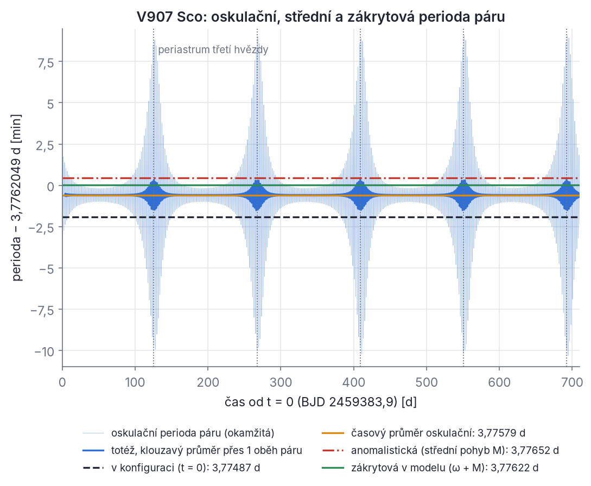
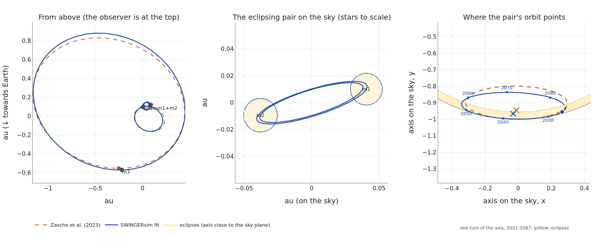
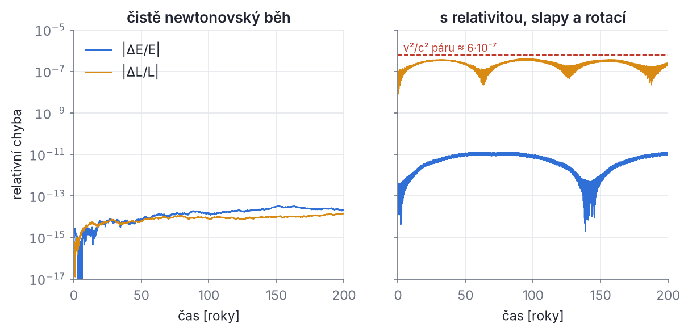
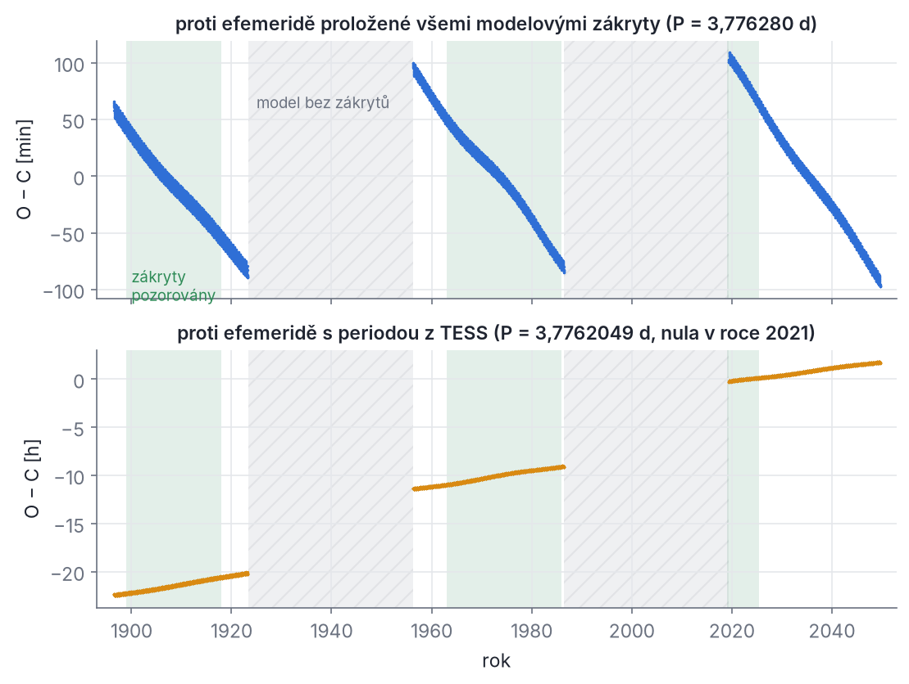
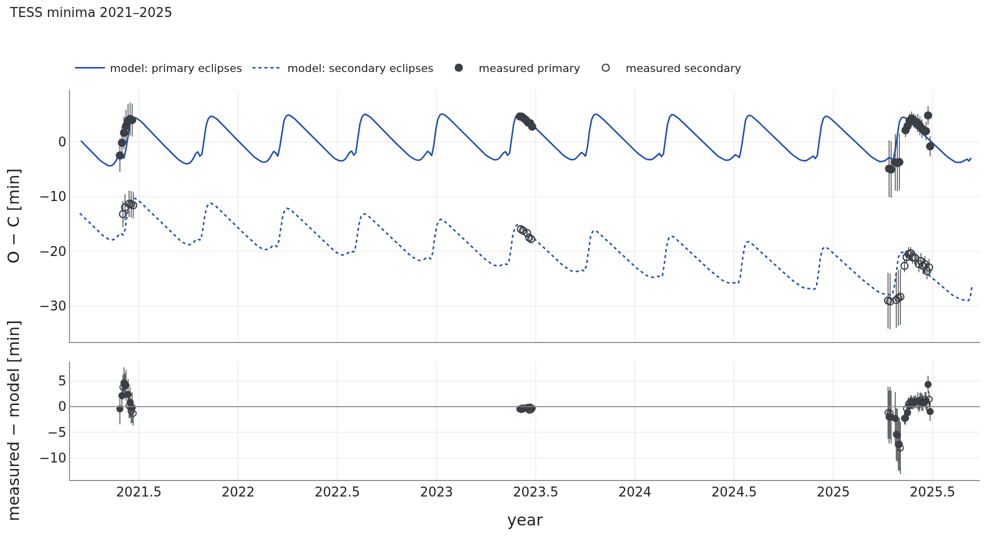
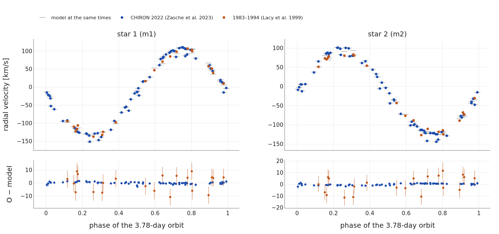
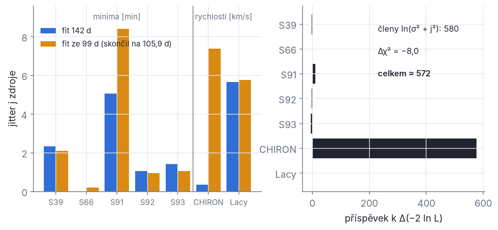
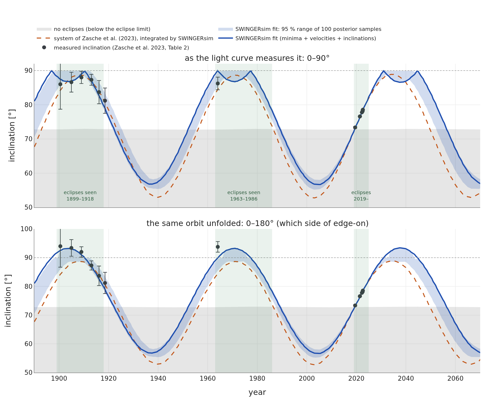
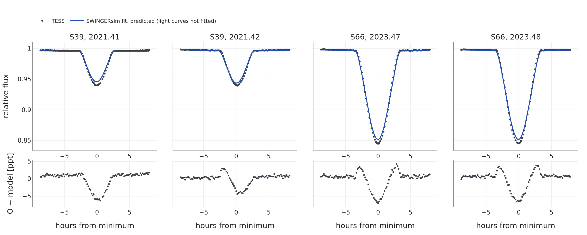

## Kapitola 12 – Celý postup na příkladu V907 Sco

V předchozích kapitolách jsme poskládali fyziku, numeriku i statistiku. V této kapitole je spojíme do jednoho pracovního postupu a projdeme ho na skutečné soustavě, od otázky z odborného článku až k předpovědi s nejistotou. Kapitola je psaná jako návod: každý příkaz si můžeš spustit a porovnat svůj výstup s výpisem v textu. Postup je stejný pro každou násobnou soustavu:

**otázka → data → model → stabilita → simulace → kontrola integrátoru → syntetická pozorování → srovnání s daty → fit → nejistoty → konkurenční hypotézy → předpovědi → nezávislé kontroly.**

Soustava V907 Sco je pro tento účel ideální. Je to trojhvězda 2+1, jejíž zákrytový pár během posledních 125 let několikrát přestal a zase začal zakrývat. Má staré i nové radiální rychlosti, přesná minima z družice TESS a 14 naměřených sklonů dráhy za 120 let. Je také dost malá, aby se dal každý krok spočítat na notebooku.

**Jak číst tuto kapitolu.** Všechny příkazy se spouštějí v kořenové složce SWINGERsim (tam, kde jsou složky `configs/` a `data/`). Výstupy si ukládej do `output/`. Uvedené doby výpočtu jsou změřené na notebooku se **dvěma jádry**. Příkazy, které trvají déle než deset minut, jsou označené **(dlouhý běh)**. Ty v textu nespouštíme a odkazujeme na hotové výsledky v dokumentaci SWINGERsim (`docs/cs/part3/03_v907_sco.md`, `docs/cs/part3/02_data_methods.md` a `docs/figures/squadra_test3/numbers.json`). Každý krok lze udělat i ve webové aplikaci (`swingersim gui`). Příkazová řádka má tu výhodu, že se dá zapsat a zopakovat.

### 12.1 Otázka a historie

**Soustava.** V907 Sco (HD 163302, TIC 261030551) je zákrytový pár dvou hvězd pozdního typu B na hlavní posloupnosti, m₁ = 2,56 M☉ a m₂ = 2,74 M☉, s periodou zákrytů 3,7762 d. Kolem páru obíhá hvězda slunečního typu m₃ ≈ 1 M☉ s periodou asi 142 d. Soustava je ve vzdálenosti 439 pc (paralaxa Gaia DR3 2,279 ± 0,033 mas).

**Co se pozorovalo.** Na harvardských fotografických deskách byla V907 Sco zákrytová přibližně v letech 1899–1918. Pak zákryty zmizely. Strohmeier, Knigge a Ott (1964) ohlásili hvězdu jako novou zákrytovou proměnnou. Zákryty byly vidět zhruba v letech 1963–1986 a pak opět zmizely. V roce 2019 zachytila družice TESS (sektor 13) velmi mělké tečné zákryty (Borkovits 2022 uvádí amplitudu asi 0,001 mag vedle elipsoidální proměnnosti asi 0,005 mag), v roce 2021 (sektor 39) už zákryty hluboké asi 0,05 mag (Borkovits 2022).

> **Z historie.** Lacy, Helt a Vaz (1999) jako první pochopili, že „vypínání“ zákrytů způsobuje třetí hvězda. Ta stáčí rovinu dráhy páru, a pár se proto na obloze naklání. Z řídkých spekter z let 1983–1994 odvodili vnější dráhu s periodou 99,3 d a uzlovou periodu asi 68 let. Předpověděli návrat zákrytů na rok 2030 ± 5. Zákryty se však vrátily už v roce 2019. Zasche, Vokrouhlický, Barlow a Mašek (2023) proto v roce 2022 získali 66 spekter spektrografem CHIRON. V rychlostech páru, po odečtení jeho oběhu, nenašli očekávanou 99denní periodu, ale dráhu 142,01 ± 0,05 d s výstředností 0,47 ± 0,02. Ze 14 sklonů páru z let 1900–2022 a numerického modelu tří hmotných bodů pak určili m₃ = 1,06 (+0,11/−0,10) M☉, vzájemný sklon drah 26,2 (+2,6/−2,2)° a uzlovou periodu 63,5 (+3,3/−2,6) roku. Tyto tři intervaly jsou 90% meze spolehlivosti. Konec současné zákrytové fáze odhadli kolem roku 2049. Rychlosti Lacyho et al. nepoužili.

**Otázky pro nás.**

1. Vysvětlí jeden N-částicový model všechna pozorovaná zapnutí a vypnutí zákrytů?
2. Je vnější perioda 99 d, nebo 142 d? A dokážou to rozhodnout samy staré rychlosti Lacyho et al.?
3. Kdy zákryty znovu skončí a s jakou nejistotou?
4. Co data neurčí a jak to prozkoumat?

#### 12.1.1 Fyzikální obrázek: precese a mez zákrytů

Třetí hvězda působí na pár slapovým momentem síly (kapitola 5). Moment hybnosti páru **L**_in a moment hybnosti vnější dráhy **L**_out proto precesují kolem celkového momentu hybnosti **L** = **L**_in + **L**_out, který je stálý. Rovina kolmá na **L** je **invariantní rovina**. Normála dráhy páru opisuje kužel kolem **L** s vrcholovým úhlem θ_in. Sklon páru k obloze i(t) se proto houpá mezi i_inv − θ_in a i_inv + θ_in, kde i_inv je sklon invariantní roviny. Jeden kmit trvá jednu uzlovou periodu P_nod.

**Mez zákrytů.** Dvě koule s poloměry R₁ a R₂ se při konjunkci na obloze překryjí, je-li jejich promítnutá vzdálenost menší než R₁ + R₂. Při konjunkci leží obě hvězdy v rovině obsahující zorný paprsek a jejich vzdálenost r se promítá na r|cos i|. Podmínka zákrytu tedy zní

```latex
r\,|\cos i| < R_1 + R_2
\quad\Longleftrightarrow\quad
|\cos i| < \frac{R_1+R_2}{r}.
```

Absolutní hodnota je důležitá. Sklon může být i větší než 90° (dráha obíhá opačným směrem), a zákryty proto nastávají v pásu 90° ± (90° − i_mez), tedy pro i_mez < i < 180° − i_mez. Světelná křivka sama rozliší jen |cos i|, sklony i a 180° − i dávají stejné zákryty.

**Řešený příklad (mez zákrytů V907 Sco).** Z třetího Keplerova zákona s G = (k·365,25)² ≈ 39,4769 au³ M☉⁻¹ rok⁻², P = 3,7748707 d = 0,0103350 roku (perioda páru v konfiguraci, oddíl 12.3) a M = 5,30 M☉ vychází

```latex
a = \left(\frac{G M P^2}{4\pi^2}\right)^{1/3}
  = \left(\frac{39{,}4769 \cdot 5{,}30 \cdot 0{,}0103350^2}{39{,}4784}\right)^{1/3}\ \mathrm{au}
  = 0{,}082723\ \mathrm{au} = 17{,}788\ R_\odot .
```

Pro kruhovou dráhu (r = a) a R₁ + R₂ = 2,53 + 2,68 = 5,21 R☉ je cos i_mez = 5,21/17,788 = 0,2929, tedy **i_mez = 72,97°**. Zákryty jsou možné pro 72,97° < i < 107,03°. Dráha páru je ale mírně výstředná (e = 0,008). V konjunkci je vzdálenost r = a(1 − e²)/(1 + e cos ν), kde ν je pravá anomálie v okamžiku konjunkce. S ω = 302,6° (hodnota v konfiguraci, oddíl 12.3) je jedna konjunkce při ν = 90° − ω = −212,6° ≡ 147,4°, kde r = 17,908 R☉ a i_mez = 73,09°. Druhá je při ν = 270° − ω = −32,6°, takže r = 17,668 R☉ a i_mez = 72,85°. SWINGERsim bere bližší konjunkci, proto ve výpisech uvidíš 72,85°. Zasche et al. (2023a) uvádějí 73,3°, protože počítali s jinými poloměry z řešení světelné křivky. Rozdíl desetin stupně nás nesmí znepokojit: blízko meze jsou zákryty tečné a tak mělké, že je stejně nikdo nezměří (oddíl 12.8).

**Řešený příklad (jak velký kužel?).** Vzájemný sklon J drah spočítáme ze sférické kosinové věty (kapitola 2). S publikovanými sklony i₁ = 76,61°, i₂ = 68,80° (index 1 = vnitřní, 2 = vnější dráha, jako v kapitolách 10 a 11) a uzly Ω₁ = 17,27°, Ω₂ = −8,97° je

```latex
\cos J = \cos i_1 \cos i_2 + \sin i_1 \sin i_2 \cos(\Omega_1-\Omega_2)
       = 0{,}2316\cdot 0{,}3616 + 0{,}9728\cdot 0{,}9323\cdot 0{,}8970 = 0{,}8973,
```

tedy J = 26,20°. Velikost momentu hybnosti keplerovské dráhy je L = m_r √(μ a (1 − e²)), kde m_r je redukovaná hmotnost a μ = G·(součet hmotností). Pro vnější dráhu s a_out = 0,98696 au (z P₂ = 142,01 d a M = 6,36 M☉) dostaneme poměr

```latex
\ell = \frac{L_\mathrm{in}}{L_\mathrm{out}}
     = \frac{\frac{m_1 m_2}{m_1+m_2}\sqrt{G(m_1+m_2)\,a_\mathrm{in}(1-e_\mathrm{in}^2)}}
            {\frac{(m_1+m_2) m_3}{M}\sqrt{G M\, a_\mathrm{out}(1-e_\mathrm{out}^2)}}
     = 0{,}448 .
```

Pár má tedy menší moment hybnosti než vnější dráha a od **L** se odklání víc. Ze složení vektorů plyne L/L_out = √(1 + ℓ² + 2ℓ cos J) = 1,4157 a

```latex
\sin\theta_\mathrm{in} = \frac{\sin J}{\sqrt{1+\ell^2+2\ell\cos J}} = 0{,}3119,
\qquad
\sin\theta_\mathrm{out} = \frac{\ell\,\sin J}{\sqrt{1+\ell^2+2\ell\cos J}} = 0{,}1397,
```

tedy θ_in = 18,17° a θ_out = 8,03° (součet je J). Sklon invariantní roviny k obloze vyjde z vektoru **L** na i_inv = 70,8° (Zasche et al. uvádějí ≈ 71°). Sklon páru se tedy houpá zhruba mezi 70,8° − 18,2° = 52,6° a 70,8° + 18,2° = 89,0°. Mez zákrytů 72,9° leží uvnitř tohoto rozsahu, a proto zákryty přicházejí a odcházejí. V běhu SWINGERsim (oddíl 12.5) uvidíš rozsah 52,8–89,0°.

> **Pozor.** Zasche et al. (2023a) označují poměr ℓ písmenem γ (u nich γ ≈ 0,47) a komentář souboru `v907_sco_published.yaml` toto označení přebírá („the ratio the paper calls gamma“). V této knize je γ vždy **systémová rychlost**. Poměr momentů hybnosti značíme ℓ. Z elementů vychází ℓ = 0,448 a úhly 8,0° a 18,2° (výpočet výše); tytéž hodnoty uvádí i komentář konfigurace.

**Řešený příklad (uzlová perioda).** SWINGERsim ve výpisu běhu uvádí kvadrupólový odhad pro dráhu páru kolem pevné normály vnější dráhy. Nejprve se spočítá kvadrupólová časová škála

```latex
t_\mathrm{ZLK} = \frac{P_\mathrm{out}^2}{P_\mathrm{in}}\,\frac{M}{m_3}\,(1-e_\mathrm{out}^2)^{3/2}
 = \frac{142{,}01^2}{3{,}7749}\cdot\frac{6{,}36}{1{,}06}\cdot 0{,}7819^{3/2}\ \mathrm{d}
 = 22\,163\ \mathrm{d} = 60{,}7\ \mathrm{roku}
```

a z ní perioda precese (4/3)·t_ZLK/cos J = 90,2 roku. Jenže vnější dráha není pevná: obě normály obíhají kolem **L**, a to rychleji v poměru L/L_out (kapitola 5). Odhad je proto 90,2/1,4157 = **63,7 roku**. N-částicový běh dá 63,2 roku a Zasche et al. 63,5 roku. Shoda na 1 % je u kvadrupólového odhadu s e_out = 0,47 trochu šťastná. Řád velikosti ale potvrzuje, že rozumíme, odkud perioda pochází.

### 12.2 Data

Všechna data jsou ve složce `data/observed/v907_sco/`. Každý soubor má v hlavičce komentář o původu a úpravách. Přečti si ho, než data použiješ.

| soubor | obsah | počet | k čemu |
| --- | --- | --- | --- |
| `minima_tess.csv` | okamžiky minim z TESS 2021–2025, sektory 39, 66 (SPOC) a 91–93 (QLP), BJD_TDB | 58 (31 primárních, 27 sekundárních) | dynamický efekt, světelný čas, stáčení přímky apsid |
| `rv_zasche2023.csv` | rychlosti m₁ a m₂, CHIRON 2022 (Zasche et al. 2023a, tab. A1) | 130 (66 + 64) | hmotnosti, vnější dráha |
| `rv_lacy1999.csv` | rychlosti m₁ a m₂ z let 1983–1994 (Lacy et al. 1999, tab. 3) | 42 | fáze vnější dráhy přes 40 let, test 99 d |
| `rv_all.csv` | obě sady rychlostí dohromady, sloupec `source` | 172 | vstup fitu |
| `inclination_zasche2023.csv` | sklony páru (Zasche et al. 2023a, tab. 2): DASCH 6, APPLAUSE 1, TESS 3, FRAM 4 | 14 | precese za 120 let |
| `lc_tess_windows.csv` | výřezy světelné křivky TESS ±0,35 d kolem zákrytů, po 10 min | 2562 bodů | hloubky zákrytů |

Několik věcí z hlaviček stojí za zdůraznění.

- **Minima z roku 2019 chybějí.** Sektor 13 (2019) zachytil jen tečné zákryty. Hlavička souboru uvádí pokles jasnosti 0,6 %; to odpovídá celkovému poklesu včetně elipsoidální proměnnosti, samotný zákryt má jen asi 0,1 % (Borkovits 2022; model SWINGERsim dává 0,002 mag). Jejich okamžiky jsou příliš nepřesné, a proto je soubor vědomě vynechává. Rok 2019 se ve fitu objeví jen jako jeden sklon (73,37 ± 0,25°).
- **Chyby minim.** Chyba je vždy větší z formální chyby a robustního rozptylu minim v daném sektoru. Formální chyby u TESS podceňují červený šum a systematiku.
- **Prohozené hvězdy.** Lacyho „primární“ složka má menší amplitudu rychlostí, je tedy hmotnější. Je to naše m₂ (2,74 M☉), ne m₁. V souboru je to už opraveno. Kdybys data přebíral z článku sám, je to přesně ta chyba, která se nedá najít jinak než pečlivým čtením.
- **Chyby starých rychlostí.** Lacy et al. neuvádějí chybu jednotlivých bodů. Jako σ je proto použit rozptyl reziduí jejich vlastního fitu (3,9 a 3,4 km/s).
- **Sklony jsou modelové veličiny.** Každý sklon pochází z řešení světelné křivky programem PHOEBE, s hmotnostmi, poloměry a teplotami pevnými. Nejsou to tedy přímá měření a jejich chyby nezahrnují systematiku modelu. Proto fit používá chybu nejméně 0,1° (oddíl 12.9).

#### 12.2.1 Časové systémy: proč všechno převádíme na BJD_TDB

O−C diagram porovnává okamžiky s přesností na sekundy. Pokud dva soubory dat používají různé „hodiny“, objeví se v O−C falešný skok. Hodiny se liší ve dvou věcech: **časovou stupnicí** (jak tikají) a **místem**, ke kterému je okamžik vztažen.

**Časové stupnice.**

- **UTC** je občanský atomový čas. Udržuje se do 0,9 s od rotace Země (UT1) vkládáním přestupných sekund, takže **není spojitý**.
- **TAI** je spojitý atomový čas. Od 1. 1. 2017 platí TAI − UTC = 37 s.
- **TT** (pozemský čas) je TT = TAI + 32,184 s, tedy TT − UTC = 69,184 s od roku 2017. TT − UTC se mění jen při přestupné sekundě, například 54,18 s v polovině roku 1983, 56,18 s v roce 1988 a 60,18 s v roce 1994.
- **TDB** (barycentrický dynamický čas) se od TT liší jen periodicky, nejvýše o 1,7 ms. V něm jsou psané efemeridy sluneční soustavy.

**Místo.** Světlo dorazí k Zemi a ke Slunci v různou dobu. Rozdíl je až ±8,3 min, podle polohy Země na dráze a směru ke hvězdě. Okamžiky se proto přepočítávají na místo, které se nepohybuje se Zemí:

- **HJD** (heliocentrické juliánské datum) je vztaženo ke středu Slunce;
- **BJD** (barycentrické juliánské datum) je vztaženo k těžišti sluneční soustavy. Slunce kolem těžiště obíhá ve vzdálenosti až asi 0,01 au, takže HJD a BJD se liší nejvýše o několik sekund.

Dnešní standard je **BJD_TDB** (Eastman, Siverd a Gaudi 2010): barycentrické místo a stupnice TDB. Rezoluce IAU z roku 1991 doporučuje barycentrické časy. Starší literatura ale většinou uvádí HJD ve stupnici UTC. Časy TESS jsou už v BJD_TDB (sloupec BTJD = BJD_TDB − 2 457 000).

```latex
\mathrm{BJD_{TDB}} = \mathrm{JD_{UTC}} + \underbrace{(\mathrm{TT}-\mathrm{UTC})}_{\text{69,184 s v 2022}}
 + \underbrace{(\mathrm{TDB}-\mathrm{TT})}_{\le 1{,}7\ \mathrm{ms}}
 + \underbrace{\Delta_\mathrm{bary}}_{\le \pm 8{,}3\ \mathrm{min}} .
```

Je-li výchozí údaj HJD_UTC, je heliocentrická korekce už provedená. Zbývá přičíst TT − UTC a rozdíl BJD − HJD, který je u V907 Sco v letech 2021–2022 mezi asi −2,9 s (leden 2021) a 0 s (konec roku 2022); v době spekter CHIRON (březen–říjen 2022) mezi −1,2 a −0,4 s.

**Řešený příklad (převod rychlostí CHIRON).** Zasche et al. uvádějí v tabulce A1 čas HJD_UTC − 2 400 000 = 59 670,8707. Hlavička souboru `rv_zasche2023.csv` říká, že k HJD_UTC se přičetlo TT − UTC = 69,184 s = 0,000 801 d:

```latex
2\,459\,670{,}8707 + 0{,}000\,801 = 2\,459\,670{,}871\,50\ \text{(BJD$_\mathrm{TDB}$, přibližně)} .
```

To je přesně hodnota v souboru. Přesný převod knihovnou astropy (poloha hvězdy α = 269,2285°, δ = −34,7496°, observatoř CTIO) dá 2 459 670,871 487. Rozdíl 1,2 s je rozdíl BJD − HJD. Pro rychlosti je zanedbatelný: za 1,2 s se rychlost hvězdy páru změní nejvýše o 0,003 km/s (K·2π/P · 1,2 s pro K ≈ 120 km/s). Pro okamžiky minim by ale nebyl zanedbatelný při přesnosti TESS (několik desítek sekund u nejlepších sektorů). Proto minima převádíme vždy přesně.

U rychlostí Lacyho et al. bylo přičteno TT − UTC ≈ 57 s (54–60 s podle data). Epochy sklonů zůstávají v HJD_UTC. Každý sklon popisuje interval dlouhý dny až roky, takže na minutě nezáleží.

> **Pozor.** Kdybys ke starému minimu v HJD_UTC přidal nové minimum v BJD_TDB bez převodu, vznikne v O−C skok o 50–70 s na rozhraní obou souborů. Vypadá jako fyzikální jev, ale je to jen změna hodin. UTC navíc existuje teprve od roku 1960 (do roku 1972 s proměnnou délkou sekundy) a starší časy jsou ve světovém čase UT. Pro převod na TT je pak potřeba ΔT = TT − UT, které se odhaduje z historických pozorování. SWINGERsim to při převodu (`fit.time_system: HJD_UTC` nebo `JD_UTC`, funkce `ocfit.to_bjd_tdb`) dělá sám: časy před 1. 1. 1960 bere jako UT a přičte ΔT podle polynomů Espenaka a Meeuse (2006); kolem roku 1900 je ΔT ≈ −3 s, kolem roku 1930 ≈ 24 s a v roce 1959 ≈ 33 s. Knihovna astropy by jinak před rokem 1960 s varováním „dubious year“ použila TT − UTC = 32,184 s, tedy chybu až 35 s kolem roku 1900. Data této kapitoly jsou už v BJD_TDB, konfigurace fitu proto uvádí `time_system: BJD_TDB`.

### 12.3 Model: konfigurační soubor řádek po řádku

Publikované řešení Zascheho et al. (2023a) je přepsané do souboru `configs/squadra_test3/v907_sco_published.yaml`. Bez úvodních komentářů vypadá takto:

```yaml
topology: custom
hierarchy: {out: [inner, m3], inner: [m1, m2]}
masses: {m1: 2.56, m2: 2.74, m3: 1.06}
orbits:
  inner: {P: 3.77487065, e: 0.008, i: 76.61, Omega: 17.27, omega: 302.6, M0: 223.7284}
  out:   {P: 142.01,    e: 0.467, i: 68.80, Omega: -8.97, omega: 22.7,  M0: 40.7}
stars:
  m1: {R: 2.53, Teff: 10004}
  m2: {R: 2.68, Teff: 10000}
  m3: {R: 1.00, Teff: 5900}
stellar_model: {kind: mist, age_myr: 400.0, feh: 0.0, vvcrit: 0.0}
physics: {gr: true, tides: true, rotation: true}
run: {t_max_yr: 200, n_output: 4001, extremes_every_orbits: 20}
```

Projdeme ho řádek po řádku.

- **`topology: custom`, `hierarchy`.** Pro trojhvězdu 2+1 není přednastavená topologie, hierarchie se proto zadává ručně. Dráha `inner` spojuje hvězdy m1 a m2. Dráha `out` spojuje těžiště dráhy `inner` s hvězdou m3. Každá dráha je **Jacobiho dráha** (kapitola 3): druhá větev obíhá kolem těžiště první.
- **`masses`** v M☉. Hmotnosti páru jsou z řešení rychlostí a světelné křivky (2,56 a 2,74 ± 0,02 M☉), m₃ je výsledek dynamického modelu Zascheho et al.
- **`orbits`** obsahují **oskulační elementy** v okamžiku t = 0 (kapitola 2). Jsou to keplerovské elementy, které by dráha měla, kdyby v tom okamžiku přestala působit všechna ostatní tělesa. Čas t = 0 odpovídá **BJD_TDB 2 459 383,9**. Je to referenční epocha článku, střed druhé poloviny sektoru TESS 39 (červen 2021). Konfigurace sama datum nezná. Datum se zadává u příkazů (`--bjd-t0 2459383.9`) nebo v sekci `fit` (`stage2.bjd_t0`).
- **Úhly** jsou ve stupních a vztažené k obloze. Rovina x–y je rovina oblohy a osa z míří **od pozorovatele**, takže radiální rychlost je v_z. Výstupný uzel je bod, kde těleso protíná rovinu oblohy směrem od nás (z roste). Ω se měří v rovině oblohy od osy x a poloha se z elementů skládá aktivními rotacemi r = R_z(Ω) R_x(i) R_z(ω) r′ (kapitola 2). Sklony i₁ = 76,61° a i₂ = 68,80° jsou z článku. Uzly Ω jsou zvolené tak, aby vzájemný sklon byl J = 26,2° a normály obou drah ležely na opačných stranách **L** (12.1.1). Bez astrometrie je totiž měřitelný jen **rozdíl** uzlů Ω₁ − Ω₂ = 26,24°. Natočení celé soustavy kolem zorného paprsku nemá na zákryty ani na rychlosti žádný vliv.
- **`omega`: pozor na konvenci.** SWINGERsim udává ω **relativní dráhy druhé větve kolem první**. U vnější dráhy je to dráha m₃ kolem páru. Zasche et al. ale z rychlostí určili dráhu **těžiště páru** kolem těžiště soustavy, s ω = 201,4 ± 2,7° (jejich tab. 3). Konfigurace vychází z hodnoty ω = 202,7° pro těžiště páru (komentář v souboru ji uvádí spolu s okamžikem průchodu pericentrem T_peri = BJD 2 459 651,86 z rychlostí CHIRON; rozdíl od článku je v rámci jeho chyby). Těžiště páru je vždy na opačné straně než m₃, takže jeho ω je o 180° jiné: v konfiguraci je ω_out = 202,7° − 180° = 22,7°. Stejné pravidlo platí pro pár: barycentrická dráha hvězdy m₁ má ω₁ = ω + 180°. Do vzorce pro světelný čas (kapitola 10) patří ω dráhy *páru* (202,7°), ne hodnota z YAML. Kdo dosadí 22,7°, dostane O−C s opačným znaménkem.
- **ω páru (302,6°)** je hodnota z článku (ω₁ = 122,6 ± 3,3°) zvětšená o 180°. SWINGERsim udává ω relativní dráhy m₂ kolem m₁ a primárním zákrytem nazývá zákryt hvězdy m₁; článek používá opačnou konvenci. U téměř kruhové dráhy (e = 0,008) na ω závisí hlavně to, o kolik se sekundární minimum posouvá vůči polovině periody (e cos ω mění znaménko). Rozhodnou okamžiky minim TESS (12.9.1): s ω = 122,6° leží po ukotvení sekundární minima v průměru o 40,8 min jinde než v modelu, s ω = 302,6° sedí primární i sekundární minima na několik minut. Pro sklony a zapínání zákrytů na tom nezáleží, pro okamžiky minim ano.
- **`M0`** je střední anomálie v t = 0. U páru je M₀ (spolu s P) výsledkem „ukotvení“ na minima TESS (12.9.1); posun o 180° proti ω kompenzuje otočení ω, takže konjunkce zůstanou na svých místech.
- **`stars`** dávají poloměry (R☉) a efektivní teploty (K). Poloměry rozhodují o mezi zákrytů a o hloubkách, teploty o podílu světla.
- **`stellar_model: mist`, 400 Myr.** Z izochrony MIST se pro hvězdy dopočítají apsidální konstanta k₂ a normalizovaný moment setrvačnosti r_g². Ve výpisu běhu uvidíš k₂ = 0,00328 a r_g² = 0,0356 pro m₁. Hmotnosti a poloměry z YAML se nemění.
- **`physics`.** Zapíná první postnewtonovskou korekci obecné relativity (`gr`), slapovou a rotační deformaci hvězd (`tides`, `rotation`) přes REBOUNDx (kapitoly 6 a 7). Slapové zpoždění je v této konfiguraci nulové (`lag = 0 s` ve výpisu), takže slapy dráhu stáčejí, ale energii nerozptylují.
- **`run`.** Integrace na 200 let se 4001 výstupy, tedy jeden výstup za 0,05 roku = 18,3 d. To je méně často než jedna perioda páru, výstupy jsou proto vzorky, ne souvislá křivka. Okamžiky zákrytů počítá zvláštní příkaz (12.7).

#### 12.3.1 Proč perioda v konfiguraci není perioda zákrytů

Zákryty TESS jdou s periodou P_zákr = 3,776 2049 d (Zasche et al. 2023a, tab. 1). V konfiguraci je ale P = 3,774 8707 d. Rozdíl je

```latex
3{,}776\,2049 - 3{,}774\,8707 = 0{,}001\,334\ \mathrm{d} = 1{,}92\ \mathrm{min} .
```

Odkud se necelé dvě minuty za oběh berou? Obecně to vysvětluje oddíl 2.16. Zde to rozebereme číselně. Pomůže si ujasnit, co je „perioda“:

- **oskulační perioda** P_osk = 2π √(a³/μ) je okamžitá veličina, spočítaná z okamžité polohy a rychlosti;
- **anomalistická perioda** je doba mezi dvěma průchody pericentrem, tedy 2π dělené středním tempem růstu střední anomálie M;
- **zákrytová perioda** je doba mezi dvěma konjunkcemi. Konjunkce nastává, když argument šířky u = ω + ν (úhel od výstupného uzlu na obloze) dosáhne 90° nebo 270°. U téměř kruhové dráhy je proto zákrytová perioda 2π dělené středním tempem růstu ω + M.

Všechny tři jsme změřili z hustého běhu publikované konfigurace na dva roky (výstup každých 0,09 d, viz Vyzkoušej si 4). Výsledek je na obr. 12.1 a v tabulce.



*Obr. 12.1 – Perioda páru V907 Sco v prvních 710 dnech po t = 0, vynesená jako rozdíl od pozorované zákrytové periody 3,7762049 d (v minutách). Světle modře: okamžitá oskulační perioda. Kmitá s poloviční periodou páru a nejvíce kolem průchodů třetí hvězdy periastrem (svislé tečkované čáry), kdy se mění téměř o ±10 min kolem svého průměru. Tmavě modře: její klouzavý průměr přes jeden oběh páru. Vodorovné čáry: hodnota v konfiguraci (t = 0, černě čárkovaně), časový průměr oskulační periody (oranžově), anomalistická perioda (červeně) a zákrytová perioda modelu (zeleně). Zelená čára leží prakticky na nule (+0,02 min): model dává zákryty se správnou periodou, i když konfigurace uvádí periodu o 1,9 min kratší.*

| krok | perioda [d] | změna [10⁻³ d] | změna [min] | proč |
| --- | --- | --- | --- | --- |
| P_osk v t = 0 (konfigurace) | 3,774 871 | – | – | okamžitá hodnota |
| keplerovská perioda ze střední poloosy ⟨a⟩ | 3,775 794 | +0,92 | +1,33 | v t = 0 je oskulační a o 0,016 % pod střední hodnotou |
| střední siderická perioda | 3,776 236 | +0,44 | +0,64 | sekulární porucha od m₃ zpomaluje střední pohyb (včetně stáčení apsid) |
| *z toho: anomalistická perioda* | *3,776 524* | *(+0,73)* | *(+1,05)* | *tempo střední anomálie M* |
| *z toho: stáčení přímky apsid* | | *(−0,29)* | *(−0,41)* | *pericentrum postupuje, oběh vůči pevnému směru je kratší než anomalistický* |
| zákrytová perioda modelu | 3,776 218 | −0,02 | −0,025 | uzel se pohybuje po obloze; do tempa u se promítne jen −Ω̇ cos i |
| **celkem** | | **+1,35** | **+1,94** | |
| pozorováno: Zasche et al. (2023a), P₁ | 3,776 205 ± 0,000 012 | | | model o 1,3·10⁻⁵ d = 1,2 s delší (1,1σ) |
| pozorováno: lineární fit 58 minim TESS 2021–2025 | 3,776 228 ± 0,000 007 | | | model ve stejném intervalu 3,776 224, rozdíl 0,4 s |

První krok (střední poloosa) je nejpřekvapivější. Okamžitá perioda páru kolísá během jednoho vnějšího oběhu o víc než 13·10⁻³ d. Je to proto, že třetí hvězda na výstředné dráze se v periastru přiblíží na 0,53 au, jen na 6,4násobek velikosti dráhy páru. Konfigurace zachycuje pár v jednom okamžiku a ten okamžik není „průměrný“. Druhý krok (střední siderická perioda) má velikost, jakou čekáme z kvadrupólové poruchové teorie (oddíl 2.16): středovaná porucha od třetí hvězdy mění střední pohyb páru o δn/n ≈ −(m₃/M)(P_in/P_out)²(2 − 3 sin² i_mut)/[2(1 − e_out²)^{3/2}] = −1,21·10⁻⁴, což dává +0,000 46 d, jen o 3 % víc než naměřených +0,000 44 d. Rozdělení tohoto členu na anomalistickou periodu a stáčení přímky apsid (kurzivou) je jen informativní: při e = 0,008 jsou ω a M každé zvlášť špatně určené a jejich podíl se s délkou okna mění (přes 25 vnějších oběhů vychází +0,67 a −0,22·10⁻³ d), robustní je jen součet (+0,442 a +0,449·10⁻³ d). Slapy, rotace a relativita k němu přidávají jen −1·10⁻⁵ d. Třetí krok (zákrytová perioda) je jediný, který souvisí s precesí uzlu. Uzel na obloze se stáčí rychlostí Ω̇ ≈ −6,0·10⁻⁵ rad/d (průměr přes 25 vnějších oběhů), ale protože sklon páru je blízko 90° (průměrné cos i ≈ 0,12), změní tempo argumentu šířky jen o −Ω̇ cos i, tedy o −0,000 02 d. **Hlavní příčinou je, že oskulační perioda v t = 0 není střední perioda** (první krok, 68 % rozdílu); zbytek je sekulární zpomalení středního pohybu (33 %, uzel −1 %). Odhad „uzlového členu“ P²/P_nod = 3,776²/(63,2 · 365,25) = 6·10⁻⁴ d, který se někdy uvádí, je proto zavádějící: celý pohyb uzlu v prostoru se do zákrytové periody nepromítne. Systémová rychlost γ ≈ −17 km/s by pozorovanou periodu zkrátila o dalších 2,2·10⁻⁴ d = 0,31 min; model ji nezahrnuje (oddíl 12.3.2).

**Poučení.** Oskulační elementy nejsou střední elementy a perioda v konfiguraci není perioda, kterou naměříš. Opisovat periodu zákrytů do `orbits.inner.P` by byla chyba: model by se za čtyři roky dat TESS (asi 390 oběhů) rozešel s minimy o 390 · 1,94 min ≈ 12,6 h. Správný postup je **ukotvení**: SWINGERsim P a M₀ páru upraví tak, aby modelové zákryty seděly na naměřená minima (12.9.1).

#### 12.3.2 Poznámka o γ a rychlosti světla

Soustava se k nám přibližuje systémovou rychlostí γ ≈ −17,1 km/s (záporná rychlost znamená přibližování, protože osa z míří od nás). Představ si dva po sobě jdoucí zákryty, mezi nimiž uplyne ve vlastní soustavě V907 Sco čas P₀. Za tu dobu se soustava přiblíží o |γ|P₀. Světlo z druhého zákrytu proto letí kratší dráhu a přijde o |γ|P₀/c dříve. Obecně platí

```latex
P_\mathrm{poz} = P_0\left(1 + \frac{\gamma}{c}\right),
\qquad
\frac{\gamma}{c} = \frac{-17{,}1\ \mathrm{km\,s^{-1}}}{299\,792\ \mathrm{km\,s^{-1}}} = -5{,}7\cdot 10^{-5} .
```

Všechny pozorované periody jsou tedy o 5,7·10⁻⁵ relativně kratší než vlastní: u páru o 2,2·10⁻⁴ d = 19 s, u vnější dráhy o 8,1·10⁻³ d = 12 min. SWINGERsim integruje v klidové soustavě těžiště trojhvězdy a tento faktor **nepřidává** (modul `timing.py` přičítá jen světelný čas napříč soustavou, z_těžiště/c). Fitované periody jsou proto **zdánlivé** (v soustavě pozorovatele). Pro naše závěry to nevadí: u P₂ je to 0,2σ a hmotnosti z P a K se změní relativně o ~6·10⁻⁵. U soustav s γ ~ 100 km/s a s velmi přesnými periodami už na tom záleží, a proto o tom víme.

### 12.4 Krok 1: je soustava stabilní?

Než začneme cokoli integrovat na stovky let, ověříme, že soustava není dynamicky nestabilní. Nestabilní konfigurace obvykle znamená chybu v elementech nebo v jednotkách.

```bash
swingersim stability configs/squadra_test3/v907_sco_published.yaml
```

Výstup (7 s):

```text
stability of configs/squadra_test3/v907_sco_published.yaml (custom)
nested triples (ratio > 1 = stable):
  inner in out (+m3)     a_in/a_out = 0.0838, e_in = 0.008, e_out = 0.467, i_mut = 26.2 deg,
  q_out = 0.200: Mardling-Aarseth 1.67, Vynatheya+22 2.20
N-body ghost test (100 outer orbits, Newtonian): stable after 100.0 outer orbits,
  max relative divergence 9.60e-04  [6.0 s]
```

Jak výpis číst (podrobně kapitola 4):

- **Kritéria.** Poměr periastra vnější dráhy a_out(1 − e_out) ke kritické hodnotě podle Mardlinga a Aarsetha (2001) je 1,67. Podle zpřesněného vzorce Vynatheyi et al. (2022) je 2,20. Oba jsou větší než 1, soustava je tedy stabilní s rezervou (u MA01 asi 70 %, oddíl 4.3). Výpis uvádí i poměr hmotností q_out = m₃/(m₁ + m₂) = 0,200.
- **Test „duchem“** (Vynatheya, Mardling a Hamers 2023). SWINGERsim vytvoří **jednu** kopii soustavy, jejíž vnitřní velká poloosa je větší o 10⁻⁶ au. Obě soustavy integruje 100 vnějších oběhů (39 let) **čistě newtonovsky**, jako hmotné body. Soustava je nestabilní, pokud se rozpadne, nebo pokud relativní rozdíl vnitřních velkých poloos obou kopií kdykoli překročí 10⁻² (1 %). U V907 Sco je největší rozdíl 9,6·10⁻⁴, tedy desetkrát pod prahem.

Pro intuici: v periastru vnější dráhy je třetí hvězda ve vzdálenosti 0,53 au, tedy 6,4 a_in. Poměr slapového zrychlení od m₃ ke vzájemnému přitahování hvězd páru je přibližně 2(m₃/m₁₂)(a_in/r_p)³ = 2 · 0,20 · (1/6,36)³ = 1,6·10⁻³. Pár je i v nejtěsnějším přiblížení dobře definovaná jednotka. Kdyby poměry vyšly pod 1, nemá smysl pokračovat a je třeba nejprve zkontrolovat vstupy.

### 12.5 Krok 2: simulace

```bash
swingersim run configs/squadra_test3/v907_sco_published.yaml -o output/v907/run.h5
```

Integrace IAS15 s relativitou, slapy a rotací na 200 let trvá na dvou jádrech asi půl minuty (27,6 s samotné integrace). Výpis:

```text
integrated to t = 200 yr (4001 outputs, osculating elements)
  out    a = 0.98582..0.99288 AU  e = 0.4663..0.4712
  inner  a = 0.082634..0.082839 AU  e = 0.0041..0.0131
  i_mut out-inner    25.57..  26.28 deg
  max |dE/E| = 1.31e-11
  max |dL/L| = 4.10e-07
...
  inner in out: i_mut0 = 26.2 deg, g1_0 = 234 deg
    quadrupole theory : e = 0.007..0.009, i_mut = 26.2..26.2 deg, e-cycle 21.8 yr (outside ZLK window)
    simulation        : e = 0.004..0.014, i_mut = 25.6..26.3 deg
    precession period : 90.2 yr estimated, 63.2 yr measured, closest periastron = 3.37 x (R1+R2)
    stability ratio Mardling-Aarseth = 1.67 (stable), Vynatheya+22 = 2.20 (stable), eps_oct = 0.0017, eps_SA = 0.0064
...
  m1  R = 2.53 Rsun, k2 = 0.00328, rg2 = 0.0356, lag = 0 s, P_rot = 3.775 -> 3.775 d,
      obliquity 0.0 -> 83.3 deg, Roche lobe filled up to 0.39, ...
```

Co z něj vyčteme:

- **Vzájemný sklon** se drží mezi 25,6° a 26,3°. Je pod mezí cyklů ZLK (39,2° pro kvadrupólovou aproximaci, kapitola 5), proto „outside ZLK window“. Výstřednost páru se mění jen v rozmezí 0,004–0,014.
- **Uzlová perioda** naměřená z běhu je 63,2 roku. Odhad 90,2 roku je precese kolem pevné normály vnější dráhy. Po vydělení faktorem L/L_out = 1,416 dá 63,7 roku (12.1.1).
- **Oktupólový parametr** ε_oct = 0,0017 a parametr jednoduchého středování ε_SA = 0,0064 jsou malé. Sekulární kvadrupólová teorie je tedy dobrým prvním přiblížením (kapitola 5). Přesto ji pro zákryty nepoužíváme: Zasche et al. ukázali, že sekulární model sklony neproloží statisticky přijatelně, protože výstředná vnější dráha přidává poruchy s periodou vnějšího oběhu.
- **Nejtěsnější průchod periastrem páru** je 3,37 (R₁ + R₂), hvězdy se tedy nedotknou. Rocheův lalok je zaplněn nejvýše ze 40 % (poměr poloměru hvězdy k poloměru laloku: 0,39 u m₁ ve výpisu, 0,40 u m₂ na dalším řádku výpisu).
- **Sklon spinu** hvězdy m₁ vůči její dráze je na začátku 0° a na konci běhu 83° (obliquity 0.0 -> 83.3 deg). To je Cassiniho rezonance z kapitoly 7, k níž se vrátíme v oddílu 12.14.

Interaktivní prohlížeč ukáže dráhy a časový vývoj:

```bash
swingersim view output/v907/run.h5
```

Totéž lze vyčíst přímo ze souboru HDF5. **Úhly jsou v něm v radiánech** (`inc`, `inc_inv`, `Omega`, `omega`, `M`, `mutual_inclination`). Ve stupních jsou jen veličiny, jejichž jméno končí na `_deg` (třeba `obliquity_deg`). Čas je v juliánských rocích od t = 0. Krátký skript (`read_run.py`):

```python
import json
import h5py
import numpy as np

f = h5py.File("output/v907/run.h5", "r")
t = f["time_yr"][:]                                  # roky od t = 0
inc = np.degrees(f["orbits/inner/inc"][:])           # radiány -> stupně
imut = np.degrees(f["mutual_inclination/out-inner"][:])
b = json.loads(f.attrs["binaries_json"])["inner"]
print(f"sklon páru {inc.min():.1f}..{inc.max():.1f} deg")
print(f"vzájemný sklon {imut.min():.2f}..{imut.max():.2f} deg")
print(f"podíl času se zákryty {b['eclipse_fraction']:.4f}")
print(f"uzlová perioda {f['diagnostics/inner'].attrs['prec_period_measured_yr']:.1f} let")
```

vypíše

```text
sklon páru 52.8..89.0 deg
vzájemný sklon 25.57..26.28 deg
podíl času se zákryty 0.5051
uzlová perioda 63.2 let
```

Sklon páru se houpá mezi 52,8° a 89,0°, jak jsme odhadli v 12.1.1 (52,6–89,0°). Pár zakrývá **50,5 %** času, v oknech dlouhých kolem 30 let. Obr. 12.2 ukazuje soustavu z dokumentace SWINGERsim.



*Obr. 12.2 – V907 Sco podle Zascheho et al. (2023a) (oranžově čárkovaně) a podle fitu SWINGERsim (modře); popisky v angličtině z dokumentace SWINGERsim. Vlevo: dráhy shora; svislá osa je −z, Země je tedy směrem k **hornímu** okraji (popisky „observer is below“ a „↓ towards Earth“ v obrázku jsou chybné, v SWINGERsim byly opraveny). Uprostřed: pár na obloze v roce 2021 s hvězdami v měřítku. Disky se v konjunkci právě překrývají, zákryt je částečný (sklon 76,6°, mez 72,8°). Vpravo: kam míří osa dráhy páru (průmět jednotkového vektoru na oblohu) v letech 2021–2087. Bod ve vzdálenosti sin i od středu znamená sklon i. Zákryty jsou možné, jen když osa leží ve žlutém prstenci mezi okrajem a kružnicí o poloměru sin(i_mez). Osa obíhá kolem směru celkového momentu hybnosti (×) jednou za asi 66 let.*

### 12.6 Kontrola integrátoru: jak ji udělat správně

Výpis běhu uvádí největší relativní chybu energie |ΔE/E| = 1,31·10⁻¹¹ a momentu hybnosti |ΔL/L| = 4,10·10⁻⁷. Druhé číslo je o čtyři řády horší než první. Je to chyba integrátoru? Není, a je poučné pochopit proč.

**Co SWINGERsim počítá.** S relativitou je „energie“ ve výpisu úplný postnewtonovský hamiltonián 1PN z REBOUNDx (`gr_full_hamiltonian`), ke kterému se přičte energie slapové a rotační deformace. Taková energie se zachovává přesně, a proto vychází 10⁻¹¹. Moment hybnosti je ale **newtonovský**: Σ mᵢ rᵢ × vᵢ plus spiny hvězd. Ten se v 1PN dynamice nezachovává. Zachovává se moment hybnosti s relativistickými opravami, které se od newtonovského liší o člen řádu v²/c². Pro pár V907 Sco je relativní rychlost hvězd

```latex
v = \frac{2\pi a}{P} = \frac{2\pi\cdot 0{,}08272\cdot 1{,}496\cdot10^{8}\ \mathrm{km}}{3{,}7748\cdot 86\,400\ \mathrm{s}} = 238\ \mathrm{km\,s^{-1}},
\qquad \frac{v^2}{c^2} = 6{,}3\cdot10^{-7} .
```

Přesně v tomto řádu kolísá |ΔL/L|. Kolísá s uzlovou periodou a neroste (obr. 12.3), takže nejde o hromadění chyb.

Integrátor se proto kontroluje v **čistě newtonovském běhu**, kde se zachovávají obě veličiny. Zkopíruj konfiguraci a změň jeden řádek:

```bash
sed 's/physics: {gr: true, tides: true, rotation: true}/physics: {gr: false, tides: false, rotation: false}/' \
  configs/squadra_test3/v907_sco_published.yaml > configs/squadra_test3/v907_newton.yaml
swingersim run configs/squadra_test3/v907_newton.yaml -o output/v907/newton.h5 --no-viewer --no-plots
```

| běh | fyzika | max \|ΔE/E\| | max \|ΔL/L\| |
| --- | --- | --- | --- |
| `v907_newton.yaml` | jen Newton | 3,3·10⁻¹⁴ | 1,4·10⁻¹⁴ |
| `v907_gronly.yaml` (stejně, s `gr: true`) | Newton + 1PN | 3,4·10⁻¹³ | 4,0·10⁻⁷ |
| `v907_sco_published.yaml` | + slapy a rotace | 1,3·10⁻¹¹ | 4,1·10⁻⁷ |

Newtonovský běh zachovává energii i moment hybnosti na úrovni 10⁻¹⁴, což je blízko zaokrouhlovacích chyb dvojité přesnosti nasčítaných přes 19 000 oběhů páru. Integrátor IAS15 tedy pracuje správně (kapitola 6). Druhý řádek ukazuje, že |ΔL/L| ≈ 4·10⁻⁷ způsobuje **relativita**, ne slapy. Slapy zde navíc nic nerozptylují, protože slapové zpoždění je nulové (`lag = 0 s`) a soubor HDF5 má atribut `dissipative: False`. S nenulovým zpožděním by se energie skutečně ztrácela. SWINGERsim pak sleduje jen moment hybnosti (spolu se spiny se zachovává i při disipaci) a běh zastaví, překročí-li chyba hodnotu `run.max_energy_error` (výchozí 10⁻⁵).



*Obr. 12.3 – Kontrola zachování u V907 Sco. Vlevo: čistě newtonovský běh, energie (modře) i moment hybnosti (oranžově) jsou zachovány na 10⁻¹⁴. Vpravo: publikovaná konfigurace s relativitou, slapy a rotací. Energie (úplný 1PN hamiltonián) je zachována na 10⁻¹¹. Newtonovský moment hybnosti kolísá kolem 10⁻⁷ s periodou asi 63 let, pod hodnotou v²/c² páru (červená čárkovaná čára). Kolísání, ne růst, je znak toho, že jde o fyziku (nezachovávanou veličinu), ne o numerickou chybu.*

**Konvergence.** Druhá kontrola je, zda se výsledek nezmění, když výpočet zjemníme. IAS15 si krok volí sám. Okamžiky zákrytů ale SWINGERsim hledá ze vzorků integrace (`--samples`, výchozí 40 na periodu páru) a minimum dopřesňuje dvoutělesovým pohybem. Dokumentace uvádí, že při pětkrát jemnějším vzorkování se modelová O−C V907 Sco změní o méně než 0,02 min. Vyzkoušej si to sám (cvičení 6).

### 12.7 Krok 3: syntetická pozorování

Model teď převedeme na veličiny, které se měří: okamžiky zákrytů, světelnou křivku a radiální rychlosti (kapitola 10).

**Okamžiky zákrytů od roku 1896 do roku 2051.**

```bash
swingersim timings configs/squadra_test3/v907_sco_published.yaml --from-years -125 --years 30 \
  --bjd-t0 2459383.9 -o output/v907/timings.csv --plot output/v907/oc.png
```

Volba `--from-years -125` přidá zákryty před t = 0 (integruje se do minulosti), `--years 30` po něm. `--bjd-t0` přidá sloupec `bjd_obs`, tedy pozorovaný okamžik v BJD_TDB. Výpočet 155 let trvá na dvou jádrech asi minutu. Výpis:

```text
eclipse timings over 30 yr
  inner: 8448 primary and 8446 secondary eclipses, P = 3.77628002 d, O-C of primaries
    -97.42 .. +109.26 min (semi-amplitude 103.34 min)
    eclipses missing between -98.206 and -65.194 yr
    no primary eclipses after t = 28.248 yr
  16894 eclipses saved in output/v907/timings.csv (73.2 s)
```

Každý řádek CSV je jeden zákryt: `kind` (primární, nebo sekundární), `epoch` (číslo cyklu, sekundární mají poloviční), `t_yr` (dynamický čas nejmenší promítnuté vzdálenosti), `t_obs_yr` (totéž plus světelný čas), `o_c_d` (O−C vůči lineární efemeridě proložené všemi primárními zákryty), `impact` (promítnutá vzdálenost v konjunkci dělená R₁ + R₂, zákryt nastává pro impact < 1) a `bjd_obs`. Rok t = 0 je 2021,462, takže výpis říká: zákryty chybějí v letech **1923,3–1956,3**. Výpis hlásí jen první mezeru. Další najdeš v CSV jako skok v `t_yr`: **1986,5–2019,4**. Poslední primární zákryt nastane v roce **2049,7**. To je geometrický obrázek publikované soustavy.



*Obr. 12.4 – Modelové okamžiky primárních zákrytů publikované soustavy v letech 1896–2050. Zeleně: období, kdy byly zákryty pozorovány. Šedě šrafovaně: období, kdy model zákryty nemá. Nahoře: O−C vůči efemeridě proložené všemi modelovými zákryty (P = 3,776280 d), tak jak ho počítá `swingersim timings`. Dole: totéž vůči efemeridě s periodou z TESS (3,7762049 d) a nulou v roce 2021, v hodinách. Uvnitř každého okna jdou zákryty téměř s periodou z TESS. Mezi okny se ale fáze konjunkcí posune: zákryty z let 1899–1918 přicházejí o 20–22 h dříve, než by dala lineární efemerida protažená z roku 2021 zpět.*

Obr. 12.4 je varování pro každého, kdo pracuje s archivními minimy. Zákrytová perioda (tempo růstu ω + M, 12.3.1) se během uzlového cyklu mění, protože se mění geometrie konjunkce vůči obloze. Mezi okny proto nejde spojit minima jednou lineární efemeridou, a počet cyklů přes 33letou mezeru by se navíc nedal ověřit. N-částicový model tento problém nemá: zákryty počítá z polohy hvězd. Náš fit používá jen minima TESS z let 2021–2025 a problém s počítáním cyklů se ho netýká.

**Světelná křivka sektoru TESS v roce 2023.**

```bash
swingersim lightcurve configs/squadra_test3/v907_sco_published.yaml --days 30 --start-day 700 \
  --cadence-min 10 --band TESS -o output/v907/lc_2023.csv --plot output/v907/lc_2023.png
```

Den 700 po t = 0 je BJD 2 460 083,9 (květen 2023), těsně před sektorem 66. Výpis (18 s):

```text
light curve TESS (swingersim): 4320 points, 30 d, cadence 10 min
  m1: R = 2.530 Rsun, limb darkening 0.649, -0.425, 0.411, -0.150, share of the light 46.4 % (out of eclipse)
  m2: R = 2.680 Rsun, limb darkening 0.650, -0.427, 0.413, -0.151, share of the light 51.9 % (out of eclipse)
  m3: R = 1.000 Rsun, limb darkening 0.558, -0.025, 0.315, -0.197, share of the light 1.7 % (out of eclipse)
  m1 is eclipsed: deepest loss of its light 29.78 %
  m2 is eclipsed: deepest loss of its light 25.62 %
  m3 is eclipsed: deepest loss of its light 0.09 %
  minimum flux 0.86399; saved output/v907/lc_2023.csv (3.4 s)
```

Hvězdy jsou koule s okrajovým ztemněním podle čtyřkoeficientového zákona Clareta (2000). Výpis uvádí jeho koeficienty a₁–a₄ v pásmu TESS. Třetí hvězda přispívá 1,7 % světla (**třetí světlo**). Nejhlubší místo v okně má tok 0,864 celkového, takže hloubka zákrytu publikované soustavy v roce 2023 je 13,6 %. Pozorování ukazuje 15,0 % (oddíl 12.12).

**Radiální rychlosti v době spekter CHIRON.**

```bash
swingersim rv configs/squadra_test3/v907_sco_published.yaml --bjd-t0 2459383.9 \
  --start 2459600 --end 2459900 --gamma -17.1 \
  --measured data/observed/v907_sco/rv_zasche2023.csv -o output/v907/rv
```

> **Pozor.** Příkaz `rv` potřebuje vědět, které BJD odpovídá t = 0. Bez `--bjd-t0` skončí hláškou `swingersim rv needs --bjd-t0 (or fit.stage2.bjd_t0)`, protože publikovaná konfigurace nemá sekci `fit`. Ze stejného důvodu by bez `--gamma` byla systémová rychlost nulová a bez `--measured` by se do obrázku nenakreslila naměřená data. U konfigurací se sekcí `fit` (12.9) se tyto hodnoty berou z ní.

Výpočet trvá necelé dvě minuty. Do `output/v907/rv/` zapíše `rv_model.csv` (BJD_TDB a rychlosti m₁, m₂, m₃ po 0,01 d) a obrázek `rv_model.png`. Na něm je vidět, že těžiště páru se během 142denního oběhu posouvá o desítky km/s, a to velmi nesouměrně: rychlost m₃ se mění od −55 do +78 km/s s ostrým vrcholem kolem periastra. To je podpis výstředné vnější dráhy.

### 12.8 Krok 4: model proti pozorování (ještě bez fitu)

Než začneme fitovat, porovnáme publikovanou soustavu s tím, co bylo pozorováno. Tím ověříme, že jsme ji správně přepsali, a zároveň nezávisle zkontrolujeme N-částicový výpočet SWINGERsim.

**Kdy se zákryty přepínají.** Geometrické přechody publikované soustavy vycházejí na roky 1923,5, 1956,5, 1986,5, 2019,5 a konec na 2050,0 (s krokem půl roku). Pozorováno bylo ~1918, ~1963, ~1986 a 2019. Na první pohled tedy v roce 1918 a 1963 nesouhlasí o 5–7 let. Rozpor ale zmizí, když si uvědomíme, co znamená „zákryt byl pozorován“.

Blízko meze zákrytů je zákryt **tečný a velmi mělký**. Zákryt je **zjistitelný** jen tehdy, je-li hlubší, než jakou změnu dokázala tehdejší fotometrie zachytit. Fotografické desky zachytí zhruba 0,1 mag, fotoelektrická fotometrie několik setin magnitudy, TESS několik desetin procenta. Pro starou fotometrii jako celek se v dokumentaci SWINGERsim používá mez asi 0,05 mag. Hloubku zákrytu ve filtru V (včetně třetího světla m₃, 1,7 %) spočítá `swingersim lightcurve --band V`. Tabulka je převzatá z dokumentace (`docs/cs/part3/03_v907_sco.md`, tab. 2):

| změna | pozorováno | publikovaná soustava | fit SWINGERsim, geometricky (medián; 95 %) | fit: modelová hloubka ve V |
| --- | --- | --- | --- | --- |
| zákryty ustávají | ~1918 (poslední sklon z DASCH 1918) | 1923,5 | 1923,5 (1921,7–1925,5) | 0,16 mag v roce 1918, 0,06 mag v roce 1920 |
| zákryty se vracejí | od ~1963 (Strohmeier et al. 1964) | 1956,5 | 1954,0 (1952,0–1955,5) | 0,08 mag v roce 1955, 0,28 mag v roce 1958 |
| zákryty ustávají | ~1986 (Lacy et al. 1999) | 1986,5 | 1989,0 (1988,0–1990,0) | 0,11 mag v roce 1986, 0,02 mag v roce 1988 |
| zákryty se vracejí | 2019, hloubka 0,6 % (TESS S13) | 2019,5 | 2019,5 | 0,002 mag v polovině roku 2019 |
| zákryty končí | ~2049 (Zasche et al. 2023a) | 2050,0 | 2054,5 (2052,5–2056,8) | 0,19 mag v roce 2052, 0,03 mag v roce 2055 |

Jak tabulku číst. Geometrický přechod nastává 1–3 roky poté, co modelové zákryty zeslábnou pod mez zjistitelnosti. V roce 1920 měl zákryt podle fitu hloubku jen 0,06 mag, na deskách by se ztratil v šumu. V letech 1955–1958 zákryty zesílily z 0,08 na 0,28 mag. První ohlášené pozorování z roku 1963 je tedy pozdě spíš proto, že se na hvězdu nikdo systematicky nedíval. Mezi lety 1925 a 1960 nebyly zaznamenány žádné zákryty, ve shodě s modelem. Model tak souhlasí se všemi čtyřmi pozorovanými změnami, jakmile místo geometrické meze použijeme mez zjistitelnosti. Publikovaná soustava zintegrovaná SWINGERsim navíc končí zákryty v roce 2050,0 (hloubka 0,014 mag v roce 2049). Zasche et al. svým vlastním numerickým modelem dostali „kolem roku 2049“. To je nezávislá kontrola N-částicové integrace.

**Okamžiky minim.** V O−C převažuje **dynamický efekt** nad **světelným časem** (kapitola 10). Polovina amplitudy světelného času je

```latex
A_\mathrm{LTTE} = \frac{a_{12}\sin i_2}{c}\sqrt{1-e_2^2\cos^2\omega_2},
\qquad a_{12} = a_2\,\frac{m_3}{M} = 0{,}98696\cdot\frac{1{,}06}{6{,}36}\ \mathrm{au} = 0{,}1645\ \mathrm{au},
```

kde ω₂ = 202,7° je argument pericentra dráhy *páru*. S c = 173,145 au/d dostaneme a₁₂/c = 1,368 min a A_LTTE = 1,368 · sin 68,8° · √(1 − 0,467² cos² 202,7°) = 1,15 min. Odhad poloviny amplitudy dynamického efektu (Borkovits et al. 2016) je

```latex
A_\mathrm{dyn} \approx \frac{1}{2\pi}\,\frac{m_3}{M}\,\frac{P_1^2}{P_2}\,(1-e_2^2)^{-3/2}
 = \frac{1}{2\pi}\cdot 0{,}1667\cdot\frac{3{,}7749^2}{142{,}01}\cdot 1{,}446\ \mathrm{d} = 5{,}5\ \mathrm{min} .
```

Je to jen řádový odhad. Skutečná amplituda závisí i na vzájemném sklonu a na orientaci drah. N-částicový model fitu dává dynamickou část 10,8 min mezi vrcholy, tedy ±5,4 min, a světelný čas ±1,1 min. Dynamický efekt převažuje asi pětkrát, stejně jako u Zascheho et al.



*Obr. 12.5 – Okamžiky minim V907 Sco z TESS 2021–2025 vůči pevné periodě (nahoře) a po odečtení modelu (dole); popisky v angličtině z dokumentace SWINGERsim. Plné body: primární minima, prázdné: sekundární. Čáry: modelové okamžiky zákrytů fitu. Pilovitý průběh se opakuje se 142denní vnější periodou. Strmý vzestup po každém průchodu třetí hvězdy periastrem je dynamický efekt: třetí hvězda je blízko a perioda páru je nejdelší. Primární a sekundární zákryty se za čtyři roky vzdálí ze 13 na 28 min, protože třetí hvězda mění výstřednost a orientaci mírně výstředné dráhy páru. Rezidua mají rms 2,6 min. Větší rozptyl v roce 2025 je z méně přesné fotometrie QLP.*

### 12.9 Krok 5: fit

Publikovaná soustava data popisuje dobře. Teď se zeptáme, jaké parametry popisují **všechna** data nejlépe: minima TESS, obě sady rychlostí i sklony. Postup z kapitoly 11 má pět kroků: ukotvení, fit nejmenšími čtverci (stupeň 2), chyby a odlehlé body, priory a MCMC.

#### 12.9.1 Ukotvení

Oskulační elementy z literatury v N-částicovém modelu SWINGERsim nikdy nesedí na minima přesně (12.3.1). Ukotvení proto nejprve upraví jen periodu P a střední anomálii M₀ páru. Hrubý krok porovná střední efemeridu modelových zákrytů se střední efemeridou naměřených minim: P se vynásobí poměrem P_data/P_model a M₀ se posune o 360°·Δt/P, kde Δt je zpoždění modelového zákrytu u minima nejbližšího t = 0. Jemný krok pak opakovaně prokládá přímku rozdíly „naměřené − model“, dokud se žádné minimum nepohne o víc než 0,1 min. Ostatní parametry zůstávají beze změny.

Ukotvení elementů z článku tak, jak jsou vytištěné (konfigurace `v907_sco_fit.yaml` má úhly z článku včetně ω₁ = 122,6° **bez** převodu o 180° a k nim sekci `fit`; je to první průchod fitu a záměrně ukazuje past konvence):

```bash
swingersim fit configs/squadra_test3/v907_sco_fit.yaml --anchor -o output/v907/anchor
```

```text
swingersim fit --anchor: period and phase of every eclipsing pair anchored to the minima
  t = 0 of the configuration: BJD 2459383.9; 3 iteration(s)
  pair     P before -> after [d]          M0 before -> after [deg]   delay at t=0   drift over the data   rms after
  inner    3.7747839 -> 3.77485275 (+1.82e-05)   43.9500 -> 43.9454      -18.96 min        -18.3 min      30.29 min
```

Výpočet trvá 40 s. Perioda se změnila o pouhých 6,9·10⁻⁵ d (číslo v závorce, +1,82·10⁻⁵, je **relativní** změna P_po/P_před − 1). Periodu tedy ukotvení opravilo jen nepatrně. Rezidua mají ale rms **30 min**, i když chyby minim jsou 0,3–2 min. Abychom věděli proč, spočítáme rezidua zvlášť pro primární a sekundární minima (`swingersim timings output/v907/anchor/anchored.yaml --from-years -0.1 --years 4.3 --bjd-t0 2459383.9 ...` a porovnání s `minima_tess.csv`):

| start fitu | ω páru | primární minima: průměr | sekundární minima: průměr | rms všech |
| --- | --- | --- | --- | --- |
| úhly z článku bez převodu (`v907_sco_fit.yaml`) | 122,6° | +3,9 min | −40,8 min | 30,3 min |
| publikovaná soustava v konvenci SWINGERsim (`v907_sco_published.yaml`) | 302,6° | +2,6 min | −1,9 min | 4,0 min |
| `v907_sco_fit_v2.yaml` | 301,7° | −0,5 min | −0,8 min | 2,7 min |

S ω = 122,6° leží sekundární minima o 41 min jinde než v modelu. Posun sekundárního minima vůči polovině periody je úměrný e cos ω, takže ω otočené o 180° změní znaménko posunu. S ω = 302,6° (hodnota z článku převedená do konvence SWINGERsim, jak ji má `v907_sco_published.yaml`) sedí primární i sekundární minima na několik minut; zbylé rozdíly (+2,6 a −1,9 min) jsou už malé změny e cos ω, které doladí fit. Druhý průchod fitu (`v907_sco_fit_v2.yaml`) startuje s e = 0,010 a ω = 301,7° (e cos ω = +0,0053). Po ukotvení dává rms 2,7 min:

```bash
swingersim fit configs/squadra_test3/v907_sco_fit_v2.yaml --anchor -o output/v907/anchor_v2
```

```text
  inner    3.77471817 -> 3.77475847 (+1.07e-05)   44.6152 -> 224.7633    -2715.33 min        +22.2 min       2.69 min
```

Posun M₀ o 180° kompenzuje otočení ω: zákryty zůstanou na svém místě. „Zpoždění“ −2715 min je téměř přesně půl periody (2718 min).

> **Pozor.** Tak velký rozdíl mezi primárními a sekundárními minimy by fit bez upozornění „spolkl“. První průchod (job sq4_5 v dokumentaci) skončil v lokálním minimu s e ≈ 0,0003. Rozdíl primárních a sekundárních minim (+7 až +15 a −10 až −18 min) tam pohltily dodatečné chyby zdrojů (10–19 min). Vždy se podívej na rezidua rozdělená podle druhu minima. SWINGERsim je ve výpisu fitu uvádí na řádku „primary vs secondary minima“.

#### 12.9.2 Stupeň 2: společný N-částicový fit

Konfigurace `v907_sco_fit_v2.yaml` (sekce `fit`):

```yaml
fit:
  minima: ../../data/observed/v907_sco/minima_tess.csv
  time_system: BJD_TDB
  inclination:
  - {file: ../../data/observed/v907_sco/inclination_zasche2023.csv, pair: inner,
     label: Zasche2023, min_sigma_deg: 0.1}
  rv:
    file: ../../data/observed/v907_sco/rv_all.csv
    gamma: -17.33
    offsets: {Lacy1999: 0.0}
  stage2:
    bjd_t0: 2459383.9
    anchor: true
    free: [orbits.inner.P, orbits.inner.M0, orbits.inner.ecosw, orbits.inner.esinw, orbits.inner.i,
           orbits.out.P, orbits.out.M0, orbits.out.e, orbits.out.omega, orbits.out.i,
           orbits.out.Omega, masses.m3, rv.gamma, rv.offset.Lacy1999]
    error_scale: per_source
    error_model: jitter
    clip_sigma: 5.0
    priors:
      orbits.out.e: [0.47, 0.05]
    max_iterations: 40
    processes: 0
  output:
    dir: ../../output/squadra_test3/v907_sco/fit_v2
    predict: {years: 30, samples: 100}
```

Co je volné a co pevné:

- **14 volných parametrů.** Za pár P, M₀, e cos ω, e sin ω a i. Výstřednost a ω páru se fitují v kombinacích e cos ω a e sin ω, protože při e ≈ 0,01 je samotné ω špatně určené a v e = 0 má singularitu. Za vnější dráhu P, M₀, e, ω, i, Ω. Dále m₃, systémová rychlost γ a posun nulového bodu rychlostí Lacyho et al. vůči CHIRON (`rv.offset.Lacy1999`). Různé spektrografy mají různé nulové body.
- **Pevné** jsou hmotnosti páru a všechny poloměry. Hmotnosti páru jsou z rychlostí dobře změřené (±0,02 M☉). Poloměry určuje světelná křivka a ta ve fitu není (12.12). Pevný je i **uzel páru Ω₁ = 17,27°**. Bez astrometrie se dá měřit jen rozdíl uzlů. Když byly v prvním průchodu volné oba uzly, „ujely“ spolu s korelací +1,000.
- **Data**: 58 minim + 172 rychlostí + 14 sklonů = 244 řádků. Počet stupňů volnosti je n_dof = 244 − 14 = 230.

```bash
swingersim fit configs/squadra_test3/v907_sco_fit_v2.yaml        # (dlouhý běh)
```

Jedno vyhodnocení modelu je N-částicová integrace přes 120 let do minulosti (kvůli sklonům) a přes data TESS. Každá iterace metody trust-region (`least_squares`, `method="trf"`, kapitola 11) potřebuje jakobián, tedy nejméně 15 integrací (jednu výchozí a jednu pro každý parametr). Fit trvá hodiny i na 12 jádrech (srovnatelný fit z 99 d v oddílu 12.11 trval 1,7 h). Výsledky proto čteme z dokumentace.

#### 12.9.3 Chyby a odlehlé body

Zadané chyby málokdy odpovídají skutečnému rozptylu. Volba `error_scale: per_source` s `error_model: jitter` přidá každému zdroji dat (každému sektoru TESS a každé sadě rychlostí) vlastní **jitter** j, který se k chybám přičte kvadraticky:

```latex
s_k^2 = \sigma_k^2 + j_\mathrm{zdroj}^2 ,
\qquad
\sum_{k\in\mathrm{zdroj}} \frac{r_k^2}{\sigma_k^2 + j^2} = n_\mathrm{dof,zdroj} .
```

Jitter se určí tak, aby redukované χ² každého zdroje bylo 1. Počet stupňů volnosti zdroje je počet jeho bodů zmenšený o jeho podíl na 14 parametrech. Jitter nikdy není záporný, takže zdroj, který sedí lépe než jeho chyby, si své chyby ponechá. Odlehlé body se vyřazují podle robustní směrodatné odchylky skupiny s = max(1; 1,4826 · medián |r/σ|). Bod je vyřazen, když |r/σ| > 5s (`clip_sigma: 5`). Vrátí se, když v pozdějším fitu klesne pod 0,8 · 5 s = 4s. Jittery a vyřazení se počítají ve „fitech v řadě“, dokud se nepřestanou měnit. U V907 Sco jsou čtyři, s χ²_red postupně 3,95 → 0,915 → 0,964 → 0,968.

Výsledné jittery (výpis fitu v `numbers.json`):

| zdroj | jitter | poznámka |
| --- | --- | --- |
| TESS S39 | 2,32 min | mělké zákryty (5 %) |
| TESS S66 | 0 | zadané chyby stačí |
| TESS S91 / S92 / S93 | 5,07 / 1,06 / 1,44 min | fotometrie QLP |
| CHIRON 2022 | 0,36 km/s | zadané chyby 0,3–2,2 km/s (medián 0,7) |
| Lacy 1999 | 5,66 km/s | |

Po této úpravě je χ²_red = 222,7/230 = 0,968. Chyby parametrů se pak ještě násobí √max(χ²_red; 1) = 1 a členy priorů se neškálují.

> **Pozor.** χ²_red ≈ 1 tu **není** důkaz dobrého modelu. Vychází tak z definice, protože jittery jsou zvolené právě proto. O kvalitě fitu svědčí něco jiného: rezidua bez systematického průběhu (obr. 12.5) a fyzikálně rozumné jittery. Jitter 0 až 2 min u kvalitních sektorů TESS je rozumný. Jitter 10–19 min v chybném prvním průchodu rozumný nebyl a prozradil chybějící fyziku.

Rezidua mají rms 2,57 min (58 minim). Primární minima mají střední reziduum −0,03 ± 0,44 min, sekundární −0,50 ± 0,53 min, rozdíl je 0,7σ. Rychlosti CHIRON mají rms 0,77 km/s. Rychlosti Lacyho et al. mají rms 6,55 km/s, tedy 1,7–1,9krát víc než rms jejich vlastního fitu (3,4–3,9 km/s). Model, který staré rychlosti popisuje současně s rychlostmi o 40 let mladšími, je k nim „přísnější“ než lokální keplerovský fit. Rozdíl pohltí jitter zdroje. Posun nulového bodu Lacyho et al. vyšel −1,8 ± 1,1 km/s. Čtrnáct sklonů dává χ² = 13,7 (publikovaná soustava 6,0). Největší reziduum má sklon TESS S39a (+2,7σ).



*Obr. 12.6 – Radiální rychlosti obou hvězd páru proti fázi 3,78denní dráhy; popisky v angličtině z dokumentace SWINGERsim. Modře: CHIRON 2022, oranžově: Lacy et al. (1983–1994), šedé čárky: model v časech pozorování, dole rezidua. Čárky neleží na jedné křivce, protože model obsahuje pohyb páru po vnější dráze (posun až ±13 km/s). Fáze se počítá z modelových zákrytů blízko každého pozorování, protože světelný čas a precese fázi mezi lety 1983 a 2022 posouvají.*

#### 12.9.4 Priory: kdy výsledek není nezávislý

Fit obsahuje jediný prior: gaussovský e₂ = 0,47 ± 0,05. Je to hodnota Zascheho et al. (0,467 ± 0,019) s chybou rozšířenou na 0,05. Do χ² přidá člen ((e₂ − 0,47)/0,05)². Fit dal e₂ = 0,4647 ± 0,0107, odchylka od prioru je −0,11σ.

Je pak srovnání „e₂ = 0,467 (SWINGERsim) proti 0,47 (Zasche)“ nezávislý test? **Formálně ne**, protože fit dostal informaci z téhož článku. Kolik ale prior přidal? U gaussovských rozdělení se převrácené kvadráty chyb sčítají, 1/σ_post² = 1/σ_data² + 1/σ_prior². Odtud

```latex
\sigma_\mathrm{data} = \left(\frac{1}{0{,}0115^2} - \frac{1}{0{,}05^2}\right)^{-1/2} = 0{,}0118,
\qquad
\frac{\sigma_\mathrm{post}^2}{\sigma_\mathrm{prior}^2} = 0{,}053 .
```

Prior tedy nese jen asi 5 % informace o e₂, zbytek dávají data. Výsledek je *téměř* nezávislý. Poctivé je to ale napsat, a test bez prioru udělat zvlášť (oddíl 12.11 je přesně takový).

#### 12.9.5 MCMC: konfigurace použitá pro publikovaná čísla

Lineární chyby z kovarianční matice předpokládají rovné údolí χ². Vnější dráha pokrytá jen několika oběhy ale vytváří zakřivená údolí, kde se M₀, ω a P vzájemně zastupují. Proto se posterior vzorkuje programem emcee (Foreman-Mackey et al. 2013; kapitola 11). Publikovaná čísla pocházejí z konfigurace

```bash
swingersim fit configs/squadra_test3/v907_sco_fit_v2_mcmc_1000.yaml     # (dlouhý běh: 19,3 h na 12 jádrech)
```

Je to `v907_sco_fit_v2.yaml` s výsledkem fitu jako startem, `anchor: false` a s řádky

```yaml
    sampler: emcee
    walkers: 48
    mcmc_steps: 1000
```

Soubor `v907_sco_fit_v2_mcmc.yaml` je totéž se 400 kroky. Jeho komentář uvádí „~9 h on 12 cores“ a chyby z něj nepoužíváme (níže).

**Kolik je chodců?** SWINGERsim bere nejméně 2p + 2 chodců (p = 14, tedy 30) a jejich počet zaokrouhlí nahoru na sudé číslo (emcee posouvá vždy polovinu chodců najednou). Počet nezávisí na počítači, takže se stejným `seed` (výchozí 1) dá stejný řetězec na libovolném počtu jader; jádra si jen dělí modely jednoho půlkroku. Publikovaný řetězec měl 48 chodců: starší verze programu zaokrouhlovala na násobek dvojnásobku počtu jader a ze zapsaných 32 udělala na 12 jádrech 48. Konfigurace proto dnes uvádí přímo `walkers: 48`.

**Jak řetězec běží.** Chodci startují v gaussovském oblaku kolem nejlepšího fitu s kovariancí C/4 (poloviční směrodatné odchylky). Logaritmus hustoty posterioru je −½(χ²_data/max(χ²_red; 1) + χ²_prior). Jittery zdrojů jsou přitom pevné z fitu nejmenších čtverců, ve vzorkování se nemění. Pro dvojici (e cos ω, e sin ω) se přidává jakobián 1/e. Rovnoměrné rozdělení v obou složkách by totiž znamenalo prior úměrný e, který odtlačuje téměř kruhové dráhy od nuly. První polovina řetězce se zahodí jako zahoření.

**Výsledek (z výpisu fitu):**

```text
58 minima, 172 radial velocities, 1 priors, 14 free parameters, 49548 model evaluations, 69435 s
...
optimiser: `ftol` termination condition is satisfied.; emcee acceptance 0.21
...
sampler emcee: 48 walkers x 1000 steps, first 500 discarded, seed 1,
  autocorrelation time tau max 53.9 steps (steps / tau 18.6)
warning: emcee: the chain after burn-in (500 steps) is shorter than 10 autocorrelation times
  (tau max 53.9 steps) - the errors are not converged; ...
```

Buďme poctiví:

- Největší integrovaný autokorelační čas přes parametry je τ = 53,9 kroku. Celý řetězec je dlouhý **18,6 τ**, ponechaná polovina **9,3 τ**. To dává asi 9 nezávislých vzorků na chodce, celkem 48 · 500/53,9 ≈ 450.
- Foreman-Mackey et al. (2013) doporučují řetězec dlouhý asi 10 τ. Ponechaná část toho téměř dosahuje. Online dokumentace emcee doporučuje pro spolehlivý odhad *samotného* τ alespoň 50 τ. Tomu řetězec zdaleka **nevyhovuje**. Padesát τ v ponechané polovině by znamenalo 2 · 50 · 54 ≈ 5400 kroků, tedy asi 100 h na 12 jádrech.
- Proč se tedy výsledkům dá věřit? Řetězec se 400 kroky hlásil τ ≈ 21. Po prodloužení na 1000 kroků vzrostl odhad τ na 54. To je typické: krátký řetězec τ podceňuje. Chyby z obou řetězců se ale liší v mediánu jen o 10 % (nejvýše 1,5krát, u m₃ a fáze vnější dráhy) a mediány o méně než 0,8σ. Chyby 1σ jsou proto spolehlivé na několik desítek procent. Okraje rozdělení (meze 95 %) jsou nejistější, protože stojí na menším počtu vzorků.
- Podíl přijetí 0,21 je na dolním okraji doporučeného rozmezí 0,2–0,5.

Kontrolní seznam (12.15) proto neříká „vždy 50 τ“, ale: uveď, kolik τ máš, a ověř stabilitu výsledků prodloužením řetězce.

### 12.10 Výsledky a srovnání s literaturou

| veličina | Zasche et al. (2023a) | SWINGERsim (MCMC: medián, 16–84 %) |
| --- | --- | --- |
| m₃ | 1,06 (+0,11/−0,10) M☉ **(90 %)** | 0,98 (+0,05/−0,04) M☉ |
| P₂ | 142,01 ± 0,05 d | 142,09 ± 0,04 d |
| e₂ | 0,47 ± 0,02 | 0,467 (+0,010/−0,013) (s priorem ze Zascheho et al.) |
| vzájemný sklon J | 26,2 (+2,6/−2,2)° **(90 %)** | 25,8 ± 0,8° |
| uzlová perioda | 63,5 (+3,3/−2,6) roku **(90 %)** | 65,5 (+0,9/−1,0) roku |
| konec současných zákrytů | ~2049 | 2052–2057 (95 %) |
| rms minim TESS | – | 2,6 min (58 minim) |
| rms rychlostí | 0,64 km/s (jen CHIRON, keplerovský fit) | CHIRON 0,8 km/s, Lacy et al. 6,6 km/s |

**Pozor na hladiny spolehlivosti.** Zasche et al. uvádějí u m₃, J a P_nod 90% meze, SWINGERsim interval 16–84 %, tedy ±1σ. Pro gaussovské rozdělení leží 5 % pravděpodobnosti nad z = 1,645 směrodatné odchylky. Oboustranný 90% interval je proto ±1,645σ a na 1σ ho převedeme dělením 1,645. Teprve pak lze rozdíly porovnávat. Rozdíl Δ vyjádříme v jednotkách sloučené směrodatné odchylky σ_sl = √(σ_Z² + σ_S²). Bereme tu stranu intervalu, která směřuje k druhé hodnotě.

| veličina | σ_Z (1σ) | σ_S | Δ | Δ/σ_sl |
| --- | --- | --- | --- | --- |
| m₃ | 0,10/1,645 = 0,061 M☉ | 0,05 M☉ | −0,08 M☉ | 1,0 |
| P₂ | 0,05 d (už 1σ) | 0,04 d | +0,08 d | 1,25 |
| e₂ | 0,02 | 0,010 | −0,003 | 0,13 (není nezávislé) |
| J | 2,2/1,645 = 1,34° | 0,8° | −0,4° | 0,26 |
| P_nod | 3,3/1,645 = 2,01 roku | 1,0 roku | +2,0 roku | 0,89 |

Všechny rozdíly jsou v rozmezí **0,1–1,3 sloučené směrodatné odchylky**. Kdybychom 90% meze omylem brali jako 1σ, vyšly by rozdíly ještě menší a zdálo by se, že shoda je „příliš dobrá“. Kdybychom naopak naše 1σ brali jako 90% meze, přecenili bychom rozpor. SWINGERsim má užší intervaly, protože navíc používá minima TESS a rychlosti Lacyho et al. U publikované soustavy zintegrované SWINGERsim vychází uzlová perioda 63,2 roku.

> **Pozor.** Nejlepší fit a medián posterioru nejsou totéž. Konfigurace `v907_sco_fit_v2_mcmc.yaml` začíná v nejlepším fitu nejmenších čtverců. Její běh (`swingersim run ... --t-max-yr 140`) dává vzájemný sklon 26,7–27,4° a uzlovou periodu 67,1 roku. Medián posterioru je přitom 25,8° a 65,5 roku. Ze 100 vzorků posterioru vychází P_nod 64,0 / 64,6 / 65,5 / 66,4 / 67,2 roku (percentily 2,5 / 16 / 50 / 84 / 97,5), takže nejlepší fit leží na horním okraji 95% intervalu. U nelineárních odvozených veličin (J a P_nod nejsou fitované parametry, ale počítají se z nich) a s řetězcem dlouhým jen 9 τ se to stát může. Je to ale signál, že posterior není gaussovský kolem nejlepšího bodu. Proto uvádíme medián a interval z MCMC, ne nejlepší fit s lineární chybou.

### 12.11 Test konkurenční hypotézy: 99 d, nebo 142 d?

Fit, který začal u 142 d, najde nejbližší minimum χ² a 99 d nikdy „neuvidí“. Konkurenční hypotéza se proto testuje **samostatným startem**. Konfigurace `v907_sco_fit_p99.yaml` má stejná data a stejné volné parametry jako `fit_v2`. Startuje ale z P₂ = 99,3 d (Lacy et al. 1999), e₂ = 0,3 a M₀ = 0, **bez prioru** na e₂ a s P₂ volnou mezi 60 a 200 d (`bounds`). Fit trval 6273 s na 12 jádrech (dlouhý běh). Výsledek (výpis v `numbers.json`):

```text
58 minima, 172 radial velocities, 0 priors, 14 free parameters, 3322 model evaluations, 6273 s
chi^2 1837.05 -> 214.696 (reduced 0.9335 for 230 degrees of freedom)
optimiser: The maximum number of function evaluations is exceeded.
errors (per_source), jitter ...: TESS S39 2.11 min; TESS S66 0.196 min; TESS S91 8.42 min;
  TESS S92 0.941 min; TESS S93 1.06 min; rv:CHIRON2022 7.39 km/s; rv:Lacy1999 5.77 km/s
orbits.out.P   99.3 -> 105.904807 +- 0.448 d
masses.m3      0.9778446746 -> 0.3725390014 +- 0.0201 Msun
```

Fit 99 d opustil a zastavil se v lokálním minimu u **105,9 d** s m₃ = 0,37 M☉. Optimalizátor navíc vyčerpal povolený počet vyhodnocení. Rychlosti CHIRON tento model prokládá s rms 7,1 km/s, i když jejich chyby jsou asi 0,7 km/s.

**Past: χ² zde nerozhoduje.** χ² fitu 99 d je 214,7, tedy *menší* než 222,7 u fitu 142 d. Kdo by porovnal jen χ², vybral by špatnou dráhu. Důvod je, že každý fit si zvolil vlastní jittery, a χ² je proto v obou případech ≈ n_dof z definice (12.9.3). Fit 99 d „schoval“ špatný popis rychlostí CHIRON do jitteru 7,39 km/s. Správné je porovnat **úplnou věrohodnost** včetně normalizace gaussovského rozdělení. Pro gaussovské chyby s_k² = σ_k² + j² je

```latex
-2\ln L = \sum_k \left[\frac{r_k^2}{s_k^2} + \ln\!\left(2\pi s_k^2\right)\right]
 = \chi^2 + \sum_k \ln\!\left(2\pi s_k^2\right) .
```

Druhý člen trestá velké jittery. V rozdílu obou fitů se 2π vykrátí a zůstane

```latex
\Delta(-2\ln L) = \Delta\chi^2 + \sum_k \ln\frac{\sigma_k^2 + j_{99,k}^2}{\sigma_k^2 + j_{142,k}^2} .
```

**Řešený příklad.** Z chyb v datových souborech a jitterů z obou výpisů dostaneme pro rychlosti CHIRON (130 bodů) příspěvek 577, pro Lacyho rychlosti 1,1 a pro minima TESS dohromady 1,7. Součet je 580 a s Δχ² = 214,7 − 222,7 = −8,0 vychází **Δ(−2 ln L) ≈ 572**. Dokumentace SWINGERsim uvádí ≈ 580, což je samotný součet logaritmických členů (577 + 1,1 + 1,7 = 580, bez Δχ² = −8,0). Na závěru to nic nemění.



*Obr. 12.7 – Test vnější periody. Vlevo: jitter každého zdroje dat ve fitu se 142 d (modře) a ve fitu startovaném z 99 d (oranžově). Minima jsou v minutách, rychlosti v km/s. Fit z 99 d potřebuje u rychlostí CHIRON jitter 7,4 km/s místo 0,36 km/s. Vpravo: příspěvky zdrojů k Δ(−2 ln L). Téměř všechno pochází z rychlostí CHIRON. Rozdíl χ² (−8,0) má opačné znaménko a je zanedbatelný.*

**Jak číslo vyložit.** Δ(−2 ln L) = 572 znamená poměr věrohodností L₁₄₂/L₉₉ = e^286 ≈ 10¹²⁴. Oba modely mají stejný počet parametrů (14 a 7 jitterů), takže ΔAIC = ΔBIC = Δ(−2 ln L) (kapitola 11). Je to daleko za jakoukoli hranicí Jeffreysovy škály (rozhodující podpora začíná u poměru 100). Modely nejsou vnořené (99 d není speciální případ 142 d), takže Wilksova věta o rozdělení χ² zde neplatí a nepočítáme z rozdílu „p-hodnotu“. Stačí poměr věrohodností.

**Data tedy vylučují 99denní vnější dráhu.** Je to závěr samotných dat, protože fit startoval z 99 d a bez prioru. Nejde o vliv startovních hodnot. Výsledek je i lekce: lokální minimum u 105,9 d je jen nejbližší údolí, ne globální řešení. Konkurenční hypotézy proto testuj vždy samostatnými starty a porovnávej úplnou věrohodnost.

### 12.12 Krok 6: předpovědi s nejistotou

Sekce `output.predict: {years: 30, samples: 100}` spustí po MCMC model pro 100 náhodných vzorků posterioru. Každá předpověď tak dostane rozptyl odpovídající nejistotám parametrů. Pro obr. 12.8 byly vzorky zintegrovány přes roky 1890–2070 skriptem `tools/squadra3_posterior.py` (dlouhý běh).



*Obr. 12.8 – Sklon dráhy páru V907 Sco v letech 1890–2070; popisky v angličtině z dokumentace SWINGERsim. Nahoře: sklon tak, jak ho měří světelná křivka (0–90°, tedy |cos i|). Dole: tentýž model „rozložený“ do 0–180°. Body: 14 naměřených sklonů. Modrá čára: fit SWINGERsim. Modrý pás: rozsah 95 % ze 100 vzorků posterioru. Oranžově čárkovaně: publikovaná soustava zintegrovaná SWINGERsim. Šedě: pod mezí zákrytů. Zelené pásy: kdy byly zákryty pozorovány. Pás je úzký tam, kde jsou data, a rozšiřuje se do minulosti i budoucnosti. Tvar „M“ v horním panelu vzniká, když dráha projde polohou z boku (90°), otočí se a projde jí znovu. Nafitovaná dráha přes 90° v každém cyklu přechází, publikovaná zůstává těsně pod ní. Světelná křivka obě možnosti nerozliší.*

**Konec současných zákrytů:** medián 2054,5, rozsah 95 % **2052,5–2056,8** (geometricky). Podle modelu bude hloubka ve V v roce 2052 ještě 0,19 mag a v roce 2055 už jen 0,03 mag. Publikovaná soustava končí v roce 2050,0. Okraje 95% rozsahu stojí na řetězci dlouhém 9 τ, a jejich šířka je proto sama nejistá (12.9.5).

**Co je skutečná předpověď a co ne.** Fit nepoužil světelné křivky. Jeho syntetická křivka (poloměry a teploty ze Zascheho et al., třetí světlo 1,7 % v TESS) dává hloubku zákrytu 5,3 % v roce 2021 (pozorováno 5,5 %) a 14,3 % v roce 2023 (pozorováno 15,0 %). Obě čísla ale nemají stejnou váhu:

- **2021 (sektor 39) není předpověď.** Fit obsahuje sklony 76,57° a 76,61° odvozené programem PHOEBE právě z této světelné křivky. Hloubka je tedy do fitu „vložena“ nepřímo.
- **2023 (sektor 66) je skutečná, i když krátká extrapolace.** Poslední sklon ve fitu je z FRAM v srpnu 2022 (78,55°). Hloubka 2023 je předpověď na necelý rok dopředu, bez světelné křivky. Minima ze sektoru 66 ve fitu jsou, ale okamžiky minim hloubku neurčují. Růst hloubky předpověděli už Zasche et al. (2023a, jejich obr. 10). Shoda je tedy potvrzením obou modelů, ne objevem SWINGERsim.
- **Rezidua mají tvar „W“.** Naměřené zákryty jsou asi o 5 % hlubší a o něco kratší, než model předpovídá. Když se světelné křivky přidají do fitu, rozdíl zmizí: sklon se zvýší o 0,3° a poloměr R₂ klesne na 2,51 R☉. Se 14 sklony z PHOEBE pak model souhlasí mnohem hůř (χ² = 222 místo 13,7). Syntetické zákryty SWINGERsim jsou pro stejné parametry asi o 5 % mělčí než zákryty z PHOEBE. Jde tedy o systematický rozdíl dvou modelů světelné křivky, ne o dynamiku. Jako výsledek se proto používá fit bez světelných křivek. Přechody a konec zákrytů se mezi oběma fity liší o méně než dva roky.



*Obr. 12.9 – Zákryty v TESS z roku 2021 (sektor 39) a 2023 (sektor 66) se světelnou křivkou fitu, který světelné křivky nepoužil (u každého zákrytu se upravuje jen nulový bod a směrnice); popisky v angličtině z dokumentace SWINGERsim. Dole rezidua v tisícinách (ppt). Tvar „W“ reziduí ukazuje, že naměřené zákryty jsou o něco hlubší a kratší než modelové.*

**Ověřitelné předpovědi do budoucna.** (1) Hloubky zákrytů v příštích deseti letech. Sklon v obou modelech roste zhruba do roku 2035 a hloubky mezi publikovaným modelem a fitem rozhodnou. (2) Konec zákrytů v letech 2052–2057. (3) Další vzájemné vzdalování primárních a sekundárních minim. (4) Stáčení vnější dráhy, podle Zascheho et al. asi 1,35° za rok, měřitelné z dalších rychlostí.

### 12.13 Nezávislá kontrola: astrometrie Gaia

Třetí hvězda posouvá **světelný střed** soustavy (fotocentrum). To je měření nezávislé na všem, co jsme dosud použili. Označme r vektor od těžiště páru k m₃. Těžiště páru je pak v −(m₃/M) r a hvězda m₃ v +(m₁₂/M) r. Nese-li m₃ podíl l₃ celkového světla, je světelný střed v

```latex
\mathbf{x}_\mathrm{ph} = (1-l_3)\left(-\frac{m_3}{M}\mathbf{r}\right) + l_3\,\frac{m_{12}}{M}\mathbf{r}
 = \left(l_3 - \frac{m_3}{M}\right)\mathbf{r} .
```

Světelný střed tedy obíhá po dráze s velkou poloosou a_out |m₃/M − l₃|. Pro fit (m₃ = 0,98 M☉, M = 6,28 M☉, a_out = 0,983 au, l₃ ≈ 0,017) je to 0,983 · (0,156 − 0,017) = **0,137 au**. Ve vzdálenosti 439 pc odpovídá 1 au úhlu 1/439 obl. vteřiny, takže 0,137 au je 0,31 mas, s periodou 142 d.

Gaia DR3 (dotaz nástrojem `tools/gaia_check.py`, výsledky v `docs/cs/part3/06_gaia.md`) ukazuje: G = 8,55 mag, paralaxa 2,279 ± 0,033 mas, **RUWE = 0,81**, astrometrický nadbytečný šum 0,16 mas (významnost 11). V katalogu Non-Single Star je řešení SB2 s P = 3,978 d. Pohyb o 0,3 mas u tak jasné hvězdy by obvykle zvýšil RUWE nad 1,4 (práh podle Lindegrena 2018), přesto je 0,81. To je **nevyřešený rozpor**. Nadbytečný šum má správný řád, ale u jasných hvězd ho má významný téměř každá. Perioda SB2 3,978 d je o 5 % delší než perioda zákrytů, takže jde nejspíš o špatně určený vnitřní pár, ne o 142denní dráhu. Možná vysvětlení jsou menší pohyb světelného středu (víc světla od m₃, nebo menší m₃/M) nebo nešťastná geometrie skenování. Existenci třetí hvězdy to nezpochybňuje, ta je dána minimy i rychlostmi. Přímým testem m₃ bude astrometrická dráha v Gaia DR4 s epochovou astrometrií.

Stejný výpočet pomáhá i v testu 99 d. Řešení u 105,9 d s m₃ = 0,37 M☉ by mělo a_out = 0,781 au a pohyb světelného středu jen 0,051 au = 0,12 mas. Astrometrická dráha v DR4 tedy obě řešení rozliší i nezávisle na rychlostech.

### 12.14 Co fit neurčí: ensemble spinu

Fit neurčí, jak rychle rotuje hvězda m₁ a kam míří její osa. Rotace na okamžiky zákrytů ani na rychlosti téměř nepůsobí. Přitom je dynamicky zajímavá (kapitola 7). Osa rotace precesuje kolem normály dráhy s úhlovou rychlostí α ∝ Ω_s (rychlost rotace). Dráha sama precesuje kolem **L** s úhlovou rychlostí |g| = 2π/P_nod. Rozhoduje Cassiniho parametr η = |g|/α. Pro synchronní rotaci (3,78 d) vychází η ≈ 0,58, téměř přesně u kritické hodnoty η_krit ≈ 0,59 pro sklon dráhy I = θ_in ≈ 18° k ose precese (12.1.1; η_krit(17,5°) = 0,592, η_krit(18,2°) = 0,587). I náš běh publikované soustavy v oddílu 12.5 ukázal, že sklon spinu m₁ se za 200 let změní z 0° na 83°.

Když rychlost rotace neznáme, prozkoumáme ji **ensemblem**. Konfigurace `configs/campaign_oq/s1b_v907_spin_ensemble.yaml` je publikovaná soustava s touto sekcí (vznikla ještě před opravou ω páru o 180° a ukotvením P a M₀, oddíl 12.3; rotace a sklon osy hvězdy závisí na normále dráhy, ne na poloze pericentra téměř kruhové dráhy; v 200letém běhu se synchronní rotací vyjde konečný sklon osy m₁ 83,0° se starou a 83,3° s opravenou konfigurací):

```yaml
run: {t_max_yr: 600, n_output: 1201, extremes_every_orbits: 50}
ensemble:
  n: 600
  seed: 1
  vary:
    stars.m1.P_rot: {loguniform: [0.5, 30.0]}
    stars.m1.obliquity: {isotropic: [0.0, 90.0]}
    stars.m1.spin_azimuth: {uniform: [0.0, 360.0]}
  save_runs: true
```

- Perioda rotace m₁ se losuje **logaritmicky rovnoměrně** mezi 0,5 a 30 d. Protože α ∝ Ω_s ∝ 1/P_rot, je η ∝ P_rot. Rozsah tedy pokrývá η ≈ 0,58 · 0,5/3,775 = 0,08 až 0,58 · 30/3,775 = 4,6: rychlou rotaci (adiabatický režim), rezonanci i pomalou rotaci.
- Počáteční sklon spinu se losuje „izotropně“ v rozsahu 0–90°: cos θ je rovnoměrné mezi cos 90° = 0 a cos 0° = 1. Jde tedy o izotropní rozdělení **jen na polokouli** spinů souhlasných s oběhem, ne na celé kouli. Azimut spinu kolem normály dráhy je rovnoměrný v 0–360°.
- Každý člen se integruje 600 let (asi 10 uzlových period).

```bash
swingersim ensemble configs/campaign_oq/s1b_v907_spin_ensemble.yaml -o output/campaign_oq/s1b -j 0   # (dlouhý běh)
swingersim ensemble-report output/campaign_oq/s1b --plot output/campaign_oq/s1b/report.png
```

Jeden člen trvá na jednom jádře asi 8 minut (medián 482 s). Celý ensemble je tedy asi 80 hodin na jednom jádře a na dvanácti jádrech zhruba 7 h. Vyzkoušet si postup můžeš na malé verzi `--n 4 -j 2` (16 min na dvou jádrech). Ta ale slouží jen k ověření, že vše funguje, statistiku ze čtyř členů nedělej. Výsledky celého ensemblu zatím nejsou v dokumentaci publikované, proto je zde neuvádíme.

Co ensemble dá: rozdělení sklonu spinu dnes a jeho závislost na P_rot. Zváží se pozorováními (kapitola 11): naměřené v sin i hvězdy m₁ nebo Rossiterův–McLaughlinův jev během zákrytu. Ten ale měří jen **průmět** sklonu spinu do roviny oblohy (úhel λ), ne skutečný úhel. Váhy členů pak zúží rozsah možností. Ensemble je poctivá odpověď na otázku, na kterou fit odpovědět nemůže.

### 12.15 Kontrolní seznam dobré práce

1. **Časy:** všechno v BJD_TDB. Zkontroluj stupnici (UTC/TT/TDB), místo (Země/Slunce/těžiště), střed expozice a převod starých HJD_UTC (12.2.1).
2. **Jednotky a konvence:** úhly v HDF5 jsou v radiánech, osa z míří **od** pozorovatele, ω v SWINGERsim patří relativní dráze druhé větve (ω těžiště páru = ω_out + 180°). Konvenci ω ověř na rozdílu primárních a sekundárních minim.
3. **Oskulační ≠ střední elementy:** periodu z pozorování neopisuj do konfigurace, ale ukotvi (12.3.1, 12.9.1).
4. **Stabilita** před simulací (kritéria i test duchem).
5. **Zachování** energie i momentu hybnosti v **čistě newtonovském** běhu (10⁻¹⁴–10⁻¹⁰). S relativitou se newtonovský L nezachovává (~v²/c²), s disipací ani E.
6. **Konvergence:** jemnější vzorkování nebo přesnější integrace nesmí výsledek změnit.
7. **Rezidua** bez systematických vzorů, zvlášť pro primární a sekundární minima a pro každý zdroj. Prohlédni histogram normovaných reziduí. Jittery musí být fyzikálně rozumné (srovnej s přesností přístroje). Žádný parametr na mezi. χ²_red ≈ 1 po škálování nic nedokazuje.
8. **Priory:** uveď, odkud jsou, a nesrovnávej s literaturou veličinu, na kterou jsi z téže literatury dal prior, jako by šlo o nezávislý výsledek.
9. **MCMC:** uveď délku řetězce v jednotkách τ (aspoň 10 τ po zahoření; 50 τ pro spolehlivé samotné τ), podíl přijetí (0,2–0,5) a skutečný počet chodců. Ověř, že prodloužení řetězce nemění výsledky.
10. **Hladiny spolehlivosti** sjednoť před srovnáním (90 % → 1σ: děleno 1,645).
11. **Konkurenční hypotézy** testuj samostatnými starty. Při fitovaných jitterech porovnávej úplnou věrohodnost, ne χ².
12. **Předpovědi** odděl od toho, co bylo (i nepřímo) ve fitu, a uveď jejich nejistotu.
13. **Nezávislé kontroly** (Gaia, jiné pásmo, jiný typ dat) a otevřené rozpory zapiš, neskrývej je.
14. **Reprodukovatelnost:** zapiš konfigurace, verze programu (atributy HDF5 `swingersim_version`, `rebound_version`), seed a skutečný počet chodců.

### Pojmy kapitoly

| pojem | anglicky | význam |
| --- | --- | --- |
| mez zákrytů | eclipse limit | nejmenší sklon, při kterém se disky v konjunkci překryjí: \|cos i\| < (R₁+R₂)/r |
| zjistitelný zákryt | detectable eclipse | zákryt hlubší, než jakou změnu tehdejší fotometrie zachytila |
| invariantní rovina | invariable plane | rovina kolmá na celkový moment hybnosti soustavy |
| uzlová perioda | nodal period | doba jednoho oběhu normály dráhy kolem celkového momentu hybnosti |
| oskulační perioda | osculating period | perioda keplerovské dráhy z okamžité polohy a rychlosti |
| anomalistická perioda | anomalistic period | doba mezi dvěma průchody pericentrem |
| zákrytová perioda | eclipse period | doba mezi dvěma konjunkcemi (tempo růstu ω + M) |
| argument šířky | argument of latitude | u = ω + ν, úhel od výstupného uzlu |
| ukotvení | anchoring | úprava P a M₀ páru tak, aby modelové zákryty seděly na minima |
| BJD_TDB | barycentric Julian date (TDB) | juliánské datum vztažené k těžišti sluneční soustavy, ve stupnici TDB |
| HJD | heliocentric Julian date | juliánské datum vztažené ke středu Slunce |
| přestupná sekunda | leap second | sekunda vkládaná do UTC, aby zůstal do 0,9 s od UT1 |
| systémová rychlost | systemic velocity | radiální rychlost těžiště soustavy, γ |
| zdánlivá perioda | apparent period | perioda v soustavě pozorovatele, P₀(1 + γ/c) |
| test duchem | ghost test | integrace soustavy a její kopie s a_in větší o 10⁻⁶ au |
| jitter | jitter | dodatečná chyba zdroje dat přičtená kvadraticky |
| úplná věrohodnost | full likelihood | věrohodnost včetně normalizačního členu ln(2πs²) |
| autokorelační čas | autocorrelation time | počet kroků MCMC, po nichž chodec „zapomene“ výchozí polohu, τ |
| zahoření | burn-in | začátek řetězce MCMC, který se zahazuje |
| světelný střed (fotocentrum) | photocentre | těžiště světla soustavy, které měří astrometrie |
| třetí světlo | third light | světlo, které se zákrytu neúčastní, l₃ |
| Cassiniho parametr | Cassini parameter | η = \|g\|/α, poměr rychlosti precese dráhy a spinu |

### Vyzkoušej si

1. Kdyby poloměry obou hvězd páru byly o 5 % větší, jaká by byla mez zákrytů pro kruhovou dráhu? V jakém rozmezí sklonů by pár zakrýval?
2. Zasche et al. uvádějí spektrum s HJD_UTC − 2 400 000 = 59 799,5262 (srpen 2022). Převeď čas na BJD_TDB a odhadni chybu převodu. Proč je tato chyba pro rychlosti zanedbatelná a pro minima TESS ne?
3. Pro nejlepší fit (i₁ = 76,575°, i₂ = 74,841°, Ω₁ = 17,27°, Ω₂ = 349,067°, m₃ = 0,978 M☉, P₂ = 142,104 d, e₂ = 0,4647, e₁ = 0,011) spočítej vzájemný sklon J, poměr ℓ = L_in/L_out, úhel θ_in, rozsah sklonu páru a odhad uzlové periody. Porovnej s během `swingersim run configs/squadra_test3/v907_sco_fit_v2_mcmc.yaml --t-max-yr 140` (67,1 roku).
4. Vytvoř konfiguraci `v907_dense.yaml` se řádkem `run: {t_max_yr: 2.0, n_output: 8001, extremes_every_orbits: 20}` a spusť ji. Z HDF5 spočítej časový průměr oskulační periody páru, anomalistickou periodu (sklon přímky proložené `np.unwrap(M)`) a zákrytovou periodu (totéž pro ω + M) přes pět vnějších oběhů. Dostaneš hodnoty z tabulky v 12.3.1?
5. O kolik je zdánlivá vnější perioda kratší než vlastní, je-li γ = −17,1 km/s? Porovnej s chybou P₂ z MCMC. Jak se změní hmotnost spočítaná z P a K?
6. Spusť `swingersim timings` pro ukotvenou konfiguraci `output/v907/anchor_v2/anchored.yaml` (`--from-years -0.1 --years 4.3 --bjd-t0 2459383.9`) s výchozím `--samples 40` a s `--samples 200`. O kolik se nejvýše liší okamžiky zákrytů?
7. Změň v publikované konfiguraci m₃ na 0,5 M☉ a spusť `run`. Jak se změní uzlová perioda a podíl času se zákryty? Vysvětli změnu odhadem z 12.1.1. Proč uzlová perioda nevzroste dvakrát, i když se m₃ zmenšila víc než dvakrát?
8. Převeď publikovaný interval pro m₃ (+0,11/−0,10, 90 %) a pro uzlovou periodu (+3,3/−2,6 roku, 90 %) na ±1σ. O kolik sloučených směrodatných odchylek se liší od výsledků SWINGERsim?
9. Odhadni příspěvek rychlostí CHIRON k Δ(−2 ln L) v testu 99 d za zjednodušujícího předpokladu, že všech 130 bodů má σ = 0,6 km/s. Proč se výsledek liší od přesné hodnoty 577?
10. Kolik kroků MCMC by bylo potřeba, aby ponechaná polovina řetězce měla 10 τ a 50 τ (τ = 54)? Kolik by to trvalo, trvá-li 1000 kroků 19,3 h? Kolik chodců použije SWINGERsim s `walkers: 32` na 8 jádrech a na 6 jádrech, a kolik s `walkers: 31`?
11. Jak velký pohyb světelného středu (v mas, ve vzdálenosti 439 pc) by měla soustava podle řešení z testu 99 d (P₂ = 105,9 d, m₃ = 0,37 M☉, třetí světlo zanedbatelné)? Porovnej s řešením 142 d.
12. Spusť čistě newtonovskou variantu (12.6) i variantu `physics: {gr: true, tides: false, rotation: false}` a porovnej |ΔE/E| a |ΔL/L|. Proč |ΔL/L| v relativistickém běhu kolísá s periodou asi 63 let, a neroste?

### Řešení

1. R₁ + R₂ = 1,05 · 5,21 = 5,47 R☉, cos i_mez = 5,47/17,788 = 0,3075, **i_mez = 72,09°**. Pár by zakrýval pro 72,09° < i < 107,91°.
2. TT − UTC = 69,184 s = 0,000 801 d, tedy **BJD_TDB ≈ 2 459 799,527 00** (tak je i v souboru). Zbývá rozdíl BJD − HJD, který je pro toto datum asi −0,6 s (přesný převod astropy dá 2 459 799,526 993). V letech 2021–2025 se tento rozdíl pohybuje mezi asi −3 a +3 s. Rychlost se za 1 s změní nejvýše o ~0,002 km/s, což je hluboko pod chybou 0,5 km/s. Nejlepší minima TESS mají chyby 20–40 s, takže systematický posun o několik sekund u všech minim by už nebyl zanedbatelný.
3. cos J = 0,8881, **J = 27,4°**. a_out = 0,9831 au, **ℓ = 0,482**, L/L_out = 1,446, **θ_in = 18,5°**, i_inv = 75,0°. Sklon se houpá mezi **56,5° a 93,6°**, tedy přes 90° (proto tvar „M“ na obr. 12.8). t_ZLK = 65,3 roku, (4/3)t_ZLK/cos J = 98,0 roku, po dělení 1,446 **67,8 roku** (běh: 67,1 roku).
4. Ano: 3,775 794 d (keplerovská perioda ze střední poloosy; časový průměr P_osk vyjde stejně na 10⁻⁶ d), 3,776 524 d (anomalistická), 3,776 218 d (zákrytová). Pozor na vzorkování: s výstupem každých 18 d (běh na 200 let) nejde M „rozbalit“, protože mezi výstupy uplyne 4,8 oběhu.
5. ΔP₂ = 142,10 · (−5,7·10⁻⁵) = **−8,1·10⁻³ d** (12 min), tedy asi 0,2σ (σ = 0,04 d). Hmotnost z hmotnostní funkce je úměrná P K³, změní se tedy relativně o −5,7·10⁻⁵.
6. Nejvýše o **0,019 min** (1,1 s), rms 0,003 min. To je hluboko pod chybami minim (≥ 0,35 min).
7. Běh dá **P_nod = 92,5 roku**, vzájemný sklon 26,0–26,3°, sklon páru 58,5–85,7° a podíl času se zákryty 52,9 %. Odhad: t_ZLK ∝ M/m₃ vzroste na 117,3 roku, (4/3)t_ZLK/cos J = 174,3 roku. Lehčí m₃ ale nese menší L_out: ℓ = 0,921 a L/L_out = 1,871, takže odhad je 174,3/1,871 = **93,2 roku**. Faktor L/L_out roste a část zpomalení vyruší. Proto perioda vzroste jen 1,46krát, ne 2,1krát.
8. m₃: +0,067/−0,061 M☉ (1σ). Rozdíl 0,98 − 1,06 = −0,08 M☉, σ_sl = √(0,061² + 0,05²) = 0,079, tedy **1,0σ**. P_nod: +2,01/−1,58 roku. Rozdíl +2,0 roku, σ_sl = √(2,01² + 1,0²) = 2,24, tedy **0,9σ**.
9. 130 · ln[(0,36 + 54,6)/(0,36 + 0,13)] = **613**. Skutečné chyby jsou 0,3–2,2 km/s. U bodů s velkou σ je poměr (σ² + j₉₉²)/(σ² + j₁₄₂²) menší, proto přesný součet dá 577.
10. 10 τ v polovině: 2 · 10 · 54 = **1080 kroků** (≈ 21 h). 50 τ: **5400 kroků** (≈ 104 h). Počet chodců na jádrech nezávisí: max(32; 2 · 14 + 2 = 30) = **32** na 8 i na 6 jádrech; s `walkers: 31` je to max(31; 30) = 31, zaokrouhleno na sudé **32**.
11. a_out = 0,781 au, posun 0,781 · 0,37/5,67 = 0,051 au, tedy **0,12 mas**. Řešení 142 d dává 0,31 mas, astrometrie je tedy rozliší.
12. Newton: 3,3·10⁻¹⁴ a 1,4·10⁻¹⁴. Jen 1PN: 3,4·10⁻¹³ a 4,0·10⁻⁷. Energie je úplný 1PN hamiltonián a zachovává se. Newtonovský L se od zachovávaného 1PN momentu hybnosti liší o člen řádu v²/c² ≈ 6·10⁻⁷, který závisí na orientaci a tvaru dráhy páru. Ty se opakují s uzlovou periodou, a proto rozdíl kolísá a nehromadí se.

### Literatura citovaná v kapitole

- Borkovits T. et al. (2016), MNRAS 455, 4136 – analytické vzorce pro O−C trojhvězd (arXiv:1510.08272).
- Borkovits T. (2022), Galaxies 10, 9 – přehled trojhvězd se zákryty; nástup zákrytů V907 Sco v TESS.
- Claret A. (2000), A&A 363, 1081 – čtyřkoeficientový zákon okrajového ztemnění.
- Eastman J., Siverd R., Gaudi B. S. (2010), PASP 122, 935 – BJD_TDB.
- Espenak F., Meeus J. (2006), Five Millennium Canon of Solar Eclipses: −1999 to +3000, NASA/TP-2006-214141 – polynomy pro ΔT.
- Foreman-Mackey D., Hogg D. W., Lang D., Goodman J. (2013), PASP 125, 306 – emcee.
- Lacy C. H. S., Helt B. E., Vaz L. P. R. (1999), AJ 117, 541 – V907 Sco, první model trojhvězdy.
- Lindegren L. (2018), technická zpráva Gaia GAIA-C3-TN-LU-LL-124 – RUWE.
- Mardling R. A., Aarseth S. J. (2001), MNRAS 321, 398 – kritérium stability.
- Strohmeier W., Knigge R., Ott H. (1964), IBVS 74, 1 – ohlášení zákrytů V907 Sco.
- Vynatheya P., Hamers A. S., Mardling R. A., Bellinger E. P. (2022), MNRAS 516, 4146 – zpřesněné kritérium stability.
- Vynatheya P., Mardling R. A., Hamers A. S. (2023), MNRAS 525, 2388, arXiv:2301.09930 – test duchem.
- Zasche P., Vokrouhlický D., Barlow B. N., Mašek M. (2023), AJ 165, 81 – V907 Sco: vnější dráha 142 d a precese.
