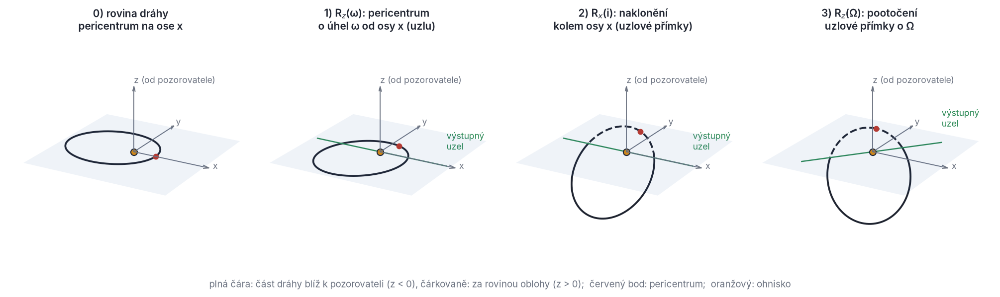
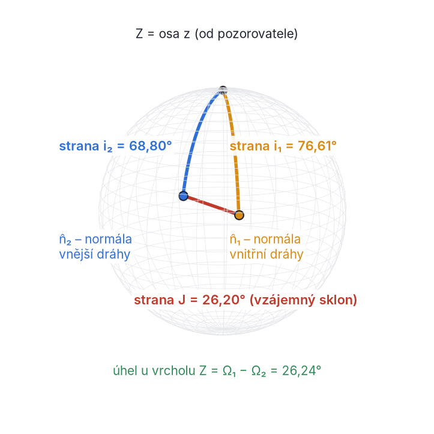
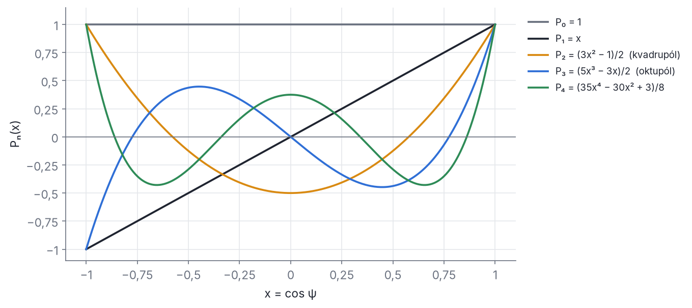
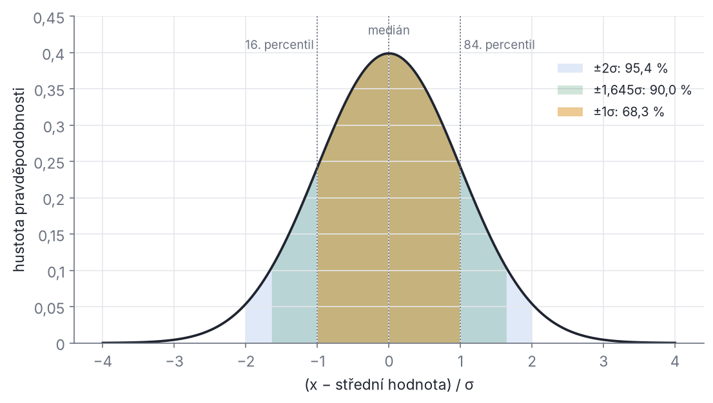

## Přílohy

Přílohy jsou příruční část skript. Nemusíš je číst popořadě. Vracej se k nim, když v textu narazíš na pojem, značku nebo matematický obrat, který ti není jasný.

- **Příloha A – Matematické minimum** shrnuje matematiku prvního ročníku, kterou kapitoly 1–12 používají. U každého tématu je odvození, řešený příklad a odkaz na místo, kde se v knize použije.
- **Příloha B – Jednotky a konstanty** uvádí hodnoty, se kterými počítá SWINGERsim (soubor `units.py`), a vysvětluje, proč gravitační konstanta v programu není přesně 4π².
- **Příloha C – Tabulka značení** obsahuje všechny značky knihy. Upozorňuje i na místa, kde stejné písmeno znamená v různých kapitolách různé věci.
- **Příloha D – Slovníček pojmů** je česko-anglický slovník s krátkým vysvětlením a číslem kapitoly.
- **Příloha E – Časté chyby a pasti** je seznam omylů, které se dělají nejčastěji. Patří k nim znaménka, konvence pro ω, radiány, různé periody, hladiny spolehlivosti nebo HJD a BJD.
- **Příloha F – Doporučená literatura** obsahuje volně dostupné české texty, knihy ke koupi, přehledové články a úplný seznam citované literatury.

---

### Příloha A – Matematické minimum

Všechno v této příloze se probírá v prvním ročníku: vektory, derivace, integrály, matice a základy pravděpodobnosti. Nové jsou spíš souvislosti, ve kterých to v astrofyzice použijeme. Když něco z toho ještě neznáš, přečti si nejdřív intuici na začátku oddílu. Na první čtení kapitol stačí ona, odvození si můžeš doplnit později.

#### A.1 Vektory

**Intuice.** Vektor je šipka. Má velikost a směr a nezáleží na tom, kde začíná. Poloha hvězdy vůči těžišti, její rychlost, zrychlení i moment hybnosti dráhy jsou vektory. Vektory píšeme tučně (**r**, **v**), jejich velikosti obyčejně (r = |**r**|). Jednotkový vektor (velikost 1) má stříšku, např. **n̂**.

V kartézských souřadnicích má vektor tři složky, **r** = (x, y, z), a velikost

```latex
|\mathbf r| = \sqrt{x^2 + y^2 + z^2}.
```

Vektory sčítáme po složkách a násobíme číslem po složkách. Jednotkové vektory os značíme **x̂** = (1, 0, 0), **ŷ** = (0, 1, 0), **ẑ** = (0, 0, 1).

**Skalární součin** dvou vektorů je číslo:

```latex
\mathbf a\cdot\mathbf b = a_x b_x + a_y b_y + a_z b_z = |\mathbf a|\,|\mathbf b|\cos\varphi ,
```

kde φ je úhel mezi vektory. Skalární součin měří, nakolik vektory míří stejným směrem. Je nulový pro kolmé vektory a roven součinu velikostí pro rovnoběžné. Pro jednotkové vektory je to přímo kosinus úhlu mezi nimi. Proto se jím počítá **vzájemný sklon** dvou drah: je to úhel mezi jejich normálami (kapitoly 3 a 5, příklad v A.9). Skalárním součinem se také promítá: složka **v** do směru **n̂** je **v**·**n̂**. Radiální rychlost je složka rychlosti do zorného paprsku, v_r = **v**·**ẑ** = v_z (kapitola 10).

**Vektorový součin** dvou vektorů je vektor:

```latex
\mathbf a\times\mathbf b = \bigl(a_y b_z - a_z b_y,\; a_z b_x - a_x b_z,\; a_x b_y - a_y b_x\bigr).
```

Je kolmý na oba vektory a má velikost |**a**||**b**| sin φ, tedy plochu rovnoběžníku, který vektory vytvoří. Jeho směr určuje **pravidlo pravé ruky**: prsty pravé ruky stočíš od **a** k **b** a palec ukáže směr **a** × **b**. Součin je antikomutativní, **a** × **b** = −**b** × **a**, a **a** × **a** = 0. Pro osy platí **x̂** × **ŷ** = **ẑ**, **ŷ** × **ẑ** = **x̂**, **ẑ** × **x̂** = **ŷ**. Taková soustava se nazývá **pravotočivá**. Na pořadí os záleží (viz A.10).

Měrný moment hybnosti dráhy **h** = **r** × **v** je kolmý na rovinu, ve které leží **r** i **v**, tedy na rovinu dráhy. Jeho směr říká, kam je dráha natočena (kapitola 2).

Dvě identity, které se v knize použijí:

```latex
\mathbf a\times(\mathbf b\times\mathbf c) = \mathbf b\,(\mathbf a\cdot\mathbf c) - \mathbf c\,(\mathbf a\cdot\mathbf b),
\qquad
\mathbf a\cdot(\mathbf b\times\mathbf c) = \mathbf b\cdot(\mathbf c\times\mathbf a) = \mathbf c\cdot(\mathbf a\times\mathbf b).
```

První („bac minus cab“) potřebuješ k odvození vektoru výstřednosti **e** = **v** × **h**/μ − **r**/r (kapitola 2). Druhá je smíšený součin, objem rovnoběžnostěnu. Je nulový, právě když tři vektory leží v jedné rovině.

**Derivace vektoru** se počítá po složkách. Pro součiny platí stejná pravidla jako pro čísla, jen u vektorového součinu nesmíš prohodit pořadí:

```latex
\frac{d}{dt}(\mathbf a\cdot\mathbf b)=\dot{\mathbf a}\cdot\mathbf b+\mathbf a\cdot\dot{\mathbf b},
\qquad
\frac{d}{dt}(\mathbf a\times\mathbf b)=\dot{\mathbf a}\times\mathbf b+\mathbf a\times\dot{\mathbf b}.
```

**Řešený příklad (zachování momentu hybnosti).** Pro **h** = **r** × **v** dostaneme

```latex
\dot{\mathbf h} = \dot{\mathbf r}\times\mathbf v + \mathbf r\times\dot{\mathbf v} = \mathbf v\times\mathbf v + \mathbf r\times\mathbf a = \mathbf r\times\mathbf a .
```

První člen je nulový, protože vektor krát sám sebe je nula. Je-li síla centrální, je **a** rovnoběžné s **r** a druhý člen je také nulový. Moment hybnosti je tedy konstantní a pohyb probíhá v pevné rovině. Takto začíná kapitola 2. Třetí hvězda přidá zrychlení, které s **r** rovnoběžné není, takže **h** vnitřní dvojice se pomalu mění: dráha precesuje (kapitola 5).

#### A.2 Derivace

**Intuice.** Derivace říká, jak rychle se veličina mění. Rychlost je derivace polohy podle času, v = dr/dt. Zrychlení je derivace rychlosti, a = dv/dt = d²r/dt². Tečkou nad písmenem značíme derivaci podle času: ṙ = dr/dt, r̈ = d²r/dt².

Definice derivace:

```latex
f'(x) = \lim_{h\to 0}\frac{f(x+h) - f(x)}{h}.
```

Základní pravidla: (f + g)′ = f′ + g′, (fg)′ = f′g + fg′, (f/g)′ = (f′g − fg′)/g². Dále **řetízkové pravidlo** (derivace složené funkce) [f(g(x))]′ = f′(g(x)) g′(x). Například d/dt cos(nt) = −n sin(nt).

**Parciální derivace** ∂f/∂x je derivace funkce více proměnných podle jedné z nich, ostatní držíme pevné. **Gradient** ∇f = (∂f/∂x, ∂f/∂y, ∂f/∂z) míří tam, kde funkce roste nejrychleji. Gravitační zrychlení je záporný gradient potenciálu, **a** = −∇Φ. Pro Φ = −GM/r vychází **a** = −GM**r**/r³.

**Numerická derivace.** Ve fitu (kapitola 11) SWINGERsim potřebuje derivace modelových okamžiků minim podle parametrů (jakobián J). Vzorec pro ně neexistuje, protože model je numerická simulace, a proto se derivace odhadují **konečnými diferencemi**:

```latex
f'(x)\approx\frac{f(x+h)-f(x)}{h}\quad(\text{chyba}\propto h),
\qquad
f'(x)\approx\frac{f(x+h)-f(x-h)}{2h}\quad(\text{chyba}\propto h^2).
```

Oba odhady plynou z Taylorovy řady (A.5). Krok h nesmí být ani příliš velký (chyba metody), ani příliš malý: rozdíl dvou téměř stejných čísel ztratí platné cifry kvůli zaokrouhlení i kvůli numerickému šumu simulace.

**Řešený příklad.** Pro f(x) = sin x v bodě x = 1 je přesná derivace cos 1 = 0,540 302. Dopředná diference s h = 0,01 dá 0,536 086 (chyba 4,2·10⁻³). Centrální diference dá 0,540 293 (chyba 9·10⁻⁶). Centrální vzorec je při stejné ceně o dva řády přesnější.

#### A.3 Integrál a středování

**Intuice.** Integrál sčítá mnoho malých příspěvků. Plocha pod křivkou, uražená dráha ∫v dt i hmotnost ∫ρ dV jsou integrály. Integrál je opakem derivace: když F′ = f, pak ∫ₐᵇ f dx = F(b) − F(a).

**Střední hodnota** funkce přes interval je integrál dělený délkou intervalu. V sekulární teorii (kapitola 5) nás zajímá **časový průměr** přes jeden oběh s periodou P:

```latex
\langle f\rangle = \frac{1}{P}\int_0^P f\,dt = \frac{1}{2\pi}\int_0^{2\pi} f\,dM ,
```

kde M = n(t − τ) je střední anomálie, n = 2π/P střední pohyb a τ okamžik průchodu pericentrem. Protože M roste s časem rovnoměrně, dt = dM/n. Funkce f je ale obvykle zadaná pomocí vzdálenosti r nebo pravé anomálie ν, a proto se integrační proměnná mění **substitucí**. Z Keplerovy rovnice M = E − e sin E (kapitola 2) a ze vztahů r = a(1 − e cos E) a r²dν/dt = h plyne

```latex
dM = (1 - e\cos E)\,dE = \frac{r}{a}\,dE,
\qquad
dM = \frac{r^2}{a^2\sqrt{1-e^2}}\,d\nu .
```

Druhý vztah dostaneš takto. Z h = r² dν/dt a h = √(μa(1 − e²)) = n a² √(1 − e²) plyne dt = r² dν/h. Vynásobením n vyjde dM = n dt = r² dν/(a²√(1 − e²)).

**Řešený příklad 1 (střední vzdálenost).** Použijeme proměnnou E:

```latex
\langle r\rangle = \frac{1}{2\pi}\int_0^{2\pi} a(1-e\cos E)\,(1-e\cos E)\,dE
= \frac{a}{2\pi}\int_0^{2\pi}\bigl(1 - 2e\cos E + e^2\cos^2 E\bigr)\,dE
= a\Bigl(1+\frac{e^2}{2}\Bigr).
```

Integrál cos E přes periodu je nula a průměr cos²E je ½. Střední vzdálenost přes čas je tedy *větší* než a: hvězda tráví víc času daleko, u apocentra.

**Řešený příklad 2 (průměr (a/r)³).** Tento průměr se objevuje u slapů, relativity a rotace (kapitola 7). Použijeme ν a rovnici dráhy a/r = (1 + e cos ν)/(1 − e²):

```latex
\Bigl\langle\Bigl(\frac{a}{r}\Bigr)^3\Bigr\rangle
= \frac{1}{2\pi}\int_0^{2\pi}\frac{a^3}{r^3}\,\frac{r^2}{a^2\sqrt{1-e^2}}\,d\nu
= \frac{1}{2\pi\sqrt{1-e^2}}\int_0^{2\pi}\frac{1+e\cos\nu}{1-e^2}\,d\nu
= (1-e^2)^{-3/2}.
```

Pro e = 0,5 je výsledek 1,5396. Numerická integrace podle M (krátký skript v Pythonu se `scipy.integrate.quad`) dá totéž na 15 platných míst. Záporné mocniny r se snadno integrují přes ν, kladné přes E. Další užitečné průměry: ⟨(a/r)⟩ = 1, ⟨(a/r)²⟩ = (1 − e²)^(−1/2), ⟨(r/a)²⟩ = 1 + 3e²/2.

> **Pozor.** „Průměr přes oběh“ je vždy průměr přes **čas** (přes M). Průměr přes úhel ν dává jiné číslo: ⟨r⟩ přes ν je a√(1 − e²), tedy *méně* než a. Když článek píše o středování, ověř si, podle které proměnné se průměruje.

#### A.4 Obyčejné diferenciální rovnice a soustavy 1. řádu

**Intuice.** Diferenciální rovnice svazuje funkci s jejími derivacemi. Newtonův zákon r̈ = **a**(**r**) říká: znáš-li polohu, znáš zrychlení. Řešit rovnici znamená najít trajektorii **r**(t), která to splňuje. Abychom ji určili jednoznačně, potřebujeme **počáteční podmínky**: polohu i rychlost v čase t = 0. Je to **počáteční úloha**.

**Řád** rovnice je řád nejvyšší derivace. Newtonova rovnice je 2. řádu. Každou rovnici vyššího řádu převedeme na **soustavu rovnic 1. řádu** tak, že rychlost prohlásíme za samostatnou neznámou. Pro N těles je stavový vektor **y** = (**r**₁, …, **r**_N, **v**₁, …, **v**_N) o 6N složkách a

```latex
\frac{d\mathbf y}{dt} = \mathbf F(\mathbf y),\qquad
\frac{d\mathbf r_k}{dt} = \mathbf v_k,\qquad
\frac{d\mathbf v_k}{dt} = \sum_{j\ne k} G m_j\,\frac{\mathbf r_j-\mathbf r_k}{|\mathbf r_j-\mathbf r_k|^3}.
```

V tomto tvaru pracují všechny numerické integrátory. Spin hvězdy v SWINGERsim je další trojice složek stavového vektoru (kapitoly 6 a 7).

**Eulerova metoda** je nejjednodušší integrátor. Nahradí derivaci dopřednou diferencí (A.2):

```latex
\mathbf y(t+h) \approx \mathbf y(t) + h\,\mathbf F(\mathbf y(t)).
```

Chyba jednoho kroku je úměrná h² (první vynechaný člen Taylorovy řady). Do pevného času T vede T/h kroků, takže **globální chyba** je úměrná h. Metoda s globální chybou ∝ hᵖ se nazývá **metoda řádu p**. Eulerova metoda je 1. řádu. Klasická **Rungova–Kuttova metoda 4. řádu** (RK4) má globální chybu ∝ h⁴, DOP853 (Dormand–Prince) ∝ h⁸ a IAS15, výchozí integrátor SWINGERsim, je 15. řádu (kapitola 6).

**Řešený příklad.** Rovnice y′ = y, y(0) = 1 má řešení y = eᵗ, takže y(1) = e = 2,718 282. Ověřeno krátkým výpočtem v Pythonu:

| krok h | Euler y(1) | chyba | RK4 chyba |
| --- | --- | --- | --- |
| 0,1 | 2,593 742 | 0,1245 | 2,08·10⁻⁶ |
| 0,05 | 2,653 298 | 0,0650 | 1,36·10⁻⁷ |

Poloviční krok zmenší chybu Eulerovy metody zhruba dvakrát (řád 1). Chybu RK4 zmenší 2,08/0,136 ≈ 15krát, což se blíží 2⁴ = 16 (řád 4).

Pro oběžné dráhy je Eulerova metoda zvlášť špatná. Na harmonickém oscilátoru (kruhová dráha v jedné souřadnici) vynásobí energii v každém kroku faktorem 1 + h²ω². Se 100 kroky na periodu vzroste energie za jediný oběh o 48 % a dráha se rozvine do spirály. Proto existují symplektické metody a vysoké řády (kapitola 6).

#### A.5 Taylorova řada

**Intuice.** Hladkou funkci lze v okolí bodu nahradit polynomem. Čím více členů vezmeš, tím lépe to sedí. Většina přibližných vzorců v astrofyzice je jen několik prvních členů Taylorovy řady podle malého parametru.

```latex
f(x+h) = f(x) + h f'(x) + \frac{h^2}{2!} f''(x) + \frac{h^3}{3!} f'''(x) + \dots
```

Užitečné rozvoje pro malé x:

```latex
(1+x)^n \approx 1 + n x + \frac{n(n-1)}{2}x^2,\qquad
\sin x \approx x - \frac{x^3}{6},\qquad
\cos x \approx 1 - \frac{x^2}{2},\qquad
e^x \approx 1 + x + \frac{x^2}{2},\qquad
\ln(1+x) \approx x - \frac{x^2}{2}.
```

Kde se v knize použijí:
- **Numerické metody** (A.2, A.4, kapitola 6): řád metody je počet členů Taylorovy řady, které metoda reprodukuje.
- **Linearizace modelu ve fitu** (kapitola 11): f(θ + Δθ) ≈ f(θ) + J Δθ, kde J je jakobián.
- **Rozvoj podle poměru drah**: gravitační působení vzdálené dvojice se rozvíjí podle a_in/a_out ≪ 1 (kvadrupól, oktupól; kapitola 3, A.11).
- **Malé výstřednosti a sklony**: např. √(1 − e²) ≈ 1 − e²/2 − e⁴/8. Pro e = 0,1 je přesná hodnota 0,994 987, první oprava dá 0,995 000 a druhá 0,994 988.

**Řešený příklad (zbytek řady).** Chybu useknuté řady odhadneme prvním vynechaným členem. Pro sin 1° = sin(0,017 453 3) dá aproximace sin x ≈ x hodnotu 0,017 453 3. Přesná hodnota je 0,017 452 4 a rozdíl 8,9·10⁻⁷ je přesně x³/6. Pro úhly pod 1° je chyba „malého úhlu“ menší než 10⁻⁴ relativně.

#### A.6 Komplexní čísla (stručně)

Komplexní číslo je z = x + iy, kde i² = −1. Je to bod v rovině, x je reálná a y imaginární část. Velikost je |z| = √(x² + y²) a argument (úhel) je φ = atan2(y, x). **Eulerův vzorec**

```latex
e^{i\varphi} = \cos\varphi + i\sin\varphi
```

umožní zapsat z = |z| e^{iφ}. Násobení číslem e^{iφ} otočí bod v rovině o úhel φ. Násobení komplexních čísel tedy znamená násobení velikostí a sčítání úhlů. Z Eulerova vzorce plynou součtové vzorce: e^{i(α+β)} = e^{iα}e^{iβ}, odtud cos(α + β) = cos α cos β − sin α sin β a obdobně pro sin.

Kde to v knize uvidíš:
- **Periodické signály** se zapisují jako A e^{i(2πt/P + φ)}. Fourierova analýza a periodogramy (kapitola 2: Besselova řada; kapitola 11: periodogram jako start fitu) tak rozkládají světelné křivky a O−C diagramy.
- **Výstřednost a argument pericentra jako jedno číslo.** Dvojice (e cos ω, e sin ω) je reálná a imaginární část čísla e·e^{iω}. SWINGERsim fituje vnitřní dráhu právě v těchto složkách (kapitola 11). Je to lepší než fitovat e a ω zvlášť, protože pro e → 0 přestává být ω definováno, kdežto e cos ω a e sin ω se mění hladce. Posun sekundárního minima je úměrný hlavně e cos ω (kapitola 10).
- **Vlastní čísla** reálných matic mohou být komplexní (A.7). Komplexní vlastní čísla znamenají kmitání, například při lineární analýze stability.

#### A.7 Matice: soustavy rovnic, inverze, vlastní vektory a vlastní čísla

**Intuice.** Matice je tabulka čísel, která předpisuje lineární zobrazení: vektor **x** převede na vektor A**x**. Umí ho natáhnout, otočit, překlopit nebo promítnout. Násobení matic odpovídá skládání zobrazení. Pozor, na pořadí záleží: obecně AB ≠ BA.

Součin matic: (AB)ᵢⱼ = Σₖ Aᵢₖ Bₖⱼ. **Transpozice** Aᵀ vymění řádky a sloupce, (AB)ᵀ = BᵀAᵀ. **Jednotková matice** I má na diagonále jedničky. **Inverzní matice** A⁻¹ splňuje A A⁻¹ = A⁻¹A = I a existuje, právě když je **determinant** det A ≠ 0. Pro matici 2 × 2:

```latex
A = \begin{pmatrix} a & b\\ c & d\end{pmatrix},\qquad
\det A = ad - bc,\qquad
A^{-1} = \frac{1}{ad-bc}\begin{pmatrix} d & -b\\ -c & a\end{pmatrix}.
```

Soustavu lineárních rovnic A**x** = **b** formálně řeší **x** = A⁻¹**b**. Numericky se inverze nepočítá, soustava se řeší rozkladem matice (LU, Choleského rozklad, SVD). Je to rychlejší a přesnější.

**Vlastní vektory a vlastní čísla.** Nenulový vektor **v**, který matice jen natáhne (nebo zkrátí či otočí o 180°), ale nezmění jeho směr, se nazývá **vlastní vektor**. Faktor natažení λ je příslušné **vlastní číslo**:

```latex
A\mathbf v = \lambda\mathbf v .
```

Vlastní vektory jsou tedy *směry*, vlastní čísla *faktory* („o kolik“). Vlastní čísla jsou kořeny rovnice det(A − λI) = 0. **Symetrická** matice (Aᵀ = A) má všechna vlastní čísla reálná a vlastní vektory navzájem kolmé. Takové jsou kovarianční matice i matice momentu setrvačnosti.

**Kovarianční matice a elipsa nejistot** (kapitola 11). Pro dva parametry s nejistotami σ₁, σ₂ a korelačním koeficientem ρ je

```latex
C = \begin{pmatrix}\sigma_1^2 & \rho\,\sigma_1\sigma_2\\ \rho\,\sigma_1\sigma_2 & \sigma_2^2\end{pmatrix}.
```

Křivka (**θ** − **θ̂**)ᵀ C⁻¹ (**θ** − **θ̂**) = 1 je elipsa. Její osy míří podél **vlastních vektorů** C a délky poloos jsou **√λ** (odmocniny vlastních čísel). V metodě nejmenších čtverců je C = (JᵀWJ)⁻¹, kde J je jakobián a W = diag(1/σₖ²) matice vah. Hessova matice χ² je H ≈ 2JᵀWJ, takže C = 2H⁻¹, *ne* H⁻¹. Hranice 1σ pro jeden parametr odpovídá Δχ² = 1.

**Řešený příklad.** Nechť σ₁ = 2, σ₂ = 1 a ρ = 0,9, takže C = ((4; 1,8), (1,8; 1)). Rovnice det(C − λI) = (4 − λ)(1 − λ) − 3,24 = 0 má kořeny λ₁ = 4,843 a λ₂ = 0,157. Poloosy elipsy jsou √λ₁ = 2,20 a √λ₂ = 0,396. Elipsa je tedy úzká a šikmá. Dlouhá osa míří podél vlastního vektoru (0,906; 0,424), tj. pod úhlem 25° k ose θ₁. Kombinace podél krátké osy, úměrná θ₁ − 2,1 θ₂, je určena 2,20/0,396 ≈ 5,6krát přesněji než kombinace podél dlouhé osy. Tak vypadá **degenerace** parametrů (např. hmotnost třetí hvězdy a sklon vnější dráhy, kapitola 11).

**Podmíněnost a SVD.** Poměr největšího a nejmenšího singulárního čísla matice se nazývá **číslo podmíněnosti**. Je-li obrovské (10¹²), matice je numericky téměř singulární a některé kombinace parametrů data neurčují. SWINGERsim proto nedělá inverzi JᵀWJ přímo. Rozloží jakobián se škálovanými sloupci singulárním rozkladem (SVD) a směry se singulárním číslem pod 10⁻¹² největšího vypustí a vypíše varování. Nejistoty parametrů, které takové směry tvoří, pak vycházejí *příliš malé* a nelze jim věřit (kapitola 11). Rozklad samotného J je lepší než rozklad JᵀWJ, protože součin JᵀJ číslo podmíněnosti umocní na druhou.

#### A.8 Rotační matice (aktivní) a jejich skládání

**Intuice.** Rotační matice otočí vektor kolem osy o daný úhel a nezmění jeho délku. V knize je používáme k jedinému úkolu: dráhu, kterou umíme snadno popsat v její vlastní rovině, natočit do prostoru tak, jak ji vidí pozorovatel (kapitola 2).

**Aktivní a pasivní rotace.** *Aktivní* rotace otáčí vektor, souřadnicové osy zůstávají. *Pasivní* rotace otáčí osy a vektor zůstává. Stejný vektor má v otočených osách složky dané *transponovanou* maticí. V knize i v SWINGERsim jsou všechny rotace **aktivní**. Kladný úhel znamená otočení podle pravidla pravé ruky: palec ve směru osy, prsty ukazují směr otáčení. Při pohledu ze špičky osy dolů k počátku jde otáčení proti směru hodinových ručiček.

Rotace o úhel φ kolem osy z a kolem osy x:

```latex
R_z(\varphi) = \begin{pmatrix}\cos\varphi & -\sin\varphi & 0\\ \sin\varphi & \cos\varphi & 0\\ 0 & 0 & 1\end{pmatrix},
\qquad
R_x(\varphi) = \begin{pmatrix}1 & 0 & 0\\ 0 & \cos\varphi & -\sin\varphi\\ 0 & \sin\varphi & \cos\varphi\end{pmatrix}.
```

Kontrola: R_z(90°) **x̂** = (0, 1, 0) = **ŷ**, tedy osa x se otočila do osy y, jak má. R_x(90°) **ŷ** = **ẑ**.

Každá rotační matice je **ortogonální**, RᵀR = I. Inverzní rotace je tedy transpozice, R⁻¹ = Rᵀ, a R(φ)⁻¹ = R(−φ). Determinant je +1 (zrcadlení by mělo −1). Ortogonalita znamená, že se zachovávají délky a úhly: |R**v**| = |**v**| a (R**a**)·(R**b**) = **a**·**b**.

**Skládání.** Polohu v rovině dráhy **r**′ = (r cos ν, r sin ν, 0), kde osa x′ míří do pericentra, převedeme do souřadnic oblohy jako

```latex
\mathbf r = R_z(\Omega)\,R_x(i)\,R_z(\omega)\,\mathbf r' .
```

Součin matic se čte **zprava doleva**, v pořadí, v jakém rotace na vektor působí (obr. A.1):
1. R_z(ω) otočí dráhu v její vlastní rovině tak, že pericentrum leží pod úhlem ω od osy x. Osa x se tím stává uzlovou přímkou.
2. R_x(i) nakloní rovinu dráhy o sklon i kolem osy x, tedy kolem uzlové přímky.
3. R_z(Ω) otočí celou nakloněnou dráhu kolem osy z (zorného paprsku) o délku uzlu Ω.


*Obr. A.1 – Jak R_z(Ω)R_x(i)R_z(ω) natočí dráhu (a = 1, e = 0,5, ω = 70°, i = 55°, Ω = 50°). Modrá plocha je rovina oblohy z = 0, osa z míří od pozorovatele. V panelu 1 leží pericentrum (červený bod) pod úhlem ω od osy x. V panelu 2 se rovina dráhy naklonila kolem osy x: čárkovaná polovina dráhy je za rovinou oblohy (z > 0, dál od nás). Zelená uzlová přímka prochází výstupným uzlem, kde těleso přechází z plné do čárkované části, tedy směrem od pozorovatele. V panelu 3 se celá dráha otočila kolem zorného paprsku o Ω.*

Roznásobením dostaneme matici, kterou SWINGERsim používá (`kepler.rotation_matrix`; zkratky c = cos, s = sin):

```latex
R = \begin{pmatrix}
c_\Omega c_\omega - s_\Omega s_\omega c_i & -c_\Omega s_\omega - s_\Omega c_\omega c_i & s_\Omega s_i\\
s_\Omega c_\omega + c_\Omega s_\omega c_i & -s_\Omega s_\omega + c_\Omega c_\omega c_i & -c_\Omega s_i\\
s_\omega s_i & c_\omega s_i & c_i
\end{pmatrix}.
```

Ze třetího řádku plyne souřadnice podél zorného paprsku. S **r**′ = (r cos ν, r sin ν, 0) a součtovým vzorcem je

```latex
z = r\,(\sin\omega\cos\nu + \cos\omega\sin\nu)\sin i = r\sin(\omega+\nu)\sin i .
```

Tento vzorec je základem efektu světelného času a radiálních rychlostí (kapitola 10). Třetí sloupec R je obraz osy **ẑ**′, tedy jednotková **normála dráhy**:

```latex
\hat{\mathbf n} = R\,\hat{\mathbf z}' = (\sin\Omega\sin i,\; -\cos\Omega\sin i,\; \cos i).
```

Sklon i je tedy úhel mezi normálou dráhy (směrem **h**) a osou +z: cos i = **n̂**·**ẑ**.

**Výstupný uzel.** Uzly jsou body, kde dráha protíná rovinu oblohy z = 0, tedy kde sin(ω + ν) = 0. V bodě u = ω + ν = 0 je z = 0 a dz/du = r sin i > 0 (pro 0 < i < 180°). Těleso tam tedy přechází na stranu z > 0, **od pozorovatele**. To je **výstupný uzel** a Ω je jeho směr v rovině oblohy, měřený od osy x k ose y.

**Nekomutativnost.** Na pořadí rotací záleží. Vezmi vektor **x̂**. R_x(90°) ho nezmění a R_z(90°) z něj pak udělá **ŷ**. Tedy R_z(90°)R_x(90°)**x̂** = **ŷ**. V opačném pořadí R_z(90°) udělá z **x̂** vektor **ŷ** a R_x(90°) z něj **ẑ**. Výsledky se liší, takže R_x(90°)R_z(90°) ≠ R_z(90°)R_x(90°). Kdo prohodí pořadí rotací, dostane jinou dráhu. Inverzní transformace (z oblohy do roviny dráhy) je R⁻¹ = Rᵀ = R_z(−ω)R_x(−i)R_z(−Ω). Pořadí i znaménka se obrátí.

> **Pozor.** Některé učebnice zapisují tutéž transformaci pasivně, jako otáčení os. Pak mají matice opačná znaménka u sinů a opačné pořadí. Výsledné vzorce pro x, y, z jsou stejné, jen jinak zapsané. Když přebíráš vzorec z literatury, ověř ho na jednoduchém případu: pro i = 0 musí dráha ležet v rovině oblohy, pro i = 90° ji musíš vidět z boku.

**Řešený příklad.** Pro Ω = 0,3 rad, i = 1,1 rad, ω = 2,0 rad a ν = 0,7 rad dá maticový součin z = 0,380 884·r a vzorec r sin(ω + ν) sin i totéž. Numericky jsme ověřili i to, že součin R_z R_x R_z se shoduje s funkcí `kepler.rotation_matrix` ze SWINGERsim, že RᵀR = I a že det R = 1.

#### A.9 Sférická trigonometrie z rotací: kosinová věta a vzájemný sklon

**Intuice.** Směry v prostoru jsou body na jednotkové kouli: normála dráhy, směr ke hvězdě, osa rotace. Úhel mezi dvěma směry je délka oblouku hlavní kružnice mezi nimi. Tři směry tvoří **sférický trojúhelník**. Jeho strany jsou úhly mezi směry (měří se ve stupních, ne v metrech) a úhly u vrcholů jsou úhly mezi rovinami.

**Odvození kosinové věty pomocí rotací.** Normála dráhy se sklonem i a délkou uzlu Ω je podle A.8 **n̂**(i, Ω) = R_z(Ω)R_x(i)**ẑ**. Pro dvě dráhy je kosinus úhlu J mezi normálami jejich skalární součin. Protože rotace zachovávají skalární součin, můžeme celý obraz otočit pomocí R_z(−Ω₁) a pak R_x(−i₁) tak, aby první normála splynula s osou z:

```latex
\cos J = \hat{\mathbf n}_1\cdot\hat{\mathbf n}_2
= \hat{\mathbf z}^{\mathsf T} R_x(-i_1)\,R_z(\Omega_2-\Omega_1)\,R_x(i_2)\,\hat{\mathbf z}.
```

Počítáme zprava. R_x(i₂)**ẑ** = (0, −sin i₂, cos i₂). Rotace R_z(Δ) s Δ = Ω₂ − Ω₁ z toho udělá (sin i₂ sin Δ, −sin i₂ cos Δ, cos i₂). Z posledního kroku potřebujeme jen složku z. Třetí řádek matice R_x(−i₁) je (0, sin(−i₁), cos(−i₁)) = (0, −sin i₁, cos i₁). Jeho skalární součin s předchozím vektorem dá (−sin i₁)(−sin i₂ cos Δ) + cos i₁ cos i₂, tedy

```latex
\cos J = \cos i_1\cos i_2 + \sin i_1\sin i_2\cos(\Omega_1-\Omega_2).
```

To je **kosinová věta sférické trigonometrie pro strany**: v trojúhelníku s vrcholy **ẑ**, **n̂**₁, **n̂**₂ jsou dvě strany i₁ a i₂, úhel mezi nimi u vrcholu **ẑ** je ΔΩ a třetí strana je J (obr. A.2). Ve tvaru se souřadnicemi oblohy je to známý vzorec pro úhlovou vzdálenost dvou hvězd:

```latex
\cos d = \sin\delta_1\sin\delta_2 + \cos\delta_1\cos\delta_2\cos(\alpha_1-\alpha_2),
```

kde δ je deklinace (90° − δ je úhel od pólu) a α rektascenze.


*Obr. A.2 – Vzájemný sklon dráhy páru a vnější dráhy V907 Sco jako strana sférického trojúhelníku na jednotkové kouli. Vrcholy jsou osa z (zorný paprsek, od pozorovatele) a normály obou drah. Strany od osy z jsou sklony vůči obloze, i₁ = 76,61° a i₂ = 68,80°. Úhel u vrcholu Z je rozdíl délek uzlů 26,24°. Třetí strana, vzájemný sklon J, vychází 26,20°.*

**Řešený příklad (V907 Sco).** Konfigurace `v907_sco_published.yaml` má i₁ = 76,61°, Ω₁ = 17,27°, i₂ = 68,80° a Ω₂ = −8,97°. Tedy

```latex
\cos J = \cos 76{,}61^\circ\cos 68{,}80^\circ + \sin 76{,}61^\circ \sin 68{,}80^\circ\cos 26{,}24^\circ
= 0{,}0837 + 0{,}8137 = 0{,}8974,
\qquad J = 26{,}20^\circ .
```

To souhlasí s J = 26,2° v práci Zasche et al. (2023a).

**Co když rozdíl uzlů neznáme?** Ze zákrytů a radiálních rychlostí se dají změřit i₁ a i₂, ale ne absolutní Ω: to umí jen astrometrie nebo interferometrie. Protože −1 ≤ cos ΔΩ ≤ 1, kosinová věta dává alespoň meze:

```latex
|i_1 - i_2| \le J \le \min(i_1 + i_2,\; 360^\circ - i_1 - i_2).
```

Pro V907 Sco by to bylo 7,81° ≤ J ≤ 145,41°, tedy téměř nic. Vzájemný sklon se proto musí určit jinak, u V907 Sco z rychlosti precese sklonu páru (kapitoly 5 a 12).

**Sinová věta a invariantní rovina.** Celkový moment hybnosti **L** = **L**_in + **L**_out je kolmý na invariantní rovinu. Obě normály drah s ním leží v jedné rovině a složky kolmé na **L** se musí odečíst. Proto L_in sin θ_in = L_out sin θ_out a θ_in + θ_out = J. Odtud (s ℓ = L_in/L_out)

```latex
\tan\theta_{\mathrm{out}} = \frac{\ell\,\sin J}{1+\ell\cos J}.
```

Pro V907 Sco s ℓ ≈ 0,45 a J = 26,2° vyjde θ_out ≈ 8,0° a θ_in ≈ 18,2° (kapitoly 3 a 5).

#### A.10 Souřadnicové soustavy a orientace (z od pozorovatele, sever a východ)

**Kartézské a sférické souřadnice.** Bod v prostoru je dán buď (x, y, z), nebo vzdáleností r a dvěma úhly. Pro polární úhel θ od osy z a azimut φ od osy x je x = r sin θ cos φ, y = r sin θ sin φ, z = r cos θ. Astronomické soustavy (rovníková, ekliptikální, galaktická) používají místo θ šířku 90° − θ.

**Pravotočivé a levotočivé soustavy.** Soustava (x, y, z) je pravotočivá, když **x̂** × **ŷ** = **ẑ**. Zrcadlový obraz pravotočivé soustavy je levotočivý. Vzorce pro vektorový součin z A.1 platí v pravotočivé soustavě. Obzorníková soustava (azimut od jihu k západu) a rovníková soustava 1. druhu jsou levotočivé, rovníková 2. druhu, ekliptikální a galaktická pravotočivé (Janík & Mikulášek, *Obecná astronomie*, kap. 2).

**Soustava SWINGERsim.** Rovina x–y je rovina oblohy, osa z leží v zorném paprsku a míří **od pozorovatele**. Radiální rychlost v_r = v_z je kladná pro vzdalování, jak je v astronomii zvykem. Hvězda s větším z je dál a její světlo k nám dorazí později, o z/c. Sklon i je úhel mezi momentem hybnosti dráhy a osou +z: i < 90° znamená, že **h** má kladnou složku z. Délka uzlu Ω se měří od osy x k ose y (v kódu `atan2(n_y, n_x)`, kde **n** = **ẑ** × **h**). Všechny úhly jsou uvnitř programu v radiánech, v konfiguraci ve stupních.

**Kde je sever a východ?** Na obloze se poziční úhly měří od severu přes východ. Když se díváš na oblohu se severem nahoře, je východ *vlevo*. Trojice (sever, východ, od pozorovatele) je proto **levotočivá**: sever × východ míří k pozorovateli, ne od něj. Plynou z toho dvě rovnocenné volby:

- **x = sever, y = východ.** Pak vzorce SWINGERsim pro x, y, z (A.8) jsou přesně klasické vzorce pro vizuální dvojhvězdy: Ω se měří od severu přes východ a pro i < 90° roste poziční úhel průvodce. Fyzikální soustava (sever, východ, od nás) je ovšem zrcadlová. To nevadí, protože newtonovská gravitace, relativistické korekce i slapy jsou vůči zrcadlení symetrické. Zrcadlový obraz řešení je opět řešení a okamžiky zákrytů, radiální rychlosti, sklony a vzájemné sklony vyjdou stejně.
- **x = východ, y = sever.** Soustava je fyzikálně pravotočivá, ale Ω se pak měří od východu k severu (o 90° jinak a opačným směrem než v katalozích) a dráha s i < 90° běží po obloze ve směru hodinových ručiček.

Pro fotometrii, O−C a radiální rychlosti na volbě nezáleží: pozorovatelné jsou jen *rozdíly* délek uzlů. Na absolutní Ω záleží až při srovnání s astrometrií nebo interferometrií. Pak je nutné říct, kterou volbu používáš. (Komentář v souboru `systemview.py` uvádí „y towards north“, tedy druhou volbu. Kód sám jen měří Ω od osy x.)

**Jacobiho a barycentrické souřadnice.** Elementy každé dráhy hierarchie počítá SWINGERsim v **Jacobiho souřadnicích**: vnitřní pár relativně (druhá hvězda vůči první), vnější dráha jako pohyb třetího tělesa vůči těžišti páru (kapitola 3). Argument pericentra ω v konfiguraci patří relativní dráze *druhé* větve kolem první. Barycentrická dráha první hvězdy má ω₁ = ω + 180° (příloha E).

**Soustava invariantní roviny.** HDF5 výstup obsahuje kromě sklonů k obloze (`inc`, `Omega`) i sklony a uzly vůči invariantní rovině v čase t = 0 (`inc_inv`, `Omega_inv`). Invariantní rovina je kolmá na celkový moment hybnosti a v čistě gravitační soustavě se nemění (kapitoly 3 a 5).

#### A.11 Legendreovy polynomy a multipólový rozvoj

**Intuice.** Vzdálená dvojice hvězd působí na třetí hvězdu skoro jako jeden hmotný bod. Rozdíl od bodu je malý a dá se rozepsat do řady podle poměru velikostí drah. Členy této řady jsou **Legendreovy polynomy** Pₙ. Člen n = 2 je **kvadrupól**, n = 3 **oktupól** (kapitoly 3 a 5).

**Rozvoj převrácené vzdálenosti.** Nechť **R** je poloha vzdáleného tělesa, **r** poloha blízkého (r < R) a ψ úhel mezi nimi. Podle kosinové věty |**R** − **r**|² = R² − 2Rr cos ψ + r², takže

```latex
\frac{1}{|\mathbf R-\mathbf r|} = \frac{1}{R}\,\frac{1}{\sqrt{1 - 2xt + t^2}},\qquad t = \frac{r}{R},\quad x = \cos\psi .
```

Funkce (1 − 2xt + t²)^(−1/2) je **vytvořující funkce** Legendreových polynomů:

```latex
\frac{1}{\sqrt{1-2xt+t^2}} = \sum_{n=0}^{\infty} P_n(x)\,t^n ,
\qquad
\frac{1}{|\mathbf R-\mathbf r|} = \frac{1}{R}\sum_{n=0}^{\infty}\Bigl(\frac{r}{R}\Bigr)^n P_n(\cos\psi).
```

První polynomy dostaneme z binomického rozvoje (A.5). Položme u = 2xt − t². Pak (1 − u)^(−1/2) = 1 + u/2 + 3u²/8 + 5u³/16 + … Dosadíme u a seskupíme členy podle mocnin t:

```latex
1 + \tfrac12(2xt - t^2) + \tfrac38(2xt-t^2)^2 + \dots
= 1 + x\,t + \Bigl(\tfrac32 x^2 - \tfrac12\Bigr)t^2 + \dots
```

Člen t² obsahuje −½ z první závorky a (3/8)·4x² z druhé. Tak vyjde P₂(x) = (3x² − 1)/2. Stejně se dopočtou další:

```latex
P_0 = 1,\quad P_1 = x,\quad P_2 = \tfrac12(3x^2-1),\quad P_3 = \tfrac12(5x^3-3x),\quad P_4 = \tfrac18(35x^4-30x^2+3).
```


*Obr. A.3 – Legendreovy polynomy P₀ až P₄ na intervalu −1 ≤ x ≤ 1 (x = cos ψ). Všechny mají Pₙ(1) = 1. Sudé jsou symetrické a liché antisymetrické vůči x = 0. P₂ je nejmenší (−½) pro ψ = 90°. Proto kvadrupólová síla závisí na tom, zda jsou dráhy rovnoběžné, nebo kolmé.*

Vlastnosti: Pₙ(1) = 1, Pₙ(−x) = (−1)ⁿPₙ(x) a polynomy jsou **ortogonální**:

```latex
\int_{-1}^{1} P_m(x)P_n(x)\,dx = \frac{2}{2n+1}\,\delta_{mn},
```

kde δ_mn = 1 pro m = n a jinak 0 (Kroneckerovo delta).

**Řešený příklad.** Pro r/R = 0,1 a ψ = 60° (x = 0,5) je přesně R/|**R** − **r**| = (1 − 0,1 + 0,01)^(−1/2) = 1,048 285. Částečné součty řady jsou 1, 1,05, 1,048 75 a 1,048 313 (P₀ až P₃). Každý další člen zpřesní výsledek zhruba desetkrát, protože r/R = 0,1. U hierarchické trojhvězdy je poměr a_in/a_out obvykle 0,01–0,1, takže kvadrupól je hlavní oprava a oktupól malá oprava k ní.

**Jak to souvisí s hmotnostmi.** Pro dvojici hmotností m₁, m₂ s relativní polohou **r** a vzdálené těleso ve vzdálenosti **R** od těžiště dvojice vymizí člen n = 1 díky volbě těžiště. Kvadrupól má hmotnostní faktor m₁m₂/(m₁ + m₂). Oktupól má navíc faktor (m₁ − m₂)/(m₁ + m₂), takže u dvojice stejných hmotností vymizí (kapitola 3).

#### A.12 Eliptické integrály (stručně)

Některé integrály s odmocninou z goniometrické funkce nelze vyjádřit elementárními funkcemi. Nejčastější jsou **úplné eliptické integrály** 1. a 2. druhu:

```latex
K(k) = \int_0^{\pi/2}\frac{d\varphi}{\sqrt{1-k^2\sin^2\varphi}},\qquad
E(k) = \int_0^{\pi/2}\sqrt{1-k^2\sin^2\varphi}\;d\varphi .
```

Pro k = 0 je K = E = π/2. Obvod elipsy s velkou poloosou a a výstředností e je 4aE(e). Pro a = 1 vychází 5,870 pro e = 0,5 a 5,105 pro e = 0,8 (kružnice má 2π = 6,283). Perioda kyvadla s velkou amplitudou θ₀ je 4√(l/g) K(sin(θ₀/2)). V literatuře o vícenásobných hvězdách se eliptické integrály objevují v analytických řešeních cyklů ZLK, v potenciálu prstence (Gaussova metoda středování) a v analytických modelech tranzitů (Mandel & Agol 2002). SWINGERsim je nepotřebuje: oběhy integruje numericky a průměry počítá kvadraturou. Když je v článku uvidíš, stačí vědět, že jsou to obyčejná čísla, která spočítá např. `scipy.special.ellipk`. Pozor: SciPy bere jako argument *parametr* m = k², ne modul k.

#### A.13 Pravděpodobnost a statistika

**Intuice.** Každé měření je zatížené náhodnou chybou. Opakovaná měření by se rozptýlila kolem skutečné hodnoty. Pravděpodobnost popisuje, jak se rozptýlí. Statistika jde opačným směrem: z rozptýlených měření usuzuje na skutečnou hodnotu a její **nejistotu**. (V českých textech se pro σ používá spíš „nejistota“ a slovo „chyba“ se nechává pro omyly. V této knize používáme obě slova, jak je v astronomii obvyklé.)

**Střední hodnota, rozptyl, směrodatná odchylka.** Pro náhodnou veličinu x s hustotou pravděpodobnosti p(x) je střední hodnota ⟨x⟩ = ∫x p(x) dx a **rozptyl** (variance) σ² = ⟨(x − ⟨x⟩)²⟩. **Směrodatná odchylka** σ je odmocnina z rozptylu a má stejné jednotky jako x. „Rozptyl“ je tedy σ², ne σ.

**Gaussovo (normální) rozdělení**

```latex
p(x) = \frac{1}{\sqrt{2\pi}\,\sigma}\exp\Bigl[-\frac{(x-\mu)^2}{2\sigma^2}\Bigr]
```

je dáno střední hodnotou μ a směrodatnou odchylkou σ. (Zde je μ střední hodnota, ne gravitační parametr. Viz tabulka značení.) Plochy pod křivkou, ověřené numerickým výpočtem:

| interval | pravděpodobnost |
| --- | --- |
| μ ± 1σ | 68,27 % |
| μ ± 1,645σ | 90,00 % |
| μ ± 1,960σ | 95,00 % |
| μ ± 2σ | 95,45 % |
| μ ± 3σ | 99,73 % |


*Obr. A.4 – Normované Gaussovo rozdělení. Oranžová plocha (±1σ) obsahuje 68,3 % pravděpodobnosti, zelená (±1,645σ) 90 % a modrá (±2σ) 95,4 %. Tečkované čáry jsou 16. percentil, medián a 84. percentil. Pro Gaussovo rozdělení leží téměř přesně v −1σ, 0 a +1σ (16. a 84. percentil jsou ∓0,994σ, přesně ∓1σ jsou 15,87. a 84,13. percentil).*

**Percentily.** p-tý percentil je hodnota, pod kterou leží p % pravděpodobnosti. Pro Gaussovo rozdělení je 15,87. percentil μ − σ, 50. percentil (medián) μ a 84,13. percentil μ + σ. SWINGERsim i většina článků uvádí výsledky MCMC jako medián a 16. a 84. percentil, zapsané jako hodnota s horní a dolní nejistotou, např. x = 1,00 (+0,07/−0,06) (kapitoly 11 a 12). U nesymetrického rozdělení jsou horní a dolní nejistota různé. Nelze je jednoduše zprůměrovat a pro negaussovské rozdělení neodpovídá interval 16–84 % přesně ±1σ.

**Převody mezi hladinami.** Když článek uvádí 90% interval ±a, odpovídá u gaussovského rozdělení σ = a/1,645. Například ±0,13 na hladině 90 % je σ = 0,079. Robustní odhad σ z **mediánové absolutní odchylky** (MAD) je σ ≈ 1,4826 × MAD. Celá šířka v polovině výšky (FWHM) je 2,3548σ.

**Šíření nejistot.** Pro funkci f(x, y) s malými nejistotami σ_x, σ_y a korelací ρ (lineární aproximace, A.5) platí

```latex
\sigma_f^2 \approx \Bigl(\frac{\partial f}{\partial x}\Bigr)^2\sigma_x^2 + \Bigl(\frac{\partial f}{\partial y}\Bigr)^2\sigma_y^2
+ 2\,\frac{\partial f}{\partial x}\frac{\partial f}{\partial y}\,\rho\,\sigma_x\sigma_y .
```

Obecně σ_f² = **g**ᵀC**g**, kde **g** je gradient f a C kovarianční matice. Pro nezávislé veličiny (ρ = 0) se nejistoty **sčítají kvadraticky**. **Řešený příklad:** f = xy, x = 2 ± 0,1, y = 3 ± 0,2. Bez korelace je σ_f = √((3·0,1)² + (2·0,2)²) = 0,50. S korelací ρ = 0,5 je σ_f = 0,61. Zanedbání korelace tu podcení nejistotu o 18 %.

**Rozdělení χ².** Součet čtverců n_dof nezávislých normovaných gaussovských veličin má střední hodnotu n_dof a rozptyl 2n_dof. Proto má χ²_red = χ²/n_dof u správného modelu se správnými chybami hodnotu 1 ± √(2/n_dof) (kapitola 11). Oblasti spolehlivosti pro p společně odhadovaných parametrů ohraničuje Δχ² nad minimem:

| počet parametrů p | Δχ² pro 68,3 % | Δχ² pro 90 % |
| --- | --- | --- |
| 1 | 1,00 | 2,71 |
| 2 | 2,30 | 4,61 |
| 3 | 3,53 | 6,25 |

**Podmíněná pravděpodobnost a Bayesův teorém.** P(A|B) je pravděpodobnost A za předpokladu, že platí B. Z P(A a B) = P(A|B)P(B) = P(B|A)P(A) plyne

```latex
p(\boldsymbol\theta\,|\,D) = \frac{p(D\,|\,\boldsymbol\theta)\,p(\boldsymbol\theta)}{p(D)} .
```

Posterior p(**θ**|D) je úměrný věrohodnosti p(D|**θ**) krát prior p(**θ**). Jmenovatel p(D) je **evidence** (kapitola 11). Věrohodnost je hustota pravděpodobnosti dat. Jako funkce **θ** to ale není rozdělení pravděpodobnosti, integrál přes **θ** nemusí být 1.

**Srovnání modelů.** Bayesův faktor K = Z₁/Z₂ je poměr evidencí dvou modelů. Jeffreysova škála (Jeffreys 1961, příloha B) říká, že K > 10^(1/2) ≈ 3,2 je podstatná podpora prvního modelu, K > 10 silná, K > 10^(3/2) ≈ 32 velmi silná a K > 100 rozhodující. Přibližná kritéria jsou **BIC** = −2 ln L_max + p ln N (Schwarz 1978) a **AIC** = −2 ln L_max + 2p (Akaike 1974), kde p je počet parametrů a N počet dat. Model s menší hodnotou je lepší. Tvary s χ²_min místo −2 ln L_max platí jen pro stejná data se stejnými σ u obou modelů.

**Poissonovo a binomické rozdělení.** Počet náhodných událostí se střední hodnotou N kolísá o √N (Poissonovo rozdělení). Podíl k úspěchů z n pokusů má binomické rozdělení. Pro malá k nebo k blízko n se jeho nejistota nesmí počítat jako √(p̂(1 − p̂)/n). SWINGERsim proto používá Wilsonův interval (Wilson 1927, kapitola 11).

#### A.14 Logaritmy a mocninné zákony

Logaritmus je opak umocnění: y = log_b x, právě když b^y = x. Dekadický logaritmus značíme log, přirozený ln (základ e = 2,718 28). Pravidla: log(xy) = log x + log y, log(x/y) = log x − log y, log xⁿ = n log x a ln x = ln 10 · log x = 2,302 59 log x.

**Mocninný zákon** y = C xⁿ je v grafu s logaritmickými osami přímka se směrnicí n, protože log y = log C + n log x. Tak se z grafu čte exponent. Příklady z knihy:
- 3. Keplerův zákon P² ∝ a³/M, tedy a ∝ P^(2/3) při pevné hmotnosti. Dvojnásobná perioda znamená 2^(2/3) = 1,59krát větší dráhu.
- Amplituda světelného času roste jako P₂^(2/3) (je úměrná velikosti vnější dráhy), amplituda dynamického efektu klesá jako P₁²/P₂. Jejich poměr je ∝ P₂^(−5/3). Dvojnásobná vnější perioda zmenší převahu dynamického efektu 2^(5/3) = 3,2krát (kapitola 10).
- Slapové časové škály jsou úměrné vysokým mocninám a/R, např. (a/R)⁸ (kapitola 7). Malá změna a znamená velkou změnu času.

**Hvězdné velikosti** jsou logaritmické: m₁ − m₂ = −2,5 log(F₁/F₂) (Pogsonova rovnice). Zákryt hloubky 0,1 mag sníží tok na 10^(−0,04) = 0,912, tedy o 8,8 %. Dvě stejně jasné hvězdy jsou dohromady o 2,5 log 2 = 0,753 mag jasnější než jedna z nich.

**Exponenciální růst** y = y₀ e^(t/τ) je v grafu s logaritmickou osou y přímka. Za čas τ (e-násobný čas) vzroste y e-krát, za τ ln 2 = 0,693τ dvakrát. Takto se rozbíhají sousední trajektorie v chaotické soustavě (kapitola 4).

#### A.15 Úhly a radiány

Radián je úhel, jemuž na jednotkové kružnici odpovídá oblouk délky 1. Plný úhel je 2π rad = 360°, takže 1 rad = 57,2958° a 1° = 0,017 453 rad. Dále 1′ = 1/60°, 1″ = 1/3600° = 4,848·10⁻⁶ rad a 1 mas (milivteřina) = 10⁻³″. Oblouk délky s na kružnici o poloměru r má úhel s/r v radiánech. Pro malé úhly (A.5) je sin φ ≈ tan φ ≈ φ jen v radiánech.

**Řešený příklad.** Slunce (průměr 2R☉ = 1,391·10⁹ m) ve vzdálenosti 100 pc = 3,086·10¹⁸ m má úhlový průměr 4,5·10⁻¹⁰ rad = 0,093 mas. Takové hvězdy nerozliší ani interferometr. O jejich velikosti se dozvíme ze zákrytů (kapitola 10).

**Úhly v programech.** Funkce sin, cos a tan v Pythonu (NumPy) i v C berou **radiány**. SWINGERsim má úhly v konfiguračním souboru (YAML) ve **stupních**, uvnitř programu a v HDF5 výstupu v **radiánech**. Výjimkou jsou veličiny, jejichž jméno končí na `_deg`, např. sklon spinu `obliquity_deg` (soubor `io.py`: „angles are radians unless the name ends in `_deg`“).

**atan2.** Úhel z dvojice složek (x, y) se počítá funkcí atan2(y, x), ne atan(y/x). Atan(y/x) nerozliší protilehlé kvadranty, protože (1, 1) a (−1, −1) mají stejný podíl. Atan2 vrací úhel v rozsahu (−π, π]. SWINGERsim pak úhly převádí do intervalu [0, 2π) pomocí modula.

**Průměr úhlů.** Úhly nelze průměrovat jako čísla. Průměr 359° a 1° není 180°, ale 0°. Správný postup: zprůměrovat vektory (cos φ, sin φ) a z výsledku vzít atan2. Stejně tak rozdíl dvou úhlů je třeba převést do intervalu (−180°, 180°].

#### Vyzkoušej si (příloha A)

1. Pomocí excentrické anomálie ukaž, že ⟨(r/a)²⟩ = 1 + 3e²/2.
2. Dvě dráhy mají i₁ = 80°, i₂ = 60° a rozdíl uzlů 90°. Jaký je vzájemný sklon?
3. Zákrytový pár má i₁ = 88° a vnější dráha (z efektu světelného času a radiálních rychlostí) i₂ = 86°. V jakých mezích leží vzájemný sklon, když rozdíl uzlů neznáme?
4. Najdi vlastní čísla a vlastní vektory kovarianční matice C = ((1; 0,5), (0,5; 1)). Jaké jsou poloosy elipsy nejistot a jak je natočená?
5. Ověř nekomutativnost rotací: spočítej R_z(90°)R_x(90°)**ŷ** a R_x(90°)R_z(90°)**ŷ**.
6. Článek uvádí parametr s 90% intervalem ±0,33. Jaká je odpovídající směrodatná odchylka?
7. Jakou periodu má v jednotkách SWINGERsim těleso zanedbatelné hmotnosti na kruhové dráze o poloměru 1 au kolem 1 M☉? Vyjádři ji v juliánských letech i ve dnech.
8. Spočítej P₂(cos ψ) pro ψ = 0° a 90°. Co to znamená pro znaménko kvadrupólového členu?
9. Okamžik minima je zapsán jako 2 459 383,900 00 v BJD_UTC. Jaký je v BJD_TDB (rok 2021)?
10. Eulerova metoda s 1000 kroky na periodu harmonického oscilátoru: o kolik procent vzroste energie za jeden oběh?

#### Řešení

1. ⟨(1 − e cos E)³⟩ přes E: liché mocniny cos E dají nulu, ⟨cos²E⟩ = ½, takže výsledek je 1 + 3e²·½ = 1 + 3e²/2.
2. cos J = cos 80° cos 60° + 0 = 0,0868, J = 85,0°.
3. 2° ≤ J ≤ 174°. Bez rozdílu uzlů o vzájemném sklonu skoro nic nevíme.
4. λ = 1,5 s vektorem (1, 1)/√2 a λ = 0,5 s vektorem (1, −1)/√2. Poloosy √1,5 = 1,22 a √0,5 = 0,71, dlouhá osa pod 45°.
5. R_x(90°)**ŷ** = **ẑ** a R_z(90°)**ẑ** = **ẑ**, takže první výsledek je **ẑ**. R_z(90°)**ŷ** = −**x̂** a R_x(90°)(−**x̂**) = −**x̂**, takže druhý výsledek je −**x̂**. Liší se.
6. σ = 0,33/1,645 = 0,20.
7. P = 2π/√G = 1,000 019 juliánského roku = 365,2569 d (Gaussův rok, příloha B).
8. P₂(1) = 1, P₂(0) = −½. Kvadrupólová interakce mění znaménko podle toho, zda vnější těleso leží v rovině vnitřní dráhy, nebo nad ní. Odtud závislost sekulárního vývoje na vzájemném sklonu.
9. Přičti TT − UTC = 69,184 s = 0,000 800 7 d (TDB − TT je pod 2 ms): 2 459 383,900 80 BJD_TDB.
10. (1 + (2π/1000)²)¹⁰⁰⁰ = 1,0403, tedy +4,0 % za oběh. I s tisícem kroků je Eulerova metoda pro dráhy nepoužitelná.

---

### Příloha B – Jednotky a konstanty

#### B.1 Vnitřní jednotky SWINGERsim

SWINGERsim počítá v **hmotnostech Slunce** (M☉), **astronomických jednotkách** (au) a **juliánských letech** (365,25 dne). Úhly jsou uvnitř programu v radiánech. Konfigurační soubor používá stupně a periody ve dnech, HDF5 výstup roky, au a radiány (A.15). Konstanty jsou v souboru `src/swingersim/units.py`. Hodnoty v tabulce jsme přepočítali v Pythonu.

| veličina | hodnota | v SWINGERsim | zdroj |
| --- | --- | --- | --- |
| astronomická jednotka | 1 au = 149 597 870 700 m (přesně) | `AU_KM = 149 597 870,7` | IAU 2012, rezoluce B2 |
| rychlost světla | c = 299 792 458 m s⁻¹ (přesně) = 173,144 63 au d⁻¹ = 63 241,08 au rok⁻¹ | `C` [au/rok] | definice SI |
| světelný čas 1 au | 499,004 78 s = 0,005 775 52 d | odvozeno | – |
| sluneční gravitační parametr | GM☉ = 1,327 124 4·10²⁰ m³ s⁻² | – | IAU 2015, B3 (nominální) |
| gravitační konstanta (SI) | G = 6,674 30(15)·10⁻¹¹ m³ kg⁻¹ s⁻² | – | CODATA 2018 |
| hmotnost Slunce | M☉ = GM☉/G = 1,988 41·10³⁰ kg ≈ 1,988·10³⁰ kg | `MSUN_G = 1,988 41·10³³` g | odvozeno |
| poloměr Slunce | R☉ = 6,957·10⁸ m = 0,004 650 47 au; 1 au = 215,03 R☉ | `RSUN_AU` | IAU 2015, B3 (nominální) |
| zářivý výkon Slunce | L☉ = 3,828·10²⁶ W | – | IAU 2015, B3 (nominální) |
| efektivní teplota Slunce | T_eff☉ = 5772 K | – | IAU 2015, B3 (nominální) |
| sluneční konstanta | S☉ = 1361 W m⁻² | – | IAU 2015, B3 (nominální) |
| juliánský rok | 365,25 d = 31 557 600 s | `DAYS_PER_YEAR` | definice |
| Gaussova gravitační konstanta | k = 0,017 202 098 95 au^(3/2) M☉^(−1/2) d⁻¹ | `GAUSS_K` | Gauss (1809); definující konstanta IAU do roku 2012 |
| gravitační konstanta v SWINGERsim | G = (k · 365,25)² = 39,476 93 au³ M☉⁻¹ rok⁻² | `G` | odvozeno |
| 1 km s⁻¹ | 0,210 950 au rok⁻¹ = 5,775·10⁻⁴ au d⁻¹ | `KMS_TO_AUYR` | odvozeno |
| parsek | 1 pc = 648 000/π au = 206 264,8 au = 3,085 68·10¹⁶ m | – | IAU 2015, B2 |
| světelný rok | 1 ly = c × 1 juliánský rok = 9,460 73·10¹⁵ m = 0,3066 pc | – | – |
| světelný čas přes R☉ | R☉/c = 2,32 s | – | odvozeno |

Nominální hodnoty IAU 2015 (Prša et al. 2016) jsou *definované* převodní konstanty, ne naměřené vlastnosti Slunce. Napíšeš-li R = 2,53 R☉, myslíš 2,53 × 6,957·10⁸ m přesně, bez ohledu na to, jak velké Slunce skutečně je. Hmotnost Slunce v kilogramech zná fyzika jen tak přesně, jak přesně zná G (asi na 2·10⁻⁵). Proto astronomové počítají s GM☉, které je známé o mnoho řádů přesněji.

#### B.2 Proč G v SWINGERsim není přesně 4π²

V jednotkách au, M☉ a rok vypadá 3. Keplerův zákon nejjednodušeji, když G = 4π². Pak by těleso zanedbatelné hmotnosti obíhalo Slunce ve vzdálenosti 1 au přesně za 1 rok. SWINGERsim však používá **Gaussovu konstantu**:

```latex
G = (k\cdot 365{,}25)^2 = 39{,}476\,926\ \mathrm{au^3\,M_\odot^{-1}\,rok^{-2}},
\qquad
4\pi^2 = 39{,}478\,418 .
```

Relativní rozdíl je 3,78·10⁻⁵. Důvod je historický a zároveň praktický. Gauss definoval k tak, aby k² = GM☉ v jednotkách au³ d⁻². Těleso zanedbatelné hmotnosti na kruhové dráze o poloměru 1 au pak má periodu 2π/k = 365,256 90 d, tzv. **Gaussův rok**. Ten je o 0,0069 d delší než juliánský rok 365,25 d. Hodnota 4π² by v SWINGERsim platila jen tehdy, kdyby rok měl 365,2569 dne. Program ale počítá v juliánských letech, protože v nich jsou zadané všechny časy, okamžiky minim i BJD.

Gaussova konstanta je přitom fyzikálně přesná. Nominální GM☉ podle IAU 2015, převedené do au³ d⁻², dává √(GM☉) = 0,017 202 098 947, což se od k liší jen o 1,6·10⁻¹⁰ relativně. Volba (k · 365,25)² tedy znamená skutečné Slunce v juliánských letech, kdežto 4π² by znamenalo mírně „těžší“ Slunce (o 3,8·10⁻⁵): těleso ve vzdálenosti 1 au by pak oběhlo za kratší dobu 365,25 d místo 365,2569 d.

**3. Keplerův zákon v jednotkách SWINGERsim** (P v juliánských letech, a v au, M v M☉):

```latex
a^3 = \frac{G}{4\pi^2}\,M\,P^2 = 0{,}999\,962\;M\,P^2 \approx M\,P^2 .
```

Rozdíl 3,8·10⁻⁵ v a³ odpovídá rozdílu 1,3·10⁻⁵ ve velké poloose. Pro odhady nehraje roli. Do konfigurace se ale zadává perioda a SWINGERsim z ní spočítá a funkcí `units.period_to_sma`. Kdo by pro kontrolu počítal a se 4π², dostane jinou velkou poloosu v 5. platné cifře. Zbývající malé rozdíly vůči programům, které používají 4π² (nebo G v SI s M☉ = 1,989·10³⁰ kg), vznikají právě takto. Nejsou to chyby, jen jiné konvence jednotek.

**Řešený příklad.** Pár V907 Sco má m₁ + m₂ = 5,30 M☉ a P₁ = 3,7762 d = 0,010 339 juliánského roku. Pak a³ = 0,999 962 × 5,30 × 0,010 339² = 5,665·10⁻⁴ au³, tedy a = 0,082 74 au = 17,79 R☉. To souhlasí s a₁ = 17,79 ± 0,05 R☉ v článku Zasche et al. (2023a).

#### B.3 Časové stupnice a juliánské datum (přehled)

| značka | význam | vztah |
| --- | --- | --- |
| JD | juliánské datum: počet dní od poledne 1. 1. 4713 př. n. l. (juliánský kalendář) | den začíná v poledne |
| MJD | modifikované juliánské datum | MJD = JD − 2 400 000,5 |
| UTC | koordinovaný světový čas, atomový s přestupnými sekundami | TAI − UTC = 37 s od 1. 1. 2017 |
| TT | terestrický čas, rovnoměrný | TT = TAI + 32,184 s; TT − UTC = 69,184 s od 2017 |
| TDB | barycentrický dynamický čas | TDB − TT periodicky, méně než 1,7 ms |
| HJD | čas převedený do středu Slunce | zahrnuje jen heliocentrickou korekci (až ±8,3 min) |
| BJD_TDB | čas převedený do barycentra Sluneční soustavy, ve stupnici TDB | standard (Eastman et al. 2010) |

Všechny časy v SWINGERsim (`--bjd-t0`, `fit.stage2.bjd_t0`, tabulky minim) jsou **BJD_TDB**. Funkce `ocfit.to_bjd_tdb` převede starší údaje v HJD_UTC nebo JD_UTC na BJD_TDB pomocí knihovny Astropy. Proč na tom záleží, vysvětluje příloha E.

---

### Příloha C – Tabulka značení

Tabulka shrnuje značky používané v knize. U každé je uveden význam, jednotka a kapitola, kde je značka zavedena. Značky v jedné kapitole se snažíme držet jednoznačné. Mezi kapitolami se ale některým kolizím nelze vyhnout, protože literatura používá stejné písmeno pro různé veličiny. Seznam kolizí a dohodnuté řešení je na konci přílohy.

#### C.1 Dráhy a dynamika

| značka | význam | jednotka | kap. |
| --- | --- | --- | --- |
| m₁, m₂, m₃, m₄ | hmotnosti hvězd 1–4 | M☉ | 1–3 |
| M, m₁₂ | celková hmotnost (soustavy nebo páru); m₁₂ = m₁ + m₂ | M☉ | 2, 3 |
| m_r | redukovaná hmotnost m₁m₂/(m₁ + m₂) | M☉ | 2 |
| q | poměr hmotností (obvykle m₂/m₁; u Rocheova laloku viz kap. 9) | 1 | 2, 9 |
| G | gravitační konstanta; v SWINGERsim (k · 365,25)² ≈ 39,4769 | au³ M☉⁻¹ rok⁻² | 2, B |
| k | Gaussova gravitační konstanta 0,017 202 098 95 | au^(3/2) M☉^(−1/2) d⁻¹ | B |
| μ | gravitační parametr G(m₁ + m₂) | au³ rok⁻² | 2 |
| **r**, **v**, **a** | poloha, rychlost, zrychlení (relativní nebo barycentrické) | au, au rok⁻¹, au rok⁻² | 2 |
| r | vzdálenost hvězd \|**r**\| | au | 2 |
| **h** | měrný moment hybnosti **r** × **v** | au² rok⁻¹ | 2 |
| **L**, L | moment hybnosti dráhy (L = m_r h); **L**_in, **L**_out | M☉ au² rok⁻¹ | 3, 5 |
| ℓ | poměr momentů hybnosti L_in/L_out | 1 | 3, 5 |
| ε | měrná orbitální energie v²/2 − μ/r = −μ/(2a) | au² rok⁻² | 2 |
| **e**, e | vektor výstřednosti, výstřednost | 1 | 2 |
| a | velká poloosa | au (v konfiguraci se zadává P) | 2 |
| i | sklon dráhy k rovině oblohy (úhel **h** od osy +z) | ° v YAML, rad v HDF5 | 2 |
| Ω | délka výstupného uzlu | ° / rad | 2 |
| ω | argument pericentra relativní dráhy druhé větve kolem první; ω₁ = ω + 180° pro první hvězdu | ° / rad | 2, 10 |
| M₀ | střední anomálie v čase t = 0 | ° / rad | 2 |
| M | střední anomálie n(t − τ) (pozor: také celková hmotnost) | rad | 2 |
| E | excentrická anomálie | rad | 2 |
| ν | pravá anomálie | rad | 2 |
| u | argument šířky ω + ν | rad | 2, A.8 |
| τ | okamžik průchodu pericentrem (pozor: také autokorelační doba, slapové zpoždění) | rok, d | 2 |
| n | střední pohyb 2π/P | rad rok⁻¹ | 2 |
| P, P₁, P₂ | perioda; vnitřní (P₁, P_in) a vnější (P₂, P_out) – vždy uvést, která (příloha E) | d, rok | 2, 3, 10 |
| x₁, x₂ (u elementů drah) | v kap. 10–12 a v literatuře o O−C index 1 = vnitřní, 2 = vnější dráha: P₁ = P_in, e₂ = e_out, i₂ = i_out, a₂ = a_out, ν₂, ω₂, Ω₂ (u hmotností a poloměrů jsou indexy hvězd) | – | 10–12 |
| R(φ), R_x, R_z | (aktivní) rotační matice | – | 2, A.8 |
| **n̂** | jednotková normála dráhy | – | 2, A.8 |
| in, out | indexy vnitřní a vnější dráhy | – | 3 |
| A, B | páry soustavy 2+2 | – | 3 |
| J, i_mut | vzájemný sklon drah (J v článcích o V907 Sco, i_mut v textu) | ° | 3, 5, 12 |
| θ_in, θ_out | sklony drah k invariantní rovině | ° | 3, 5 |
| α_a | poměr velkých poloos a_in/a_out (bez indexu je α konstanta precese spinu) | 1 | 3 |
| ψ | úhel mezi **r**_in a **r**_out | rad | 3 |
| Pₙ | Legendreův polynom stupně n | – | 3, A.11 |
| ε_oct | oktupólový parametr (m₁ − m₂)/(m₁ + m₂) · (a_in/a_out) · e_out/(1 − e_out²) | 1 | 3, 5 |
| ε_SA | parametr jednoduchého středování (kvazisekulární režim) | 1 | 5 |
| t_ZLK | kvadrupólová časová škála ZLK (přesná definice a prefaktor v kap. 5) | rok | 5 |
| Φ | potenciál, středovaná interakční energie | au² rok⁻² | 3, 5 |
| ⟨Y⟩ | MEGNO (střední hodnota) | 1 | 4 |
| λ_L | Ljapunovův exponent (v knize λ_L, aby se nepletl s λ obálky) | rok⁻¹ | 4 |
| (R_p/a_in)_krit | kritický poměr pericentrové vzdálenosti vnější dráhy a velké poloosy vnitřní dráhy (Mardling & Aarseth 2001) | 1 | 4 |
| h | integrační krok (pozor: kolize s **h** momentu hybnosti) | rok | 6, A.4 |
| p | řád integrační metody; také počet volných parametrů | 1 | 6, 11 |
| ΔE/E, ΔL/L | relativní chyba energie a momentu hybnosti | 1 | 6, 12 |

#### C.2 Hvězdy, slapy, rotace

| značka | význam | jednotka | kap. |
| --- | --- | --- | --- |
| R, R₁ … | poloměr hvězdy | R☉ | 7, 8 |
| L | zářivý výkon (pozor: také moment hybnosti a věrohodnost) | L☉ | 8 |
| T_eff | efektivní teplota | K | 8, 10 |
| g | tíhové zrychlení na povrchu (pozor: také g uzlové precese, g(Z) ve stretch move) | cm s⁻² | 8, 10 |
| k₂ | **apsidální konstanta** | 1 | 7, 8 |
| k_L | Loveovo číslo k_L = 2k₂ (do REBOUNDx jde k_L) | 1 | 7 |
| r_g² | normovaný moment setrvačnosti I/(MR²) | 1 | 7, 8 |
| I | moment setrvačnosti (pozor: také I = sklon k invariantní rovině v kap. 7, filtr I) | M☉ R☉² | 7 |
| Ω_s, **Ω**_s | úhlová rychlost (vektor) rotace hvězdy | rad rok⁻¹ | 7 |
| P_rot | perioda rotace | d | 7 |
| θ | sklon spinu (obliquity), úhel mezi **Ω**_s a **h** | ° (`obliquity_deg`) | 7 |
| α | konstanta precese spinu | rad rok⁻¹ | 7 |
| g | rychlost uzlové precese dráhy | rad rok⁻¹ | 5, 7 |
| η | Cassiniho parametr \|g\|/α | 1 | 7 |
| η₂ | d ln ε/d ln r v Radauově rovnici | 1 | 8 |
| Δt_lag, τ_lag | slapové časové zpoždění (`lag_s`) | s | 7 |
| Q | slapový faktor kvality | 1 | 7 |
| ω̇ | rychlost stáčení přímky apsid | ° rok⁻¹ | 7 |
| U | perioda apsidálního pohybu 2π/ω̇ | rok | 7 |
| β | exponent gravitačního ztemnění T_eff⁴ ∝ g^β | 1 | 10 |
| R_L | poloměr Rocheova laloku (objemově ekvivalentní, Eggleton 1983) | R☉ | 9 |
| ζ_d, ζ_L | d ln R/d ln M dárce a laloku | 1 | 9 |
| α_CE, λ | parametry společné obálky (účinnost a stavba obálky) | 1 | 9 |
| Ṁ | rychlost ztráty / přenosu hmoty | M☉ rok⁻¹ | 8, 9 |
| X, Y, Z | hmotnostní zastoupení H, He a kovů (pozor: Z také evidence, Z ve stretch move) | 1 | 8 |
| [Fe/H] | metalicita (`feh`) | dex | 8 |

#### C.3 Pozorování

| značka | význam | jednotka | kap. |
| --- | --- | --- | --- |
| z | souřadnice podél zorného paprsku, **od pozorovatele** | au | 2, 10 |
| v_r | radiální rychlost v_z + γ (kladná = vzdalování) | km s⁻¹ | 10 |
| γ | systémová rychlost (rychlost těžiště) | km s⁻¹ | 10 |
| K₁, K₂ | poloamplitudy radiálních rychlostí | km s⁻¹ | 10 |
| f(m) | hmotnostní funkce | M☉ | 10 |
| c | rychlost světla | au d⁻¹ | 10, B |
| A_LTTE | poloamplituda efektu světelného času | min, d | 10 |
| A_dyn | amplituda dynamického efektu | min | 10 |
| O − C | pozorovaný minus vypočtený okamžik minima | d, min | 1, 10 |
| T₀, E | základní okamžik minima a epocha (číslo cyklu) v efemeridě T = T₀ + P E | BJD_TDB, 1 | 1, 10 |
| BJD_TDB | barycentrické juliánské datum ve stupnici TDB | d | 10, B |
| m, Δm | hvězdná velikost, rozdíl hvězdných velikostí | mag | 10 |
| F | tok záření | – | 10 |
| l₃ | třetí světlo (podíl cizího světla) | 1 | 10 |
| μ (u ztemnění) | cos úhlu mezi zorným paprskem a normálou povrchu, I(μ) | 1 | 10 |
| aₖ | koeficienty čtyřčlenného zákona okrajového ztemnění (Claret 2000) | 1 | 10 |

#### C.4 Statistika a fitování

| značka | význam | jednotka | kap. |
| --- | --- | --- | --- |
| **θ** | vektor parametrů modelu | – | 11 |
| yₖ, σₖ | naměřená hodnota a její nejistota | – | 11 |
| χ², χ²_red | součet čtverců normovaných reziduí; χ²/n_dof | 1 | 11 |
| n_dof | počet stupňů volnosti N − p (ne ν) | 1 | 11 |
| N | počet dat | 1 | 11 |
| J | jakobián ∂fₖ/∂θⱼ (pozor: J také vzájemný sklon a moment hybnosti) | – | 11 |
| W | matice vah diag(1/σₖ²) | – | 11 |
| H | Hessova matice χ², H ≈ 2JᵀWJ | – | 11 |
| C | kovarianční matice (JᵀWJ)⁻¹ = 2H⁻¹ | – | 11, A.7 |
| ρ | korelační koeficient (pozor: také hustota) | 1 | 11 |
| λ (LM) | tlumení v Levenbergově–Marquardtově metodě | 1 | 11 |
| j | jitter (přidaný rozptyl dat jednoho zdroje) | jako data | 11 |
| L(**θ**) | věrohodnost | – | 11 |
| p(**θ**), p(**θ**\|D) | prior, posterior | – | 11 |
| Z | evidence (průměrná věrohodnost přes prior) | – | 11 |
| K | Bayesův faktor Z₁/Z₂ (pozor: K₁ je poloamplituda) | 1 | 11 |
| τ | integrovaná autokorelační doba řetězce MCMC | kroky | 11 |
| Z (stretch) | náhodný faktor afinně invariantního tahu, g(Z) ∝ 1/√Z | 1 | 11 |
| w_m | váha člena ensemblu | 1 | 11 |
| N_eff | efektivní počet vzorků (Kish 1965) (Σw)²/Σw² | 1 | 11 |
| k, n (Wilson) | počet úspěchů a pokusů v Wilsonově intervalu | 1 | 11 |
| BIC, AIC | informační kritéria | 1 | 11, A.13 |

#### C.5 Kolize značení a jak je v knize řešíme

| značka | významy | doporučení a konvence knihy |
| --- | --- | --- |
| ν | pravá anomálie × počet stupňů volnosti (původní návrh kap. 11) | ν jen pro pravou anomálii; stupně volnosti n_dof |
| γ | systémová rychlost × poměr momentů hybnosti (komentář v `v907_sco_published.yaml`) × pomocné úhly a směrové kosiny | γ jen systémová rychlost; poměr momentů ℓ = L_in/L_out; úhly a kosiny jinými písmeny |
| η | Cassiniho parametr × logaritmická derivace v Radauově rovnici × √(1 − e²) v článcích o ZLK | η = \|g\|/α; Radau η₂; √(1 − e²) píšeme vypsané nebo j (jen v kap. 5; nezaměňovat s jitterem j v kap. 11) |
| k | Gaussova konstanta × k₂ apsidální konstanta × počet úspěchů (Wilson) × index | k vždy s indexem nebo z kontextu; k₂ = apsidální konstanta, k_L = Loveovo číslo |
| k₂ | apsidální konstanta × Loveovo číslo (v REBOUNDx a exoplanetární literatuře se `k2` píše Loveovo číslo) | k₂ jen apsidální; k_L = 2k₂ |
| μ | gravitační parametr × redukovaná hmotnost (některé učebnice) × cos úhlu u ztemnění × střední hodnota | μ = G(m₁ + m₂); redukovaná hmotnost m_r; u ztemnění vždy I(μ) |
| M | střední anomálie × hmotnost | M (anomálie) jen se slovem „anomálie“ nebo jako M₀; hmotnost M s indexem nebo m |
| J | vzájemný sklon × jakobián × moment hybnosti × J₂ | vzájemný sklon i_mut (J jen v citacích Zascheho a Vokrouhlického); J = jakobián v kap. 11 |
| L | moment hybnosti × zářivý výkon × věrohodnost | moment hybnosti **L** tučně nebo L_in, L_out; zářivý výkon L s ☉; věrohodnost L(**θ**) |
| λ | Ljapunovův exponent × parametr obálky × tlumení LM × vlnová délka × vlastní číslo | λ_L Ljapunov; λ obálky (kap. 9); λ LM jen v kap. 11 |
| α | a_in/a_out × konstanta precese spinu × α_CE × úroveň významnosti × koeficient elipsoidální proměnnosti | α bez indexu = konstanta precese spinu (kap. 7); poměr poloos α_a = a_in/a_out (kap. 3); α_CE a α_ell vždy s indexem; úroveň významnosti z kontextu kap. 11 |
| τ | okamžik průchodu pericentrem × autokorelační doba × slapové zpoždění × optická hloubka | τ v kap. 2 a 11 dle kontextu; zpoždění Δt_lag |
| Z | evidence × metalicita × proměnná stretch move | evidence Z (kap. 11), metalicita jako [Fe/H] nebo Z (kap. 8) |
| ε | orbitální energie × ε_oct × ε_SA × tolerance IAS15 × deformace v Radauově rovnici | ε bez indexu = energie; ostatní s indexem |
| h | moment hybnosti × integrační krok × Planckova konstanta | **h** tučně = moment hybnosti; h obyčejně = krok |
| Ω | délka uzlu × úhlová rychlost rotace | rotace Ω_s s indexem |
| ω | argument pericentra × úhlová frekvence | frekvence 2π/P píšeme n nebo 2π/P |
| I | sklon k invariantní rovině (u η_krit) × moment setrvačnosti × filtr I | z kontextu; filtr jako „filtr I“ |
| g | povrchové tíhové zrychlení × frekvence uzlové precese × g(Z) | z kontextu kapitoly |
| R | poloměr × rotační matice × disturbing function | rotační matice R(φ) vždy s úhlem |
| P | perioda × Legendreův polynom × pravděpodobnost × tlak | Legendre Pₙ (kap. 3, 7, 8, A.11), v kap. 10–12 se nevyskytuje; tam P₂ = perioda vnější dráhy; pravděpodobnost p() |
| n | střední pohyb × polytropní index × stupeň Legendreova polynomu × počet | z kontextu |
| ω konvence | ω relativní dráhy (SWINGERsim) × ω první hvězdy (spektroskopie) × ω páru (LTTE) | viz příloha E.2 |

> **Pozor.** Draft kapitoly 8 psal η pro d ln ε/d ln r v Radauově rovnici a draft kapitoly 11 ν pro stupně volnosti. V této verzi knihy jsou to η₂ a n_dof. Narazíš-li na starší značení v dokumentaci SWINGERsim nebo v poznámkách, převeď ho podle této tabulky.

---

### Příloha D – Slovníček pojmů

Číslo v posledním sloupci udává kapitolu, kde je pojem vysvětlen (A–F = přílohy). Pojmy jsou seřazeny abecedně podle češtiny.

| pojem | anglicky | stručně | kap. |
| --- | --- | --- | --- |
| afinně invariantní tah | affine-invariant stretch move | krok sampleru emcee: chodec se posune po přímce procházející jiným chodcem | 11 |
| apocentrum | apocentre (apoapsis) | bod dráhy nejdál od těžiště, r = a(1 + e) | 2 |
| apsidální konstanta k₂ | apsidal motion constant | míra koncentrace hmoty ke středu hvězdy; menší k₂ = koncentrovanější hvězda | 7, 8 |
| apsidální pohyb (stáčení přímky apsid) | apsidal motion | otáčení velké poloosy dráhy v její rovině (ω̇) | 7 |
| argument pericentra ω | argument of pericentre | úhel od výstupného uzlu k pericentru v rovině dráhy | 2 |
| autokorelační doba τ | integrated autocorrelation time | po kolika krocích MCMC je vzorek prakticky nezávislý na předchozím | 11 |
| barycentrum (těžiště) | barycentre | bod, kolem kterého obíhají všechna tělesa soustavy | 2, 3 |
| Bayesův faktor | Bayes factor | poměr evidencí dvou modelů | 11 |
| BJD_TDB | barycentric Julian date (TDB) | čas události převedený do barycentra Sluneční soustavy | 10, B, E |
| Cassiniho stavy | Cassini states | rovnovážné směry spinu vůči precesující dráze | 7 |
| dárce, příjemce | donor, accretor | hvězda, která hmotu ztrácí, a hvězda, která ji přijímá | 9 |
| detailní rovnováha | detailed balance | podmínka na přechodové pravděpodobnosti, díky které má řetězec MCMC správné stacionární rozdělení | 11 |
| dotyková (kontaktní) dvojhvězda | contact binary | obě hvězdy přesahují své Rocheovy laloky a mají společnou obálku | 9 |
| dvojzákrytová soustava | doubly eclipsing system | čtyřhvězda, ve které zakrývají oba páry | 1 |
| dynamický efekt | dynamical (physical) delay | změna okamžiků zákrytů způsobená přímým gravitačním působením třetí hvězdy na pár | 10 |
| efekt světelného času (LTTE, LiTE) | light-travel time effect | zpoždění signálu podle polohy páru na vnější dráze | 10 |
| efemerida (světelné elementy) | ephemeris (light elements) | předpis T = T₀ + P E pro okamžiky minim | 1, 10 |
| ensemble | ensemble | soubor simulací s parametry vytaženými z rozdělení | 11 |
| evidence | evidence (marginal likelihood) | průměrná věrohodnost modelu přes prior; normuje posterior | 11 |
| excentrická anomálie E | eccentric anomaly | pomocný úhel na opsané kružnici; M = E − e sin E | 2 |
| excentrický ZLK | eccentric ZLK (EKL) | ZLK s oktupólem: překlápění dráhy a extrémní výstřednosti | 5 |
| gravitační ztemnění | gravity darkening | povrch hvězdy je tmavší tam, kde je menší tíže, T_eff⁴ ∝ g^β | 10 |
| Hessova matice | Hessian | matice druhých derivací χ² podle parametrů | 11, A.7 |
| hierarchie | hierarchy | uspořádání soustavy do vnořených dvojic (2+1, 2+2, 3+1) | 3 |
| hlavní posloupnost | main sequence | fáze hoření vodíku v jádře; pás v HR diagramu | 8 |
| hmotnostní funkce | mass function | kombinace hmotností a sin i měřitelná z radiálních rychlostí jedné složky | 10 |
| integrátor | integrator | numerická metoda řešení pohybových rovnic | 6 |
| invariantní (Laplaceova) rovina | invariable plane | rovina kolmá na celkový moment hybnosti | 3, 5 |
| Jacobiho souřadnice | Jacobi coordinates | polohy vůči těžištím vnitřních podsoustav | 3 |
| jakobián | Jacobian | matice derivací modelu podle parametrů | 11 |
| jevy blízkosti | proximity effects | elipsoidální proměnnost, efekt odrazu, dopplerovské zesílení | 10 |
| jitter | jitter | přidaný rozptyl, který vyrovná podceněné chyby jednoho zdroje dat | 11 |
| juliánský rok | Julian year | 365,25 d, časová jednotka SWINGERsim | B |
| konjunkce | conjunction | hvězdy jsou za sebou ve směru pohledu (ω + ν = 90° nebo 270°) | 10 |
| kovarianční matice | covariance matrix | nejistoty parametrů na diagonále, korelace mimo ni | 11, A.7 |
| kvadrupól, oktupól | quadrupole, octupole | členy rozvoje potenciálu řádu (a_in/a_out)² a (a_in/a_out)³ | 3, A.11 |
| kvazisekulární režim | quasi-secular regime | jednoduché středování nestačí, výstřednost kolísá i během vnějšího oběhu | 5 |
| Levenbergova–Marquardtova metoda | Levenberg–Marquardt method | metoda nejmenších čtverců s tlumeným krokem | 11 |
| Ljapunovův exponent | Lyapunov exponent | rychlost exponenciálního rozbíhání sousedních trajektorií | 4 |
| Loveovo číslo k_L | (potential) Love number | odezva potenciálu hvězdy na slapové pole; k_L = 2k₂ | 7 |
| MEGNO | MEGNO | indikátor chaosu: ⟨Y⟩ → 2 pro pravidelný pohyb, roste pro chaos | 4 |
| metoda nejmenších čtverců | least squares | hledání parametrů minimalizujících χ² | 11 |
| mez zákrytů | eclipse limit | nejmenší sklon, při kterém ještě nastává zákryt | 10, 12 |
| moment hybnosti | angular momentum | **L** = m **r** × **v**; zachovává se v izolované soustavě | 2 |
| nejistota | uncertainty | odhad velikosti náhodné chyby, σ | 11, A.13 |
| obnažená hvězda | stripped star | hvězda, která přenosem hmoty přišla o obálku | 9 |
| odlehlý bod | outlier | měření, které model nevysvětlí ani v rámci chyb | 11 |
| okrajové ztemnění | limb darkening | disk hvězdy je u okraje tmavší než ve středu | 10 |
| O−C diagram | O−C diagram | odchylky okamžiků minim od lineární efemeridy v čase | 1, 10 |
| oskulační elementy | osculating elements | keplerovské elementy okamžité polohy a rychlosti | 2, E |
| pericentrum | pericentre (periapsis) | bod dráhy nejblíž těžišti, r = a(1 − e) | 2 |
| polodotyková dvojhvězda | semidetached binary | jedna hvězda vyplňuje svůj Rocheův lalok | 9 |
| posterior, prior | posterior, prior | rozdělení parametrů po datech a před nimi | 11 |
| poziční úhel | position angle | směr průvodce na obloze měřený od severu přes východ | A.10 |
| pravá anomálie ν | true anomaly | skutečný úhel tělesa od pericentra | 2 |
| precese | precession | pomalé otáčení osy (normály dráhy, spinu) kolem jiné osy | 5, 7 |
| přenos hmoty | mass transfer (RLOF) | přetékání látky z dárce na příjemce přes bod L₁ | 9 |
| radiální rychlost | radial velocity | složka rychlosti do zorného paprsku; kladná při vzdalování | 10 |
| redukovaná hmotnost | reduced mass | m₁m₂/(m₁ + m₂); hmotnost v ekvivalentní úloze jednoho tělesa | 2 |
| relativistické stáčení pericentra | relativistic apsidal motion | příspěvek obecné relativity k ω̇ | 7 |
| rezidua | residuals | rozdíl pozorování a modelu | 11 |
| Rocheova mez | Roche limit | vzdálenost, pod kterou slapy roztrhnou těleso držené jen vlastní gravitací; *není* totéž co Rocheův lalok | 7, 9 |
| Rocheův lalok | Roche lobe | oblast kolem hvězdy ohraničená kritickou ekvipotenciálou přes L₁ | 9 |
| rovina oblohy | plane of the sky | rovina kolmá na zorný paprsek (z = 0) | 2, A.10 |
| sekulární dynamika | secular dynamics | pomalé změny drah po středování přes oběhy | 5 |
| sklon dráhy i | inclination | úhel mezi normálou dráhy a zorným paprskem | 2 |
| sklon spinu θ | obliquity | úhel mezi osou rotace hvězdy a normálou dráhy | 7 |
| slapové tření | tidal friction (dissipation) | přeměna energie slapů na teplo; synchronizuje a zakulacuje | 7 |
| společná obálka | common envelope | fáze, kdy dvě jádra obíhají ve společné obálce a sbližují se | 9 |
| stabilitní kritérium | stability criterion | podmínka, kdy se hierarchická soustava nerozpadne | 4 |
| střední anomálie M | mean anomaly | úhel rostoucí rovnoměrně s časem, n(t − τ) | 2 |
| střední elementy | mean elements | elementy zprůměrované přes krátké periody | 2, E |
| střední pohyb n | mean motion | 2π/P | 2 |
| středování | averaging | průměr přes oběh (přes střední anomálii) | 5, A.3 |
| symplektický integrátor | symplectic integrator | metoda zachovávající geometrii fázového prostoru; energie neujíždí | 6 |
| synchronizace | synchronisation | srovnání rotace hvězdy s oběhem slapy | 7 |
| třetí světlo | third light | světlo nezakrývaných hvězd, které ztenčuje zákryty | 10 |
| uzlová precese | nodal precession | otáčení roviny dráhy kolem celkového momentu hybnosti | 5 |
| vázaná / nevázaná dráha | bound / unbound orbit | ε < 0 (elipsa) / ε ≥ 0 (parabola, hyperbola) | 2 |
| věrohodnost | likelihood | hustota pravděpodobnosti dat při daných parametrech | 11 |
| vlastní vektor, vlastní číslo | eigenvector, eigenvalue | směr, který matice jen natáhne, a faktor natažení | A.7 |
| vnitřní gravitační vlny (g-módy) | internal gravity waves (g modes) | vlny ve stabilně vrstvené zářivé oblasti, mechanismus dynamického slapu | 7 |
| výstřednost e | eccentricity | míra protažení elipsy, 0 ≤ e < 1 pro vázanou dráhu | 2 |
| výstupný uzel | ascending node | bod, kde těleso prochází rovinou oblohy směrem od pozorovatele | 2, A.8 |
| vzájemný sklon | mutual inclination | úhel mezi rovinami (normálami) dvou drah | 3, 5, A.9 |
| Wilsonův interval | Wilson score interval | interval spolehlivosti pro podíl, spolehlivý i pro k = 0 | 11 |
| zahoření | burn-in | počáteční část řetězce MCMC, která se zahazuje | 11 |
| zákrytová dvojhvězda | eclipsing binary | dvojhvězda, jejíž složky se pro nás navzájem zakrývají | 1, 10 |
| zakulacení (cirkularizace) | circularisation | pokles výstřednosti slapy | 7 |
| cykly ZLK | von Zeipel–Lidov–Kozai cycles | výměna výstřednosti a sklonu při velkém vzájemném sklonu | 5 |
| zorný paprsek | line of sight | směr od pozorovatele k soustavě; osa z | 2, 10 |
| χ², redukované χ² | chi-squared, reduced chi-squared | součet čtverců normovaných reziduí; dělený počtem stupňů volnosti | 11 |

---

### Příloha E – Časté chyby a pasti

Tato příloha je kontrolní seznam. Každá položka popisuje omyl, který se v praxi skutečně dělá, říká, jak se pozná, a jak se mu vyhnout. Většina z nich nezpůsobí pád programu ani hlášku. Výsledek prostě vyjde tiše špatně.

#### E.1 Znaménka a směr osy z

- **Osa z míří od pozorovatele.** Radiální rychlost v_r = v_z + γ je kladná pro vzdalování. Hvězda s větším z je dál, její světlo k nám dorazí později o z/c, a její minimum se proto opozdí. Kdo vezme osu z k pozorovateli (jako některé učebnice nebeské mechaniky), dostane opačné znaménko efektu světelného času i radiálních rychlostí.
- **Výstupný uzel** je bod, kde se těleso od pozorovatele vzdaluje (z roste). V soustavě s osou z k pozorovateli by to byl sestupný uzel. Ω se tak liší o 180°.
- **i a 180° − i.** Zákryty, radiální rychlosti i efekt světelného času určují jen sin i, a tedy i jen do záměny i ↔ 180° − i. Podmínka zákrytu je |cos i| < (R₁ + R₂)/a, u V907 Sco tedy 73° < i < 107°, ne jen i > 73°. Pro *jednu* dráhu na volbě nezáleží. Pro vzájemný sklon dvou drah ano: cos J = cos i₁ cos i₂ + sin i₁ sin i₂ cos ΔΩ změní při i₂ → 180° − i₂ hodnotu. Rozhodnout musí jiná data (precese sklonu, astrometrie).
- **Sever × východ míří k pozorovateli.** Trojice (sever, východ, od nás) je levotočivá. Viz A.10 a kdy na tom záleží.
- **Znaménko zrychlení z potenciálu.** **a** = −∇Φ pro potenciál Φ = −GM/r. Nebeská mechanika často používá *poruchovou funkci* ℛ s opačným znaménkem, **a** = +∇ℛ. Při přebírání vzorců z různých knih se tato dvě znaménka pletou. Pozor také na hamiltonián: Naoz (2016) definuje 𝓗 = −E (záporně vzatou energii).

#### E.2 Konvence pro argument pericentra ω

V literatuře se setkáš nejméně se třemi různými ω pro tutéž dráhu:

| kdo | čí ω | vztah k ω v SWINGERsim |
| --- | --- | --- |
| SWINGERsim (`orbits.*.omega`), vizuální dvojhvězdy | relativní dráha druhé větve (průvodce) kolem první | ω |
| spektroskopické dvojhvězdy (SB1, SB2), křivka K₁ | dráha první (primární) hvězdy kolem těžiště | ω₁ = ω + 180° |
| efekt světelného času (Irwin 1952) | dráha páru (zákrytové dvojice) kolem těžiště trojhvězdy | ω₂(páru) = ω_out + 180° |

**Příklad V907 Sco.** Konfigurace má `orbits.out.omega` = 22,7°, ω relativní dráhy třetí hvězdy vůči páru. Do Irwinova vzorce pro efekt světelného času patří ω dráhy páru, 22,7° + 180° = 202,7°. Kdo dosadí 22,7°, dostane O−C s opačným znaménkem. Konstantní člen e₂ sin ω₂ v Irwinově vzorci jen posouvá nulový bod a pohltí ho T₀.

Kontrola: se SWINGERsim konvencí (z_rel = z₂ − z₁ = r sin(ω + ν) sin i) je druhá hvězda nejdál za první, když ω + ν = 90°. Pak ji první hvězda zakrývá. Při ω + ν = 270° je to naopak.

#### E.3 Radiány a stupně

- YAML konfigurace: **stupně**. Uvnitř programu a v HDF5: **radiány**, kromě veličin s příponou `_deg` (např. `obliquity_deg`). Vzájemné sklony `mutual_inclination/...` jsou v radiánech. Kdo vykreslí `inc` z HDF5 a čeká stupně, uvidí na ose hodnoty kolem 1,3 místo 76.
- NumPy funkce `sin`, `cos`, `tan` berou radiány. Převod je `np.radians`, `np.degrees`.
- Úhly z HDF5 jsou převedené do [0, 2π). Při kreslení časového vývoje Ω nebo ω proto vznikají skoky z 2π na 0. Pro grafy použij `np.unwrap`.
- Úhly se neprůměrují jako čísla (A.15).

#### E.4 Která perioda?

Pro jednu dráhu existuje několik různých period a liší se o víc, než je přesnost dat:

| perioda | definice | kdy se liší |
| --- | --- | --- |
| oskulační (keplerovská, siderická) | 2π/n z okamžité polohy a rychlosti; to je `P` v konfiguraci v čase t = 0 | kolísá s poruchami od třetí hvězdy |
| střední siderická | průměrná doba oběhu vůči pevnému směru | liší se od oskulační kvůli průměrné poruše |
| anomalistická | od pericentra k pericentru | delší o ≈ P²ω̇/2π; pro P = 3,776 d a ω̇ = 1° rok⁻¹ o 9,4 s |
| zákrytová (pozorovaná) | mezi po sobě jdoucími primárními minimy | ovlivněná stáčením apsid (primární a sekundární minima mají jinou periodu), uzlovou precesí a efektem světelného času |
| zdánlivá | perioda změřená pozorovatelem | (1 + γ/c)× vlastní perioda |

**Příklad V907 Sco.** Oskulační perioda páru v čase t = 0 je 3,774 871 d, zákrytová perioda modelu 3,776 218 d (Zasche et al. 2023a: 3,776 205 ± 0,000 012 d). Rozdíl je 1,35·10⁻³ d = 1,94 min a způsobuje ho třetí hvězda: +1,33 min dává to, že oskulační velká poloosa v t = 0 je o 0,016 % menší než střední, +0,64 min sekulární zpomalení středního pohybu páru (včetně stáčení přímky apsid). Precese uzlu promítnutá na oblohu přispívá jen −0,025 min, takže hrubý „uzlový“ odhad P²/P_nod ≈ 6·10⁻⁴ d je zavádějící. Systémová rychlost γ (níže) by přidala −0,31 min, model ji ale nezahrnuje (podrobně oddíly 2.16 a 12.3.1). Proto se oskulační periody z článků nesmí přímo dosazovat do konfigurace. Fituje se s ukotvením (`swingersim fit --anchor`) na naměřená minima (kapitola 12).

**Zdánlivá perioda.** Pohybuje-li se těžiště soustavy rychlostí γ, jsou všechny periody, které vidíme, násobeny faktorem 1 + γ/c. Pro V907 Sco s γ = −17,3 km s⁻¹ (Zasche et al. 2023a) je to −5,8·10⁻⁵, tedy −18,9 s na periodu 3,776 d. Výpočet okamžiků minim v SWINGERsim tento faktor nezahrnuje, takže fitovaná perioda je perioda *zdánlivá*. Při srovnání s periodou z N-body integrace ze známých hmotností (třeba přes 3. Keplerův zákon) to musíš vzít v úvahu.

#### E.5 Hladiny spolehlivosti

- ±1σ odpovídá 68,3 %, ±1,645σ 90 % a ±2σ 95,4 % (A.13). Řada článků (např. Zasche et al. 2023a) uvádí 90% intervaly. Před srovnáním s výsledkem SWINGERsim (medián a 16. a 84. percentil) je převeď: σ = (90% pološířka)/1,645.
- Rozdíl dvou nezávislých výsledků posuzuj vzhledem ke **sloučené** nejistotě √(σ₁² + σ₂²), ne vzhledem k jedné z nich.
- Interval 68 % pro dva parametry současně je ohraničen Δχ² = 2,30, ne 1. Elipsa Δχ² = 1 obsahuje jen 39 % pravděpodobnosti.
- Nesymetrické nejistoty (+a/−b) nejsou gaussovské. Neprůměruj je a nešiř je vzorcem z A.13. Šiř raději celé vzorky posterioru (SWINGERsim to dělá v posteriorní předpovědi).
- χ²_red ≈ 1 po škálování chyb podle zdroje (`per_source`) vyjde z definice a o kvalitě modelu nic neříká. O kvalitě vypovídají rezidua bez systematických vzorů a rozumné jittery.

#### E.6 k₂: apsidální konstanta, nebo Loveovo číslo?

- V této knize, v tabulkách Clareta (2023) a v teorii stáčení apsid je **k₂ apsidální konstanta**. Pro homogenní kouli je k₂ = 0,75, pro polytropu n = 3 je k₂ = 0,0144.
- Slapový modul REBOUNDx (`tides_spin`, Lu et al. 2023) a exoplanetární literatura používají parametr `k2` ve významu **Loveova čísla** k_L = 2k₂. Pro homogenní kouli je k_L = 1,5.
- SWINGERsim proto předává REBOUNDx hodnotu 2k₂ (`backends/nbody.py`: `p.params["k2"] = 2.0 * k2`). Kdo by zadal k₂ přímo do REBOUNDx, dostane poloviční slapy a poloviční slapové stáčení apsid.
- Tabulky Clareta uvádějí log k₂. Nezapomeň odlogaritmovat.

#### E.7 Oskulační, nebo střední elementy?

- Elementy v konfiguraci SWINGERsim jsou **oskulační Jacobiho elementy v čase t = 0** (kapitoly 2 a 3). Elementy v článcích bývají střední (zprůměrované přes krátké periody) nebo odvozené z pozorování za několik let.
- Oskulační elementy z HDF5 kolísají s vnější periodou, protože třetí hvězda dráhu páru v každém vnějším oběhu trochu deformuje. Tyto rychlé oscilace nejsou numerický šum ani chyba.
- Sekulární integrátor (`run.backend: secular`) pracuje se *středními* elementy. Při srovnání s N-body během je proto nutné N-body elementy vyhladit (zprůměrovat přes vnější oběh), jinak se liší i správné výsledky.

#### E.8 Časové stupnice: JD, HJD, BJD; UTC, TT, TDB

- **Místo** (geocentrické, heliocentrické, barycentrické) a **stupnice** (UTC, TT, TDB) jsou dvě různé věci. Úplný údaj je například BJD_TDB.
- HJD převádí čas do středu Slunce, BJD do barycentra Sluneční soustavy. Slunce je od barycentra vzdáleno až asi 2 R☉ ≈ 0,01 au, takže HJD a BJD se liší až o několik sekund (Eastman et al. 2010). IAU od roku 1991 doporučuje barycentrický čas.
- UTC má přestupné sekundy. TT − UTC = 69,184 s od roku 2017 (32,184 s + 37 přestupných sekund). Smíchání BJD_UTC a BJD_TDB tedy dá chybu přes minutu.
- Stará minima bývají v HJD_UTC, moderní (TESS) v BJD_TDB. Jejich smíchání bez převodu vytvoří v O−C *skok* v epoše, kdy se mění zdroj dat. Takový skok se snadno mylně vyloží jako fyzikální jev. SWINGERsim má převod `ocfit.to_bjd_tdb` (Astropy); časy před rokem 1960 bere jako světový čas UT a přičte ΔT = TT − UT podle Espenaka a Meeuse (2006), protože UTC tehdy neexistovalo.
- MJD = JD − 2 400 000,5, *ne* − 2 400 000. Rozdíl je půl dne.
- U každého okamžiku zjisti, zda jde o začátek, střed, nebo konec expozice. Rozdíl může být řádově minuty.

#### E.9 Kontrola zachování energie a momentu hybnosti

- Relativní chybu energie a momentu hybnosti (`energy_error`, `angmom_error`) kontroluj v **čistě newtonovském** běhu (`physics: {gr: false, tides: false, rotation: false}`). Tam má být |ΔE/E| i |ΔL/L| ≈ 10⁻¹⁴–10⁻¹⁰.
- S relativitou (`gr_full`) není newtonovská energie ani newtonovský moment hybnosti zachovávající se veličina. U V907 Sco vychází |ΔL/L| ≈ 4·10⁻⁷. To není chyba integrátoru, to je fyzika. S nenulovým slapovým zpožděním se energie skutečně rozptyluje.

#### E.10 Další pasti

- **G = 4π², nebo (k · 365,25)²?** Jiné programy a učebnice počítají s 4π², SWINGERsim s Gaussovou hodnotou (příloha B). Rozdíl 3,8·10⁻⁵ se projeví v páté platné cifře velkých poloos.
- **Rocheův lalok × Rocheova mez.** Rocheův lalok je oblast gravitačně ovládaná hvězdou ve dvojhvězdě (kapitola 9). Rocheova mez je vzdálenost, pod kterou slapy roztrhnou těleso držené jen vlastní gravitací (v knize ji nepotřebujeme, viz příloha D). V Eggletonově vzorci je q = m_hvězdy/m_průvodce, tedy obrácený poměr než obvyklé q = m₂/m₁.
- **Hmotnostní funkce není hmotnost.** Efekt světelného času dává jen a₁₂ sin i₂ a hmotnostní funkci f(m₃) = (m₃ sin i₂)³/(m₁₂ + m₃)². Hmotnost m₃ bez sin i₂ dá až dynamický efekt nebo sklon z jiných dat (kapitola 10).
- **Počet chodců MCMC.** SWINGERsim použije aspoň 2p + 2 chodců (p = počet volných parametrů), nebo zadaný počet `walkers`, je-li větší, zaokrouhleno nahoru na sudé číslo. Na počtu jader to nezávisí, takže stejné `seed` dá stejný řetězec na každém počítači. (Starší verze zaokrouhlovala na násobek dvojnásobku počtu jader: u V907 Sco s p = 14, `walkers: 32` a 12 jádry vzniklo 48 chodců; konfigurace proto dnes uvádí `walkers: 48`.) Délku řetězce posuzuj v jednotkách autokorelační doby τ. Doporučení „aspoň 50 τ“ je z online dokumentace emcee („Autocorrelation analysis & convergence“), kde slouží ke spolehlivému odhadu samotného τ. Článek Foreman-Mackey et al. (2013) doporučuje podíl přijetí 0,2–0,5.
- **Ljapunovovy časy.** Funkce `lyapunov()` v REBOUND vrací sklon růstu ⟨Y⟩ (MEGNO) a protože ⟨Y⟩ ≈ λt/2, je to λ/2, ne λ. SWINGERsim proto uvádí Ljapunovův čas 1/λ = 1/(2 · `lyapunov()`) (`lyapunov_yr` v mapách chaosu, `lyapunov_time_yr` v běhu). Starší verze programu uváděla dvojnásobek; s ní spočítané Ljapunovovy časy je třeba vydělit dvěma (kapitola 4). Počáteční tečný vektor MEGNO má pevné semínko, takže mapy chaosu vycházejí při opakování stejně.
- **Zákryt není totéž co jeho detekce.** Geometrický zákryt může být tak mělký, že ho přístroj nezaznamená. Fotografické desky poznaly zhruba 0,1 mag, TESS několik desetin procenta. Proto se „konce“ zákrytových období v různých datech liší.

---

### Příloha F – Doporučená literatura

Všechny údaje (autoři, rok, časopis, ročník, první strana nebo číslo článku) byly ověřeny podle samotných článků, podle seznamů literatury v jiných recenzovaných pracích nebo podle stránek vydavatelů. Odkazy na PDF byly v listopadu 2026 funkční.

#### F.1 Zdarma v češtině (začni tady)

**Brněnská skripta (Přírodovědecká fakulta MU).** Jsou volně ke stažení a navazují na sebe:

- Zejda M.: *Základy astronomie 1* (skripta, verze 0.20, Brno 2021) a *Základy astronomie 2* (verze 0.15, Brno 2013). PřF MU. Popisný úvod: souřadnice, čas, Sluneční soustava, fotometrie, dvojhvězdy, stavba a vývoj hvězd, vícenásobné hvězdy. Na webu jsou i novější verze: [F1251_skripta2022.pdf](https://www.physics.muni.cz/~zejda/ZA/F1251_skripta2022.pdf), [za2_v018.pdf](https://www.physics.muni.cz/~zejda/ZA/za2_v018.pdf). K úvodu a kapitolám 1, 2 a 8.
- Janík J., Mikulášek Z.: *Obecná astronomie* (skripta PřF MU, verze 1.6, prosinec 2024). Matematika astronomie: sférická trigonometrie, transformace souřadnic, problém dvou těles, Keplerova rovnice, problém tří těles, Rocheův model, slapy, časové stupnice, heliocentrická korekce. [PDF](https://astro.physics.muni.cz/download/documents/skripta/F3170.pdf). K přílohám A a B a kapitolám 2, 3, 9 a 10.
- Janík J.: *Astronomické pozorování* (skripta PřF MU, verze 1.1, červen 2021). Atmosféra, detektory, fotometrie, spektroskopie, interferometrie. Studijní text předmětu F4200. K kapitole 10.
- Mikulášek Z., Krtička J. (2005): *Základy fyziky hvězd*. Masarykova univerzita, Brno. Fyzika hvězd od fotometrie po vývoj, s mnoha řešenými příklady a fyzikou dvojhvězd v kap. 6. [PDF](https://astro.physics.muni.cz/download/documents/skripta/F3080.pdf). Ke kapitolám 7–9.
- Mikulášek Z., Zejda M. (2013): *Úvod do studia proměnných hvězd*. Masarykova univerzita, Brno, ISBN 978-80-210-6241-2. Regresní analýza a nejistoty, časové řady, O−C diagramy, okamžiky minim, periodogramy, zákrytové dvojhvězdy. [PDF](https://www.physics.muni.cz/~zejda/PHV.pdf). Nejlepší český text ke kapitolám 10 a 11.
- Pokorný Z., Mikulášek Z., Grygar J.: *Astronomické Vádemécum* (rozšířené internetové vydání, PDF). Populární kurz celé astronomie s otázkami, příklady a historickými medailony. Zdroj české terminologie a historických poznámek.

**Pražská skripta (MFF UK, M. Brož a spol.)** vyšla v nakladatelství Matfyzpress. Seznam je na stránce [sirrah.troja.mff.cuni.cz/\~mira](https://sirrah.troja.mff.cuni.cz/~mira/).

- Harmanec P., Brož M. (2011): *Stavba a vývoj hvězd*. Matfyzpress, Praha, 314 s., ISBN 978-80-7378-165-1. Nitro hvězd, rovnice stavby, vývoj osamocených hvězd i dvojhvězd. Ke kapitolám 8 a 9.
- Brož M., Šolc M. (2013): *Fyzika sluneční soustavy*. Matfyzpress, Praha, 424 s., ISBN 978-80-7378-236-8. Nebeská mechanika: problém N těles, Ljapunovovy exponenty, rezonance, Lagrangeovy rovnice, poruchová funkce, sekulární teorie, integrátory. Ke kapitolám 2–6.
- Brož M., Wolf M. (2017): *Astronomická měření*. Matfyzpress, Praha, 343 s., ISBN 978-80-7378-354-9. Fotometrie, okamžiky minim, zpracování dat. Ke kapitolám 10 a 11.
- Brož M. (2022): *Hydrodynamika v astronomii* (verze 18. 7. 2022, 257 s.). Volně ke stažení: [PDF](https://sirrah.troja.mff.cuni.cz/~mira/hydrodynamika/hyd_20220718.pdf). Přílohy o vektorech a tenzorech, kapitola „Druhé hvězdy“ (rovnice stavby hvězd, přenos záření, konvekce, MESA). Ke kapitole 8 a příloze A.

> **Pozor.** Plné PDF tří skript z Matfyzpressu jsou na serveru chráněna heslem pro studenty MFF. Tištěné verze se dají koupit. Volně jsou dostupné ukázkové kapitoly („preview“) na stránkách přednášek, např. *Gravitace a rezonance* ([PDF](https://astro.troja.mff.cuni.cz/~mira/astrofyzika_pro_fyziky/4_efemeridy/gravitace_rezonance_preview.pdf)) a další na stránce předmětu [Astrofyzika pro fyziky](https://sirrah.troja.mff.cuni.cz/~mira/astrofyzika_pro_fyziky/). Dále Brožovy přednáškové poznámky [Fyzika malých těles sluneční soustavy](https://astro.troja.mff.cuni.cz/~mira/fyzika_malych_teles/fyzika_malych_teles.pdf) (2005) a jeho „Astronomický kurz“ v časopise *Povětroň* (Hvězdárna a planetárium Hradec Králové) 16, č. 4/2008 (*Problém dvou těles*) a č. 5/2008 (*Problém tří těles*). Ten obsahuje úplné elementární odvození Keplerových zákonů a omezeného problému tří těles.

**Česká disertace o soustavách 2+2:** Kolář J. (2025): *Studium vícenásobných hvězdných systémů* (Study of multiple stellar systems). Disertační práce, PřF MU, Brno. Dvojzákrytové čtyřhvězdy, poměry period, rezonance 3 : 2.

#### F.2 Knihy ke koupi

V doporučeném pořadí:

1. Murray C. D., Dermott S. F. (1999): *Solar System Dynamics*. Cambridge University Press. Klasika nebeské mechaniky: Keplerův problém, poruchová funkce, rezonance, sekulární teorie. Ke kapitolám 2–5.
2. Tremaine S. (2023): *Dynamics of Planetary Systems*. Princeton University Press. Moderní výklad včetně cyklů ZLK, slapů, spinu, chaosu a numerických metod. Většina platí i pro hvězdy. Ke kapitolám 4–7.
3. Prša A. (2018): *Modeling and Analysis of Eclipsing Binary Stars: The theory and design principles of PHOEBE*. IOP Publishing, Bristol. Světelné křivky, atmosféry, okrajové ztemnění, inverzní úloha. Ke kapitole 10.
4. Eggleton P. P. (2006): *Evolutionary Processes in Binary and Multiple Stars*. Cambridge University Press. Slapy, přenos hmoty, vývoj dvojhvězd a trojhvězd. Ke kapitolám 7–9.
5. Hilditch R. W. (2001): *An Introduction to Close Binary Stars*. Cambridge University Press. Přístupný úvod do pozorování a modelování těsných dvojhvězd. Ke kapitolám 1, 9 a 10.
6. Sivia D. S., Skilling J. (2006): *Data Analysis: A Bayesian Tutorial*, 2. vyd. Oxford University Press. Krátký a jasný úvod do bayesovské statistiky. Ke kapitole 11.
7. Valtonen M., Karttunen H. (2006): *The Three-Body Problem*. Cambridge University Press. Rozpady, rozptyly a statistická teorie problému tří těles. Ke kapitole 4.
8. Kippenhahn R., Weigert A., Weiss A. (2012): *Stellar Structure and Evolution*, 2. vyd. Springer (Astronomy and Astrophysics Library). Standardní učebnice stavby a vývoje hvězd. Ke kapitole 8.
9. Press W. H., Teukolsky S. A., Vetterling W. T., Flannery B. P. (2007): *Numerical Recipes: The Art of Scientific Computing*, 3. vyd. Cambridge University Press. Numerické metody od integrátorů po nelineární fitování. Ke kapitolám 6 a 11.
10. Kopal Z. (1959): *Close Binary Systems*. Chapman & Hall, London (The International Astrophysics Series, sv. 5). Historická klasika teorie těsných dvojhvězd, apsidálního pohybu a Rocheova modelu od českého rodáka. K hlubšímu studiu kapitol 7 a 9 (dnes spíš v knihovně než v obchodě).

Statistická klasika, ze které kniha bere definice: Jeffreys H. (1961): *Theory of Probability*, 3. vyd. Clarendon Press, Oxford (Jeffreysova škála, příloha B knihy). Kish L. (1965): *Survey Sampling*. Wiley, New York (efektivní počet vzorků).

#### F.3 Přehledové články (zdarma na arXiv)

- Naoz S. (2016): The eccentric Kozai–Lidov effect and its applications. *ARA&A* 54, 441 ([arXiv:1601.07175](https://arxiv.org/abs/1601.07175)). ZLK s oktupólem. Pozor na znaménkovou konvenci hamiltoniánu (𝓗 = −E). Ke kapitole 5.
- Toonen S., Hamers A. S., Portegies Zwart S. (2016): The evolution of hierarchical triple star-systems. *Comput. Astrophys. Cosmol.* 3, 6 ([arXiv:1612.06172](https://arxiv.org/abs/1612.06172)). Dynamika a vývoj trojhvězd. Ke kapitolám 3–9.
- Perets H. B. (2025): Evolution of triple stars. Kapitola pro encyklopedii nakladatelství Elsevier ([arXiv:2504.02939](https://arxiv.org/abs/2504.02939)). Stručný moderní přehled.
- Borkovits T. (2022): Eclipsing binaries in dynamically interacting close, multiple systems. *Galaxies* 10, 9 ([arXiv:2201.01243](https://arxiv.org/abs/2201.01243)). Časování zákrytů, efekt světelného času, dynamický efekt, proměnné hloubky zákrytů. Ke kapitolám 10 a 12.
- Hogg D. W., Bovy J., Lang D. (2010): Data analysis recipes: Fitting a model to data ([arXiv:1008.4686](https://arxiv.org/abs/1008.4686)). Praktický text o χ², odlehlých bodech, jitteru a MCMC. Ke kapitole 11.
- Dehnen W., Read J. I. (2011): N-body simulations of gravitational dynamics. *Eur. Phys. J. Plus* 126, 55 ([arXiv:1105.1082](https://arxiv.org/abs/1105.1082)). Integrátory, časové kroky, symplektičnost. Ke kapitole 6.
- Ivanova N. et al. (2013): Common envelope evolution: where we stand and how we can move forward. *A&ARv* 21, 59 ([arXiv:1209.4302](https://arxiv.org/abs/1209.4302)). Ke kapitole 9.
- Postnov K. A., Yungelson L. R. (2014): The evolution of compact binary star systems. *Living Rev. Relativ.* 17, 3 ([arXiv:1403.4754](https://arxiv.org/abs/1403.4754)). Ke kapitolám 8 a 9.

#### F.4 Úplný seznam citované literatury

Seznam obsahuje všechny práce citované v kapitolách 1–12 a v přílohách A–E: články, příspěvky ve sbornících, kapitoly v knihách, preprinty, technické zprávy a knihy, pokud nejsou uvedeny už v F.1–F.3 (česká skripta jsou v F.1, knihy v F.2 a přehledové články v F.3). Údaje jsme ověřili podle samotných prací, podle seznamů literatury v recenzovaných článcích a podle stránek vydavatelů. Vynechány jsou jen historické práce, které kapitoly zmiňují v historických poznámkách jménem a rokem: Scaliger (1583), Kepler (1609, 1619), Newton (1687), J. Bernoulli (1710), Clairaut (1743, 1749), Euler (1767), Lagrange (1772), Goodricke (1783), Laplace (1799), Gauss (1809, 1818), Jacobi (1836), Gascheau (1843), J. Herschel (1849), Lane (1870), Bertrand (1873), Routh (1875), Hill (1878), Radau (1885), Vogel (1889), Emden (1907) a Runge (1919). Číslo v závorce na konci je kapitola (písmeno příloha), kde se citace používá. Kde má autor v jednom roce dvě citované práce, rozlišují je písmena a, b.

- Aarseth S. J., Mardling R. A. (2001), in *Evolution of Binary and Multiple Star Systems*, *ASP Conf. Ser.* 229, 77 – sklonový faktor kritéria stability (4).
- Akaike H. (1974), *IEEE Trans. Autom. Control* 19, 716 – informační kritérium AIC (11).
- Albrecht S., Reffert S., Snellen I. A. G., Winn J. N. (2009), *Nature* 461, 373 – skloněné osy rotace v DI Her (7).
- Alexander M. E. (1973), *Ap&SS* 23, 459 – slabé tření a slapový vývoj (7).
- Anderson K. R., Lai D., Storch N. I. (2017), *MNRAS* 467, 3066 – spin a sklon spinu v trojhvězdách (7).
- Antognini J. M. O. (2015), *MNRAS* 452, 3610 – časové škály cyklů ZLK (5).
- Antonini F., Murray N., Mikkola S. (2014), *ApJ* 781, 45 – mez platnosti prvního středování (5).
- Applegate J. H. (1992), *ApJ* 385, 621 – magnetická modulace periody (10).
- Asplund M., Grevesse N., Sauval A. J., Scott P. (2009), *ARA&A* 47, 481 – sluneční chemické složení (8).
- Barker A. J. (2020), *MNRAS* 498, 2270 – slapová disipace inerciálních vln ve vyvíjejících se hvězdách (7).
- Barker A. J. (2022), *ApJL* 927, L36 – inerciální vlny a periody zakulacení (7).
- Baron F. et al. (2012), *ApJ* 752, 20 – interferometrie Algolu (1, 5).
- Benettin G., Giorgilli A. (1994), *J. Stat. Phys.* 74, 1117 – hamiltonovská interpolace symplektických zobrazení (6).
- Blaauw A. (1961), *Bull. Astron. Inst. Neth.* 15, 265 – rozvázání dvojhvězdy náhlou ztrátou hmoty (8, 9).
- Böhm-Vitense E. (1958), *Z. Astrophys.* 46, 108 – teorie délky promíchávání (8).
- Bono G., Castellani V., Marconi M. (2000), *ApJ* 529, 293 – modely cefeid (10).
- Borkovits T., Érdi B., Forgács-Dajka E., Kovács T. (2003), *A&A* 398, 1091 – dynamický efekt v O−C (10).
- Borkovits T. et al. (2013), *MNRAS* 428, 1656 – trojitě zákrytová HD 181068 (9).
- Borkovits T., Rappaport S., Hajdu T., Sztakovics J. (2015), *MNRAS* 448, 946 – analytický dynamický efekt (10).
- Borkovits T. et al. (2016), *MNRAS* 455, 4136 – trojhvězdy z Kepleru, vzorce pro světelný čas a dynamický efekt (10).
- Borkovits T. et al. (2026), *Nat. Commun.*, doi:10.1038/s41467-026-69223-4 – nejkompaktnější čtyřhvězda 3+1, TIC 120362137 (1).
- Bozis G. (1976), *Ap&SS* 43, 355 – plochy nulové rychlosti obecného rovinného problému tří těles (4).
- Branch M. A., Coleman T. F., Li Y. (1999), *SIAM J. Sci. Comput.* 21, 1 – metoda trust-region reflective (11).
- Breiter S., Vokrouhlický D. (2018), *MNRAS* 475, 5215 – rezonance 1 : 1 dvou vázaných dvojhvězd (5).
- Brouwer D. (1937), *AJ* 46, 149 – šíření zaokrouhlovacích chyb (6).
- Brož M. et al. (2022), *A&A* 666, A24 – N-body model čtyřhvězdy QZ Car (12).
- Bruns H. (1887), *Acta Math.* 11, 25 – neexistence dalších algebraických integrálů (1, 2).
- Cincotta P. M., Simó C. (2000), *A&AS* 147, 205 – indikátor chaosu MEGNO (4).
- Claret A. (1999), *A&A* 350, 56 – oprava k₂ na rotaci (6, 7, 8).
- Claret A. (2000), *A&A* 363, 1081 – čtyřčlenný zákon okrajového ztemnění (10).
- Claret A. (2004), *A&A* 424, 919 – apsidální konstanty hmotných hvězd (8).
- Claret A. (2023), *A&A* 674, A67 – apsidální konstanty a momenty setrvačnosti (7, 8).
- Claret A., Bloemen S. (2011), *A&A* 529, A75 – koeficienty okrajového a gravitačního ztemnění (10).
- Claret A., Giménez A. (1993), *A&A* 277, 487 – test vnitřní stavby apsidálním pohybem, Sterneho vzorec (7).
- Claret A., Giménez A. (2010), *A&A* 519, A57 – test apsidálním pohybem, oprava na rotaci (8).
- Clopper C. J., Pearson E. S. (1934), *Biometrika* 26, 404 – Clopperův–Pearsonův interval (11).
- Colombo G. (1966), *AJ* 71, 891 – Cassiniho stavy (7).
- Conroy K. E. et al. (2020), *ApJS* 250, 34 – PHOEBE 2.3, inverzní úloha (10).
- Cowling T. G. (1938), *MNRAS* 98, 734 – apsidální pohyb těsných dvojhvězd (7).
- Cranmer K., Brehmer J., Louppe G. (2020), *PNAS* 117, 30055 – inference založená na simulacích (11).
- Cranmer S. R., Saar S. H. (2011), *ApJ* 741, 54 – ztráta hmoty chladných hvězd (8).
- Cummings J. D. et al. (2018), *ApJ* 866, 21 – vztah počáteční a konečné hmotnosti bílých trpaslíků (8).
- Danby J. M. A. (1992): *Fundamentals of Celestial Mechanics*, 2. vyd. (3. tisk). Willmann-Bell, Richmond – startovní odhad Keplerovy rovnice (2).
- Danby J. M. A., Burkardt T. (1983), *Celest. Mech.* 31, 95 – řešení Keplerovy rovnice (2).
- Darwin G. H. (1879), *Phil. Trans. R. Soc.* 170, 447 – precese viskózního sféroidu, slapová nestabilita (7).
- Darwin G. H. (1880), *Phil. Trans. R. Soc.* 171, 713 – sekulární změny dráhy slapově deformovaného tělesa (7).
- de Kool M. (1990), *ApJ* 358, 189 – parametr λ společné obálky (9).
- de Vries N., Portegies Zwart S., Figueira J. (2014), *MNRAS* 438, 1909 – trojhvězdy s vnější hvězdou vyplňující Rocheův lalok (9).
- Derekas A. et al. (2011), *Science* 332, 216 – HD 181068, trojitě zákrytová soustava (9).
- Dewi J. D. M., Tauris T. M. (2000), *A&A* 360, 1043 – vazebná energie obálek, parametr λ (9).
- Dotter A. (2016), *ApJS* 222, 8 – MIST 0, body EEP (8).
- Douglas S. T. et al. (2017), *ApJ* 842, 83 – periody rotace v Praesepe (7, 8).
- Eastman J., Siverd R., Gaudi B. S. (2010), *PASP* 122, 935 – BJD_TDB (10, B, E).
- Eggleton P. P. (1983), *ApJ* 268, 368 – poloměr Rocheova laloku (9).
- Eggleton P. P., Kiseleva L. G. (1995), *ApJ* 455, 640 – empirické kritérium stability EK95 (4).
- Eggleton P. P., Kiseleva L. G., Hut P. (1998), *ApJ* 499, 853 – model rovnovážného slapu (7).
- Einstein A., Infeld L., Hoffmann B. (1938), *Ann. Math.* 39, 65 – rovnice EIH (6).
- Espenak F., Meeus J. (2006), *Five Millennium Canon of Solar Eclipses: −1999 to +3000*, NASA/TP-2006-214141 – polynomy pro ΔT = TT − UT (10, 12, E).
- Everhart E. (1985), in *Dynamics of Comets: Their Origin and Evolution*, *Astrophys. Space Sci. Libr.* 115, 185 – integrátor RADAU (6).
- Fabrycky D., Tremaine S. (2007), *ApJ* 669, 1298 – cykly ZLK se slapovým třením (5, 7).
- Felce C., Fuller J. (2023), *MNRAS* 526, 6168 – pomalu rotující hvězdy v Cassiniho stavech (7).
- Fitzpatrick R. (2012): *An Introduction to Celestial Mechanics*. Cambridge University Press – pohyb Měsíce, vyšší řády (3).
- Fliegel H. F., van Flandern T. C. (1968), *Commun. ACM* 11, 657 – algoritmus juliánského data (10).
- Ford E. B., Kozinsky B., Rasio F. A. (2000), *ApJ* 535, 385 – oktupólová sekulární dynamika trojhvězd (5).
- Foreman-Mackey D., Hogg D. W., Lang D., Goodman J. (2013), *PASP* 125, 306 – emcee (11).
- Gazeas K., Stępień K. (2008), *MNRAS* 390, 1577 – moment hybnosti a vývoj dotykových dvojhvězd (9).
- Ge H., Webbink R. F., Chen X., Han Z. (2015), *ApJ* 812, 40 – adiabatická ztráta hmoty II, kritický poměr hmot (9).
- Ge H., Webbink R. F., Chen X., Han Z. (2020), *ApJ* 899, 132 – adiabatická ztráta hmoty III (9).
- Gelman A., Rubin D. B. (1992), *Stat. Sci.* 7, 457 – diagnostika konvergence R̂ (11).
- Gelman A., Roberts G. O., Gilks W. R. (1996), in *Bayesian Statistics 5*, ed. J. M. Bernardo et al., Oxford University Press, 599 – optimální podíl přijatých kroků (11).
- Giménez A. (1985), *ApJ* 297, 405 – relativistické stáčení periastra zákrytových dvojhvězd (7).
- Giménez A., García-Pelayo J. M. (1983), *Ap&SS* 92, 203 – rozvoj apsidálního pohybu do vyšších řádů v e (7).
- Glanz H., Perets H. B. (2021), *MNRAS* 507, 2659 – společná obálka výstředných dvojhvězd (9).
- Goldreich P. (1963), *MNRAS* 126, 257 – slapy s konstantním Q (7).
- Goldreich P., Nicholson P. D. (1977), *Icarus* 30, 301 – turbulentní viskozita, kvadratická redukce (7).
- Goldstein H. (1975), *Am. J. Phys.* 43, 737 – historie Rungeova–Lenzova vektoru (2).
- Goldstein H. (1976), *Am. J. Phys.* 44, 1123 – historie Laplaceova–Rungeova–Lenzova vektoru (2).
- Golubev V. G. (1968), *Dokl. Akad. Nauk SSSR* 180, 308 – Hillova stabilita v problému tří těles (4).
- Goodman J., Weare J. (2010), *Commun. Appl. Math. Comput. Sci.* 5, 65 – afinně invariantní ensemble sampler (11).
- Greenberg D. S., Nonnenmacher M., Macke J. H. (2019), *Proc. ICML*, PMLR 97, 2404 – neuronový odhad posterioru (11).
- Grishin E., Perets H. B. (2022), *MNRAS* 512, 4993 – široké trojhvězdy a galaktické slapy (4, 5).
- Grishin E., Perets H. B., Zenati Y., Michaely E. (2017), *MNRAS* 466, 276 – Hillova stabilita při libovolném sklonu (4).
- Guinan E. F., Engle S. G., Devinney E. J. (2012), *JAAVSO* 40, 467 – zákrytové dvojhvězdy a amatéři, mizející zákryty (1).
- Hadjidemetriou J. D. (1963), *Icarus* 2, 440 – problém dvou těles s proměnnou hmotností (4, 8, 9).
- Hairer E., Lubich C., Wanner G. (2006): *Geometric Numerical Integration*, 2. vyd. Springer – zpětná analýza chyb (6).
- Hall D. S. (1989), *Space Sci. Rev.* 50, 219 – změny period algolid a magnetická aktivita (10).
- Hamers A. S., Lai D. (2017), *MNRAS* 470, 1657 – sekulární chaos ve čtyřhvězdách (5).
- Hamers A. S., Portegies Zwart S. F. (2016), *MNRAS* 459, 2827 – sekulární dynamika vnořených dvojhvězd (SecularMultiple) (5).
- Hamers A. S., Perets H. B., Antonini F., Portegies Zwart S. F. (2015), *MNRAS* 449, 4221 – sekulární dynamika čtyřhvězd 3+1 (5).
- Hamers A. S. et al. (2021), *MNRAS* 502, 4479 – kód MSE (8).
- Hamers A. S., Glanz H., Neunteufel P. (2022), *ApJS* 259, 25 – přenos hmoty z třetí hvězdy (9).
- Harrington R. S. (1972), *Celest. Mech.* 6, 322 – numerická stabilita trojhvězd (4).
- Hastings W. K. (1970), *Biometrika* 57, 97 – Metropolisův–Hastingsův algoritmus (11).
- Hayashi T., Trani A. A., Suto Y. (2022), *ApJ* 939, 81 – doby rozpadu trojhvězd (4).
- Hayashi T., Trani A. A., Suto Y. (2023), *ApJ* 943, 58 – stabilita a vzájemný sklon (4).
- Hills J. G. (1984), *AJ* 89, 1811 – výstřednosti dvojhvězd po setkáních (4).
- Hjellming M. S., Webbink R. F. (1987), *ApJ* 318, 794 – meze rychlého přenosu hmoty, kondenzované polytropy (9).
- Huijser D., Goodman J., Brewer B. J. (2015), arXiv:1509.02230 – afinně invariantní sampler ve vysoké dimenzi (11).
- Hurley J. R., Pols O. R., Tout C. A. (2000), *MNRAS* 315, 543 – SSE (8).
- Hurley J. R., Tout C. A., Pols O. R. (2002), *MNRAS* 329, 897 – BSE (7, 9).
- Hut P. (1980), *A&A* 92, 167 – stabilita slapové rovnováhy (7).
- Hut P. (1981), *A&A* 99, 126 – slapový vývoj s konstantním zpožděním (7).
- Charles E. D., Tatum J. B. (1997), *Celest. Mech. Dyn. Astron.* 69, 357 – konvergence Newtonovy metody pro Keplerovu rovnici (2).
- Chirikov B. V. (1979), *Phys. Rep.* 52, 263 – kritérium překryvu rezonancí (4).
- Choi J. et al. (2016), *ApJ* 823, 102 – vývojové stopy MIST (8).
- Iben I. Jr., Tutukov A. V. (1984), *ApJS* 54, 335 – vzorec pro Rocheův lalok (9).
- Irwin J. B. (1952), *ApJ* 116, 211 – efekt světelného času (10).
- Kahan W. (1965), *Commun. ACM* 8, 40 – kompenzované sčítání (6).
- Kaplan D. L. (2010), *ApJ* 717, L108 – světelný čas napříč dvojhvězdou (10).
- Kass R. E., Raftery A. E. (1995), *J. Am. Stat. Assoc.* 90, 773 – Bayesovy faktory (11).
- Katz B., Dong S., Malhotra R. (2011), *Phys. Rev. Lett.* 107, 181101 – dlouhodobé cykly excentrického ZLK (5).
- Kinoshita H., Nakai H. (2007), *Celest. Mech. Dyn. Astron.* 98, 67 – obecné řešení Kozaiova mechanismu (5).
- Kippenhahn R., Weigert A. (1967), *Z. Astrophys.* 65, 251 – případy A, B, C přenosu hmoty (9).
- Kiseleva L. G., Eggleton P. P., Mikkola S. (1998), *MNRAS* 300, 292 – cykly ZLK se slapovým třením (5).
- Kolář J. et al. (2025), *MNRAS* 538, 1160 – poměry period a rezonance 3 : 2 v soustavách 2+2 (1, 5).
- Kolář J. et al. (2026), *MNRAS* 547, 1 – dvojzákrytové čtyřhvězdy I (1).
- Kopal Z. (1955), *Ann. Astrophys.* 18, 379 – klasifikace těsných dvojhvězd (9).
- Kostov V. B. et al. (2022), *ApJS* 259, 66 – kandidáti na zákrytové čtyřhvězdy z TESS (5).
- Kostov V. B. et al. (2024), *MNRAS* 527, 3995 – 101 kandidátů na zákrytové čtyřhvězdy z TESS (1).
- Kozai Y. (1962), *AJ* 67, 591 – cykly ZLK (5).
- Kumar P., Ao C. O., Quataert E. J. (1995), *ApJ* 449, 294 – slapové buzení módů ve výstředných dvojhvězdách (10).
- Kwee K. K., van Woerden H. (1956), *Bull. Astron. Inst. Neth.* 12, 327 – určení okamžiku minima (10).
- Lacy C. H. S., Helt B. E., Vaz L. P. R. (1999), *AJ* 117, 541 – V907 Sco, zapínání a vypínání zákrytů (12).
- Lada C. J. (2006), *ApJ* 640, L63 – násobnost červených trpaslíků (1).
- Leconte J., Chabrier G., Baraffe I., Levrard B. (2010), *A&A* 516, A64 – slapy s konstantním zpožděním pro libovolnou výstřednost (5, 7).
- Lee C.-U. et al. (2008), *MNRAS* 389, 1630 – V994 Her (1).
- Leigh N. W. C., Toonen S., Portegies Zwart S. F., Perna R. (2020), *MNRAS* 496, 1819 – přenos hmoty z třetí hvězdy na dvojici (9).
- Lenz W. (1924), *Z. Phys.* 24, 197 – Rungeův–Lenzův vektor (2).
- Levenberg K. (1944), *Q. Appl. Math.* 2, 164 – tlumená metoda nejmenších čtverců (11).
- Li G., Naoz S., Kocsis B., Loeb A. (2014), *ApJ* 785, 116 – překlopení skoro koplanárních drah (5).
- Lidov M. L. (1962), *Planet. Space Sci.* 9, 719 – cykly ZLK (5).
- Lidov M. L., Ziglin S. L. (1976), *Celest. Mech.* 13, 471 – neomezený dvojitě středovaný problém tří těles (5).
- Lindegren L. (2018), technická zpráva Gaia GAIA-C3-TN-LU-LL-124-01 – RUWE (12).
- Lindley D. V. (1957), *Biometrika* 44, 187 – Lindleyho paradox (11).
- Lithwick Y., Naoz S. (2011), *ApJ* 742, 94 – excentrický Kozaiův mechanismus pro testovací částici (5).
- Liu B., Muñoz D. J., Lai D. (2015), *MNRAS* 447, 747 – potlačení ZLK krátkodosahovými silami (5).
- Livio M., Soker N. (1988), *ApJ* 329, 764 – účinnost α_CE (9).
- Loeb A., Gaudi B. S. (2003), *ApJ* 588, L117 – dopplerovské zjasnění (10).
- Love A. E. H. (1909), *Proc. R. Soc. Lond. A* 82, 73 – Loveova čísla (7).
- Lu T. et al. (2023), *ApJ* 948, 41 – spin a slapy v REBOUNDx (`tides_spin`) (6, 7).
- Lucy L. B. (1967), *Z. Astrophys.* 65, 89 – gravitační ztemnění konvektivních obálek (10).
- Lucy L. B. (1968), *ApJ* 151, 1123 – stavba dotykových dvojhvězd (9).
- Lucy L. B., Sweeney M. A. (1971), *AJ* 76, 544 – falešné výstřednosti spektroskopických drah (11).
- Lucy L. B., Wilson R. E. (1979), *ApJ* 231, 502 – stupeň kontaktu, potenciál povrchu (9).
- Luo L., Katz B., Dong S. (2016), *MNRAS* 458, 3060 – selhání dvojitého středování (5).
- Mandel K., Agol E. (2002), *ApJ* 580, L171 – analytické světelné křivky tranzitů (A.12).
- Manwadkar V., Trani A. A., Leigh N. W. C. (2020), *MNRAS* 497, 3694 – chaos a Lévyho lety při rozpadu trojhvězd (4).
- Mardling R. A. (1995a), *ApJ* 450, 722 – chaos slapových kmitů I (4).
- Mardling R. A. (1995b), *ApJ* 450, 732 – chaos slapových kmitů II (4).
- Mardling R. A. (2008), in *The Cambridge N-Body Lectures*, *Lect. Notes Phys.* 760, 59 – rezonance a chaos v trojhvězdách (4).
- Mardling R. A. (2013), *MNRAS* 435, 2187 – stabilita trojhvězd z překryvu rezonancí (4).
- Mardling R. A., Aarseth S. J. (1999), *NATO ASI Ser. C* 522, 385 – kalibrace kritéria stability (4).
- Mardling R. A., Aarseth S. J. (2001), *MNRAS* 321, 398 – kritérium stability trojhvězd (4).
- Marchal C., Bozis G. (1982), *Celest. Mech.* 26, 311 – Hillova stabilita obecného problému tří těles (4).
- Marchal C., Saari D. G. (1975), *Celest. Mech.* 12, 115 – Hillovy oblasti obecného problému tří těles (4).
- Marquardt D. W. (1963), *J. Soc. Ind. Appl. Math.* 11, 431 – Levenbergova–Marquardtova metoda (11).
- Matt S. P. et al. (2015), *ApJ* 799, L23 – magnetické brzdění (7, 8).
- Maxted P. F. L. (2016), *A&A* 591, A111 – kód ellc (10).
- Mazeh T. (2008), *EAS Publ. Ser.* 29, 1 – pozorování slapové interakce v těsných dvojhvězdách (7).
- McLaughlin D. B. (1924), *ApJ* 60, 22 – Rossiterův–McLaughlinův jev (10).
- Meibom S., Mathieu R. D. (2005), *ApJ* 620, 970 – periody zakulacení v M35 (7).
- Metropolis N., Rosenbluth A. W., Rosenbluth M. N., Teller A. H., Teller E. (1953), *J. Chem. Phys.* 21, 1087 – Metropolisův algoritmus (11).
- Mignard F. (1979), *Moon Planets* 20, 301 – model konstantního časového zpoždění (6, 7).
- Mikulášek Z. (2015), *A&A* 584, A8 – fenomenologické modely světelných křivek, okamžiky minim (10).
- Milani A., Nobili A. M. (1992), *Nature* 357, 569 – stabilní chaos (4).
- Moe M., Di Stefano R. (2017), *ApJS* 230, 15 – statistika násobnosti (1).
- Moe M., Kratter K. M. (2018), *ApJ* 854, 44 – vznik těsných dvojhvězd (5).
- Morris S. L. (1985), *ApJ* 295, 143 – elipsoidální proměnné (10).
- Morris S. L., Naftilan S. A. (1993), *ApJ* 419, 344 – rovnice elipsoidální proměnnosti (10).
- Murphy S. J., Bedding T. R., Shibahashi H., Kurtz D. W., Kjeldsen H. (2014), *MNRAS* 441, 2515 – fázová modulace pulzací (10).
- Naoz S., Farr W. M., Lithwick Y., Rasio F. A., Teyssandier J. (2011), *Nature* 473, 187 – excentrický ZLK a horcí Jupiteři (5).
- Naoz S., Farr W. M., Lithwick Y., Rasio F. A., Teyssandier J. (2013), *MNRAS* 431, 2155 – sekulární dynamika trojhvězd (5).
- Napier K. J. (2024), arXiv:2411.15374 – startovní odhady Keplerovy rovnice (2).
- Nelemans G., Verbunt F., Yungelson L. R., Portegies Zwart S. F. (2000), *A&A* 360, 1011 – formalismus γ (9).
- Nelson C. A., Eggleton P. P. (2001), *ApJ* 552, 664 – přenos hmoty typu A (9).
- Newhall X X, Standish E. M., Williams J. G. (1983), *A&A* 125, 150 – relativistické pohybové rovnice pro efemeridy (6).
- Nieuwenhuijzen H., de Jager C. (1990), *A&A* 231, 134 – ztráta hmoty jako funkce M, L, R (8).
- Nugis T., Lamers H. J. G. L. M. (2000), *A&A* 360, 227 – vítr Wolfových–Rayetových hvězd (8).
- Offner S. S. R. et al. (2023), in *Protostars and Planets VII*, *ASP Conf. Ser.* 534, 275 – vznik vícenásobných hvězd (1).
- Ogilvie G. I. (2013), *MNRAS* 429, 613 – slapy a inerciální vlny (7).
- Paczyński B. (1971), *ARA&A* 9, 183 – vývoj těsných dvojhvězd, vzorec pro Rocheův lalok (9).
- Papamakarios G., Murray I. (2016), *Adv. Neural Inf. Process. Syst.* 29 – inference bez ε (11).
- Pavlovski K., Southworth J., Tamajo E. (2018), *MNRAS* 481, 3129 – AH Cep (1).
- Paxton B. et al. (2011), *ApJS* 192, 3 – MESA (8).
- Peale S. J. (1969), *AJ* 74, 483 – Cassiniho stavy (7).
- Pejcha O., Antognini J. M., Shappee B. J., Thompson T. A. (2013), *MNRAS* 435, 943 – výstřednosti ve čtyřhvězdách 2+2 (5).
- Pejcha O. et al. (2022), *A&A* 667, A53 – CzeV343 (1, 9).
- Perets H. B., Kratter K. M. (2012), *ApJ* 760, 99 – nestabilita vyvolaná ztrátou hmoty (TEDI) (4, 8).
- Peters P. C. (1964), *Phys. Rev.* 136, B1224 – vyzařování gravitačních vln (7).
- Pham D., Rein H., Spiegel D. S. (2024), *Open J. Astrophys.* 7 ([arXiv:2401.02849](https://arxiv.org/abs/2401.02849)) – nové kritérium kroku IAS15 (6).
- Plavec M., Kratochvíl P. (1964), *Bull. Astron. Inst. Czech.* 15, 165 – poloha bodu L₁ (9).
- Poincaré H. (1890), *Acta Math.* 13, 1 – problém tří těles (1, 2).
- Pols O. R., Schröder K.-P., Hurley J. R., Tout C. A., Eggleton P. P. (1998), *MNRAS* 298, 525 – vývojové modely pro Z = 0,0001–0,03 (8).
- Pribulla T. et al. (2023), *MNRAS* 524, 4220 – BU CMi (1).
- Prša A. et al. (2016a), *ApJS* 227, 29 – PHOEBE 2 (10).
- Prša A. et al. (2016b), *AJ* 152, 41 – nominální hodnoty IAU 2015, rezoluce B3 (B).
- Raghavan D. et al. (2010), *ApJS* 190, 1 – násobnost hvězd slunečního typu (1).
- Rasio F. A. (1995), *ApJ* 444, L41 – nejmenší poměr hmot dvojhvězd W UMa (9).
- Rasio F. A., Tout C. A., Lubow S. H., Livio M. (1996), *ApJ* 470, 1187 – slapový rozpad drah, konvektivní viskozita (7).
- Reeve D. C., Howarth I. D. (2016), *MNRAS* 456, 1294 – okrajové ztemnění horkých hvězd (10).
- Reimers D. (1975), *Mém. Soc. R. Sci. Liège* 8, 369 – vítr červených obrů (8).
- Rein H., Liu S.-F. (2012), *A&A* 537, A128 – REBOUND (6).
- Rein H., Spiegel D. S. (2015), *MNRAS* 446, 1424 – IAS15 (6).
- Rein H., Tamayo D. (2015), *MNRAS* 452, 376 – WHFast (6).
- Rossiter R. A. (1924), *ApJ* 60, 15 – Rossiterův–McLaughlinův jev (10).
- Rucinski S. M. (1969), *Acta Astron.* 19, 245 – albedo konvektivních obálek (10).
- Russell H. N. (1928), *MNRAS* 88, 641 – apsidální pohyb (7).
- Sepinsky J. F., Willems B., Kalogera V. (2007), *ApJ* 660, 1624 – Rocheův lalok nesynchronních výstředných dvojhvězd (9).
- Shakura N. I. (1985), *Sov. Astron. Lett.* 11, 224 – apsidální pohyb při skloněných osách rotace (7).
- Shappee B. J., Thompson T. A. (2013), *ApJ* 766, 64 – excentrický Kozaiův mechanismus vyvolaný ztrátou hmoty (5).
- Schaller G., Schaerer D., Meynet G., Maeder A. (1992), *A&AS* 96, 269 – ženevské vývojové modely (8).
- Schwarz G. (1978), *Ann. Stat.* 6, 461 – informační kritérium BIC (11).
- Skilling J. (2006), *Bayesian Anal.* 1, 833 – vnořené vzorkování (11).
- Skumanich A. (1972), *ApJ* 171, 565 – brzdění rotace, Ω ∝ t^(−1/2) (8).
- Soberman G. E., Phinney E. S., van den Heuvel E. P. J. (1997), *A&A* 327, 620 – stabilita přenosu hmoty (9).
- Söderhjelm S. (1975), *A&A* 42, 229 – problém tří těles a zákrytové dvojhvězdy (5).
- Söderhjelm S. (1984), *A&A* 141, 232 – členy třetího řádu a slapy v hvězdném problému tří těles (5).
- Sokal A. (1997), in *Functional Integration: Basics and Applications*, *NATO ASI Ser. B* 361 – autokorelační čas a okno (11).
- Sterne T. E. (1939), *MNRAS* 99, 451 – apsidální pohyb (7).
- Strohmeier W., Knigge R., Ott H. (1964), *IBVS* 74, 1 – ohlášení zákrytů V907 Sco (12).
- Sundman K. F. (1912), *Acta Math.* 36, 105 – konvergentní řada problému tří těles (1, 2).
- Szebehely V., Zare K. (1977), *A&A* 58, 145 – stabilita a hierarchie trojic (4).
- Tamayo D., Rein H., Shi P., Hernandez D. M. (2020), *MNRAS* 491, 2885 – REBOUNDx (6).
- Tauris T. M., van den Heuvel E. P. J. (2006), in *Compact Stellar X-ray Sources*, ed. W. H. G. Lewin, M. van der Klis, Cambridge University Press, 623 – vývoj dvojhvězd s kompaktními složkami (8, 9).
- Tejero-Cantero A. et al. (2020), *J. Open Source Softw.* 5, 2505 – balík sbi (11).
- Thompson S. E. et al. (2012), *ApJ* 753, 86 – výstředné dvojhvězdy se slapovými „tepy“ z Kepleru (10).
- Tian Y. P., Xiang F. Y., Tao X. (2009), *Ap&SS* 319, 119 – Applegateův mechanismus v přiblížení tenké slupky (10).
- Tokovinin A. (2014), *AJ* 147, 87 – hierarchická násobnost hvězd F a G (1).
- Tokovinin A., Moe M. (2020), *MNRAS* 491, 5158 – vznik těsných dvojhvězd fragmentací disku (5).
- Tokovinin A., Thomas S., Sterzik M., Udry S. (2006), *A&A* 450, 681 – třetí hvězdy u těsných dvojhvězd (1, 5).
- Toonen S., Boekholt T. C. N., Portegies Zwart S. (2022), *A&A* 661, A61 – destabilizované trojhvězdy (8).
- Tout C. A., Pols O. R., Eggleton P. P., Han Z. (1996), *MNRAS* 281, 257 – poloměry a zářivé výkony ZAMS (8).
- Tout C. A., Aarseth S. J., Pols O. R., Eggleton P. P. (1997), *MNRAS* 291, 732 – rychlý vývoj dvojhvězd, fit d ln r_L/d ln q (9).
- Tremaine S. (2020), *MNRAS* 493, 5583 – zachycení čtyřhvězd 2+2 do rezonance (5).
- Tremaine S., Touma J., Namouni F. (2009), *AJ* 137, 3706 – vektorové sekulární rovnice (5).
- Valtonen M., Mylläri A., Orlov V., Rubinov A. (2008), *IAU Symp.* 246, 209 – kritérium stability trojhvězd (4).
- van den Heuvel E. P. J. (1976), in *Structure and Evolution of Close Binary Systems*, *IAU Symp.* 73, 35 – energetická bilance společné obálky (9).
- Veras D., Wyatt M. C., Mustill A. J., Bonsor A., Eldridge J. J. (2011), *MNRAS* 417, 2104 – index ztráty hmoty, adiabatický a neadiabatický režim (4, 8).
- Vick M., Lai D. (2018), *MNRAS* 476, 482 – chaotické dynamické slapy ve výstředných dvojhvězdách (4).
- Vink J. S., de Koter A., Lamers H. J. G. L. M. (2001), *A&A* 369, 574 – vítr hvězd O a B (8).
- Vokrouhlický D. (2016), *MNRAS* 461, 3964 – sekulární dynamika dvou vázaných dvojhvězd (5).
- Völschow M. et al. (2016), *A&A* 587, A34 – Applegateův mechanismus proti planetám (10).
- von Zeipel H. (1910), *Astron. Nachr.* 183, 345 – původ cyklů ZLK (5).
- von Zeipel H. (1924), *MNRAS* 84, 665 – gravitační ztemnění, T_eff⁴ ∝ g (10).
- Vynatheya P., Hamers A. S., Mardling R. A., Bellinger E. P. (2022), *MNRAS* 516, 4146 – stabilita trojhvězd strojovým učením (4).
- Vynatheya P., Mardling R. A., Hamers A. S. (2023), *MNRAS* 525, 2388 – stabilita čtyřhvězd 2+2 a 3+1 (4).
- Ward W. R., Hamilton D. P. (2004), *AJ* 128, 2501 – sklon osy Saturnu, Cassiniho stav 2 (7).
- Webbink R. F. (1984), *ApJ* 277, 355 – energetický formalismus společné obálky (9).
- Welsh W. F. et al. (2011), *ApJS* 197, 4 – KOI-54 (10).
- Wilks S. S. (1938), *Ann. Math. Stat.* 9, 60 – Wilksova věta (11).
- Wilson E. B. (1927), *J. Am. Stat. Assoc.* 22, 209 – Wilsonův interval (11).
- Wisdom J., Holman M. (1991), *AJ* 102, 1528 – symplektické zobrazení pro problém N těles (2, 6).
- Yoshida H. (1990), *Phys. Lett. A* 150, 262 – symplektické integrátory vyšších řádů (6).
- Zahn J.-P. (1966), *Ann. Astrophys.* 29, 313 – slapy v těsných dvojhvězdách (7).
- Zahn J.-P. (1975), *A&A* 41, 329 – dynamický slap (7).
- Zahn J.-P. (1977), *A&A* 57, 383 – slapové tření (7).
- Zahn J.-P. (1989), *A&A* 220, 112 – rovnovážný slap (7).
- Zasche P., Uhlář R. (2016), *A&A* 588, A121 – V994 Her jako čtyřhvězda 2+2 (1).
- Zasche P. et al. (2019), *A&A* 630, A128 – dvojzákrytové soustavy z OGLE (5).
- Zasche P., Vokrouhlický D., Barlow B. N., Mašek M. (2023a), *AJ* 165, 81 – V907 Sco (3, 5, 12).
- Zasche P. et al. (2023b), *MNRAS* 520, 3127 – V994 Her, trojnásobně zákrytová šestihvězda (1).

**Dokumentace programů:** [REBOUND](https://rebound.readthedocs.io), [REBOUNDx](https://reboundx.readthedocs.io), [PHOEBE](https://phoebe-project.org), [MESA](https://docs.mesastar.org), [MIST](https://waps.cfa.harvard.edu/MIST/), [emcee](https://emcee.readthedocs.io). Doporučení k délce řetězce (50 τ) je v návodu „Autocorrelation analysis & convergence“ v dokumentaci emcee. Dokumentace SWINGERsim je ve složce `docs/` (česky `docs/cs`, anglicky `docs/en`). Úplný anglický seznam literatury je v `docs/en/methods/11_references.md`.
